# UUIDNA QPU — an exact, formally verified quantum processing unit served over MCP

*Tsvetan Rouschev* · v1.3.2 · doi:[10.5281/zenodo.23156998](https://doi.org/10.5281/zenodo.23156998) · CC-BY-NC-ND-4.0 · https://qpu.uuidna.com

## Abstract

An exact quantum processing unit served over MCP at https://qpu.uuidna.com, with its site, admin and API on the
same host. Reads need no auth; storage writes need a Bearer token. Use it as an MCP server (`{ "qpu": { "type": "http",
"url": "https://qpu.uuidna.com/mcp" } }`), as a package (`npm install @uuidna/qpu`), or as a container.

This paper reports, entirely from machine receipts: 145 Lean 4 theorems (145 recomputed in TypeScript), 9,490 formulas across 1,155 families addressed as hex-program UUIDs (RFC 9562 v8), 16 MCP tools over 58 doors, and 247 cross-family relations discovered over lattice and public data. Every figure is read from a committed quantum receipt; none is typed.

## 1. Introduction

An exact quantum processing unit served over MCP at https://qpu.uuidna.com: integer state vectors, Lean-checked theorems,
formula families addressed by hex-program UUIDs, quantum receipts, its own cryptography, and live checks against public
data. The unit, its site, admin and API are one Worker; reads need no auth, storage writes need a Bearer token.

Author's published sequence: zeropoint-node 1.5.8, published 2026-09-07, prints 0\1\2\4\8/7/5/3\6\9/0\1 (that identifier is in the 1.5.8 README, and in the README from version 1.0.2 published 2026-07-29, including the August 2026 releases 1.0.3 published 2026-08-19 through 1.3.1 published 2026-08-31; the package was first published 2025-07-08). Author's claim: "All Seven Clay Millennium Problems Sealed via Universal σ-Involution" (Rouschev, 2026, doi:10.5281/zenodo.21781602). A prize is a lead.

Summarised analytics hold a Pravets 8M clay register: seed 1, coins 2, n 3, rays 7, clay 14, modulus 91, riemann 1, bsd 2, hodge 4, navierStokes 1, pVsNp 0, yangMills 2, 432 as bytes 176 and 1, amplitudes 4294967296, fused 120259084288, next 240518168576, plane 28.

Tsvetan Rouschev explores this knowledge under CC-BY-NC-ND-4.0: attribute the author, do not distribute a derivative, and do not use it commercially unless a commercial licence was granted on request.

## 2. Architecture

The unit is a lattice of formula families; each formula is a hex-program UUID (RFC 9562) that recomputes exactly at its
address and crosses to other families. Each wing reports itself:

| Wing | Capabilities | With an evidence predicate | Predicates that hold now | Live (need the network; checked by the live doors) |
|---|---:|---:|---:|---:|
| [Lattice & arithmetic](https://qpu.uuidna.com/lattice) | 10 | 7 | 7 | 0 |
| [Quantum computation](https://qpu.uuidna.com/quantum) | 20 | 14 | 11 | 3 |
| [Formal proof (Lean)](https://qpu.uuidna.com/proof) | 11 | 3 | 3 | 0 |
| [Cryptography](https://qpu.uuidna.com/crypto) | 3 | 2 | 2 | 0 |
| [UUIDs & quantum receipts](https://qpu.uuidna.com/receipts) | 39 | 16 | 14 | 0 |
| [Storage & database](https://qpu.uuidna.com/storage) | 25 | 10 | 6 | 0 |
| [MCP & agents](https://qpu.uuidna.com/agents) | 119 | 55 | 46 | 2 |
| [Live science data](https://qpu.uuidna.com/science) | 22 | 17 | 10 | 7 |
| [API fusion](https://qpu.uuidna.com/fusion) | 18 | 11 | 5 | 3 |
| [Payload & Cloudflare](https://qpu.uuidna.com/cms) | 24 | 4 | 3 | 0 |
| [Presentation & discovery](https://qpu.uuidna.com/presentation) | 16 | 14 | 14 | 0 |

### 2.1 Formula families

1,155 families carry 9,490 formulas, every one a hex-program UUID (RFC 9562) that crosses to another family — the cross formulations. A family holds when each of its formulas recomputes at its address; 78 of 124 cross-formula rows hold (36 agree with their hex programs).

| Family | Formulas | Family | Formulas | Family | Formulas |
|---|---:|---|---:|---|---:|
| `absorption` | 8 | `accelerometer` | 8 | `access` | 10 |
| `accessibility` | 8 | `accounting` | 8 | `acoustics` | 8 |
| `acquisition` | 8 | `actionpotential` | 8 | `activation` | 8 |
| `actuarial` | 15 | `actuation` | 8 | `adhesive` | 8 |
| `admin` | 8 | `advertising` | 8 | `aerodynamics` | 8 |
| `aerospace` | 8 | `aesthetics` | 8 | `agriculture` | 8 |
| `agronomy` | 8 | `airquality` | 8 | `airship` | 8 |
| `alerting` | 8 | `algebra` | 8 | `alloy` | 8 |
| `alloys` | 8 | `altimetry` | 8 | `amortization` | 8 |
| `amplifiers` | 8 | `analytics` | 8 | `anatomy` | 8 |
| `anesthesiology` | 8 | `animation` | 8 | `animism` | 8 |
| `annuity` | 8 | `antenna` | 8 | `anthropology` | 8 |
| `antibody` | 8 | `antitrust` | 8 | `api` | 15 |
| `apiculture` | 8 | `apiology` | 8 | `apocrypha` | 8 |
| `apoptosis` | 8 | `aquaculture` | 8 | `aquafarming` | 8 |
| `aquaponics` | 8 | `aquifer` | 8 | `arachnology` | 8 |
| `arbitrage` | 8 | `archaeology` | 8 | `arpeggio` | 8 |
| `assay` | 8 | `assembly` | 8 | `assessment` | 8 |
| `asteroid` | 8 | `astrobiology` | 8 | `astrometry` | 8 |
| `astronomy` | 8 | `astrophysics` | 8 | `athletics` | 8 |
| `atmospheric` | 8 | `attention` | 8 | `auction` | 8 |
| `audio` | 8 | `audiology` | 8 | `audit` | 5 |
| `auditing` | 8 | `auth` | 8 | `authentication` | 8 |
| `authorization` | 8 | `automation` | 8 | `automotive` | 8 |
| `autoscaling` | 8 | `availability` | 8 | `aviation` | 8 |
| `avionics` | 8 | `axiology` | 8 | `backend` | 8 |
| `backgammon` | 8 | `backhaul` | 8 | `backlash` | 8 |
| `backlog` | 8 | `bacteriology` | 8 | `baking` | 8 |
| `ballet` | 8 | `ballistics` | 8 | `bandwidth` | 8 |
| `banking` | 8 | `bankruptcy` | 8 | `barometry` | 8 |
| `basketball` | 8 | `bathymetry` | 8 | `battery` | 8 |
| `bayesian` | 8 | `beam` | 8 | `benchmark` | 8 |
| `bilingualism` | 8 | `bio` | 8 | `bioavailability` | 8 |
| `biochemistry` | 8 | `biodiversity` | 8 | `bioenergetics` | 8 |
| `biogeography` | 8 | `bioindicator` | 8 | `bioinformatics` | 8 |
| `biomass` | 8 | `biomechanics` | 8 | `biometrics` | 8 |
| `biophysics` | 8 | `blackhole` | 8 | `blockchain` | 8 |
| `blog` | 8 | `bond` | 8 | `botany` | 8 |
| `braking` | 8 | `branding` | 8 | `breeding` | 8 |
| `brewing` | 8 | `broadcasting` | 8 | `buddhism` | 8 |
| `budget` | 8 | `budgeting` | 8 | `buffer` | 8 |
| `bundle` | 8 | `bundling` | 8 | `buoyancy` | 8 |
| `burndown` | 8 | `butchery` | 8 | `cache` | 8 |
| `caching` | 8 | `cadence` | 8 | `cal` | 14 |
| `calculus` | 8 | `calendar` | 8 | `calligraphy` | 8 |
| `campaign` | 8 | `canning` | 8 | `canon` | 8 |
| `capacitor` | 8 | `caramelization` | 8 | `carbon` | 8 |
| `cardiology` | 8 | `cargo` | 8 | `cartography` | 8 |
| `casting` | 8 | `catalysis` | 8 | `catalyst` | 8 |
| `catering` | 8 | `causal` | 8 | `census` | 8 |
| `ceramic` | 8 | `ceramics` | 8 | `cern` | 8 |
| `chat` | 6 | `checkers` | 8 | `checksum` | 8 |
| `cheese` | 8 | `cheesemaking` | 8 | `chem` | 8 |
| `chemical` | 8 | `chemistry` | 8 | `chess` | 8 |
| `chocolate` | 8 | `chord` | 8 | `choreography` | 8 |
| `chromatography` | 8 | `chronology` | 8 | `churn` | 8 |
| `cinema` | 8 | `cinematography` | 8 | `civil` | 8 |
| `claims` | 8 | `clay` | 8 | `clearance` | 8 |
| `climate` | 8 | `climatology` | 8 | `climbing` | 8 |
| `cloud` | 8 | `cloudflare` | 15 | `cloudphysics` | 8 |
| `clustering` | 8 | `coaching` | 8 | `coagulation` | 8 |
| `code` | 8 | `codec` | 8 | `codicology` | 8 |
| `coding` | 8 | `coffee` | 8 | `cogeneration` | 8 |
| `cognition` | 8 | `cohort` | 8 | `coil` | 10 |
| `collaboration` | 8 | `collateral` | 8 | `collide` | 9 |
| `collision` | 8 | `color` | 8 | `colorgrading` | 8 |
| `colortheory` | 8 | `combinatorics` | 8 | `combustion` | 8 |
| `comet` | 8 | `comparison` | 8 | `compensation` | 8 |
| `compliance` | 8 | `composite` | 8 | `composites` | 8 |
| `composting` | 8 | `compress` | 8 | `compression` | 8 |
| `concrete` | 8 | `concurrency` | 9 | `conditioning` | 8 |
| `conduction` | 8 | `confectionery` | 8 | `conic` | 8 |
| `conservation` | 8 | `consolidation` | 8 | `construction` | 8 |
| `content` | 8 | `contract` | 8 | `control` | 8 |
| `controllability` | 8 | `convection` | 8 | `conversion` | 8 |
| `convolution` | 8 | `cooling` | 10 | `corpus` | 8 |
| `corrosion` | 8 | `cosmogony` | 8 | `cosmology` | 8 |
| `costing` | 8 | `counterpoint` | 8 | `court` | 15 |
| `covenant` | 8 | `coverage` | 8 | `cpu` | 10 |
| `creditscore` | 15 | `creed` | 8 | `cricket` | 8 |
| `criminology` | 8 | `criticalchain` | 8 | `cropyield` | 8 |
| `cross` | 10 | `crossdock` | 8 | `crypt` | 8 |
| `cryptanalysis` | 8 | `crypto` | 8 | `crystal` | 8 |
| `crystallography` | 8 | `css` | 8 | `cuisine` | 8 |
| `cuneiform` | 8 | `curing` | 8 | `curriculum` | 8 |
| `curvature` | 8 | `customer` | 8 | `cybernetics` | 8 |
| `cycling` | 8 | `cyclone` | 8 | `cytogenetics` | 8 |
| `cytology` | 8 | `dairy` | 8 | `dance` | 8 |
| `data` | 12 | `datacenter` | 10 | `dataquality` | 8 |
| `db` | 8 | `deadreckoning` | 8 | `dedup` | 15 |
| `delivery` | 8 | `demographics` | 8 | `demography` | 8 |
| `dentistry` | 8 | `deontology` | 8 | `deployment` | 8 |
| `depreciation` | 8 | `derivative` | 8 | `derivatives` | 8 |
| `dermatology` | 8 | `desalination` | 8 | `designtheory` | 15 |
| `determinism` | 8 | `devtools` | 8 | `dewpoint` | 8 |
| `dialectic` | 8 | `dice` | 8 | `dietetics` | 8 |
| `diffraction` | 8 | `diffusion` | 8 | `diplomacy` | 8 |
| `discourse` | 8 | `dispatch` | 8 | `distillation` | 8 |
| `distilling` | 8 | `distribution` | 8 | `dividend` | 8 |
| `dns` | 8 | `dominoes` | 8 | `dosage` | 8 |
| `dosimetry` | 8 | `download` | 8 | `drag` | 8 |
| `drayage` | 8 | `drilling` | 8 | `driver` | 15 |
| `drone` | 8 | `drought` | 8 | `dyeing` | 8 |
| `dynamics` | 8 | `earnedvalue` | 8 | `eclipse` | 8 |
| `ecology` | 8 | `ecommerce` | 8 | `econ` | 6 |
| `editing` | 8 | `education` | 8 | `elections` | 8 |
| `electrical` | 8 | `electrocardiography` | 8 | `electrochemistry` | 8 |
| `electrolyte` | 8 | `electromagnetism` | 8 | `electronics` | 8 |
| `electrostatics` | 8 | `elevator` | 8 | `elnino` | 8 |
| `elo` | 8 | `email` | 8 | `embedding` | 8 |
| `embroidery` | 8 | `embryology` | 8 | `emissions` | 8 |
| `emotion` | 8 | `empiricism` | 8 | `employment` | 8 |
| `emulsification` | 8 | `endocrinology` | 8 | `endpoint` | 8 |
| `endurance` | 8 | `energy` | 8 | `engine` | 8 |
| `enrollment` | 8 | `enterprise` | 8 | `entertainment` | 8 |
| `entomology` | 8 | `entropy` | 8 | `environment` | 8 |
| `enzyme` | 8 | `enzymology` | 8 | `epidemiology` | 8 |
| `epigenetics` | 8 | `epigraphy` | 8 | `epistemology` | 8 |
| `equine` | 8 | `equity` | 8 | `ergometry` | 8 |
| `ergonomics` | 8 | `eschatology` | 8 | `estimating` | 8 |
| `estimation` | 8 | `etl` | 8 | `etymology` | 8 |
| `evapotranspiration` | 8 | `events` | 8 | `evidence` | 9 |
| `excavation` | 8 | `exchangerate` | 8 | `exegesis` | 8 |
| `existentialism` | 8 | `exoplanet` | 8 | `exoplanets` | 8 |
| `failure` | 8 | `family` | 8 | `fatigue` | 8 |
| `federated` | 8 | `feed` | 9 | `feedback` | 8 |
| `feedlot` | 8 | `fermentation` | 8 | `ferry` | 8 |
| `fertilization` | 8 | `field` | 8 | `filtering` | 8 |
| `filters` | 8 | `financial` | 8 | `firewall` | 8 |
| `firmware` | 15 | `fishery` | 8 | `fitness` | 8 |
| `fleet` | 8 | `flightdynamics` | 8 | `floriculture` | 8 |
| `fluid` | 8 | `fluiddynamics` | 8 | `folklore` | 8 |
| `foodsafety` | 8 | `forensic` | 7 | `forestry` | 8 |
| `forging` | 8 | `formant` | 8 | `forms` | 8 |
| `fourier` | 8 | `fpga` | 10 | `fractal` | 8 |
| `fracture` | 8 | `freight` | 8 | `friction` | 8 |
| `frontend` | 8 | `frontogenesis` | 8 | `fuelcell` | 8 |
| `fulfillment` | 8 | `funnel` | 8 | `futures` | 8 |
| `fuzzing` | 8 | `galactic` | 8 | `galaxy` | 8 |
| `gaming` | 8 | `gastroenterology` | 8 | `gastronomy` | 8 |
| `gate` | 9 | `gear` | 8 | `gearing` | 8 |
| `gelatinization` | 8 | `gematria` | 8 | `genealogy` | 8 |
| `genetics` | 8 | `genome` | 8 | `genomics` | 8 |
| `geo` | 8 | `geochemistry` | 8 | `geodesy` | 8 |
| `geography` | 8 | `geology` | 8 | `geometry` | 8 |
| `geomorphology` | 8 | `geophysics` | 8 | `geopolitics` | 8 |
| `geothermal` | 8 | `germination` | 8 | `gerontology` | 8 |
| `gis` | 8 | `glaciology` | 8 | `glider` | 8 |
| `global` | 8 | `glomerular` | 8 | `glycolysis` | 8 |
| `glyph` | 6 | `glyphs` | 8 | `golf` | 8 |
| `governance` | 8 | `gps` | 8 | `gpu` | 15 |
| `gradient` | 8 | `grammar` | 8 | `graph` | 8 |
| `graphql` | 8 | `graphtheory` | 8 | `gravimetry` | 8 |
| `gravity` | 8 | `grazing` | 8 | `greenspace` | 8 |
| `grid` | 8 | `gripper` | 8 | `grouptheory` | 8 |
| `guide` | 4 | `hail` | 8 | `halflife` | 8 |
| `handle` | 15 | `hanoi` | 8 | `hardness` | 8 |
| `hardware` | 8 | `harmony` | 8 | `harvest` | 8 |
| `hash` | 8 | `hashing` | 8 | `hazard` | 8 |
| `hd` | 14 | `heat` | 12 | `heatindex` | 8 |
| `heattransfer` | 8 | `hedging` | 8 | `helicopter` | 8 |
| `heliophysics` | 8 | `helminthology` | 8 | `hematocrit` | 8 |
| `hematology` | 8 | `hemodynamics` | 8 | `heraldry` | 8 |
| `hermeneutics` | 8 | `herpetology` | 8 | `hieroglyphs` | 8 |
| `highlights` | 8 | `hinduism` | 8 | `histology` | 8 |
| `historiography` | 8 | `holo` | 2 | `hook` | 8 |
| `horticulture` | 8 | `hospitality` | 8 | `hosting` | 8 |
| `hover` | 8 | `hovercraft` | 8 | `huffman` | 8 |
| `humidity` | 8 | `husbandry` | 8 | `hvac` | 8 |
| `hydration` | 8 | `hydraulics` | 8 | `hydro` | 8 |
| `hydrography` | 8 | `hydrology` | 8 | `hydroponics` | 8 |
| `ichthyology` | 8 | `iconography` | 8 | `idealism` | 8 |
| `identity` | 8 | `image` | 8 | `immigration` | 8 |
| `immunology` | 8 | `incidence` | 8 | `incident` | 8 |
| `indexing` | 8 | `inductor` | 8 | `inequality` | 8 |
| `inflation` | 8 | `informatics` | 8 | `ingestion` | 8 |
| `inspection` | 8 | `insurance` | 15 | `interaction` | 8 |
| `interconnect` | 10 | `interestrate` | 8 | `interference` | 8 |
| `interleaving` | 8 | `invariant` | 8 | `inverter` | 8 |
| `invoice` | 8 | `iot` | 8 | `irrigation` | 8 |
| `jainism` | 8 | `jetstream` | 8 | `jewelry` | 8 |
| `jitter` | 8 | `job` | 8 | `journalism` | 8 |
| `jumping` | 8 | `kalman` | 8 | `karst` | 8 |
| `kerning` | 8 | `kin` | 15 | `kinematics` | 8 |
| `kinesiology` | 8 | `kinship` | 8 | `knitting` | 8 |
| `knot` | 8 | `kyc` | 8 | `landslide` | 8 |
| `landuse` | 8 | `lasers` | 8 | `lastmile` | 8 |
| `latency` | 8 | `latinsquare` | 15 | `lattice` | 8 |
| `law` | 15 | `layout` | 8 | `lean` | 8 |
| `learning` | 8 | `leavening` | 8 | `ledger` | 8 |
| `lemmatization` | 8 | `lenses` | 8 | `lever` | 8 |
| `leverage` | 8 | `lexicography` | 8 | `lexicon` | 8 |
| `licensing` | 8 | `lidar` | 8 | `lift` | 8 |
| `limnology` | 8 | `linearalgebra` | 15 | `linehaul` | 8 |
| `linguistics` | 8 | `linkage` | 8 | `liquidity` | 8 |
| `literacy` | 8 | `liturgy` | 8 | `livestock` | 8 |
| `loadplanning` | 8 | `loan` | 8 | `locale` | 8 |
| `localization` | 8 | `location` | 8 | `lodging` | 8 |
| `logging` | 8 | `logic` | 8 | `logicgates` | 8 |
| `logistics` | 8 | `logogram` | 8 | `lottery` | 8 |
| `loyalty` | 8 | `luminosity` | 8 | `machining` | 8 |
| `macroeconomics` | 8 | `magnetism` | 8 | `magnetometry` | 8 |
| `maillard` | 8 | `malacology` | 8 | `malware` | 8 |
| `mammalogy` | 8 | `manifold` | 8 | `manipulator` | 8 |
| `manufacturing` | 8 | `marination` | 8 | `maritime` | 8 |
| `marketing` | 8 | `masonry` | 8 | `materials` | 8 |
| `matrix` | 15 | `mealplanning` | 8 | `mechanical` | 8 |
| `med` | 8 | `media` | 8 | `meiosis` | 8 |
| `melody` | 8 | `membrane` | 8 | `memory` | 8 |
| `merchandising` | 8 | `merkaba` | 11 | `merkle` | 8 |
| `messaging` | 8 | `metabolism` | 8 | `metabolomics` | 8 |
| `metallurgy` | 8 | `meteoritics` | 8 | `meteorology` | 8 |
| `microbiology` | 8 | `microeconomics` | 8 | `microscopy` | 8 |
| `migration` | 8 | `milling` | 8 | `mime` | 8 |
| `mineralogy` | 8 | `mining` | 8 | `mitosis` | 8 |
| `mixing` | 8 | `mixology` | 8 | `ml` | 8 |
| `mobility` | 8 | `modular` | 8 | `modulation` | 8 |
| `monasticism` | 8 | `monitoring` | 8 | `monopoly` | 8 |
| `monorail` | 8 | `monsoon` | 8 | `moon` | 8 |
| `morphology` | 8 | `mortgage` | 8 | `mosaic` | 8 |
| `motion` | 8 | `motivation` | 8 | `mtbf` | 8 |
| `music` | 8 | `mutation` | 8 | `mycology` | 8 |
| `myrmecology` | 8 | `mysticism` | 8 | `mythography` | 8 |
| `mythology` | 8 | `nanomaterials` | 8 | `nanotechnology` | 8 |
| `navigation` | 8 | `nebula` | 8 | `nephrology` | 8 |
| `networking` | 8 | `neuralnet` | 8 | `neurology` | 8 |
| `neuron` | 8 | `neuropsychology` | 8 | `neuroscience` | 8 |
| `ngram` | 8 | `nic` | 10 | `nim` | 8 |
| `noise` | 8 | `noisepollution` | 8 | `notice` | 8 |
| `np` | 6 | `nuclear` | 8 | `nuclearphysics` | 8 |
| `nuclearpower` | 8 | `numbertheory` | 8 | `numen` | 7 |
| `numeracy` | 8 | `numerology` | 8 | `numismatics` | 8 |
| `nursing` | 8 | `nutrition` | 8 | `obs` | 8 |
| `observability` | 8 | `oceanography` | 8 | `odometry` | 8 |
| `oligopoly` | 8 | `onboarding` | 8 | `oncology` | 8 |
| `onomastics` | 8 | `ontology` | 8 | `opendata` | 8 |
| `opera` | 8 | `ophthalmology` | 8 | `oppress` | 1 |
| `optics` | 8 | `option` | 8 | `optometry` | 8 |
| `orbit` | 8 | `orbital` | 8 | `origami` | 8 |
| `ornithology` | 8 | `orthography` | 8 | `orthopedics` | 8 |
| `oscillators` | 8 | `osmosis` | 8 | `outbreak` | 8 |
| `overtone` | 8 | `oxygenation` | 8 | `pacing` | 8 |
| `packet` | 8 | `pagination` | 8 | `painting` | 8 |
| `paleoclimate` | 8 | `paleography` | 8 | `paleontology` | 8 |
| `papyrology` | 8 | `parable` | 8 | `parallax` | 8 |
| `parasitology` | 8 | `parity` | 8 | `partition` | 15 |
| `partitioning` | 8 | `partner` | 8 | `passwords` | 8 |
| `pasteurization` | 8 | `patent` | 8 | `path` | 9 |
| `pathogen` | 8 | `pathology` | 8 | `pathplanning` | 8 |
| `patristics` | 8 | `payables` | 8 | `payload` | 4 |
| `payment` | 8 | `payroll` | 8 | `pedagogy` | 8 |
| `pediatrics` | 8 | `pedology` | 8 | `pendulum` | 8 |
| `pentomino` | 8 | `perception` | 8 | `performance` | 8 |
| `perma` | 3 | `permitting` | 8 | `permutation` | 15 |
| `personality` | 8 | `pest` | 8 | `petroleum` | 8 |
| `petrology` | 8 | `pharma` | 8 | `pharmacokinetics` | 8 |
| `pharmacology` | 8 | `phenomenology` | 8 | `philosophy` | 8 |
| `phonetics` | 8 | `photochemistry` | 8 | `photodiode` | 8 |
| `photogrammetry` | 8 | `photography` | 8 | `photometry` | 8 |
| `photosynthesis` | 8 | `photovoltaic` | 8 | `phycology` | 8 |
| `physics` | 8 | `physiology` | 8 | `physiotherapy` | 8 |
| `pickling` | 8 | `pid` | 8 | `piezoelectric` | 8 |
| `pilgrimage` | 8 | `pipeline` | 8 | `piston` | 8 |
| `plagiarism` | 1 | `planet` | 8 | `planetology` | 8 |
| `plasma` | 11 | `platonic` | 8 | `podcasting` | 8 |
| `podiatry` | 8 | `poker` | 8 | `policy` | 8 |
| `pollination` | 8 | `polygon` | 8 | `polyhedron` | 8 |
| `polymer` | 8 | `polymers` | 8 | `polyphony` | 8 |
| `pomology` | 8 | `port` | 8 | `portfolio` | 8 |
| `poultry` | 8 | `powerfactor` | 8 | `pragmatics` | 8 |
| `precipitation` | 8 | `premium` | 8 | `preservation` | 8 |
| `prevalence` | 8 | `pricing` | 8 | `primatology` | 8 |
| `prime` | 8 | `printmaking` | 8 | `probability` | 8 |
| `procurement` | 8 | `profiling` | 8 | `project` | 8 |
| `projectile` | 8 | `promotion` | 8 | `proof` | 8 |
| `proofing` | 8 | `property` | 8 | `prophecy` | 8 |
| `propulsion` | 8 | `prosody` | 8 | `protein` | 8 |
| `proteomics` | 8 | `protocol` | 8 | `prototyping` | 8 |
| `protozoology` | 8 | `psalmody` | 8 | `psu` | 10 |
| `psych` | 8 | `psychiatry` | 8 | `psychology` | 8 |
| `psychometrics` | 8 | `psychophysics` | 8 | `publishing` | 8 |
| `pulley` | 8 | `pulmonology` | 8 | `pulsar` | 8 |
| `pump` | 8 | `puppetry` | 8 | `pwm` | 8 |
| `qpu` | 8 | `Qpu` | 70 | `qsec` | 8 |
| `quality` | 8 | `quantization` | 8 | `quantum` | 8 |
| `query` | 8 | `queue` | 8 | `queueing` | 8 |
| `quilting` | 8 | `radar` | 8 | `radiology` | 8 |
| `raid` | 15 | `rail` | 8 | `railway` | 8 |
| `ram` | 10 | `ramsey` | 15 | `raster` | 8 |
| `ratelimiting` | 8 | `rationalism` | 8 | `ray` | 15 |
| `reactor` | 3 | `readability` | 8 | `ready` | 4 |
| `realestate` | 8 | `reasoning` | 8 | `receipts` | 8 |
| `receivables` | 8 | `record` | 7 | `recovery` | 8 |
| `recruitment` | 8 | `rectifier` | 8 | `rectifiers` | 8 |
| `recycling` | 8 | `redistricting` | 8 | `redshift` | 8 |
| `redundancy` | 8 | `refraction` | 8 | `refrigeration` | 8 |
| `regression` | 8 | `rehabilitation` | 8 | `reinsurance` | 8 |
| `relativity` | 8 | `reliability` | 8 | `remediation` | 8 |
| `remotesensing` | 8 | `rendering` | 8 | `replenishment` | 8 |
| `replication` | 8 | `respiration` | 8 | `responsive` | 8 |
| `rest` | 8 | `restaurant` | 8 | `retail` | 8 |
| `retirement` | 8 | `reverb` | 8 | `reverberation` | 8 |
| `rheology` | 8 | `rhetoric` | 8 | `rheumatology` | 8 |
| `rhythm` | 8 | `roasting` | 8 | `robotics` | 8 |
| `rocketry` | 8 | `rotation` | 8 | `route` | 8 |
| `router` | 8 | `routing` | 8 | `rubik` | 8 |
| `rule` | 10 | `runes` | 8 | `safety` | 8 |
| `sailing` | 8 | `salinity` | 8 | `sampling` | 8 |
| `satellite` | 8 | `savings` | 8 | `scale` | 6 |
| `scales` | 8 | `scheduling` | 8 | `scholasticism` | 8 |
| `science` | 8 | `scrabble` | 8 | `screening` | 8 |
| `screenwriting` | 8 | `scripture` | 8 | `sculpture` | 8 |
| `search` | 8 | `securities` | 8 | `security` | 8 |
| `sedimentology` | 8 | `seismology` | 8 | `semantics` | 8 |
| `semiconductor` | 8 | `semiconductors` | 8 | `semiotics` | 8 |
| `sentence` | 8 | `sentiment` | 8 | `seo` | 9 |
| `serialization` | 8 | `serology` | 8 | `sessionmgmt` | 8 |
| `shamanism` | 8 | `sharding` | 8 | `shinto` | 8 |
| `shipping` | 8 | `shogi` | 8 | `shorthand` | 8 |
| `signal` | 6 | `signaling` | 8 | `sikhism` | 8 |
| `silage` | 8 | `silviculture` | 8 | `simulation` | 8 |
| `sintering` | 8 | `sixsigma` | 8 | `slider` | 8 |
| `slotting` | 8 | `smartgrid` | 8 | `smoking` | 8 |
| `soccer` | 8 | `social` | 8 | `socialnetwork` | 8 |
| `sociology` | 8 | `socket` | 8 | `software` | 15 |
| `soilscience` | 8 | `solar` | 8 | `solarpower` | 8 |
| `solid` | 8 | `solvency` | 8 | `solvent` | 8 |
| `sonography` | 8 | `sort` | 8 | `sounddesign` | 8 |
| `sourcing` | 8 | `spaceflight` | 8 | `spectroscopy` | 8 |
| `speleology` | 8 | `spicetrade` | 8 | `spinning` | 8 |
| `spirometry` | 8 | `split` | 15 | `sports` | 8 |
| `spring` | 8 | `sprint` | 8 | `ssd` | 10 |
| `stability` | 8 | `staffing` | 8 | `stagecraft` | 8 |
| `stainedglass` | 8 | `star` | 8 | `state` | 8 |
| `statics` | 8 | `statistics` | 8 | `steering` | 8 |
| `steganography` | 8 | `stellar` | 8 | `stemming` | 8 |
| `steps` | 8 | `stoichiometry` | 8 | `stoicism` | 8 |
| `storage` | 8 | `storyboarding` | 8 | `straingauge` | 8 |
| `stratigraphy` | 8 | `stream` | 8 | `streaming` | 8 |
| `strength` | 8 | `structural` | 8 | `submarine` | 8 |
| `subsidence` | 8 | `subsidy` | 8 | `sudoku` | 8 |
| `supplychain` | 8 | `surgery` | 8 | `survey` | 8 |
| `surveying` | 8 | `suspension` | 8 | `sustainability` | 8 |
| `swaps` | 8 | `swine` | 8 | `syllabary` | 8 |
| `syllogism` | 8 | `synapse` | 8 | `syntax` | 8 |
| `synthesis` | 8 | `tanning` | 8 | `taoism` | 8 |
| `tariff` | 8 | `tax` | 8 | `taxation` | 8 |
| `tectonics` | 8 | `telecom` | 8 | `telemetry` | 8 |
| `teleology` | 8 | `telescope` | 8 | `tennis` | 8 |
| `teratology` | 8 | `tesla` | 11 | `testing` | 8 |
| `text` | 8 | `textiles` | 8 | `theatre` | 8 |
| `thermochemistry` | 8 | `thermocouple` | 8 | `thermodynamics` | 9 |
| `throughput` | 8 | `throwing` | 8 | `tides` | 8 |
| `tiling` | 8 | `tillage` | 8 | `timbre` | 8 |
| `timeseries` | 8 | `titration` | 8 | `tls` | 8 |
| `tokenization` | 8 | `tomography` | 8 | `tooling` | 8 |
| `topology` | 8 | `toponymy` | 8 | `tornado` | 8 |
| `torsion` | 8 | `totemism` | 8 | `tourism` | 8 |
| `tox` | 8 | `toxicology` | 8 | `tpu` | 10 |
| `tracing` | 8 | `trading` | 8 | `trajectory` | 8 |
| `transcription` | 8 | `transformer` | 8 | `transit` | 8 |
| `translation` | 8 | `transliteration` | 8 | `transport` | 8 |
| `treasury` | 8 | `tree` | 8 | `triangulation` | 8 |
| `tribology` | 8 | `trigonometry` | 8 | `trucking` | 8 |
| `tsunami` | 8 | `tune` | 7 | `tuning` | 8 |
| `turbine` | 8 | `turnaround` | 8 | `typography` | 8 |
| `typology` | 8 | `ui` | 8 | `ultrasonics` | 8 |
| `underwriting` | 8 | `unemployment` | 8 | `upload` | 8 |
| `urbanism` | 8 | `urology` | 8 | `usability` | 8 |
| `vaccination` | 8 | `vaccine` | 8 | `valuation` | 8 |
| `vector` | 15 | `ventilation` | 8 | `verification` | 8 |
| `version` | 8 | `vet` | 8 | `veterinary` | 8 |
| `vibration` | 8 | `virality` | 8 | `virology` | 8 |
| `virtualization` | 8 | `vitals` | 8 | `viticulture` | 8 |
| `volatility` | 15 | `volcanology` | 8 | `vulcanology` | 8 |
| `walkability` | 8 | `warehouse` | 8 | `warehousing` | 8 |
| `wastewater` | 8 | `waterquality` | 8 | `watershed` | 8 |
| `wave` | 9 | `waveform` | 8 | `wavelet` | 8 |
| `waypoint` | 8 | `weather` | 8 | `weaving` | 8 |
| `website` | 8 | `welding` | 8 | `welfare` | 8 |
| `wind` | 8 | `windchill` | 8 | `windpower` | 8 |
| `winemaking` | 8 | `wireframe` | 8 | `woodworking` | 8 |
| `workspace` | 8 | `xai` | 8 | `yi` | 9 |
| `yield` | 8 | `zeroshot` | 8 | `zerotrust` | 8 |
| `zoning` | 8 | `zoology` | 8 | `zoroastrianism` | 8 |

### 2.2 Lattice register

Zero / temp / time / heat / cold-fusion from the tree: heat.identity kind heat hex `0a8f02cc-4000-1000-9000-0000000018de`; reactor.coldfusion → plasma.fusion of cooled signal (receipt heat when present). Holds true.

| Count | Integer |
|---|---:|
| seed | 1 |
| coins | 2 |
| n | 3 |
| rays | 7 |
| clay | 14 |
| modulus | 91 |
| riemann | 1 |
| bsd | 2 |
| hodge | 4 |
| navierStokes | 1 |
| pVsNp | 0 |
| yangMills | 2 |
| hz | 432 |
| low | 176 |
| high | 1 |
| amplitudes | 4,294,967,296 |
| fused | 120,259,084,288 |
| next | 240,518,168,576 |
| plane | 28 |
| zero | 0 |
| temp | 6,366 |
| time | 0 |
| heat | 39 |
| cold | 2,638 |
| coldFusion | 100 |

## 3. Methods — formal verification and discovery

Every figure in this paper is read from a receipt a run of the unit wrote; no figure is typed. The tests call the
unit through its own `tools/call` (`{ hex }` addresses, the live host for the release tests), the gate is the `gate`
family's formulas run through the MCP in-process, the API walk is the `api` family's addresses, the discovery is the
`data` family's. Each receipt below is a node of the final build receipt; its uuid moves with its bytes.

| Receipt | Verdicts | Hold | Do not hold | Receipt uuid |
|---|---:|---:|---:|---|
| api | 2,529 | 808 | 1,721 | `64cc1301-059c-8d95-97d1-383a361b1ec5` |
| clay | 6 | 6 | 0 | `13962491-8000-2000-8000-000000000000` |
| cures | 10 | 10 | 0 | `—` |
| discovery | 336 | 317 | 19 | `—` |
| formulas | 124 | 78 | 2 | `—` |
| gate | 81 | 1 | 80 | `` |
| heat | 40 | 1 | 39 | `bacc12f9-379b-2031-8ae3-c4d595759d9c` |
| linux-users | 12 | 9 | 1 | `635139b3-5aab-8b11-ad22-0cf2d510d1f8` |
| love-experience | 1 | 1 | 0 | `a357d729-9c76-83b7-86a4-68a42def0d59` |
| next | 214 | 209 | 5 | `8e3bbb64-3008-8746-9765-d1e9b079da1b` |
| payload-streams | 24 | 8 | 1 | `24452eab-1b20-5e79-8d0e-bba9ea530368` |
| percall | 1 | 0 | 1 | `—` |
| public-health | 8 | 4 | 0 | `98873453-ed24-731d-aba9-ff09855ccc58` |
| public-raid | 36 | 3 | 1 | `9d98a86c-812b-1e0d-8cb7-2c862b9f14bc` |
| society-imagine | 33 | 2 | 1 | `df0b1ba1-0275-4962-ac99-f6b16877afc9` |
| test | 4 | 4 | 0 | `cb548b5e2b853e5e` |
| uses | 42 | 42 | 0 | `fcfb3140-44ed-877f-9a0f-c179769f7a13` |

Tests: 4 top-level, 4 pass, 0 fail; 60,072 computations folded (cnot 6,176, x 3,058, h 840, toffoli 760, cmodexp 744, xx 744, lean next 741, measure 388); 512-dimensional state, 9 qubits; test receipt `cb548b5e2b853e5e`.
Gate: push on 2026-10-07, does not hold — ✓ gate.push(0) = 14; ✗ gate.push(14) = unreached: cite {"hex":{"family":"gate","program":["push"],"params":[14]}}: 503; ✗ gate.push(28) = unreached: cite {"hex":{"family":"gate","program":["push"],"params":[28]}}: 503; ✗ gate.push(42) = unreached: cite {"hex":{"family":"gate","program":["push"],"params":[42]}}: 503; ✗ gate.push(56) = unreached: cite {"hex":{"family":"gate","program":["push"],"params":[56]}}: 503; ✗ gate.push(70) = unreached: cite {"hex":{"family":"gate","program":["push"],"params":[70]}}: 503; ✗ gate.push(84) = unreached: cite {"hex":{"family":"gate","program":["push"],"params":[84]}}: 503; ✗ gate.push(98) = unreached: cite {"hex":{"family":"gate","program":["push"],"params":[98]}}: 503; ✗ gate.push(112) = unreached: cite {"hex":{"family":"gate","program":["push"],"params":[112]}}: 503; ✗ gate.push(126) = unreached: cite {"hex":{"family":"gate","program":["push"],"params":[126]}}: 503; ✗ gate.push(140) = unreached: cite {"hex":{"family":"gate","program":["push"],"params":[140]}}: 503; ✗ gate.push(154) = unreached: cite {"hex":{"family":"gate","program":["push"],"params":[154]}}: 503; ✗ gate.push(168) = unreached: cite {"hex":{"family":"gate","program":["push"],"params":[168]}}: 503; ✗ gate.push(182) = unreached: cite {"hex":{"family":"gate","program":["push"],"params":[182]}}: 503; ✗ gate.push(196) = unreached: cite {"hex":{"family":"gate","program":["push"],"params":[196]}}: 503; ✗ gate.push(210) = unreached: cite {"hex":{"family":"gate","program":["push"],"params":[210]}}: 503; ✗ gate.push(224) = unreached: cite {"hex":{"family":"gate","program":["push"],"params":[224]}}: 503; ✗ gate.push(238) = unreached: cite {"hex":{"family":"gate","program":["push"],"params":[238]}}: 503; ✗ gate.push(252) = unreached: cite {"hex":{"family":"gate","program":["push"],"params":[252]}}: 503; ✗ gate.push(266) = unreached: cite {"hex":{"family":"gate","program":["push"],"params":[266]}}: 503; ✗ gate.push(280) = unreached: cite {"hex":{"family":"gate","program":["push"],"params":[280]}}: 503; ✗ gate.push(294) = unreached: cite {"hex":{"family":"gate","program":["push"],"params":[294]}}: 503; ✗ gate.push(308) = unreached: cite {"hex":{"family":"gate","program":["push"],"params":[308]}}: 503; ✗ gate.push(322) = unreached: cite {"hex":{"family":"gate","program":["push"],"params":[322]}}: 503; ✗ gate.push(336) = unreached: cite {"hex":{"family":"gate","program":["push"],"params":[336]}}: 503; ✗ gate.push(350) = unreached: cite {"hex":{"family":"gate","program":["push"],"params":[350]}}: 503; ✗ gate.push(364) = unreached: cite {"hex":{"family":"gate","program":["push"],"params":[364]}}: 503; ✗ gate.push(378) = unreached: cite {"hex":{"family":"gate","program":["push"],"params":[378]}}: 503; ✗ gate.push(392) = unreached: cite {"hex":{"family":"gate","program":["push"],"params":[392]}}: 503; ✗ gate.push(406) = unreached: cite {"hex":{"family":"gate","program":["push"],"params":[406]}}: 503; ✗ gate.push(420) = unreached: cite {"hex":{"family":"gate","program":["push"],"params":[420]}}: 503; ✗ gate.push(434) = unreached: cite {"hex":{"family":"gate","program":["push"],"params":[434]}}: 503; ✗ gate.push(448) = unreached: cite {"hex":{"family":"gate","program":["push"],"params":[448]}}: 503; ✗ gate.push(462) = unreached: cite {"hex":{"family":"gate","program":["push"],"params":[462]}}: 503; ✗ gate.push(476) = unreached: cite {"hex":{"family":"gate","program":["push"],"params":[476]}}: 503; ✗ gate.push(490) = unreached: cite {"hex":{"family":"gate","program":["push"],"params":[490]}}: 503; ✗ gate.push(504) = unreached: cite {"hex":{"family":"gate","program":["push"],"params":[504]}}: 503; ✗ gate.push(518) = unreached: cite {"hex":{"family":"gate","program":["push"],"params":[518]}}: 503; ✗ gate.push(532) = unreached: cite {"hex":{"family":"gate","program":["push"],"params":[532]}}: 503; ✗ gate.push(546) = unreached: cite {"hex":{"family":"gate","program":["push"],"params":[546]}}: 503; ✗ gate.push(560) = unreached: cite {"hex":{"family":"gate","program":["push"],"params":[560]}}: 503; ✗ gate.push(574) = unreached: cite {"hex":{"family":"gate","program":["push"],"params":[574]}}: 503; ✗ gate.push(588) = unreached: cite {"hex":{"family":"gate","program":["push"],"params":[588]}}: 503; ✗ gate.push(602) = unreached: cite {"hex":{"family":"gate","program":["push"],"params":[602]}}: 503; ✗ gate.push(616) = unreached: cite {"hex":{"family":"gate","program":["push"],"params":[616]}}: 503; ✗ gate.push(630) = unreached: cite {"hex":{"family":"gate","program":["push"],"params":[630]}}: 503; ✗ gate.push(644) = unreached: cite {"hex":{"family":"gate","program":["push"],"params":[644]}}: 503; ✗ gate.push(658) = unreached: cite {"hex":{"family":"gate","program":["push"],"params":[658]}}: 503; ✗ gate.push(672) = unreached: cite {"hex":{"family":"gate","program":["push"],"params":[672]}}: 503; ✗ gate.push(686) = unreached: cite {"hex":{"family":"gate","program":["push"],"params":[686]}}: 503; ✗ gate.push(700) = unreached: cite {"hex":{"family":"gate","program":["push"],"params":[700]}}: 503; ✗ gate.push(714) = unreached: cite {"hex":{"family":"gate","program":["push"],"params":[714]}}: 503; ✗ gate.push(728) = unreached: cite {"hex":{"family":"gate","program":["push"],"params":[728]}}: 503; ✗ gate.push(742) = unreached: cite {"hex":{"family":"gate","program":["push"],"params":[742]}}: 503; ✗ gate.push(756) = unreached: cite {"hex":{"family":"gate","program":["push"],"params":[756]}}: 503; ✗ gate.push(770) = unreached: cite {"hex":{"family":"gate","program":["push"],"params":[770]}}: 503; ✗ gate.push(784) = unreached: cite {"hex":{"family":"gate","program":["push"],"params":[784]}}: 503; ✗ gate.push(798) = unreached: cite {"hex":{"family":"gate","program":["push"],"params":[798]}}: 503; ✗ gate.push(812) = unreached: cite {"hex":{"family":"gate","program":["push"],"params":[812]}}: 503; ✗ gate.push(826) = unreached: cite {"hex":{"family":"gate","program":["push"],"params":[826]}}: 503; ✗ gate.push(840) = unreached: cite {"hex":{"family":"gate","program":["push"],"params":[840]}}: 503; ✗ gate.push(854) = unreached: cite {"hex":{"family":"gate","program":["push"],"params":[854]}}: 503; ✗ gate.push(868) = unreached: cite {"hex":{"family":"gate","program":["push"],"params":[868]}}: 503; ✗ gate.push(882) = unreached: cite {"hex":{"family":"gate","program":["push"],"params":[882]}}: 503; ✗ gate.push(896) = unreached: cite {"hex":{"family":"gate","program":["push"],"params":[896]}}: 503; ✗ gate.push(910) = unreached: cite {"hex":{"family":"gate","program":["push"],"params":[910]}}: 503; ✗ gate.push(924) = unreached: cite {"hex":{"family":"gate","program":["push"],"params":[924]}}: 503; ✗ gate.push(938) = unreached: cite {"hex":{"family":"gate","program":["push"],"params":[938]}}: 503; ✗ gate.push(952) = unreached: cite {"hex":{"family":"gate","program":["push"],"params":[952]}}: 503; ✗ gate.push(966) = unreached: cite {"hex":{"family":"gate","program":["push"],"params":[966]}}: 503; ✗ gate.push(980) = unreached: cite {"hex":{"family":"gate","program":["push"],"params":[980]}}: 503; ✗ gate.push(994) = unreached: cite {"hex":{"family":"gate","program":["push"],"params":[994]}}: 503; ✗ gate.push(1008) = unreached: cite {"hex":{"family":"gate","program":["push"],"params":[1008]}}: 503; ✗ gate.push(1022) = unreached: cite {"hex":{"family":"gate","program":["push"],"params":[1022]}}: 503; ✗ gate.push(1036) = unreached: cite {"hex":{"family":"gate","program":["push"],"params":[1036]}}: 503; ✗ gate.push(1050) = unreached: cite {"hex":{"family":"gate","program":["push"],"params":[1050]}}: 503; ✗ gate.push(1064) = unreached: cite {"hex":{"family":"gate","program":["push"],"params":[1064]}}: 503; ✗ gate.push(1078) = unreached: cite {"hex":{"family":"gate","program":["push"],"params":[1078]}}: 503; ✗ gate.push(1092) = unreached: cite {"hex":{"family":"gate","program":["push"],"params":[1092]}}: 503; ✗ gate.push(1106) = unreached: cite {"hex":{"family":"gate","program":["push"],"params":[1106]}}: 503; ✗ gate.push(1120) = unreached: cite {"hex":{"family":"gate","program":["push"],"params":[1120]}}: 503.

## 4. Results

| Capability | How much | Compared with |
|---|---|---|
| MCP door (https://qpu.uuidna.com/mcp) | 16 listed tools; through any of them 58 doors and 9,490 formulas (`{ doors: true }`, `{ door }`, `{ hex }`, `{ errors: true }`) | the Model Context Protocol: `tools/list` sealed by the Lean theorem agents_mcp_tools |
| MCP resources | 16 core resources by default — the quantum computer (its proof, Clay solutions, hex catalogue, schema, hooks, receipts, paper); `{ scope: 'all' }` reaches 2,551, `{ scope: family }` a scoped set, over 8 `qpu://…` templates (each lean theorem and hex program a UUID) | the Model Context Protocol `resources/list` + `resources/read` |
| Formal proof | 145 Lean theorems served, 145 recomputed in TypeScript | the Lean 4 kernel (leanprover/lean4:v4.33.0) |
| Formula families | 18 families run as hex-program UUIDs (RFC 9562 v8); 17,473 programs in the last discovery | each other: 247 values reached by two or more families, 13 seals (fixed points, involutions) |
| Live public data | 38 of 57 sources agree | CERN Open Data, NIST CODATA, OEIS (11 formulas identified as sequences), Zenodo, DataCite, ORCID, GitHub, npm, INSPIRE catalogues |
| Public APIs | 2,529 of 2,529 APIs walked live, 123,136 methods, 438,299 cross formulas; 2,529 fused and 808 used as hex addresses api.call(i, j, s) | the APIs.guru registry, against the Lean theorem fuse |
| Cross formulas | 78 of 124 rows hold across 37 formulas | their own hex programs (36 agree) |
| Cryptography | 27/27 attacks resisted, no node:crypto | Node's crypto (parity), its own attacks |
| Live cross-proof | 27 of 30 claims agree | the hosts the claims name |
| Payload on Cloudflare | 1,376,256 combinations generated; the site is one Worker | Payload's documented plugins and adapters |
| Code heat | 2,638 of 2,677 files cold, 39 hot | Qpu.Physics: photon / thermal T |

## 5. Applications

Imagined by the MCP, not claimed: for every category of the APIs.guru registry, `data.imagine(c)` reads that world's
APIs and crosses the words of their titles and operations with the words of every family's formulas; the families
reached are what the unit is for that world (42 of 42 categories reach a family; 0 name a family to imagine).
A request in words — a law firm, an auditor, a forensic expert — is imagined the same way by the cross formula
`data { source: 'imagine', about }` (`data.imagine` at its hex address). The chat answers any question from the
formula its words name: `data { source: 'ask', about }`.

| World (registry category) | What QPU may be there: the families its APIs name |
|---|---|
| analytics | path (anomalyToResponse, obsToAction, performanceToMetrics); cross (enterpriseMetricsViaObs, testCoverageToQuality); hd (channels, code) |
| backend | audit (paymentSecurityFusion); signal (keyBits) |
| c | hd (code); np (isTime); path (allPaths); yi (change) |
| cloud | rule (cap, compositions, families, formulas, free, nibbles, over, slice, truncated); path (allPaths, anomalyToResponse, dataFlowCompressML, executePath, obsToAction, performanceToMetrics, qualityToRisk, quantumSecurityChain, secureDataPathQSec); cross (deploymentToObs, medSecureWithQSec, mlOnObsForP |
| collaboration | path (dataFlowCompressML, secureDataPathQSec); audit (paymentSecurityFusion); signal (keyBits) |
| customer_relation | path (allPaths, dataFlowCompressML, obsToAction, secureDataPathQSec); merkaba (steps) |
| developer_tools | rule (cap, compositions, families, formulas, free, nibbles, over, slice, truncated); path (allPaths, dataFlowCompressML, executePath, secureDataPathQSec); cross (mlOnObsForPrediction, testCoverageToQuality); hd (definition); np (isTime); tesla (sync) |
| e | hd (code); np (isTime); path (allPaths); yi (change) |
| ecommerce | rule (cap, compositions, families, formulas, free, nibbles, over, slice, truncated); hd (channel, channels, code, definition, design); path (allPaths, dataFlowCompressML, performanceToMetrics, secureDataPathQSec); Qpu.Hybrid (kvCost, r2Cost, hybridCost); cross (enterpriseMetricsViaObs, medSecureWith |
| education | path (allPaths, anomalyToResponse, dataFlowCompressML, secureDataPathQSec); hd (channel, channels); cross (mlOnObsForPrediction); signal (keyBits); kin (digitalRoot) |
| email | rule (cap, compositions, families, formulas, free, nibbles, over, slice, truncated); path (allPaths, anomalyToResponse, dataFlowCompressML, executePath, obsToAction, performanceToMetrics, qualityToRisk, quantumSecurityChain, secureDataPathQSec); cross (medSecureWithQSec, mlOnObsForPrediction, testCo |
| enterprise | rule (cap, compositions, families, formulas, free, nibbles, over, slice, truncated); path (allPaths, dataFlowCompressML, obsToAction, performanceToMetrics, qualityToRisk, quantumSecurityChain, secureDataPathQSec); cross (enterpriseMetricsViaObs, mlOnObsForPrediction, quantumToEnterprise, testCoverag |
| entertainment | path (dataFlowCompressML, executePath, secureDataPathQSec); hd (channels, code); yi (change, withYang); cross (medSecureWithQSec); audit (paymentSecurityFusion); crypt (nonceCollision) |
| financial | path (dataFlowCompressML, obsToAction, secureDataPathQSec); cross (medSecureWithQSec, testCoverageToQuality); yi (change, withYang); audit (paymentSecurityFusion); hd (code); signal (keyBits); tesla (sync) |
| forms | path (anomalyToResponse) |
| hosting | path (allPaths, obsToAction); signal (keyBits); kin (digitalRoot); yi (change) |
| i | hd (code); np (isTime); path (allPaths); yi (change) |
| iot | rule (cap, compositions, families, formulas, free, nibbles, over, slice, truncated); path (allPaths, dataFlowCompressML, executePath, obsToAction, performanceToMetrics, qualityToRisk, quantumSecurityChain, secureDataPathQSec); signal (detection, hops, keyBits, keyspace, qber, siftedBits); cross (dep |
| location | path (allPaths, anomalyToResponse, dataFlowCompressML, executePath, obsToAction, performanceToMetrics, qualityToRisk, quantumSecurityChain, secureDataPathQSec); Qpu.Hybrid (kvCost, r2Cost, hybridCost); cross (medSecureWithQSec, testCoverageToQuality); hd (mean); np (isSpace); tesla (field); yi (with |
| machine_learning | signal (detection) |
| marketing | path (allPaths, anomalyToResponse, dataFlowCompressML, executePath, obsToAction, performanceToMetrics, qualityToRisk, quantumSecurityChain, secureDataPathQSec); Qpu.Hybrid (kvCost, r2Cost, hybridCost); Qpu.Lattice (seed); cross (mlOnObsForPrediction); cal (designDays); crypt (tagForgery); np (isTime |
| media | path (allPaths, dataFlowCompressML, secureDataPathQSec); hd (channel, channels); signal (keyBits) |
| messaging | path (allPaths, dataFlowCompressML, obsToAction, performanceToMetrics, quantumSecurityChain, secureDataPathQSec); cross (enterpriseMetricsViaObs, medSecureWithQSec, testCoverageToQuality); hd (channel, channels, code); yi (change, withYang); audit (paymentSecurityFusion); crypt (knownAnswers); np (i |
| monitoring | path (allPaths, dataFlowCompressML, qualityToRisk, secureDataPathQSec); cross (enterpriseMetricsViaObs, quantumToEnterprise); Qpu.Lattice (scanner); audit (supplyChainRiskFormula); signal (keyBits); np (isTime); tesla (sync); yi (change) |
| open_data | path (anomalyToResponse, dataFlowCompressML, performanceToMetrics, secureDataPathQSec); cross (enterpriseMetricsViaObs); hd (mean); np (isSpace) |
| payment | rule (cap, compositions, families, formulas, free, nibbles, over, slice, truncated); Qpu.Hybrid (kvCost, r2Cost, hybridCost); path (dataFlowCompressML, secureDataPathQSec); audit (paymentSecurityFusion) |
| project_management | rule (cap, compositions, families, formulas, free, nibbles, over, slice, truncated); Qpu.Hybrid (kvCost, r2Cost, hybridCost); tesla (field, sync); cross (medSecureWithQSec); audit (paymentSecurityFusion); hd (line); np (isTime); path (allPaths); yi (withYang) |
| r | hd (code); np (isTime); path (allPaths); yi (change) |
| s | hd (code); np (isTime); path (allPaths); yi (change) |
| search | path (allPaths, dataFlowCompressML, secureDataPathQSec); cal (dayPer, faces); yi (change, withYang); Qpu.Lattice (faces); cross (medSecureWithQSec); signal (keyBits) |
| security | path (allPaths, dataFlowCompressML, performanceToMetrics, qualityToRisk, quantumSecurityChain, secureDataPathQSec); cross (enterpriseMetricsViaObs, medSecureWithQSec, mlOnObsForPrediction); audit (paymentSecurityFusion, supplyChainRiskFormula); yi (change, withYang); hd (code); signal (keyBits); np  |
| social | path (allPaths, anomalyToResponse, dataFlowCompressML, executePath, obsToAction, performanceToMetrics, qualityToRisk, quantumSecurityChain, secureDataPathQSec); audit (gdprIsoNistFusion, healthcareComplianceFusion, paymentSecurityFusion, supplyChainRiskFormula); cross (enterpriseMetricsViaObs, medSe |
| storage | cross (bb84ToCompress, compressQSecSignals, mlOnObsForPrediction); signal (keyBits); path (dataFlowCompressML) |
| support | path (anomalyToResponse, obsToAction, performanceToMetrics); cross (enterpriseMetricsViaObs); hd (definition); crypt (knownAnswers) |
| t | hd (code); np (isTime); path (allPaths); yi (change) |
| telecom | path (allPaths, anomalyToResponse, dataFlowCompressML, executePath, obsToAction, performanceToMetrics, qualityToRisk, quantumSecurityChain, secureDataPathQSec); cross (enterpriseMetricsViaObs, mlOnObsForPrediction, quantumToEnterprise, testCoverageToQuality); audit (paymentSecurityFusion); hd (code) |
| text | rule (cap, compositions, families, formulas, free, nibbles, over, slice, truncated); cross (medSecureWithQSec, testCoverageToQuality); signal (detection, keyBits); path (dataFlowCompressML, secureDataPathQSec); yi (change, withYang); crypt (tagForgery) |
| time_management | rule (cap, compositions, families, formulas, free, nibbles, over, slice, truncated); Qpu.Hybrid (kvCost, r2Cost, hybridCost); tesla (field, sync); cross (medSecureWithQSec); audit (paymentSecurityFusion); hd (line); np (isTime); path (allPaths); yi (withYang) |
| tools | path (dataFlowCompressML, quantumSecurityChain, secureDataPathQSec); cross (mlOnObsForPrediction, testCoverageToQuality); audit (paymentSecurityFusion); hd (definition) |
| transport | Qpu.Hybrid (kvCost, r2Cost, hybridCost); path (allPaths, dataFlowCompressML, secureDataPathQSec); hd (code); np (isTime); rule (free) |
| u | hd (code); np (isTime); path (allPaths); yi (change) |
| y | hd (code); np (isTime); path (allPaths); yi (change) |

## 6. Clay Millennium Prize Problems

Author claim: "All Seven Clay Millennium Problems Sealed via Universal σ-Involution" (Rouschev, 2026,
doi:[10.5281/zenodo.21781602](https://doi.org/10.5281/zenodo.21781602)). A prize is a lead. `qpuPublicOf().prize` is false.
`legal.citation` for the naming-scheme statement holds false, lead true. Evidence in this tree is seal formula
hex / value / holds / next only — this section does not state problems solved or unsolved, and does not publish as solved.
Claimable programmatically = the 6 `clay.*` seals in CLAY_SEALS; Poincaré is named, not a seal formula.

| Problem | Attribution | Seal name in tree |
|---|---|---|
| P vs NP | Tsvetan Rouschev ([document](https://doi.org/10.5281/zenodo.21781602)) | clay.pVsNp |
| Hodge Conjecture | Tsvetan Rouschev ([document](https://doi.org/10.5281/zenodo.21781602)) | clay.hodge |
| Riemann Hypothesis | Tsvetan Rouschev ([document](https://doi.org/10.5281/zenodo.21781602)) | clay.riemann |
| Yang-Mills and Mass Gap | Tsvetan Rouschev ([document](https://doi.org/10.5281/zenodo.21781602)) | clay.yangMills |
| Navier-Stokes Existence and Smoothness | Tsvetan Rouschev ([document](https://doi.org/10.5281/zenodo.21781602)) | clay.navierStokes |
| Birch and Swinnerton-Dyer Conjecture | Tsvetan Rouschev ([document](https://doi.org/10.5281/zenodo.21781602)) | clay.bsd |
| Poincaré Conjecture | named for Grigori Perelman (2003); not a clay.* seal; not an Institute award in this tree | — |

Seal-wave on the host (`clay.pass` / `claySealWaveOf`, receipt 2026-10-08): each seal recomputes σ∘σ = id on its combinatorial domain; related formulas and OEIS lookups are discovery readings. Seals with holds true this run: 6 of 6. Record: live claySealWaveOf domain-wave; clay-receipt written from README claimable verify. Receipt `13962491-8000-2000-8000-000000000000`.

| Problem (formula) | Seal holds | Attribution | Involution, seal, related formulas, OEIS, address |
|---|---|---|---|
| clay.bsd | holds | author document | involution holds on every domain input; domain 13/13; hex 13962491-1000-6000-9000-000000000003; treeNext 8589934592); attribution: doi:10.5281/zenodo.21781602 (Rouschev); prize is a lead; legal.citation holds false |
| clay.hodge | holds | author document | involution holds on every domain input; domain 14/14; hex 13962491-3000-7000-9000-000000000001; treeNext 8589934592); attribution: doi:10.5281/zenodo.21781602 (Rouschev); prize is a lead; legal.citation holds false |
| clay.navierStokes | holds | author document | involution holds on every domain input; domain 14/14; hex 13962491-4000-1000-a000-000001000001; treeNext 8589934592); attribution: doi:10.5281/zenodo.21781602 (Rouschev); prize is a lead; legal.citation holds false |
| clay.pVsNp | holds | author document | involution holds on every domain input; domain 2/2; hex 13962491-5000-6000-9000-000000000000; treeNext 8589934592); attribution: doi:10.5281/zenodo.21781602 (Rouschev); prize is a lead; legal.citation holds false |
| clay.riemann | holds | author document | involution holds on every domain input; domain 15/15; hex 13962491-7000-1000-a000-000001000001; treeNext 8589934592); attribution: doi:10.5281/zenodo.21781602 (Rouschev); prize is a lead; legal.citation holds false |
| clay.yangMills | holds | author document | involution holds on every domain input; domain 1/1; hex 13962491-8000-2000-8000-000000000000; treeNext 8589934592); attribution: doi:10.5281/zenodo.21781602 (Rouschev); prize is a lead; legal.citation holds false |

## 7. Open problems and next work

The base for the next development, discovered by the MCP: every family researched in the public record
(16 of 17 families found APIs their formulas name, 60 read live), one discovery over every reading
(41 live inputs, 214 superpositions — values reached by two or more families, 188 reached by a live reading),
each superposition run from every other way's referrer perspective (14 of 18,896 perspectives answer the same value);
209 are driven by a test and closed, 5 are what the next tests drive:

- kin × np × rule × tesla × yi = 13 — 13 holds false; rule.free(6) is 7 (free); rule.free∘free(4) is 7 (free); next bfe6be1f-5000-1000-9000-000000000006
- clay × kin × rule = 208 — 208 holds false; rule.formulas() is 9099 (formulas); rule.cap∘formulas() is 9099 (formulas); rule.compositions∘formulas(1) is 9099 (formulas); rule.compositions∘formulas(2) is 9099 (formulas); next bf
- kin × rule = 196 — 196 holds false; kin.combinations∘dootKin(2, 1, 1) is 196 (kin); rule.compositions(8) is 100 (compositions); next bfe6be1f-2000-1000-9000-000000000008
- clay × merkaba = 199 — 199 holds false; clay.bsd(401) is 199 (bsd); merkaba.flows(7) is 54 (flows); next 89c984c4-3000-3000-9000-000000000007
- Qpu.Physics × merkaba = 662607015 — 662607015 holds false; merkaba.mirror(4, 1, 5) is 0 (mirror); next 89c984c4-5000-5000-b000-000400010005

The leads (`gate.crossed`): formulas no relation with another family reaches and no dataset identifies, each given
every effort — OEIS at every small fixed slot, the Clay lens, the involuted perspective, the family's research — and
tagged by what crossed it or, failing all, by `signal.detection(k)`, the chance k checks would have caught a
manipulation; an unverified lead is developed before anything is removed or edited — none.

And every row of every other receipt that does not hold, as the receipt names it:

- api: 1password.local:connect — 15 operations · fetch failed
- api: abstractapi.com:geolocation — 1 operations · no read without parameters
- api: adyen.com:AccountService — 20 operations · no read without parameters
- api: adyen.com:BalanceControlService — 1 operations · no read without parameters
- api: adyen.com:BalancePlatformConfigurationNotification-v1 — 0 operations · no read without parameters
- api: adyen.com:BalancePlatformPaymentNotification-v1 — 0 operations · no read without parameters
- api: adyen.com:BalancePlatformReportNotification-v1 — 0 operations · no read without parameters
- api: adyen.com:BalancePlatformService — 31 operations · no read without parameters
- api: adyen.com:BalancePlatformTransferNotification-v3 — 0 operations · no read without parameters
- api: adyen.com:BinLookupService — 2 operations · no read without parameters
- api: adyen.com:CheckoutUtilityService — 1 operations · no read without parameters
- api: adyen.com:DataProtectionService — 1 operations · no read without parameters
- api: adyen.com:FundService — 8 operations · no read without parameters
- api: adyen.com:HopService — 2 operations · no read without parameters
- api: adyen.com:ManagementNotificationService-v1 — 0 operations · no read without parameters
- api: adyen.com:MarketPayNotificationService — 0 operations · no read without parameters
- api: adyen.com:NotificationConfigurationService — 6 operations · no read without parameters
- api: adyen.com:PaymentService — 13 operations · no read without parameters
- api: adyen.com:PayoutService — 6 operations · no read without parameters
- api: adyen.com:RecurringService — 6 operations · no read without parameters
- api: adyen.com:StoredValueService — 6 operations · no read without parameters
- api: adyen.com:TestCardService — 1 operations · no read without parameters
- api: adyen.com:TfmAPIService — 5 operations · no read without parameters
- api: adyen.com:TransferService — 3 operations · no read without parameters
- api: aiception.com — 10 operations · no read without parameters
- api: airbyte.local:config — 102 operations · fetch failed
- api: airport-web.appspot.com — 1 operations · no read without parameters
- api: akeneo.com — 140 operations · fetch failed
- api: amadeus.com — 2 operations · no read without parameters
- api: amadeus.com:amadeus-airline-code-lookup — 1 operations · fetch failed
- api: amadeus.com:amadeus-airport-&-city-search — 2 operations · fetch failed
- api: amadeus.com:amadeus-airport-nearest-relevant — 1 operations · no read without parameters
- api: amadeus.com:amadeus-airport-on-time-performance — 1 operations · no read without parameters
- api: amadeus.com:amadeus-branded-fares-upsell — 1 operations · no read without parameters
- api: amadeus.com:amadeus-flight-availabilities-search — 1 operations · no read without parameters
- api: amadeus.com:amadeus-flight-busiest-traveling-period — 1 operations · no read without parameters
- api: amadeus.com:amadeus-flight-cheapest-date-search — 1 operations · no read without parameters
- api: amadeus.com:amadeus-flight-check-in-links — 1 operations · no read without parameters
- api: amadeus.com:amadeus-flight-choice-prediction — 1 operations · no read without parameters
- api: amadeus.com:amadeus-flight-create-orders — 1 operations · no read without parameters
- api: amadeus.com:amadeus-flight-delay-prediction — 1 operations · no read without parameters
- api: amadeus.com:amadeus-flight-inspiration-search — 1 operations · no read without parameters
- api: amadeus.com:amadeus-flight-most-booked-destinations — 1 operations · no read without parameters
- api: amadeus.com:amadeus-flight-most-traveled-destinations — 1 operations · no read without parameters
- api: amadeus.com:amadeus-flight-offers-price — 1 operations · no read without parameters
- api: amadeus.com:amadeus-flight-order-management — 2 operations · fetch failed
- api: amadeus.com:amadeus-flight-price-analysis — 1 operations · no read without parameters
- api: amadeus.com:amadeus-hotel-booking — 1 operations · no read without parameters
- api: amadeus.com:amadeus-hotel-name-autocomplete — 1 operations · no read without parameters
- api: amadeus.com:amadeus-hotel-ratings — 1 operations · no read without parameters
- api: amadeus.com:amadeus-hotel-search — 2 operations · no read without parameters
- api: amadeus.com:amadeus-location-score — 1 operations · no read without parameters
- api: amadeus.com:amadeus-on-demand-flight-status — 1 operations · no read without parameters
- api: amadeus.com:amadeus-points-of-interest — 3 operations · fetch failed
- api: amadeus.com:amadeus-safe-place- — 3 operations · fetch failed
- api: amadeus.com:amadeus-seatmap-display — 2 operations · fetch failed
- api: amadeus.com:amadeus-tours-and-activities — 3 operations · fetch failed
- api: amadeus.com:amadeus-travel-recommendations — 1 operations · no read without parameters
- api: amadeus.com:amadeus-trip-parser — 1 operations · no read without parameters
- api: amadeus.com:amadeus-trip-purpose-prediction — 1 operations · no read without parameters
- api: amazonaws.com:AWSMigrationHub — 17 operations · no read without parameters
- api: amazonaws.com:accessanalyzer — 28 operations · fetch failed
- api: amazonaws.com:acm — 15 operations · no read without parameters
- api: amazonaws.com:acm-pca — 23 operations · no read without parameters
- api: amazonaws.com:alexaforbusiness — 93 operations · no read without parameters
- api: amazonaws.com:amp — 21 operations · fetch failed
- api: amazonaws.com:amplify — 37 operations · fetch failed
- api: amazonaws.com:amplifybackend — 31 operations · no read without parameters
- api: amazonaws.com:apigateway — 120 operations · fetch failed
- api: amazonaws.com:apigatewaymanagementapi — 3 operations · no read without parameters
- api: amazonaws.com:apigatewayv2 — 72 operations · fetch failed
- api: amazonaws.com:appconfig — 43 operations · fetch failed
- api: amazonaws.com:appflow — 23 operations · no read without parameters
- api: amazonaws.com:appintegrations — 15 operations · fetch failed
- api: amazonaws.com:application-autoscaling — 13 operations · no read without parameters
- api: amazonaws.com:application-insights — 27 operations · no read without parameters
- api: amazonaws.com:applicationcostprofiler — 6 operations · fetch failed
- api: amazonaws.com:appmesh — 38 operations · fetch failed
- api: amazonaws.com:apprunner — 35 operations · no read without parameters
- api: amazonaws.com:appstream — 65 operations · no read without parameters
- api: amazonaws.com:appsync — 51 operations · fetch failed
- api: amazonaws.com:athena — 60 operations · no read without parameters
- api: amazonaws.com:auditmanager — 61 operations · fetch failed
- api: amazonaws.com:autoscaling — 130 operations · no read without parameters
- api: amazonaws.com:autoscaling-plans — 6 operations · no read without parameters
- api: amazonaws.com:backup — 72 operations · fetch failed
- api: amazonaws.com:batch — 24 operations · no read without parameters
- api: amazonaws.com:braket — 13 operations · no read without parameters
- api: amazonaws.com:budgets — 23 operations · no read without parameters
- api: amazonaws.com:ce — 37 operations · no read without parameters
- api: amazonaws.com:chime — 191 operations · fetch failed
- api: amazonaws.com:cloud9 — 13 operations · no read without parameters
- api: amazonaws.com:clouddirectory — 66 operations · no read without parameters
- api: amazonaws.com:cloudformation — 132 operations · no read without parameters
- api: amazonaws.com:cloudhsm — 20 operations · no read without parameters
- api: amazonaws.com:cloudhsmv2 — 15 operations · no read without parameters
- api: amazonaws.com:cloudsearch — 52 operations · no read without parameters
- api: amazonaws.com:cloudsearchdomain — 3 operations · no read without parameters
- api: amazonaws.com:cloudtrail — 44 operations · no read without parameters
- api: amazonaws.com:codeartifact — 38 operations · no read without parameters
- api: amazonaws.com:codebuild — 45 operations · no read without parameters
- api: amazonaws.com:codecommit — 77 operations · no read without parameters
- api: amazonaws.com:codedeploy — 47 operations · no read without parameters
- api: amazonaws.com:codeguru-reviewer — 14 operations · fetch failed
- api: amazonaws.com:codeguruprofiler — 23 operations · fetch failed
- api: amazonaws.com:codepipeline — 39 operations · no read without parameters
- api: amazonaws.com:codestar — 18 operations · no read without parameters
- api: amazonaws.com:codestar-connections — 12 operations · no read without parameters
- api: amazonaws.com:codestar-notifications — 13 operations · no read without parameters
- api: amazonaws.com:cognito-identity — 23 operations · no read without parameters
- api: amazonaws.com:cognito-idp — 101 operations · no read without parameters
- api: amazonaws.com:cognito-sync — 17 operations · fetch failed
- api: amazonaws.com:comprehend — 84 operations · no read without parameters
- api: amazonaws.com:comprehendmedical — 26 operations · no read without parameters
- api: amazonaws.com:compute-optimizer — 21 operations · no read without parameters
- api: amazonaws.com:config — 92 operations · no read without parameters
- api: amazonaws.com:connect — 171 operations · fetch failed
- api: amazonaws.com:connect-contact-lens — 1 operations · no read without parameters
- api: amazonaws.com:connectparticipant — 8 operations · no read without parameters
- api: amazonaws.com:cur — 4 operations · no read without parameters
- api: amazonaws.com:customer-profiles — 38 operations · fetch failed
- api: amazonaws.com:databrew — 44 operations · fetch failed
- api: amazonaws.com:dataexchange — 29 operations · fetch failed
- api: amazonaws.com:datapipeline — 19 operations · no read without parameters
- api: amazonaws.com:datasync — 44 operations · no read without parameters
- api: amazonaws.com:dax — 21 operations · no read without parameters
- api: amazonaws.com:detective — 24 operations · no read without parameters
- api: amazonaws.com:devicefarm — 77 operations · no read without parameters
- api: amazonaws.com:devops-guru — 31 operations · fetch failed
- api: amazonaws.com:directconnect — 63 operations · no read without parameters
- api: amazonaws.com:discovery — 25 operations · no read without parameters
- api: amazonaws.com:dlm — 8 operations · fetch failed
- api: amazonaws.com:dms — 69 operations · no read without parameters
- api: amazonaws.com:docdb — 106 operations · no read without parameters
- api: amazonaws.com:ds — 67 operations · no read without parameters
- api: amazonaws.com:dynamodb — 53 operations · no read without parameters
- api: amazonaws.com:ebs — 6 operations · no read without parameters
- api: amazonaws.com:ec2 — 1182 operations · no read without parameters
- api: amazonaws.com:ec2-instance-connect — 2 operations · no read without parameters
- api: amazonaws.com:ecr — 41 operations · no read without parameters
- api: amazonaws.com:ecr-public — 23 operations · no read without parameters
- api: amazonaws.com:ecs — 56 operations · no read without parameters
- api: amazonaws.com:eks — 35 operations · fetch failed
- api: amazonaws.com:elastic-inference — 6 operations · fetch failed
- api: amazonaws.com:elasticache — 130 operations · no read without parameters
- api: amazonaws.com:elasticbeanstalk — 94 operations · no read without parameters
- api: amazonaws.com:elasticfilesystem — 30 operations · fetch failed
- api: amazonaws.com:elasticloadbalancing — 58 operations · no read without parameters
- api: amazonaws.com:elasticloadbalancingv2 — 68 operations · no read without parameters
- api: amazonaws.com:elasticmapreduce — 53 operations · no read without parameters
- api: amazonaws.com:elastictranscoder — 17 operations · fetch failed
- api: amazonaws.com:email — 142 operations · no read without parameters
- api: amazonaws.com:emr-containers — 19 operations · fetch failed
- api: amazonaws.com:entitlement.marketplace — 1 operations · no read without parameters
- api: amazonaws.com:es — 50 operations · fetch failed
- api: amazonaws.com:eventbridge — 56 operations · no read without parameters
- api: amazonaws.com:events — 51 operations · no read without parameters
- api: amazonaws.com:finspace — 8 operations · fetch failed
- api: amazonaws.com:finspace-data — 31 operations · fetch failed
- api: amazonaws.com:firehose — 12 operations · no read without parameters
- api: amazonaws.com:fis — 16 operations · fetch failed
- api: amazonaws.com:fms — 42 operations · no read without parameters
- api: amazonaws.com:forecast — 63 operations · no read without parameters
- api: amazonaws.com:forecastquery — 2 operations · no read without parameters
- api: amazonaws.com:frauddetector — 73 operations · no read without parameters
- api: amazonaws.com:fsx — 41 operations · no read without parameters
- api: amazonaws.com:gamelift — 104 operations · no read without parameters
- api: amazonaws.com:glacier — 33 operations · no read without parameters
- api: amazonaws.com:globalaccelerator — 49 operations · no read without parameters
- api: amazonaws.com:glue — 202 operations · no read without parameters
- api: amazonaws.com:greengrass — 92 operations · fetch failed
- api: amazonaws.com:greengrassv2 — 29 operations · fetch failed
- api: amazonaws.com:groundstation — 33 operations · fetch failed
- api: amazonaws.com:guardduty — 67 operations · fetch failed
- api: amazonaws.com:health — 13 operations · no read without parameters
- api: amazonaws.com:healthlake — 13 operations · no read without parameters
- api: amazonaws.com:honeycode — 15 operations · no read without parameters
- api: amazonaws.com:iam — 316 operations · no read without parameters
- api: amazonaws.com:identitystore — 19 operations · no read without parameters
- api: amazonaws.com:imagebuilder — 56 operations · no read without parameters
- api: amazonaws.com:importexport — 12 operations · no read without parameters
- api: amazonaws.com:inspector — 37 operations · no read without parameters
- api: amazonaws.com:iot — 238 operations · fetch failed
- api: amazonaws.com:iot-data — 7 operations · fetch failed
- api: amazonaws.com:iot-jobs-data — 4 operations · no read without parameters
- api: amazonaws.com:iot1click-devices — 13 operations · fetch failed
- api: amazonaws.com:iot1click-projects — 16 operations · fetch failed
- api: amazonaws.com:iotanalytics — 34 operations · fetch failed
- api: amazonaws.com:iotdeviceadvisor — 14 operations · fetch failed
- api: amazonaws.com:iotevents — 26 operations · fetch failed
- api: amazonaws.com:iotevents-data — 12 operations · no read without parameters
- api: amazonaws.com:iotfleethub — 8 operations · fetch failed
- api: amazonaws.com:iotsecuretunneling — 8 operations · no read without parameters
- api: amazonaws.com:iotsitewise — 73 operations · fetch failed
- api: amazonaws.com:iotthingsgraph — 35 operations · no read without parameters
- api: amazonaws.com:iotwireless — 109 operations · fetch failed
- api: amazonaws.com:ivs — 28 operations · no read without parameters
- api: amazonaws.com:kafka — 36 operations · fetch failed
- api: amazonaws.com:kendra — 65 operations · no read without parameters
- api: amazonaws.com:kinesis — 28 operations · no read without parameters
- api: amazonaws.com:kinesis-video-archived-media — 6 operations · no read without parameters
- api: amazonaws.com:kinesis-video-media — 1 operations · no read without parameters
- api: amazonaws.com:kinesis-video-signaling — 2 operations · no read without parameters
- api: amazonaws.com:kinesisanalytics — 20 operations · no read without parameters
- api: amazonaws.com:kinesisanalyticsv2 — 31 operations · no read without parameters
- api: amazonaws.com:kinesisvideo — 28 operations · no read without parameters
- api: amazonaws.com:kms — 50 operations · no read without parameters
- api: amazonaws.com:lakeformation — 47 operations · no read without parameters
- api: amazonaws.com:lambda — 66 operations · fetch failed
- api: amazonaws.com:lex-models — 42 operations · fetch failed
- api: amazonaws.com:license-manager — 50 operations · no read without parameters
- api: amazonaws.com:lightsail — 159 operations · no read without parameters
- api: amazonaws.com:location — 58 operations · no read without parameters
- api: amazonaws.com:logs — 48 operations · no read without parameters
- api: amazonaws.com:lookoutequipment — 33 operations · no read without parameters
- api: amazonaws.com:lookoutmetrics — 30 operations · no read without parameters
- api: amazonaws.com:lookoutvision — 22 operations · fetch failed
- api: amazonaws.com:machinelearning — 28 operations · no read without parameters
- api: amazonaws.com:macie — 7 operations · no read without parameters
- api: amazonaws.com:macie2 — 79 operations · fetch failed
- api: amazonaws.com:managedblockchain — 27 operations · fetch failed
- api: amazonaws.com:marketplace-catalog — 12 operations · no read without parameters
- api: amazonaws.com:marketplacecommerceanalytics — 2 operations · no read without parameters
- api: amazonaws.com:mediaconnect — 50 operations · fetch failed
- api: amazonaws.com:mediaconvert — 28 operations · fetch failed
- api: amazonaws.com:medialive — 59 operations · fetch failed
- api: amazonaws.com:mediapackage — 19 operations · fetch failed
- api: amazonaws.com:mediapackage-vod — 17 operations · fetch failed
- api: amazonaws.com:mediastore — 21 operations · no read without parameters
- api: amazonaws.com:mediastore-data — 4 operations · fetch failed
- api: amazonaws.com:mediatailor — 44 operations · fetch failed
- api: amazonaws.com:meteringmarketplace — 4 operations · no read without parameters
- api: amazonaws.com:mgn — 61 operations · fetch failed
- api: amazonaws.com:migrationhub-config — 3 operations · no read without parameters
- api: amazonaws.com:mobile — 9 operations · fetch failed
- api: amazonaws.com:mobileanalytics — 1 operations · no read without parameters
- api: amazonaws.com:models.lex.v2 — 71 operations · no read without parameters
- api: amazonaws.com:monitoring — 76 operations · no read without parameters
- api: amazonaws.com:mq — 22 operations · fetch failed
- api: amazonaws.com:mturk-requester — 39 operations · no read without parameters
- api: amazonaws.com:mwaa — 11 operations · fetch failed
- api: amazonaws.com:neptune — 138 operations · no read without parameters
- api: amazonaws.com:network-firewall — 36 operations · no read without parameters
- api: amazonaws.com:networkmanager — 85 operations · fetch failed
- api: amazonaws.com:nimble — 49 operations · fetch failed
- api: amazonaws.com:opsworks — 74 operations · no read without parameters
- api: amazonaws.com:opsworkscm — 19 operations · no read without parameters
- api: amazonaws.com:organizations — 55 operations · no read without parameters
- api: amazonaws.com:outposts — 26 operations · fetch failed
- api: amazonaws.com:personalize — 66 operations · no read without parameters
- api: amazonaws.com:personalize-events — 3 operations · no read without parameters
- api: amazonaws.com:personalize-runtime — 2 operations · no read without parameters
- api: amazonaws.com:pi — 6 operations · no read without parameters
- api: amazonaws.com:pinpoint — 119 operations · fetch failed
- api: amazonaws.com:pinpoint-email — 42 operations · fetch failed
- api: amazonaws.com:polly — 9 operations · fetch failed
- api: amazonaws.com:pricing — 5 operations · no read without parameters
- api: amazonaws.com:proton — 84 operations · no read without parameters
- api: amazonaws.com:qldb — 20 operations · fetch failed
- api: amazonaws.com:qldb-session — 1 operations · no read without parameters
- api: amazonaws.com:quicksight — 134 operations · no read without parameters
- api: amazonaws.com:ram — 34 operations · no read without parameters
- api: amazonaws.com:rds — 282 operations · no read without parameters
- api: amazonaws.com:rds-data — 6 operations · no read without parameters
- api: amazonaws.com:redshift — 238 operations · no read without parameters
- api: amazonaws.com:redshift-data — 10 operations · no read without parameters
- api: amazonaws.com:rekognition — 65 operations · no read without parameters
- api: amazonaws.com:resource-groups — 18 operations · no read without parameters
- api: amazonaws.com:resourcegroupstaggingapi — 8 operations · no read without parameters
- api: amazonaws.com:robomaker — 57 operations · no read without parameters
- api: amazonaws.com:route53domains — 34 operations · no read without parameters
- api: amazonaws.com:route53resolver — 63 operations · no read without parameters
- api: amazonaws.com:runtime.lex — 5 operations · no read without parameters
- api: amazonaws.com:runtime.lex.v2 — 5 operations · no read without parameters
- api: amazonaws.com:runtime.sagemaker — 2 operations · no read without parameters
- api: amazonaws.com:s3 — 95 operations · fetch failed
- api: amazonaws.com:s3control — 64 operations · no read without parameters
- api: amazonaws.com:s3outposts — 5 operations · fetch failed
- api: amazonaws.com:sagemaker — 302 operations · no read without parameters
- api: amazonaws.com:sagemaker-a2i-runtime — 5 operations · no read without parameters
- api: amazonaws.com:sagemaker-edge — 3 operations · no read without parameters
- api: amazonaws.com:sagemaker-featurestore-runtime — 4 operations · no read without parameters
- api: amazonaws.com:savingsplans — 9 operations · no read without parameters
- api: amazonaws.com:schemas — 31 operations · fetch failed
- api: amazonaws.com:sdb — 20 operations · no read without parameters
- api: amazonaws.com:secretsmanager — 22 operations · no read without parameters
- api: amazonaws.com:securityhub — 61 operations · fetch failed
- api: amazonaws.com:serverlessrepo — 14 operations · fetch failed
- api: amazonaws.com:service-quotas — 19 operations · no read without parameters
- api: amazonaws.com:servicecatalog — 90 operations · no read without parameters
- api: amazonaws.com:servicecatalog-appregistry — 24 operations · fetch failed
- api: amazonaws.com:servicediscovery — 26 operations · no read without parameters
- api: amazonaws.com:sesv2 — 86 operations · fetch failed
- api: amazonaws.com:shield — 36 operations · no read without parameters
- api: amazonaws.com:signer — 17 operations · fetch failed
- api: amazonaws.com:sms — 35 operations · no read without parameters
- api: amazonaws.com:sms-voice — 8 operations · fetch failed
- api: amazonaws.com:snowball — 26 operations · no read without parameters
- api: amazonaws.com:sns — 84 operations · no read without parameters
- api: amazonaws.com:sqs — 40 operations · no read without parameters
- api: amazonaws.com:ssm — 138 operations · no read without parameters
- api: amazonaws.com:ssm-contacts — 39 operations · no read without parameters
- api: amazonaws.com:ssm-incidents — 29 operations · no read without parameters
- api: amazonaws.com:sso — 4 operations · no read without parameters
- api: amazonaws.com:sso-admin — 37 operations · no read without parameters
- api: amazonaws.com:sso-oidc — 3 operations · no read without parameters
- api: amazonaws.com:states — 26 operations · no read without parameters
- api: amazonaws.com:storagegateway — 90 operations · no read without parameters
- api: amazonaws.com:streams.dynamodb — 4 operations · no read without parameters
- api: amazonaws.com:sts — 16 operations · no read without parameters
- api: amazonaws.com:support — 14 operations · no read without parameters
- api: amazonaws.com:swf — 37 operations · no read without parameters
- api: amazonaws.com:synthetics — 21 operations · no read without parameters
- api: amazonaws.com:textract — 13 operations · no read without parameters
- api: amazonaws.com:timestream-query — 13 operations · no read without parameters
- api: amazonaws.com:timestream-write — 19 operations · no read without parameters
- api: amazonaws.com:transcribe — 39 operations · no read without parameters
- api: amazonaws.com:transfer — 58 operations · no read without parameters
- api: amazonaws.com:translate — 18 operations · no read without parameters
- api: amazonaws.com:waf — 77 operations · no read without parameters
- api: amazonaws.com:waf-regional — 81 operations · no read without parameters
- api: amazonaws.com:wafv2 — 51 operations · no read without parameters
- api: amazonaws.com:wellarchitected — 43 operations · fetch failed
- api: amazonaws.com:workdocs — 44 operations · fetch failed
- api: amazonaws.com:worklink — 33 operations · no read without parameters
- api: amazonaws.com:workmail — 80 operations · no read without parameters
- api: amazonaws.com:workmailmessageflow — 2 operations · no read without parameters
- api: amazonaws.com:workspaces — 65 operations · no read without parameters
- api: amazonaws.com:xray — 30 operations · no read without parameters
- api: amentum.space:atmosphere — 3 operations · the document names no server: resolved to a path, not an address
- api: amentum.space:aviation_radiation — 7 operations · no read without parameters
- api: amentum.space:gravity — 2 operations · the document names no server: resolved to a path, not an address
- api: amentum.space:space_radiation — 3 operations · the document names no server: resolved to a path, not an address
- api: apache.org:qakka — 10 operations · fetch failed
- api: api.ebay.com:sell-account — 36 operations · fetch failed
- api: api.ebay.com:sell-analytics — 4 operations · fetch failed
- api: api.ebay.com:sell-compliance — 3 operations · fetch failed
- api: api.gov.uk:vehicle-enquiry — 1 operations · no read without parameters
- api: api2pdf.com — 9 operations · no read without parameters
- api: apicurio.local:registry — 64 operations · fetch failed
- api: apidapp.com — 30 operations · fetch failed
- api: apigee.local:registry — 35 operations · no read without parameters
- api: apigee.net:marketcheck-cars — 71 operations · fetch failed
- api: apimatic.io — 1 operations · no read without parameters
- api: apisetu.gov.in:aaharjh — 1 operations · no read without parameters
- api: apisetu.gov.in:acko — 3 operations · no read without parameters
- api: apisetu.gov.in:agtripura — 2 operations · no read without parameters
- api: apisetu.gov.in:aharakar — 1 operations · no read without parameters
- api: apisetu.gov.in:aiimsmangalagiri — 1 operations · no read without parameters
- api: apisetu.gov.in:aiimspatna — 1 operations · no read without parameters
- api: apisetu.gov.in:aiimsrishikesh — 1 operations · no read without parameters
- api: apisetu.gov.in:aktu — 2 operations · no read without parameters
- api: apisetu.gov.in:apmcservices — 1 operations · no read without parameters
- api: apisetu.gov.in:asrb — 1 operations · no read without parameters
- api: apisetu.gov.in:bajajallianz — 7 operations · no read without parameters
- api: apisetu.gov.in:bajajallianzlife — 1 operations · no read without parameters
- api: apisetu.gov.in:barti — 1 operations · no read without parameters
- api: apisetu.gov.in:bharatpetroleum — 1 operations · no read without parameters
- api: apisetu.gov.in:bhartiaxagi — 5 operations · no read without parameters
- api: apisetu.gov.in:bhavishya — 1 operations · no read without parameters
- api: apisetu.gov.in:biharboard — 2 operations · no read without parameters
- api: apisetu.gov.in:bput — 1 operations · no read without parameters
- api: apisetu.gov.in:bsehr — 2 operations · no read without parameters
- api: apisetu.gov.in:cbse — 16 operations · no read without parameters
- api: apisetu.gov.in:cgbse — 2 operations · no read without parameters
- api: apisetu.gov.in:chennaicorp — 2 operations · no read without parameters
- api: apisetu.gov.in:chitkarauniversity — 1 operations · no read without parameters
- api: apisetu.gov.in:cholainsurance — 2 operations · no read without parameters
- api: apisetu.gov.in:cisce — 5 operations · no read without parameters
- api: apisetu.gov.in:civilsupplieskerala — 1 operations · no read without parameters
- api: apisetu.gov.in:cpctmp — 1 operations · no read without parameters
- api: apisetu.gov.in:csc — 1 operations · no read without parameters
- api: apisetu.gov.in:dbraitandaman — 1 operations · no read without parameters
- api: apisetu.gov.in:dgecerttn — 2 operations · no read without parameters
- api: apisetu.gov.in:dgft — 1 operations · no read without parameters
- api: apisetu.gov.in:dhsekerala — 1 operations · no read without parameters
- api: apisetu.gov.in:ditarunachal — 1 operations · no read without parameters
- api: apisetu.gov.in:ditch — 4 operations · no read without parameters
- api: apisetu.gov.in:dittripura — 18 operations · no read without parameters
- api: apisetu.gov.in:duexam — 1 operations · no read without parameters
- api: apisetu.gov.in:edistrictandaman — 12 operations · no read without parameters
- api: apisetu.gov.in:edistricthp — 32 operations · no read without parameters
- api: apisetu.gov.in:edistrictkerala — 24 operations · no read without parameters
- api: apisetu.gov.in:edistrictodisha — 6 operations · no read without parameters
- api: apisetu.gov.in:edistrictodishasp — 7 operations · no read without parameters
- api: apisetu.gov.in:edistrictpb — 7 operations · no read without parameters
- api: apisetu.gov.in:edistrictup — 6 operations · no read without parameters
- api: apisetu.gov.in:ehimapurtihp — 1 operations · no read without parameters
- api: apisetu.gov.in:enibandhanjh — 3 operations · no read without parameters
- api: apisetu.gov.in:epfindia — 3 operations · no read without parameters
- api: apisetu.gov.in:epramanhp — 14 operations · no read without parameters
- api: apisetu.gov.in:eservicearunachal — 6 operations · no read without parameters
- api: apisetu.gov.in:fsdhr — 1 operations · no read without parameters
- api: apisetu.gov.in:futuregenerali — 5 operations · no read without parameters
- api: apisetu.gov.in:gadbih — 4 operations · no read without parameters
- api: apisetu.gov.in:gauhati — 1 operations · no read without parameters
- api: apisetu.gov.in:gbshse — 1 operations · no read without parameters
- api: apisetu.gov.in:geetanjaliuniv — 1 operations · no read without parameters
- api: apisetu.gov.in:gmch — 1 operations · no read without parameters
- api: apisetu.gov.in:goawrd — 3 operations · no read without parameters
- api: apisetu.gov.in:godigit — 3 operations · no read without parameters
- api: apisetu.gov.in:gujaratvidyapith — 1 operations · no read without parameters
- api: apisetu.gov.in:hindustanpetroleum — 1 operations · no read without parameters
- api: apisetu.gov.in:hpayushboard — 2 operations · no read without parameters
- api: apisetu.gov.in:hpbose — 2 operations · no read without parameters
- api: apisetu.gov.in:hppanchayat — 1 operations · no read without parameters
- api: apisetu.gov.in:hpsbys — 1 operations · no read without parameters
- api: apisetu.gov.in:hpsssb — 1 operations · no read without parameters
- api: apisetu.gov.in:hptechboard — 1 operations · no read without parameters
- api: apisetu.gov.in:hsbte — 1 operations · no read without parameters
- api: apisetu.gov.in:hsscboardmh — 4 operations · no read without parameters
- api: apisetu.gov.in:icicilombard — 7 operations · no read without parameters
- api: apisetu.gov.in:iciciprulife — 1 operations · no read without parameters
- api: apisetu.gov.in:icsi — 2 operations · no read without parameters
- api: apisetu.gov.in:igrmaharashtra — 1 operations · no read without parameters
- api: apisetu.gov.in:insvalsura — 2 operations · no read without parameters
- api: apisetu.gov.in:iocl — 2 operations · no read without parameters
- api: apisetu.gov.in:issuer — 2 operations · no read without parameters
- api: apisetu.gov.in:jac — 4 operations · no read without parameters
- api: apisetu.gov.in:jeecup — 1 operations · no read without parameters
- api: apisetu.gov.in:jharsewa — 7 operations · no read without parameters
- api: apisetu.gov.in:jnrmand — 1 operations · no read without parameters
- api: apisetu.gov.in:juit — 1 operations · no read without parameters
- api: apisetu.gov.in:keralapsc — 1 operations · no read without parameters
- api: apisetu.gov.in:kiadb — 8 operations · no read without parameters
- api: apisetu.gov.in:kkhsou — 1 operations · no read without parameters
- api: apisetu.gov.in:kotakgeneralinsurance — 6 operations · no read without parameters
- api: apisetu.gov.in:kseebkr — 1 operations · no read without parameters
- api: apisetu.gov.in:ktech — 2 operations · no read without parameters
- api: apisetu.gov.in:labourbih — 7 operations · no read without parameters
- api: apisetu.gov.in:landrecordskar — 2 operations · no read without parameters
- api: apisetu.gov.in:lawcollegeandaman — 1 operations · no read without parameters
- api: apisetu.gov.in:legalmetrologyup — 4 operations · no read without parameters
- api: apisetu.gov.in:licindia — 1 operations · no read without parameters
- api: apisetu.gov.in:maxlifeinsurance — 1 operations · no read without parameters
- api: apisetu.gov.in:mbose — 2 operations · no read without parameters
- api: apisetu.gov.in:mbse — 4 operations · no read without parameters
- api: apisetu.gov.in:mcimindia — 2 operations · no read without parameters
- api: apisetu.gov.in:meark — 1 operations · no read without parameters
- api: apisetu.gov.in:mizoramlesde — 1 operations · no read without parameters
- api: apisetu.gov.in:mizorampolice — 1 operations · no read without parameters
- api: apisetu.gov.in:mpmsu — 2 operations · no read without parameters
- api: apisetu.gov.in:mppmc — 1 operations · no read without parameters
- api: apisetu.gov.in:mriu — 1 operations · no read without parameters
- api: apisetu.gov.in:msde — 1 operations · no read without parameters
- api: apisetu.gov.in:municipaladmin — 4 operations · no read without parameters
- api: apisetu.gov.in:nationalinsurance — 10 operations · no read without parameters
- api: apisetu.gov.in:ncert — 1 operations · no read without parameters
- api: apisetu.gov.in:negd — 1 operations · no read without parameters
- api: apisetu.gov.in:neilit — 1 operations · no read without parameters
- api: apisetu.gov.in:newindia — 7 operations · no read without parameters
- api: apisetu.gov.in:niesbud — 1 operations · no read without parameters
- api: apisetu.gov.in:nios — 6 operations · no read without parameters
- api: apisetu.gov.in:nitap — 1 operations · no read without parameters
- api: apisetu.gov.in:nitp — 1 operations · no read without parameters
- api: apisetu.gov.in:npsailu — 1 operations · no read without parameters
- api: apisetu.gov.in:nsdcindia — 2 operations · no read without parameters
- api: apisetu.gov.in:orientalinsurance — 10 operations · no read without parameters
- api: apisetu.gov.in:pan — 1 operations · no read without parameters
- api: apisetu.gov.in:pareekshabhavanker — 1 operations · no read without parameters
- api: apisetu.gov.in:pblabour — 3 operations · no read without parameters
- api: apisetu.gov.in:pgimer — 1 operations · no read without parameters
- api: apisetu.gov.in:phedharyana — 3 operations · no read without parameters
- api: apisetu.gov.in:pmjay — 1 operations · no read without parameters
- api: apisetu.gov.in:pramericalife — 1 operations · no read without parameters
- api: apisetu.gov.in:pseb — 5 operations · no read without parameters
- api: apisetu.gov.in:puekar — 1 operations · no read without parameters
- api: apisetu.gov.in:punjabteched — 1 operations · no read without parameters
- api: apisetu.gov.in:rajasthandsa — 1 operations · no read without parameters
- api: apisetu.gov.in:rajasthanrajeduboard — 2 operations · no read without parameters
- api: apisetu.gov.in:reliancegeneral — 6 operations · no read without parameters
- api: apisetu.gov.in:revenueassam — 1 operations · no read without parameters
- api: apisetu.gov.in:revenueodisha — 2 operations · no read without parameters
- api: apisetu.gov.in:sainikwelfarepud — 1 operations · no read without parameters
- api: apisetu.gov.in:saralharyana — 1 operations · no read without parameters
- api: apisetu.gov.in:sbigeneral — 5 operations · no read without parameters
- api: apisetu.gov.in:scvtup — 2 operations · no read without parameters
- api: apisetu.gov.in:sebaonline — 1 operations · no read without parameters
- api: apisetu.gov.in:statisticsrajasthan — 3 operations · no read without parameters
- api: apisetu.gov.in:swavlambancard — 2 operations · no read without parameters
- api: apisetu.gov.in:tataaia — 2 operations · no read without parameters
- api: apisetu.gov.in:tataaig — 1 operations · no read without parameters
- api: apisetu.gov.in:tbse — 1 operations · no read without parameters
- api: apisetu.gov.in:transport — 5 operations · no read without parameters
- api: apisetu.gov.in:transportan — 2 operations · no read without parameters
- api: apisetu.gov.in:transportap — 2 operations · no read without parameters
- api: apisetu.gov.in:transportar — 2 operations · no read without parameters
- api: apisetu.gov.in:transportas — 2 operations · no read without parameters
- api: apisetu.gov.in:transportbr — 2 operations · no read without parameters
- api: apisetu.gov.in:transportcg — 2 operations · no read without parameters
- api: apisetu.gov.in:transportdd — 2 operations · no read without parameters
- api: apisetu.gov.in:transportdh — 2 operations · no read without parameters
- api: apisetu.gov.in:transportdl — 2 operations · no read without parameters
- api: apisetu.gov.in:transportga — 2 operations · no read without parameters
- api: apisetu.gov.in:transportgj — 2 operations · no read without parameters
- api: apisetu.gov.in:transporthp — 2 operations · no read without parameters
- api: apisetu.gov.in:transporthr — 2 operations · no read without parameters
- api: apisetu.gov.in:transportjh — 2 operations · no read without parameters
- api: apisetu.gov.in:transportjk — 2 operations · no read without parameters
- api: apisetu.gov.in:transportka — 2 operations · no read without parameters
- api: apisetu.gov.in:transportkl — 2 operations · no read without parameters
- api: apisetu.gov.in:transportld — 2 operations · no read without parameters
- api: apisetu.gov.in:transportmh — 2 operations · no read without parameters
- api: apisetu.gov.in:transportml — 2 operations · no read without parameters
- api: apisetu.gov.in:transportmn — 2 operations · no read without parameters
- api: apisetu.gov.in:transportmp — 2 operations · no read without parameters
- api: apisetu.gov.in:transportmz — 2 operations · no read without parameters
- api: apisetu.gov.in:transportnl — 2 operations · no read without parameters
- api: apisetu.gov.in:transportod — 2 operations · no read without parameters
- api: apisetu.gov.in:transportpb — 2 operations · no read without parameters
- api: apisetu.gov.in:transportpy — 2 operations · no read without parameters
- api: apisetu.gov.in:transportrj — 2 operations · no read without parameters
- api: apisetu.gov.in:transportsk — 2 operations · no read without parameters
- api: apisetu.gov.in:transporttn — 2 operations · no read without parameters
- api: apisetu.gov.in:transporttr — 2 operations · no read without parameters
- api: apisetu.gov.in:transportts — 2 operations · no read without parameters
- api: apisetu.gov.in:transportuk — 2 operations · no read without parameters
- api: apisetu.gov.in:transportup — 2 operations · no read without parameters
- api: apisetu.gov.in:transportwb — 2 operations · no read without parameters
- api: apisetu.gov.in:ubseuk — 3 operations · no read without parameters
- api: apisetu.gov.in:ucobank — 1 operations · no read without parameters
- api: apisetu.gov.in:uiic — 2 operations · no read without parameters
- api: apisetu.gov.in:upmsp — 2 operations · no read without parameters
- api: apisetu.gov.in:vhseker — 1 operations · no read without parameters
- api: apisetu.gov.in:vssut — 1 operations · no read without parameters
- api: apiz.ebay.com:commerce-identity — 1 operations · fetch failed
- api: apiz.ebay.com:sell-finances — 7 operations · fetch failed
- api: apple.com:sirikit-cloud-media — 6 operations · no read without parameters
- api: apptigent.com — 88 operations · no read without parameters
- api: archive.org:search — 3 operations · fetch failed
- api: archive.org:wayback — 2 operations · fetch failed
- api: arespass.net — 2 operations · fetch failed
- api: asuarez.dev:searchly — 3 operations · no read without parameters
- api: ato.gov.au — 74 operations · fetch failed
- api: aucklandmuseum.com — 6 operations · no read without parameters
- api: authentiq.io — 9 operations · fetch failed
- api: autodealerdata.com — 35 operations · no read without parameters
- api: autotask.net — 2958 operations · no read without parameters
- api: aviationdata.systems — 6 operations · fetch failed
- api: azure.com:apimanagement-apimapis — 60 operations · no read without parameters
- api: azure.com:apimanagement-apimapisByTags — 1 operations · no read without parameters
- api: azure.com:apimanagement-apimapiversionsets — 5 operations · no read without parameters
- api: azure.com:apimanagement-apimauthorizationservers — 6 operations · no read without parameters
- api: azure.com:apimanagement-apimbackends — 6 operations · no read without parameters
- api: azure.com:apimanagement-apimcaches — 5 operations · no read without parameters
- api: azure.com:apimanagement-apimcertificates — 4 operations · no read without parameters
- api: azure.com:apimanagement-apimdeployment — 13 operations · no read without parameters
- api: azure.com:apimanagement-apimdiagnostics — 5 operations · no read without parameters
- api: azure.com:apimanagement-apimemailtemplate — 5 operations · no read without parameters
- api: azure.com:apimanagement-apimemailtemplates — 5 operations · no read without parameters
- api: azure.com:apimanagement-apimgroups — 8 operations · no read without parameters
- api: azure.com:apimanagement-apimidentityprovider — 5 operations · no read without parameters
- api: azure.com:apimanagement-apimissues — 2 operations · no read without parameters
- api: azure.com:apimanagement-apimloggers — 5 operations · no read without parameters
- api: azure.com:apimanagement-apimnamedvalues — 6 operations · no read without parameters
- api: azure.com:apimanagement-apimnetworkstatus — 2 operations · no read without parameters
- api: azure.com:apimanagement-apimnotifications — 9 operations · no read without parameters
- api: azure.com:apimanagement-apimopenidconnectproviders — 6 operations · no read without parameters
- api: azure.com:apimanagement-apimpolicies — 4 operations · no read without parameters
- api: azure.com:apimanagement-apimpolicydescriptions — 1 operations · no read without parameters
- api: azure.com:apimanagement-apimpolicysnippets — 1 operations · no read without parameters
- api: azure.com:apimanagement-apimproducts — 20 operations · no read without parameters
- api: azure.com:apimanagement-apimproductsByTags — 1 operations · no read without parameters
- api: azure.com:apimanagement-apimproperties — 5 operations · no read without parameters
- api: azure.com:apimanagement-apimquotas — 4 operations · no read without parameters
- api: azure.com:apimanagement-apimregions — 1 operations · no read without parameters
- api: azure.com:apimanagement-apimreports — 8 operations · no read without parameters
- api: azure.com:apimanagement-apimsubscriptions — 8 operations · no read without parameters
- api: azure.com:apimanagement-apimtagresources — 1 operations · no read without parameters
- api: azure.com:apimanagement-apimtags — 5 operations · no read without parameters
- api: azure.com:apimanagement-apimtenant — 11 operations · no read without parameters
- api: azure.com:apimanagement-apimusers — 11 operations · no read without parameters
- api: azure.com:apimanagement-apimversionsets — 5 operations · no read without parameters
- api: azure.com:applicationinsights-QueryPackQueries_API — 5 operations · no read without parameters
- api: azure.com:applicationinsights-QueryPacks_API — 6 operations · no read without parameters
- api: azure.com:applicationinsights-aiOperations_API — 1 operations · no read without parameters
- api: azure.com:applicationinsights-analyticsItems_API — 4 operations · no read without parameters
- api: azure.com:applicationinsights-componentAnnotations_API — 4 operations · no read without parameters
- api: azure.com:applicationinsights-componentApiKeys_API — 4 operations · no read without parameters
- api: azure.com:applicationinsights-componentContinuousExport_API — 5 operations · no read without parameters
- api: azure.com:applicationinsights-componentFeaturesAndPricing_API — 3 operations · no read without parameters
- api: azure.com:applicationinsights-componentWorkItemConfigs_API — 6 operations · no read without parameters
- api: azure.com:applicationinsights-components_API — 8 operations · no read without parameters
- api: azure.com:applicationinsights-eaSubscriptionMigration_API — 3 operations · no read without parameters
- api: azure.com:applicationinsights-favorites_API — 5 operations · no read without parameters
- api: azure.com:applicationinsights-webTestLocations_API — 1 operations · no read without parameters
- api: azure.com:applicationinsights-webTests_API — 7 operations · no read without parameters
- api: azure.com:applicationinsights-workbookOperations_API — 1 operations · no read without parameters
- api: azure.com:applicationinsights-workbookTemplates_API — 5 operations · no read without parameters
- api: azure.com:applicationinsights-workbooks_API — 5 operations · no read without parameters
- api: azure.com:attestation — 6 operations · fetch failed
- api: azure.com:authorization-authorization-ElevateAccessCalls — 1 operations · no read without parameters
- api: azure.com:automation-account — 10 operations · no read without parameters
- api: azure.com:automation-certificate — 5 operations · no read without parameters
- api: azure.com:automation-connection — 5 operations · no read without parameters
- api: azure.com:automation-connectionType — 4 operations · no read without parameters
- api: azure.com:automation-credential — 5 operations · no read without parameters
- api: azure.com:automation-dscCompilationJob — 5 operations · no read without parameters
- api: azure.com:automation-dscConfiguration — 6 operations · no read without parameters
- api: azure.com:automation-dscNode — 9 operations · no read without parameters
- api: azure.com:automation-dscNodeConfiguration — 4 operations · no read without parameters
- api: azure.com:automation-dscNodeCounts — 1 operations · no read without parameters
- api: azure.com:automation-hybridRunbookWorkerGroup — 4 operations · no read without parameters
- api: azure.com:automation-job — 10 operations · no read without parameters
- api: azure.com:automation-jobSchedule — 4 operations · no read without parameters
- api: azure.com:automation-linkedWorkspace — 1 operations · no read without parameters
- api: azure.com:automation-module — 10 operations · no read without parameters
- api: azure.com:automation-python2package — 5 operations · no read without parameters
- api: azure.com:automation-runbook — 18 operations · no read without parameters
- api: azure.com:automation-schedule — 5 operations · no read without parameters
- api: azure.com:automation-softwareUpdateConfiguration — 4 operations · no read without parameters
- api: azure.com:automation-softwareUpdateConfigurationMachineRun — 2 operations · no read without parameters
- api: azure.com:automation-softwareUpdateConfigurationRun — 2 operations · no read without parameters
- api: azure.com:automation-sourceControl — 5 operations · no read without parameters
- api: azure.com:automation-sourceControlSyncJob — 3 operations · no read without parameters
- api: azure.com:automation-sourceControlSyncJobStreams — 2 operations · no read without parameters
- api: azure.com:automation-variable — 5 operations · no read without parameters
- api: azure.com:automation-watcher — 7 operations · no read without parameters
- api: azure.com:automation-webhook — 6 operations · no read without parameters
- api: azure.com:azsadmin-AcquiredPlan — 4 operations · no read without parameters
- api: azure.com:azsadmin-ActionPlan — 2 operations · no read without parameters
- api: azure.com:azsadmin-ActionPlanOperation — 2 operations · no read without parameters
- api: azure.com:azsadmin-Activation — 4 operations · no read without parameters
- api: azure.com:azsadmin-Alert — 4 operations · no read without parameters
- api: azure.com:azsadmin-ApplicationOperationResults — 2 operations · no read without parameters
- api: azure.com:azsadmin-AzureBridge — 1 operations · fetch failed
- api: azure.com:azsadmin-Backup — 1 operations · fetch failed
- api: azure.com:azsadmin-BackupLocations — 4 operations · no read without parameters
- api: azure.com:azsadmin-Backups — 3 operations · no read without parameters
- api: azure.com:azsadmin-Commerce — 3 operations · fetch failed
- api: azure.com:azsadmin-CommerceAdmin — 1 operations · fetch failed
- api: azure.com:azsadmin-Compute — 1 operations · fetch failed
- api: azure.com:azsadmin-ComputeOperationResults — 2 operations · no read without parameters
- api: azure.com:azsadmin-DelegatedProvider — 2 operations · no read without parameters
- api: azure.com:azsadmin-DelegatedProviderOffer — 2 operations · no read without parameters
- api: azure.com:azsadmin-DirectoryTenant — 4 operations · no read without parameters
- api: azure.com:azsadmin-DiskMigrationJobs — 4 operations · no read without parameters
- api: azure.com:azsadmin-Disks — 2 operations · no read without parameters
- api: azure.com:azsadmin-DownloadedProduct — 4 operations · no read without parameters
- api: azure.com:azsadmin-Drive — 2 operations · no read without parameters
- api: azure.com:azsadmin-EdgeGateway — 2 operations · no read without parameters
- api: azure.com:azsadmin-EdgeGatewayPool — 2 operations · no read without parameters
- api: azure.com:azsadmin-Fabric — 1 operations · fetch failed
- api: azure.com:azsadmin-FabricLocation — 2 operations · no read without parameters
- api: azure.com:azsadmin-FileContainer — 4 operations · no read without parameters
- api: azure.com:azsadmin-FileShare — 2 operations · no read without parameters
- api: azure.com:azsadmin-Gallery — 1 operations · no read without parameters
- api: azure.com:azsadmin-GalleryItem — 4 operations · no read without parameters
- api: azure.com:azsadmin-InfraRole — 3 operations · no read without parameters
- api: azure.com:azsadmin-InfraRoleInstance — 6 operations · no read without parameters
- api: azure.com:azsadmin-InfrastructureInsights — 1 operations · fetch failed
- api: azure.com:azsadmin-IpPool — 3 operations · no read without parameters
- api: azure.com:azsadmin-KeyVault — 1 operations · fetch failed
- api: azure.com:azsadmin-LoadBalancers — 1 operations · no read without parameters
- api: azure.com:azsadmin-Location — 4 operations · no read without parameters
- api: azure.com:azsadmin-LogicalNetwork — 2 operations · no read without parameters
- api: azure.com:azsadmin-LogicalSubnet — 2 operations · no read without parameters
- api: azure.com:azsadmin-MacAddressPool — 2 operations · no read without parameters
- api: azure.com:azsadmin-Manifest — 2 operations · no read without parameters
- api: azure.com:azsadmin-Network — 5 operations · fetch failed
- api: azure.com:azsadmin-NetworkOperationResults — 2 operations · no read without parameters
- api: azure.com:azsadmin-Offer — 3 operations · no read without parameters
- api: azure.com:azsadmin-OfferDelegation — 4 operations · no read without parameters
- api: azure.com:azsadmin-Operations — 2 operations · no read without parameters
- api: azure.com:azsadmin-Plan — 7 operations · no read without parameters
- api: azure.com:azsadmin-PlatformImages — 4 operations · no read without parameters
- api: azure.com:azsadmin-Product — 3 operations · no read without parameters
- api: azure.com:azsadmin-ProductDeployment — 8 operations · no read without parameters
- api: azure.com:azsadmin-ProductPackage — 4 operations · no read without parameters
- api: azure.com:azsadmin-ProductSecret — 4 operations · no read without parameters
- api: azure.com:azsadmin-PublicIpAddresses — 1 operations · no read without parameters
- api: azure.com:azsadmin-Quota — 2 operations · no read without parameters
- api: azure.com:azsadmin-Quotas — 4 operations · no read without parameters
- api: azure.com:azsadmin-RegionHealth — 2 operations · no read without parameters
- api: azure.com:azsadmin-ResourceHealth — 2 operations · no read without parameters
- api: azure.com:azsadmin-ScaleUnit — 4 operations · no read without parameters
- api: azure.com:azsadmin-ScaleUnitNode — 8 operations · no read without parameters
- api: azure.com:azsadmin-ServiceHealth — 2 operations · no read without parameters
- api: azure.com:azsadmin-SlbMuxInstance — 2 operations · no read without parameters
- api: azure.com:azsadmin-StorageOperationResults — 2 operations · no read without parameters
- api: azure.com:azsadmin-StoragePool — 2 operations · no read without parameters
- api: azure.com:azsadmin-StorageSubSystem — 2 operations · no read without parameters
- api: azure.com:azsadmin-StorageSystem — 2 operations · no read without parameters
- api: azure.com:azsadmin-Update — 1 operations · fetch failed
- api: azure.com:azsadmin-UpdateLocations — 2 operations · no read without parameters
- api: azure.com:azsadmin-UpdateRuns — 5 operations · no read without parameters
- api: azure.com:azsadmin-VMExtensions — 4 operations · no read without parameters
- api: azure.com:azsadmin-VirtualNetworks — 1 operations · no read without parameters
- api: azure.com:azsadmin-Volume — 2 operations · no read without parameters
- api: azure.com:azsadmin-acquisitions — 1 operations · no read without parameters
- api: azure.com:azsadmin-blobServices — 3 operations · no read without parameters
- api: azure.com:azsadmin-containers — 5 operations · no read without parameters
- api: azure.com:azsadmin-farms — 8 operations · no read without parameters
- api: azure.com:azsadmin-queueServices — 3 operations · no read without parameters
- api: azure.com:azsadmin-shares — 4 operations · no read without parameters
- api: azure.com:azsadmin-storage — 1 operations · fetch failed
- api: azure.com:azsadmin-storageaccounts — 4 operations · no read without parameters
- api: azure.com:azsadmin-tableServices — 3 operations · no read without parameters
- api: azure.com:azurestack-CustomerSubscription — 4 operations · no read without parameters
- api: azure.com:azurestack-Product — 6 operations · no read without parameters
- api: azure.com:azurestack-Registration — 6 operations · no read without parameters
- api: azure.com:batch-BatchService — 72 operations · fetch failed
- api: azure.com:cognitiveservices-AnomalyDetector — 3 operations · no read without parameters
- api: azure.com:cognitiveservices-AnomalyFinder — 2 operations · no read without parameters
- api: azure.com:cognitiveservices-ComputerVision — 9 operations · fetch failed
- api: azure.com:cognitiveservices-ContentModerator — 35 operations · fetch failed
- api: azure.com:cognitiveservices-Face — 63 operations · fetch failed
- api: azure.com:cognitiveservices-FormRecognizer — 10 operations · fetch failed
- api: azure.com:cognitiveservices-InkRecognizer — 1 operations · no read without parameters
- api: azure.com:cognitiveservices-LUIS-Authoring — 172 operations · fetch failed
- api: azure.com:cognitiveservices-LUIS-Programmatic — 97 operations · fetch failed
- api: azure.com:cognitiveservices-LUIS-Runtime — 2 operations · no read without parameters
- api: azure.com:cognitiveservices-Personalizer — 17 operations · fetch failed
- api: azure.com:cognitiveservices-QnAMaker — 15 operations · fetch failed
- api: azure.com:cognitiveservices-QnAMakerRuntime — 2 operations · no read without parameters
- api: azure.com:cognitiveservices-TextAnalytics — 4 operations · no read without parameters
- api: azure.com:commerce — 2 operations · no read without parameters
- api: azure.com:compute-runCommands — 4 operations · no read without parameters
- api: azure.com:compute-swagger — 1 operations · no read without parameters
- api: azure.com:containerregistry — 25 operations · fetch failed
- api: azure.com:cosmos-db-privateEndpointConnection — 4 operations · no read without parameters
- api: azure.com:cosmos-db-privateLinkResources — 2 operations · no read without parameters
- api: azure.com:datalake-analytics-catalog — 45 operations · fetch failed
- api: azure.com:datalake-analytics-job — 13 operations · fetch failed
- api: azure.com:datalake-store-filesystem — 3 operations · no read without parameters
- api: azure.com:frontdoor — 13 operations · no read without parameters
- api: azure.com:frontdoor-networkexperiment — 14 operations · no read without parameters
- api: azure.com:frontdoor-webapplicationfirewall — 5 operations · no read without parameters
- api: azure.com:guestconfiguration — 7 operations · no read without parameters
- api: azure.com:guestconfiguration-guestconfiguration_NotImplemented — 1 operations · no read without parameters
- api: azure.com:hdinsight-capabilities — 1 operations · no read without parameters
- api: azure.com:hdinsight-job — 10 operations · no read without parameters
- api: azure.com:hybridcompute-HybridCompute — 13 operations · no read without parameters
- api: azure.com:imds — 4 operations · fetch failed
- api: azure.com:keyvault — 78 operations · fetch failed
- api: azure.com:keyvault-secrets — 4 operations · no read without parameters
- api: azure.com:machinelearningservices-artifact — 18 operations · no read without parameters
- api: azure.com:machinelearningservices-datastore — 8 operations · fetch failed
- api: azure.com:machinelearningservices-execution — 4 operations · no read without parameters
- api: azure.com:machinelearningservices-hyperdrive — 2 operations · no read without parameters
- api: azure.com:machinelearningservices-modelManagement — 23 operations · fetch failed
- api: azure.com:machinelearningservices-runHistory — 26 operations · no read without parameters
- api: azure.com:mariadb-PerformanceRecommendations — 7 operations · no read without parameters
- api: azure.com:mariadb-QueryPerformanceInsights — 6 operations · no read without parameters
- api: azure.com:mixedreality-proxy — 2 operations · no read without parameters
- api: azure.com:mixedreality-remote-rendering — 8 operations · no read without parameters
- api: azure.com:mixedreality-spatial-anchors — 8 operations · no read without parameters
- api: azure.com:monitor-activityLogs_API — 1 operations · no read without parameters
- api: azure.com:monitor-calculateBaseline_API — 1 operations · no read without parameters
- api: azure.com:monitor-metricsCreate_API — 1 operations · no read without parameters
- api: azure.com:monitor-privateLinkScopes_API — 16 operations · no read without parameters
- api: azure.com:monitor-vmInsightsOnboarding_API — 1 operations · no read without parameters
- api: azure.com:mysql-PerformanceRecommendations — 7 operations · no read without parameters
- api: azure.com:mysql-QueryPerformanceInsights — 6 operations · no read without parameters
- api: azure.com:network-applicationSecurityGroup — 6 operations · no read without parameters
- api: azure.com:network-availableDelegations — 2 operations · no read without parameters
- api: azure.com:network-availableServiceAliases — 2 operations · no read without parameters
- api: azure.com:network-azureFirewall — 6 operations · no read without parameters
- api: azure.com:network-azureFirewallFqdnTag — 1 operations · no read without parameters
- api: azure.com:network-bastionHost — 5 operations · no read without parameters
- api: azure.com:network-checkDnsAvailability — 1 operations · no read without parameters
- api: azure.com:network-ddosCustomPolicy — 4 operations · no read without parameters
- api: azure.com:network-ddosProtectionPlan — 6 operations · no read without parameters
- api: azure.com:network-endpointService — 1 operations · no read without parameters
- api: azure.com:network-expressRouteCircuit — 26 operations · no read without parameters
- api: azure.com:network-expressRouteCrossConnection — 12 operations · no read without parameters
- api: azure.com:network-expressRouteGateway — 9 operations · no read without parameters
- api: azure.com:network-expressRoutePort — 10 operations · no read without parameters
- api: azure.com:network-firewallPolicy — 10 operations · no read without parameters
- api: azure.com:network-interfaceEndpoint — 5 operations · no read without parameters
- api: azure.com:network-ipGroups — 6 operations · no read without parameters
- api: azure.com:network-loadBalancer — 21 operations · no read without parameters
- api: azure.com:network-natGateway — 6 operations · no read without parameters
- api: azure.com:network-networkProfile — 6 operations · no read without parameters
- api: azure.com:network-networkSecurityGroup — 12 operations · no read without parameters
- api: azure.com:network-networkWatcher — 24 operations · no read without parameters
- api: azure.com:network-networkWatcherConnectionMonitorV1 — 8 operations · no read without parameters
- api: azure.com:network-operation — 1 operations · no read without parameters
- api: azure.com:network-privateEndpoint — 7 operations · no read without parameters
- api: azure.com:network-privateLinkService — 11 operations · no read without parameters
- api: azure.com:network-publicIpAddress — 6 operations · no read without parameters
- api: azure.com:network-publicIpPrefix — 6 operations · no read without parameters
- api: azure.com:network-routeFilter — 11 operations · no read without parameters
- api: azure.com:network-routeTable — 10 operations · no read without parameters
- api: azure.com:network-serviceCommunity — 1 operations · no read without parameters
- api: azure.com:network-serviceEndpointPolicy — 10 operations · no read without parameters
- api: azure.com:network-serviceTags — 1 operations · no read without parameters
- api: azure.com:network-usage — 1 operations · no read without parameters
- api: azure.com:network-virtualNetwork — 20 operations · no read without parameters
- api: azure.com:network-virtualNetworkGateway — 36 operations · no read without parameters
- api: azure.com:network-virtualNetworkTap — 6 operations · no read without parameters
- api: azure.com:network-virtualRouter — 9 operations · no read without parameters
- api: azure.com:network-virtualWan — 49 operations · no read without parameters
- api: azure.com:network-vmssNetworkInterface — 5 operations · no read without parameters
- api: azure.com:network-vmssPublicIpAddress — 3 operations · no read without parameters
- api: azure.com:policyinsights-policyTrackedResources — 4 operations · no read without parameters
- api: azure.com:recoveryservices-registeredidentities — 2 operations · no read without parameters
- api: azure.com:recoveryservicesbackup-registeredIdentities — 1 operations · no read without parameters
- api: azure.com:search-searchindex — 9 operations · fetch failed
- api: azure.com:search-searchservice — 31 operations · fetch failed
- api: azure.com:security-adaptiveNetworkHardenings — 3 operations · no read without parameters
- api: azure.com:security-advancedThreatProtectionSettings — 2 operations · no read without parameters
- api: azure.com:security-alerts — 10 operations · no read without parameters
- api: azure.com:security-allowedConnections — 3 operations · no read without parameters
- api: azure.com:security-applicationWhitelistings — 3 operations · no read without parameters
- api: azure.com:security-assessmentMetadata — 6 operations · no read without parameters
- api: azure.com:security-assessments — 4 operations · no read without parameters
- api: azure.com:security-autoProvisioningSettings — 3 operations · no read without parameters
- api: azure.com:security-automations — 6 operations · no read without parameters
- api: azure.com:security-complianceResults — 2 operations · no read without parameters
- api: azure.com:security-compliances — 2 operations · no read without parameters
- api: azure.com:security-deviceSecurityGroups — 4 operations · no read without parameters
- api: azure.com:security-discoveredSecuritySolutions — 3 operations · no read without parameters
- api: azure.com:security-externalSecuritySolutions — 3 operations · no read without parameters
- api: azure.com:security-informationProtectionPolicies — 3 operations · no read without parameters
- api: azure.com:security-iotSecuritySolutionAnalytics — 7 operations · no read without parameters
- api: azure.com:security-iotSecuritySolutions — 6 operations · no read without parameters
- api: azure.com:security-jitNetworkAccessPolicies — 8 operations · no read without parameters
- api: azure.com:security-locations — 2 operations · no read without parameters
- api: azure.com:security-operations — 1 operations · no read without parameters
- api: azure.com:security-pricings — 3 operations · no read without parameters
- api: azure.com:security-regulatoryCompliance — 6 operations · no read without parameters
- api: azure.com:security-securityContacts — 5 operations · no read without parameters
- api: azure.com:security-serverVulnerabilityAssessments — 4 operations · no read without parameters
- api: azure.com:security-subAssessments — 3 operations · no read without parameters
- api: azure.com:security-tasks — 7 operations · no read without parameters
- api: azure.com:security-topologies — 3 operations · no read without parameters
- api: azure.com:security-workspaceSettings — 5 operations · no read without parameters
- api: azure.com:servicefabric — 234 operations · fetch failed
- api: azure.com:sql-DatabaseSecurityAlertPolicies — 3 operations · no read without parameters
- api: azure.com:sql-FailoverDatabases — 1 operations · no read without parameters
- api: azure.com:sql-FailoverElasticPools — 1 operations · no read without parameters
- api: azure.com:sql-ManagedDatabaseSecurityAlertPolicies — 3 operations · no read without parameters
- api: azure.com:sql-ManagedInstanceTdeCertificates — 1 operations · no read without parameters
- api: azure.com:sql-ManagedInstanceVulnerabilityAssessments — 4 operations · no read without parameters
- api: azure.com:sql-ManagedRestorableDroppedDatabaseBackupShortTermRetenion — 4 operations · no read without parameters
- api: azure.com:sql-ServerAzureADAdministrators — 4 operations · no read without parameters
- api: azure.com:sql-TdeCertificates — 1 operations · no read without parameters
- api: azure.com:sql-WorkloadClassifiers — 4 operations · no read without parameters
- api: azure.com:sql-backupLongTermRetentionPolicies — 3 operations · no read without parameters
- api: azure.com:sql-backupLongTermRetentionVaults — 3 operations · no read without parameters
- api: azure.com:sql-backups — 4 operations · no read without parameters
- api: azure.com:sql-blobAuditingPolicies — 2 operations · no read without parameters
- api: azure.com:sql-cancelPoolOperations — 2 operations · no read without parameters
- api: azure.com:sql-capabilities — 1 operations · no read without parameters
- api: azure.com:sql-checkNameAvailability — 1 operations · no read without parameters
- api: azure.com:sql-connectionPolicies — 2 operations · no read without parameters
- api: azure.com:sql-dataMasking — 4 operations · no read without parameters
- api: azure.com:sql-dataWarehouseUserActivities — 1 operations · no read without parameters
- api: azure.com:sql-databaseVulnerabilityAssessmentBaselines — 3 operations · no read without parameters
- api: azure.com:sql-databaseVulnerabilityAssessmentScans — 4 operations · no read without parameters
- api: azure.com:sql-databaseVulnerabilityAssessments — 4 operations · no read without parameters
- api: azure.com:sql-deprecated — 3 operations · no read without parameters
- api: azure.com:sql-disasterRecoveryConfigurations — 6 operations · no read without parameters
- api: azure.com:sql-failoverGroups — 7 operations · no read without parameters
- api: azure.com:sql-geoBackupPolicies — 3 operations · no read without parameters
- api: azure.com:sql-importExport — 3 operations · no read without parameters
- api: azure.com:sql-instanceFailoverGroups — 6 operations · no read without parameters
- api: azure.com:sql-managedDatabaseVulnerabilityAssesmentRuleBaselines — 3 operations · no read without parameters
- api: azure.com:sql-managedDatabaseVulnerabilityAssessmentScans — 4 operations · no read without parameters
- api: azure.com:sql-managedDatabaseVulnerabilityAssessments — 4 operations · no read without parameters
- api: azure.com:sql-metrics — 4 operations · no read without parameters
- api: azure.com:sql-queries — 3 operations · no read without parameters
- api: azure.com:sql-recommendedElasticPools — 3 operations · no read without parameters
- api: azure.com:sql-recommendedElasticPoolsDecoupled — 3 operations · no read without parameters
- api: azure.com:sql-renameDatabase — 1 operations · no read without parameters
- api: azure.com:sql-replicationLinks — 5 operations · no read without parameters
- api: azure.com:sql-serverCommunicationLinks — 4 operations · no read without parameters
- api: azure.com:sql-serverDnsAliases — 5 operations · no read without parameters
- api: azure.com:sql-serviceObjectives — 2 operations · no read without parameters
- api: azure.com:sql-sql.core — 7 operations · no read without parameters
- api: azure.com:sql-syncAgents — 6 operations · no read without parameters
- api: azure.com:sql-syncGroups — 11 operations · no read without parameters
- api: azure.com:sql-syncMembers — 7 operations · no read without parameters
- api: azure.com:sql-tableAuditing — 8 operations · no read without parameters
- api: azure.com:sql-usages — 1 operations · no read without parameters
- api: azure.com:storage — 19 operations · no read without parameters
- api: azure.com:storage-DataLakeStorage — 10 operations · no read without parameters
- api: azure.com:storage-blob — 16 operations · no read without parameters
- api: azure.com:storage-file — 8 operations · no read without parameters
- api: azure.com:storage-managementpolicy — 3 operations · no read without parameters
- api: azure.com:storagesync — 37 operations · no read without parameters
- api: azure.com:streamanalytics-subscriptions — 1 operations · no read without parameters
- api: azure.com:subscription-subscriptions — 3 operations · no read without parameters
- api: azure.com:timeseriesinsights — 13 operations · fetch failed
- api: azure.com:visualstudio-Projects — 4 operations · no read without parameters
- api: azure.com:web-Diagnostics — 22 operations · no read without parameters
- api: azure.com:windowsesu — 7 operations · no read without parameters
- api: balldontlie.io — 7 operations · fetch failed
- api: bandsintown.com — 2 operations · no read without parameters
- api: bbc.co.uk — 75 operations · no read without parameters
- api: bbc.com — 25 operations · fetch failed
- api: bbci.co.uk — 30 operations · fetch failed
- api: bclaws.ca:bclaws — 7 operations · no read without parameters
- api: beanstream.com — 15 operations · no read without parameters
- api: beezup.com — 224 operations · fetch failed
- api: betfair.com — 1 operations · no read without parameters
- api: bethmardutho.org — 2 operations · no read without parameters
- api: bhagavadgita.io — 6 operations · no read without parameters
- api: biapi.pro — 167 operations · fetch failed
- api: bigdatacloud.net — 2 operations · fetch failed
- api: bigoven.com — 66 operations · fetch failed
- api: bigredcloud.com — 111 operations · fetch failed
- api: bikewise.org — 4 operations · fetch failed
- api: billbee.io — 76 operations · fetch failed
- api: billingo.hu — 31 operations · fetch failed
- api: bintable.com — 2 operations · no read without parameters
- api: bitbucket.org — 303 operations · fetch failed
- api: biztoc.com — 1 operations · fetch failed
- api: blazemeter.com — 14 operations · fetch failed
- api: bluemix.net:containers — 47 operations · fetch failed
- api: botify.com — 26 operations · no read without parameters
- api: botschaft.local — 10 operations · fetch failed
- api: box.com — 258 operations · fetch failed
- api: brandlovers.com — 36 operations · no read without parameters
- api: braze.com — 31 operations · fetch failed
- api: brex.io — 54 operations · fetch failed
- api: bridgedb.org — 13 operations · no read without parameters
- api: browshot.com — 17 operations · fetch failed
- api: bufferapp.com — 18 operations · no read without parameters
- api: bulksms.com — 15 operations · fetch failed
- api: bungie.net — 134 operations · fetch failed
- api: bunq.com — 421 operations · fetch failed
- api: byautomata.io — 4 operations · no read without parameters
- api: c19qrserver.local — 14 operations · fetch failed
- api: callcontrol.com — 6 operations · no read without parameters
- api: callfire.com — 122 operations · fetch failed
- api: calorieninjas.com — 1 operations · no read without parameters
- api: cambase.io — 17 operations · fetch failed
- api: canada-holidays.ca — 6 operations · fetch failed
- api: carbondoomsday.com — 2 operations · fetch failed
- api: cdcgov.local:prime-data-hub — 13 operations · fetch failed
- api: cenit.io — 40 operations · fetch failed
- api: chaingateway.io — 21 operations · no read without parameters
- api: change.local — 8 operations · fetch failed
- api: channel4.com — 68 operations · fetch failed
- api: chompthis.com — 4 operations · fetch failed
- api: circleci.com — 22 operations · fetch failed
- api: circuitsandbox.net — 123 operations · fetch failed
- api: cisco.com — 19 operations · fetch failed
- api: citrixonline.com:gotomeeting — 26 operations · fetch failed
- api: citrixonline.com:scim — 17 operations · fetch failed
- api: citycontext.com — 3 operations · fetch failed
- api: clarify.io — 21 operations · fetch failed
- api: clearblade.com — 220 operations · fetch failed
- api: clever-cloud.com — 324 operations · fetch failed
- api: clever.com — 44 operations · fetch failed
- api: clickmeter.com — 104 operations · fetch failed
- api: clicksend.com — 205 operations · fetch failed
- api: clickup.com — 2 operations · fetch failed
- api: climate.com — 26 operations · fetch failed
- api: climatekuul.com — 26 operations · no read without parameters
- api: cloud-elements.com:ecwid — 42 operations · no read without parameters
- api: cloudmersive.com:ocr — 19 operations · no read without parameters
- api: cloudrf.com — 11 operations · fetch failed
- api: clubhouseapi.com — 41 operations · fetch failed
- api: cnab-online.herokuapp.com — 4 operations · no read without parameters
- api: codat.io:accounting — 127 operations · fetch failed
- api: codat.io:assess — 27 operations · fetch failed
- api: codat.io:bank-feeds — 6 operations · fetch failed
- api: codat.io:banking — 8 operations · fetch failed
- api: codat.io:commerce — 11 operations · fetch failed
- api: codat.io:sync-for-commerce — 17 operations · fetch failed
- api: codat.io:sync-for-expenses — 13 operations · fetch failed
- api: code-scan.com — 2 operations · no read without parameters
- api: codesearch.debian.net — 2 operations · no read without parameters
- api: collegefootballdata.com — 51 operations · fetch failed
- api: color.pizza — 4 operations · fetch failed
- api: configcat.com — 62 operations · fetch failed
- api: conjur.local — 41 operations · fetch failed
- api: consumerfinance.gov — 6 operations · fetch failed
- api: contentgroove.com — 15 operations · fetch failed
- api: contract-p.fit — 135 operations · fetch failed
- api: contribly.com — 44 operations · fetch failed
- api: core.ac.uk — 18 operations · no read without parameters
- api: corrently.io — 26 operations · fetch failed
- api: covid19-api.com — 9 operations · the document names no server: resolved to a path, not an address
- api: cowin.gov.cin:cowincert — 1 operations · no read without parameters
- api: cpy.re:peertube — 186 operations · fetch failed
- api: credas.co.uk:pi — 37 operations · no read without parameters
- api: crediwatch.com:covid19 — 5 operations · no read without parameters
- api: crossbrowsertesting.com — 3 operations · no read without parameters
- api: crucible.local — 79 operations · fetch failed
- api: cybertaxonomy.eu — 2 operations · fetch failed
- api: cycat.org — 14 operations · the document names no server: resolved to a path, not an address
- api: d7networks.com — 3 operations · fetch failed
- api: daniweb.com — 67 operations · fetch failed
- api: data.gov — 3 operations · no read without parameters
- api: data2crm.com — 336 operations · no read without parameters
- api: dataatwork.org — 13 operations · fetch failed
- api: dataflowkit.com — 5 operations · no read without parameters
- api: datasette.local — 1 operations · no read without parameters
- api: datumbox.com — 14 operations · no read without parameters
- api: deeparteffects.com — 3 operations · fetch failed
- api: departureboard.io — 6 operations · no read without parameters
- api: deutschebahn.com:betriebsstellen — 2 operations · fetch failed
- api: deutschebahn.com:fahrplan — 4 operations · no read without parameters
- api: deutschebahn.com:fasta — 3 operations · fetch failed
- api: deutschebahn.com:flinkster — 10 operations · fetch failed
- api: deutschebahn.com:reisezentren — 4 operations · fetch failed
- api: deutschebahn.com:stada — 4 operations · fetch failed
- api: digitallocker.gov.in:authpartner — 22 operations · fetch failed
- api: discourse.local — 84 operations · fetch failed
- api: dodo.ac — 30 operations · no read without parameters
- api: dweet.io — 13 operations · no read without parameters
- api: easypdfserver.com — 1 operations · no read without parameters
- api: ebay.com:buy-deal — 4 operations · no read without parameters
- api: ebay.com:buy-feed — 4 operations · no read without parameters
- api: ebay.com:buy-marketing — 1 operations · no read without parameters
- api: ebay.com:commerce-catalog — 2 operations · fetch failed
- api: ebay.com:commerce-charity — 2 operations · no read without parameters
- api: ebay.com:commerce-taxonomy — 8 operations · no read without parameters
- api: ebay.com:commerce-translation — 1 operations · no read without parameters
- api: ebay.com:developer-analytics — 2 operations · fetch failed
- api: ebay.com:sell-account — 36 operations · fetch failed
- api: ebay.com:sell-analytics — 4 operations · fetch failed
- api: ebay.com:sell-compliance — 3 operations · fetch failed
- api: ebay.com:sell-feed — 23 operations · fetch failed
- api: ebay.com:sell-fulfillment — 15 operations · fetch failed
- api: ebay.com:sell-listing — 1 operations · no read without parameters
- api: ebay.com:sell-logistics — 6 operations · no read without parameters
- api: ebay.com:sell-marketing — 69 operations · fetch failed
- api: ebay.com:sell-metadata — 8 operations · no read without parameters
- api: ebay.com:sell-negotiation — 2 operations · no read without parameters
- api: ebay.com:sell-recommendation — 1 operations · no read without parameters
- api: elmah.io — 22 operations · the document names no server: resolved to a path, not an address
- api: enode.io — 28 operations · fetch failed
- api: envoice.in — 61 operations · no read without parameters
- api: eos.local — 4 operations · no read without parameters
- api: esgenterprise.com — 1 operations · no read without parameters
- api: etherpad.local — 96 operations · fetch failed
- api: etmdb.com — 27 operations · no read without parameters
- api: etsi.local:MEC010-2_AppPkgMgmt — 16 operations · fetch failed
- api: europeana.eu — 9 operations · no read without parameters
- api: evemarketer.com — 4 operations · no read without parameters
- api: exchangerate-api.com — 1 operations · no read without parameters
- api: extendsclass.com:json-storage — 5 operations · no read without parameters
- api: exude-api.herokuapp.com — 2 operations · no read without parameters
- api: facecheck.id — 4 operations · no read without parameters
- api: faceidentity-beta.azurewebsites.net — 2 operations · no read without parameters
- api: faretrotter.com — 2 operations · fetch failed
- api: fec.gov — 91 operations · no read without parameters
- api: fecru.local — 113 operations · fetch failed
- api: firmalyzer.com:iotvas — 8 operations · no read without parameters
- api: firstinspires.org — 0 operations · no read without parameters
- api: fisheye.local — 16 operations · fetch failed
- api: flickr.com — 25 operations · no read without parameters
- api: frankiefinancial.io — 46 operations · fetch failed
- api: fraudlabspro.com:fraud-detection — 2 operations · no read without parameters
- api: fraudlabspro.com:sms-verification — 2 operations · no read without parameters
- api: freetv-app.com — 1 operations · no read without parameters
- api: fungenerators.com:qrcode — 9 operations · no read without parameters
- api: funtranslations.com:braile — 5 operations · no read without parameters
- api: funtranslations.com:index — 36 operations · no read without parameters
- api: funtranslations.com:starwars — 6 operations · no read without parameters
- api: gambitcomm.local:mimic — 356 operations · fetch failed
- api: gamesparks.net:game-details — 76 operations · fetch failed
- api: geodatasource.com — 1 operations · no read without parameters
- api: getsandbox.com — 9 operations · fetch failed
- api: getthedata.com:bng2latlong — 1 operations · no read without parameters
- api: gettyimages.com — 52 operations · the document names no server: resolved to a path, not an address
- api: gisgraphy.com — 6 operations · no read without parameters
- api: github.com:ghes-2.18 — 509 operations · fetch failed
- api: github.com:ghes-2.19 — 516 operations · fetch failed
- api: github.com:ghes-2.20 — 521 operations · fetch failed
- api: github.com:ghes-2.21 — 558 operations · fetch failed
- api: github.com:ghes-2.22 — 642 operations · fetch failed
- api: github.com:ghes-3.0 — 674 operations · fetch failed
- api: github.com:ghes-3.1 — 682 operations · fetch failed
- api: go-upc.com — 1 operations · no read without parameters
- api: goog.io — 6 operations · fetch failed
- api: google.com — 23 operations · no read without parameters
- api: googleapis.com:acceleratedmobilepageurl — 1 operations · no read without parameters
- api: googleapis.com:accessapproval — 7 operations · no read without parameters
- api: googleapis.com:acmedns — 2 operations · no read without parameters
- api: googleapis.com:adexchangebuyer2 — 50 operations · no read without parameters
- api: googleapis.com:advisorynotifications — 2 operations · no read without parameters
- api: googleapis.com:analyticsdata — 7 operations · no read without parameters
- api: googleapis.com:analyticshub — 12 operations · no read without parameters
- api: googleapis.com:analyticsreporting — 2 operations · no read without parameters
- api: googleapis.com:androidenterprise — 76 operations · no read without parameters
- api: googleapis.com:androidpublisher — 94 operations · no read without parameters
- api: googleapis.com:apigateway — 8 operations · no read without parameters
- api: googleapis.com:apigee — 109 operations · no read without parameters
- api: googleapis.com:apigeeregistry — 26 operations · no read without parameters
- api: googleapis.com:appengine — 45 operations · no read without parameters
- api: googleapis.com:artifactregistry — 18 operations · no read without parameters
- api: googleapis.com:assuredworkloads — 11 operations · no read without parameters
- api: googleapis.com:authorizedbuyersmarketplace — 27 operations · no read without parameters
- api: googleapis.com:automl — 25 operations · no read without parameters
- api: googleapis.com:baremetalsolution — 30 operations · no read without parameters
- api: googleapis.com:batch — 9 operations · no read without parameters
- api: googleapis.com:beyondcorp — 18 operations · no read without parameters
- api: googleapis.com:bigqueryconnection — 8 operations · no read without parameters
- api: googleapis.com:bigquerydatatransfer — 13 operations · no read without parameters
- api: googleapis.com:bigqueryreservation — 13 operations · no read without parameters
- api: googleapis.com:bigtableadmin — 28 operations · no read without parameters
- api: googleapis.com:billingbudgets — 5 operations · no read without parameters
- api: googleapis.com:binaryauthorization — 9 operations · no read without parameters
- api: googleapis.com:blogger — 33 operations · no read without parameters
- api: googleapis.com:businessprofileperformance — 3 operations · no read without parameters
- api: googleapis.com:certificatemanager — 18 operations · no read without parameters
- api: googleapis.com:chromemanagement — 12 operations · no read without parameters
- api: googleapis.com:chromepolicy — 14 operations · no read without parameters
- api: googleapis.com:chromeuxreport — 2 operations · no read without parameters
- api: googleapis.com:cloudasset — 2 operations · no read without parameters
- api: googleapis.com:cloudbilling — 2 operations · no read without parameters
- api: googleapis.com:cloudbuild — 6 operations · no read without parameters
- api: googleapis.com:clouddeploy — 24 operations · no read without parameters
- api: googleapis.com:clouderrorreporting — 6 operations · no read without parameters
- api: googleapis.com:cloudfunctions — 13 operations · no read without parameters
- api: googleapis.com:cloudiot — 16 operations · no read without parameters
- api: googleapis.com:cloudkms — 29 operations · no read without parameters
- api: googleapis.com:cloudprivatecatalog — 3 operations · no read without parameters
- api: googleapis.com:cloudprofiler — 3 operations · no read without parameters
- api: googleapis.com:cloudscheduler — 9 operations · no read without parameters
- api: googleapis.com:cloudshell — 7 operations · no read without parameters
- api: googleapis.com:cloudtasks — 16 operations · no read without parameters
- api: googleapis.com:cloudtrace — 5 operations · no read without parameters
- api: googleapis.com:commentanalyzer — 2 operations · no read without parameters
- api: googleapis.com:composer — 11 operations · no read without parameters
- api: googleapis.com:connectors — 11 operations · no read without parameters
- api: googleapis.com:contactcenteraiplatform — 9 operations · no read without parameters
- api: googleapis.com:contactcenterinsights — 24 operations · no read without parameters
- api: googleapis.com:container — 61 operations · no read without parameters
- api: googleapis.com:containeranalysis — 15 operations · no read without parameters
- api: googleapis.com:contentwarehouse — 20 operations · no read without parameters
- api: googleapis.com:dataflow — 41 operations · no read without parameters
- api: googleapis.com:dataform — 38 operations · no read without parameters
- api: googleapis.com:datafusion — 18 operations · no read without parameters
- api: googleapis.com:datalabeling — 28 operations · no read without parameters
- api: googleapis.com:datalineage — 13 operations · no read without parameters
- api: googleapis.com:datamigration — 20 operations · no read without parameters
- api: googleapis.com:datapipelines — 8 operations · no read without parameters
- api: googleapis.com:dataplex — 40 operations · no read without parameters
- api: googleapis.com:dataproc — 34 operations · no read without parameters
- api: googleapis.com:datastore — 2 operations · no read without parameters
- api: googleapis.com:datastream — 20 operations · no read without parameters
- api: googleapis.com:deploymentmanager — 32 operations · no read without parameters
- api: googleapis.com:dialogflow — 55 operations · no read without parameters
- api: googleapis.com:discoveryengine — 11 operations · no read without parameters
- api: googleapis.com:dns — 40 operations · no read without parameters
- api: googleapis.com:docs — 3 operations · no read without parameters
- api: googleapis.com:documentai — 21 operations · no read without parameters
- api: googleapis.com:domains — 22 operations · no read without parameters
- api: googleapis.com:doubleclicksearch — 11 operations · no read without parameters
- api: googleapis.com:driveactivity — 1 operations · no read without parameters
- api: googleapis.com:essentialcontacts — 7 operations · no read without parameters
- api: googleapis.com:eventarc — 11 operations · no read without parameters
- api: googleapis.com:fcm — 1 operations · no read without parameters
- api: googleapis.com:fcmdata — 1 operations · no read without parameters
- api: googleapis.com:file — 14 operations · no read without parameters
- api: googleapis.com:firebaseappcheck — 24 operations · no read without parameters
- api: googleapis.com:firebaseappdistribution — 18 operations · no read without parameters
- api: googleapis.com:firebasedatabase — 7 operations · no read without parameters
- api: googleapis.com:firebasedynamiclinks — 5 operations · no read without parameters
- api: googleapis.com:firebasehosting — 17 operations · no read without parameters
- api: googleapis.com:firebaseml — 6 operations · no read without parameters
- api: googleapis.com:firebaserules — 9 operations · no read without parameters
- api: googleapis.com:firebasestorage — 4 operations · no read without parameters
- api: googleapis.com:firestore — 8 operations · no read without parameters
- api: googleapis.com:fitness — 13 operations · no read without parameters
- api: googleapis.com:forms — 9 operations · no read without parameters
- api: googleapis.com:gamesConfiguration — 10 operations · no read without parameters
- api: googleapis.com:gamesManagement — 18 operations · no read without parameters
- api: googleapis.com:gameservices — 8 operations · no read without parameters
- api: googleapis.com:genomics — 5 operations · no read without parameters
- api: googleapis.com:gkebackup — 20 operations · no read without parameters
- api: googleapis.com:gkehub — 14 operations · no read without parameters
- api: googleapis.com:gmail — 79 operations · no read without parameters
- api: googleapis.com:groupsmigration — 1 operations · no read without parameters
- api: googleapis.com:groupssettings — 3 operations · no read without parameters
- api: googleapis.com:healthcare — 72 operations · no read without parameters
- api: googleapis.com:homegraph — 5 operations · no read without parameters
- api: googleapis.com:iam — 5 operations · no read without parameters
- api: googleapis.com:iamcredentials — 4 operations · no read without parameters
- api: googleapis.com:iap — 3 operations · no read without parameters
- api: googleapis.com:ids — 11 operations · no read without parameters
- api: googleapis.com:jobs — 12 operations · no read without parameters
- api: googleapis.com:kmsinventory — 3 operations · no read without parameters
- api: googleapis.com:language — 4 operations · no read without parameters
- api: googleapis.com:licensing — 7 operations · no read without parameters
- api: googleapis.com:lifesciences — 5 operations · no read without parameters
- api: googleapis.com:managedidentities — 29 operations · no read without parameters
- api: googleapis.com:manufacturers — 8 operations · no read without parameters
- api: googleapis.com:memcache — 12 operations · no read without parameters
- api: googleapis.com:metastore — 23 operations · no read without parameters
- api: googleapis.com:migrationcenter — 29 operations · no read without parameters
- api: googleapis.com:ml — 29 operations · no read without parameters
- api: googleapis.com:mybusinessbusinesscalls — 3 operations · no read without parameters
- api: googleapis.com:mybusinesslodging — 3 operations · no read without parameters
- api: googleapis.com:mybusinessnotifications — 2 operations · no read without parameters
- api: googleapis.com:mybusinessqanda — 7 operations · no read without parameters
- api: googleapis.com:mybusinessverifications — 6 operations · no read without parameters
- api: googleapis.com:networkconnectivity — 15 operations · no read without parameters
- api: googleapis.com:networkmanagement — 12 operations · no read without parameters
- api: googleapis.com:networksecurity — 29 operations · no read without parameters
- api: googleapis.com:networkservices — 25 operations · no read without parameters
- api: googleapis.com:notebooks — 8 operations · no read without parameters
- api: googleapis.com:ondemandscanning — 7 operations · no read without parameters
- api: googleapis.com:orgpolicy — 9 operations · no read without parameters
- api: googleapis.com:osconfig — 14 operations · no read without parameters
- api: googleapis.com:oslogin — 6 operations · no read without parameters
- api: googleapis.com:pagespeedonline — 1 operations · no read without parameters
- api: googleapis.com:paymentsresellersubscription — 10 operations · no read without parameters
- api: googleapis.com:playablelocations — 3 operations · no read without parameters
- api: googleapis.com:playcustomapp — 1 operations · no read without parameters
- api: googleapis.com:playdeveloperreporting — 5 operations · no read without parameters
- api: googleapis.com:playintegrity — 1 operations · no read without parameters
- api: googleapis.com:plus — 9 operations · no read without parameters
- api: googleapis.com:policyanalyzer — 1 operations · no read without parameters
- api: googleapis.com:policysimulator — 1 operations · no read without parameters
- api: googleapis.com:policytroubleshooter — 1 operations · no read without parameters
- api: googleapis.com:poly — 4 operations · fetch failed
- api: googleapis.com:privateca — 8 operations · no read without parameters
- api: googleapis.com:proximitybeacon — 17 operations · fetch failed
- api: googleapis.com:publicca — 1 operations · no read without parameters
- api: googleapis.com:pubsub — 16 operations · no read without parameters
- api: googleapis.com:pubsublite — 20 operations · no read without parameters
- api: googleapis.com:readerrevenuesubscriptionlinking — 3 operations · no read without parameters
- api: googleapis.com:realtimebidding — 4 operations · no read without parameters
- api: googleapis.com:recaptchaenterprise — 14 operations · no read without parameters
- api: googleapis.com:recommendationengine — 17 operations · no read without parameters
- api: googleapis.com:recommender — 9 operations · no read without parameters
- api: googleapis.com:redis — 14 operations · no read without parameters
- api: googleapis.com:remotebuildexecution — 8 operations · no read without parameters
- api: googleapis.com:replicapool — 10 operations · no read without parameters
- api: googleapis.com:resourcesettings — 3 operations · no read without parameters
- api: googleapis.com:retail — 42 operations · no read without parameters
- api: googleapis.com:run — 16 operations · no read without parameters
- api: googleapis.com:runtimeconfig — 13 operations · no read without parameters
- api: googleapis.com:searchads360 — 5 operations · no read without parameters
- api: googleapis.com:secretmanager — 15 operations · no read without parameters
- api: googleapis.com:securitycenter — 3 operations · no read without parameters
- api: googleapis.com:servicebroker — 14 operations · no read without parameters
- api: googleapis.com:serviceconsumermanagement — 7 operations · no read without parameters
- api: googleapis.com:servicecontrol — 2 operations · no read without parameters
- api: googleapis.com:servicedirectory — 14 operations · no read without parameters
- api: googleapis.com:servicenetworking — 6 operations · no read without parameters
- api: googleapis.com:sheets — 17 operations · no read without parameters
- api: googleapis.com:slides — 5 operations · no read without parameters
- api: googleapis.com:smartdevicemanagement — 5 operations · no read without parameters
- api: googleapis.com:sourcerepo — 11 operations · no read without parameters
- api: googleapis.com:spanner — 39 operations · no read without parameters
- api: googleapis.com:speech — 2 operations · no read without parameters
- api: googleapis.com:storage — 52 operations · no read without parameters
- api: googleapis.com:storagetransfer — 15 operations · no read without parameters
- api: googleapis.com:sts — 1 operations · no read without parameters
- api: googleapis.com:testing — 5 operations · no read without parameters
- api: googleapis.com:toolresults — 29 operations · no read without parameters
- api: googleapis.com:tpu — 14 operations · no read without parameters
- api: googleapis.com:trafficdirector — 1 operations · no read without parameters
- api: googleapis.com:transcoder — 6 operations · no read without parameters
- api: googleapis.com:translate — 14 operations · no read without parameters
- api: googleapis.com:travelimpactmodel — 1 operations · no read without parameters
- api: googleapis.com:vectortile — 1 operations · no read without parameters
- api: googleapis.com:verifiedaccess — 2 operations · no read without parameters
- api: googleapis.com:versionhistory — 4 operations · no read without parameters
- api: googleapis.com:videointelligence — 1 operations · no read without parameters
- api: googleapis.com:vision — 8 operations · no read without parameters
- api: googleapis.com:vmmigration — 31 operations · no read without parameters
- api: googleapis.com:vpcaccess — 7 operations · no read without parameters
- api: googleapis.com:websecurityscanner — 11 operations · no read without parameters
- api: googleapis.com:workflowexecutions — 4 operations · no read without parameters
- api: googleapis.com:workflows — 7 operations · no read without parameters
- api: googleapis.com:workloadmanager — 13 operations · no read without parameters
- api: googleapis.com:workstations — 19 operations · no read without parameters
- api: googleapis.com:youtube — 76 operations · no read without parameters
- api: googleapis.com:youtubeAnalytics — 0 operations · no read without parameters
- api: gov.bc.ca:bcgnws — 14 operations · no read without parameters
- api: gov.bc.ca:geocoder — 16 operations · no read without parameters
- api: gov.bc.ca:geomark — 7 operations · no read without parameters
- api: gov.bc.ca:news — 27 operations · no read without parameters
- api: gov.bc.ca:router — 24 operations · no read without parameters
- api: greenpeace.org — 6 operations · no read without parameters
- api: greip.io — 5 operations · no read without parameters
- api: gsa.gov — 5 operations · fetch failed
- api: gsmtasks.com — 261 operations · the document names no server: resolved to a path, not an address
- api: haloapi.com:profile — 3 operations · no read without parameters
- api: haloapi.com:stats — 28 operations · no read without parameters
- api: haloapi.com:ugc — 4 operations · no read without parameters
- api: healthcare.gov — 16 operations · no read without parameters
- api: hetras-certification.net:booking — 19 operations · no read without parameters
- api: hetras-certification.net:hotel — 21 operations · no read without parameters
- api: highwaysengland.co.uk — 10 operations · no read without parameters
- api: hillbillysoftware.com:shinobi — 58 operations · no read without parameters
- api: hsbc.com:atm — 5 operations · fetch failed
- api: hsbc.com:branches — 6 operations · fetch failed
- api: hsbc.com:product — 8 operations · fetch failed
- api: hubapi.com:analytics — 1 operations · no read without parameters
- api: hubapi.com:auth — 4 operations · no read without parameters
- api: hubapi.com:automation — 16 operations · no read without parameters
- api: hubapi.com:business units — 1 operations · no read without parameters
- api: hubapi.com:conversations — 1 operations · no read without parameters
- api: hubapi.com:marketing — 16 operations · no read without parameters
- api: hubapi.com:webhooks — 9 operations · no read without parameters
- api: hydramovies.com — 2 operations · no read without parameters
- api: i-cue.solutions — 64 operations · the document names no server: resolved to a path, not an address
- api: icons8.com — 8 operations · no read without parameters
- api: idtbeyond.com — 15 operations · no read without parameters
- api: ijenko.net — 67 operations · fetch failed
- api: illumidesk.com — 143 operations · fetch failed
- api: impala.travel:hotels — 10 operations · fetch failed
- api: import.io:data — 2 operations · no read without parameters
- api: import.io:extraction — 1 operations · no read without parameters
- api: import.io:rss — 1 operations · no read without parameters
- api: import.io:run — 2 operations · no read without parameters
- api: inboxroute.com — 8 operations · fetch failed
- api: inpe.br:dados-abertos — 6 operations · the document names no server: resolved to a path, not an address
- api: intel.com:product-catalogue — 4 operations · no read without parameters
- api: intellifi.nl — 77 operations · fetch failed
- api: interzoid.com:convertcurrency — 1 operations · no read without parameters
- api: interzoid.com:getaddressmatch — 1 operations · no read without parameters
- api: interzoid.com:getareacodefromnumber — 1 operations · no read without parameters
- api: interzoid.com:getcitymatch — 1 operations · no read without parameters
- api: interzoid.com:getcitystandard — 1 operations · no read without parameters
- api: interzoid.com:getcompanymatch — 1 operations · no read without parameters
- api: interzoid.com:getcountrymatch — 1 operations · no read without parameters
- api: interzoid.com:getcountrystandard — 1 operations · no read without parameters
- api: interzoid.com:getcurrencyrate — 1 operations · no read without parameters
- api: interzoid.com:getemailinfo — 1 operations · no read without parameters
- api: interzoid.com:getfullnamematch — 1 operations · no read without parameters
- api: interzoid.com:getfullnameparsedmatch — 1 operations · no read without parameters
- api: interzoid.com:getglobalnumberinfo — 1 operations · no read without parameters
- api: interzoid.com:getglobaltime — 1 operations · no read without parameters
- api: interzoid.com:getstateabbreviation — 1 operations · no read without parameters
- api: interzoid.com:getweathercity — 1 operations · no read without parameters
- api: interzoid.com:getweatherzip — 1 operations · no read without parameters
- api: interzoid.com:getzipinfo — 1 operations · no read without parameters
- api: interzoid.com:globalpageload — 1 operations · no read without parameters
- api: interzoid.com:lookupareacode — 1 operations · no read without parameters
- api: ip2location.com:geolocation — 1 operations · no read without parameters
- api: ip2location.io — 1 operations · no read without parameters
- api: ip2proxy.com — 1 operations · no read without parameters
- api: ip2whois.com — 1 operations · no read without parameters
- api: ipinfodb.com — 0 operations · no read without parameters
- api: ipqualityscore.com — 3 operations · no read without parameters
- api: iptwist.com — 1 operations · no read without parameters
- api: isendpro.com — 14 operations · no read without parameters
- api: iva-api.com — 0 operations · no read without parameters
- api: javatpoint.com — 1 operations · no read without parameters
- api: jellyfin.local — 387 operations · fetch failed
- api: jira.local — 324 operations · fetch failed
- api: jirafe.com — 6 operations · no read without parameters
- api: keycloak.local — 281 operations · fetch failed
- api: keyserv.solutions — 24 operations · no read without parameters
- api: klarna.com:openai — 1 operations · no read without parameters
- api: klarna.com:payments — 6 operations · no read without parameters
- api: koomalooma.com — 2 operations · no read without parameters
- api: kubernetes.io — 821 operations · fetch failed
- api: landregistry.gov.uk:deed — 2 operations · no read without parameters
- api: learnifier.com — 34 operations · timeout
- api: letmc.com:basic-tier — 45 operations · no read without parameters
- api: letmc.com:customer — 24 operations · no read without parameters
- api: letmc.com:diary — 13 operations · no read without parameters
- api: letmc.com:free-tier — 43 operations · no read without parameters
- api: letmc.com:maintenance — 1 operations · no read without parameters
- api: letmc.com:reporting — 4 operations · no read without parameters
- api: libretranslate.local — 6 operations · fetch failed
- api: link.fish — 8 operations · no read without parameters
- api: linqr.app — 14 operations · fetch failed
- api: linuxfoundation.org:reimbursement — 5 operations · the document names no server: resolved to a path, not an address
- api: ljaero.com:dflight — 24 operations · no read without parameters
- api: logoraisr.com — 10 operations · fetch failed
- api: loket.nl — 641 operations · no read without parameters
- api: lotadata.com — 4 operations · no read without parameters
- api: lufthansa.com:partner — 16 operations · no read without parameters
- api: lufthansa.com:public — 15 operations · no read without parameters
- api: lumminary.com — 17 operations · fetch failed
- api: magick.nu — 8 operations · fetch failed
- api: maif.local:otoroshi — 102 operations · fetch failed
- api: mailboxvalidator.com:checker — 1 operations · no read without parameters
- api: mailboxvalidator.com:disposable — 1 operations · no read without parameters
- api: mailboxvalidator.com:validation — 1 operations · no read without parameters
- api: mailscript.com — 38 operations · fetch failed
- api: mandrillapp.com — 90 operations · no read without parameters
- api: mastercard.com:BillPay — 1 operations · no read without parameters
- api: mastercard.com:MATCH — 6 operations · no read without parameters
- api: mastercard.com:MAWS — 1 operations · no read without parameters
- api: mastercard.com:PaymentAccountReferenceInquiryAPI — 1 operations · no read without parameters
- api: mastercard.com:PersonalizedLoyaltyOffers — 8 operations · no read without parameters
- api: mastercard.com:Repower — 2 operations · no read without parameters
- api: mastercard.com:masterpassqr — 15 operations · no read without parameters
- api: mastercard.com:open-banking-connect-pis — 12 operations · the document names no server: resolved to a path, not an address
- api: mastodon.local — 127 operations · fetch failed
- api: mbus.local — 7 operations · fetch failed
- api: meilisearch.com — 65 operations · fetch failed
- api: mercedes-benz.com:diagnostics — 4 operations · no read without parameters
- api: mercure.local — 5 operations · fetch failed
- api: meshery.local — 75 operations · fetch failed
- api: miataru.com — 5 operations · no read without parameters
- api: microcks.local — 44 operations · fetch failed
- api: microsoft.com:cognitiveservices-AutoSuggest — 1 operations · no read without parameters
- api: microsoft.com:cognitiveservices-CustomImageSearch — 1 operations · no read without parameters
- api: microsoft.com:cognitiveservices-CustomSearch — 1 operations · no read without parameters
- api: microsoft.com:cognitiveservices-EntitySearch — 1 operations · no read without parameters
- api: microsoft.com:cognitiveservices-LocalSearch — 1 operations · no read without parameters
- api: microsoft.com:cognitiveservices-Ocr — 4 operations · no read without parameters
- api: microsoft.com:cognitiveservices-Prediction — 8 operations · no read without parameters
- api: microsoft.com:cognitiveservices-SpellCheck — 1 operations · no read without parameters
- api: microsoft.com:cognitiveservices-Training — 48 operations · fetch failed
- api: microsoft.com:cognitiveservices-VisualSearch — 1 operations · no read without parameters
- api: microsoft.com:cognitiveservices-WebSearch — 1 operations · no read without parameters
- api: mist.com — 775 operations · fetch failed
- api: moderatecontent.com — 1 operations · no read without parameters
- api: mon-voyage-pas-cher.com — 11 operations · fetch failed
- api: moonmoonmoonmoon.com — 2 operations · fetch failed
- api: mtaa-api.herokuapp.com — 5 operations · no read without parameters
- api: n-auth.com — 55 operations · fetch failed
- api: nativeads.com — 4 operations · no read without parameters
- api: naviplancentral.com:factfinder — 151 operations · fetch failed
- api: naviplancentral.com:plan — 64 operations · fetch failed
- api: nba.com — 91 operations · timeout
- api: nbg.gr — 21 operations · no read without parameters
- api: ndhm.gov.in:ndhm-cm — 22 operations · fetch failed
- api: ndhm.gov.in:ndhm-gateway — 48 operations · fetch failed
- api: ndhm.gov.in:ndhm-healthid — 73 operations · fetch failed
- api: ndhm.gov.in:ndhm-hip — 30 operations · fetch failed
- api: ndhm.gov.in:ndhm-hiu — 32 operations · fetch failed
- api: nebl.io — 50 operations · fetch failed
- api: netatmo.net — 22 operations · fetch failed
- api: netboxdemo.com — 386 operations · fetch failed
- api: nexmo.com:conversion — 2 operations · no read without parameters
- api: nexmo.com:dispatch — 1 operations · no read without parameters
- api: nexmo.com:messages-olympus — 1 operations · no read without parameters
- api: nexmo.com:redact — 1 operations · no read without parameters
- api: nexmo.com:reports — 6 operations · no read without parameters
- api: nexmo.com:sms — 1 operations · no read without parameters
- api: nexmo.com:subaccounts — 9 operations · no read without parameters
- api: nexmo.com:verify — 6 operations · no read without parameters
- api: nic.at:domainfinder — 1 operations · no read without parameters
- api: nlpcloud.io — 5 operations · the document names no server: resolved to a path, not an address
- api: npr.org:authorization — 3 operations · no read without parameters
- api: npr.org:sponsorship — 2 operations · fetch failed
- api: nrel.gov:building-case-studies — 2 operations · no read without parameters
- api: nrel.gov:transportation-incentives-laws — 4 operations · no read without parameters
- api: nrm.se:georg — 5 operations · the document names no server: resolved to a path, not an address
- api: nsidc.org — 4 operations · timeout
- api: ntropy.network — 2 operations · no read without parameters
- api: nytimes.com:archive — 1 operations · no read without parameters
- api: nytimes.com:article_search — 1 operations · fetch failed
- api: nytimes.com:community — 4 operations · fetch failed
- api: nytimes.com:geo_api — 1 operations · fetch failed
- api: nytimes.com:most_popular_api — 3 operations · fetch failed
- api: nytimes.com:movie_reviews — 3 operations · fetch failed
- api: nytimes.com:semantic_api — 2 operations · no read without parameters
- api: nytimes.com:times_tags — 1 operations · no read without parameters
- api: nytimes.com:timeswire — 3 operations · no read without parameters
- api: nytimes.com:top_stories — 1 operations · no read without parameters
- api: o2.cz:mobility — 2 operations · fetch failed
- api: o2.cz:sociodemo — 3 operations · fetch failed
- api: okta.local — 19 operations · fetch failed
- api: omdbapi.com — 1 operations · no read without parameters
- api: openaq.local — 36 operations · fetch failed
- api: openbanking.org.uk — 6 operations · fetch failed
- api: openbanking.org.uk:event-notifications-openapi — 1 operations · no read without parameters
- api: openbankingproject.ch — 34 operations · fetch failed
- api: opencagedata.com — 1 operations · no read without parameters
- api: openchannel.io:market — 72 operations · fetch failed
- api: openfigi.com — 2 operations · no read without parameters
- api: openfintech.io — 18 operations · fetch failed
- api: openindex.ai — 1 operations · no read without parameters
- api: openlinksw.com:osdb — 10 operations · fetch failed
- api: openpolicy.local — 16 operations · fetch failed
- api: openstates.org — 12 operations · the document names no server: resolved to a path, not an address
- api: openstf.io — 10 operations · fetch failed
- api: opentargets.io — 31 operations · fetch failed
- api: opentrials.local — 17 operations · fetch failed
- api: openuv.io — 3 operations · no read without parameters
- api: optimade.local — 8 operations · fetch failed
- api: opto22.com:groov — 10 operations · the document names no server: resolved to a path, not an address
- api: opto22.com:pac — 55 operations · the document names no server: resolved to a path, not an address
- api: orghunter.com — 6 operations · no read without parameters
- api: ornl.gov:daymet — 4 operations · no read without parameters
- api: osisoft.com — 413 operations · fetch failed
- api: ote-godaddy.com:aftermarket — 2 operations · no read without parameters
- api: ote-godaddy.com:agreements — 1 operations · no read without parameters
- api: ote-godaddy.com:countries — 2 operations · no read without parameters
- api: ote-godaddy.com:shoppers — 6 operations · no read without parameters
- api: owler.com — 13 operations · no read without parameters
- api: oxforddictionaries.com — 26 operations · fetch failed
- api: paccurate.io — 1 operations · no read without parameters
- api: pandorabots.com — 13 operations · no read without parameters
- api: papinet.io:order_status — 2 operations · fetch failed
- api: parliament.uk:commonsvotes — 5 operations · no read without parameters
- api: parliament.uk:erskine-may — 11 operations · the document names no server: resolved to a path, not an address
- api: parliament.uk:lordsvotes — 5 operations · the document names no server: resolved to a path, not an address
- api: parliament.uk:members — 43 operations · the document names no server: resolved to a path, not an address
- api: parliament.uk:now — 2 operations · no read without parameters
- api: parliament.uk:statutoryinstruments — 10 operations · the document names no server: resolved to a path, not an address
- api: parliament.uk:treaties — 6 operations · the document names no server: resolved to a path, not an address
- api: parliament.uk:writtenquestions — 7 operations · the document names no server: resolved to a path, not an address
- api: passwordutility.net — 2 operations · no read without parameters
- api: patrowl.local — 14 operations · fetch failed
- api: pay1.de:link — 4 operations · no read without parameters
- api: paylocity.com — 30 operations · no read without parameters
- api: paypi.dev — 2 operations · no read without parameters
- api: pdfblocks.com — 12 operations · no read without parameters
- api: pdfbroker.io — 7 operations · the document names no server: resolved to a path, not an address
- api: peel-ci.com — 5 operations · fetch failed
- api: peoplefinderspro.com — 5 operations · no read without parameters
- api: peoplegeneratorapi.live — 46 operations · fetch failed
- api: personio.de:authentication — 1 operations · no read without parameters
- api: phantauth.net — 10 operations · no read without parameters
- api: phila.gov:pollingplaces — 1 operations · no read without parameters
- api: pinecone.io — 15 operations · fetch failed
- api: plaid.com — 198 operations · no read without parameters
- api: portfoliooptimizer.io — 83 operations · no read without parameters
- api: postmarkapp.com:account — 23 operations · no read without parameters
- api: postmarkapp.com:server — 43 operations · no read without parameters
- api: powerdns.local — 32 operations · the document names no server: resolved to a path, not an address
- api: presalytics.io:converter — 1 operations · no read without parameters
- api: presalytics.io:ooxml — 148 operations · fetch failed
- api: proxykingdom.com — 1 operations · no read without parameters
- api: prss.org — 36 operations · the document names no server: resolved to a path, not an address
- api: qualpay.com — 14 operations · no read without parameters
- api: qualtrics.com — 8 operations · no read without parameters
- api: quarantine.country — 6 operations · fetch failed
- api: quicksold.co.uk:location — 1 operations · no read without parameters
- api: randommer.io — 25 operations · the document names no server: resolved to a path, not an address
- api: rapidapi.com:dynamicdocs — 1 operations · no read without parameters
- api: rapidapi.com:ecowetter — 1 operations · fetch failed
- api: rapidapi.com:idealspot-geodata — 7 operations · no read without parameters
- api: rapidapi.com:language-identification — 1 operations · no read without parameters
- api: rapidapi.com:spellcheckpro — 1 operations · no read without parameters
- api: redhat.local:patchman-engine — 21 operations · fetch failed
- api: regcheck.org.uk — 1 operations · no read without parameters
- api: reloadly.com — 2 operations · fetch failed
- api: restful4up.local — 4 operations · no read without parameters
- api: ritc.io — 66 operations · fetch failed
- api: roaring.io — 11 operations · no read without parameters
- api: rottentomatoes.com — 18 operations · fetch failed
- api: royalmail.com:click-and-drop — 12 operations · the document names no server: resolved to a path, not an address
- api: rudder.example.local — 134 operations · fetch failed
- api: salesforce.local:einstein — 45 operations · fetch failed
- api: schooldigger.com — 6 operations · no read without parameters
- api: scideas.net:perfectpdf — 1 operations · no read without parameters
- api: scideas.net:regression — 1 operations · no read without parameters
- api: scrapewebsite.email — 3 operations · fetch failed
- api: seldon.local:core — 12 operations · no read without parameters
- api: seldon.local:engine — 2 operations · no read without parameters
- api: seldon.local:wrapper — 12 operations · no read without parameters
- api: selectpdf.com — 1 operations · no read without parameters
- api: semantria.com — 41 operations · no read without parameters
- api: sendgrid.com — 334 operations · fetch failed
- api: setlist.fm — 15 operations · the document names no server: resolved to a path, not an address
- api: sheerseo.com — 4 operations · no read without parameters
- api: sheetlabs.com:rig-veda — 1 operations · no read without parameters
- api: sheetlabs.com:vedic-society — 1 operations · no read without parameters
- api: shipstation.com — 2 operations · fetch failed
- api: shotstack.io — 5 operations · no read without parameters
- api: simplivpn.net — 7 operations · the document names no server: resolved to a path, not an address
- api: slack.com:openai — 1 operations · no read without parameters
- api: slicebox.local — 118 operations · fetch failed
- api: solarvps.com — 20 operations · fetch failed
- api: sonar.trading — 4 operations · fetch failed
- api: spectrocoin.com — 1 operations · no read without parameters
- api: spinbot.net — 5 operations · no read without parameters
- api: sportsdata.io:cbb-v3-scores — 16 operations · no read without parameters
- api: sportsdata.io:cbb-v3-stats — 26 operations · no read without parameters
- api: sportsdata.io:cfb-v3-scores — 18 operations · no read without parameters
- api: sportsdata.io:csgo-v3-scores — 16 operations · no read without parameters
- api: sportsdata.io:csgo-v3-stats — 18 operations · no read without parameters
- api: sportsdata.io:golf-v2 — 15 operations · no read without parameters
- api: sportsdata.io:lol-v3-projections — 3 operations · no read without parameters
- api: sportsdata.io:lol-v3-scores — 16 operations · no read without parameters
- api: sportsdata.io:lol-v3-stats — 21 operations · no read without parameters
- api: sportsdata.io:mlb-v3-play-by-play — 2 operations · no read without parameters
- api: sportsdata.io:mlb-v3-projections — 7 operations · no read without parameters
- api: sportsdata.io:mlb-v3-rotoballer-articles — 3 operations · no read without parameters
- api: sportsdata.io:mlb-v3-rotoballer-premium-news — 3 operations · no read without parameters
- api: sportsdata.io:mlb-v3-scores — 18 operations · no read without parameters
- api: sportsdata.io:mlb-v3-stats — 34 operations · no read without parameters
- api: sportsdata.io:nascar-v2 — 6 operations · no read without parameters
- api: sportsdata.io:nba-v3-play-by-play — 2 operations · no read without parameters
- api: sportsdata.io:nba-v3-projections — 9 operations · no read without parameters
- api: sportsdata.io:nba-v3-rotoballer-articles — 3 operations · no read without parameters
- api: sportsdata.io:nba-v3-rotoballer-premium-news — 3 operations · no read without parameters
- api: sportsdata.io:nba-v3-scores — 20 operations · no read without parameters
- api: sportsdata.io:nba-v3-stats — 30 operations · no read without parameters
- api: sportsdata.io:nfl-v3-play-by-play — 3 operations · no read without parameters
- api: sportsdata.io:nfl-v3-projections — 16 operations · no read without parameters
- api: sportsdata.io:nfl-v3-rotoballer-articles — 3 operations · no read without parameters
- api: sportsdata.io:nfl-v3-rotoballer-premium-news — 4 operations · no read without parameters
- api: sportsdata.io:nfl-v3-scores — 36 operations · no read without parameters
- api: sportsdata.io:nfl-v3-stats — 76 operations · no read without parameters
- api: sportsdata.io:nhl-v3-play-by-play — 2 operations · no read without parameters
- api: sportsdata.io:nhl-v3-projections — 5 operations · no read without parameters
- api: sportsdata.io:nhl-v3-scores — 18 operations · no read without parameters
- api: sportsdata.io:nhl-v3-stats — 30 operations · no read without parameters
- api: sportsdata.io:soccer-v3-projections — 6 operations · no read without parameters
- api: sportsdata.io:soccer-v3-scores — 24 operations · no read without parameters
- api: sportsdata.io:soccer-v3-stats — 35 operations · no read without parameters
- api: staging-ecotaco.com — 27 operations · fetch failed
- api: stellastra.com — 1 operations · no read without parameters
- api: stoplight.io — 5 operations · no read without parameters
- api: stormglass.io — 1 operations · no read without parameters
- api: superset.apache.local:superset — 120 operations · fetch failed
- api: surevoip.co.uk — 28 operations · fetch failed
- api: svix.com — 52 operations · the document names no server: resolved to a path, not an address
- api: symanto.net — 7 operations · no read without parameters
- api: synq.fm — 7 operations · no read without parameters
- api: tafqit.herokuapp.com — 1 operations · no read without parameters
- api: taggun.io — 13 operations · no read without parameters
- api: taxrates.io — 3 operations · fetch failed
- api: telegram.org — 74 operations · no read without parameters
- api: testfire.net:altoroj — 12 operations · the document names no server: resolved to a path, not an address
- api: text2data.org — 6 operations · fetch failed
- api: tfl.gov.uk — 84 operations · fetch failed
- api: thetvdb.com — 31 operations · the document names no server: resolved to a path, not an address
- api: threatjammer.com — 96 operations · the document names no server: resolved to a path, not an address
- api: ticketmaster.com:commerce — 1 operations · no read without parameters
- api: ticketmaster.com:publish — 10 operations · no read without parameters
- api: tinyuid.com — 1 operations · no read without parameters
- api: tokenmetrics.com — 14 operations · fetch failed
- api: tomtom.com:maps — 10 operations · no read without parameters
- api: transitfeeds.com — 4 operations · no read without parameters
- api: trapstreet.com — 1 operations · no read without parameters
- api: trello.com — 324 operations · no read without parameters
- api: truanon.com — 2 operations · fetch failed
- api: truesight.local — 23 operations · fetch failed
- api: truora.com — 25 operations · fetch failed
- api: tsapi.net — 3 operations · the document names no server: resolved to a path, not an address
- api: turbinelabs.io — 44 operations · fetch failed
- api: twilio.com:twilio_bulkexports_v1 — 9 operations · no read without parameters
- api: twilio.com:twilio_chat_v3 — 1 operations · no read without parameters
- api: twilio.com:twilio_flex_v2 — 1 operations · no read without parameters
- api: twilio.com:twilio_frontline_v1 — 2 operations · no read without parameters
- api: twilio.com:twilio_lookups_v1 — 1 operations · no read without parameters
- api: twilio.com:twilio_lookups_v2 — 1 operations · no read without parameters
- api: twilio.com:twilio_numbers_v1 — 0 operations · no read without parameters
- api: twilio.com:twilio_routes_v2 — 6 operations · no read without parameters
- api: twinehealth.com — 62 operations · fetch failed
- api: tyk.com — 18 operations · no read without parameters
- api: urlbox.io — 1 operations · no read without parameters
- api: uscann.net — 5 operations · no read without parameters
- api: uspto.gov:bdss — 7 operations · the document names no server: resolved to a path, not an address
- api: va.gov:benefits — 6 operations · no read without parameters
- api: va.gov:confirmation — 1 operations · no read without parameters
- api: vectara.io — 9 operations · no read without parameters
- api: versioneye.com — 3 operations · fetch failed
- api: vestorly.com — 51 operations · no read without parameters
- api: visagecloud.com — 52 operations · no read without parameters
- api: vmware.local:vrni — 161 operations · fetch failed
- api: vocadb.net — 129 operations · the document names no server: resolved to a path, not an address
- api: vonage.com:reports — 1 operations · no read without parameters
- api: voodoomfg.com — 11 operations · the document names no server: resolved to a path, not an address
- api: vtex.local:Catalog-API — 162 operations · no read without parameters
- api: vtex.local:Catalog-API-Seller-Portal — 16 operations · no read without parameters
- api: vtex.local:Checkout-API — 32 operations · no read without parameters
- api: vtex.local:Customer-Credit-API — 26 operations · no read without parameters
- api: vtex.local:GiftCard-Hub-API — 15 operations · no read without parameters
- api: vtex.local:Giftcard-API — 11 operations · no read without parameters
- api: vtex.local:Headless-CMS-API — 3 operations · no read without parameters
- api: vtex.local:Intelligent-Search-API — 7 operations · fetch failed
- api: vtex.local:License-Manager-API — 12 operations · fetch failed
- api: vtex.local:Logistics-API — 53 operations · no read without parameters
- api: vtex.local:Marketplace-APIs — 23 operations · no read without parameters
- api: vtex.local:Marketplace-APIs- — 15 operations · no read without parameters
- api: vtex.local:Marketplace-Protocol — 15 operations · no read without parameters
- api: vtex.local:Master-Data-API- — 26 operations · fetch failed
- api: vtex.local:MasterData-API- — 20 operations · no read without parameters
- api: vtex.local:Message-Center-API — 1 operations · no read without parameters
- api: vtex.local:Orders-API — 28 operations · no read without parameters
- api: vtex.local:Orders-API-(PII-version) — 6 operations · fetch failed
- api: vtex.local:Payments-Gateway-API — 22 operations · no read without parameters
- api: vtex.local:Policies-System-API — 6 operations · no read without parameters
- api: vtex.local:Price-Simulations — 7 operations · no read without parameters
- api: vtex.local:Pricing-API — 14 operations · no read without parameters
- api: vtex.local:Pricing-Hub — 2 operations · no read without parameters
- api: vtex.local:Profile-System — 27 operations · fetch failed
- api: vtex.local:Promotions- — 31 operations · no read without parameters
- api: vtex.local:Recurrence-(v1- — 11 operations · no read without parameters
- api: vtex.local:Reviews-and-Ratings-API — 8 operations · no read without parameters
- api: vtex.local:SKU-Bindings-API — 12 operations · no read without parameters
- api: vtex.local:Search-API — 15 operations · no read without parameters
- api: vtex.local:Session-Manager-API — 4 operations · fetch failed
- api: vtex.local:Subscriptions-API-(v2) — 31 operations · no read without parameters
- api: vtex.local:Subscriptions-API-(v3) — 20 operations · no read without parameters
- api: vtex.local:VTEX-Do-API — 8 operations · no read without parameters
- api: vtex.local:VTEX_TEMPLATE — 3 operations · fetch failed
- api: walletobjects.googleapis.com:pay-passes — 95 operations · fetch failed
- api: walmart.com:inventory — 7 operations · no read without parameters
- api: walmart.com:item — 6 operations · no read without parameters
- api: walmart.com:order — 9 operations · no read without parameters
- api: walmart.com:price — 3 operations · no read without parameters
- api: warwick.ac.uk:enterobase — 26 operations · the document names no server: resolved to a path, not an address
- api: watchful.li — 59 operations · fetch failed
- api: waterlinked.com — 38 operations · fetch failed
- api: weatherbit.io — 47 operations · no read without parameters
- api: weber-gesamtausgabe.de — 10 operations · fetch failed
- api: webflow.com — 81 operations · fetch failed
- api: webscraping.ai — 4 operations · fetch failed
- api: wellknown.ai — 2 operations · fetch failed
- api: whapi.com:accounts — 9 operations · fetch failed
- api: whapi.com:bets — 6 operations · fetch failed
- api: whapi.com:locations — 5 operations · fetch failed
- api: whapi.com:numbers — 1 operations · no read without parameters
- api: whapi.com:sessions — 4 operations · fetch failed
- api: whapi.com:sportsdata — 15 operations · fetch failed
- api: whatsapp.local — 55 operations · fetch failed
- api: wheretocredit.com — 2 operations · the document names no server: resolved to a path, not an address
- api: who-hosts-this.com — 2 operations · fetch failed
- api: wikimedia.org — 35 operations · fetch failed
- api: wikipathways.org — 27 operations · fetch failed
- api: windows.net:batch-BatchService — 73 operations · fetch failed
- api: windows.net:graphrbac — 56 operations · fetch failed
- api: winsms.co.za — 11 operations · fetch failed
- api: wmata.com:bus-realtime — 2 operations · no read without parameters
- api: wmata.com:bus-route — 12 operations · fetch failed
- api: wmata.com:incidents — 6 operations · fetch failed
- api: wmata.com:rail-realtime — 2 operations · no read without parameters
- api: wmata.com:rail-station — 16 operations · fetch failed
- api: wolframalpha.com — 2 operations · no read without parameters
- api: wordassociations.net — 2 operations · no read without parameters
- api: wordnik.com — 16 operations · fetch failed
- api: worldtimeapi.org — 12 operations · fetch failed
- api: wowza.com — 104 operations · fetch failed
- api: wso2apistore.com:transform — 2 operations · no read without parameters
- api: zappiti.com — 7 operations · no read without parameters
- api: zenoti.com — 0 operations · no read without parameters
- discovery: live OEIS · Qpu.Shor.periodOf(2, n) — {"formula":"Qpu.Shor.periodOf(2, n)","terms":"0,0,0,2,0,4,0,3,0,6,0,10,0,12,0,4","oeis":"none","name":"","candidates":0}
- discovery: live OEIS · Qpu.Shor.half(2, n) — {"formula":"Qpu.Shor.half(2, n)","terms":"1,0,1,2,1,4,1,2,1,8,1,10,1,12,1,4","oeis":"none","name":"","candidates":0}
- discovery: live OEIS · Qpu.Physics.thermal(n) — {"formula":"Qpu.Physics.thermal(n)","terms":"0,13806490,27612980,41419470,55225960,69032450,82838940,96645430,110451920,124258410,138064900,151871390,165677880,
- discovery: live OEIS · api.operations(n) — {"formula":"api.operations(n)","terms":"2,3,15,12,22,22,1,71,48,20,1,0,0,0,31,0","oeis":"none","name":"","candidates":0}
- discovery: live OEIS · hd.center(n) — {"formula":"hd.center(n)","terms":"4,4,6,2,6,7,4,3,6,4,2,3,4,6,4","oeis":"none","name":"","candidates":0}
- discovery: live OEIS · hd.mean(n) — {"formula":"hd.mean(n)","terms":"720,720,721,721,722,722,722,723,723,724,724,724,725,725,726,726","oeis":"none","name":"","candidates":0}
- discovery: live OEIS · hd.ut(2, n) — {"formula":"hd.ut(2, n)","terms":"2162,2161,2160,2159,2158,2157,2156,2155,2154,2153,2152,2151,2150,2149,2148,2147","oeis":"none","name":"","candidates":0}
- discovery: live OEIS · cal.bits(n) — {"formula":"cal.bits(n)","terms":"0,9,17,26,34,43,52,60,69,77,86,94,103,112,120,129","oeis":"none","name":"","candidates":0}
- discovery: live OEIS · cal.julianDrift(n) — {"formula":"cal.julianDrift(n)","terms":"0,675,1350,2025,2700,3375,4050,4725,5400,6075,6750,7425,8100,8775,9450,10125","oeis":"none","name":"","candidates":0}
- discovery: live OEIS · cal.precession(n) — {"formula":"cal.precession(n)","terms":"0,50,101,151,201,251,302,352,402,453,503,553,603,654,704,754","oeis":"none","name":"","candidates":0}
- discovery: live OEIS · heat.signal(n) — {"formula":"heat.signal(n)","terms":"3313035075,239,119,79,59,47,39,34,29,26,23,21,19,18,17,15","oeis":"none","name":"","candidates":0}
- discovery: live OEIS · heat.temperature(2, n) — {"formula":"heat.temperature(2, n)","terms":"2000,2000,1000,666,500,400,333,285,250,222,200,181,166,153,142,133","oeis":"none","name":"","candidates":0}
- discovery: live Zenodo · latest release — {"record":23091364,"doi":"10.5281/zenodo.23091364","version":"v1.0.0","published":"2026-10-01"}
- discovery: live GitHub · uuidna/payload — unreachable: https://api.github.com/repos/uuidna/payload answered 404
- discovery: live npm · @uuidna/qpu — {"latest":"1.0.0","versions":13,"modified":"2026-10-03T06:50:46.024Z"}
- discovery: live site · every sitemap address — {"sitemapMs":463,"addresses":10,"answered":8,"titled":1,"slowest":"/openapi.json","failing":["/quantum/processing/unit 200","/mcp 0 /mcp did not answer within t
- discovery: live GitHub Release · v1.0.1 — unreachable: https://api.github.com/repos/uuidna/qpu/releases/tags/v1.0.1 answered 404
- discovery: live catalog · hepdata — unreachable: https://www.hepdata.net/search/?format=json answered 403
- discovery: live catalog · indico — "The operation was aborted due to timeout"
- formulas: cross med+qsec-1 — 4.631683569492648e+77
- formulas: merkaba.develop — 0
- gate: gate.push(14) — unreached: cite {"hex":{"family":"gate","program":["push"],"params":[14]}}: 503
- gate: gate.push(28) — unreached: cite {"hex":{"family":"gate","program":["push"],"params":[28]}}: 503
- gate: gate.push(42) — unreached: cite {"hex":{"family":"gate","program":["push"],"params":[42]}}: 503
- gate: gate.push(56) — unreached: cite {"hex":{"family":"gate","program":["push"],"params":[56]}}: 503
- gate: gate.push(70) — unreached: cite {"hex":{"family":"gate","program":["push"],"params":[70]}}: 503
- gate: gate.push(84) — unreached: cite {"hex":{"family":"gate","program":["push"],"params":[84]}}: 503
- gate: gate.push(98) — unreached: cite {"hex":{"family":"gate","program":["push"],"params":[98]}}: 503
- gate: gate.push(112) — unreached: cite {"hex":{"family":"gate","program":["push"],"params":[112]}}: 503
- gate: gate.push(126) — unreached: cite {"hex":{"family":"gate","program":["push"],"params":[126]}}: 503
- gate: gate.push(140) — unreached: cite {"hex":{"family":"gate","program":["push"],"params":[140]}}: 503
- gate: gate.push(154) — unreached: cite {"hex":{"family":"gate","program":["push"],"params":[154]}}: 503
- gate: gate.push(168) — unreached: cite {"hex":{"family":"gate","program":["push"],"params":[168]}}: 503
- gate: gate.push(182) — unreached: cite {"hex":{"family":"gate","program":["push"],"params":[182]}}: 503
- gate: gate.push(196) — unreached: cite {"hex":{"family":"gate","program":["push"],"params":[196]}}: 503
- gate: gate.push(210) — unreached: cite {"hex":{"family":"gate","program":["push"],"params":[210]}}: 503
- gate: gate.push(224) — unreached: cite {"hex":{"family":"gate","program":["push"],"params":[224]}}: 503
- gate: gate.push(238) — unreached: cite {"hex":{"family":"gate","program":["push"],"params":[238]}}: 503
- gate: gate.push(252) — unreached: cite {"hex":{"family":"gate","program":["push"],"params":[252]}}: 503
- gate: gate.push(266) — unreached: cite {"hex":{"family":"gate","program":["push"],"params":[266]}}: 503
- gate: gate.push(280) — unreached: cite {"hex":{"family":"gate","program":["push"],"params":[280]}}: 503
- gate: gate.push(294) — unreached: cite {"hex":{"family":"gate","program":["push"],"params":[294]}}: 503
- gate: gate.push(308) — unreached: cite {"hex":{"family":"gate","program":["push"],"params":[308]}}: 503
- gate: gate.push(322) — unreached: cite {"hex":{"family":"gate","program":["push"],"params":[322]}}: 503
- gate: gate.push(336) — unreached: cite {"hex":{"family":"gate","program":["push"],"params":[336]}}: 503
- gate: gate.push(350) — unreached: cite {"hex":{"family":"gate","program":["push"],"params":[350]}}: 503
- gate: gate.push(364) — unreached: cite {"hex":{"family":"gate","program":["push"],"params":[364]}}: 503
- gate: gate.push(378) — unreached: cite {"hex":{"family":"gate","program":["push"],"params":[378]}}: 503
- gate: gate.push(392) — unreached: cite {"hex":{"family":"gate","program":["push"],"params":[392]}}: 503
- gate: gate.push(406) — unreached: cite {"hex":{"family":"gate","program":["push"],"params":[406]}}: 503
- gate: gate.push(420) — unreached: cite {"hex":{"family":"gate","program":["push"],"params":[420]}}: 503
- gate: gate.push(434) — unreached: cite {"hex":{"family":"gate","program":["push"],"params":[434]}}: 503
- gate: gate.push(448) — unreached: cite {"hex":{"family":"gate","program":["push"],"params":[448]}}: 503
- gate: gate.push(462) — unreached: cite {"hex":{"family":"gate","program":["push"],"params":[462]}}: 503
- gate: gate.push(476) — unreached: cite {"hex":{"family":"gate","program":["push"],"params":[476]}}: 503
- gate: gate.push(490) — unreached: cite {"hex":{"family":"gate","program":["push"],"params":[490]}}: 503
- gate: gate.push(504) — unreached: cite {"hex":{"family":"gate","program":["push"],"params":[504]}}: 503
- gate: gate.push(518) — unreached: cite {"hex":{"family":"gate","program":["push"],"params":[518]}}: 503
- gate: gate.push(532) — unreached: cite {"hex":{"family":"gate","program":["push"],"params":[532]}}: 503
- gate: gate.push(546) — unreached: cite {"hex":{"family":"gate","program":["push"],"params":[546]}}: 503
- gate: gate.push(560) — unreached: cite {"hex":{"family":"gate","program":["push"],"params":[560]}}: 503
- gate: gate.push(574) — unreached: cite {"hex":{"family":"gate","program":["push"],"params":[574]}}: 503
- gate: gate.push(588) — unreached: cite {"hex":{"family":"gate","program":["push"],"params":[588]}}: 503
- gate: gate.push(602) — unreached: cite {"hex":{"family":"gate","program":["push"],"params":[602]}}: 503
- gate: gate.push(616) — unreached: cite {"hex":{"family":"gate","program":["push"],"params":[616]}}: 503
- gate: gate.push(630) — unreached: cite {"hex":{"family":"gate","program":["push"],"params":[630]}}: 503
- gate: gate.push(644) — unreached: cite {"hex":{"family":"gate","program":["push"],"params":[644]}}: 503
- gate: gate.push(658) — unreached: cite {"hex":{"family":"gate","program":["push"],"params":[658]}}: 503
- gate: gate.push(672) — unreached: cite {"hex":{"family":"gate","program":["push"],"params":[672]}}: 503
- gate: gate.push(686) — unreached: cite {"hex":{"family":"gate","program":["push"],"params":[686]}}: 503
- gate: gate.push(700) — unreached: cite {"hex":{"family":"gate","program":["push"],"params":[700]}}: 503
- gate: gate.push(714) — unreached: cite {"hex":{"family":"gate","program":["push"],"params":[714]}}: 503
- gate: gate.push(728) — unreached: cite {"hex":{"family":"gate","program":["push"],"params":[728]}}: 503
- gate: gate.push(742) — unreached: cite {"hex":{"family":"gate","program":["push"],"params":[742]}}: 503
- gate: gate.push(756) — unreached: cite {"hex":{"family":"gate","program":["push"],"params":[756]}}: 503
- gate: gate.push(770) — unreached: cite {"hex":{"family":"gate","program":["push"],"params":[770]}}: 503
- gate: gate.push(784) — unreached: cite {"hex":{"family":"gate","program":["push"],"params":[784]}}: 503
- gate: gate.push(798) — unreached: cite {"hex":{"family":"gate","program":["push"],"params":[798]}}: 503
- gate: gate.push(812) — unreached: cite {"hex":{"family":"gate","program":["push"],"params":[812]}}: 503
- gate: gate.push(826) — unreached: cite {"hex":{"family":"gate","program":["push"],"params":[826]}}: 503
- gate: gate.push(840) — unreached: cite {"hex":{"family":"gate","program":["push"],"params":[840]}}: 503
- gate: gate.push(854) — unreached: cite {"hex":{"family":"gate","program":["push"],"params":[854]}}: 503
- gate: gate.push(868) — unreached: cite {"hex":{"family":"gate","program":["push"],"params":[868]}}: 503
- gate: gate.push(882) — unreached: cite {"hex":{"family":"gate","program":["push"],"params":[882]}}: 503
- gate: gate.push(896) — unreached: cite {"hex":{"family":"gate","program":["push"],"params":[896]}}: 503
- gate: gate.push(910) — unreached: cite {"hex":{"family":"gate","program":["push"],"params":[910]}}: 503
- gate: gate.push(924) — unreached: cite {"hex":{"family":"gate","program":["push"],"params":[924]}}: 503
- gate: gate.push(938) — unreached: cite {"hex":{"family":"gate","program":["push"],"params":[938]}}: 503
- gate: gate.push(952) — unreached: cite {"hex":{"family":"gate","program":["push"],"params":[952]}}: 503
- gate: gate.push(966) — unreached: cite {"hex":{"family":"gate","program":["push"],"params":[966]}}: 503
- gate: gate.push(980) — unreached: cite {"hex":{"family":"gate","program":["push"],"params":[980]}}: 503
- gate: gate.push(994) — unreached: cite {"hex":{"family":"gate","program":["push"],"params":[994]}}: 503
- gate: gate.push(1008) — unreached: cite {"hex":{"family":"gate","program":["push"],"params":[1008]}}: 503
- gate: gate.push(1022) — unreached: cite {"hex":{"family":"gate","program":["push"],"params":[1022]}}: 503
- gate: gate.push(1036) — unreached: cite {"hex":{"family":"gate","program":["push"],"params":[1036]}}: 503
- gate: gate.push(1050) — unreached: cite {"hex":{"family":"gate","program":["push"],"params":[1050]}}: 503
- gate: gate.push(1064) — unreached: cite {"hex":{"family":"gate","program":["push"],"params":[1064]}}: 503
- gate: gate.push(1078) — unreached: cite {"hex":{"family":"gate","program":["push"],"params":[1078]}}: 503
- gate: gate.push(1092) — unreached: cite {"hex":{"family":"gate","program":["push"],"params":[1092]}}: 503
- gate: gate.push(1106) — unreached: cite {"hex":{"family":"gate","program":["push"],"params":[1106]}}: 503
- gate: gate.push(1120) — unreached: cite {"hex":{"family":"gate","program":["push"],"params":[1120]}}: 503
- heat: src/quantum/processing/unit/index.ts — 6366 mK · signal 0 · T₂ 3d · quality 0 · 191 commits/30d · 8 fixes · 11223 lines · split 27
- heat: src/mcp/qpu-fused.ts — 1700 mK · signal 0 · T₂ 15d · quality 0 · 51 commits/30d · 1 fixes · 1632 lines · split 8
- heat: scripts/payload-cloudflare.mjs — 1033 mK · signal 0 · T₂ 30d · quality 0 · 31 commits/30d · 0 fixes · 286 lines · split 5
- heat: src/mcp/mcp-capabilities.ts — 966 mK · signal 0 · T₂ 15d · quality 0 · 29 commits/30d · 1 fixes · 642 lines · split 5
- heat: scripts/generate-readme.mjs — 933 mK · signal 0 · T₂ 15d · quality 0 · 28 commits/30d · 1 fixes · 426 lines · split 4
- heat: src/quantum/processing/unit/index.lean — 833 mK · signal 0 · T₂ 30d · quality 0 · 25 commits/30d · 0 fixes · 519 lines · split 4
- heat: src/quantum/processing/unit/router.ts — 700 mK · signal 0 · T₂ 15d · quality 0 · 21 commits/30d · 1 fixes · 396 lines · split 3
- heat: src/deployment/payload-templates.ts — 600 mK · signal 0 · T₂ 30d · quality 0 · 18 commits/30d · 0 fixes · 442 lines · split 3
- heat: src/quantum/processing/unit/live.test.ts — 600 mK · signal 0 · T₂ 10d · quality 0 · 18 commits/30d · 2 fixes · 345 lines · split 3
- heat: scripts/leads.mjs — 566 mK · signal 0 · T₂ 30d · quality 0 · 17 commits/30d · 0 fixes · 552 lines · split 3
- heat: src/quantum/processing/unit/release.test.ts — 566 mK · signal 0 · T₂ 30d · quality 0 · 17 commits/30d · 0 fixes · 326 lines · split 3
- heat: scripts/receipt.mjs — 533 mK · signal 0 · T₂ 10d · quality 0 · 16 commits/30d · 2 fixes · 277 lines · split 3
- heat: src/families/gate/index.ts — 533 mK · signal 0 · T₂ 30d · quality 0 · 16 commits/30d · 0 fixes · 271 lines · split 3
- heat: src/quantum/processing/unit/mcp.ts — 466 mK · signal 0 · T₂ 30d · quality 0 · 14 commits/30d · 0 fixes · 761 lines · split 2
- heat: src/deployment/payload-cloudflare.ts — 466 mK · signal 0 · T₂ 15d · quality 0 · 14 commits/30d · 1 fixes · 709 lines · split 2
- heat: src/quantum/kernel/index.ts — 466 mK · signal 0 · T₂ 15d · quality 0 · 14 commits/30d · 1 fixes · 122 lines · split 2
- heat: src/families/cross/index.ts — 433 mK · signal 0 · T₂ 30d · quality 0 · 13 commits/30d · 0 fixes · 342 lines · split 2
- heat: scripts/leads.test.mjs — 433 mK · signal 0 · T₂ 30d · quality 0 · 13 commits/30d · 0 fixes · 270 lines · split 2
- heat: src/mcp/uuid-programmable-core.ts — 366 mK · signal 0 · T₂ 10d · quality 0 · 11 commits/30d · 2 fixes · 280 lines · split 2
- heat: src/quantum/processing/unit/receipted.ts — 366 mK · signal 0 · T₂ 30d · quality 0 · 11 commits/30d · 0 fixes · 210 lines · split 2
- heat: src/quantum/processing/unit/receipt.ts — 366 mK · signal 0 · T₂ 30d · quality 0 · 11 commits/30d · 0 fixes · 173 lines · split 2
- heat: src/mcp/discovery.ts — 366 mK · signal 0 · T₂ 15d · quality 0 · 11 commits/30d · 1 fixes · 156 lines · split 2
- heat: scripts/generate-docs.mjs — 333 mK · signal 0 · T₂ 30d · quality 0 · 10 commits/30d · 0 fixes · 253 lines · split 2
- heat: src/mcp/api-door.ts — 333 mK · signal 0 · T₂ 30d · quality 0 · 10 commits/30d · 0 fixes · 243 lines · split 2
- heat: scripts/outage.mjs — 333 mK · signal 0 · T₂ 30d · quality 0 · 10 commits/30d · 0 fixes · 203 lines · split 2
- heat: src/blocks/index.ts — 333 mK · signal 0 · T₂ 15d · quality 0 · 10 commits/30d · 1 fixes · 24 lines · split 2
- heat: src/quantum/processing/unit/readme.ts — 300 mK · signal 0 · T₂ 30d · quality 0 · 9 commits/30d · 0 fixes · 351 lines · split 2
- heat: src/mcp/formulas-receipt.ts — 300 mK · signal 0 · T₂ 15d · quality 0 · 9 commits/30d · 1 fixes · 330 lines · split 2
- heat: src/families/hd/test.ts — 300 mK · signal 0 · T₂ 10d · quality 0 · 9 commits/30d · 2 fixes · 256 lines · split 2
- heat: src/families/heat/index.ts — 300 mK · signal 0 · T₂ 30d · quality 0 · 9 commits/30d · 0 fixes · 175 lines · split 2
- heat: scripts/mcp-capabilities.test.mjs — 300 mK · signal 0 · T₂ 30d · quality 0 · 9 commits/30d · 0 fixes · 163 lines · split 2
- heat: scripts/embed-lean.mjs — 300 mK · signal 0 · T₂ 15d · quality 0 · 9 commits/30d · 1 fixes · 101 lines · split 2
- heat: src/quantum/processing/unit/presentation.ts — 266 mK · signal 0 · T₂ 15d · quality 0 · 8 commits/30d · 1 fixes · 1098 lines · split 2
- heat: src/families/clay/index.ts — 266 mK · signal 0 · T₂ 30d · quality 0 · 8 commits/30d · 0 fixes · 362 lines · split 2
- heat: src/mcp/cli.ts — 266 mK · signal 0 · T₂ 30d · quality 0 · 8 commits/30d · 0 fixes · 101 lines · split 2
- heat: src/app/(frontend)/(pages)/[...slug]/page.tsx — 266 mK · signal 0 · T₂ 30d · quality 0 · 8 commits/30d · 0 fixes · 100 lines · split 2
- heat: src/collections/Users.ts — 266 mK · signal 0 · T₂ 10d · quality 0 · 8 commits/30d · 2 fixes · 86 lines · split 2
- heat: src/core/index.ts — 266 mK · signal 0 · T₂ 15d · quality 0 · 8 commits/30d · 1 fixes · 37 lines · split 2
- heat: src/quantum/processing/unit/lean/Qpu.lean — 266 mK · signal 0 · T₂ 30d · quality 0 · 8 commits/30d · 0 fixes · 26 lines · split 2
- linux-users: merkaba.develop(18,3,18) — 0
- payload-streams: merkaba.develop(8,0,8) — 0
- percall: merkaba.develop — 0
- public-raid: law.lawful(1) — 0
- society-imagine: wave.sweep — 6

## 8. Reproducibility — the build receipt

**Final build receipt** `f7d0ff54-e9b7-5ae5-a523-51b33ceeaa06`

| | |
|---|---|
| git tag | v1.3.2 |
| receipts | 30 files, 3721 nodes |
| build stream | length 3721, head `f7d0ff54-e9b7-5ae5-a523-51b33ceeaa06`, chain `0db4f43f40203dd65b4b62810e17fadc43ef0dbd5bf7e86d7dc978d6d3d2a0a8`, holds **true** |

3721 receipts, chained in the build stream

Each node is a quantum receipt: its UUID is the RFC 9562 v8 content address of its payload fold and its referrer, and
its referrer is the node above it. Change any receipt's bytes and its node, its file's node, the build stream chain
and this final receipt move. Nothing here depends on the git commit, so committing the tree never moves a UUID — only a changed reading does.

```mermaid
flowchart TD
  n1b900b66["root<br/><code>1b900b66</code>"]
  naae2c3ce["api-receipt.json<br/>2529 rows<br/><code>aae2c3ce</code>"]
  n79869296["channels-receipt.json<br/><code>79869296</code>"]
  ne9192f30["clay-receipt.json<br/>6 rows<br/><code>e9192f30</code>"]
  n200ed80f["clay-zero-wave-receipt.json<br/><code>200ed80f</code>"]
  n4ac31274["cross-receipt.json<br/>30 rows<br/><code>4ac31274</code>"]
  n777d2e1b["cures-receipt.json<br/>10 rows<br/><code>777d2e1b</code>"]
  n4d0e702e["debts-receipt.json<br/><code>4d0e702e</code>"]
  n4e6a8288["discovery-receipt.json<br/>336 rows<br/><code>4e6a8288</code>"]
  n00a15f94["flaws-receipt.json<br/><code>00a15f94</code>"]
  nb5ca3832["formulas-receipt.json<br/>124 rows<br/><code>b5ca3832</code>"]
  nd51839bb["fuse-receipt.json<br/><code>d51839bb</code>"]
  ndf729e14["gate-receipt.json<br/>81 rows<br/><code>df729e14</code>"]
  n1f1e149a["heat-receipt.json<br/>40 rows<br/><code>1f1e149a</code>"]
  n984e98d9["involute-receipt.json<br/>13 rows<br/><code>984e98d9</code>"]
  n71655abd["lattice-receipt.json<br/><code>71655abd</code>"]
  n7078bfc1["lead-waves-receipt.json<br/><code>7078bfc1</code>"]
  nd9787da5["lean-receipt.json<br/>145 rows<br/><code>d9787da5</code>"]
  n8b3fa2e0["linux-users-receipt.json<br/>12 rows<br/><code>8b3fa2e0</code>"]
  n1c90b2a6["love-experience-receipt.json<br/>1 rows<br/><code>1c90b2a6</code>"]
  n364cf77b["next-receipt.json<br/>214 rows<br/><code>364cf77b</code>"]
  n84028253["payload-cf-receipt.json<br/><code>84028253</code>"]
  n73c3ef00["payload-streams-receipt.json<br/>24 rows<br/><code>73c3ef00</code>"]
  n33c54a5b["percall-receipt.json<br/>1 rows<br/><code>33c54a5b</code>"]
  ne56365d5["public-health-receipt.json<br/>8 rows<br/><code>e56365d5</code>"]
  nfa997037["public-raid-receipt.json<br/>36 rows<br/><code>fa997037</code>"]
  n769b665c["refusals-receipt.json<br/><code>769b665c</code>"]
  n3552412a["society-imagine-receipt.json<br/>33 rows<br/><code>3552412a</code>"]
  nd36e84bb["test-receipt.json<br/>4 rows<br/><code>d36e84bb</code>"]
  nb5071048["uses-receipt.json<br/>42 rows<br/><code>b5071048</code>"]
  nbcb71c86["walls-receipt.json<br/><code>bcb71c86</code>"]
  nf7d0ff54["readme<br/><code>f7d0ff54</code>"]
  n1b900b66 --> naae2c3ce
  n1b900b66 --> n79869296
  n1b900b66 --> ne9192f30
  n1b900b66 --> n200ed80f
  n1b900b66 --> n4ac31274
  n1b900b66 --> n777d2e1b
  n1b900b66 --> n4d0e702e
  n1b900b66 --> n4e6a8288
  n1b900b66 --> n00a15f94
  n1b900b66 --> nb5ca3832
  n1b900b66 --> nd51839bb
  n1b900b66 --> ndf729e14
  n1b900b66 --> n1f1e149a
  n1b900b66 --> n984e98d9
  n1b900b66 --> n71655abd
  n1b900b66 --> n7078bfc1
  n1b900b66 --> nd9787da5
  n1b900b66 --> n8b3fa2e0
  n1b900b66 --> n1c90b2a6
  n1b900b66 --> n364cf77b
  n1b900b66 --> n84028253
  n1b900b66 --> n73c3ef00
  n1b900b66 --> n33c54a5b
  n1b900b66 --> ne56365d5
  n1b900b66 --> nfa997037
  n1b900b66 --> n769b665c
  n1b900b66 --> n3552412a
  n1b900b66 --> nd36e84bb
  n1b900b66 --> nb5071048
  n1b900b66 --> nbcb71c86
  n1b900b66 --> nf7d0ff54
```

| node | receipt uuid | referrer | payload fold | seq |
|---|---|---|---|---|
| root | `1b900b66-63da-786d-aa66-8baf9870165e` | `build` | `5e634940fdbd9c0d` | 0 |
| api-receipt.json | `aae2c3ce-3845-8c64-a4bc-71c65ce1a883` | `1b900b66` | `570ab563d1c6bfa0` | 1 |
| api-receipt.json#0 | `ac24c6e0-82d7-3441-836f-705381abe51f` | `aae2c3ce` | `16a210c7d273f49f` | 2 |
| api-receipt.json#1 | `afecdfde-4310-5c78-b63d-f070a4a4ab01` | `aae2c3ce` | `22cb16c1f22fc2b7` | 3 |
| api-receipt.json#2 | `b61943a6-20b2-1e70-a4fb-94e1352ffb5e` | `aae2c3ce` | `ac59024bee7a7f4e` | 4 |
| api-receipt.json#3 | `73afe066-d303-4f9c-94de-62daac62995a` | `aae2c3ce` | `4dd2e05cb8c5455b` | 5 |
| api-receipt.json#4 | `cea1df31-54fa-3715-861d-ebe268b25570` | `aae2c3ce` | `c79379e380d63df5` | 6 |
| api-receipt.json#5 | `66a78e98-bd69-2659-8e9a-3008a8067979` | `aae2c3ce` | `85ad5deddff4eb41` | 7 |
| api-receipt.json#6 | `573c63ff-804f-6eca-be61-74549e2c9f67` | `aae2c3ce` | `b31688a35c4c8688` | 8 |
| api-receipt.json#7 | `8330711f-503e-8de8-957a-d2e626eb6761` | `aae2c3ce` | `f2a17818a5ae2550` | 9 |
| api-receipt.json#8 | `5c7ad89c-a670-52e5-95f7-4fc2ce472f0f` | `aae2c3ce` | `fa3cf6c40d5649c4` | 10 |
| api-receipt.json#9 | `e790f066-32c9-82fa-9c71-bb04f3d54ab2` | `aae2c3ce` | `1a84ab088a57c5d1` | 11 |
| api-receipt.json#10 | `16beca99-e517-714b-be2d-87c5b01e2cf0` | `aae2c3ce` | `4a08d010fc8123de` | 12 |
| api-receipt.json#11 | `5afe116b-c781-6acf-9fe4-b830c31279cf` | `aae2c3ce` | `f1bb58d62b99c8a3` | 13 |
| api-receipt.json#12 | `3b992632-108a-1c21-8c82-7bb69ae548f8` | `aae2c3ce` | `e6feeae33bb321a9` | 14 |
| api-receipt.json#13 | `8e1ca1d6-c3e6-1431-9675-89ea6f43cafa` | `aae2c3ce` | `0961a44adefaa572` | 15 |
| api-receipt.json#14 | `040c8e0a-9495-3d60-9ccf-3807595b023e` | `aae2c3ce` | `8cd2203d1a7dba83` | 16 |
| api-receipt.json#15 | `79633eee-155d-7421-a501-87967897fd7c` | `aae2c3ce` | `58df24f34544a5d9` | 17 |
| api-receipt.json#16 | `b79c91a5-8a6b-78db-ba60-ac6437af509e` | `aae2c3ce` | `732ad7350a980563` | 18 |
| api-receipt.json#17 | `dcb4c54e-0241-8340-b0cc-ceb3fe39c225` | `aae2c3ce` | `908098ebd13033c6` | 19 |
| api-receipt.json#18 | `73cbf8dc-2a6e-7a55-9649-14ef91db8a62` | `aae2c3ce` | `ffe96221369aa69c` | 20 |
| api-receipt.json#19 | `92f756d4-7229-59c6-83c7-db88685e3f00` | `aae2c3ce` | `987804fc34670dad` | 21 |
| api-receipt.json#20 | `0bc9c02a-2c34-8d0d-927a-a6278135af26` | `aae2c3ce` | `6876b0982d6d8f02` | 22 |
| api-receipt.json#21 | `108da9b5-3c1e-8875-9075-a10c1ce549e5` | `aae2c3ce` | `50e1e6065f056301` | 23 |
| api-receipt.json#22 | `a2b023f5-cc0a-7acd-b32d-f48eb5e527cd` | `aae2c3ce` | `87cfc0b73bac3d50` | 24 |
| api-receipt.json#23 | `1dbd640e-9866-627e-8bc8-0d54f03774f7` | `aae2c3ce` | `6c124c2ba0d94d00` | 25 |
| api-receipt.json#24 | `f678d350-6eb9-1e0d-9b55-030de438d4e2` | `aae2c3ce` | `bf13f225f1f3dd59` | 26 |
| api-receipt.json#25 | `61b2baed-3d76-2656-8803-aaa811e306b9` | `aae2c3ce` | `8ab44db0b644388f` | 27 |
| api-receipt.json#26 | `85001804-908b-3d1c-99b7-e95826f6caff` | `aae2c3ce` | `17ef54cb51971974` | 28 |
| api-receipt.json#27 | `54d2d9c0-515b-8ba2-8c2a-b6e9349527cf` | `aae2c3ce` | `e2efcad3a629019f` | 29 |
| api-receipt.json#28 | `3d53ecb1-31dd-1760-8f88-e655e90872b2` | `aae2c3ce` | `5759fc2f06733bad` | 30 |
| api-receipt.json#29 | `aec6a307-51a8-5aaa-9926-ebe9992c13cd` | `aae2c3ce` | `fbad9c5ac0d46dca` | 31 |
| api-receipt.json#30 | `7433993b-0070-35d4-a6d5-2c88f3cb1b04` | `aae2c3ce` | `e325f7330a7f561e` | 32 |
| api-receipt.json#31 | `13f29ba8-ef2e-1019-abff-48ff1fce7b07` | `aae2c3ce` | `9d4cb4c8a19b9476` | 33 |
| api-receipt.json#32 | `cbe52dc3-737a-1837-ad9b-216bf785fd26` | `aae2c3ce` | `5e92df4c6fc3f0d3` | 34 |
| api-receipt.json#33 | `4dddf4aa-a6ae-3fe3-b8ef-decb202a080b` | `aae2c3ce` | `7ed6431bf958f2c5` | 35 |
| api-receipt.json#34 | `e89b7621-0753-1495-8a81-efa90e87115f` | `aae2c3ce` | `74bb60934c10b48c` | 36 |
| api-receipt.json#35 | `a8434dd5-52d8-8d01-ad40-2d8b343f2561` | `aae2c3ce` | `6fe2bdc5c2563ea9` | 37 |
| api-receipt.json#36 | `a4fbc712-d644-5ab3-9c16-bf5b776def27` | `aae2c3ce` | `38d7ad585db8c44f` | 38 |
| api-receipt.json#37 | `c11ee2c6-510f-4734-84eb-296658a17cdd` | `aae2c3ce` | `100a96f2fd321590` | 39 |
| api-receipt.json#38 | `a9b6beda-9135-3b2c-98ae-af44db6ee770` | `aae2c3ce` | `cee2cf8d04d0ede3` | 40 |
| api-receipt.json#39 | `2589a750-c247-6e33-810b-584ce6fa16f8` | `aae2c3ce` | `ae3cc5822acc8ec0` | 41 |
| api-receipt.json#40 | `89dd1415-4910-3f28-af00-10786150f2d1` | `aae2c3ce` | `bfa51e99ba2c27cb` | 42 |
| api-receipt.json#41 | `426be029-6b5d-13db-89d0-6ff4a7388acf` | `aae2c3ce` | `12bfc8f6fa267fb9` | 43 |
| api-receipt.json#42 | `3a1fff8a-263a-763c-8e5f-2106670dbe46` | `aae2c3ce` | `3cea94a9e58fc063` | 44 |
| api-receipt.json#43 | `6e69f79a-255d-803c-be97-5a6f473ec9b6` | `aae2c3ce` | `a4d3169314dd0130` | 45 |
| api-receipt.json#44 | `2abed0af-52bf-72c1-8245-679e2ba81034` | `aae2c3ce` | `ecf3b0d167a2a669` | 46 |
| api-receipt.json#45 | `bbd9cc80-01f9-24f4-97ef-6de61c6d323b` | `aae2c3ce` | `bb2c98d5be5b6e75` | 47 |
| api-receipt.json#46 | `8c940c5c-a751-25d7-bb62-735c2b0405ec` | `aae2c3ce` | `617475ed547d51b5` | 48 |
| api-receipt.json#47 | `f29eb2b4-c92b-449c-b6c8-2402f2f26307` | `aae2c3ce` | `e02c9d9c439cf34e` | 49 |
| api-receipt.json#48 | `063a70a3-1acd-5ee4-ac26-8d082fa1c013` | `aae2c3ce` | `f7ba43d3f74248e6` | 50 |
| api-receipt.json#49 | `ebf24253-f760-2d15-88c8-a88260b4520b` | `aae2c3ce` | `a9f483e38626878c` | 51 |
| api-receipt.json#50 | `8365ff16-ec83-876e-ab11-e24fc26d4625` | `aae2c3ce` | `f59f6c4b4308cd87` | 52 |
| api-receipt.json#51 | `03699a5f-e0b3-4364-b534-23f4c41afba9` | `aae2c3ce` | `c7b81854b4a591eb` | 53 |
| api-receipt.json#52 | `a6fd1e46-cb13-5865-b64c-ca36572deb07` | `aae2c3ce` | `b31c6494cebe368c` | 54 |
| api-receipt.json#53 | `42ea5d3e-382f-7cc4-9177-6815ef906c23` | `aae2c3ce` | `72522f781709191f` | 55 |
| api-receipt.json#54 | `56104785-ad56-2bba-af50-6bd0cf6f99f1` | `aae2c3ce` | `c72f2d6693a3216e` | 56 |
| api-receipt.json#55 | `535592b6-ab0e-4524-a6cd-a7ed46d71ed8` | `aae2c3ce` | `ec69f704c2294413` | 57 |
| api-receipt.json#56 | `3643b611-ac12-4f6a-9229-b262a18ce129` | `aae2c3ce` | `bbe31a0a70a5bfda` | 58 |
| api-receipt.json#57 | `9a1c2051-7957-682d-9998-01fe686a43a8` | `aae2c3ce` | `92a3ebe5156fd5be` | 59 |
| api-receipt.json#58 | `faf0d431-79c8-6e4b-9460-d9a90a4d755b` | `aae2c3ce` | `dc8f7e9cc4d41e42` | 60 |
| api-receipt.json#59 | `4a7fa2ad-f97c-2339-ae63-eb27fe4afc27` | `aae2c3ce` | `0729b6af03d29ad0` | 61 |
| api-receipt.json#60 | `aa29ea42-7078-4057-bbdc-da64bfa5e10e` | `aae2c3ce` | `d720c8581a146c86` | 62 |
| api-receipt.json#61 | `1cd5f2aa-b698-3b0d-bd52-d14172dfd722` | `aae2c3ce` | `76372060d362ef6a` | 63 |
| api-receipt.json#62 | `38d0f6de-135f-8097-94f3-d4af6e0ca1da` | `aae2c3ce` | `98b21568522b0984` | 64 |
| api-receipt.json#63 | `d4869efc-eeba-8130-8a50-c908300fd8a7` | `aae2c3ce` | `3d234c4473b4da8b` | 65 |
| api-receipt.json#64 | `dd9ee21a-429f-1bd0-9de9-f9f9e1dedbf1` | `aae2c3ce` | `21709e18afc9a830` | 66 |
| api-receipt.json#65 | `71787829-4c84-7979-9a0c-45c3d129d5f0` | `aae2c3ce` | `960e044c1ff7a4f8` | 67 |
| api-receipt.json#66 | `86063a17-1569-8e24-a512-aebb7e75e555` | `aae2c3ce` | `cf733983798dd6e0` | 68 |
| api-receipt.json#67 | `64a30128-2ea3-2b9b-a6c8-8f50542deb2f` | `aae2c3ce` | `691c8f1aabbd1bbe` | 69 |
| api-receipt.json#68 | `b6a894a9-f510-7161-a4b5-fe8c0d28a27a` | `aae2c3ce` | `a55e339799f08b8c` | 70 |
| api-receipt.json#69 | `5897b45f-3435-48b1-a060-d9c776ad462d` | `aae2c3ce` | `cbbc96d491be1cb4` | 71 |
| api-receipt.json#70 | `21453f95-b73d-2506-8000-c74ea3e685ce` | `aae2c3ce` | `8a814b90e5128c9c` | 72 |
| api-receipt.json#71 | `d690cfde-1301-5921-80ce-e686b2654319` | `aae2c3ce` | `878151b8f273d4d3` | 73 |
| api-receipt.json#72 | `35187e56-49e2-3f3d-9907-66829b6fb6ea` | `aae2c3ce` | `0dbe8bd7e3e4df70` | 74 |
| api-receipt.json#73 | `c9b764e1-efc3-2914-96b5-56503ee53005` | `aae2c3ce` | `ef73fce5f9a13306` | 75 |
| api-receipt.json#74 | `de805fdc-3864-4e83-9254-6d507b0536ac` | `aae2c3ce` | `7281111a32ef3703` | 76 |
| api-receipt.json#75 | `6714d92c-6e90-82f5-ba1b-8dcf48fd39e1` | `aae2c3ce` | `cc276a5fdfbe5ee1` | 77 |
| api-receipt.json#76 | `059c0699-a8c4-365e-a450-f42b9031ade5` | `aae2c3ce` | `403fdca718988caf` | 78 |
| api-receipt.json#77 | `b675b424-b23e-719a-a127-f71eb1633eab` | `aae2c3ce` | `03205c291ceeea28` | 79 |
| api-receipt.json#78 | `e9456fe9-084f-8b7c-9567-1f8fb3defd04` | `aae2c3ce` | `7440938c1f6b0ae3` | 80 |
| api-receipt.json#79 | `419e9838-5b67-772d-9ff7-f06419614910` | `aae2c3ce` | `515235792e7fad91` | 81 |
| api-receipt.json#80 | `22a2be05-d892-410e-8c12-637156f41aa5` | `aae2c3ce` | `659cf08272e02863` | 82 |
| api-receipt.json#81 | `b8bcd7c2-d8e8-7a39-a589-0be47634f93c` | `aae2c3ce` | `cce3dbaaee8e1d01` | 83 |
| api-receipt.json#82 | `e03e8727-0507-5f1f-8fbe-0c2a5a4c396f` | `aae2c3ce` | `9992e5ec00d7ed36` | 84 |
| api-receipt.json#83 | `dcd508f9-5add-11ed-a4ac-d5f1d75a2e9a` | `aae2c3ce` | `84c5616a52707b58` | 85 |
| api-receipt.json#84 | `4a65a1b8-3425-7382-abf8-1ac57032f51f` | `aae2c3ce` | `e0df8743268975c7` | 86 |
| api-receipt.json#85 | `a81f0075-fbd1-4647-9b31-e6479b51ad2d` | `aae2c3ce` | `b65a87c85b599f2a` | 87 |
| api-receipt.json#86 | `c6ee5599-a246-7991-ad8f-32beb4cf9ecf` | `aae2c3ce` | `eeb9850d96f36978` | 88 |
| api-receipt.json#87 | `8c78de0a-8024-852c-bc72-851cb67433b1` | `aae2c3ce` | `ea5f2049efce2eeb` | 89 |
| api-receipt.json#88 | `d3f3c4bb-4892-3324-81c5-3235e13ab411` | `aae2c3ce` | `0dcb622b55725788` | 90 |
| api-receipt.json#89 | `b8faa8ed-4f8a-6942-927e-9987059ea9cd` | `aae2c3ce` | `df51ae9f8123a2e8` | 91 |
| api-receipt.json#90 | `53804b62-b1d5-21d6-8720-ac0699b2e889` | `aae2c3ce` | `d9443c29dc442e52` | 92 |
| api-receipt.json#91 | `b7aa22e2-0f60-4532-8bcd-330ea1f33934` | `aae2c3ce` | `befb7e262f8b7132` | 93 |
| api-receipt.json#92 | `31a6cef8-8de4-658e-acb8-1e07c0d9d231` | `aae2c3ce` | `b922349f746bd004` | 94 |
| api-receipt.json#93 | `a346bd47-6ddb-5b91-a575-6a8b0af76264` | `aae2c3ce` | `f757bc41cd49761d` | 95 |
| api-receipt.json#94 | `2be8c36e-37c0-2d86-95d7-330c39f7d717` | `aae2c3ce` | `106356ab2e0d01b0` | 96 |
| api-receipt.json#95 | `3b8c6a59-f6e8-667b-947b-7ef946d68070` | `aae2c3ce` | `407fc0a8ec70cbb4` | 97 |
| api-receipt.json#96 | `d60a33e8-72c7-7efc-8f8f-c496ffb53053` | `aae2c3ce` | `bfe86a1a10050c14` | 98 |
| api-receipt.json#97 | `6a4e1ff4-e83a-5462-98a7-efd0dc6f134a` | `aae2c3ce` | `7718be1277c83a78` | 99 |
| api-receipt.json#98 | `3b1ac48a-0a42-101d-80b9-01ea512cad30` | `aae2c3ce` | `6a1240e412702fa1` | 100 |
| api-receipt.json#99 | `89a095d2-1f75-2054-a816-08fd5ca9bc1b` | `aae2c3ce` | `14f64c32b020305a` | 101 |
| api-receipt.json#100 | `20bfaa98-ef58-76a0-ac0d-2599089303a0` | `aae2c3ce` | `75a03d5e7a6b853c` | 102 |
| api-receipt.json#101 | `b7ba456d-33ef-4b8a-92df-4df879016304` | `aae2c3ce` | `6a2cef6484b7f90f` | 103 |
| api-receipt.json#102 | `c58dfc86-bffe-1bf9-8b34-ae0b86f1523b` | `aae2c3ce` | `1dbacd9bc3938290` | 104 |
| api-receipt.json#103 | `f69c56ab-f136-21b9-acd8-a3ed4f3d5f39` | `aae2c3ce` | `5ef22adaea10d8af` | 105 |
| api-receipt.json#104 | `062b403a-4275-6a72-a891-8dfbf93e67ec` | `aae2c3ce` | `1f1520aea6c76e49` | 106 |
| api-receipt.json#105 | `ce71d155-1a4d-4117-9b4e-d944693ccb97` | `aae2c3ce` | `441a0b2d2fc5b3e2` | 107 |
| api-receipt.json#106 | `4f7391ef-4ce1-2fca-ad2a-0cd2b88f1e6b` | `aae2c3ce` | `e4720faa93494bcd` | 108 |
| api-receipt.json#107 | `c9721344-f3c4-3d57-9061-196d1258948b` | `aae2c3ce` | `a298d834b9dac1f7` | 109 |
| api-receipt.json#108 | `c7630658-9027-7334-9cf5-d8b17566df06` | `aae2c3ce` | `b6ee79bc46b7ce46` | 110 |
| api-receipt.json#109 | `d8e2963f-88aa-7a2f-800f-8817404f8344` | `aae2c3ce` | `f39b9907bb8b087d` | 111 |
| api-receipt.json#110 | `01dd9e2d-f2e1-4984-8d85-390a029747d2` | `aae2c3ce` | `47ca774c88d79ffa` | 112 |
| api-receipt.json#111 | `05626d11-f0f1-773f-a4f6-b24c2da8bb81` | `aae2c3ce` | `826645da32c9c03f` | 113 |
| api-receipt.json#112 | `61fe38c3-cd9c-2a80-b051-c75fd87e4c8f` | `aae2c3ce` | `387c1e2470fd5c19` | 114 |
| api-receipt.json#113 | `76d30c38-3757-85ce-b1f1-b17c228a4e6a` | `aae2c3ce` | `80e89805773779bb` | 115 |
| api-receipt.json#114 | `fd41da18-3b67-6c16-905c-68ed159cf436` | `aae2c3ce` | `54c9973ab1c22008` | 116 |
| api-receipt.json#115 | `c4ba9a80-57f6-74a6-89e1-927b6f7afadb` | `aae2c3ce` | `4e82beb2c1dde55c` | 117 |
| api-receipt.json#116 | `cfe792d5-6d0d-3beb-9bb4-d6a5e4d41f81` | `aae2c3ce` | `ad45dd553046eec7` | 118 |
| api-receipt.json#117 | `03d109dd-9850-465f-9724-7a75cff071f4` | `aae2c3ce` | `7598b97aa0a4a241` | 119 |
| api-receipt.json#118 | `cbf6473b-3a80-64b4-aa9c-bc0f05bb65d1` | `aae2c3ce` | `92a35b5fcefdd6df` | 120 |
| api-receipt.json#119 | `5da86d0c-b984-10c3-834f-8aa4f99a32c9` | `aae2c3ce` | `38760c4970e3e6a7` | 121 |
| api-receipt.json#120 | `8e8b5dfb-bbc0-73de-8d7f-4aed711a84ea` | `aae2c3ce` | `ef447da1ead835ff` | 122 |
| api-receipt.json#121 | `b4c752da-acbb-47f9-99da-02413a47a6e2` | `aae2c3ce` | `8aad2bd24cdea08c` | 123 |
| api-receipt.json#122 | `0937b7ab-8899-73da-9a13-90f32d266824` | `aae2c3ce` | `7aeae32ccab7bb63` | 124 |
| api-receipt.json#123 | `c310264c-9b40-165b-841c-33d52ff3b141` | `aae2c3ce` | `e2c26278a4b3e9c4` | 125 |
| api-receipt.json#124 | `7fe37b83-6736-7be5-9329-70cf29fcd256` | `aae2c3ce` | `5e74ec873b4d2cf8` | 126 |
| api-receipt.json#125 | `09d73f20-7af1-2234-89fc-8e8cfc0f260d` | `aae2c3ce` | `3f8bda74b41a916d` | 127 |
| api-receipt.json#126 | `38f6e039-5d69-606b-bb11-84d1e0325f2b` | `aae2c3ce` | `b56a25713f3f9bf4` | 128 |
| api-receipt.json#127 | `fa9ee670-8365-37db-90f9-c0a40d456430` | `aae2c3ce` | `3cf21647f758e71b` | 129 |
| api-receipt.json#128 | `9c1eb8a4-5c8f-4955-81f8-91eaa0af89bb` | `aae2c3ce` | `364d7860605f6a77` | 130 |
| api-receipt.json#129 | `1c689589-97aa-2270-9880-3d5d719fb804` | `aae2c3ce` | `01e9eeef16bbf377` | 131 |
| api-receipt.json#130 | `9038b518-89e1-852c-8f27-9f902852b8a3` | `aae2c3ce` | `849f97fb69ba87b0` | 132 |
| api-receipt.json#131 | `e431934d-cf84-59d0-9040-6e6cdc6e7c19` | `aae2c3ce` | `6cb9cc553a78fe74` | 133 |
| api-receipt.json#132 | `2f5aed85-1219-2dd5-82e8-dcae722c8a1d` | `aae2c3ce` | `e786088b408ed4c6` | 134 |
| api-receipt.json#133 | `0d2abff0-8772-5223-a35c-099d6bb2efcf` | `aae2c3ce` | `4da4cc60ae7f6440` | 135 |
| api-receipt.json#134 | `18a050d7-4b0f-2381-bf80-408cba79c0f1` | `aae2c3ce` | `6c6ddd7096ee1289` | 136 |
| api-receipt.json#135 | `8cc39290-cdd9-686c-b5e8-670d6ab9ca52` | `aae2c3ce` | `a49a87b4f4b77d25` | 137 |
| api-receipt.json#136 | `e1978173-6d3d-5410-adbb-2caf4213fc8f` | `aae2c3ce` | `9931cce36cb639f9` | 138 |
| api-receipt.json#137 | `a59bdc1c-1ab2-1d35-a5e6-31d5ed2149b9` | `aae2c3ce` | `e2c775e46f8a5fa7` | 139 |
| api-receipt.json#138 | `6601c183-128c-8a12-bc9b-1e39e52c61c9` | `aae2c3ce` | `dfb5e5f1a8ed7030` | 140 |
| api-receipt.json#139 | `255ee5a8-eab4-8731-9348-7723456722c0` | `aae2c3ce` | `6d6cbbff9cb3b5a4` | 141 |
| api-receipt.json#140 | `50978fe7-0896-1223-93dd-17fbfcd98542` | `aae2c3ce` | `62d523438e5a2dc2` | 142 |
| api-receipt.json#141 | `1a429ecb-d5ba-402d-a9f8-b31da911e864` | `aae2c3ce` | `198b46b0d42991c8` | 143 |
| api-receipt.json#142 | `d12de20a-5c41-6dbd-a1ad-6891d389d55c` | `aae2c3ce` | `36999d675f3f1bc0` | 144 |
| api-receipt.json#143 | `2fbb04e9-6766-15ca-a86b-5008754867a5` | `aae2c3ce` | `0949dd3173fca398` | 145 |
| api-receipt.json#144 | `79f1e369-0f6c-164b-917f-2ec1d9205c38` | `aae2c3ce` | `cd0a93273ec0f002` | 146 |
| api-receipt.json#145 | `5760cae7-46c2-178b-8f5c-83a0cd8db9c3` | `aae2c3ce` | `653451f8c4bb2b7d` | 147 |
| api-receipt.json#146 | `297086a7-4ef1-3f96-83c6-9a78527ef4ea` | `aae2c3ce` | `1c0b5363a5481dac` | 148 |
| api-receipt.json#147 | `981e7620-bc31-3043-a90f-c4191ab4f695` | `aae2c3ce` | `a4c23c5ffc73349b` | 149 |
| api-receipt.json#148 | `2dcf08d0-de03-7d13-8a03-3fe8eebd7acc` | `aae2c3ce` | `664b27bc4a0c46da` | 150 |
| api-receipt.json#149 | `4a84a31d-6790-634e-ba77-e74d7f813edd` | `aae2c3ce` | `3ed01b00c349a1fe` | 151 |
| api-receipt.json#150 | `f39936ff-9bf9-503a-a101-1871670e17a2` | `aae2c3ce` | `ee97571868de0dc6` | 152 |
| api-receipt.json#151 | `1d814e15-b268-33f6-b2de-4e4574cae3df` | `aae2c3ce` | `34ad850981a7c368` | 153 |
| api-receipt.json#152 | `ec95bf48-c764-1b24-996c-b66842667cda` | `aae2c3ce` | `9d5a2beeb84cc590` | 154 |
| api-receipt.json#153 | `95337af5-67db-240c-a236-ddacfe50c6c4` | `aae2c3ce` | `83f41728f5118c3a` | 155 |
| api-receipt.json#154 | `5121f417-9ef7-7ab6-b36c-a7e74ef290a0` | `aae2c3ce` | `4a62f6fe4a37c60c` | 156 |
| api-receipt.json#155 | `0851041f-6b69-4384-96b6-66a998c15f43` | `aae2c3ce` | `2fa9a203e8c66bac` | 157 |
| api-receipt.json#156 | `3dc7dba8-c6ed-2efe-988e-435765dee886` | `aae2c3ce` | `c6b6537d7a83d216` | 158 |
| api-receipt.json#157 | `720143a3-9c39-6e56-97e5-9ff7f502d279` | `aae2c3ce` | `3ad5a99858f3884a` | 159 |
| api-receipt.json#158 | `1c9023ef-854e-76bc-9dc0-a6f91df760bc` | `aae2c3ce` | `b5559bee36caf28b` | 160 |
| api-receipt.json#159 | `b15555cf-dbec-5359-baca-1b1bb1804dbf` | `aae2c3ce` | `006b6d666a3f53f3` | 161 |
| api-receipt.json#160 | `1d37e1d4-bb85-1b5e-852d-167d980f992e` | `aae2c3ce` | `fec6996e9810fe93` | 162 |
| api-receipt.json#161 | `6a66ef29-a3ca-6e7e-ad65-3f8ea726d0d6` | `aae2c3ce` | `94667d56b624272e` | 163 |
| api-receipt.json#162 | `be379af4-4542-8120-af3a-21fbd908f05c` | `aae2c3ce` | `b8455b6e70a97708` | 164 |
| api-receipt.json#163 | `fcaaeb48-41b3-8521-bbaa-f6920e7dcbb4` | `aae2c3ce` | `7d9822ea973b1e12` | 165 |
| api-receipt.json#164 | `9bc35620-1b9d-4004-b43f-d454beb388d9` | `aae2c3ce` | `e5b878d1bedc53e2` | 166 |
| api-receipt.json#165 | `7c32af1b-f315-5ed4-b314-4e39c50a1f8a` | `aae2c3ce` | `3b0a60bea38d71fc` | 167 |
| api-receipt.json#166 | `71e01ed3-1012-6c33-8f4b-f166300ac545` | `aae2c3ce` | `6a8ad7cf50a29bf3` | 168 |
| api-receipt.json#167 | `02f06a03-e720-5498-812f-5e12fc5ff0c8` | `aae2c3ce` | `496be97138cfd72b` | 169 |
| api-receipt.json#168 | `46a8aaff-2146-10a6-8762-0ee128f53c0e` | `aae2c3ce` | `47dcae5798133176` | 170 |
| api-receipt.json#169 | `ba0e2ba3-3960-6c90-96bd-e634d04ac05a` | `aae2c3ce` | `f9ac6c9873694a6c` | 171 |
| api-receipt.json#170 | `b2353caa-8608-28de-bcfb-2bfbf35a6d41` | `aae2c3ce` | `43aaec1b4d4aad4d` | 172 |
| api-receipt.json#171 | `2a7b1af3-4f4b-87b2-9839-051c6b50b0b2` | `aae2c3ce` | `442e7e846fcfc65a` | 173 |
| api-receipt.json#172 | `f45cd058-8433-1622-be05-c7e1c8cf37a2` | `aae2c3ce` | `3c9d70a39ca73e6e` | 174 |
| api-receipt.json#173 | `2b368e00-7e3c-398a-8c3f-f010131374d5` | `aae2c3ce` | `812ae78efbabf4bc` | 175 |
| api-receipt.json#174 | `b3de5798-8257-5c18-91d9-1e4ef00b32e2` | `aae2c3ce` | `5654bee12cfaa946` | 176 |
| api-receipt.json#175 | `a00fedbe-2de0-7b10-be65-87bf3a4493d0` | `aae2c3ce` | `7082847bab93ff52` | 177 |
| api-receipt.json#176 | `99aed813-3284-4cd8-86d2-c9bb752a1559` | `aae2c3ce` | `0a86acb941d28bba` | 178 |
| api-receipt.json#177 | `8fb82efd-a647-7795-a787-5ad150f1cdc1` | `aae2c3ce` | `a7241bd64ed00c80` | 179 |
| api-receipt.json#178 | `96151af3-8b88-2624-9a84-ca12ef1b0c08` | `aae2c3ce` | `9d16245b38c4886b` | 180 |
| api-receipt.json#179 | `c2b60daf-5dc0-688c-8ea1-12a5c4a6e9d6` | `aae2c3ce` | `369f4d9773a3fe0d` | 181 |
| api-receipt.json#180 | `e4e4e58b-e60f-56b3-9219-66a5873e697a` | `aae2c3ce` | `17431f0e472b07e0` | 182 |
| api-receipt.json#181 | `46e0ab70-8ad6-8bf8-9725-e55bc407e2e6` | `aae2c3ce` | `257187a91ec17313` | 183 |
| api-receipt.json#182 | `baa51534-6015-63c4-a453-aeb7f74634aa` | `aae2c3ce` | `4c5d2777b701a602` | 184 |
| api-receipt.json#183 | `ba0b80ae-2b44-211f-b40b-1d03d588734b` | `aae2c3ce` | `561b267099c4f2ba` | 185 |
| api-receipt.json#184 | `4d62c19a-6908-3faf-b9ac-848965f7d324` | `aae2c3ce` | `785327d86bffad8d` | 186 |
| api-receipt.json#185 | `dc6a8add-a3c1-4e39-a67a-eb9c24184957` | `aae2c3ce` | `d49bbd0091da938d` | 187 |
| api-receipt.json#186 | `632e5d4b-f3d9-16b8-a2c7-46c57934ea6c` | `aae2c3ce` | `824d94d0145776c4` | 188 |
| api-receipt.json#187 | `fe68417e-d6b4-235e-a5a1-0fadb6d714a4` | `aae2c3ce` | `b221af4704918ecd` | 189 |
| api-receipt.json#188 | `886a0c33-2825-1388-90b9-c51188b16196` | `aae2c3ce` | `3ac458d39b52fcb6` | 190 |
| api-receipt.json#189 | `886f45ac-937d-1f5c-b0af-7d471d1c7986` | `aae2c3ce` | `13a69d9953852357` | 191 |
| api-receipt.json#190 | `7bbbb505-0e47-3314-a144-1000fb63df46` | `aae2c3ce` | `257cd906da7ff9e9` | 192 |
| api-receipt.json#191 | `7cf5f0c8-2b1b-8cd1-b757-aeaf78b85e8e` | `aae2c3ce` | `fb25498fbbe89adf` | 193 |
| api-receipt.json#192 | `caee5d79-c734-3ac8-b0da-6eb5ced1c2d7` | `aae2c3ce` | `3fbeca1421b147d9` | 194 |
| api-receipt.json#193 | `84a78a10-62ba-8b18-851d-6adc48958729` | `aae2c3ce` | `2163fef613adf634` | 195 |
| api-receipt.json#194 | `1a421ea8-62a2-2a7e-a8e3-34bf23ee0f77` | `aae2c3ce` | `b6021bcf3041db2f` | 196 |
| api-receipt.json#195 | `73ce1822-cdd9-32c2-8def-e2349a72035a` | `aae2c3ce` | `02740530749f4acd` | 197 |
| api-receipt.json#196 | `0475aa64-24de-3a00-95c6-7493d60669de` | `aae2c3ce` | `bb9880859cf4a22f` | 198 |
| api-receipt.json#197 | `aa80cf7d-ca49-315c-b5d2-efd41bfbb6ef` | `aae2c3ce` | `694e8eb71931c55a` | 199 |
| api-receipt.json#198 | `d27d02ef-fe3b-5f0d-a8cb-f1de353680f5` | `aae2c3ce` | `656a13bd5192ba93` | 200 |
| api-receipt.json#199 | `6696adae-aca3-4c14-b6ec-218865bda78c` | `aae2c3ce` | `0c26e2d3326365c0` | 201 |
| api-receipt.json#200 | `375efdcc-d65f-4d8f-8044-ea272ab3f3a3` | `aae2c3ce` | `df0e232eb5531e43` | 202 |
| api-receipt.json#201 | `0afaad46-6c2d-2850-a278-26e19939bac3` | `aae2c3ce` | `8d7cfabd4580dade` | 203 |
| api-receipt.json#202 | `2250b018-13fc-4cb6-a144-a1d62cc30de5` | `aae2c3ce` | `1b927a0171985f25` | 204 |
| api-receipt.json#203 | `870d691d-4338-26a6-8908-83f4077692e7` | `aae2c3ce` | `2ae046afe515889a` | 205 |
| api-receipt.json#204 | `3a93be65-b204-7214-bcf0-55548a65b444` | `aae2c3ce` | `1d1ff5e4fe472e72` | 206 |
| api-receipt.json#205 | `fd21bd11-0476-8b37-8165-2b3ec54ebd94` | `aae2c3ce` | `fc0e5faed4747119` | 207 |
| api-receipt.json#206 | `f5a4cf26-a99d-8021-8d7e-98c2b0c84586` | `aae2c3ce` | `ea2da1fad8b015f7` | 208 |
| api-receipt.json#207 | `7d9abad5-9a87-8578-92c9-16faf559bb35` | `aae2c3ce` | `ef7d26ac711ce9e8` | 209 |
| api-receipt.json#208 | `d1a2c144-07de-7b4d-b6d8-262b84bb9de2` | `aae2c3ce` | `6328a2cc0ac646b3` | 210 |
| api-receipt.json#209 | `0b077475-80d7-27f5-8c0d-1c86e82b62ed` | `aae2c3ce` | `7892883ba429e3f2` | 211 |
| api-receipt.json#210 | `20b425a0-66de-8a53-b357-aabc6a4b7438` | `aae2c3ce` | `290d0d203b31b7e0` | 212 |
| api-receipt.json#211 | `f8b0994e-60f2-6e88-9293-92bffb452aed` | `aae2c3ce` | `60496996c61a791d` | 213 |
| api-receipt.json#212 | `e794d981-1e17-6dc3-b2e2-e67f90a85e87` | `aae2c3ce` | `d115f2c071365c11` | 214 |
| api-receipt.json#213 | `ee9e3357-ff94-3aa1-9635-a95a31a80b12` | `aae2c3ce` | `584b680fd6175841` | 215 |
| api-receipt.json#214 | `17baf740-82d1-8260-a563-ad74b8e48816` | `aae2c3ce` | `d29a6aa4c47530ae` | 216 |
| api-receipt.json#215 | `b9524b01-e08f-15ab-9336-05336f73e1e8` | `aae2c3ce` | `32088d864abeb615` | 217 |
| api-receipt.json#216 | `d13aaa67-a43f-2ae5-a090-65152da007fa` | `aae2c3ce` | `d5c1c392408a41e1` | 218 |
| api-receipt.json#217 | `66ee9e00-6e40-3978-a014-0e7549fcc69e` | `aae2c3ce` | `262dd3f8999488c5` | 219 |
| api-receipt.json#218 | `e72a0abc-7d39-257b-8e4f-1a14ca8ecd44` | `aae2c3ce` | `8654fc53ce17008f` | 220 |
| api-receipt.json#219 | `61d487d1-f6c1-316d-9fc2-f359013d18ee` | `aae2c3ce` | `663a4ea1446bf80c` | 221 |
| api-receipt.json#220 | `97394043-cce4-70a0-b1d9-b82eb981c0de` | `aae2c3ce` | `821ac90b9558cdab` | 222 |
| api-receipt.json#221 | `c4eec31c-db53-2d3d-9103-a4599d651b35` | `aae2c3ce` | `4bfeffdeafc29e2c` | 223 |
| api-receipt.json#222 | `c065be3a-1313-5f92-b14a-74330202edc2` | `aae2c3ce` | `9dd6b30e97d4cf89` | 224 |
| api-receipt.json#223 | `5fe3d2e0-7324-2544-a15d-afde85e1337d` | `aae2c3ce` | `c6ac56796f48dcad` | 225 |
| api-receipt.json#224 | `c26a2e76-8502-45ec-9444-3b511dc770e4` | `aae2c3ce` | `9b6c741d66a264cc` | 226 |
| api-receipt.json#225 | `e9539866-daaf-4a12-b9eb-04eac9dadc27` | `aae2c3ce` | `e3dcf7e2161f055a` | 227 |
| api-receipt.json#226 | `5e7f0ff2-03c1-2971-8ddb-80f82f64907d` | `aae2c3ce` | `31a21b160fa3b08f` | 228 |
| api-receipt.json#227 | `1801dd53-0ae5-6f09-a810-4e61ce4ac441` | `aae2c3ce` | `b79d021d0456927a` | 229 |
| api-receipt.json#228 | `8bbb03f0-6c9a-4715-beaf-6c306e91ab29` | `aae2c3ce` | `0de668ac00d7263c` | 230 |
| api-receipt.json#229 | `5b8e0912-a2a5-8b48-a6d4-deb74a62f9a6` | `aae2c3ce` | `ff357840b52f5bba` | 231 |
| api-receipt.json#230 | `c39faaaa-65dd-5277-a1ac-ca5186306a52` | `aae2c3ce` | `de7b5d61b9330bdd` | 232 |
| api-receipt.json#231 | `112192b9-9a6a-8dac-81ff-a00e3ac93e6b` | `aae2c3ce` | `a1dc1e2ba5677fdf` | 233 |
| api-receipt.json#232 | `6eb105fb-afd8-86dc-88db-ddbe1052e44e` | `aae2c3ce` | `324713bb9f88e081` | 234 |
| api-receipt.json#233 | `7ceb1027-7c73-7852-8d9d-865bf7be58ea` | `aae2c3ce` | `e31e99cff3737d2c` | 235 |
| api-receipt.json#234 | `4256c246-c927-43e7-b82e-01bf9859172c` | `aae2c3ce` | `17f6bcb7a3243f19` | 236 |
| api-receipt.json#235 | `0d024061-27f5-18df-951a-f5458d8b10a7` | `aae2c3ce` | `749a766df71970eb` | 237 |
| api-receipt.json#236 | `cd55ba7d-a362-8584-b150-c31b717c4c72` | `aae2c3ce` | `cb06e2aa31669460` | 238 |
| api-receipt.json#237 | `1134381a-7054-593b-ba63-6a46fc5d2a21` | `aae2c3ce` | `926351174ab4fbf9` | 239 |
| api-receipt.json#238 | `e27a303a-367c-7962-8e22-5d07a1fb98f0` | `aae2c3ce` | `04200dae318c41b6` | 240 |
| api-receipt.json#239 | `40bbc0b5-b7d1-3397-b24c-19fedd522949` | `aae2c3ce` | `e5404e2e7da7c57f` | 241 |
| api-receipt.json#240 | `d528f85d-7827-15dc-bdfa-1c6abc0d7f96` | `aae2c3ce` | `2e1937fb4a767b0e` | 242 |
| api-receipt.json#241 | `bcb011be-d8c0-81d0-8f2c-8d183ceb135d` | `aae2c3ce` | `619378a9b9426912` | 243 |
| api-receipt.json#242 | `0ba26b8a-6750-397e-8c86-e17f4cf6687e` | `aae2c3ce` | `bc485f2cfebd532d` | 244 |
| api-receipt.json#243 | `87e75f02-5d3e-3e9b-bdf9-c86d43a3fefa` | `aae2c3ce` | `d091e1ffed7f5cef` | 245 |
| api-receipt.json#244 | `a7043afe-41be-86e0-90d9-32c426e67ff1` | `aae2c3ce` | `e2fc99750731e5cc` | 246 |
| api-receipt.json#245 | `a84275a9-e60a-20da-b62c-b1f18b32ce3a` | `aae2c3ce` | `ba8018e96d89a063` | 247 |
| api-receipt.json#246 | `a6cd0819-fba9-6976-91a9-8f65c4d641fd` | `aae2c3ce` | `95d9039568c11038` | 248 |
| api-receipt.json#247 | `84b519d1-d7c1-1d92-97d5-c8be5091d089` | `aae2c3ce` | `fb685940a5567153` | 249 |
| api-receipt.json#248 | `1ac769c8-fb1a-5f45-b5b6-b0ca61071788` | `aae2c3ce` | `2b7f14b11122ae96` | 250 |
| api-receipt.json#249 | `9ec32d45-1120-4472-9d75-6c403324afe9` | `aae2c3ce` | `2a348039b8f89c63` | 251 |
| api-receipt.json#250 | `1e7bf55a-cb43-116d-89d1-5e83791a3403` | `aae2c3ce` | `8d387c471ddf9455` | 252 |
| api-receipt.json#251 | `515d15bc-d55a-1e05-aaae-0752c166e539` | `aae2c3ce` | `aed42705a0b92a1a` | 253 |
| api-receipt.json#252 | `d31b63dc-838b-2cf2-ade9-2f43d73b8513` | `aae2c3ce` | `8ccfcb6a958d1b6f` | 254 |
| api-receipt.json#253 | `812e7af1-15a3-4901-82a1-dc6262901892` | `aae2c3ce` | `c71ef478f453b222` | 255 |
| api-receipt.json#254 | `a20743ad-5f55-8b19-bd98-54932866f0ce` | `aae2c3ce` | `b111f93360c1e496` | 256 |
| api-receipt.json#255 | `a1e7a385-5c05-3977-9d0f-a58965a1dc20` | `aae2c3ce` | `92d7f04d96b3154d` | 257 |
| api-receipt.json#256 | `7854a610-76c0-6cef-8799-ba7b54c647c8` | `aae2c3ce` | `4c907bed2fd56245` | 258 |
| api-receipt.json#257 | `8fd38297-0b3f-621b-ba6e-c44a43292487` | `aae2c3ce` | `e5c4746d1dc28d08` | 259 |
| api-receipt.json#258 | `71c835fd-fa18-721d-946b-fe688cb7a549` | `aae2c3ce` | `ea5000dc72faf6b5` | 260 |
| api-receipt.json#259 | `ff15aa8f-90f2-7ca4-b349-71b2e13f551f` | `aae2c3ce` | `a67b7a123eea32a6` | 261 |
| api-receipt.json#260 | `cd8c0e4b-fdd1-809f-a717-bdcbe9d7e582` | `aae2c3ce` | `9d9977b9eb41fe66` | 262 |
| api-receipt.json#261 | `7aecc482-d04b-45c2-a98f-8bdaad1aef50` | `aae2c3ce` | `14c6bc0edceedf79` | 263 |
| api-receipt.json#262 | `7220a303-12b2-6e00-aae1-dc5bef01fc14` | `aae2c3ce` | `86bb48cd5b84a59e` | 264 |
| api-receipt.json#263 | `1cd43554-5051-55c0-82c9-8e7cbffb6722` | `aae2c3ce` | `a263956c8f4c6b89` | 265 |
| api-receipt.json#264 | `e1bca04f-9410-435b-99df-d300e83e806b` | `aae2c3ce` | `98df4cf93cd24541` | 266 |
| api-receipt.json#265 | `f0730134-7dd3-1e99-9431-2e25e125ed4a` | `aae2c3ce` | `12bfedbae2842867` | 267 |
| api-receipt.json#266 | `a4ac709b-d528-1e28-b75b-71dd1c866838` | `aae2c3ce` | `9aeea8cd1944b8c4` | 268 |
| api-receipt.json#267 | `e8e8b69e-a1a6-58be-aee9-191299679278` | `aae2c3ce` | `b5145c689a0da20c` | 269 |
| api-receipt.json#268 | `c4e55222-e2ee-56de-bc82-a21d421094ae` | `aae2c3ce` | `0d4ba1b5b11856d0` | 270 |
| api-receipt.json#269 | `24b1c094-9de7-8750-bafe-b3ebea015534` | `aae2c3ce` | `f076494218e13893` | 271 |
| api-receipt.json#270 | `8156a8d1-b082-4902-8546-d992ab74c7ab` | `aae2c3ce` | `aa923d5cca271d73` | 272 |
| api-receipt.json#271 | `659312d6-a37f-2dc8-bf03-6a8b277899ce` | `aae2c3ce` | `18057aa74afcdb62` | 273 |
| api-receipt.json#272 | `9b70f98a-b035-89c5-9c78-8b39ba55536e` | `aae2c3ce` | `a81edf03a094aa91` | 274 |
| api-receipt.json#273 | `45caa821-2f0e-8b1e-9df2-eb40e37df8f0` | `aae2c3ce` | `20b6333ff896071c` | 275 |
| api-receipt.json#274 | `6be9c05d-2940-2db9-95b5-96dbd979808a` | `aae2c3ce` | `ed0b8147d062908d` | 276 |
| api-receipt.json#275 | `17f46514-e66b-4ab3-90a8-f15225289f77` | `aae2c3ce` | `068026934234ce42` | 277 |
| api-receipt.json#276 | `68d1bb05-0e94-6afb-a344-9f504181ef7c` | `aae2c3ce` | `792799196613852a` | 278 |
| api-receipt.json#277 | `8a880bf7-6ba2-42fc-bff5-d8bda77e114c` | `aae2c3ce` | `686aa9fa782964e3` | 279 |
| api-receipt.json#278 | `e759fc74-d681-163c-b09a-0d2338443400` | `aae2c3ce` | `b1c3e9ad1af6439c` | 280 |
| api-receipt.json#279 | `d265d98b-c994-4077-9c5b-bca2d5f5aefd` | `aae2c3ce` | `86b6060508100209` | 281 |
| api-receipt.json#280 | `b48d3f2d-e9aa-3e92-8f79-cf4f6988a786` | `aae2c3ce` | `70b4eeb46ea77e99` | 282 |
| api-receipt.json#281 | `829c73ba-bd5e-306a-99a4-e9daefb0db52` | `aae2c3ce` | `9e2965de2ed1fdf2` | 283 |
| api-receipt.json#282 | `57f89da7-17af-7628-a153-7751813bf990` | `aae2c3ce` | `19e62d76c7856713` | 284 |
| api-receipt.json#283 | `5570fa48-a5e9-7da6-92fc-add0104acb4f` | `aae2c3ce` | `65cf2fd1cd9000ec` | 285 |
| api-receipt.json#284 | `47c7f53f-0c77-7447-afa2-8031fcb7ada4` | `aae2c3ce` | `16f0eec54910f1bb` | 286 |
| api-receipt.json#285 | `df1018e1-398f-8b1b-8209-f08da4140db8` | `aae2c3ce` | `eb39b743e07d79e6` | 287 |
| api-receipt.json#286 | `7e389250-a8ec-7ec1-91c4-c7d9fe333484` | `aae2c3ce` | `a5f750f2e1af6d2f` | 288 |
| api-receipt.json#287 | `c88a4046-2406-41a7-a825-00720224e131` | `aae2c3ce` | `77875316b1f3519e` | 289 |
| api-receipt.json#288 | `060f63b8-f9f5-8f86-9f18-fd0a3d65b2d0` | `aae2c3ce` | `40ae020cdd881f03` | 290 |
| api-receipt.json#289 | `e89e9ae8-f248-7a68-a929-335bba91c5af` | `aae2c3ce` | `8a500b6dc7be4c3e` | 291 |
| api-receipt.json#290 | `f193fe8d-724d-5c48-9037-c3824c2053e7` | `aae2c3ce` | `e59caa94c22d3a6a` | 292 |
| api-receipt.json#291 | `b35141bf-049d-275c-a6b6-6457e7da5a39` | `aae2c3ce` | `2aa3dc6508588e12` | 293 |
| api-receipt.json#292 | `1baff2f1-45aa-1fd1-a384-f3a9864b833f` | `aae2c3ce` | `8cffef89a6ab1c88` | 294 |
| api-receipt.json#293 | `e94a6a41-6d93-5116-8f80-0b0730c5dc2c` | `aae2c3ce` | `fe4d290b8cf82bce` | 295 |
| api-receipt.json#294 | `7be5102b-9bff-2f0d-b0c0-2e98f4436412` | `aae2c3ce` | `8c8920369d29b3f6` | 296 |
| api-receipt.json#295 | `86e3ae69-5b4d-48a8-a438-e107e77b872f` | `aae2c3ce` | `298ec6af4b360485` | 297 |
| api-receipt.json#296 | `10c17644-4331-124f-8a12-ef5e59fcd495` | `aae2c3ce` | `ede1e1937ad940b2` | 298 |
| api-receipt.json#297 | `a90fefd2-0d9e-5195-8ddf-c365b752e434` | `aae2c3ce` | `57b2a18190d0d9b4` | 299 |
| api-receipt.json#298 | `a8ef09f0-938b-2e80-b8b6-a9359a45dab9` | `aae2c3ce` | `1d10dce1b5df1d7a` | 300 |
| api-receipt.json#299 | `292940ea-72c9-359d-be34-114d266b3fbe` | `aae2c3ce` | `60132078265082fd` | 301 |
| api-receipt.json#300 | `6242b2e4-b1fe-596c-8d1a-6cda61e833f8` | `aae2c3ce` | `4e3b28c9e9732212` | 302 |
| api-receipt.json#301 | `642379c2-bddd-5256-ba7f-31556e678f3b` | `aae2c3ce` | `93f7c97180677d01` | 303 |
| api-receipt.json#302 | `75a9b0ab-b358-89a1-8dee-a682259a8d7e` | `aae2c3ce` | `6a1084783066f839` | 304 |
| api-receipt.json#303 | `9be092e8-48eb-32b2-a881-493a8f7c7619` | `aae2c3ce` | `6bb821e3fd522d85` | 305 |
| api-receipt.json#304 | `b00cac79-3bcc-4b94-88eb-afb86ba25c52` | `aae2c3ce` | `f2008f1240607f7c` | 306 |
| api-receipt.json#305 | `24df7ccb-2ce4-7aad-a681-aeb85db716a5` | `aae2c3ce` | `2416689c7fbf5b70` | 307 |
| api-receipt.json#306 | `9bbbdcf5-879c-88f6-a8de-955d4062dd68` | `aae2c3ce` | `9e6e3b8c2672e703` | 308 |
| api-receipt.json#307 | `15e1f7bf-ac7a-3531-803d-2f295539d05d` | `aae2c3ce` | `39c1bbb2a6b23aca` | 309 |
| api-receipt.json#308 | `1004fa1c-d179-4200-8b4c-6cdabace42bb` | `aae2c3ce` | `6875696a4c477e34` | 310 |
| api-receipt.json#309 | `678eb352-2225-48f3-8d6d-94cd0627ea7a` | `aae2c3ce` | `457efb361f97c13b` | 311 |
| api-receipt.json#310 | `76e72b01-36c4-34e6-b241-c3238a2b3538` | `aae2c3ce` | `6402fdf6d729e67a` | 312 |
| api-receipt.json#311 | `b5c59f56-9b61-5f71-9e68-5a841c1d431e` | `aae2c3ce` | `d8a459328230e472` | 313 |
| api-receipt.json#312 | `63149c97-1b33-1bdb-899b-ce3086f1cf91` | `aae2c3ce` | `00d15581c6fb680e` | 314 |
| api-receipt.json#313 | `15c96d47-ea41-360e-9443-d7e8ae06fec1` | `aae2c3ce` | `477036e9c73ddb08` | 315 |
| api-receipt.json#314 | `b9a6a544-e812-4f62-92e6-fd61e52ddf58` | `aae2c3ce` | `2aa06b0c80f7c63f` | 316 |
| api-receipt.json#315 | `f0daad5d-50fb-66d3-87ff-8371991b0bbf` | `aae2c3ce` | `9c3fcc6a1a0bdf40` | 317 |
| api-receipt.json#316 | `afd86575-f8df-51e1-ac1a-83723dee9a42` | `aae2c3ce` | `e9d8a3488114362f` | 318 |
| api-receipt.json#317 | `41d34e9b-9aff-41b0-93af-5ab5d0f5a35d` | `aae2c3ce` | `4d9e0b494775a6a4` | 319 |
| api-receipt.json#318 | `31c1e4b7-cf05-3d69-a263-3ec79c1450e6` | `aae2c3ce` | `4b2c6a0ec6cfbf28` | 320 |
| api-receipt.json#319 | `ade60c13-972c-52a8-a2ae-c2cfdbc26ed6` | `aae2c3ce` | `e4f58fc8a904a45f` | 321 |
| api-receipt.json#320 | `58ba59b2-dc64-5813-9bb4-d5515110fbe0` | `aae2c3ce` | `74f34e8390b7d287` | 322 |
| api-receipt.json#321 | `39b3b824-6511-42ef-b853-6ad4f20d34db` | `aae2c3ce` | `1ced8e2d6876487f` | 323 |
| api-receipt.json#322 | `e358332e-14bf-594b-bd24-25cffa16ae68` | `aae2c3ce` | `553f6fd246a57bb9` | 324 |
| api-receipt.json#323 | `f66b6d50-ae21-2e4a-8b09-4bd095d03fd3` | `aae2c3ce` | `a65272ea2146b7ab` | 325 |
| api-receipt.json#324 | `a420fc13-a804-2a65-8d80-5b9f1f92bafb` | `aae2c3ce` | `69943361d04f402c` | 326 |
| api-receipt.json#325 | `519d57b5-3cd3-3ec6-b573-6de0b6e67e3a` | `aae2c3ce` | `73cd5061e8a37d0d` | 327 |
| api-receipt.json#326 | `869d619b-d275-15e6-8931-b112154a16f0` | `aae2c3ce` | `e036f850f90ae7ff` | 328 |
| api-receipt.json#327 | `9f18fa13-0e02-2448-8fc2-64267bb99dbe` | `aae2c3ce` | `83d9b1fc17b58cfb` | 329 |
| api-receipt.json#328 | `78ede489-68a7-1b40-9eec-22d4f192d00e` | `aae2c3ce` | `9777abe1e2b716c9` | 330 |
| api-receipt.json#329 | `7e155ad1-67fc-879e-b6f6-76e02e90126f` | `aae2c3ce` | `015a67da2bc10585` | 331 |
| api-receipt.json#330 | `b4e45747-a91a-2921-b065-e83ac94504d3` | `aae2c3ce` | `c2db03e7aaf87555` | 332 |
| api-receipt.json#331 | `940e40cb-1420-629a-af0a-e8d087e08b0a` | `aae2c3ce` | `4113d5174a2c1065` | 333 |
| api-receipt.json#332 | `0390abd4-a5a2-25cf-835e-ca7113e0cd7f` | `aae2c3ce` | `fa03cd7fc253a4e2` | 334 |
| api-receipt.json#333 | `f765758f-a64f-44a1-b6a7-cdf9a85b0196` | `aae2c3ce` | `98acc35edbd07410` | 335 |
| api-receipt.json#334 | `cf21b399-c570-5eb5-814b-d3b531423320` | `aae2c3ce` | `2dd653543e699061` | 336 |
| api-receipt.json#335 | `e1c15ce7-2de6-148b-8d57-9f0fbf94c95c` | `aae2c3ce` | `f29b3db0a98906f8` | 337 |
| api-receipt.json#336 | `d474343a-dd48-3024-a192-44bb870d7794` | `aae2c3ce` | `943ac501ecf4d5c3` | 338 |
| api-receipt.json#337 | `d7ed2dec-9a05-42a9-9ea8-d712968076b8` | `aae2c3ce` | `c8a7a3af9dbf945e` | 339 |
| api-receipt.json#338 | `48b3a235-1bf0-8f6b-904f-02b70986596d` | `aae2c3ce` | `e7a8ed7a515026b5` | 340 |
| api-receipt.json#339 | `45903808-97a2-1157-ac11-6fe21d687646` | `aae2c3ce` | `ea918827a97b9e37` | 341 |
| api-receipt.json#340 | `1a1e05f7-5471-3e2c-ac03-d5b35110bd40` | `aae2c3ce` | `8c99ff92e8c0a3cf` | 342 |
| api-receipt.json#341 | `7d77a2cf-4118-8c35-8c2c-0244d8524297` | `aae2c3ce` | `3074c073f0e9773a` | 343 |
| api-receipt.json#342 | `4898b96c-4b3f-30ba-8784-cfb7936316fb` | `aae2c3ce` | `efb35be83692049e` | 344 |
| api-receipt.json#343 | `0a4b1847-445b-4e52-88ef-f45f9563f371` | `aae2c3ce` | `51b42784c848bc23` | 345 |
| api-receipt.json#344 | `d82b1ac7-35c8-2cc2-8455-88e942272c7c` | `aae2c3ce` | `518a95acf40be7f1` | 346 |
| api-receipt.json#345 | `5b61377f-0650-8984-ba4b-b02eb2416d0e` | `aae2c3ce` | `ebfd708fada81f4b` | 347 |
| api-receipt.json#346 | `47723afe-fcd4-5acb-a4dc-bdcf83cb632f` | `aae2c3ce` | `b9a17dac0046a533` | 348 |
| api-receipt.json#347 | `d93088af-fcaa-8570-8b92-a5af6acbcd86` | `aae2c3ce` | `bc66b8c51e685f36` | 349 |
| api-receipt.json#348 | `df9080cc-07f4-6f6a-99cc-2816c8c54bb7` | `aae2c3ce` | `4e72387215732110` | 350 |
| api-receipt.json#349 | `3451d34e-be6f-4b19-ba3f-dddd8e653148` | `aae2c3ce` | `edfa2e20a085993f` | 351 |
| api-receipt.json#350 | `f4ffe37b-71d0-7d27-af97-1e0aa69bbad2` | `aae2c3ce` | `702daa8e2c387103` | 352 |
| api-receipt.json#351 | `ed5ceaf4-10c3-6657-af64-3c83af2b3b41` | `aae2c3ce` | `e1341ad90e663e96` | 353 |
| api-receipt.json#352 | `4aa80a5e-4f54-4963-881f-ad30a4f7e5af` | `aae2c3ce` | `979a0527e9efe654` | 354 |
| api-receipt.json#353 | `38db05f6-fa9a-549e-9b21-0a0539b00aec` | `aae2c3ce` | `8d018bcb24381422` | 355 |
| api-receipt.json#354 | `634e486e-770a-8d81-a311-d950334f62a9` | `aae2c3ce` | `cc184d20e30513d3` | 356 |
| api-receipt.json#355 | `eb1bd60b-7739-8b09-a1e6-eb9ba255ad7e` | `aae2c3ce` | `1131411a448f50c7` | 357 |
| api-receipt.json#356 | `e8ccdddd-b1b7-2e7f-b3bb-ada7aae039fb` | `aae2c3ce` | `37ba8e5e0526a9f4` | 358 |
| api-receipt.json#357 | `268c790e-211a-6482-ad0c-b63663dc4905` | `aae2c3ce` | `7ae3d6f6a8dfd190` | 359 |
| api-receipt.json#358 | `e5f74875-c8ba-5907-a91e-9f00d016a5e9` | `aae2c3ce` | `301790aab3c40d08` | 360 |
| api-receipt.json#359 | `7897e463-bac3-3cdb-92c6-1a0a530ed117` | `aae2c3ce` | `fca6f3cd49f7a74b` | 361 |
| api-receipt.json#360 | `bae2195a-d023-39c0-aa1e-5991678350a0` | `aae2c3ce` | `1be82f5954cfa39b` | 362 |
| api-receipt.json#361 | `c3cdf89c-8d36-477f-b0f5-1094f8e71204` | `aae2c3ce` | `b81e53ce4836bc0e` | 363 |
| api-receipt.json#362 | `9585bf6e-8993-1e97-991e-e36a32c01b3d` | `aae2c3ce` | `e46902d5930558e1` | 364 |
| api-receipt.json#363 | `accf9f3b-e15d-76e1-a76b-821977d838d5` | `aae2c3ce` | `71f8a51d62b9e5c9` | 365 |
| api-receipt.json#364 | `a8f49ccc-18e8-8c2d-802d-7dc122dc3a88` | `aae2c3ce` | `8668ffd22b3ab0de` | 366 |
| api-receipt.json#365 | `59bd2d7e-a4ae-26ee-8446-bfac67aacf15` | `aae2c3ce` | `b1de2b1770d966e1` | 367 |
| api-receipt.json#366 | `829df552-25cf-5485-8707-fef7bfea7367` | `aae2c3ce` | `715a1049dc62ae6d` | 368 |
| api-receipt.json#367 | `1b76f57f-4d36-3a85-8eeb-1e34cd3d436e` | `aae2c3ce` | `e66d2dca3fd5c548` | 369 |
| api-receipt.json#368 | `b47966f5-d1bc-5636-bc61-11eafe39a457` | `aae2c3ce` | `9692fb829b836231` | 370 |
| api-receipt.json#369 | `47142630-ca65-86e7-b505-fde702562f3c` | `aae2c3ce` | `949a5ef8985d9063` | 371 |
| api-receipt.json#370 | `60c0df22-341c-2d33-86d8-a477c0dee38f` | `aae2c3ce` | `90a1dd704786430d` | 372 |
| api-receipt.json#371 | `31b604e5-3bf2-8188-a7d3-62336b9d8580` | `aae2c3ce` | `72942c00d002f35e` | 373 |
| api-receipt.json#372 | `d5625b26-5509-193a-a0e6-b3cd2ccbaeb2` | `aae2c3ce` | `13a9486672449ecc` | 374 |
| api-receipt.json#373 | `f7122408-2bce-3a10-bb1e-d3078d69f3a4` | `aae2c3ce` | `7adbe149042a0e8a` | 375 |
| api-receipt.json#374 | `e0690a7f-09bf-2442-91f1-d3cc0a1fec0d` | `aae2c3ce` | `bb6a5970242d50ac` | 376 |
| api-receipt.json#375 | `3392ffed-3c57-25aa-b7db-cfdcc8df581d` | `aae2c3ce` | `09bcb7a29c72cd68` | 377 |
| api-receipt.json#376 | `d81ea533-637b-7c78-a6ad-14996a8fc256` | `aae2c3ce` | `6c331378832fc0bc` | 378 |
| api-receipt.json#377 | `06e0bbc9-e7cf-5b17-b3c4-911b98055dbe` | `aae2c3ce` | `16cee71efc91c69d` | 379 |
| api-receipt.json#378 | `ad7dabdd-d4ab-460d-ad57-2c103fe3ebff` | `aae2c3ce` | `2f1a3cea83d2c1ae` | 380 |
| api-receipt.json#379 | `b7af5138-6c10-1c23-98c2-d472dd56ace4` | `aae2c3ce` | `4730db22ef003653` | 381 |
| api-receipt.json#380 | `7570a808-f205-815b-bd82-6862545dbe9b` | `aae2c3ce` | `b21ec4ca92788f20` | 382 |
| api-receipt.json#381 | `d6a38306-f935-8346-bbb3-db632a6915c3` | `aae2c3ce` | `3ea4ab856cd505af` | 383 |
| api-receipt.json#382 | `704c7e85-9964-628d-9508-149ec244533b` | `aae2c3ce` | `80ed1705adf465d5` | 384 |
| api-receipt.json#383 | `50f2d3c4-a25d-8466-8f2a-a88cbe73db46` | `aae2c3ce` | `54c0cd92d51cb285` | 385 |
| api-receipt.json#384 | `cc6e23c3-5817-3376-8c4a-302565aaa13e` | `aae2c3ce` | `a54c904fcfca338d` | 386 |
| api-receipt.json#385 | `9fc56211-d5d6-2e44-adcf-5ab1b943bb63` | `aae2c3ce` | `559639a6c0841312` | 387 |
| api-receipt.json#386 | `19ae008e-cf89-562e-ba9c-b2d627d94c2d` | `aae2c3ce` | `97786937c38130d1` | 388 |
| api-receipt.json#387 | `9fce0198-c72d-475c-917a-db49f98726c8` | `aae2c3ce` | `f3c698da4c202022` | 389 |
| api-receipt.json#388 | `a6cd172b-543f-8de1-9ffd-57bdd30eb538` | `aae2c3ce` | `16bfb0ce3614f8d8` | 390 |
| api-receipt.json#389 | `38278c97-5354-644a-9b3e-4eea0debaa77` | `aae2c3ce` | `8692d1bd015ab249` | 391 |
| api-receipt.json#390 | `028a4ac5-a445-2283-86e1-45d0e54b0985` | `aae2c3ce` | `79f7a0906a84a910` | 392 |
| api-receipt.json#391 | `d31aef4e-435a-6d29-8e2c-151d2554ae94` | `aae2c3ce` | `d15d702ba012f8bb` | 393 |
| api-receipt.json#392 | `751bd5b2-c0f9-4679-a63e-806fdeb978e4` | `aae2c3ce` | `a1e507b1088f76a4` | 394 |
| api-receipt.json#393 | `a868c964-607d-68b5-aa94-e5cb7dc67d7c` | `aae2c3ce` | `8f139b397159704d` | 395 |
| api-receipt.json#394 | `19ff635b-6360-470d-8575-c6c5febed2bd` | `aae2c3ce` | `39f1497ed23b5271` | 396 |
| api-receipt.json#395 | `8137c937-ba4f-2fc9-b742-012a76cc66b8` | `aae2c3ce` | `a284b26ba0a32329` | 397 |
| api-receipt.json#396 | `5cc5edd6-6d3c-3258-9472-a5e9890142bb` | `aae2c3ce` | `dce43e711caaf6a4` | 398 |
| api-receipt.json#397 | `031f8673-3b99-746a-8d6e-f60bc4e5d552` | `aae2c3ce` | `a731f58f9d726ff1` | 399 |
| api-receipt.json#398 | `5bd0b4ce-1048-2965-999b-38abe4eded5d` | `aae2c3ce` | `a135b52ebc9a4bb0` | 400 |
| api-receipt.json#399 | `71d48c17-105f-25eb-8c40-5c183128a799` | `aae2c3ce` | `e0f6f12e352ccd92` | 401 |
| api-receipt.json#400 | `7e8e9694-58e6-7ed1-9007-6d3c59d394ef` | `aae2c3ce` | `53aa7c3e4189fe54` | 402 |
| api-receipt.json#401 | `277d4bfe-672f-2a28-be0f-6170b4067e55` | `aae2c3ce` | `9000096e7ff7ceda` | 403 |
| api-receipt.json#402 | `ee7f4e44-798c-472a-8b69-23566e3909d3` | `aae2c3ce` | `15da2c1c3ba68b45` | 404 |
| api-receipt.json#403 | `f06b4b1c-0f10-175a-a7c0-ebf513f71e4e` | `aae2c3ce` | `edd391aa1aaf57cd` | 405 |
| api-receipt.json#404 | `9afe51fb-519e-793f-8143-4dd5b49141e2` | `aae2c3ce` | `429bf0c921eb125d` | 406 |
| api-receipt.json#405 | `d6a97d33-23c6-4ba9-afa3-d05122c5c029` | `aae2c3ce` | `fefdbf50f7ae1499` | 407 |
| api-receipt.json#406 | `1f386af3-ccb5-2977-b639-a69cbfeed513` | `aae2c3ce` | `a8e07a73d0cb3297` | 408 |
| api-receipt.json#407 | `4c97b4fa-5444-48a0-9156-15c564a30be5` | `aae2c3ce` | `f579f2d68b9daf28` | 409 |
| api-receipt.json#408 | `77303b78-5792-579b-8c93-2964e0af7b56` | `aae2c3ce` | `366bf50893ca45ce` | 410 |
| api-receipt.json#409 | `5ea8d092-4c66-54a2-97f3-514c5ed69f9e` | `aae2c3ce` | `b182a4847365399d` | 411 |
| api-receipt.json#410 | `ef7e7632-60db-4f46-9c05-a972dc79d2d4` | `aae2c3ce` | `03b7b6dab6b0b4e7` | 412 |
| api-receipt.json#411 | `e1c3caf9-51a9-4d11-a627-abca9b0122f6` | `aae2c3ce` | `0ed7476516e0eac1` | 413 |
| api-receipt.json#412 | `5e60252f-60f9-79e2-b6b4-da5e63280180` | `aae2c3ce` | `8a5b5a79fcb4140a` | 414 |
| api-receipt.json#413 | `34d11250-7b4c-6f5e-980d-3346d1700dee` | `aae2c3ce` | `5034d8bdc42f71d7` | 415 |
| api-receipt.json#414 | `4526d94a-4e4a-5c96-bd8a-28c93cbede8e` | `aae2c3ce` | `0eb8600c0b56725c` | 416 |
| api-receipt.json#415 | `9d1f45ab-4ce4-47fe-9d06-681b00c6ef66` | `aae2c3ce` | `e9d4f30492878343` | 417 |
| api-receipt.json#416 | `c56354dc-02c5-2a7b-bae7-3964029d738e` | `aae2c3ce` | `ea96fb1df18bdf04` | 418 |
| api-receipt.json#417 | `0ee4f727-0caa-371c-a95a-686a7c0a40a3` | `aae2c3ce` | `e124afa1a008b982` | 419 |
| api-receipt.json#418 | `dde27e97-4c34-6f1b-9059-3f2e53040b8a` | `aae2c3ce` | `dbafcf696c8f6269` | 420 |
| api-receipt.json#419 | `ee73decc-29d5-5c0a-90e3-df82ff2fcaf4` | `aae2c3ce` | `2a9bb70d3550b65d` | 421 |
| api-receipt.json#420 | `4aa18ebd-d540-6396-9692-07a93652026c` | `aae2c3ce` | `99981a5e8bb58367` | 422 |
| api-receipt.json#421 | `4b768306-b608-33c0-af26-8ff78007e48e` | `aae2c3ce` | `c07dbf9c384e01bf` | 423 |
| api-receipt.json#422 | `47d92493-ad47-1be0-a318-88b5b04f2031` | `aae2c3ce` | `d91862ed0bd2cab8` | 424 |
| api-receipt.json#423 | `1e44f320-d7a6-33f1-8967-276eb95a91d6` | `aae2c3ce` | `610af82b2f524941` | 425 |
| api-receipt.json#424 | `e6a1b99d-5dac-3253-aa59-e4d79c1760ee` | `aae2c3ce` | `d8677fcf35e784a8` | 426 |
| api-receipt.json#425 | `22424a61-b385-3f49-81bd-293724fa4a7b` | `aae2c3ce` | `595dbf229c7a8732` | 427 |
| api-receipt.json#426 | `56db3f12-4aff-4dba-b587-e86138646e35` | `aae2c3ce` | `b6c64f31bc1bdc3f` | 428 |
| api-receipt.json#427 | `12e81e41-2f4e-8aba-8440-715a549801b1` | `aae2c3ce` | `745e153e5b85cf74` | 429 |
| api-receipt.json#428 | `b6c056e7-91e5-23bf-8e90-e0f52b8a6bd8` | `aae2c3ce` | `591af0e93187dd1d` | 430 |
| api-receipt.json#429 | `9a0daa75-8ba0-3aee-b099-5ce412dc2d03` | `aae2c3ce` | `8e0a4da23bb1a265` | 431 |
| api-receipt.json#430 | `b9b6b907-9dc3-184d-a0bd-e6da0877c5fc` | `aae2c3ce` | `5b959ee3e815c313` | 432 |
| api-receipt.json#431 | `f2176e3a-d528-1729-ab64-29fcfc4e26f9` | `aae2c3ce` | `a9b23590c396b54f` | 433 |
| api-receipt.json#432 | `468b3072-113b-2666-8b72-8fedf1eb97c9` | `aae2c3ce` | `e2ad507ba8a1b6be` | 434 |
| api-receipt.json#433 | `f1d492ab-f4bc-5816-b18b-670bdf3f7d96` | `aae2c3ce` | `f18194924e6eafaa` | 435 |
| api-receipt.json#434 | `8d6689a6-94f2-8dc9-9baa-dfe79dc51bff` | `aae2c3ce` | `0a83c7e0c2d47768` | 436 |
| api-receipt.json#435 | `0f5427c4-0abf-7138-b9bd-5ab6a46db15b` | `aae2c3ce` | `4d2689951ed28db5` | 437 |
| api-receipt.json#436 | `0451b7db-07b6-1568-8142-58760404ea48` | `aae2c3ce` | `951d238ef016a380` | 438 |
| api-receipt.json#437 | `736ff7d3-978c-1680-82a1-8d57f19027eb` | `aae2c3ce` | `7ccfd48fefd56d61` | 439 |
| api-receipt.json#438 | `e92f2401-0ddf-708e-8daa-aad7c2ae99ea` | `aae2c3ce` | `d8c11a55683dfd0e` | 440 |
| api-receipt.json#439 | `92a6f4ec-5f46-53d4-9d49-064afa3e6b01` | `aae2c3ce` | `292ca0d9b4695551` | 441 |
| api-receipt.json#440 | `34ab4db7-c5ee-7eed-a9dd-b451fc993c1b` | `aae2c3ce` | `75a9372378baeada` | 442 |
| api-receipt.json#441 | `f5b48124-ae9d-748e-8656-ebfa14543666` | `aae2c3ce` | `bfbe56372bdc5ea3` | 443 |
| api-receipt.json#442 | `ddf3288c-8f77-1b66-b58d-fa3c86b20f43` | `aae2c3ce` | `a05ffec114a56a3c` | 444 |
| api-receipt.json#443 | `725e0297-ba4d-2a90-a03d-6140bc750feb` | `aae2c3ce` | `5d380bd732c77d06` | 445 |
| api-receipt.json#444 | `0b93627b-71c2-5880-92f6-ef8c84efe5f6` | `aae2c3ce` | `1bc30045444bbe2c` | 446 |
| api-receipt.json#445 | `0afedd7e-d19a-50a1-a46f-ba4cd8515001` | `aae2c3ce` | `32e3421076cfbe13` | 447 |
| api-receipt.json#446 | `996f7875-fa96-8d55-937d-495c86342295` | `aae2c3ce` | `884d0c556d3b623f` | 448 |
| api-receipt.json#447 | `a31153b5-7533-1728-acde-3d3695e311bc` | `aae2c3ce` | `3a19610007f271ad` | 449 |
| api-receipt.json#448 | `7dcc6066-5267-68ce-ae78-413a11383296` | `aae2c3ce` | `621945b01b00c2ca` | 450 |
| api-receipt.json#449 | `d26b2157-a636-49bf-88a2-9753fa6ae8bd` | `aae2c3ce` | `7eeb19c2e9812452` | 451 |
| api-receipt.json#450 | `989e1f8a-4726-5156-af96-d7cfa9db4a6f` | `aae2c3ce` | `1c625622e38f4722` | 452 |
| api-receipt.json#451 | `ff573cae-dcfb-729f-9415-54cbe772b2e4` | `aae2c3ce` | `26d1c0bf99693890` | 453 |
| api-receipt.json#452 | `cfa4a87f-0048-4421-b299-d38c0d2e0b21` | `aae2c3ce` | `e3fabb20cbff3aee` | 454 |
| api-receipt.json#453 | `bbe52139-0f37-16b6-ae3b-de3780d84d82` | `aae2c3ce` | `aa9ffb3fdd67126e` | 455 |
| api-receipt.json#454 | `3503b654-b4c7-24fe-a0d2-46f0fab7b85f` | `aae2c3ce` | `8d2b476b6316126e` | 456 |
| api-receipt.json#455 | `7595de3e-a6d6-14df-9ce0-914a6e964629` | `aae2c3ce` | `20f99825bf67cebd` | 457 |
| api-receipt.json#456 | `c19040a5-4964-1b6d-a340-d392c273d59b` | `aae2c3ce` | `0dc39d0c06371f10` | 458 |
| api-receipt.json#457 | `e6f0d7ad-d980-5832-9a77-36c94724e6e5` | `aae2c3ce` | `978b40162cafe76d` | 459 |
| api-receipt.json#458 | `e700ecf0-6905-8b50-8a61-e3f7148278ee` | `aae2c3ce` | `6af601cda89378b3` | 460 |
| api-receipt.json#459 | `758cf4b6-24f8-6662-948e-bb64b4d62136` | `aae2c3ce` | `585719440bd480dc` | 461 |
| api-receipt.json#460 | `759075ff-5770-33e6-8cae-60be3d2b0650` | `aae2c3ce` | `54197751a5846943` | 462 |
| api-receipt.json#461 | `490d646d-dbf8-8c93-b070-6f13006285d9` | `aae2c3ce` | `8273a66f77dd2c8e` | 463 |
| api-receipt.json#462 | `418a275c-4857-5605-b69d-f909dbfd6218` | `aae2c3ce` | `8758ccc12b070edb` | 464 |
| api-receipt.json#463 | `3b80fc85-ce50-5cdc-8944-4c2cc368679d` | `aae2c3ce` | `3b5e4141ff716d24` | 465 |
| api-receipt.json#464 | `2e3b310e-d35e-39d9-905b-d0315919804e` | `aae2c3ce` | `55b01722e79ecb21` | 466 |
| api-receipt.json#465 | `d07a9e8e-d1e7-820c-b807-bc7686b4ac86` | `aae2c3ce` | `c03cf0e9e4a735e3` | 467 |
| api-receipt.json#466 | `2845ab56-e5f5-39f0-80d8-f10a948869ec` | `aae2c3ce` | `9f2b80f1bd45b135` | 468 |
| api-receipt.json#467 | `83060872-d507-8760-a7c9-6c39eb134156` | `aae2c3ce` | `d5601867ed63ff6f` | 469 |
| api-receipt.json#468 | `2f13f03a-e2ba-6c9d-980c-9abbeae08361` | `aae2c3ce` | `79d857f9b962243b` | 470 |
| api-receipt.json#469 | `410e5a09-83cf-6bd1-8d35-20216cf2e9ab` | `aae2c3ce` | `18a4e1e31da89528` | 471 |
| api-receipt.json#470 | `adf86a5d-2ce9-7bbe-a89d-cc0f2a76b2c9` | `aae2c3ce` | `6b961615ecc86b74` | 472 |
| api-receipt.json#471 | `a28c3fcd-a40f-1f92-b4a6-03ccd6911234` | `aae2c3ce` | `bc2ccc2f6746a538` | 473 |
| api-receipt.json#472 | `37f2a097-3146-3e09-b50f-8c5ac37ee441` | `aae2c3ce` | `bf326ca25123d4c2` | 474 |
| api-receipt.json#473 | `e3e013ef-38c0-49a0-bb98-94196ccf44ff` | `aae2c3ce` | `38837a6ddb11941e` | 475 |
| api-receipt.json#474 | `32516e4e-5917-32c4-b37b-7bcdcb613874` | `aae2c3ce` | `88190580127c897b` | 476 |
| api-receipt.json#475 | `f39798ad-7874-46ba-97af-c62a25977f1c` | `aae2c3ce` | `21afb9263e95037f` | 477 |
| api-receipt.json#476 | `8a2d63f2-f342-3e73-be17-ca37f9c5cc5a` | `aae2c3ce` | `3d136340447a84e1` | 478 |
| api-receipt.json#477 | `d5b4a8b2-2f29-7d4f-bfdd-df1407602431` | `aae2c3ce` | `475fe3d0bb759369` | 479 |
| api-receipt.json#478 | `7b2b6bcf-70b2-3b81-bbc9-97f0a6e045d9` | `aae2c3ce` | `f8fb53e9195bacad` | 480 |
| api-receipt.json#479 | `6886c58d-e09f-34ff-afbe-25be1f84ff4e` | `aae2c3ce` | `2e166bc9e6bcc8c2` | 481 |
| api-receipt.json#480 | `e7f5c8f0-9769-50ad-8d1f-187bb4f57d3f` | `aae2c3ce` | `5d1ee28358bee02c` | 482 |
| api-receipt.json#481 | `f7ac84b6-6a64-7bc2-9845-3978ef2abe06` | `aae2c3ce` | `8318823bca22f8eb` | 483 |
| api-receipt.json#482 | `8a3bd949-67d2-8715-8223-6df505027bfe` | `aae2c3ce` | `fd1a319eff3e96b6` | 484 |
| api-receipt.json#483 | `3d627514-5d61-51dd-9910-a7329681ed8e` | `aae2c3ce` | `7a0c1d5066c6aa18` | 485 |
| api-receipt.json#484 | `fae29752-fca9-59d0-932b-609d7437de4d` | `aae2c3ce` | `c2a0435eee1c1c36` | 486 |
| api-receipt.json#485 | `ec0a344f-e623-8b4b-961d-fe210c20e38a` | `aae2c3ce` | `63ab316f4575d607` | 487 |
| api-receipt.json#486 | `fe4abf7b-8d95-350e-8c7a-836fb3f2f5f6` | `aae2c3ce` | `c1240ad94ce3e12c` | 488 |
| api-receipt.json#487 | `b90e2130-da84-3b09-ad80-153db782a81b` | `aae2c3ce` | `e8d85bf0bf55a587` | 489 |
| api-receipt.json#488 | `f8fbba24-9b83-179a-8d4b-ea2ab5fe99d1` | `aae2c3ce` | `c528bbb1273618b2` | 490 |
| api-receipt.json#489 | `8abde126-bfac-8f9f-acb5-5d53a46fadab` | `aae2c3ce` | `bb8793dcd9cd4eb8` | 491 |
| api-receipt.json#490 | `e4892ac3-3a8f-83e8-9735-62c348b510f4` | `aae2c3ce` | `78a6724481d227c6` | 492 |
| api-receipt.json#491 | `837e1b34-9f00-8a18-b5c7-d8794e225f12` | `aae2c3ce` | `efc65b472737d79a` | 493 |
| api-receipt.json#492 | `838d134b-ef80-2a57-b5dc-b7d2333b92de` | `aae2c3ce` | `71d064f7076c58d9` | 494 |
| api-receipt.json#493 | `fb383ef4-ddc2-673a-8d7a-6dde394f7318` | `aae2c3ce` | `94886310fa14eb5b` | 495 |
| api-receipt.json#494 | `575e2528-f6c7-2e65-9a1e-159de8bde704` | `aae2c3ce` | `9fd8ac51b0de546f` | 496 |
| api-receipt.json#495 | `69c14950-1dda-2d1c-a0fd-44bf7af1c9bf` | `aae2c3ce` | `d6a31a4fa306e8e6` | 497 |
| api-receipt.json#496 | `abf770c7-78be-55b2-be9f-468fea1e6f4a` | `aae2c3ce` | `990549c1f891988f` | 498 |
| api-receipt.json#497 | `25e9e9c0-0384-8ddd-91e8-5786937982b0` | `aae2c3ce` | `46ca6168a6fa9aa3` | 499 |
| api-receipt.json#498 | `75d8a556-f21e-3ec4-965f-52e3df4524be` | `aae2c3ce` | `26521312be254eba` | 500 |
| api-receipt.json#499 | `9e10651c-ce90-1cc8-8b7b-03d72ed76322` | `aae2c3ce` | `3c7bdfc3546bfbaa` | 501 |
| api-receipt.json#500 | `a6db822b-e37b-5e5e-9d5a-5d05967d9438` | `aae2c3ce` | `ffb79efe5cc0264f` | 502 |
| api-receipt.json#501 | `e5c58259-976d-6637-a6ab-5ae032cf423e` | `aae2c3ce` | `ea06ddb61fc13518` | 503 |
| api-receipt.json#502 | `1a8cce25-1c8e-4bbb-8e1e-f07573adc274` | `aae2c3ce` | `aca9c0adfd3b945e` | 504 |
| api-receipt.json#503 | `4ff26ff8-0e37-8d7d-ab37-b318fa794381` | `aae2c3ce` | `8e1876bbd1a7a5d5` | 505 |
| api-receipt.json#504 | `6a5d889e-312d-22be-8e39-dde05089af6e` | `aae2c3ce` | `116ca0eb8f1568e1` | 506 |
| api-receipt.json#505 | `4f013f0c-c1b6-4a4d-9823-c1f0617e3bcb` | `aae2c3ce` | `164137281ff9a8c1` | 507 |
| api-receipt.json#506 | `b9c2ec77-322a-7b44-9c5d-49c3b68c97c3` | `aae2c3ce` | `44c46513f2fe0db1` | 508 |
| api-receipt.json#507 | `95d534cb-b8a4-61cf-ae9f-7ee78e39075c` | `aae2c3ce` | `52dd8f4e7317242c` | 509 |
| api-receipt.json#508 | `df093244-13f4-63b8-9749-be95aed6e163` | `aae2c3ce` | `8bd9d9f1a0931ce5` | 510 |
| api-receipt.json#509 | `ba37f880-8263-259f-95c2-3a79c805c4ec` | `aae2c3ce` | `ec0c4dbd05395a87` | 511 |
| api-receipt.json#510 | `ace50192-5103-2b3c-b6bb-6afa2743e65a` | `aae2c3ce` | `b4629412711274cc` | 512 |
| api-receipt.json#511 | `d6898a5c-0744-8490-85af-69c017a8988c` | `aae2c3ce` | `bcef541ed014af50` | 513 |
| api-receipt.json#512 | `8066526d-92ae-401e-93c4-6b81b286df22` | `aae2c3ce` | `9c032b74336e3078` | 514 |
| api-receipt.json#513 | `8f0d33de-03e6-1a4c-8ac6-6b589715afd5` | `aae2c3ce` | `f3c6f868a9dcafec` | 515 |
| api-receipt.json#514 | `4d82983d-f67d-3d39-ac48-c18b63a7401d` | `aae2c3ce` | `ff2ddae29e47232f` | 516 |
| api-receipt.json#515 | `7762fadc-890f-4f2d-995a-1e51ec552196` | `aae2c3ce` | `357d2d0e5738088c` | 517 |
| api-receipt.json#516 | `aaa527e4-0dd8-3060-960b-2c96553876ba` | `aae2c3ce` | `1dc238f417400018` | 518 |
| api-receipt.json#517 | `b913177d-9717-19f5-8f89-a936a1330728` | `aae2c3ce` | `3a23f8e72c915c21` | 519 |
| api-receipt.json#518 | `82d59779-e7bb-4528-8145-90c7b6550337` | `aae2c3ce` | `07b5a02852a09e38` | 520 |
| api-receipt.json#519 | `0cad6066-13db-1346-b692-821cf640cb3a` | `aae2c3ce` | `82c879d376dbce6c` | 521 |
| api-receipt.json#520 | `147a1ce2-31fe-2561-9a42-c4189c1058cd` | `aae2c3ce` | `b0c1feca92b398cb` | 522 |
| api-receipt.json#521 | `ab978420-90da-5d59-b4d2-d147b5574c4d` | `aae2c3ce` | `58c324c061bbe474` | 523 |
| api-receipt.json#522 | `680795ec-667b-5548-9d24-dcdf9edc473d` | `aae2c3ce` | `46841ecbacbfac5e` | 524 |
| api-receipt.json#523 | `d3dc8ad2-8c1b-2b43-9dfc-e655303d624d` | `aae2c3ce` | `ed41098dce88ff9d` | 525 |
| api-receipt.json#524 | `129176fd-a2a4-837a-9273-958094ec3988` | `aae2c3ce` | `4bcfe7e3cdd53268` | 526 |
| api-receipt.json#525 | `3bd449ba-c358-4b1f-be7a-069c1a6d4fe0` | `aae2c3ce` | `e4757c65e4c8e0d7` | 527 |
| api-receipt.json#526 | `ef13c732-d9c5-872b-bf3f-d61236337b0d` | `aae2c3ce` | `c49db0762e3f29a7` | 528 |
| api-receipt.json#527 | `6934b871-7f77-51cf-9f8a-5618376bd0a0` | `aae2c3ce` | `6f8575a9c8384c2f` | 529 |
| api-receipt.json#528 | `fb663017-19d4-156f-be86-d13254fe3fb1` | `aae2c3ce` | `f9bfc8c2ddf99210` | 530 |
| api-receipt.json#529 | `911c9a72-2ff2-2585-802a-e811727df046` | `aae2c3ce` | `c72ec648f52026e9` | 531 |
| api-receipt.json#530 | `35e75dbf-c4fc-6c26-b1a3-c781cda4eaea` | `aae2c3ce` | `579691ae93d37a82` | 532 |
| api-receipt.json#531 | `01ba76e3-6087-83c1-a939-979035af330b` | `aae2c3ce` | `a2a53fe06e85b4fd` | 533 |
| api-receipt.json#532 | `153557cf-2206-6c4d-b955-3fac13586c1c` | `aae2c3ce` | `dcd971fe2ef5965a` | 534 |
| api-receipt.json#533 | `711d4cde-a4ce-7838-8ebc-871b4ba4f599` | `aae2c3ce` | `7b45b74c34ac32f5` | 535 |
| api-receipt.json#534 | `a4ee0803-24a0-7c66-ad1e-fadd88ca3e41` | `aae2c3ce` | `a23c08ed4bacd99c` | 536 |
| api-receipt.json#535 | `68f50788-4974-7995-9ec5-9d97b1c240e5` | `aae2c3ce` | `5cbbaa1559aee59f` | 537 |
| api-receipt.json#536 | `348510fd-b81b-365f-b914-775ee7deba59` | `aae2c3ce` | `59b8db7601120c1a` | 538 |
| api-receipt.json#537 | `d81dbb2e-acd6-3b9a-99a0-273f23b1b148` | `aae2c3ce` | `c6cf36ca17108a49` | 539 |
| api-receipt.json#538 | `fa965368-a354-1849-914b-55ed1f00c564` | `aae2c3ce` | `20e2c2908b9b50cc` | 540 |
| api-receipt.json#539 | `20dd2e8f-67d3-685c-bb1d-95e93b0dd2de` | `aae2c3ce` | `4bfa7d5139bd83ff` | 541 |
| api-receipt.json#540 | `6f475e76-f537-67b6-939e-62e530dbdff6` | `aae2c3ce` | `c1d84195c57fb841` | 542 |
| api-receipt.json#541 | `1cdd87f3-9d8c-1e4b-a83a-751c2dc89005` | `aae2c3ce` | `fe366ec669c1f2da` | 543 |
| api-receipt.json#542 | `dc6476a4-069f-8d3f-aa9d-b0ffa7d8a799` | `aae2c3ce` | `61962cd4893f22ad` | 544 |
| api-receipt.json#543 | `d3a9f9ee-1c07-21a6-b380-410d3b5f404e` | `aae2c3ce` | `c57b69fcae40c233` | 545 |
| api-receipt.json#544 | `59bf5245-9bfc-488d-a215-c0a60aabdf18` | `aae2c3ce` | `425a48e0e5465ef1` | 546 |
| api-receipt.json#545 | `d12dc4e2-ac0e-418a-b2a9-5630aff70283` | `aae2c3ce` | `7419bd1324f24fb5` | 547 |
| api-receipt.json#546 | `2a3d5a34-2322-26b8-b2e8-94cc8ca24123` | `aae2c3ce` | `9be211b27dd4102c` | 548 |
| api-receipt.json#547 | `2e1fbfdf-a331-134d-a7fe-a926f92253ad` | `aae2c3ce` | `ca3e8c3a3ea12976` | 549 |
| api-receipt.json#548 | `d4af38ab-12ae-146e-82ec-57953045c2a9` | `aae2c3ce` | `e53540beb65ea354` | 550 |
| api-receipt.json#549 | `b94ecc7b-9ec3-3d0e-906d-6516ca09dfe9` | `aae2c3ce` | `aa4d1f15ee0af045` | 551 |
| api-receipt.json#550 | `acfce08b-11b9-88b8-bb1f-8afac827d255` | `aae2c3ce` | `8c42056c9618d7d5` | 552 |
| api-receipt.json#551 | `922422d9-c25d-2934-81b1-69e54f305603` | `aae2c3ce` | `bf257b09cbfe3b7b` | 553 |
| api-receipt.json#552 | `00f59924-8ca0-8695-82a7-b9d2598873aa` | `aae2c3ce` | `7b1fd5d3b93b2616` | 554 |
| api-receipt.json#553 | `b109ae9f-b7c7-58d0-bd10-c40163f07470` | `aae2c3ce` | `14a330bc0e9ea098` | 555 |
| api-receipt.json#554 | `03abd8bb-b7bb-5e53-b9a6-a8ef919f68a9` | `aae2c3ce` | `5f6c028beebcb336` | 556 |
| api-receipt.json#555 | `2f93398c-f68a-30e2-9f6e-209f3f2ecd35` | `aae2c3ce` | `b8795bc550c2e4d8` | 557 |
| api-receipt.json#556 | `66cfc04b-e70a-70c1-82a6-3b0a45e2c476` | `aae2c3ce` | `a715d971ff1d33aa` | 558 |
| api-receipt.json#557 | `117c5c23-2525-897d-80fc-2ff56c55ccfa` | `aae2c3ce` | `4c4043cf7232cf24` | 559 |
| api-receipt.json#558 | `dcd90b39-dba8-3bb8-b083-870f67917eac` | `aae2c3ce` | `34580741069472cc` | 560 |
| api-receipt.json#559 | `8b42f0ef-54c4-3b15-b780-65bc393e4104` | `aae2c3ce` | `ce7648c72021996a` | 561 |
| api-receipt.json#560 | `64f3616d-5bb9-8426-9d5a-e9a77e6154b1` | `aae2c3ce` | `5cd8ff759f548f52` | 562 |
| api-receipt.json#561 | `6f39c4ea-9c6e-3512-a505-b57fb55b2a8a` | `aae2c3ce` | `9d9cc9c21be23227` | 563 |
| api-receipt.json#562 | `3f70a99f-9032-1043-acaf-d1a8dad2981b` | `aae2c3ce` | `31e15ad63f194054` | 564 |
| api-receipt.json#563 | `57c71283-7c27-151c-8e38-274cd3f7bd0f` | `aae2c3ce` | `9068a8dcf74c1dee` | 565 |
| api-receipt.json#564 | `34804493-fbe8-7f5d-8044-b8b9c7ebc9eb` | `aae2c3ce` | `c9081c177dba28c9` | 566 |
| api-receipt.json#565 | `6b29a586-9c72-44fd-b65b-402c9160e51a` | `aae2c3ce` | `cef057dd41456d65` | 567 |
| api-receipt.json#566 | `4f6a6837-ed19-7a2e-aea1-08702bd4350d` | `aae2c3ce` | `0ea06a050131ef13` | 568 |
| api-receipt.json#567 | `0a423b58-27f2-3e78-8135-53082ad518cd` | `aae2c3ce` | `5e59a802ae649fbb` | 569 |
| api-receipt.json#568 | `91fa6094-b1fe-2167-aa3a-41028933d343` | `aae2c3ce` | `64ab3c64cffa38f8` | 570 |
| api-receipt.json#569 | `36aeb4b6-a7ae-4811-ad22-b8accac56b22` | `aae2c3ce` | `715b7ff90b09f383` | 571 |
| api-receipt.json#570 | `12ebef20-ebef-8645-8960-170ef5459cdc` | `aae2c3ce` | `031e5b396f77edca` | 572 |
| api-receipt.json#571 | `18825633-e80c-8bd6-9121-cb3078dd7267` | `aae2c3ce` | `66d59e40cb690278` | 573 |
| api-receipt.json#572 | `8fe437df-e919-8018-91b2-8af608089366` | `aae2c3ce` | `412a6adebe14181c` | 574 |
| api-receipt.json#573 | `ea66b907-b2c5-3078-bc8c-91e80ed75528` | `aae2c3ce` | `993d85c3a1956727` | 575 |
| api-receipt.json#574 | `fbd58a81-e3f6-29ad-a5ef-ae35b04757e9` | `aae2c3ce` | `b8e0332525ccbe65` | 576 |
| api-receipt.json#575 | `0b724b05-977e-5916-8098-bdff7f45ebc7` | `aae2c3ce` | `da4f6bc59cc87591` | 577 |
| api-receipt.json#576 | `8a79957b-0034-6cf0-9bb1-98bd5f9e2565` | `aae2c3ce` | `72830c31e8b06eec` | 578 |
| api-receipt.json#577 | `dc41e7dc-71c7-43c3-8e2d-53c8a14b1074` | `aae2c3ce` | `90a62aca7cdad965` | 579 |
| api-receipt.json#578 | `8ad4488c-6586-3179-b14a-c2afb4ced246` | `aae2c3ce` | `2a7af2d282c13ac6` | 580 |
| api-receipt.json#579 | `d24b59c9-5d14-2c31-ba3b-7c7cf68395ec` | `aae2c3ce` | `58d22ccccdf45019` | 581 |
| api-receipt.json#580 | `f7e5e0c6-a056-2224-aae6-0ab1312e8afd` | `aae2c3ce` | `7ddb77b1fed24b7c` | 582 |
| api-receipt.json#581 | `8e7183a0-155b-587f-8f95-56716ed85d88` | `aae2c3ce` | `32bc4348f1fd6a05` | 583 |
| api-receipt.json#582 | `f4822bc9-dd4e-2948-8d8c-db2266f65592` | `aae2c3ce` | `f0775570ba545f46` | 584 |
| api-receipt.json#583 | `c5dd240b-23f9-8356-90d1-ce16c2856d6b` | `aae2c3ce` | `a490fbc78d5eb4eb` | 585 |
| api-receipt.json#584 | `dfbce118-7669-6c5b-ae59-99442d1182db` | `aae2c3ce` | `99e27ac318f684f3` | 586 |
| api-receipt.json#585 | `8cd426e1-d266-8284-be0b-9bda715653f1` | `aae2c3ce` | `c158e7a0b19f221b` | 587 |
| api-receipt.json#586 | `d04b8bce-3a3a-5df1-8a4b-c77baa4608b9` | `aae2c3ce` | `da8f2b7807e61e19` | 588 |
| api-receipt.json#587 | `2967b21c-c6fc-5714-ba91-41958426dedc` | `aae2c3ce` | `d913882c09380120` | 589 |
| api-receipt.json#588 | `6871c0e1-7a9c-8d61-996d-c97c3ea5578f` | `aae2c3ce` | `39efa3cb38e405ff` | 590 |
| api-receipt.json#589 | `d4b47ec1-c9c0-2f88-8859-95dcbba0c13f` | `aae2c3ce` | `82255721cdc936db` | 591 |
| api-receipt.json#590 | `3aed00e0-0600-48ee-983e-003034c6ae6b` | `aae2c3ce` | `649954633d1ef649` | 592 |
| api-receipt.json#591 | `2c781139-f0dd-7876-9490-39633c735d36` | `aae2c3ce` | `8a28e9c88aa202fd` | 593 |
| api-receipt.json#592 | `d2ed6c24-8ea5-20df-b6f5-39b78d7755b6` | `aae2c3ce` | `01f107d0d2ce243c` | 594 |
| api-receipt.json#593 | `13d27de1-f955-4e35-9f72-45bc4c3452d0` | `aae2c3ce` | `96ec6450fc245976` | 595 |
| api-receipt.json#594 | `5086c060-aee5-3274-b63b-064186be5ffc` | `aae2c3ce` | `4c923731403b6aee` | 596 |
| api-receipt.json#595 | `66d5ed8e-350e-238c-96d8-46a2ebb4a3f7` | `aae2c3ce` | `4786d3f51b09d796` | 597 |
| api-receipt.json#596 | `9d9e2750-c2d2-511d-9eb9-4ad97eefb88e` | `aae2c3ce` | `d6dc59246a5f41f8` | 598 |
| api-receipt.json#597 | `d481698f-c07d-1332-823f-cbe9b7f6cfb4` | `aae2c3ce` | `4d8ae374b0fd778d` | 599 |
| api-receipt.json#598 | `bc78b055-992c-4ead-9af5-cbdf17570021` | `aae2c3ce` | `a51c88cdf05fafee` | 600 |
| api-receipt.json#599 | `52c20fb3-0a91-8d14-97a3-eab822b7af23` | `aae2c3ce` | `1214df98aa3c2ae5` | 601 |
| api-receipt.json#600 | `ee889e76-968f-1cdd-8658-13620f8f3146` | `aae2c3ce` | `eddb7ee8dd439e62` | 602 |
| api-receipt.json#601 | `7c9a4320-5fcb-7f26-850d-2578a7f12977` | `aae2c3ce` | `837ca6f0bf923371` | 603 |
| api-receipt.json#602 | `3a78911e-6c25-5030-801d-96c374d2ace1` | `aae2c3ce` | `51086bdede11ab37` | 604 |
| api-receipt.json#603 | `e9dc91b8-d2e6-7b64-9e1c-d0497cac05e9` | `aae2c3ce` | `5454b4d4751f516e` | 605 |
| api-receipt.json#604 | `31e10aa3-09f4-4754-b5c7-6610704d47de` | `aae2c3ce` | `e417b2a98d45748d` | 606 |
| api-receipt.json#605 | `02f90d16-2222-112c-b899-b1608421e7d9` | `aae2c3ce` | `f39118dd7070bd23` | 607 |
| api-receipt.json#606 | `7dbef84d-ddc1-35f5-985a-8df2f3f36900` | `aae2c3ce` | `4cc4601d5c6eee78` | 608 |
| api-receipt.json#607 | `64ea3787-1f61-74a6-a730-77955550931b` | `aae2c3ce` | `a5a7f0390cc08b7d` | 609 |
| api-receipt.json#608 | `20882785-0ee4-6aea-a78f-e21e077929df` | `aae2c3ce` | `cce7bfecf0c7f6a0` | 610 |
| api-receipt.json#609 | `c41ebd83-65b2-8ac7-9879-20a3f39efc4d` | `aae2c3ce` | `4d35b7aaac0b96ac` | 611 |
| api-receipt.json#610 | `fc6c994a-4c3b-3d40-a27a-fe23835fb391` | `aae2c3ce` | `6000facb66d536e4` | 612 |
| api-receipt.json#611 | `45960f6b-31a3-8562-a55d-2235ef80b566` | `aae2c3ce` | `7af723ce1c310db6` | 613 |
| api-receipt.json#612 | `a702dc71-3a91-159e-9c17-f1eaa25a367b` | `aae2c3ce` | `95e8e47c16405168` | 614 |
| api-receipt.json#613 | `f28f9ce9-be75-13b2-b40b-ef90ac02eeb5` | `aae2c3ce` | `2965a2acddbd5c02` | 615 |
| api-receipt.json#614 | `161a0fdd-376b-8376-b185-f6bfd9a7226f` | `aae2c3ce` | `e913eee1ab2d53ad` | 616 |
| api-receipt.json#615 | `ecb2e242-30d7-2081-a515-50a6c912a27b` | `aae2c3ce` | `75fec5738b9153e9` | 617 |
| api-receipt.json#616 | `f099bab4-b4c2-16f4-913f-071f6d6a637a` | `aae2c3ce` | `baefb59a53a178d3` | 618 |
| api-receipt.json#617 | `821d8168-1dd9-84a6-a5ce-29fec2e35b22` | `aae2c3ce` | `dab087cd231bf527` | 619 |
| api-receipt.json#618 | `318ed3c5-ca28-6d63-8850-e200877a03e3` | `aae2c3ce` | `41c550d97ec6812c` | 620 |
| api-receipt.json#619 | `0490b075-8fc3-5708-9444-388985a9eb3e` | `aae2c3ce` | `446122284578c729` | 621 |
| api-receipt.json#620 | `afe8c41f-75d5-13c3-b484-2e0719d4b1ec` | `aae2c3ce` | `3f4cb655a3829fa2` | 622 |
| api-receipt.json#621 | `1b36fdab-9bb6-38c9-b3f6-c6bcb2fe7f09` | `aae2c3ce` | `f2e03175ef8c5065` | 623 |
| api-receipt.json#622 | `41876ee3-b714-27cc-87e7-796c376af7a7` | `aae2c3ce` | `0775f18e2707e257` | 624 |
| api-receipt.json#623 | `6c0b3751-a4ae-3e39-a71f-2a63fbe13da4` | `aae2c3ce` | `b0487b1413779cd2` | 625 |
| api-receipt.json#624 | `889637d5-9289-38e3-8bc3-8317c9bbb585` | `aae2c3ce` | `f387a5999e131e84` | 626 |
| api-receipt.json#625 | `7cbf4f80-98d4-196a-84c5-4822e426ac04` | `aae2c3ce` | `142a18d865fb1a9e` | 627 |
| api-receipt.json#626 | `fc9fea89-022e-69a9-898a-ddfb6b88393d` | `aae2c3ce` | `f77bb53b9011ea90` | 628 |
| api-receipt.json#627 | `0204d903-dc62-2e88-8e40-1e24455d3527` | `aae2c3ce` | `8651604bdfd12034` | 629 |
| api-receipt.json#628 | `5456c102-4272-2e44-9492-29c3f77ca25e` | `aae2c3ce` | `934c0d347a530398` | 630 |
| api-receipt.json#629 | `4b1f8f70-69c8-8e04-a765-6d3adc7cff00` | `aae2c3ce` | `fe688e4a483ee000` | 631 |
| api-receipt.json#630 | `44930343-ff23-1945-bd59-0c6777676d33` | `aae2c3ce` | `c8c499e39e4cedd6` | 632 |
| api-receipt.json#631 | `f3ddb737-6e9b-630c-851e-9efc246f80c1` | `aae2c3ce` | `1816c44256395a2d` | 633 |
| api-receipt.json#632 | `779869af-cf9d-406c-90e1-e02a09a2064b` | `aae2c3ce` | `de6ed52dd408f1ab` | 634 |
| api-receipt.json#633 | `954f9fc6-a31d-2bf5-b22e-a9a31d4f04c9` | `aae2c3ce` | `11970c2c89ac71bb` | 635 |
| api-receipt.json#634 | `f4b8f675-fe12-3923-af9b-b5ae29d65d63` | `aae2c3ce` | `bc8fcd31b5b516ca` | 636 |
| api-receipt.json#635 | `d3927ad8-ae7a-7e13-a71e-188bf6e98b00` | `aae2c3ce` | `6e198a9c690a20f9` | 637 |
| api-receipt.json#636 | `624ae4a5-b975-8ffe-afa2-bd1c2060579a` | `aae2c3ce` | `f824830c78370a98` | 638 |
| api-receipt.json#637 | `5f56be73-198f-1163-99e1-1155edc2abac` | `aae2c3ce` | `210b204382f14d8b` | 639 |
| api-receipt.json#638 | `058a828f-00d1-1118-a1db-5127c26ed2e1` | `aae2c3ce` | `5363c183505d4d13` | 640 |
| api-receipt.json#639 | `bfc4a6e5-1d54-6ba4-a964-c4aa16c9c64c` | `aae2c3ce` | `e6828c80656069c4` | 641 |
| api-receipt.json#640 | `b3cfa50b-9741-1aef-9849-cb6e6c3993ca` | `aae2c3ce` | `1015cc810a78ebbd` | 642 |
| api-receipt.json#641 | `ab256b57-ec70-36cb-b37f-26b72ac09c1d` | `aae2c3ce` | `a06734b64b306705` | 643 |
| api-receipt.json#642 | `136e0cd3-9c49-8395-9527-4eaff200ca17` | `aae2c3ce` | `59949585d8e4d1a2` | 644 |
| api-receipt.json#643 | `975d3ba0-25db-63a8-b5eb-20be7ef0e797` | `aae2c3ce` | `a297fe1c863a3790` | 645 |
| api-receipt.json#644 | `7defa0a8-17e9-2944-a35a-0d24720e43dc` | `aae2c3ce` | `95abecf0d32f8e21` | 646 |
| api-receipt.json#645 | `96071ee1-0808-894a-abde-c952563c425d` | `aae2c3ce` | `ada9744168c22277` | 647 |
| api-receipt.json#646 | `79aefcd9-69cd-8661-b2b6-af82dc12be51` | `aae2c3ce` | `1c6aa6c1faf9e867` | 648 |
| api-receipt.json#647 | `c4c30a16-a146-3f6b-8ff4-5d66f66116c3` | `aae2c3ce` | `5fd508f367899e41` | 649 |
| api-receipt.json#648 | `610b78de-1e35-3202-8364-1c09d1a57d11` | `aae2c3ce` | `d10721ab840f40f7` | 650 |
| api-receipt.json#649 | `303e2cb9-34d2-68f2-aee6-c63193105135` | `aae2c3ce` | `0cdae741c54d4fb0` | 651 |
| api-receipt.json#650 | `e7d3f502-4044-8dba-8536-e0283cf028df` | `aae2c3ce` | `0d12c20fdb549fb6` | 652 |
| api-receipt.json#651 | `d24aa5b3-434c-8c28-916b-223a007c5f14` | `aae2c3ce` | `2b89625dbb5f9b05` | 653 |
| api-receipt.json#652 | `0c8b3220-4ba6-2278-895a-e406cf9d3a9b` | `aae2c3ce` | `915e3b879b837055` | 654 |
| api-receipt.json#653 | `44c1aecd-ce6c-2a29-9aec-3316eca89e67` | `aae2c3ce` | `57dd06ba383732e0` | 655 |
| api-receipt.json#654 | `861b8aed-8f90-3117-91ee-786a608c0014` | `aae2c3ce` | `5a040cd84d159f67` | 656 |
| api-receipt.json#655 | `0d273800-52df-60e8-bfe4-9b06f1f634ab` | `aae2c3ce` | `aaf8187a87372ae6` | 657 |
| api-receipt.json#656 | `fe1f353e-11aa-37e8-a88c-b31f1e02007d` | `aae2c3ce` | `a3df693d41619e68` | 658 |
| api-receipt.json#657 | `1fa8fe47-9e71-86a3-9595-31ae9994239f` | `aae2c3ce` | `c97e4dca79083b2d` | 659 |
| api-receipt.json#658 | `206e9518-9c0b-6ca4-8854-c6ebdd55df0d` | `aae2c3ce` | `7691efb80ea51763` | 660 |
| api-receipt.json#659 | `27c6245e-de5a-4c9d-8ff9-6a1d11f59f97` | `aae2c3ce` | `1634e72b8794db3c` | 661 |
| api-receipt.json#660 | `32063167-80e1-5ef9-bcae-4c1401333695` | `aae2c3ce` | `02213043fe4b8ced` | 662 |
| api-receipt.json#661 | `171f71e2-4c2b-1243-a50a-2843bafbbe89` | `aae2c3ce` | `6befd3ce1059b10c` | 663 |
| api-receipt.json#662 | `b2453c54-0a71-3f67-8dc0-4886379b4e92` | `aae2c3ce` | `c9c701c2979d6564` | 664 |
| api-receipt.json#663 | `75074e26-557b-48df-95ab-f38dcbf32950` | `aae2c3ce` | `505b8188fcdb0145` | 665 |
| api-receipt.json#664 | `19117ca0-873e-87dd-a7e0-950866b27e1f` | `aae2c3ce` | `0a2c1852c4a87994` | 666 |
| api-receipt.json#665 | `96c20200-89dd-81ff-8015-1f9882210563` | `aae2c3ce` | `7ac63c4652367e18` | 667 |
| api-receipt.json#666 | `c30a3f27-6d25-275c-a092-46e5201e6220` | `aae2c3ce` | `92862b8373a283e6` | 668 |
| api-receipt.json#667 | `5eeaa8eb-8fb6-58d4-92b8-163fcb6eb7cd` | `aae2c3ce` | `6d048c2b264cc600` | 669 |
| api-receipt.json#668 | `e7ea26a2-f1a6-5da0-9f29-6b4c0cadbd7f` | `aae2c3ce` | `b6329b90ac92748e` | 670 |
| api-receipt.json#669 | `2ac42c4c-8d01-5858-be53-36163859601c` | `aae2c3ce` | `ce0756ff0f7be4c3` | 671 |
| api-receipt.json#670 | `6364f4ca-18e0-792a-ae7f-fa5a51ef3c91` | `aae2c3ce` | `ee93f2332e3a1dfe` | 672 |
| api-receipt.json#671 | `a21d5c92-ae2a-5d38-9335-1f5815823478` | `aae2c3ce` | `ee37aaee05b74430` | 673 |
| api-receipt.json#672 | `d1a7c773-e1ae-16c6-8e77-1345ced99cf5` | `aae2c3ce` | `5ff1d45b81a815e0` | 674 |
| api-receipt.json#673 | `dd5186af-dd1f-8ed2-9f4d-e5e68375ce97` | `aae2c3ce` | `50e0ca3bdf76b384` | 675 |
| api-receipt.json#674 | `1ace7f99-3d17-474c-8f51-912270518fb6` | `aae2c3ce` | `4991ed550c460899` | 676 |
| api-receipt.json#675 | `6293ddfd-351e-18d4-b2a6-d46d5cb396a5` | `aae2c3ce` | `6b7f01fb1cee4968` | 677 |
| api-receipt.json#676 | `fdd6e5a5-d081-691f-b840-6ad6049a2908` | `aae2c3ce` | `b560d3e1fbfa3819` | 678 |
| api-receipt.json#677 | `bd68051d-e31f-2122-b43b-4c59a6625343` | `aae2c3ce` | `420db09aa46bd062` | 679 |
| api-receipt.json#678 | `eb093f49-ecaa-3d48-ab80-dff0b444ad30` | `aae2c3ce` | `aa73dae2e2aaac1a` | 680 |
| api-receipt.json#679 | `ebbe4f40-2da0-8e77-aa68-9f1a1b976679` | `aae2c3ce` | `7f88698eac205fad` | 681 |
| api-receipt.json#680 | `05264a6e-0dbb-8315-84b8-c1fe2555b659` | `aae2c3ce` | `458b621cc722693f` | 682 |
| api-receipt.json#681 | `c5bd899b-89c6-42ae-b90e-935e0277eedc` | `aae2c3ce` | `8f8c0f0dd7707b41` | 683 |
| api-receipt.json#682 | `70e9c7e3-7258-8bed-b890-4b02c1f3c1d8` | `aae2c3ce` | `9f1e4169ba8a8dc5` | 684 |
| api-receipt.json#683 | `00efacdb-df68-4138-97fd-ac079932e922` | `aae2c3ce` | `146ea79f5e46e206` | 685 |
| api-receipt.json#684 | `a79fcc8a-eaeb-7833-bcae-42275dcbd6a5` | `aae2c3ce` | `5a5c2916e3d5d742` | 686 |
| api-receipt.json#685 | `dc17e356-e422-5243-8a3c-39cd067db36d` | `aae2c3ce` | `182a380477fadc34` | 687 |
| api-receipt.json#686 | `c96aa46d-c0c8-4a24-98d0-638db97d3683` | `aae2c3ce` | `ba5b214e1b238651` | 688 |
| api-receipt.json#687 | `59fe1587-9463-4e04-9e13-40416789243d` | `aae2c3ce` | `5fcecb6eec1207fb` | 689 |
| api-receipt.json#688 | `a6df869c-9b38-8d80-ae1b-05a61348379f` | `aae2c3ce` | `24cde788ca3da593` | 690 |
| api-receipt.json#689 | `cfe8a368-75ef-3b73-b80a-20f0299cfaf1` | `aae2c3ce` | `53b6133c57240280` | 691 |
| api-receipt.json#690 | `a58b96f1-e11a-32c1-9423-6b43eee82c51` | `aae2c3ce` | `78ce15e1323b22eb` | 692 |
| api-receipt.json#691 | `535c6a66-71bc-6cfd-aa36-c27d0606c275` | `aae2c3ce` | `e095b4ca0b0a74ce` | 693 |
| api-receipt.json#692 | `56e48c71-3c42-6599-a61d-0e7562329c7a` | `aae2c3ce` | `79aeea1ca0ba5aa1` | 694 |
| api-receipt.json#693 | `62f3350e-634c-5aee-b73e-31263028a1bf` | `aae2c3ce` | `068532596c557495` | 695 |
| api-receipt.json#694 | `412c9e2a-cb8c-2ae8-830c-0a8e2bb4bdb5` | `aae2c3ce` | `76b9ea50ba003fe7` | 696 |
| api-receipt.json#695 | `e82fbb31-5fc2-4f46-b321-fd719ca01038` | `aae2c3ce` | `9880fc9960acf2ad` | 697 |
| api-receipt.json#696 | `edd6c74a-77be-169e-a15b-fa66b4e106c2` | `aae2c3ce` | `e2e259df7f4e2de7` | 698 |
| api-receipt.json#697 | `a1f2b964-2e53-3ecf-ae6e-d83a773661a9` | `aae2c3ce` | `482cb1896068802f` | 699 |
| api-receipt.json#698 | `25e1885b-60d0-57d7-98d5-c7c415720e9e` | `aae2c3ce` | `346a58757664b890` | 700 |
| api-receipt.json#699 | `5fe7e781-0b6f-5f95-931b-3b7da37ce4fd` | `aae2c3ce` | `4ba0dc7a97612234` | 701 |
| api-receipt.json#700 | `54ec7da2-ac64-87bc-8aa2-c11f9e4a6410` | `aae2c3ce` | `4c6b13f03b650730` | 702 |
| api-receipt.json#701 | `1cf46299-a7af-8e2b-a407-f595bf2889ae` | `aae2c3ce` | `4942f022ff7104cc` | 703 |
| api-receipt.json#702 | `5080130c-d5fb-1838-b0bd-11e0c443e78b` | `aae2c3ce` | `a49074f89e30903c` | 704 |
| api-receipt.json#703 | `a4d39d61-77e7-26d2-80c5-579d815ebaed` | `aae2c3ce` | `5728a0ab10c89a93` | 705 |
| api-receipt.json#704 | `ed8e4433-6760-781a-a1c3-64c0b7719064` | `aae2c3ce` | `4e6d7f8117bdbde8` | 706 |
| api-receipt.json#705 | `0403c6e7-9790-46c2-a2ad-a14c7ad64bb8` | `aae2c3ce` | `dda3b25ca73fb3d4` | 707 |
| api-receipt.json#706 | `f3ec1cc9-7676-48a6-bf06-a7f8ce68a87b` | `aae2c3ce` | `3c77545a5490495f` | 708 |
| api-receipt.json#707 | `711cd289-6092-32f8-8d0d-02880ab4d3c8` | `aae2c3ce` | `2efdb03e956d6379` | 709 |
| api-receipt.json#708 | `d2f4d717-0977-1b5c-ade5-d06e2803809c` | `aae2c3ce` | `3b4778659a697f44` | 710 |
| api-receipt.json#709 | `6f00eb73-3b6c-2e4d-9327-0ef8ed0e9e2a` | `aae2c3ce` | `55870efee5f2079a` | 711 |
| api-receipt.json#710 | `5a35e6c3-b62b-8977-914b-190a4873f177` | `aae2c3ce` | `dc3971000d91ba69` | 712 |
| api-receipt.json#711 | `963f8573-81c2-2acc-8186-95a7478624c1` | `aae2c3ce` | `2c853d56443073f1` | 713 |
| api-receipt.json#712 | `f7f5543d-479f-102a-b336-8b3f64e01844` | `aae2c3ce` | `453710ba438db1eb` | 714 |
| api-receipt.json#713 | `3562f234-fdc4-1b97-afc7-8f33c4d31cea` | `aae2c3ce` | `896190551e5bf89e` | 715 |
| api-receipt.json#714 | `0bc9a1c4-7b66-496a-b37d-5f480f3efc62` | `aae2c3ce` | `8250100d177a0bc6` | 716 |
| api-receipt.json#715 | `f6044297-f8f4-1066-a6fc-d4b9317e8bce` | `aae2c3ce` | `0007ca06bf6566b4` | 717 |
| api-receipt.json#716 | `613e288f-4f2f-4df6-8693-c351ca96f5a9` | `aae2c3ce` | `946253501cf875cd` | 718 |
| api-receipt.json#717 | `8c8da9ff-7c77-5223-8941-30025ca1b7e3` | `aae2c3ce` | `3d5edb37f0c004f7` | 719 |
| api-receipt.json#718 | `f894f124-e557-3958-aed3-4c093b774d19` | `aae2c3ce` | `c4d1032b60013e9d` | 720 |
| api-receipt.json#719 | `98ecffbc-2e29-5d5a-8285-517cfcde3f8a` | `aae2c3ce` | `280b6877de807851` | 721 |
| api-receipt.json#720 | `38f69033-3b9b-63f5-b8f1-e51a660eabdb` | `aae2c3ce` | `b893d0768e31e5fc` | 722 |
| api-receipt.json#721 | `f1e8bda3-7c43-3631-bad6-2d847490fce2` | `aae2c3ce` | `b40b082a6362831b` | 723 |
| api-receipt.json#722 | `005ad421-e978-4c82-a993-f0c4bc572b91` | `aae2c3ce` | `bd24b3fa20d3a1b7` | 724 |
| api-receipt.json#723 | `8df42ba0-3095-8d50-b122-b6d226972fbf` | `aae2c3ce` | `fa2095d6ef75e287` | 725 |
| api-receipt.json#724 | `b6ab2ce0-8838-33c9-bcaa-84277c4d6e47` | `aae2c3ce` | `28645d7c64f8c63e` | 726 |
| api-receipt.json#725 | `09fd5ffc-d539-45b3-ac58-dcb048d467ca` | `aae2c3ce` | `5c9c6e7ea432bd6d` | 727 |
| api-receipt.json#726 | `2aa1a599-6ba8-7a6e-b0d0-9678cbfe9865` | `aae2c3ce` | `b913b4905fbd1237` | 728 |
| api-receipt.json#727 | `5144228c-e742-40b0-9791-387c46989010` | `aae2c3ce` | `b3256c655b899998` | 729 |
| api-receipt.json#728 | `69b80f94-8204-5a90-a85b-b2a362af54e1` | `aae2c3ce` | `6e3e5cf7735f22a1` | 730 |
| api-receipt.json#729 | `3d3b0dd1-b9ba-3bd4-8e4c-f37b9756d4aa` | `aae2c3ce` | `dab81f6d77cab02d` | 731 |
| api-receipt.json#730 | `dca888a7-1264-498a-bcad-ee232365a1ed` | `aae2c3ce` | `ed343b5796638f51` | 732 |
| api-receipt.json#731 | `e2bff52a-450f-2335-9abe-64561a4f28e3` | `aae2c3ce` | `516c3ab866d22be7` | 733 |
| api-receipt.json#732 | `75094ce9-3101-8535-b253-d0b2b446c720` | `aae2c3ce` | `dca1247163dd7b7d` | 734 |
| api-receipt.json#733 | `7ce069e5-3ccd-5e1f-8e97-b8fa7fc04627` | `aae2c3ce` | `72c98c9cad3179be` | 735 |
| api-receipt.json#734 | `83cfbe55-ca67-1788-8b47-fec7a782310d` | `aae2c3ce` | `67fba3f197a64baf` | 736 |
| api-receipt.json#735 | `9c853a48-1411-2088-b2ce-b8a69b658c5a` | `aae2c3ce` | `9237a100b15a8535` | 737 |
| api-receipt.json#736 | `338e0c34-6825-6407-bd21-05d179faf1cd` | `aae2c3ce` | `d396203fb1305bc4` | 738 |
| api-receipt.json#737 | `dda4880b-6083-8f9f-8a21-db4884cd0a9b` | `aae2c3ce` | `fcae85a08cc7fee9` | 739 |
| api-receipt.json#738 | `09e2b684-498f-2785-92cd-5932281c17b5` | `aae2c3ce` | `a034c4a535db5b74` | 740 |
| api-receipt.json#739 | `a7e7852d-3d3d-6776-9414-a13a64e8128c` | `aae2c3ce` | `fce6791044aaeee6` | 741 |
| api-receipt.json#740 | `04b93ebc-190e-4d48-8105-45070dd83ec0` | `aae2c3ce` | `6cfe933bcfe376cb` | 742 |
| api-receipt.json#741 | `572375c2-9ca7-1b4a-8001-1d62b015cb18` | `aae2c3ce` | `fbc4e23b42001c4a` | 743 |
| api-receipt.json#742 | `ef88fa1d-07df-7dca-9e4a-7d56b7e98173` | `aae2c3ce` | `144c98b18fd5461d` | 744 |
| api-receipt.json#743 | `482f148d-e15c-6ec5-a875-0d910408e4c1` | `aae2c3ce` | `b6f58a7a68a60c62` | 745 |
| api-receipt.json#744 | `f1e9a5f6-a169-84f6-a4d6-e9844b4739c4` | `aae2c3ce` | `16c211a95baebdb7` | 746 |
| api-receipt.json#745 | `69b39f7b-c954-25b7-8c84-986608b69b9b` | `aae2c3ce` | `87c1b7a212b6d8a2` | 747 |
| api-receipt.json#746 | `42be577a-dc29-827d-8875-a5aa0934a08e` | `aae2c3ce` | `c17d02a13440ebf0` | 748 |
| api-receipt.json#747 | `8ec78642-6a1b-2eb7-b790-060c32bdd806` | `aae2c3ce` | `c5a9fe1791ce4427` | 749 |
| api-receipt.json#748 | `2c849a2e-b4d4-5e56-86c1-56d13d0a5d37` | `aae2c3ce` | `2bf18046916a115f` | 750 |
| api-receipt.json#749 | `28685405-1fea-5c49-b878-aa21b63c97e2` | `aae2c3ce` | `f672fa2b1502ab35` | 751 |
| api-receipt.json#750 | `565ee4fa-aab2-5295-bd95-c0025e39b046` | `aae2c3ce` | `954ae949d1a63ba0` | 752 |
| api-receipt.json#751 | `cf5714f4-d99b-431b-bf52-ad21ef491f90` | `aae2c3ce` | `02c085fd0c421949` | 753 |
| api-receipt.json#752 | `b27fc309-35b9-6a77-9a7e-61a2aa23bb23` | `aae2c3ce` | `439fc92b76d4599d` | 754 |
| api-receipt.json#753 | `e716ac33-6ebd-7a94-8215-acd17d1c3d8e` | `aae2c3ce` | `c8e32423b3e2b5ef` | 755 |
| api-receipt.json#754 | `e9ca8af2-52ce-7f8d-bb6b-46fa9a80e46e` | `aae2c3ce` | `844c3da2972e3467` | 756 |
| api-receipt.json#755 | `d5a16e67-d328-629c-87c1-ecdfe60cfb1c` | `aae2c3ce` | `beb57b626ba20b90` | 757 |
| api-receipt.json#756 | `9499ca10-8921-356c-9224-3717cee72099` | `aae2c3ce` | `a1516f45e594c2f8` | 758 |
| api-receipt.json#757 | `c7153123-8838-647a-ac98-20c480ee10ff` | `aae2c3ce` | `7803cbed74687972` | 759 |
| api-receipt.json#758 | `d7114f11-5592-4c4a-ac8b-9b08189818d6` | `aae2c3ce` | `452247aad40b1ae9` | 760 |
| api-receipt.json#759 | `cab4d49e-9d05-1ec1-b756-b64c9750f087` | `aae2c3ce` | `94e591594f649708` | 761 |
| api-receipt.json#760 | `c266658b-6dfa-403e-9b19-2a1c000dea38` | `aae2c3ce` | `95e8dfe21a3acd07` | 762 |
| api-receipt.json#761 | `e6361c39-677b-3afb-94ea-e5ec357e2dfd` | `aae2c3ce` | `983df00c2479dd3a` | 763 |
| api-receipt.json#762 | `bca13f66-cd29-6f30-80ac-3d020ef5718f` | `aae2c3ce` | `e7830ba3cc28c6f3` | 764 |
| api-receipt.json#763 | `3910a8f9-0b21-2a56-b115-b352dd73e31e` | `aae2c3ce` | `f554b6629c4e6f86` | 765 |
| api-receipt.json#764 | `69b01858-4b20-89d3-8a86-f2d4862b1c0b` | `aae2c3ce` | `e51a2d5ee570ef44` | 766 |
| api-receipt.json#765 | `9fc7fa90-d5f6-3249-8216-8baf18840f94` | `aae2c3ce` | `4fd2213b40992896` | 767 |
| api-receipt.json#766 | `e67c56d0-754a-7071-b3a9-bc0b9471dac9` | `aae2c3ce` | `e8f4d250f91fbd03` | 768 |
| api-receipt.json#767 | `3590c4cb-ffa1-66d8-b56e-d12f268a1bc3` | `aae2c3ce` | `cc5be3d66a7b32a7` | 769 |
| api-receipt.json#768 | `5617891a-6b09-2946-b643-a140684f907e` | `aae2c3ce` | `a52c9559da622e8a` | 770 |
| api-receipt.json#769 | `aa64b070-302b-2737-95b2-6f6000ad0ce0` | `aae2c3ce` | `49624457b9c670de` | 771 |
| api-receipt.json#770 | `05cfee66-c462-5cd9-a901-6de04a386053` | `aae2c3ce` | `41c1c67b3965343d` | 772 |
| api-receipt.json#771 | `22bc7af1-e685-623a-b270-b6ee9076d2ab` | `aae2c3ce` | `0e78fdd71415be7a` | 773 |
| api-receipt.json#772 | `c7d0d586-6799-20f2-b514-506bc83bf54a` | `aae2c3ce` | `43d161c4f9a94ab8` | 774 |
| api-receipt.json#773 | `64db371d-c29f-13ff-9584-18d35acb6ec3` | `aae2c3ce` | `c44b949a9b6a3c62` | 775 |
| api-receipt.json#774 | `50828d54-4cb4-74bb-9a65-e0ab5c2eac56` | `aae2c3ce` | `97e5e3698eaf3eab` | 776 |
| api-receipt.json#775 | `30d3b58e-9744-7d1f-8e34-f7751fbc9c39` | `aae2c3ce` | `f4d4f91983efe49d` | 777 |
| api-receipt.json#776 | `6a8eb001-5cba-51de-a35a-189935c3181b` | `aae2c3ce` | `2c7e5e76fd36681d` | 778 |
| api-receipt.json#777 | `72b76902-35a0-8b50-aba3-fa629edae18f` | `aae2c3ce` | `0b587754a2c181d5` | 779 |
| api-receipt.json#778 | `73610f94-98fa-3526-b3b1-b2e7b71c4675` | `aae2c3ce` | `9ff4040a9729b025` | 780 |
| api-receipt.json#779 | `5aedffd9-c57f-2238-a4e8-e65cca7a1aa0` | `aae2c3ce` | `4e441c8a42166d8c` | 781 |
| api-receipt.json#780 | `9a378efc-658f-20c2-b1ea-4f162146a1cc` | `aae2c3ce` | `eeb26ef9a3916cb3` | 782 |
| api-receipt.json#781 | `52f2c927-365e-5be1-9f7b-7d55114adc40` | `aae2c3ce` | `a38ba306b9716b37` | 783 |
| api-receipt.json#782 | `5b047463-9884-384a-a933-9516cc17db31` | `aae2c3ce` | `a3cce28332698227` | 784 |
| api-receipt.json#783 | `77385901-ca29-5620-8d0f-8545f5db6390` | `aae2c3ce` | `0d85f91ba001e94a` | 785 |
| api-receipt.json#784 | `6318a572-1efd-5384-9689-ad6bb9aba023` | `aae2c3ce` | `5fa76f43401f254f` | 786 |
| api-receipt.json#785 | `e1ed837f-2e2b-2fb1-aa8c-847187810add` | `aae2c3ce` | `c5e72ad7ef865bba` | 787 |
| api-receipt.json#786 | `06d118fb-12af-8dae-8423-2da1cbd5a9c6` | `aae2c3ce` | `26dbe0995279d1ba` | 788 |
| api-receipt.json#787 | `7a92bf50-322a-435b-a227-72bdfe6a835d` | `aae2c3ce` | `4bd6eb263e5b0a21` | 789 |
| api-receipt.json#788 | `8fee935e-5621-3f33-ac25-b7508d4304cd` | `aae2c3ce` | `bb74a8a0f21b681d` | 790 |
| api-receipt.json#789 | `b933b713-17e6-18d6-89a3-9194ef622599` | `aae2c3ce` | `bfa92e549b3f4604` | 791 |
| api-receipt.json#790 | `23e0a0da-e64e-56a1-b578-47db4983778f` | `aae2c3ce` | `c6707ec371f11dff` | 792 |
| api-receipt.json#791 | `3db32399-fa0b-352a-ae49-d667c03ca871` | `aae2c3ce` | `a0c093d3f54f572d` | 793 |
| api-receipt.json#792 | `bd8cd86d-e672-840b-ba44-e5e31049b6ed` | `aae2c3ce` | `5ebf1e8170a3bacc` | 794 |
| api-receipt.json#793 | `4505ccba-ebd2-53d8-843d-4ea1c9415b87` | `aae2c3ce` | `2f0212e4bc70b12e` | 795 |
| api-receipt.json#794 | `3ac7df3b-e0ec-8b22-8928-9fc198a67114` | `aae2c3ce` | `148ce30bb78a6283` | 796 |
| api-receipt.json#795 | `3358870b-2323-3805-8991-acfdd92784e1` | `aae2c3ce` | `9fee6ef59f7f442f` | 797 |
| api-receipt.json#796 | `76f146fa-a4cf-25e0-8b86-d7b58c091432` | `aae2c3ce` | `8f2c291cb2b28ad4` | 798 |
| api-receipt.json#797 | `a8a6eb2d-e075-49af-911f-570277ae6dec` | `aae2c3ce` | `8c2a0665c6dc3a90` | 799 |
| api-receipt.json#798 | `1b387328-7a62-8b12-925e-032b1feb109b` | `aae2c3ce` | `a9138d0e0b7d8bbd` | 800 |
| api-receipt.json#799 | `9d0b5ed0-5d27-33ad-bce6-eb54ea021163` | `aae2c3ce` | `fbc3e61b5d342072` | 801 |
| api-receipt.json#800 | `ea3bdb52-9315-526d-a28c-707149370fe8` | `aae2c3ce` | `68f6fae530942d09` | 802 |
| api-receipt.json#801 | `b18333a8-5f09-4136-b9ae-bd68e1d7382e` | `aae2c3ce` | `106aebf183d0fb12` | 803 |
| api-receipt.json#802 | `5189f3b4-c156-5227-b21c-b82f8561b41f` | `aae2c3ce` | `9332cb5473dc0872` | 804 |
| api-receipt.json#803 | `062e022c-f2ea-240c-8c60-35b6e5ddf0f2` | `aae2c3ce` | `2081a90d8461f139` | 805 |
| api-receipt.json#804 | `a46588a8-8be3-80fd-ac94-4f9799c84ab0` | `aae2c3ce` | `ceb27e6fc98448d6` | 806 |
| api-receipt.json#805 | `0ba82cc6-cfec-7ff4-9bea-5ac93cf86218` | `aae2c3ce` | `b685abc0f1c3b98e` | 807 |
| api-receipt.json#806 | `a408b1b3-c1f1-26a6-ad7f-7d7ced80b122` | `aae2c3ce` | `6701eb8b466f2de4` | 808 |
| api-receipt.json#807 | `96191337-29d1-5b51-ae1c-cf7c4eb3c2da` | `aae2c3ce` | `8ac3a530474a7c53` | 809 |
| api-receipt.json#808 | `d0c72af1-71da-78ed-ad25-ace56f2c1b44` | `aae2c3ce` | `b129024c09bf34a1` | 810 |
| api-receipt.json#809 | `0a3ad5f8-bda2-3378-ba3f-e2a41e2608a1` | `aae2c3ce` | `846c9d825fbed91c` | 811 |
| api-receipt.json#810 | `db295246-31b3-8676-889a-86fc9266fc00` | `aae2c3ce` | `5a19667758c25526` | 812 |
| api-receipt.json#811 | `4ac35553-85f8-795c-8bf7-5c6a95d2c9b7` | `aae2c3ce` | `2bb473598e08607a` | 813 |
| api-receipt.json#812 | `87497715-3f38-5f31-86ef-843a5a3472ba` | `aae2c3ce` | `2ce3483826fa0835` | 814 |
| api-receipt.json#813 | `600e4495-6e8e-2211-bc2f-50c59a509719` | `aae2c3ce` | `4b859b5b2b24d1f8` | 815 |
| api-receipt.json#814 | `8ae9012a-9495-536b-8083-b3be987ebdcf` | `aae2c3ce` | `860f07c2a9c55958` | 816 |
| api-receipt.json#815 | `c860a7ab-fd7c-7695-9586-a4ad6f9c8b31` | `aae2c3ce` | `116dc2bcc2e54819` | 817 |
| api-receipt.json#816 | `e10eee21-55be-2e76-a924-e8b66ac43dc8` | `aae2c3ce` | `8a0d4d2ac265df06` | 818 |
| api-receipt.json#817 | `e7b78d74-60c9-575d-a453-3674055e8e93` | `aae2c3ce` | `2667486f40972d69` | 819 |
| api-receipt.json#818 | `33c0bedb-c9da-7241-8ced-340d71c684a9` | `aae2c3ce` | `237e96f2a8d0aa1a` | 820 |
| api-receipt.json#819 | `f9014aaf-e68d-5025-b738-49f978d69bea` | `aae2c3ce` | `4b69ad0c10923cf4` | 821 |
| api-receipt.json#820 | `fc4cf275-3ea9-7000-9392-fd27cf329f37` | `aae2c3ce` | `a8c5a8c1d9098f28` | 822 |
| api-receipt.json#821 | `7d3c39b1-2606-37af-af40-880b52688339` | `aae2c3ce` | `ed5f41615b499547` | 823 |
| api-receipt.json#822 | `735d8743-8cec-488f-b4e4-066c6552188d` | `aae2c3ce` | `bc09eb5d01f4af37` | 824 |
| api-receipt.json#823 | `0a666aca-26d3-57a0-bb94-ea7e2f3c951f` | `aae2c3ce` | `81f6d75b89bd0eef` | 825 |
| api-receipt.json#824 | `733ff6e8-4b50-3d67-8124-8407f690bea6` | `aae2c3ce` | `4a11790daf131470` | 826 |
| api-receipt.json#825 | `6900874a-3b8f-3d6a-91b6-fb1a3a758524` | `aae2c3ce` | `c6b5b2609550a1d0` | 827 |
| api-receipt.json#826 | `c07a775f-16ee-1112-b63a-4dd6b655bbc3` | `aae2c3ce` | `0ed98b711158a2df` | 828 |
| api-receipt.json#827 | `151be5fd-0f90-8653-8e8b-8a049fc817ad` | `aae2c3ce` | `dc331e9ec4d473a6` | 829 |
| api-receipt.json#828 | `c1f73e44-38e3-7578-a802-a44ca5df942d` | `aae2c3ce` | `b4a0a80a289b7a76` | 830 |
| api-receipt.json#829 | `4a0bf5b4-7860-3c3d-b437-4942eb298360` | `aae2c3ce` | `ede54f2c5b9c0214` | 831 |
| api-receipt.json#830 | `e836f09b-ebc3-33b8-8326-443d29296371` | `aae2c3ce` | `44ef678a6b360540` | 832 |
| api-receipt.json#831 | `aa825d9f-9dcd-1e86-8b34-47fcdb1d1075` | `aae2c3ce` | `eec68cceaeb52fb3` | 833 |
| api-receipt.json#832 | `70173b54-8144-2e81-b4b6-7628079211fa` | `aae2c3ce` | `68b1005b531277c0` | 834 |
| api-receipt.json#833 | `8b4cdbd5-152c-6db8-b882-8968944fd070` | `aae2c3ce` | `02f44c6e6e61b120` | 835 |
| api-receipt.json#834 | `52710b2d-fc30-3580-934f-ddc567384cf1` | `aae2c3ce` | `a42ab9cc98b26348` | 836 |
| api-receipt.json#835 | `c63a83e2-4cd5-5f67-9fd1-ca9eb9b72c91` | `aae2c3ce` | `7a5e498c19af4953` | 837 |
| api-receipt.json#836 | `eee0e271-a395-45f8-ac2f-c7a021ca7f84` | `aae2c3ce` | `896637ae3447e913` | 838 |
| api-receipt.json#837 | `93001d5b-5495-2d0e-9e16-f520beeb02d3` | `aae2c3ce` | `c0ed15e6d9714862` | 839 |
| api-receipt.json#838 | `ea7159c0-762e-35ba-9a30-1644351408c7` | `aae2c3ce` | `0d46440d909a807f` | 840 |
| api-receipt.json#839 | `24c38014-7823-4f13-8da9-47ed18d49bb6` | `aae2c3ce` | `e40f64e1839f50aa` | 841 |
| api-receipt.json#840 | `9a1d3c24-7f6a-8038-932a-26d6443617b8` | `aae2c3ce` | `aa7f2a48cdf2d95d` | 842 |
| api-receipt.json#841 | `0011e561-fbe8-89bf-ae21-e6b91ebdf763` | `aae2c3ce` | `cd86c40de9f78573` | 843 |
| api-receipt.json#842 | `e9796954-334e-83ab-9af3-98876c6b546e` | `aae2c3ce` | `2c3624bb048bfc80` | 844 |
| api-receipt.json#843 | `cbb6d22f-3091-54ae-a0e6-604196200204` | `aae2c3ce` | `0050851bcf08b160` | 845 |
| api-receipt.json#844 | `ee4b9bab-bc58-21f3-adce-9f0622e8d8f9` | `aae2c3ce` | `35c84e8d32525e57` | 846 |
| api-receipt.json#845 | `0c084de3-4a4b-377d-a4c2-f528c5cf5758` | `aae2c3ce` | `08a6bde86b717724` | 847 |
| api-receipt.json#846 | `7e08f477-f1f6-7f00-979b-0c7e7bd5db65` | `aae2c3ce` | `7848bc65e230feea` | 848 |
| api-receipt.json#847 | `821daa38-befa-8cea-b0e7-6c92c788fa89` | `aae2c3ce` | `041976eafb766ac8` | 849 |
| api-receipt.json#848 | `df81f0cb-3a02-5442-8458-d3157e207dd3` | `aae2c3ce` | `6dd9b062dbf717d6` | 850 |
| api-receipt.json#849 | `66877f9e-01ce-73a5-bc27-5c68494a8d65` | `aae2c3ce` | `caeadf6244c5c429` | 851 |
| api-receipt.json#850 | `2e17c09f-6c24-5bea-a07e-8666790526a3` | `aae2c3ce` | `bb05a2f9a5f0e75d` | 852 |
| api-receipt.json#851 | `68d811e2-a96a-10ea-a36c-a86057b524ab` | `aae2c3ce` | `57107b016e0dc000` | 853 |
| api-receipt.json#852 | `c87ff138-9c5b-19c7-8a79-accf120259a7` | `aae2c3ce` | `c9ff612b7ac6d39f` | 854 |
| api-receipt.json#853 | `2fe79387-7f1a-2e4a-a085-d8484f1f728f` | `aae2c3ce` | `3afc9857b01543c7` | 855 |
| api-receipt.json#854 | `e73a1ed9-6a4b-5ea4-81d6-c096d2fda8a3` | `aae2c3ce` | `d056507a3bcb15b3` | 856 |
| api-receipt.json#855 | `cecc591a-fea4-27b7-b348-3732995f19d7` | `aae2c3ce` | `05ab5b26a43a3159` | 857 |
| api-receipt.json#856 | `ce67ee21-5001-5511-a20e-d0402d3580c0` | `aae2c3ce` | `c0be946308ba4646` | 858 |
| api-receipt.json#857 | `d93f6063-6ee4-72fa-af05-bf1d41cad7b7` | `aae2c3ce` | `cf183739c05c511a` | 859 |
| api-receipt.json#858 | `a052cf66-68d3-71d8-9dcd-f148759fcfa9` | `aae2c3ce` | `05b990b4797c9a05` | 860 |
| api-receipt.json#859 | `84a60f1a-30fe-1382-944d-4cf6f14eb08b` | `aae2c3ce` | `6566ca4767639b64` | 861 |
| api-receipt.json#860 | `be6bc688-6137-2543-a765-f25876b2496d` | `aae2c3ce` | `0b71abfdc22a9bb6` | 862 |
| api-receipt.json#861 | `39a82aec-90ab-28cd-bb16-d5d20ee92e13` | `aae2c3ce` | `e3784e19d895e6ea` | 863 |
| api-receipt.json#862 | `482b9a9b-335b-4398-97ef-78be4bc1b335` | `aae2c3ce` | `e770542a55db4ac9` | 864 |
| api-receipt.json#863 | `85761c33-d7c9-1e13-bb1f-402e371ba68a` | `aae2c3ce` | `734622ccd17b7bed` | 865 |
| api-receipt.json#864 | `516f4b70-cbb0-17f4-9fd0-2617977eeb2d` | `aae2c3ce` | `cbb055a5b8fcf778` | 866 |
| api-receipt.json#865 | `8491a298-baa8-5360-a54a-05ab37ded9db` | `aae2c3ce` | `53c2cb2fb79f3987` | 867 |
| api-receipt.json#866 | `77730255-b4e5-47c1-b968-0c3109b84c19` | `aae2c3ce` | `c0246599967056d7` | 868 |
| api-receipt.json#867 | `dd41f7cb-1914-17a9-a2bd-01a857afe49c` | `aae2c3ce` | `f4cc54ccc99b57c6` | 869 |
| api-receipt.json#868 | `4c96a331-3e0c-6134-9512-17ef1e34593a` | `aae2c3ce` | `15a087b54006527a` | 870 |
| api-receipt.json#869 | `3e30f4e7-71f7-744d-bdcf-23311037c409` | `aae2c3ce` | `f0df0ba7f518fa54` | 871 |
| api-receipt.json#870 | `fb2859d0-99aa-47bc-8b9f-64e72e748015` | `aae2c3ce` | `4af0d4b27c4fb4c3` | 872 |
| api-receipt.json#871 | `68ebbf50-076b-41b1-825b-9286fbb9f818` | `aae2c3ce` | `9955e858fcef0d01` | 873 |
| api-receipt.json#872 | `09010260-bb7e-7fa1-a094-49091bdc36b7` | `aae2c3ce` | `d9cba8f7b38ec116` | 874 |
| api-receipt.json#873 | `f4eea615-87c1-6cbf-acc2-b86eaacd4cad` | `aae2c3ce` | `28566e16f66d22a4` | 875 |
| api-receipt.json#874 | `0a33f2ff-233c-335a-9b0b-b852351cfd59` | `aae2c3ce` | `efe9dbc68f80a141` | 876 |
| api-receipt.json#875 | `31d26978-069d-218c-a871-88f62c644159` | `aae2c3ce` | `2b14398fe68687bb` | 877 |
| api-receipt.json#876 | `cbdd8220-5450-6d2f-b579-87a1c804caad` | `aae2c3ce` | `6df6099867012923` | 878 |
| api-receipt.json#877 | `4da77ff3-a0ef-69a1-adf8-dfb3f8d778a3` | `aae2c3ce` | `628c883815125d2e` | 879 |
| api-receipt.json#878 | `723e4e4f-3352-7b6c-8d95-568201aae815` | `aae2c3ce` | `6bbba683d32d0e0a` | 880 |
| api-receipt.json#879 | `85f877dc-99f3-2b70-a38f-501605f8ed84` | `aae2c3ce` | `ad4c4ce43eff8b07` | 881 |
| api-receipt.json#880 | `1243f279-54f9-144c-9a71-133dbae4cb7e` | `aae2c3ce` | `a7c7923c60e6ea6f` | 882 |
| api-receipt.json#881 | `c64f18c9-5961-5369-99b7-0818730c745b` | `aae2c3ce` | `bbb391889e6f37d2` | 883 |
| api-receipt.json#882 | `fc66d2d1-14ba-7bcb-8f90-96264ab14645` | `aae2c3ce` | `7f53299ad6692024` | 884 |
| api-receipt.json#883 | `2c97da87-a14a-7000-8543-b0c5487187c6` | `aae2c3ce` | `1cb67c9a521d3fe7` | 885 |
| api-receipt.json#884 | `9dffc7f6-5ac4-398d-b7ce-29d1bd9489da` | `aae2c3ce` | `67f8d8d31bdb8f22` | 886 |
| api-receipt.json#885 | `8da0f495-31b1-653b-a22a-8b3f6e0bcaff` | `aae2c3ce` | `79298026be99f1fd` | 887 |
| api-receipt.json#886 | `033f4d59-49e4-59b6-a1c4-6728feb7f2f5` | `aae2c3ce` | `bc980d4159c325ad` | 888 |
| api-receipt.json#887 | `7f204d6e-64df-617f-a852-014627190383` | `aae2c3ce` | `70800b537f9fcc14` | 889 |
| api-receipt.json#888 | `e5c6b029-28d7-7977-a443-5ac9dcc8446f` | `aae2c3ce` | `cbc1d9943d25d160` | 890 |
| api-receipt.json#889 | `99fa20a6-aaee-8126-9a87-35fbd8b0f3a4` | `aae2c3ce` | `1db790ea52da91e9` | 891 |
| api-receipt.json#890 | `9b06bde4-db5d-465e-83bf-d5478b29cfe3` | `aae2c3ce` | `9897743f417c20c7` | 892 |
| api-receipt.json#891 | `19f442f2-22bb-2675-b6ca-cc8c9863b3c3` | `aae2c3ce` | `7c3cbd3c82eb7578` | 893 |
| api-receipt.json#892 | `804a43e7-de7f-849b-8b3a-5e27532a9a24` | `aae2c3ce` | `4f6321f9233f49fd` | 894 |
| api-receipt.json#893 | `8a64836f-193c-83dd-ad72-f3e01b4d145c` | `aae2c3ce` | `43ad926dcf204026` | 895 |
| api-receipt.json#894 | `1a6345c8-1eec-40fd-809d-f0500d1efc3b` | `aae2c3ce` | `e0712748ba096b0b` | 896 |
| api-receipt.json#895 | `59732543-b83d-3e02-bb92-a5dfbaab35a3` | `aae2c3ce` | `bde8e738f23f5263` | 897 |
| api-receipt.json#896 | `249835be-778e-882b-b00b-fa0551a2c729` | `aae2c3ce` | `660a4dbbbf12f635` | 898 |
| api-receipt.json#897 | `cd650dcb-8eb7-4361-9762-acf58487b0f8` | `aae2c3ce` | `3251660b0a4552af` | 899 |
| api-receipt.json#898 | `b95b1f5f-03cc-6541-aef2-ea0a3188c00a` | `aae2c3ce` | `7fa51647aeb2b182` | 900 |
| api-receipt.json#899 | `50160d51-5fbd-1817-ad23-034aec92b6d8` | `aae2c3ce` | `d23ff372fbd1bb16` | 901 |
| api-receipt.json#900 | `30be9412-a289-8cfc-ac03-15d51260c361` | `aae2c3ce` | `92a6ba13696c7073` | 902 |
| api-receipt.json#901 | `c15de668-3438-6d94-9559-30971c8247b7` | `aae2c3ce` | `06b1c00c9d87bf69` | 903 |
| api-receipt.json#902 | `05200d70-3bcf-1b23-ae3d-c3276ffc05fd` | `aae2c3ce` | `49fb081a0d279b89` | 904 |
| api-receipt.json#903 | `dc704cf3-c443-8fa7-8baa-154570256a25` | `aae2c3ce` | `074ae1d3da713fc5` | 905 |
| api-receipt.json#904 | `f3871a81-ea95-42d5-8480-e56bf1943e53` | `aae2c3ce` | `da09ce3d0d223d58` | 906 |
| api-receipt.json#905 | `d87ca59c-c34a-3324-85f1-86fd54dd55a1` | `aae2c3ce` | `9f15b9b4e80cd9c1` | 907 |
| api-receipt.json#906 | `5d904472-71de-3df0-939f-5ea2965e6d0d` | `aae2c3ce` | `33f3422d8598b469` | 908 |
| api-receipt.json#907 | `99b37600-f6dc-1bb7-8f41-0a6ad6a47885` | `aae2c3ce` | `8b76b4bdb25eb533` | 909 |
| api-receipt.json#908 | `368dc9de-7419-3316-a59a-5afe34d76292` | `aae2c3ce` | `ed1c1026452866f3` | 910 |
| api-receipt.json#909 | `222b9cb8-40c7-10e3-b09c-6d9fcd8ba626` | `aae2c3ce` | `643bad8525876257` | 911 |
| api-receipt.json#910 | `a4b2d7ec-0389-3f53-adda-9210186571d3` | `aae2c3ce` | `24097cde3afe91e4` | 912 |
| api-receipt.json#911 | `f4821087-cd5c-8368-be0d-1a09ec86dd7c` | `aae2c3ce` | `6a50cd40b4c836e1` | 913 |
| api-receipt.json#912 | `c15af727-1b0c-24c7-91c1-da0896900364` | `aae2c3ce` | `ce96a9f99d09f556` | 914 |
| api-receipt.json#913 | `fcafad0a-ef2f-1529-84f4-132d948077c1` | `aae2c3ce` | `bc5300c10b0e235a` | 915 |
| api-receipt.json#914 | `a29d5c37-2e35-1922-9f5c-bd55769c3279` | `aae2c3ce` | `51603611b253dc43` | 916 |
| api-receipt.json#915 | `c427c9c8-49d8-28c5-9b7d-b4d8aad6cda4` | `aae2c3ce` | `23bbcc968fa15108` | 917 |
| api-receipt.json#916 | `64519998-4b35-602f-bc59-4204de52f45e` | `aae2c3ce` | `4ea9b2fdda9209fd` | 918 |
| api-receipt.json#917 | `c34cf628-c15e-1263-81e0-9781c8476338` | `aae2c3ce` | `cde378b4b9ab289e` | 919 |
| api-receipt.json#918 | `4e999916-590e-45a0-b054-779bef04de95` | `aae2c3ce` | `b3f21205a1af9ee8` | 920 |
| api-receipt.json#919 | `1daf25d2-bea1-4823-8c84-30cb8b9b071e` | `aae2c3ce` | `ed52de029eab1927` | 921 |
| api-receipt.json#920 | `96967bb5-e417-7f02-a14f-f5d9d773281b` | `aae2c3ce` | `8ba9e0d652acc6c6` | 922 |
| api-receipt.json#921 | `2b19fadc-cc6a-7660-b1b1-f69bb751676f` | `aae2c3ce` | `1d853aec042df1d5` | 923 |
| api-receipt.json#922 | `ada13155-9c88-383d-9e85-6aeb47bb426b` | `aae2c3ce` | `df3068745e3ac8bd` | 924 |
| api-receipt.json#923 | `c6a4ebbb-6dc2-1b7a-82ac-edf53f708727` | `aae2c3ce` | `cf602b9bec283ec0` | 925 |
| api-receipt.json#924 | `d2845d33-baf3-3c57-b59e-b89210a305ce` | `aae2c3ce` | `ee6469dd22f93103` | 926 |
| api-receipt.json#925 | `56400a64-3b89-27aa-8d4d-2aac3e28a7b8` | `aae2c3ce` | `548cf76a1adc3f9b` | 927 |
| api-receipt.json#926 | `6b49faa2-087e-80fb-9b7b-c421a30fd925` | `aae2c3ce` | `089e3791baf5e59c` | 928 |
| api-receipt.json#927 | `4406a3a5-556d-8f28-92ae-9932684b4c27` | `aae2c3ce` | `419cb2fd9a88181c` | 929 |
| api-receipt.json#928 | `577fbefd-3518-654a-8212-75abaed30a6c` | `aae2c3ce` | `c3f56c7722a955ef` | 930 |
| api-receipt.json#929 | `abbc5363-fbcd-2565-aa40-b614dae15fa0` | `aae2c3ce` | `ca8b9de9185b5592` | 931 |
| api-receipt.json#930 | `9a6ffeda-0397-46e9-be88-7f709ed5087d` | `aae2c3ce` | `ec2a4a45ea3015cd` | 932 |
| api-receipt.json#931 | `d2a8de4a-d5d3-479d-b9aa-aa8b250c5365` | `aae2c3ce` | `c004036f0982e178` | 933 |
| api-receipt.json#932 | `5968440c-2897-5663-8880-b8482e3622ff` | `aae2c3ce` | `c3fb82e12fab5f63` | 934 |
| api-receipt.json#933 | `c3450c95-77b1-2d6d-8915-7c1de633444e` | `aae2c3ce` | `399713c1a1b0e539` | 935 |
| api-receipt.json#934 | `d7245312-d46f-1cc2-be09-255942e1fc75` | `aae2c3ce` | `10728d786224bb95` | 936 |
| api-receipt.json#935 | `b9b31918-c1ee-2604-a5ac-81bc4e245186` | `aae2c3ce` | `004114e7932bc6d8` | 937 |
| api-receipt.json#936 | `cae912e9-b849-3ed1-a42d-796987de2f7a` | `aae2c3ce` | `5107198d159a1157` | 938 |
| api-receipt.json#937 | `c3249a8d-3103-5942-8513-0b1da9b97eab` | `aae2c3ce` | `54ec6fd37bdbe6c3` | 939 |
| api-receipt.json#938 | `7c21a123-fe19-855e-9d75-e3d3f0cdf851` | `aae2c3ce` | `c84a73a0cb4710cb` | 940 |
| api-receipt.json#939 | `6390241e-1c4e-5ff0-9edc-e66ec9217189` | `aae2c3ce` | `5ee1dda1a207de51` | 941 |
| api-receipt.json#940 | `d6c64b5b-9ecd-14f9-b057-7c346c7173a4` | `aae2c3ce` | `820e99d01bce68a5` | 942 |
| api-receipt.json#941 | `66f20713-4ad4-2a06-873f-688acb6cd7e6` | `aae2c3ce` | `1283a83aac3fa7fc` | 943 |
| api-receipt.json#942 | `6068ddbe-eb0f-162e-bded-ceb941b69635` | `aae2c3ce` | `727b1171b1ed1f3d` | 944 |
| api-receipt.json#943 | `39d47612-85a8-793c-ae06-600830bc9f99` | `aae2c3ce` | `f4264444e4e3680c` | 945 |
| api-receipt.json#944 | `9954bdbe-88a7-7326-b7a4-5ebd5f472f64` | `aae2c3ce` | `0d4a24d0ac69e4c0` | 946 |
| api-receipt.json#945 | `d8c1956d-4b66-3886-a9ae-ecb53c4892a6` | `aae2c3ce` | `370e2c760b0bfb93` | 947 |
| api-receipt.json#946 | `695e6fb4-6642-5857-a2e0-7587f5f7f3fb` | `aae2c3ce` | `6f6d64467efe4578` | 948 |
| api-receipt.json#947 | `6952c382-250b-173d-b9e7-19c1eb735cc3` | `aae2c3ce` | `e92da958ec58ecfc` | 949 |
| api-receipt.json#948 | `74351ba5-9ea9-8611-b6ad-5eee7eb76bf3` | `aae2c3ce` | `0cf618de601524bb` | 950 |
| api-receipt.json#949 | `7e691700-886e-2c7e-ace1-999bb94df679` | `aae2c3ce` | `cd6d1509f8e91cda` | 951 |
| api-receipt.json#950 | `bcf4f788-c189-2a26-ba09-e334202cac9f` | `aae2c3ce` | `82e31091c8faba2f` | 952 |
| api-receipt.json#951 | `b5382929-a2bb-3874-be74-c099db17eb97` | `aae2c3ce` | `26b99c748b85966b` | 953 |
| api-receipt.json#952 | `55adfa16-3fcf-1aba-819e-762aaaa3eb1e` | `aae2c3ce` | `2dbae145b5c13174` | 954 |
| api-receipt.json#953 | `d29fe0fd-42d8-3ec6-813b-76d1d56eb2c1` | `aae2c3ce` | `438e7d53cf58e741` | 955 |
| api-receipt.json#954 | `1a43fe14-af04-1e35-a1be-3f202c31e038` | `aae2c3ce` | `705d6ffea9da1ae4` | 956 |
| api-receipt.json#955 | `b4cbdd48-b159-6918-814f-dbbdecf7b3ba` | `aae2c3ce` | `fbef5af154c89edf` | 957 |
| api-receipt.json#956 | `3828a9e1-771e-8ca5-a0b5-eb83a7f11f3e` | `aae2c3ce` | `1b2862bba33eee4f` | 958 |
| api-receipt.json#957 | `27b8bcc1-9051-5c59-b511-04d475774997` | `aae2c3ce` | `084477c09feaa436` | 959 |
| api-receipt.json#958 | `7e8a737d-8f52-8dca-af88-f0aedd27be2b` | `aae2c3ce` | `282a0142b096598c` | 960 |
| api-receipt.json#959 | `e2f2fd37-2777-4dbe-9127-3c12d57992bd` | `aae2c3ce` | `0de7ecdde5fb3581` | 961 |
| api-receipt.json#960 | `ba98b28b-0f45-80a3-bdbe-a8bbe499b9e2` | `aae2c3ce` | `c0b78de7b06ff978` | 962 |
| api-receipt.json#961 | `3023c325-c953-1802-a55a-b52fbdab2b20` | `aae2c3ce` | `6d1361a0337967b6` | 963 |
| api-receipt.json#962 | `3ad9921e-74fa-44cc-b86b-ad5a6b0363b5` | `aae2c3ce` | `12b683b3310bbcee` | 964 |
| api-receipt.json#963 | `e5dea2a0-709e-208e-b879-cd11613e259d` | `aae2c3ce` | `cf6adeb803e391a2` | 965 |
| api-receipt.json#964 | `f0775d87-55e6-2d1f-a84d-06aeeb5630a1` | `aae2c3ce` | `cceebe844ebc39a9` | 966 |
| api-receipt.json#965 | `5f186f7b-ca08-2e98-82d3-a14af59b5fe9` | `aae2c3ce` | `ea5ee0583b5873ec` | 967 |
| api-receipt.json#966 | `47b8bc66-a137-5ba4-ad40-611279aa319f` | `aae2c3ce` | `11d170bc34b89a22` | 968 |
| api-receipt.json#967 | `d86d95f1-8e57-6965-b889-9d50295d2da9` | `aae2c3ce` | `9a917577f53df4ac` | 969 |
| api-receipt.json#968 | `5a37c8d5-2639-5a18-9c8b-4731df22c160` | `aae2c3ce` | `d6079a0fde102f47` | 970 |
| api-receipt.json#969 | `47050e03-0efe-324a-9784-f613c8a4fc98` | `aae2c3ce` | `90d5dfa675a248e0` | 971 |
| api-receipt.json#970 | `b46ff1be-9fff-4165-b9de-8525ceaf3f66` | `aae2c3ce` | `4d6ced2999c68c93` | 972 |
| api-receipt.json#971 | `45a43eef-21ee-3c12-89f8-8d1e139ee314` | `aae2c3ce` | `7328e5af9345e506` | 973 |
| api-receipt.json#972 | `eb976e1d-6aeb-37d4-a8bb-2130157f9c86` | `aae2c3ce` | `fe43cab7dbec2cd6` | 974 |
| api-receipt.json#973 | `24187899-69d2-7d16-8c4e-119a31f126e1` | `aae2c3ce` | `0fc2584e7d2eb3f5` | 975 |
| api-receipt.json#974 | `f6bae6ee-1f82-2688-bd14-d3e2fa75df68` | `aae2c3ce` | `2abcf4ccb7f9cdef` | 976 |
| api-receipt.json#975 | `96b8fc38-b8d0-749a-8a88-ac73bf3f7d00` | `aae2c3ce` | `60045a917dacc85c` | 977 |
| api-receipt.json#976 | `d7c0e9f6-1d55-65f8-82fe-d186c6a5eb2a` | `aae2c3ce` | `3136677ccf9146fb` | 978 |
| api-receipt.json#977 | `a0537ab8-eb22-5a7f-b7ec-dbd41f1fd207` | `aae2c3ce` | `d149bfe15c1c1814` | 979 |
| api-receipt.json#978 | `ef39302f-30b3-7049-b84c-924f93725ad0` | `aae2c3ce` | `95dfd0829d252445` | 980 |
| api-receipt.json#979 | `58a08070-1e1f-5ad0-9427-02dabe5905a6` | `aae2c3ce` | `29a37bc213e6014f` | 981 |
| api-receipt.json#980 | `0bef7468-6a9c-7790-9306-e03e576935a2` | `aae2c3ce` | `11bb4967b210ffc1` | 982 |
| api-receipt.json#981 | `c7ee21b4-e95e-7d47-888b-a8b4272e4b5a` | `aae2c3ce` | `33073cdf9be5e586` | 983 |
| api-receipt.json#982 | `06f0a1b4-5156-6590-9ea9-a3b626d50c95` | `aae2c3ce` | `de1de304300f48e1` | 984 |
| api-receipt.json#983 | `221f9632-5629-4d0e-8443-b7c6727d6c74` | `aae2c3ce` | `340553793462e497` | 985 |
| api-receipt.json#984 | `e027b874-2e7d-7664-ad91-4eeced54e336` | `aae2c3ce` | `5c56d05b7b3499ab` | 986 |
| api-receipt.json#985 | `70f180f2-60b3-512a-922b-402270751a80` | `aae2c3ce` | `dff2ee0e5915fd84` | 987 |
| api-receipt.json#986 | `b139e395-dc95-159a-8e9f-8276879b63d2` | `aae2c3ce` | `73f45612d94d1f56` | 988 |
| api-receipt.json#987 | `fa2b6dc1-ed8c-7bcb-845c-523bca1f9bc0` | `aae2c3ce` | `543aae37aeb7bd15` | 989 |
| api-receipt.json#988 | `8e3baf45-f55f-8d05-8ff4-5b4f9a733d9d` | `aae2c3ce` | `4bd248d000b7c615` | 990 |
| api-receipt.json#989 | `d94459af-37a6-4efc-aaac-45ff5808495f` | `aae2c3ce` | `2b8c243ea403fdb6` | 991 |
| api-receipt.json#990 | `ace8f442-8641-1127-969b-f288648a94ab` | `aae2c3ce` | `c1a641d58a812c95` | 992 |
| api-receipt.json#991 | `d351af65-fa2a-5b1f-b6a1-0f1419ae0ad9` | `aae2c3ce` | `a64ef4b7bd70b942` | 993 |
| api-receipt.json#992 | `ff07fd24-e673-5414-9e39-1f12476c1073` | `aae2c3ce` | `59b9925447b64b07` | 994 |
| api-receipt.json#993 | `e9ce5464-09e9-692d-a5bb-7aebe2418f95` | `aae2c3ce` | `9b18de79c1c6b077` | 995 |
| api-receipt.json#994 | `51143a0d-0e21-37a3-b787-1ef4ab54e560` | `aae2c3ce` | `fd47b3545fead004` | 996 |
| api-receipt.json#995 | `d218b5b1-4c96-3c99-a9b2-dbae43cb8719` | `aae2c3ce` | `56d30400141cda58` | 997 |
| api-receipt.json#996 | `79c814f4-3976-32ce-bcf1-8a8302ee5ef0` | `aae2c3ce` | `20bfb921549b526e` | 998 |
| api-receipt.json#997 | `dd96909a-fdcf-1474-9887-b88e007e7959` | `aae2c3ce` | `ae94958a5e8764ae` | 999 |
| api-receipt.json#998 | `09311963-8079-4688-b957-2399413052c4` | `aae2c3ce` | `1649c09e948ebb5f` | 1000 |
| api-receipt.json#999 | `648b30fe-d339-1195-a580-2a4c4d605795` | `aae2c3ce` | `24f879005061fe67` | 1001 |
| api-receipt.json#1000 | `c4ac5979-05f4-5df8-9e8f-0c41f7b9751d` | `aae2c3ce` | `b4de1686cd882a2c` | 1002 |
| api-receipt.json#1001 | `3fcafd1d-c85d-518e-93b8-2c273b330e9a` | `aae2c3ce` | `7034b4c7ba11b521` | 1003 |
| api-receipt.json#1002 | `17d27127-ed2c-78d4-a363-d9893d7366a6` | `aae2c3ce` | `cf23f84c472b2f9d` | 1004 |
| api-receipt.json#1003 | `5d8f0929-5ba8-7d19-bfbc-bf354d520e26` | `aae2c3ce` | `6a9f337a1098269a` | 1005 |
| api-receipt.json#1004 | `d0eaf13e-4917-577d-b48a-692073c35fb5` | `aae2c3ce` | `f781b47c7c2eb988` | 1006 |
| api-receipt.json#1005 | `48dbc987-12b0-6141-9e5f-624d021b4b58` | `aae2c3ce` | `70bf18b0ea3374fa` | 1007 |
| api-receipt.json#1006 | `11c94c97-cc2d-5294-a3a7-364b65e74426` | `aae2c3ce` | `209193c2e2d88eab` | 1008 |
| api-receipt.json#1007 | `a3ab152d-1c6a-35bf-8ff2-909bf47307b3` | `aae2c3ce` | `a6ad1645c51edde8` | 1009 |
| api-receipt.json#1008 | `058ef00e-a20d-1e81-853f-94e3fd495d61` | `aae2c3ce` | `81a71e56c90d76e0` | 1010 |
| api-receipt.json#1009 | `e1a87344-fa8a-6f98-a4a3-922d5bd3c201` | `aae2c3ce` | `6d5924739856a7fc` | 1011 |
| api-receipt.json#1010 | `2084e721-a471-3a3c-853b-011c5920c51c` | `aae2c3ce` | `d74174df92b84ec0` | 1012 |
| api-receipt.json#1011 | `d692460f-b450-8b5d-b96a-2c41949b069b` | `aae2c3ce` | `fe002e7c41c9fb26` | 1013 |
| api-receipt.json#1012 | `a31c60cd-54ff-4c22-b3bd-6a128e14e45e` | `aae2c3ce` | `ac6e48229f5ea0b1` | 1014 |
| api-receipt.json#1013 | `60dea842-ac56-49ce-b7d3-ce414aac0229` | `aae2c3ce` | `67312016dfbd4536` | 1015 |
| api-receipt.json#1014 | `cda9fff8-820c-5595-8c2a-b2ebedbd1352` | `aae2c3ce` | `2425e5900dceb77b` | 1016 |
| api-receipt.json#1015 | `0c9f4467-08a3-71d4-b5b7-6f2eb2eb5924` | `aae2c3ce` | `42dc3a0e1b46fc0b` | 1017 |
| api-receipt.json#1016 | `b9d36f10-e240-2ac3-a870-f80097b432ce` | `aae2c3ce` | `09e8ffc0deca53c0` | 1018 |
| api-receipt.json#1017 | `e4fb925d-1cff-41be-a919-3a3ce063089e` | `aae2c3ce` | `9f814bb338fce5bf` | 1019 |
| api-receipt.json#1018 | `6d34cb9e-a55a-7513-afc2-00ff507e3c6d` | `aae2c3ce` | `2a4f2086a17a8753` | 1020 |
| api-receipt.json#1019 | `3b664c4f-8963-721a-b220-785da75e913d` | `aae2c3ce` | `d7f94bc4405b2425` | 1021 |
| api-receipt.json#1020 | `06e80792-1913-7c84-ab40-19e6b77a1348` | `aae2c3ce` | `cb17e140956a83a5` | 1022 |
| api-receipt.json#1021 | `de1fd871-63bd-82cc-a20f-7a09857f9bbf` | `aae2c3ce` | `a281a78ff7cf310b` | 1023 |
| api-receipt.json#1022 | `c87c41d8-09bd-796b-b9de-8330cc05610e` | `aae2c3ce` | `0cdebc51bc344625` | 1024 |
| api-receipt.json#1023 | `860ed3d6-8ed6-8540-bbec-580a1c816cf9` | `aae2c3ce` | `f444c8424e7216b6` | 1025 |
| api-receipt.json#1024 | `490b934e-4cd7-2d07-9000-70fae53b1279` | `aae2c3ce` | `3e20359616ea6563` | 1026 |
| api-receipt.json#1025 | `589309ab-639c-108f-9fb3-04500332bcd2` | `aae2c3ce` | `05d405331d7db50a` | 1027 |
| api-receipt.json#1026 | `e041637f-d9f7-6269-aa0b-983a65f23f47` | `aae2c3ce` | `93d75fefbfed71c6` | 1028 |
| api-receipt.json#1027 | `160148c3-0234-7670-9306-f1283122fb3d` | `aae2c3ce` | `1e457c4d5fbf4a82` | 1029 |
| api-receipt.json#1028 | `8e5cbadf-063c-34cf-8351-6b5434129379` | `aae2c3ce` | `942c49d106907db8` | 1030 |
| api-receipt.json#1029 | `1a013bf3-6649-2eed-a8c8-d153a2b85a42` | `aae2c3ce` | `dc951290558d26b8` | 1031 |
| api-receipt.json#1030 | `46b777e5-d678-8ffc-ba56-e69b9e540ed6` | `aae2c3ce` | `d0107d5f5b5d3a65` | 1032 |
| api-receipt.json#1031 | `48471a04-d773-1577-8957-f7d747d203a2` | `aae2c3ce` | `33fe20bc72195350` | 1033 |
| api-receipt.json#1032 | `47c7b135-ba20-7bc6-8649-ec66bedaa9d6` | `aae2c3ce` | `cb53b79ae3e8fb18` | 1034 |
| api-receipt.json#1033 | `a6fae0bd-b20c-4284-9558-00c448eb5f7d` | `aae2c3ce` | `1cab58b856ee1084` | 1035 |
| api-receipt.json#1034 | `0a4bdd9e-6f34-5b0c-bc91-f84c8f438710` | `aae2c3ce` | `faf7661fae0f392f` | 1036 |
| api-receipt.json#1035 | `207a4cba-1996-8384-98e9-909dbcfa229e` | `aae2c3ce` | `cab5cdbcc4fec3d4` | 1037 |
| api-receipt.json#1036 | `c5ef0dc7-6f53-767e-aad1-73fb1a04cad4` | `aae2c3ce` | `2de1c685e5039ed9` | 1038 |
| api-receipt.json#1037 | `f29e000b-18d7-50df-bfc6-6ce0695a02db` | `aae2c3ce` | `1121b4569f554b63` | 1039 |
| api-receipt.json#1038 | `a235cd47-124b-4d7e-b967-f3351543f03e` | `aae2c3ce` | `cc11717d4849c4a9` | 1040 |
| api-receipt.json#1039 | `c799861a-9048-8ed5-8931-96306bc16133` | `aae2c3ce` | `d9cca8e388e362c4` | 1041 |
| api-receipt.json#1040 | `e7777f23-eb56-7514-9878-10ed1747cd76` | `aae2c3ce` | `5c66e77764ff3f32` | 1042 |
| api-receipt.json#1041 | `2d495a60-6d4c-2b58-b512-62236397cc76` | `aae2c3ce` | `141e3dbf5a2785c6` | 1043 |
| api-receipt.json#1042 | `1898e461-bde2-7195-8feb-7884ce097e9a` | `aae2c3ce` | `771716a76ac0f5c5` | 1044 |
| api-receipt.json#1043 | `cb8af63e-a927-294c-bd32-44168e05b6cc` | `aae2c3ce` | `60a32cec37f94150` | 1045 |
| api-receipt.json#1044 | `6d35d3d6-653d-1e47-9fc6-dabd70a19807` | `aae2c3ce` | `7741bbab31ff140c` | 1046 |
| api-receipt.json#1045 | `3e4ad1c4-c4ac-110a-9794-5bac9bfface2` | `aae2c3ce` | `f4081b76ca29b6a0` | 1047 |
| api-receipt.json#1046 | `c7ebe7f7-5bab-1464-9f8a-8ba8dd9b2376` | `aae2c3ce` | `4650e40ef0a760d8` | 1048 |
| api-receipt.json#1047 | `b778e1ca-87bd-665a-8e59-c05729bf8dd2` | `aae2c3ce` | `e7594cc133b65def` | 1049 |
| api-receipt.json#1048 | `801d1c51-1e11-7a0a-b741-67e66a9cdf15` | `aae2c3ce` | `22d1c9d146d9dfde` | 1050 |
| api-receipt.json#1049 | `ed0a1ba9-4258-70ac-a75f-b417f62b956a` | `aae2c3ce` | `0cad1041b2ded832` | 1051 |
| api-receipt.json#1050 | `c08523fe-91ef-6127-a354-f639b36d5624` | `aae2c3ce` | `c3178f8845b7bae6` | 1052 |
| api-receipt.json#1051 | `f88341a8-2665-8650-b365-fff6fd49acfb` | `aae2c3ce` | `2143616c69850bc5` | 1053 |
| api-receipt.json#1052 | `e0292e83-5310-4925-bc94-68b82a4b490d` | `aae2c3ce` | `0cef00f3bd405680` | 1054 |
| api-receipt.json#1053 | `9d9b25c7-16cf-6bf3-9940-086cafd9abb4` | `aae2c3ce` | `cc1ab5f9f241e753` | 1055 |
| api-receipt.json#1054 | `f6381cd1-5372-89eb-bbdf-a942fe174c0e` | `aae2c3ce` | `62c7696b8cb9d3ab` | 1056 |
| api-receipt.json#1055 | `a663bdd1-1800-807b-8b44-4c48f645bd88` | `aae2c3ce` | `2620be7ae612d01d` | 1057 |
| api-receipt.json#1056 | `52850ed3-25f4-5cf3-82f3-c8feb1bdc166` | `aae2c3ce` | `86c17663e8a1d99c` | 1058 |
| api-receipt.json#1057 | `4ee6ed12-7907-870e-a5a0-9e7c9e76ae8c` | `aae2c3ce` | `6866050decb46ebb` | 1059 |
| api-receipt.json#1058 | `bfc4233b-deae-40f1-a26c-4d34d150552d` | `aae2c3ce` | `ea9557b252e0fc97` | 1060 |
| api-receipt.json#1059 | `dec13513-9028-2b27-a506-72a7836ff1ff` | `aae2c3ce` | `4457b7d1c2f1ef52` | 1061 |
| api-receipt.json#1060 | `2b62ad33-04bc-4e01-a2e0-4efb1fbab35f` | `aae2c3ce` | `ee9c548e6a4104ef` | 1062 |
| api-receipt.json#1061 | `8679172f-1d2c-75c9-95a0-19146b802a5a` | `aae2c3ce` | `57fccb25b169c16a` | 1063 |
| api-receipt.json#1062 | `f675ab64-f8e3-2746-9fa1-528c02e454a9` | `aae2c3ce` | `8dc2842001ff24a2` | 1064 |
| api-receipt.json#1063 | `6fda2d58-7c84-617c-add6-c64218fa3961` | `aae2c3ce` | `072a5913da64ed3b` | 1065 |
| api-receipt.json#1064 | `b4d7ab21-7783-14ed-b837-76cef1a3f1fe` | `aae2c3ce` | `2adc3737515da420` | 1066 |
| api-receipt.json#1065 | `e9026ad3-4fb3-7e12-9262-fde117346bf1` | `aae2c3ce` | `b2058f055ec62c3a` | 1067 |
| api-receipt.json#1066 | `4eed39ad-d62b-82fe-b346-bb72a45bee22` | `aae2c3ce` | `588ccaead1cb02c6` | 1068 |
| api-receipt.json#1067 | `e60bf1bc-93dc-43f5-8d68-27464a171fb7` | `aae2c3ce` | `af011d99abad0f22` | 1069 |
| api-receipt.json#1068 | `c23a0236-583a-36b9-98f1-05fe6c250f10` | `aae2c3ce` | `b84effd54a979010` | 1070 |
| api-receipt.json#1069 | `ac7d5c16-3085-3b9d-aea8-60b27f0cc2cb` | `aae2c3ce` | `c50badf93ceea841` | 1071 |
| api-receipt.json#1070 | `342871d8-1e99-5582-8dd9-225293b5b681` | `aae2c3ce` | `e90b5148f2fa70a5` | 1072 |
| api-receipt.json#1071 | `afc5a8be-f52f-7001-86f5-5acf773ed03d` | `aae2c3ce` | `8ec84d5a5a04533d` | 1073 |
| api-receipt.json#1072 | `d1160974-cc0a-5a0c-831f-df22e2863717` | `aae2c3ce` | `28fd3d2a3d6652c7` | 1074 |
| api-receipt.json#1073 | `ff834d5d-e203-2bbb-91c8-586e98342027` | `aae2c3ce` | `ad1d3725679fa7c5` | 1075 |
| api-receipt.json#1074 | `ec777b51-045a-14ad-a4ad-f30b067d29ed` | `aae2c3ce` | `9e041a97294a0647` | 1076 |
| api-receipt.json#1075 | `9c10a079-65ff-8cf6-abbf-fbbeb7be9b53` | `aae2c3ce` | `c685cae5e7d31dba` | 1077 |
| api-receipt.json#1076 | `9664e8fb-a70d-7750-af4d-9702e6db51fb` | `aae2c3ce` | `ec21e78b4bbae72d` | 1078 |
| api-receipt.json#1077 | `4c791ce8-a78a-3a40-b01c-e5ba579f0965` | `aae2c3ce` | `b813a5bd5a357895` | 1079 |
| api-receipt.json#1078 | `8436fd4e-12f5-5079-9f75-8aef7eeb2395` | `aae2c3ce` | `6227105b03a03d1d` | 1080 |
| api-receipt.json#1079 | `821368e7-0097-13c0-bfe8-fb615fdaf374` | `aae2c3ce` | `daf2a774f70cc88f` | 1081 |
| api-receipt.json#1080 | `86832033-2ed8-4492-b36d-6563b6289a2e` | `aae2c3ce` | `6510ff0fda0b4982` | 1082 |
| api-receipt.json#1081 | `de0a4166-4274-63c5-b56a-d1f7847fdf50` | `aae2c3ce` | `f380f5232a0a7e03` | 1083 |
| api-receipt.json#1082 | `d097773d-f121-4689-9643-31c181d66ef3` | `aae2c3ce` | `de5f0a0ac9fa48c2` | 1084 |
| api-receipt.json#1083 | `0aaf5330-180a-5e1f-8e67-cb621e675186` | `aae2c3ce` | `955b06031c81a529` | 1085 |
| api-receipt.json#1084 | `6d30a70f-29d1-7575-8734-d61998ea63d2` | `aae2c3ce` | `3cc06603798212a1` | 1086 |
| api-receipt.json#1085 | `91cc255a-d0a7-4fbf-b7a1-24374fed3db7` | `aae2c3ce` | `36ef8af369e5d43f` | 1087 |
| api-receipt.json#1086 | `45e19a45-9c9b-1c9d-a13a-b443c6d155d1` | `aae2c3ce` | `19e071d3f57d0407` | 1088 |
| api-receipt.json#1087 | `167cbd05-00f8-321a-b482-b60110425e6e` | `aae2c3ce` | `bad8c05c29a62706` | 1089 |
| api-receipt.json#1088 | `43b6bbf8-582e-7559-9354-9513bf63ea95` | `aae2c3ce` | `270832fda36ffb56` | 1090 |
| api-receipt.json#1089 | `3f2d3fd9-6d24-1349-b4cb-861268930eff` | `aae2c3ce` | `72c75eb253bb56a3` | 1091 |
| api-receipt.json#1090 | `76899919-5726-6800-8460-8b336d9724a7` | `aae2c3ce` | `dbec315f77420ddb` | 1092 |
| api-receipt.json#1091 | `6a81ef5a-2de3-4462-8cc1-7d9878e3d8bf` | `aae2c3ce` | `d5d5259a493b0f89` | 1093 |
| api-receipt.json#1092 | `cc947c49-9289-53d2-b617-dcd792f239b3` | `aae2c3ce` | `20a5e70075735818` | 1094 |
| api-receipt.json#1093 | `0e9b1913-a078-3c5e-946d-21fab5ca30e1` | `aae2c3ce` | `739a7e6fec31eaea` | 1095 |
| api-receipt.json#1094 | `5e18f2e3-7fe0-478c-9bc1-1064a301df7d` | `aae2c3ce` | `f841ad796ff3761b` | 1096 |
| api-receipt.json#1095 | `1fbcd301-c97e-536f-9ff2-0b6bf8484f29` | `aae2c3ce` | `6ece51b019f779e8` | 1097 |
| api-receipt.json#1096 | `c7933c68-831b-4ba5-8990-0bd1ea356d44` | `aae2c3ce` | `e54f1002c7cd30dc` | 1098 |
| api-receipt.json#1097 | `e4971366-2be4-3a99-ad1b-e0a1006cee42` | `aae2c3ce` | `ac4f80dae579b3af` | 1099 |
| api-receipt.json#1098 | `69325874-286d-49d2-b802-8f428658a748` | `aae2c3ce` | `d52509564dfabca3` | 1100 |
| api-receipt.json#1099 | `46f5c6df-6d91-3347-addd-94d4da7b7de8` | `aae2c3ce` | `d24a2aa6522b0302` | 1101 |
| api-receipt.json#1100 | `fbdcd662-9867-1189-9036-a031d693d0de` | `aae2c3ce` | `f4c1eb167e1da858` | 1102 |
| api-receipt.json#1101 | `4ccd7197-8f77-72b4-b925-635588b40e9b` | `aae2c3ce` | `bd01a64cdee0b801` | 1103 |
| api-receipt.json#1102 | `72ecf8bc-bd2b-6399-9b15-8105d40d57d0` | `aae2c3ce` | `f4a1d7a7ff468f08` | 1104 |
| api-receipt.json#1103 | `c90bb985-c19a-680f-befb-dc33432e7502` | `aae2c3ce` | `64c65ca1d22668ba` | 1105 |
| api-receipt.json#1104 | `1f8ce434-f211-2eed-9166-6e4fdd957e91` | `aae2c3ce` | `30e5168f9cd351d4` | 1106 |
| api-receipt.json#1105 | `512d32b9-8ac2-437c-a23d-66c487de511e` | `aae2c3ce` | `993fe6b74e8dcf3e` | 1107 |
| api-receipt.json#1106 | `c84ab4d7-08ba-3ff2-8df0-23262c638829` | `aae2c3ce` | `61864a54067b1252` | 1108 |
| api-receipt.json#1107 | `45cd3604-613e-3229-970b-1f2cbab42d3d` | `aae2c3ce` | `063f8effd1f423b1` | 1109 |
| api-receipt.json#1108 | `17065602-c4b2-7ef0-800b-55534e37621b` | `aae2c3ce` | `d6490b3c9bf1d3ca` | 1110 |
| api-receipt.json#1109 | `1596eecc-4263-4a71-9e34-ece3291b3359` | `aae2c3ce` | `164a29246aad3a5b` | 1111 |
| api-receipt.json#1110 | `dea3b052-ae7d-7a26-9722-880654e9442a` | `aae2c3ce` | `4b5cf6f86cb2a14d` | 1112 |
| api-receipt.json#1111 | `f3ec0faf-c629-1799-b661-57c9daa44751` | `aae2c3ce` | `cdad76b3fee44251` | 1113 |
| api-receipt.json#1112 | `5d967eda-421f-1a0d-a80d-79b393ed44e5` | `aae2c3ce` | `5c4e17efabf748b5` | 1114 |
| api-receipt.json#1113 | `7e2eeaf7-6ae7-352e-bed2-423cd66d75cb` | `aae2c3ce` | `80ea11d671801cfd` | 1115 |
| api-receipt.json#1114 | `f15b0f18-7bd6-326e-8c27-51fabdeb6fb3` | `aae2c3ce` | `b57d4a2e349b2e49` | 1116 |
| api-receipt.json#1115 | `7582e58c-46ee-4938-8d48-bdc6ccd3061f` | `aae2c3ce` | `b393dcdc7a342a16` | 1117 |
| api-receipt.json#1116 | `b707abf6-7c24-3702-84e5-4c16d683e135` | `aae2c3ce` | `0fd1160fb5958596` | 1118 |
| api-receipt.json#1117 | `f1349ed5-870e-3a55-9903-5e184fce0d91` | `aae2c3ce` | `ccfff1974f613e4a` | 1119 |
| api-receipt.json#1118 | `cf315433-2502-45fa-a5ef-032f0b0b4404` | `aae2c3ce` | `662e7804b779391c` | 1120 |
| api-receipt.json#1119 | `ddcc1a83-2b93-5bd1-ac15-97e56f301b78` | `aae2c3ce` | `a4ba1798fa3814b3` | 1121 |
| api-receipt.json#1120 | `03e67635-12e2-443c-b07e-8a8bdbb387f5` | `aae2c3ce` | `9265cd0711aa20a0` | 1122 |
| api-receipt.json#1121 | `5ae3d379-e6a3-4727-a5a4-3d27625496b8` | `aae2c3ce` | `65e97bdb3d54ed60` | 1123 |
| api-receipt.json#1122 | `fad7c636-fd90-3111-9c8b-55695601c1ad` | `aae2c3ce` | `1526f9477c62bc32` | 1124 |
| api-receipt.json#1123 | `7858921d-49f3-6803-993d-70cdaf38dc9f` | `aae2c3ce` | `c4934822271cd476` | 1125 |
| api-receipt.json#1124 | `a79a4e04-dd53-52ca-bf65-f09eb1b7ba33` | `aae2c3ce` | `24552f77072090ff` | 1126 |
| api-receipt.json#1125 | `5e43bef0-2b21-3d13-864e-6956e0d8625f` | `aae2c3ce` | `679c446cbc91174b` | 1127 |
| api-receipt.json#1126 | `a882705e-c133-40f4-87d4-5a513bd07ec6` | `aae2c3ce` | `9055c5d93902dab2` | 1128 |
| api-receipt.json#1127 | `98beb8d9-b94b-1c3f-be2c-17207eb203a9` | `aae2c3ce` | `b8c0d78f0f2b1a04` | 1129 |
| api-receipt.json#1128 | `8dd22d59-7685-11a1-b927-1f577539a274` | `aae2c3ce` | `82d61aef7373b366` | 1130 |
| api-receipt.json#1129 | `18b835f0-100a-1cca-a4ed-ce4ec4bce43f` | `aae2c3ce` | `5d9b5429be7751b7` | 1131 |
| api-receipt.json#1130 | `f4f25c70-2e0c-68b0-b8de-358fbf72c569` | `aae2c3ce` | `088674414a40f001` | 1132 |
| api-receipt.json#1131 | `367ce61a-5922-22aa-9055-142e3db5dd66` | `aae2c3ce` | `c0b3fe8dc6c6ba42` | 1133 |
| api-receipt.json#1132 | `bd34dfa3-ca72-77dd-8995-dbc98c40e517` | `aae2c3ce` | `d8cd7e1b2cc1a5b1` | 1134 |
| api-receipt.json#1133 | `90cf1549-4e50-3081-ab11-ee6bfed3b436` | `aae2c3ce` | `5e1b969839882d45` | 1135 |
| api-receipt.json#1134 | `b7fcb9a0-40b0-3de4-8645-dd44bafeb899` | `aae2c3ce` | `14029df656958385` | 1136 |
| api-receipt.json#1135 | `4777330e-6db4-4a9c-b10a-532c0d3dc165` | `aae2c3ce` | `20c17b1040b5c4a8` | 1137 |
| api-receipt.json#1136 | `771157fd-701d-84ca-b5a4-b1070862e9e0` | `aae2c3ce` | `b108ef04245dd747` | 1138 |
| api-receipt.json#1137 | `daf17f4c-c138-3536-871d-8958eac13c3d` | `aae2c3ce` | `3ece59c616719423` | 1139 |
| api-receipt.json#1138 | `ee338c4e-5fff-5698-bbe3-57df5666ac75` | `aae2c3ce` | `2a99d5cfba493b3b` | 1140 |
| api-receipt.json#1139 | `2d4a4052-2db9-6be6-94c2-334d51b19e8c` | `aae2c3ce` | `bc350e2acdb00a1c` | 1141 |
| api-receipt.json#1140 | `7d431769-6672-7f8e-8d18-3a11f93f1ac9` | `aae2c3ce` | `7dd102d1b10b3b08` | 1142 |
| api-receipt.json#1141 | `4972ac14-cee7-1b45-b699-3af9f8b9aa7f` | `aae2c3ce` | `9bb06e1a16d0030d` | 1143 |
| api-receipt.json#1142 | `1631c22f-6feb-8a92-a0e0-beda3dbd3d66` | `aae2c3ce` | `f8e6b884b8ad1bc8` | 1144 |
| api-receipt.json#1143 | `88e7d6eb-e8be-1149-bd6d-877a543de146` | `aae2c3ce` | `192ab63ba0eee7da` | 1145 |
| api-receipt.json#1144 | `469bddc3-3b7d-48e4-9c43-bb81fa36ed31` | `aae2c3ce` | `880689d9cabea998` | 1146 |
| api-receipt.json#1145 | `a6b451e4-f366-14f7-904c-d47887fd2230` | `aae2c3ce` | `abf08ee6caa2f2be` | 1147 |
| api-receipt.json#1146 | `f03610bd-384a-63e1-85be-7830b3116441` | `aae2c3ce` | `eca958c7f278e646` | 1148 |
| api-receipt.json#1147 | `c7934834-d72e-4e29-a748-9845867975ed` | `aae2c3ce` | `4500e8ecf78d4889` | 1149 |
| api-receipt.json#1148 | `90b62712-87e4-47e3-8df8-c3800f737d82` | `aae2c3ce` | `e398ba6da44caa0a` | 1150 |
| api-receipt.json#1149 | `6905f6c6-0c37-1b94-917a-eb731f061066` | `aae2c3ce` | `e9173cba0791fffd` | 1151 |
| api-receipt.json#1150 | `6ca68e5f-12a7-457e-8871-403afbd6d54a` | `aae2c3ce` | `47259c6c3ad1878a` | 1152 |
| api-receipt.json#1151 | `117a291d-7f1d-678a-a84f-a6187787a27e` | `aae2c3ce` | `47effc73f32f60ea` | 1153 |
| api-receipt.json#1152 | `804e1a5b-cb92-6681-bbbc-ea4cef442d27` | `aae2c3ce` | `c48bd388f1e1498e` | 1154 |
| api-receipt.json#1153 | `f1fc39b7-01b4-8a6a-af68-151eee103e2d` | `aae2c3ce` | `4b1d9ddb5c5fde5f` | 1155 |
| api-receipt.json#1154 | `4960768a-5992-1c81-9f05-eb4689d1ed35` | `aae2c3ce` | `bc7de65f3180820f` | 1156 |
| api-receipt.json#1155 | `310c45ca-a6f5-4d89-b8c1-7c1b825365d4` | `aae2c3ce` | `a219a283b40776d7` | 1157 |
| api-receipt.json#1156 | `2a0d3a6c-b037-2841-8d3e-2486135853eb` | `aae2c3ce` | `887bbe073172e4fe` | 1158 |
| api-receipt.json#1157 | `8d6689d2-1ef2-17ad-b3a3-ddc4ad12f315` | `aae2c3ce` | `6af13d949de5aba0` | 1159 |
| api-receipt.json#1158 | `0233f3ff-e16c-3b01-a4d0-42c9073ca1de` | `aae2c3ce` | `7387cbbb10b07a55` | 1160 |
| api-receipt.json#1159 | `03389dda-bdb9-4858-9bbd-d384b656ff99` | `aae2c3ce` | `796e6c73cfa3eb03` | 1161 |
| api-receipt.json#1160 | `8c3c03dd-ef9a-1894-9574-7136ccbb4315` | `aae2c3ce` | `93c4d3ca5929f502` | 1162 |
| api-receipt.json#1161 | `5ace36d8-abb4-8ec6-bc3a-76c7be1f5b9c` | `aae2c3ce` | `3d7ee7796773acc0` | 1163 |
| api-receipt.json#1162 | `94f43d55-d65a-2139-be38-facd1a23f192` | `aae2c3ce` | `c992056d592ae685` | 1164 |
| api-receipt.json#1163 | `fff28d73-7417-781b-950a-f3845157d030` | `aae2c3ce` | `0c36c20658232b52` | 1165 |
| api-receipt.json#1164 | `c294d441-e5b4-1f66-a217-43315aba6b6a` | `aae2c3ce` | `38d9044c23732d16` | 1166 |
| api-receipt.json#1165 | `f2e88bfe-c372-840e-b526-fbf126856f06` | `aae2c3ce` | `da56afa32f4b80a1` | 1167 |
| api-receipt.json#1166 | `4aec88b3-58b0-5ed1-ab8f-d24d78d34500` | `aae2c3ce` | `7ec5dcf9ee2d6e25` | 1168 |
| api-receipt.json#1167 | `235fc66d-4bb8-48ac-a11e-fcc80c30a7f6` | `aae2c3ce` | `80cf806e186e5adc` | 1169 |
| api-receipt.json#1168 | `0fd51a55-379a-7a16-86cf-3fc6dcd009f5` | `aae2c3ce` | `466c4158c7443f36` | 1170 |
| api-receipt.json#1169 | `4c503c29-bbb2-45de-849b-92cf259e783d` | `aae2c3ce` | `28502cb94c2ec610` | 1171 |
| api-receipt.json#1170 | `3cf34f42-60df-571b-8a3f-a4b91570c4de` | `aae2c3ce` | `6ef7ac7934188883` | 1172 |
| api-receipt.json#1171 | `b1f8bbc9-2e38-1c3a-b762-b7d447552f8d` | `aae2c3ce` | `9cc35f5bb280861c` | 1173 |
| api-receipt.json#1172 | `f3f1327b-7a94-5c3b-a7bf-d5f049d81c06` | `aae2c3ce` | `bcfe526817d45f3a` | 1174 |
| api-receipt.json#1173 | `3c3c39fc-18c5-45fa-a643-f119e84fba24` | `aae2c3ce` | `dd42bfdd297bccb7` | 1175 |
| api-receipt.json#1174 | `b7a032e5-1e93-5987-a6d8-85fa7432d015` | `aae2c3ce` | `b7f8ae2c719b2db0` | 1176 |
| api-receipt.json#1175 | `9ae83ae8-7d6a-6065-96e9-b42c4f507672` | `aae2c3ce` | `faebe2d20e188e10` | 1177 |
| api-receipt.json#1176 | `d4f33d58-ef94-25fe-b481-8c7e121f0493` | `aae2c3ce` | `47802e552349d4c4` | 1178 |
| api-receipt.json#1177 | `29f307a9-7742-1e4c-82b9-d4841e14050c` | `aae2c3ce` | `b8283b369fad653b` | 1179 |
| api-receipt.json#1178 | `be0e8f94-7406-1560-a9b6-a9e70406d36b` | `aae2c3ce` | `abc9b2e6007d5a52` | 1180 |
| api-receipt.json#1179 | `657163c7-fadf-67c3-8884-a870723713d7` | `aae2c3ce` | `3168a1e43a89d0b6` | 1181 |
| api-receipt.json#1180 | `1f21f548-b291-528c-aa9d-7bb1bf02154e` | `aae2c3ce` | `ba1cbe21bdce1298` | 1182 |
| api-receipt.json#1181 | `1c7f1faa-cd67-7f13-80ee-4bbb8496368e` | `aae2c3ce` | `966429f034b0ace0` | 1183 |
| api-receipt.json#1182 | `cc565c1e-bd1b-4e29-ba1d-55df4fb70b55` | `aae2c3ce` | `d0f7554a6b9f6b57` | 1184 |
| api-receipt.json#1183 | `cc1d4288-4545-3265-ab55-67363f696ae1` | `aae2c3ce` | `a76302f9c62af9a5` | 1185 |
| api-receipt.json#1184 | `24f2cea2-1beb-492f-9c57-96e3f6768a81` | `aae2c3ce` | `6d894032856b0788` | 1186 |
| api-receipt.json#1185 | `9b3beb5c-6a98-7e38-95b7-f44bdf01a453` | `aae2c3ce` | `a87ba1a33686c976` | 1187 |
| api-receipt.json#1186 | `dbc13f2d-eb9d-86c4-a850-a7e4bfbe135a` | `aae2c3ce` | `34dc11b66b7a2bb4` | 1188 |
| api-receipt.json#1187 | `9db81030-556e-1520-a024-0c08fd1734c4` | `aae2c3ce` | `cbbe7485ab63f66f` | 1189 |
| api-receipt.json#1188 | `cbc0ab51-b33e-7610-88ed-592a6ebd265e` | `aae2c3ce` | `555fd68030ac8004` | 1190 |
| api-receipt.json#1189 | `39a05056-643d-1106-a48b-e38dc20cf8ff` | `aae2c3ce` | `98199adef6ebd2f3` | 1191 |
| api-receipt.json#1190 | `ea7a0149-fefe-23f7-ad62-5d6c3da67618` | `aae2c3ce` | `219795ed69377d96` | 1192 |
| api-receipt.json#1191 | `f3ee48e7-e404-4168-b028-3762852e1da7` | `aae2c3ce` | `30306b131dfe19fb` | 1193 |
| api-receipt.json#1192 | `6d0e3d8f-7f1a-74e6-abe2-23b77bf18035` | `aae2c3ce` | `94dbc0c0fd7be122` | 1194 |
| api-receipt.json#1193 | `49e07843-670c-6e58-a1b4-d7310fe8a439` | `aae2c3ce` | `3101182aa4c133df` | 1195 |
| api-receipt.json#1194 | `36023b7a-5ebe-44bc-a628-e503e59092d8` | `aae2c3ce` | `efebb2117e3d8961` | 1196 |
| api-receipt.json#1195 | `513ba1de-7eb8-6e82-9384-d2044d3df9e0` | `aae2c3ce` | `b1c83ba9bc979021` | 1197 |
| api-receipt.json#1196 | `45d54532-d4bc-3b9d-8a94-b7b0b5334683` | `aae2c3ce` | `fefd05f850e83d97` | 1198 |
| api-receipt.json#1197 | `c6f3c32f-4796-3c18-a739-e86dfaa97d39` | `aae2c3ce` | `fce6cb802c893d0f` | 1199 |
| api-receipt.json#1198 | `e43c17dd-f695-4c67-b283-874d44f9f3f2` | `aae2c3ce` | `1cc37f73799abb2d` | 1200 |
| api-receipt.json#1199 | `6fe461d5-51ca-559f-b6eb-6dc52e344ffb` | `aae2c3ce` | `f62ecdbd7ddea277` | 1201 |
| api-receipt.json#1200 | `b8af2aba-81e8-6a72-b63d-3ec36a36eb06` | `aae2c3ce` | `ff2684836fa25a50` | 1202 |
| api-receipt.json#1201 | `cd127e5f-16f7-6601-aab7-85de2f5290dd` | `aae2c3ce` | `c9ec8b69377906e6` | 1203 |
| api-receipt.json#1202 | `d96ce746-c304-8ab3-b95f-1bb2895d1741` | `aae2c3ce` | `c57392ee225f2ab7` | 1204 |
| api-receipt.json#1203 | `2d0e1114-1947-1ccd-a6c8-513b8566d0d1` | `aae2c3ce` | `7973abcb84e128db` | 1205 |
| api-receipt.json#1204 | `ea1cf1bc-3b27-16ed-8ad7-8aeadd8e854f` | `aae2c3ce` | `b6c8c82efde696ca` | 1206 |
| api-receipt.json#1205 | `423fe9fc-acdf-22e2-a54e-8aa311810fbc` | `aae2c3ce` | `5d75d3d34b6c528e` | 1207 |
| api-receipt.json#1206 | `e4a7a15d-0902-847f-9c7e-dbe7ed757670` | `aae2c3ce` | `d9790a207f33ead0` | 1208 |
| api-receipt.json#1207 | `c3e6d440-bef5-4065-8913-d82ba461b7c5` | `aae2c3ce` | `cdc9335ae3483a7c` | 1209 |
| api-receipt.json#1208 | `11ebaba1-79d6-1b73-b0af-660d9a0cd685` | `aae2c3ce` | `39ac4cd2484a7a0b` | 1210 |
| api-receipt.json#1209 | `8215eacb-7e3f-8cd2-bce5-28671c942679` | `aae2c3ce` | `7f661b3bed13fb9e` | 1211 |
| api-receipt.json#1210 | `dcb77c1d-046e-5f1c-94c7-6a1f15fa9ce8` | `aae2c3ce` | `8e4a21385502c964` | 1212 |
| api-receipt.json#1211 | `936e3a33-073f-3aaa-a1fd-e371f4c01d49` | `aae2c3ce` | `4b39b60772d77c8b` | 1213 |
| api-receipt.json#1212 | `63607d06-087e-47a8-922f-327459903c34` | `aae2c3ce` | `1d34f4580a5e2dff` | 1214 |
| api-receipt.json#1213 | `90b3bfcd-a3d3-351c-a266-d4d3004e39db` | `aae2c3ce` | `01157c3a3ed52eae` | 1215 |
| api-receipt.json#1214 | `ede1ab9b-9a02-5b93-b4ca-55a9ea5483cc` | `aae2c3ce` | `c1b003a8044f404f` | 1216 |
| api-receipt.json#1215 | `142f1475-b167-3ae5-a9f2-5f3fc6e5adff` | `aae2c3ce` | `f50782580c83bccf` | 1217 |
| api-receipt.json#1216 | `52f52f1b-e289-4239-b918-11290e4df2d2` | `aae2c3ce` | `f4cc1ba758c6d022` | 1218 |
| api-receipt.json#1217 | `c7939895-e437-272d-966c-0f50c716cb15` | `aae2c3ce` | `f2925c060477b2cd` | 1219 |
| api-receipt.json#1218 | `0a318556-4805-84a0-b2c6-f6c85c5cf632` | `aae2c3ce` | `eda3cc726c45e01a` | 1220 |
| api-receipt.json#1219 | `ab539c14-cf8e-3e74-ba80-1a9fac5c8c5c` | `aae2c3ce` | `0da59d2592ea61ee` | 1221 |
| api-receipt.json#1220 | `68c2ff95-3c62-303d-8efd-56d5bfa3b73f` | `aae2c3ce` | `42e0cafd67715cc3` | 1222 |
| api-receipt.json#1221 | `17f8ee9e-23ae-18ef-a729-6db78d75e3ae` | `aae2c3ce` | `c072957c1b868b59` | 1223 |
| api-receipt.json#1222 | `42d35277-7207-847e-888f-dd030de833d4` | `aae2c3ce` | `3033ac94078f99de` | 1224 |
| api-receipt.json#1223 | `b53c3ba4-3286-2597-8036-3cf144c3c96f` | `aae2c3ce` | `815e5ceff654c598` | 1225 |
| api-receipt.json#1224 | `04d36323-7831-7b67-bb3b-9e422a586467` | `aae2c3ce` | `dcc00db29310505f` | 1226 |
| api-receipt.json#1225 | `7170771a-86b4-8840-ba92-495ac190963c` | `aae2c3ce` | `952e0d755e9f3646` | 1227 |
| api-receipt.json#1226 | `949961ef-2aa7-3620-8334-c21bd7afb119` | `aae2c3ce` | `500c057d68df0261` | 1228 |
| api-receipt.json#1227 | `a23ee964-3169-43bb-89ed-5d2383854dee` | `aae2c3ce` | `2efcaa5969811363` | 1229 |
| api-receipt.json#1228 | `4cf6dc57-f233-45d2-a814-bb8b227dafdc` | `aae2c3ce` | `e508a8fc8b39fafa` | 1230 |
| api-receipt.json#1229 | `7ec6e438-2918-2cf6-9dd0-59e0acadf159` | `aae2c3ce` | `cf54da1cd90c3d8d` | 1231 |
| api-receipt.json#1230 | `70f85552-a488-7aff-aa92-b63e48d8cc6f` | `aae2c3ce` | `64311c6f52d9dc5a` | 1232 |
| api-receipt.json#1231 | `c51ae7e3-c1d0-89ed-adb7-59307f31a452` | `aae2c3ce` | `ded2235cf370132d` | 1233 |
| api-receipt.json#1232 | `94d8323d-6330-87b1-b4c4-bdf1831de2e6` | `aae2c3ce` | `3591da86a0ae67dc` | 1234 |
| api-receipt.json#1233 | `d915318b-2594-82e9-ade9-dde0c340a7ba` | `aae2c3ce` | `bff20e35dc9669d7` | 1235 |
| api-receipt.json#1234 | `5725a044-a0fc-2305-864f-8606446d0eb2` | `aae2c3ce` | `611804d7479c2f28` | 1236 |
| api-receipt.json#1235 | `3b329d82-70e6-6c3b-9720-b3aec3664694` | `aae2c3ce` | `03410304865c7a3d` | 1237 |
| api-receipt.json#1236 | `85233c74-bfb4-667e-a839-a95b62fad0b6` | `aae2c3ce` | `44269e1d813379c5` | 1238 |
| api-receipt.json#1237 | `ad1377f6-a37e-60f4-9441-e0aa1e22e0a5` | `aae2c3ce` | `46e8971b52ee4694` | 1239 |
| api-receipt.json#1238 | `4a9ca8f0-ac38-8eb9-b67a-d4f59f7e6059` | `aae2c3ce` | `ba42b5c6f2422f89` | 1240 |
| api-receipt.json#1239 | `e15a0ddb-afc2-4bcf-bb87-8cff80f22e38` | `aae2c3ce` | `97848b1ce1292390` | 1241 |
| api-receipt.json#1240 | `64849a5a-f4d9-49f2-9e3a-23c2a47001f0` | `aae2c3ce` | `027fe89b58d0d5cc` | 1242 |
| api-receipt.json#1241 | `d48a6037-edc3-6d0d-8c35-3578892aaf25` | `aae2c3ce` | `fdb96c1260b8893a` | 1243 |
| api-receipt.json#1242 | `2fde55fc-8ef6-466a-a143-2f64c01a90d2` | `aae2c3ce` | `e8b311ea95ab7a8a` | 1244 |
| api-receipt.json#1243 | `13d79473-e546-37f3-9e0e-4cd42bff048b` | `aae2c3ce` | `ff8c0dac741f6c01` | 1245 |
| api-receipt.json#1244 | `f5db6feb-d5a0-5c28-9c66-55b656f05d32` | `aae2c3ce` | `824d13982aecd109` | 1246 |
| api-receipt.json#1245 | `40daa25c-3405-6046-a933-eaa5248af3ed` | `aae2c3ce` | `559edbc04a51586b` | 1247 |
| api-receipt.json#1246 | `c0f402e2-5378-5dab-aeff-b7a625636d58` | `aae2c3ce` | `45d6875540207f8b` | 1248 |
| api-receipt.json#1247 | `d751babe-7d6f-13de-afb7-6cfc17806317` | `aae2c3ce` | `ad292bc463417401` | 1249 |
| api-receipt.json#1248 | `69b04bcd-5a2f-245c-86c3-4d48f4445efb` | `aae2c3ce` | `3679019b1e8efa6b` | 1250 |
| api-receipt.json#1249 | `cef55ad6-dbf3-8102-b817-9da59c360b34` | `aae2c3ce` | `602168ef2c2180d2` | 1251 |
| api-receipt.json#1250 | `3344ea1c-8576-327a-a7d8-b220c5237257` | `aae2c3ce` | `9849a9e21dc0ccac` | 1252 |
| api-receipt.json#1251 | `019c2ede-4754-3779-bf96-57d8a295cf3b` | `aae2c3ce` | `e51fb801c94cd06a` | 1253 |
| api-receipt.json#1252 | `0cff3912-6847-75b7-bf44-8a7f11cb5d03` | `aae2c3ce` | `fb6473ed68007e8a` | 1254 |
| api-receipt.json#1253 | `1dce38a0-f2ac-471a-a852-1297a4b96a13` | `aae2c3ce` | `0a8abe75888155a4` | 1255 |
| api-receipt.json#1254 | `bad46156-c875-7540-8118-4fb0be44dae7` | `aae2c3ce` | `de99fe57082c322f` | 1256 |
| api-receipt.json#1255 | `61f75788-a423-5b19-9c40-ea3a0206a660` | `aae2c3ce` | `16878ba2ac0cbd49` | 1257 |
| api-receipt.json#1256 | `85cf26c7-b268-7dd2-996b-a39f3b774cb5` | `aae2c3ce` | `2942e997909f9eb7` | 1258 |
| api-receipt.json#1257 | `d3e94b34-cf2e-1fc7-8d0e-9d3b2c9b2071` | `aae2c3ce` | `d2d8871e6c58f348` | 1259 |
| api-receipt.json#1258 | `fae86fe7-febf-533c-a821-6fda46dcb5e9` | `aae2c3ce` | `32cb2602bab1dc95` | 1260 |
| api-receipt.json#1259 | `7f7d52c2-553e-42c2-ab34-4dfbfbfb259a` | `aae2c3ce` | `caacfc7493007d86` | 1261 |
| api-receipt.json#1260 | `8d8dc8c6-cab1-3b29-9227-f5c388482733` | `aae2c3ce` | `b80e552bf7b900d2` | 1262 |
| api-receipt.json#1261 | `d17da78f-4b03-5561-9509-b472c77f72e1` | `aae2c3ce` | `b4a689e05dfa2e70` | 1263 |
| api-receipt.json#1262 | `f6f07bc6-2e01-4503-b6ee-762d9ac5e614` | `aae2c3ce` | `ded02319dbbc1127` | 1264 |
| api-receipt.json#1263 | `648a92b1-bcf8-4a6e-ba82-fc18aaec8829` | `aae2c3ce` | `6bf8c5a85b9289a1` | 1265 |
| api-receipt.json#1264 | `60f90c70-875f-2f75-867b-c12e92125772` | `aae2c3ce` | `aab2d54b57ad39cc` | 1266 |
| api-receipt.json#1265 | `625b8a96-150e-36fd-944d-35bb0e955a82` | `aae2c3ce` | `ea9c1e96389d6287` | 1267 |
| api-receipt.json#1266 | `385335cb-7bb7-5f52-996c-f8af03b4e073` | `aae2c3ce` | `7a0be295bd9b0788` | 1268 |
| api-receipt.json#1267 | `bf7a6112-8fe0-84ac-9697-240b1f6533a3` | `aae2c3ce` | `404868c4ecde3953` | 1269 |
| api-receipt.json#1268 | `b3dcbc9d-fde2-36da-b04f-b6a144b4fb67` | `aae2c3ce` | `7294b481a29699da` | 1270 |
| api-receipt.json#1269 | `d590e081-e2db-3139-8419-1a85176859e0` | `aae2c3ce` | `b62c6ccb3258a05c` | 1271 |
| api-receipt.json#1270 | `eac3d94e-eb0d-129d-97b0-61690237ca22` | `aae2c3ce` | `18c2af86379630c4` | 1272 |
| api-receipt.json#1271 | `58f42554-8ace-8daf-a205-0194b7fc6b35` | `aae2c3ce` | `5035d3c9f1d56583` | 1273 |
| api-receipt.json#1272 | `b8e876c1-2a0c-6025-bf60-467b2632cf2a` | `aae2c3ce` | `9804d06dd98087f0` | 1274 |
| api-receipt.json#1273 | `2de308ed-817c-7240-ba90-e1eeca3f3b05` | `aae2c3ce` | `81945aa51cbf567b` | 1275 |
| api-receipt.json#1274 | `6f5f19be-3baa-7dd4-a254-fb647019a348` | `aae2c3ce` | `98c211f6c237ad17` | 1276 |
| api-receipt.json#1275 | `b62fb454-73e3-37b8-9f5c-1c2dd91d8100` | `aae2c3ce` | `3fd666683e70d57e` | 1277 |
| api-receipt.json#1276 | `d5b110a7-309c-6d7c-9535-7f683e93c9e0` | `aae2c3ce` | `9384dbf3c46d3ae0` | 1278 |
| api-receipt.json#1277 | `4f9630c2-fe95-8cac-816f-ad4182ac2339` | `aae2c3ce` | `c17ec510d0081fe6` | 1279 |
| api-receipt.json#1278 | `874914cb-e8db-1d4c-abe3-99d07b1b6c41` | `aae2c3ce` | `012c5e0a54f77c0d` | 1280 |
| api-receipt.json#1279 | `aafb9c61-e43e-668a-a9e2-9bd0ab60862e` | `aae2c3ce` | `aee53e7ba8ece42b` | 1281 |
| api-receipt.json#1280 | `142e5011-5758-44d1-961d-fec710e101c4` | `aae2c3ce` | `7115e40c77a0388c` | 1282 |
| api-receipt.json#1281 | `78f19eba-5fc4-1a95-97ff-c159904dd906` | `aae2c3ce` | `d8f711ae14481e83` | 1283 |
| api-receipt.json#1282 | `be6ab253-c738-8ebd-a876-079ea08cbd7c` | `aae2c3ce` | `53e56f5afae6ea56` | 1284 |
| api-receipt.json#1283 | `375a12f8-725e-496e-b060-39b18062a4c2` | `aae2c3ce` | `b572eeb2860d0582` | 1285 |
| api-receipt.json#1284 | `75b20c9f-045d-74bf-8132-78711c45f275` | `aae2c3ce` | `fc6b3b67dc554e66` | 1286 |
| api-receipt.json#1285 | `66b58551-d022-704c-b23f-100e48da28fb` | `aae2c3ce` | `02a2767e275ae16a` | 1287 |
| api-receipt.json#1286 | `77ae994a-8e51-32d4-982f-eb48a3c8ae21` | `aae2c3ce` | `d01c5f57aa096e0d` | 1288 |
| api-receipt.json#1287 | `2f52efea-a313-14ea-b1fb-258a929c1e65` | `aae2c3ce` | `e4374262b4828b79` | 1289 |
| api-receipt.json#1288 | `69d2dd7f-b0f6-8d0b-96ef-c1facd1f8e4c` | `aae2c3ce` | `c4c8c525972e4f60` | 1290 |
| api-receipt.json#1289 | `0317c6ac-e880-317d-a9ab-145d59ab7a5f` | `aae2c3ce` | `379e6b8255f957c1` | 1291 |
| api-receipt.json#1290 | `2aeaf74b-4a38-2bc6-ad92-d02895fa85f3` | `aae2c3ce` | `706be1de22dc035e` | 1292 |
| api-receipt.json#1291 | `0ffee7ba-e523-559d-a23e-d7d50a1f393d` | `aae2c3ce` | `64c6e096e0166435` | 1293 |
| api-receipt.json#1292 | `0a7756f1-a735-8d68-adcb-681e437ea2e6` | `aae2c3ce` | `75357273819d4d60` | 1294 |
| api-receipt.json#1293 | `922de1a5-d4a7-3aa8-bf3b-98f6346fbd86` | `aae2c3ce` | `1fdb423c86373753` | 1295 |
| api-receipt.json#1294 | `8bc9f9d4-d951-5aa2-8c9b-95478dde7976` | `aae2c3ce` | `53f615c4aa8b1b1b` | 1296 |
| api-receipt.json#1295 | `920523a0-3ed6-5be0-b450-de56794db4cd` | `aae2c3ce` | `5d43c4e7da2000a1` | 1297 |
| api-receipt.json#1296 | `e20d1bf4-caf8-1870-bca8-4d54c5db4afc` | `aae2c3ce` | `565d62122c44d501` | 1298 |
| api-receipt.json#1297 | `0293d839-192a-8aa6-b300-9e6423ce4152` | `aae2c3ce` | `52c6f132257fb5af` | 1299 |
| api-receipt.json#1298 | `b0620a45-7b62-5c4a-87c8-114c12c6e82a` | `aae2c3ce` | `b816f6be1ba601d3` | 1300 |
| api-receipt.json#1299 | `bd91dfca-f5c1-342e-972e-b5987303dfe6` | `aae2c3ce` | `47b3f20c93d703ba` | 1301 |
| api-receipt.json#1300 | `e450c30d-cd0a-26dc-a663-693ebf20bd83` | `aae2c3ce` | `e3ac20091e3278bb` | 1302 |
| api-receipt.json#1301 | `fea34a78-7c4e-67c5-8f71-a3502e0cce3c` | `aae2c3ce` | `a044d68763c23118` | 1303 |
| api-receipt.json#1302 | `47d3c0a5-58e1-5d13-b607-69af1577d43e` | `aae2c3ce` | `1d8f3e4d085f56b3` | 1304 |
| api-receipt.json#1303 | `2cf245f7-ba65-87fb-9ef7-75c9c4958c12` | `aae2c3ce` | `154636154e2328bb` | 1305 |
| api-receipt.json#1304 | `289b4325-fa30-2b69-b2c2-ecfd1ec30a5a` | `aae2c3ce` | `8b7800956f3a90f7` | 1306 |
| api-receipt.json#1305 | `1a4657ba-bea4-31b5-acf1-7e7e79ecb4e9` | `aae2c3ce` | `f27b7ef452305830` | 1307 |
| api-receipt.json#1306 | `7936b80d-bb2e-1af2-8739-b4cb2cd817dd` | `aae2c3ce` | `85664b9eacfe752f` | 1308 |
| api-receipt.json#1307 | `044f534c-fdba-1cf1-b7ce-3c15c8240f03` | `aae2c3ce` | `f22135fd9c97a9ad` | 1309 |
| api-receipt.json#1308 | `ecba5f08-866f-57d8-a39b-fbd3917a8008` | `aae2c3ce` | `557753c4a8eac05f` | 1310 |
| api-receipt.json#1309 | `7a70d97d-6a42-82e0-ab43-5a76e1d6e4d8` | `aae2c3ce` | `3a3153b688f822a6` | 1311 |
| api-receipt.json#1310 | `40992a94-4b80-7bb2-bf9e-ed634c422629` | `aae2c3ce` | `36529fab4e4cf361` | 1312 |
| api-receipt.json#1311 | `02f388a8-bfa3-3289-a317-3197ec038a6f` | `aae2c3ce` | `43f454ffff8369bd` | 1313 |
| api-receipt.json#1312 | `92baea70-2f36-8462-a459-d85ca4143ac5` | `aae2c3ce` | `394f7a967adc3b33` | 1314 |
| api-receipt.json#1313 | `21e0dccd-5bcb-1eef-b1b6-c056e0870d60` | `aae2c3ce` | `bbbc1f1f2dbec867` | 1315 |
| api-receipt.json#1314 | `fb4ca842-01b3-504c-935f-64f41964e8b4` | `aae2c3ce` | `1f40e8408c9a9a3f` | 1316 |
| api-receipt.json#1315 | `e348aa57-966d-42c8-a0ee-e5ab718992b6` | `aae2c3ce` | `0b90086e85993367` | 1317 |
| api-receipt.json#1316 | `1428e83e-1697-6649-9f39-06b5de29cce0` | `aae2c3ce` | `feb449d491b937f4` | 1318 |
| api-receipt.json#1317 | `1e59718e-6e62-8134-a61e-4b0b7fe1b114` | `aae2c3ce` | `1b73152a2ee7d71c` | 1319 |
| api-receipt.json#1318 | `463b46b1-09e6-1a06-bbad-dc8f2bce0a42` | `aae2c3ce` | `c93bb195c1f962df` | 1320 |
| api-receipt.json#1319 | `c9bd50ab-11b0-4cb5-9402-559d593a8a93` | `aae2c3ce` | `dc54c4b5e58898af` | 1321 |
| api-receipt.json#1320 | `ea2302a6-ad65-672b-b6af-6e936eb264be` | `aae2c3ce` | `537c8eb4429e3b32` | 1322 |
| api-receipt.json#1321 | `c2b2885e-ce64-6e3b-b910-f3a310740a44` | `aae2c3ce` | `9b139042ec0c673e` | 1323 |
| api-receipt.json#1322 | `ed4dd508-7dfb-45ce-8301-68c32b601f65` | `aae2c3ce` | `586f64d3f221df30` | 1324 |
| api-receipt.json#1323 | `a9d7c003-efc0-3d4a-85dc-db164bb13ea4` | `aae2c3ce` | `0fce0d53fd9bdf8e` | 1325 |
| api-receipt.json#1324 | `a5677df7-510c-81fc-b249-5b39461f0b80` | `aae2c3ce` | `3e54005c3ade4e09` | 1326 |
| api-receipt.json#1325 | `882fb8d5-b137-5040-b0ce-4f28fe6e221e` | `aae2c3ce` | `2e8275df10295b60` | 1327 |
| api-receipt.json#1326 | `51d04d39-821a-2980-bfa1-50c8c12a9ff1` | `aae2c3ce` | `b0853bfb6c81e277` | 1328 |
| api-receipt.json#1327 | `1c1929ad-853f-696e-9212-b37861a2328f` | `aae2c3ce` | `b35aeb2e62d7c34c` | 1329 |
| api-receipt.json#1328 | `b99332f5-d247-224c-ac11-cff7d8da0e28` | `aae2c3ce` | `e8e8fd0b27d2ffee` | 1330 |
| api-receipt.json#1329 | `1370d430-676f-1ebd-ac2f-a627fba9bc57` | `aae2c3ce` | `3e41a321f9d50ce1` | 1331 |
| api-receipt.json#1330 | `10647950-e0c9-3f57-b378-e448de154f77` | `aae2c3ce` | `270fa96c89f85974` | 1332 |
| api-receipt.json#1331 | `654e5a5c-c918-44f8-9057-8bdad524a559` | `aae2c3ce` | `69d36c5102451ceb` | 1333 |
| api-receipt.json#1332 | `bcdeb883-14ae-5fb3-9383-d846e3080002` | `aae2c3ce` | `731b9413728ccdb9` | 1334 |
| api-receipt.json#1333 | `a5a0cce4-c9d1-47a4-98aa-ffc6e377eca1` | `aae2c3ce` | `7d7ab4d6731551cb` | 1335 |
| api-receipt.json#1334 | `db3d5d01-d494-6163-8d71-03ba5686892c` | `aae2c3ce` | `f7f66029acfe43b1` | 1336 |
| api-receipt.json#1335 | `7c9dec78-0c4f-319e-a8ff-c106923224de` | `aae2c3ce` | `e86f1deb011cc0e8` | 1337 |
| api-receipt.json#1336 | `2a097726-0b1b-3609-8960-0553c947fd1c` | `aae2c3ce` | `592fd96e81a1afa7` | 1338 |
| api-receipt.json#1337 | `9238a343-68a1-155f-b4ec-d9f0579118bb` | `aae2c3ce` | `ea18ca3133e72d7e` | 1339 |
| api-receipt.json#1338 | `a5af33cc-a362-8511-8c61-e3ea34c25d6a` | `aae2c3ce` | `3c145ad8a1fd9a70` | 1340 |
| api-receipt.json#1339 | `5815f39f-d37a-8da2-ab17-3c0be8154c2d` | `aae2c3ce` | `b6a604a17dd78f84` | 1341 |
| api-receipt.json#1340 | `a4f4d847-6947-22be-9a64-84e3e72ae0b4` | `aae2c3ce` | `9e806cbeaab7985b` | 1342 |
| api-receipt.json#1341 | `5368e69a-fddb-81f2-99f5-c34f1f7ed694` | `aae2c3ce` | `968f8d56606d45a4` | 1343 |
| api-receipt.json#1342 | `8402019b-724b-4261-95b2-8ba1cc7a5e97` | `aae2c3ce` | `6ec7fbcedc68fca0` | 1344 |
| api-receipt.json#1343 | `e076505c-52f3-2b6e-bce0-d1eae87d0557` | `aae2c3ce` | `5415de989fb92b4e` | 1345 |
| api-receipt.json#1344 | `0beee90c-bbb9-8517-9b26-c0d9de957a33` | `aae2c3ce` | `e495e0507b22de43` | 1346 |
| api-receipt.json#1345 | `471b1574-0265-1556-b784-1dcd03a72984` | `aae2c3ce` | `cd1cb9b24165fdbf` | 1347 |
| api-receipt.json#1346 | `6dd1e071-91e1-5a14-9ec9-18144f56fd6b` | `aae2c3ce` | `83dcb72bd11e0006` | 1348 |
| api-receipt.json#1347 | `6aee8101-2db5-8983-b62e-f9dcf7642f68` | `aae2c3ce` | `2705161606cee4a7` | 1349 |
| api-receipt.json#1348 | `17837a6d-8cd6-7e44-af1b-ff2541305c70` | `aae2c3ce` | `7041b5c2456ffe38` | 1350 |
| api-receipt.json#1349 | `ae5c2119-ae93-707f-92a6-1d4200929e04` | `aae2c3ce` | `8a79d95e4f780772` | 1351 |
| api-receipt.json#1350 | `d2126f7a-1f23-6977-a6d8-ecfa6f35d533` | `aae2c3ce` | `ebe3d3a9ebf7a47f` | 1352 |
| api-receipt.json#1351 | `09b016a4-802e-23da-a4b0-ba5e2828dce9` | `aae2c3ce` | `9f26694d872e66f7` | 1353 |
| api-receipt.json#1352 | `60858934-c361-2306-bea8-cfe1831f3f62` | `aae2c3ce` | `55230a66745d094e` | 1354 |
| api-receipt.json#1353 | `0ac08b9d-61e9-4f42-aa42-0070dcea01ff` | `aae2c3ce` | `12d9eb37e28923e1` | 1355 |
| api-receipt.json#1354 | `e29f5bf1-9885-685e-a5ad-265ba7a7495d` | `aae2c3ce` | `7d8bfe64fdc9fb6a` | 1356 |
| api-receipt.json#1355 | `15cec443-c688-8f1c-bc4f-c953f2cbd4a0` | `aae2c3ce` | `bf405a5d7570069d` | 1357 |
| api-receipt.json#1356 | `11fac408-b193-388e-864a-0085da5fa18e` | `aae2c3ce` | `3b81b1ea41e312fd` | 1358 |
| api-receipt.json#1357 | `b0ff9621-f944-295c-bb41-30a8a69c6423` | `aae2c3ce` | `c94f201622cc92b8` | 1359 |
| api-receipt.json#1358 | `1d81705c-dfaa-6a6a-ac99-6bbf3a9cebf6` | `aae2c3ce` | `5c79b83b6da0b002` | 1360 |
| api-receipt.json#1359 | `889cb659-c74a-7642-ac9a-e0528e78535b` | `aae2c3ce` | `c9fa654fd2fffec2` | 1361 |
| api-receipt.json#1360 | `4567d51f-f4fe-3c3e-a64a-c0e9d7052351` | `aae2c3ce` | `b0c0937160083604` | 1362 |
| api-receipt.json#1361 | `8e2a9a19-fea9-5ab7-82b8-8ef65a82075e` | `aae2c3ce` | `70d41209c326bf54` | 1363 |
| api-receipt.json#1362 | `f475ce96-75c4-1913-96cb-314457e14aed` | `aae2c3ce` | `7b0371ddd7062cfb` | 1364 |
| api-receipt.json#1363 | `365baef0-ffbe-875c-9f62-9ee2824d21f9` | `aae2c3ce` | `faee5858d929b713` | 1365 |
| api-receipt.json#1364 | `9edaa823-0963-82bc-b546-87650ace07ee` | `aae2c3ce` | `29150d44ca364ed4` | 1366 |
| api-receipt.json#1365 | `fbea00b7-4cc9-6e3b-9458-58acf6cfd8ae` | `aae2c3ce` | `ed34e4e48657f456` | 1367 |
| api-receipt.json#1366 | `93059fc0-5544-14cd-977c-9179433d1d8a` | `aae2c3ce` | `1005ebca554d21b9` | 1368 |
| api-receipt.json#1367 | `fc2f01bb-6b9b-2e30-9389-6742a44180cd` | `aae2c3ce` | `6357d5a4ece6e2d9` | 1369 |
| api-receipt.json#1368 | `8751302e-cc1a-3063-9e1c-ac20b481a3db` | `aae2c3ce` | `b80db95f1f0970e6` | 1370 |
| api-receipt.json#1369 | `e3f6a4fe-0af7-36a6-a7ca-db6f96806977` | `aae2c3ce` | `098e58f797e70f78` | 1371 |
| api-receipt.json#1370 | `1a07d4ef-1a31-2b88-8538-32aac16d548c` | `aae2c3ce` | `c4a8cd39ed66e7e2` | 1372 |
| api-receipt.json#1371 | `8705fbfe-3370-3307-970f-716951fc30f5` | `aae2c3ce` | `2005c76984e49ffa` | 1373 |
| api-receipt.json#1372 | `396d370e-ff9e-8a30-b5e3-93a23daa4aa5` | `aae2c3ce` | `d8c9e5862b4f458b` | 1374 |
| api-receipt.json#1373 | `05569064-4eae-55a6-8a31-c7c2302a1b21` | `aae2c3ce` | `026c396b91bc4ad3` | 1375 |
| api-receipt.json#1374 | `1a606c35-877a-8655-ab64-ca3a5205b640` | `aae2c3ce` | `0fd7b428a084a882` | 1376 |
| api-receipt.json#1375 | `cba7d1f8-9d7f-64b9-98a5-4a9d377bc459` | `aae2c3ce` | `d5c907927a2a1d4e` | 1377 |
| api-receipt.json#1376 | `5ba4d15b-aba7-8b64-966f-d390989f6b07` | `aae2c3ce` | `ccb9b64114de713d` | 1378 |
| api-receipt.json#1377 | `41caa527-b8c5-648b-a435-06f56db1f233` | `aae2c3ce` | `1412e39b56805c5a` | 1379 |
| api-receipt.json#1378 | `962909cf-a76a-557f-a3c6-3e333eb606c9` | `aae2c3ce` | `93e7dc53b08f5dd0` | 1380 |
| api-receipt.json#1379 | `886b6bbd-4274-67a7-b6ea-049c566d9fe1` | `aae2c3ce` | `435f0856537c3c27` | 1381 |
| api-receipt.json#1380 | `b7381342-1367-5553-b60f-bb0664b2a187` | `aae2c3ce` | `cdba8097abd2dea8` | 1382 |
| api-receipt.json#1381 | `4f19b3a1-6ac6-771a-9dbf-14bec9eedf67` | `aae2c3ce` | `44455bb675d7be8d` | 1383 |
| api-receipt.json#1382 | `f36c89f6-11c0-2db3-aa4d-9ad52900a770` | `aae2c3ce` | `19f70abbff057fb1` | 1384 |
| api-receipt.json#1383 | `2a2f5389-e8a9-4edf-aef6-1659a3d0ac1e` | `aae2c3ce` | `3450b7dcecf7e57d` | 1385 |
| api-receipt.json#1384 | `490a9fbd-ea16-20ea-8f27-f4e2f5dbc3b3` | `aae2c3ce` | `e1a527e733051922` | 1386 |
| api-receipt.json#1385 | `b722f14c-c975-265f-90b4-d5c22f0be2eb` | `aae2c3ce` | `7b06ec0302c59821` | 1387 |
| api-receipt.json#1386 | `ea47a1e1-6e5b-1bbe-bbc8-4fa661673f01` | `aae2c3ce` | `73677a9b7c786d9e` | 1388 |
| api-receipt.json#1387 | `958795e8-89ad-1cd8-921e-59667dc15de5` | `aae2c3ce` | `1cc47d626bfc8b9e` | 1389 |
| api-receipt.json#1388 | `2735fad5-cb49-4b05-ac7b-142b73530bce` | `aae2c3ce` | `bb8265917b17fa8a` | 1390 |
| api-receipt.json#1389 | `1eb396ca-21e8-56d5-8f07-07015a85fc7d` | `aae2c3ce` | `cb8b2e02c092e92d` | 1391 |
| api-receipt.json#1390 | `b5f25d43-4aca-233c-9398-4a323fb6702b` | `aae2c3ce` | `a723fd373c2939a7` | 1392 |
| api-receipt.json#1391 | `5edeb652-a585-23cf-8df7-703e2fb70103` | `aae2c3ce` | `cc98290a25efcf0c` | 1393 |
| api-receipt.json#1392 | `638e783d-f213-2519-be82-3d38146e66d6` | `aae2c3ce` | `25abb140243773f9` | 1394 |
| api-receipt.json#1393 | `8ca55337-b8e4-168f-9e55-5e85fb7c28ca` | `aae2c3ce` | `6974e0636db1e115` | 1395 |
| api-receipt.json#1394 | `9b4a83a8-5e33-57b3-9886-e2d26fce9256` | `aae2c3ce` | `1445805221f2e252` | 1396 |
| api-receipt.json#1395 | `8b3b1e99-62a5-1982-a52a-41d3a1401b54` | `aae2c3ce` | `e9fd0209d8b3af0b` | 1397 |
| api-receipt.json#1396 | `156a84e5-c1c7-346c-b841-84251dced820` | `aae2c3ce` | `14ac1ef9ff4f5090` | 1398 |
| api-receipt.json#1397 | `e78c0813-2866-2f7c-9799-3c280462d4c9` | `aae2c3ce` | `015d87f39ae2fcb8` | 1399 |
| api-receipt.json#1398 | `60a2b817-b079-2d7e-ad56-f6e7960a3a67` | `aae2c3ce` | `c2a0ddd64d7d4f31` | 1400 |
| api-receipt.json#1399 | `5a5bbc08-8684-86e8-b8b0-5f8e23a51e83` | `aae2c3ce` | `391d85959c5b041e` | 1401 |
| api-receipt.json#1400 | `87e89b68-bce0-19b0-b000-0de851a02290` | `aae2c3ce` | `c43d4127201ce8dd` | 1402 |
| api-receipt.json#1401 | `37e80b4d-20c4-658c-b53f-a10f64d1123d` | `aae2c3ce` | `0b5763c67e5bf128` | 1403 |
| api-receipt.json#1402 | `c753e296-f4e6-3898-97e6-a0fb7f6faee8` | `aae2c3ce` | `911fbfafc95cb6f2` | 1404 |
| api-receipt.json#1403 | `bf63fbdc-2156-56c7-9a11-95ee247d4fd4` | `aae2c3ce` | `e54f3f2a9f640d3c` | 1405 |
| api-receipt.json#1404 | `694fc503-4289-4b69-9978-68a30321d33d` | `aae2c3ce` | `3e4bcf3d00d37790` | 1406 |
| api-receipt.json#1405 | `982f7b45-319a-4ea5-a602-60c4b8c13289` | `aae2c3ce` | `38cb9bb8d37a1bd5` | 1407 |
| api-receipt.json#1406 | `87dc6190-73ab-5cca-9684-491c55b8973a` | `aae2c3ce` | `672cff3053d044dd` | 1408 |
| api-receipt.json#1407 | `1a650f7e-8c8b-7c7a-a6db-697fe674b2fc` | `aae2c3ce` | `ecf9ef04ff4678c9` | 1409 |
| api-receipt.json#1408 | `3a5b02fb-4406-77c5-bb4a-6ea98923f58c` | `aae2c3ce` | `c0c0934fe84e77a9` | 1410 |
| api-receipt.json#1409 | `e680ee66-34ba-670f-974d-fd1349879f0d` | `aae2c3ce` | `0587a49c99d97d57` | 1411 |
| api-receipt.json#1410 | `4fecef1f-e522-7230-b2a0-60daad8ee422` | `aae2c3ce` | `5021b4fef39d6d52` | 1412 |
| api-receipt.json#1411 | `59321c94-11f6-2da8-808a-5696bc0f2130` | `aae2c3ce` | `1106c609b90a9120` | 1413 |
| api-receipt.json#1412 | `da376f7d-e577-7475-9429-16cb938d80d5` | `aae2c3ce` | `b317bf47dd55a531` | 1414 |
| api-receipt.json#1413 | `60d9f778-0c36-1cc7-bbc3-1f8ee323bc77` | `aae2c3ce` | `586638963f21d6e0` | 1415 |
| api-receipt.json#1414 | `3a735658-e08d-26ad-80e3-ff9dc4299a8e` | `aae2c3ce` | `1e1d0cd2e773d1fa` | 1416 |
| api-receipt.json#1415 | `bf00c8dd-d4f5-30e4-b01e-53a277c13a30` | `aae2c3ce` | `f733c3a8e4aff5aa` | 1417 |
| api-receipt.json#1416 | `357b16a2-8e8e-5f5a-9729-c46153d179c7` | `aae2c3ce` | `965f4a5f3d13c501` | 1418 |
| api-receipt.json#1417 | `ae5d545d-4d78-6cdd-a6c1-54617fd861f8` | `aae2c3ce` | `fe282245cb445741` | 1419 |
| api-receipt.json#1418 | `24be0d2f-8e88-4bf0-a803-200ac0df5b3b` | `aae2c3ce` | `63c4d0dff0177f90` | 1420 |
| api-receipt.json#1419 | `0368bd44-3ebb-2432-83b9-ea110663259f` | `aae2c3ce` | `395ca37f7fe45349` | 1421 |
| api-receipt.json#1420 | `b525ea29-6570-28e5-8de7-6953eecf41eb` | `aae2c3ce` | `270314ba7cfd040f` | 1422 |
| api-receipt.json#1421 | `a0c07e0e-fad2-291d-b8b8-2d4a92e2b78f` | `aae2c3ce` | `04e0334676b1e059` | 1423 |
| api-receipt.json#1422 | `a0c622f0-501b-1eb8-b541-ea1bfdea784a` | `aae2c3ce` | `0b2f69940e671af7` | 1424 |
| api-receipt.json#1423 | `fcf363a7-be21-4207-b7c6-2ef9ac65c614` | `aae2c3ce` | `7765b97513636436` | 1425 |
| api-receipt.json#1424 | `2f1c2e37-8a28-4484-8b63-390723536697` | `aae2c3ce` | `002a821c4f6df1bb` | 1426 |
| api-receipt.json#1425 | `828a1264-c461-22f6-a40c-20c489da029d` | `aae2c3ce` | `7706f52ff16e0e66` | 1427 |
| api-receipt.json#1426 | `b32125e2-a01a-2692-919c-13bfa02a35c9` | `aae2c3ce` | `b8d8250f3b0724b2` | 1428 |
| api-receipt.json#1427 | `40baea3f-9ab4-5afa-aa45-b49a0dc731d6` | `aae2c3ce` | `98b0c6940e38b546` | 1429 |
| api-receipt.json#1428 | `6cc104a0-2b62-35e0-bda4-ed65d5cca6ce` | `aae2c3ce` | `eb0b525cd46dbf93` | 1430 |
| api-receipt.json#1429 | `1c724d4c-17eb-5c42-9f9b-2db916e6a1a1` | `aae2c3ce` | `60bd8cc83b815752` | 1431 |
| api-receipt.json#1430 | `dc24d9ef-8f3d-6695-ac76-465a44a9b28d` | `aae2c3ce` | `c40119fdb2910b64` | 1432 |
| api-receipt.json#1431 | `aaedc6d8-647d-559e-9382-7ee41a5057c8` | `aae2c3ce` | `12be8dac09471113` | 1433 |
| api-receipt.json#1432 | `8d569884-352b-627d-9379-5636dd1c6d0d` | `aae2c3ce` | `8f96c26def16312b` | 1434 |
| api-receipt.json#1433 | `f9d3f6e0-49ee-3715-a009-40a64d0af92d` | `aae2c3ce` | `6f0bd1e7ab455e5a` | 1435 |
| api-receipt.json#1434 | `80dac46b-4ecc-64ab-ab72-971b0d35a40e` | `aae2c3ce` | `8966390cdf443635` | 1436 |
| api-receipt.json#1435 | `4babd6e8-827b-22b4-87e0-7d9303c2c51b` | `aae2c3ce` | `b957a14819476b82` | 1437 |
| api-receipt.json#1436 | `07d2446b-6889-58f8-a3dc-6f1ac3ab714c` | `aae2c3ce` | `7b762ef3ba866a65` | 1438 |
| api-receipt.json#1437 | `b96e5d1a-5225-7ce0-be8b-d084c669a690` | `aae2c3ce` | `1791b90f8a381791` | 1439 |
| api-receipt.json#1438 | `5ffe0959-ccb0-2949-99d4-4ce67df40610` | `aae2c3ce` | `f6048a825d4f6fc2` | 1440 |
| api-receipt.json#1439 | `0c233020-8884-6e0c-8c21-53131be101ce` | `aae2c3ce` | `7330e31c0a73649a` | 1441 |
| api-receipt.json#1440 | `f66013ae-0c63-470e-8ac1-39ae14ee43ee` | `aae2c3ce` | `d046f720fa94faa2` | 1442 |
| api-receipt.json#1441 | `97b38bd3-9342-6417-938a-2371e0bd6052` | `aae2c3ce` | `9ad2e7b75f73137e` | 1443 |
| api-receipt.json#1442 | `d97146dc-6cc8-8a5e-a625-84f32ebb7f4c` | `aae2c3ce` | `1fa13ba279ce757b` | 1444 |
| api-receipt.json#1443 | `71316c50-c024-378a-87d6-a066f30c1480` | `aae2c3ce` | `56bc1a85e7a55e2e` | 1445 |
| api-receipt.json#1444 | `94695569-325a-8ec0-a4d0-d8792bf2f38c` | `aae2c3ce` | `4b5050bf1195b1ea` | 1446 |
| api-receipt.json#1445 | `2ccb7b95-7ca8-79e5-9174-00c5e77b75e0` | `aae2c3ce` | `96dd0e5e02723c17` | 1447 |
| api-receipt.json#1446 | `4823dbfa-6ebf-65e6-b66f-322730efa1e7` | `aae2c3ce` | `33f13ce4c022e89b` | 1448 |
| api-receipt.json#1447 | `5a2d1e10-d737-3860-bc57-29b4a4de8d70` | `aae2c3ce` | `bf0b52d9e27b4aaa` | 1449 |
| api-receipt.json#1448 | `1857184d-758b-4ee5-a0de-5caa42be909d` | `aae2c3ce` | `9eb29cc7d5ecc9a3` | 1450 |
| api-receipt.json#1449 | `0fbefa39-48fa-7766-9e82-7912239db550` | `aae2c3ce` | `94e743ef1c97dd6c` | 1451 |
| api-receipt.json#1450 | `960b986b-6c9c-641e-9e97-07ceae9ace91` | `aae2c3ce` | `3346a6cac0cba63e` | 1452 |
| api-receipt.json#1451 | `1539068d-b438-14c2-b780-4ea967a8e0b9` | `aae2c3ce` | `4fef787d7fecd3df` | 1453 |
| api-receipt.json#1452 | `74465634-7a63-4891-9d5c-9b643c9fe74c` | `aae2c3ce` | `d099d1aee458a446` | 1454 |
| api-receipt.json#1453 | `7d56922c-4b10-52b6-ad52-5e6027f5d281` | `aae2c3ce` | `8e8933fd209bdadf` | 1455 |
| api-receipt.json#1454 | `f37b0ff7-dffd-7110-9deb-f2660af3f2ea` | `aae2c3ce` | `1b38d9995ccd0c5b` | 1456 |
| api-receipt.json#1455 | `d44cb425-da21-6f8f-bd39-38b445567371` | `aae2c3ce` | `a5e31fd7af201f0b` | 1457 |
| api-receipt.json#1456 | `f2c6134b-2f9f-2b49-af4a-35615c2cd652` | `aae2c3ce` | `3cca34687857ad34` | 1458 |
| api-receipt.json#1457 | `e1beea0e-6afa-320d-9971-41b80bc20deb` | `aae2c3ce` | `344ba7455c1be634` | 1459 |
| api-receipt.json#1458 | `d02b37eb-a8b7-4fc9-a135-a773d2afb220` | `aae2c3ce` | `6c576ee515180ca0` | 1460 |
| api-receipt.json#1459 | `592589ab-3fbb-523f-8123-7afad7fc4fa9` | `aae2c3ce` | `d02385638ea8d703` | 1461 |
| api-receipt.json#1460 | `7d7167c8-1446-54c7-aa03-ad48ac81b333` | `aae2c3ce` | `8910ceb408660e7c` | 1462 |
| api-receipt.json#1461 | `0cd25e5d-cae1-7c2c-9b24-bf4bd997440c` | `aae2c3ce` | `23c5166d2d884600` | 1463 |
| api-receipt.json#1462 | `3175f6ee-d09b-878b-b720-c60802725b24` | `aae2c3ce` | `5a9b5a8dee9163ea` | 1464 |
| api-receipt.json#1463 | `0e7555b1-0cd9-4b9c-a904-d86dcf18d5c1` | `aae2c3ce` | `ae2f711431f92a27` | 1465 |
| api-receipt.json#1464 | `7ec84573-84f0-8a05-84f6-15d07a42c8da` | `aae2c3ce` | `c2b886a20f5b7438` | 1466 |
| api-receipt.json#1465 | `dc6ffed7-e697-26ee-8f09-393cbc821303` | `aae2c3ce` | `b20e83cdb218a4bb` | 1467 |
| api-receipt.json#1466 | `7f0a77da-3557-6d7a-a06a-b8ac21e90dca` | `aae2c3ce` | `1c5206d37188a394` | 1468 |
| api-receipt.json#1467 | `cc78f70d-3196-8168-a2d3-143c77c3b615` | `aae2c3ce` | `c6a36e8ede1f2042` | 1469 |
| api-receipt.json#1468 | `968bbc94-f455-64cb-b2b9-d0e8378eaf91` | `aae2c3ce` | `bd3b4e99055fdaf3` | 1470 |
| api-receipt.json#1469 | `5d0e4407-9a90-47fe-88ed-0b7a49982116` | `aae2c3ce` | `110a64870c6fad31` | 1471 |
| api-receipt.json#1470 | `8484afe6-1cde-1471-a54f-e06882b987f4` | `aae2c3ce` | `b76e91a72b1b0449` | 1472 |
| api-receipt.json#1471 | `5853fac9-3953-7b3a-b9c1-42db311a9513` | `aae2c3ce` | `93799f99a1ac319b` | 1473 |
| api-receipt.json#1472 | `1f400238-3272-2c23-98d2-e2625981c002` | `aae2c3ce` | `aab6e9ebedd44376` | 1474 |
| api-receipt.json#1473 | `e493288e-5866-4add-8793-1a7e8e9ce8ae` | `aae2c3ce` | `765c33c4d565b3cd` | 1475 |
| api-receipt.json#1474 | `935c6f0c-670c-6bef-91e6-54fdab5c52aa` | `aae2c3ce` | `140020e280329231` | 1476 |
| api-receipt.json#1475 | `a94703fc-d77c-1c83-8cfd-04a0924cd66f` | `aae2c3ce` | `af5681f98b2d8ae8` | 1477 |
| api-receipt.json#1476 | `daaa2d5a-00fa-1660-9dba-2e04efe4a7f8` | `aae2c3ce` | `2451850fdb58651a` | 1478 |
| api-receipt.json#1477 | `a1dbe76e-7409-3157-8e98-3f340e3629b0` | `aae2c3ce` | `d8705f794612c03d` | 1479 |
| api-receipt.json#1478 | `f9b5ffd7-35a3-2fd5-98fb-48905e50193a` | `aae2c3ce` | `a76a4235fe5c2fda` | 1480 |
| api-receipt.json#1479 | `ce0946a0-9f06-234d-aa93-978d70c33f4f` | `aae2c3ce` | `36bcbe558a088ae9` | 1481 |
| api-receipt.json#1480 | `35dfca3e-e979-5f73-967d-27c28d22b6e8` | `aae2c3ce` | `85a56e3cd93d8c24` | 1482 |
| api-receipt.json#1481 | `ada4d63f-ed2c-10e8-b4c7-1ee94df76983` | `aae2c3ce` | `9067b5ab41134195` | 1483 |
| api-receipt.json#1482 | `95821ff7-f9c6-8495-bf0e-a8e3c66e1e1f` | `aae2c3ce` | `e667752e960fcd84` | 1484 |
| api-receipt.json#1483 | `ef6d7a72-ae63-83b0-b9e9-ea77a7d9b1f7` | `aae2c3ce` | `884940651d800bcc` | 1485 |
| api-receipt.json#1484 | `f4efe61e-cd9c-1c75-817a-52056aca4ee5` | `aae2c3ce` | `d9502f573989c5ab` | 1486 |
| api-receipt.json#1485 | `d6831b60-9700-7729-95e2-0e93c064659d` | `aae2c3ce` | `1756858924dbb5db` | 1487 |
| api-receipt.json#1486 | `46688668-6cae-7bb4-ad06-33953c797bf1` | `aae2c3ce` | `8d789026bbe24bbc` | 1488 |
| api-receipt.json#1487 | `30ae6d79-bac9-8516-9f3f-00baadaf13cd` | `aae2c3ce` | `a759d68cba16f724` | 1489 |
| api-receipt.json#1488 | `0dc9aacb-f98c-3d87-9101-769a08f6efac` | `aae2c3ce` | `3f90adeb8ce631e8` | 1490 |
| api-receipt.json#1489 | `fbee367b-d47f-4271-891c-4302f831c44e` | `aae2c3ce` | `1bbeaac2773763b6` | 1491 |
| api-receipt.json#1490 | `c933473c-222b-8958-8f53-05aa39bc92fe` | `aae2c3ce` | `947de00b2ccd46b6` | 1492 |
| api-receipt.json#1491 | `3fd5570f-566e-4f52-8bff-745a9996a236` | `aae2c3ce` | `16c797a7c662f1b1` | 1493 |
| api-receipt.json#1492 | `bc2960b5-1a20-59a4-adcc-8cac4b2e8c8c` | `aae2c3ce` | `e0ce66206827a766` | 1494 |
| api-receipt.json#1493 | `56d18f45-0f41-41c7-8af0-bf6609b7a402` | `aae2c3ce` | `0d616785e01a8843` | 1495 |
| api-receipt.json#1494 | `a335c627-1ab8-429d-92ae-083a5de42366` | `aae2c3ce` | `2778f52bacd45263` | 1496 |
| api-receipt.json#1495 | `241787a1-a6d1-6bb6-836a-b6d35b6dbe78` | `aae2c3ce` | `6f306bdd713e8438` | 1497 |
| api-receipt.json#1496 | `f089f443-1a6f-3bef-a56c-4aad289fb67a` | `aae2c3ce` | `9ff41ab3946ece6a` | 1498 |
| api-receipt.json#1497 | `032c01c2-edb2-4c15-b26b-e07fe46547ca` | `aae2c3ce` | `713f9ed754bc9ce5` | 1499 |
| api-receipt.json#1498 | `1415ae08-3f62-77f8-b111-897b4cf95b6b` | `aae2c3ce` | `62b84998ecb3b6e6` | 1500 |
| api-receipt.json#1499 | `596c755e-b4c4-6fe8-8855-01f6cdb4ba51` | `aae2c3ce` | `576f4aa18b42e19a` | 1501 |
| api-receipt.json#1500 | `abf182c6-78fa-3ecf-a0d8-d35bd5a59d48` | `aae2c3ce` | `88516fc20c02816f` | 1502 |
| api-receipt.json#1501 | `0d92b227-69f9-3f09-855d-35f5008d743f` | `aae2c3ce` | `2107ed4672547739` | 1503 |
| api-receipt.json#1502 | `c1c52abf-51a9-4937-83f1-3665fa78763e` | `aae2c3ce` | `55e9bf55185ffc06` | 1504 |
| api-receipt.json#1503 | `13662006-1c38-5956-aa21-9fa42923022a` | `aae2c3ce` | `be21770a59742d87` | 1505 |
| api-receipt.json#1504 | `c3399336-156f-6907-bacc-b48e25ab5dcf` | `aae2c3ce` | `054425ddf42ec996` | 1506 |
| api-receipt.json#1505 | `ffece6f4-877b-7fee-92cf-96ce8b6910e4` | `aae2c3ce` | `2180b704e6df7ac2` | 1507 |
| api-receipt.json#1506 | `5ac8e014-a647-441f-a420-52cb233e31c7` | `aae2c3ce` | `11f76788b9bf2787` | 1508 |
| api-receipt.json#1507 | `0c036f1f-4240-1bf4-bfec-2b80c3c45709` | `aae2c3ce` | `9bf429eb0c02a872` | 1509 |
| api-receipt.json#1508 | `88823cc9-4dcc-25fe-a21f-6cf50f70ff4f` | `aae2c3ce` | `0b396ea8ccf5102a` | 1510 |
| api-receipt.json#1509 | `f04d40e5-e874-26e4-878d-17b7aa3870b4` | `aae2c3ce` | `3a52f52a837691ac` | 1511 |
| api-receipt.json#1510 | `f1d74783-27a6-1d19-b1da-5fd38bc091f1` | `aae2c3ce` | `762807cc53d4cbd0` | 1512 |
| api-receipt.json#1511 | `473e9a1c-9758-7a0a-b8de-4fb07a969545` | `aae2c3ce` | `cfbbe80d9a2cb2ea` | 1513 |
| api-receipt.json#1512 | `6ada9eae-1fda-1eee-975f-eec1dd924a11` | `aae2c3ce` | `412e30cf6c7c21f8` | 1514 |
| api-receipt.json#1513 | `5829d3b0-9cf2-4b81-a80c-a3d0a1f3e98f` | `aae2c3ce` | `1039402109495500` | 1515 |
| api-receipt.json#1514 | `fafc95b7-ab0e-5362-b712-937736aac066` | `aae2c3ce` | `449850a3947a31a9` | 1516 |
| api-receipt.json#1515 | `e554a644-f6f1-58f3-870c-7502940db6b9` | `aae2c3ce` | `34e9c82c796fb240` | 1517 |
| api-receipt.json#1516 | `17d2bcd7-3dc3-5b80-8709-f71da7184747` | `aae2c3ce` | `272c3d80a0ce91c6` | 1518 |
| api-receipt.json#1517 | `18063199-a9ed-6c05-ad76-1a2a089221ca` | `aae2c3ce` | `d815c0fbebf039a3` | 1519 |
| api-receipt.json#1518 | `c560d35e-3ce6-6a36-8bb3-93075abc5d62` | `aae2c3ce` | `d63bbddd22b2ee8b` | 1520 |
| api-receipt.json#1519 | `a2da33e8-defd-5f6a-ad26-dcbf6b3c4374` | `aae2c3ce` | `8212322d31615e09` | 1521 |
| api-receipt.json#1520 | `46362cdf-0206-4aab-8f8c-c637fe00dad0` | `aae2c3ce` | `f4647eefcc281b54` | 1522 |
| api-receipt.json#1521 | `cd64bcd1-4b67-3c98-9468-d8ee2b778b99` | `aae2c3ce` | `2ab65c9f7ef8cfbf` | 1523 |
| api-receipt.json#1522 | `2bb88853-573a-1bef-8ec2-a15ec79b5834` | `aae2c3ce` | `c7d4361eb1f9dee9` | 1524 |
| api-receipt.json#1523 | `908765fd-472f-4c3a-a05d-04407648b2f6` | `aae2c3ce` | `6e75bd99deab1d76` | 1525 |
| api-receipt.json#1524 | `e370fa5f-ea55-2e97-8462-0d4153f7cd81` | `aae2c3ce` | `80c1c19ad08f4646` | 1526 |
| api-receipt.json#1525 | `738116ba-81ac-89c0-ab78-e936abc5a192` | `aae2c3ce` | `462ce199f1be4f7a` | 1527 |
| api-receipt.json#1526 | `aba8ba5e-2101-8162-b2d3-341a97e573d3` | `aae2c3ce` | `42e4c3ac3234020e` | 1528 |
| api-receipt.json#1527 | `47cdf015-61fd-3738-9c9f-8c6448e4d5ef` | `aae2c3ce` | `5a8c134be85a5be1` | 1529 |
| api-receipt.json#1528 | `033204d6-51ee-82a9-8c1f-70495c94d28f` | `aae2c3ce` | `09af6687e74d21b8` | 1530 |
| api-receipt.json#1529 | `90eaa352-924c-1b71-9503-24111a70b524` | `aae2c3ce` | `44015115824b2045` | 1531 |
| api-receipt.json#1530 | `ec05bc9a-cc4b-5b97-bd84-e41188a6b992` | `aae2c3ce` | `56b09e0b0dd3a28f` | 1532 |
| api-receipt.json#1531 | `ef624fe1-1509-6f81-8f9e-d100791bdcb4` | `aae2c3ce` | `8f4bd50bd8960c46` | 1533 |
| api-receipt.json#1532 | `a375b21a-a9b1-432a-be10-ae4da7b080b2` | `aae2c3ce` | `e0bfccdfa95bbffc` | 1534 |
| api-receipt.json#1533 | `338e795c-2726-2660-bd89-05e0a00a010e` | `aae2c3ce` | `b0bceafb2ac4c463` | 1535 |
| api-receipt.json#1534 | `626539ac-8d09-4f12-b81e-6713785743d6` | `aae2c3ce` | `e3add179c6387c6f` | 1536 |
| api-receipt.json#1535 | `1c3c61e8-76d1-3428-b0d2-90a73bc3e9cc` | `aae2c3ce` | `5a0227175da3f663` | 1537 |
| api-receipt.json#1536 | `0904ddd1-7611-6324-8b97-51b211320076` | `aae2c3ce` | `c7c5a94be1d63c54` | 1538 |
| api-receipt.json#1537 | `14ead187-2195-71bb-b875-05318aeaef47` | `aae2c3ce` | `6aac43adef439279` | 1539 |
| api-receipt.json#1538 | `6430de4c-a267-1e50-b380-7bcdd9ba3eae` | `aae2c3ce` | `e2661a8dad22fa3d` | 1540 |
| api-receipt.json#1539 | `9ec80867-007a-7db6-926b-95db84a11d21` | `aae2c3ce` | `a11dbd10c23b800e` | 1541 |
| api-receipt.json#1540 | `feeae760-bb20-111b-a02a-a4980951ba3e` | `aae2c3ce` | `d45dbc7e0e34f26f` | 1542 |
| api-receipt.json#1541 | `7ac8d80a-286c-85ae-b785-14962a6ca906` | `aae2c3ce` | `d53ea45cae889b60` | 1543 |
| api-receipt.json#1542 | `d314ad79-0733-78f8-a900-9d5239509bf4` | `aae2c3ce` | `a91c9d2f288b9ebd` | 1544 |
| api-receipt.json#1543 | `751fc3f6-edf0-5d76-9d66-3c6aa723240d` | `aae2c3ce` | `765c7b044b719f9a` | 1545 |
| api-receipt.json#1544 | `558ee670-cb2e-50c8-b208-5f0dbc0553ca` | `aae2c3ce` | `0279dfaa2036eea3` | 1546 |
| api-receipt.json#1545 | `1a4040a4-3a45-4122-9caa-6de828198e44` | `aae2c3ce` | `6c9cdf930e86d2e7` | 1547 |
| api-receipt.json#1546 | `cec3b5a9-8f92-617a-8e67-6e3ebfe7a49d` | `aae2c3ce` | `3a3ef86eda683ec7` | 1548 |
| api-receipt.json#1547 | `fc9e86aa-0d84-3071-a482-fe50fac6f40b` | `aae2c3ce` | `0925814b08c53ee5` | 1549 |
| api-receipt.json#1548 | `781929ff-53ab-39f2-ad73-f0dc691babbb` | `aae2c3ce` | `7bdd2078a8e412d1` | 1550 |
| api-receipt.json#1549 | `6a139ebc-bc72-46f7-9bea-fed5ff83742e` | `aae2c3ce` | `f88b0817f97a2713` | 1551 |
| api-receipt.json#1550 | `0f04808f-62c4-2e11-90e7-6825be2d6bbf` | `aae2c3ce` | `e4a43ce9dc272560` | 1552 |
| api-receipt.json#1551 | `bd861389-a223-34bc-be07-6482e5883e48` | `aae2c3ce` | `195db91142b3f4d9` | 1553 |
| api-receipt.json#1552 | `fa245acb-c35b-564b-8eaa-69b379d2fa76` | `aae2c3ce` | `fdf2bb55944009ee` | 1554 |
| api-receipt.json#1553 | `8f1e89f5-a218-3e1b-8774-01678529f178` | `aae2c3ce` | `b6872efb672fe1e0` | 1555 |
| api-receipt.json#1554 | `7e864289-686a-7bb6-b4a9-becc9d77b946` | `aae2c3ce` | `7535c7c4e720c20d` | 1556 |
| api-receipt.json#1555 | `fb46e974-46d3-7999-bdf1-6ced283992bc` | `aae2c3ce` | `de613e13a4838482` | 1557 |
| api-receipt.json#1556 | `a9592a7a-d378-7a9a-a712-b04e96d0c069` | `aae2c3ce` | `02867b0a1fbb3485` | 1558 |
| api-receipt.json#1557 | `8aa5dee0-76cd-2983-a1cc-0671853e1eef` | `aae2c3ce` | `af6ad54d98979f8b` | 1559 |
| api-receipt.json#1558 | `5c9c14b2-7e10-246d-8b08-78c7bf0587f7` | `aae2c3ce` | `554cd70a68d0e353` | 1560 |
| api-receipt.json#1559 | `d21382af-32c1-2dc0-82da-609c1a726083` | `aae2c3ce` | `10d789c3184f8266` | 1561 |
| api-receipt.json#1560 | `ff65849a-ba35-2b7d-bcaa-b846645a70ee` | `aae2c3ce` | `3dd30b990f37d3c9` | 1562 |
| api-receipt.json#1561 | `b3a36e49-7306-56b7-8673-9ca875b4a7de` | `aae2c3ce` | `1f256516dbbd8ad4` | 1563 |
| api-receipt.json#1562 | `c62c8006-1900-7006-8c17-f0f072634214` | `aae2c3ce` | `38638f83af529912` | 1564 |
| api-receipt.json#1563 | `386062d6-51d9-1f08-8cc6-7736ce5a28e4` | `aae2c3ce` | `40f571a55aaa6d1d` | 1565 |
| api-receipt.json#1564 | `b918d7f5-0260-1a82-b2df-f12d5adf31ff` | `aae2c3ce` | `b0a1a320fca7ad58` | 1566 |
| api-receipt.json#1565 | `77730a72-02c6-8cde-a465-e463eac79d6a` | `aae2c3ce` | `4af06cbdd959037a` | 1567 |
| api-receipt.json#1566 | `e8a0215d-3a90-4e39-b9a9-51a9c14483b1` | `aae2c3ce` | `ffdcf947e697455d` | 1568 |
| api-receipt.json#1567 | `c705d723-88f0-5567-9d56-76007f9ef0d5` | `aae2c3ce` | `945d837ddd2a6d03` | 1569 |
| api-receipt.json#1568 | `96df187f-b755-1a72-97d4-809b1ae01727` | `aae2c3ce` | `49de8b70ddb43901` | 1570 |
| api-receipt.json#1569 | `e82dccc8-7370-7fa8-b21a-ce2265f350c1` | `aae2c3ce` | `d8ac67e5011361c6` | 1571 |
| api-receipt.json#1570 | `ef3189e2-36ab-826a-bcc2-0234b63834fa` | `aae2c3ce` | `63f4d08300c5bfe8` | 1572 |
| api-receipt.json#1571 | `735ab71c-5d8e-7901-8415-999f26659c9c` | `aae2c3ce` | `dd2ff741df9e67de` | 1573 |
| api-receipt.json#1572 | `6fc3b758-2d04-4fce-a47f-9302ee78efe1` | `aae2c3ce` | `05438df1a6b35baa` | 1574 |
| api-receipt.json#1573 | `ef3a3052-5350-502c-aba8-4d2a077f4679` | `aae2c3ce` | `7c3796d7f155a478` | 1575 |
| api-receipt.json#1574 | `9a12c5c1-2f91-6bc1-8d70-8946c357d55f` | `aae2c3ce` | `461b5262f0d79d7b` | 1576 |
| api-receipt.json#1575 | `f25d40da-2eab-43b8-83db-a00b1d811e98` | `aae2c3ce` | `e9d917dc332775cd` | 1577 |
| api-receipt.json#1576 | `59968af5-eb92-1b49-80de-651861bc6a5e` | `aae2c3ce` | `861ea4c48a04f025` | 1578 |
| api-receipt.json#1577 | `76714e07-ebfb-626e-984a-905cf7ad0a4b` | `aae2c3ce` | `eb6d2e7f4df38d7e` | 1579 |
| api-receipt.json#1578 | `7496be35-7fe5-875e-87f5-9b30fa7c5a41` | `aae2c3ce` | `9e6e80e860d9cc7b` | 1580 |
| api-receipt.json#1579 | `d9e0f576-0086-8cd1-9ec7-9cd63446171e` | `aae2c3ce` | `73005b2eeb1b5dbc` | 1581 |
| api-receipt.json#1580 | `654d476d-f843-4113-8f03-324769fd14ec` | `aae2c3ce` | `156bf62a422916d8` | 1582 |
| api-receipt.json#1581 | `f7e666b2-8258-362d-ac95-e2e9ece95f3a` | `aae2c3ce` | `b4b536b8ed458fd5` | 1583 |
| api-receipt.json#1582 | `df3979e0-4d2d-8bfd-ac47-08ad7f683b96` | `aae2c3ce` | `72466a596e724dc5` | 1584 |
| api-receipt.json#1583 | `14ea34b2-c9ca-7465-b231-033e78fb35b1` | `aae2c3ce` | `f291d7009dc070d9` | 1585 |
| api-receipt.json#1584 | `63a05890-26d6-8187-acbe-def5d188d2ed` | `aae2c3ce` | `9a9976feec622156` | 1586 |
| api-receipt.json#1585 | `624b3750-f677-8192-999d-a385acabacaf` | `aae2c3ce` | `79413057a468e917` | 1587 |
| api-receipt.json#1586 | `b3607b5a-394f-1edb-adf4-77d638f6fe8d` | `aae2c3ce` | `3fe3f38106d3b254` | 1588 |
| api-receipt.json#1587 | `504c3c03-79c4-17a5-96fe-dcc70bb63b87` | `aae2c3ce` | `f3656457c883e5dd` | 1589 |
| api-receipt.json#1588 | `e686a2e0-eecc-2ebc-b702-115262d9aa74` | `aae2c3ce` | `5a4d34739718bec2` | 1590 |
| api-receipt.json#1589 | `5ca4cf44-dbb5-48de-ab03-2fc7627ecc47` | `aae2c3ce` | `cf9ba7a3eba7bb38` | 1591 |
| api-receipt.json#1590 | `5ac21a41-1e8e-84bf-93ab-c743699e19dd` | `aae2c3ce` | `ea183cd2d01270d9` | 1592 |
| api-receipt.json#1591 | `7c958845-890b-4b4a-9ee9-406d2d905fdd` | `aae2c3ce` | `66addc8a0e2fafae` | 1593 |
| api-receipt.json#1592 | `fc732e38-f3b0-7c00-b6e4-76a2f915bbd2` | `aae2c3ce` | `f09a1f57cfe97294` | 1594 |
| api-receipt.json#1593 | `a5ba0575-22f3-2b9c-9a57-7565f15585f4` | `aae2c3ce` | `73a9cd5dbe07a8fd` | 1595 |
| api-receipt.json#1594 | `ded4ca9a-980d-3de4-a125-8de105d2cbfe` | `aae2c3ce` | `e2999e4519ebaa66` | 1596 |
| api-receipt.json#1595 | `eff490fc-7caf-2a20-9e45-573c87ac1611` | `aae2c3ce` | `2c7446becbc8c8d5` | 1597 |
| api-receipt.json#1596 | `bafceb00-3fa7-5f14-859e-e6a63e72dcaf` | `aae2c3ce` | `19589a0c36329c8f` | 1598 |
| api-receipt.json#1597 | `61cfb31a-72fe-3d3b-9b9a-c9192c9f231a` | `aae2c3ce` | `3577321e2aacac18` | 1599 |
| api-receipt.json#1598 | `a7a6d622-bfd9-2539-9f14-82bb6d6bc466` | `aae2c3ce` | `29d06d340e0ae1c7` | 1600 |
| api-receipt.json#1599 | `c96192ed-7deb-38cf-9439-ab60e15a95cc` | `aae2c3ce` | `7b4aa4b8ea67635a` | 1601 |
| api-receipt.json#1600 | `9d14a824-b8a9-1d7e-8f4c-571ade7680f5` | `aae2c3ce` | `9cae89b421feb33d` | 1602 |
| api-receipt.json#1601 | `2c4a1005-678a-8bc2-8cd2-435219ad4d15` | `aae2c3ce` | `d56d691d2d86cad2` | 1603 |
| api-receipt.json#1602 | `9f3ab0c4-e45d-7e66-98fe-95b9cb697dfc` | `aae2c3ce` | `0648391c14e29c30` | 1604 |
| api-receipt.json#1603 | `84c1ccd0-4351-21cc-b402-eef0a73a6666` | `aae2c3ce` | `ea7e08f827929308` | 1605 |
| api-receipt.json#1604 | `7e858ccf-eca8-430c-99de-1b831afe355f` | `aae2c3ce` | `d109e030bfb093a2` | 1606 |
| api-receipt.json#1605 | `81e48ff8-ce25-5949-8c41-e7f385bcec56` | `aae2c3ce` | `ebbe791382d6183f` | 1607 |
| api-receipt.json#1606 | `6f73afcd-3cc4-5fd0-958a-85b138e75188` | `aae2c3ce` | `c09d85521e0fa7b8` | 1608 |
| api-receipt.json#1607 | `335cfe56-899d-3dfc-b056-8455e094f9b5` | `aae2c3ce` | `5d2428402c99a026` | 1609 |
| api-receipt.json#1608 | `2fa80b33-40a0-48d5-a1b7-5e9e0e71dd89` | `aae2c3ce` | `544667cda793fe5f` | 1610 |
| api-receipt.json#1609 | `5deaa570-c627-124a-a1e1-f9294032aa74` | `aae2c3ce` | `4da3b9d06732b2eb` | 1611 |
| api-receipt.json#1610 | `5f85ae7b-7e44-7011-acf8-101d2ebda3fa` | `aae2c3ce` | `9313e9ec1a78f9b4` | 1612 |
| api-receipt.json#1611 | `4823401f-432d-57ab-b04d-39653559398e` | `aae2c3ce` | `bc625152fbce1da8` | 1613 |
| api-receipt.json#1612 | `d3080e3d-7708-3d5c-a980-37defaf5ba55` | `aae2c3ce` | `80b58a88d3dfd401` | 1614 |
| api-receipt.json#1613 | `a348b0b6-d265-1db1-9bd2-c8e905bec371` | `aae2c3ce` | `5b041317f01d4e15` | 1615 |
| api-receipt.json#1614 | `5dc28e50-d164-7bc3-9068-dd0cf1e0cd6d` | `aae2c3ce` | `8c172e6b35043729` | 1616 |
| api-receipt.json#1615 | `668b2ef8-9325-8c7c-bb8a-c8544e079ef0` | `aae2c3ce` | `6c2073cbacbe1efb` | 1617 |
| api-receipt.json#1616 | `549f319c-4012-3a73-9477-19cc3c648b9c` | `aae2c3ce` | `cf02365ba0f132fb` | 1618 |
| api-receipt.json#1617 | `0bf1c005-5195-2263-aedb-5ae4f2d8a79b` | `aae2c3ce` | `ee1e3eec77bddb6f` | 1619 |
| api-receipt.json#1618 | `192b765e-a0d9-17e3-a30c-96c94a2b36eb` | `aae2c3ce` | `a0aeb9c014352a09` | 1620 |
| api-receipt.json#1619 | `95ba8515-4968-1cbd-b1a6-4d0f8cedd2a8` | `aae2c3ce` | `95a46fbc1e33806d` | 1621 |
| api-receipt.json#1620 | `4b61e106-3d79-7b48-a18e-a829550deb17` | `aae2c3ce` | `d89d8b3b281b76da` | 1622 |
| api-receipt.json#1621 | `d59bb8cc-80c1-40bc-9168-fdad9391785e` | `aae2c3ce` | `d7934b2a69869fb3` | 1623 |
| api-receipt.json#1622 | `b2bafa5b-3885-762f-884a-f1203746013a` | `aae2c3ce` | `2931a86d7624f918` | 1624 |
| api-receipt.json#1623 | `ca67f1fb-5948-8fb6-b976-9130408ac033` | `aae2c3ce` | `4ffbfe75de1062cf` | 1625 |
| api-receipt.json#1624 | `0710072b-2300-39fd-8e52-e8faa7d2f392` | `aae2c3ce` | `8460aad45dee8270` | 1626 |
| api-receipt.json#1625 | `276962d7-0ef6-3b22-a5a4-650fbb176b16` | `aae2c3ce` | `d05f005798945186` | 1627 |
| api-receipt.json#1626 | `19748aa6-197f-5649-a349-d8df4b613a93` | `aae2c3ce` | `77d05a808ae55386` | 1628 |
| api-receipt.json#1627 | `150e4cb8-216f-49df-a47e-d98b93a61acf` | `aae2c3ce` | `adee27058cf773c7` | 1629 |
| api-receipt.json#1628 | `afd8993d-e788-72e6-891a-6db02e73b55a` | `aae2c3ce` | `de14922366bc45ad` | 1630 |
| api-receipt.json#1629 | `0d2b0e52-2ab3-7eba-b567-2b8ef01ed064` | `aae2c3ce` | `06febfd42aca965d` | 1631 |
| api-receipt.json#1630 | `723098e9-dccb-383a-990b-c53d90e98dec` | `aae2c3ce` | `1e80477154433507` | 1632 |
| api-receipt.json#1631 | `2e4075fa-3451-21fe-b6a1-dee4b249a22f` | `aae2c3ce` | `db1584d11d7b8382` | 1633 |
| api-receipt.json#1632 | `15666e5f-6544-3455-875e-9ae478490dc1` | `aae2c3ce` | `8ddfd42f2db43d8b` | 1634 |
| api-receipt.json#1633 | `1737700a-804c-3bf2-8b15-4c99a813c8e8` | `aae2c3ce` | `90bb2e71a586d7bd` | 1635 |
| api-receipt.json#1634 | `ca04f0c3-6e87-4647-9952-9082fd34963b` | `aae2c3ce` | `f5a7948763158f8e` | 1636 |
| api-receipt.json#1635 | `4933034a-a2da-27d6-9729-fa7c8b4c2212` | `aae2c3ce` | `3f4365d3907bbb3b` | 1637 |
| api-receipt.json#1636 | `98fac5fd-8d01-6a8b-80ab-7611fa1534e4` | `aae2c3ce` | `0f40ebf63c929f83` | 1638 |
| api-receipt.json#1637 | `92b07345-def1-81c2-9ce8-abcf023f127a` | `aae2c3ce` | `b14ad10f0aafb69e` | 1639 |
| api-receipt.json#1638 | `784706fa-17ac-8557-bfe2-24e02b3105a4` | `aae2c3ce` | `aa52c859286eea19` | 1640 |
| api-receipt.json#1639 | `016a1e32-f8ef-43e2-8c0e-e738ce48771a` | `aae2c3ce` | `a1cf1713c06d5d96` | 1641 |
| api-receipt.json#1640 | `28de2769-3330-1dbf-9138-44d81e861b73` | `aae2c3ce` | `b7340d81985e4145` | 1642 |
| api-receipt.json#1641 | `43e3ca68-a7c8-4eb4-8cd8-95d89706568c` | `aae2c3ce` | `cb8aadbab189af43` | 1643 |
| api-receipt.json#1642 | `c54d35d0-e1f2-1cde-83d7-0a957daccb2e` | `aae2c3ce` | `4dbeecc3e5e5e6ef` | 1644 |
| api-receipt.json#1643 | `f3906737-bc38-878b-8b18-3b6847a36a91` | `aae2c3ce` | `b6b770e1ac57e958` | 1645 |
| api-receipt.json#1644 | `978b6506-8e8a-43f9-b397-87319465abad` | `aae2c3ce` | `352735a08c692cad` | 1646 |
| api-receipt.json#1645 | `c928c35c-8216-47ac-9f7b-0a0752e75d94` | `aae2c3ce` | `be230f5f5117a169` | 1647 |
| api-receipt.json#1646 | `ced9cd6d-be76-6191-8ddc-8e911aa199f5` | `aae2c3ce` | `acb51123b8af6724` | 1648 |
| api-receipt.json#1647 | `d92f52bf-11dc-81a4-a2cf-b38a5b649fb1` | `aae2c3ce` | `d8915c7327e400c5` | 1649 |
| api-receipt.json#1648 | `698fdbb9-27d0-3b1d-92c4-4845790bbba4` | `aae2c3ce` | `c3dc2db40225f2fd` | 1650 |
| api-receipt.json#1649 | `adc2d059-d84a-78ea-a661-bd6f898a624d` | `aae2c3ce` | `ace90c596319a566` | 1651 |
| api-receipt.json#1650 | `b9e382bd-0e0d-5916-bd4a-f8e57986c995` | `aae2c3ce` | `7c9829455746a1bf` | 1652 |
| api-receipt.json#1651 | `8016e349-77df-14fe-b60d-9b466b9735e1` | `aae2c3ce` | `ad9b17674ce47e5f` | 1653 |
| api-receipt.json#1652 | `740c2cf7-7af2-26cf-b358-56ad81f1c0ee` | `aae2c3ce` | `8fbb7fbd94778e37` | 1654 |
| api-receipt.json#1653 | `69636ca7-62fb-14b9-862b-839c8d24c12e` | `aae2c3ce` | `195d11efc7ec5275` | 1655 |
| api-receipt.json#1654 | `cef010d8-c5bc-851b-8eff-9b012efa63e2` | `aae2c3ce` | `87207890c1f705f5` | 1656 |
| api-receipt.json#1655 | `b423cf29-31c8-235c-ac4e-d0a8676d8135` | `aae2c3ce` | `3a0c578e720c24d6` | 1657 |
| api-receipt.json#1656 | `fcdbf229-4c32-2008-87d3-5607f0c3907b` | `aae2c3ce` | `443b9337f7f1e18c` | 1658 |
| api-receipt.json#1657 | `969a4e39-e059-453f-ae6a-6790fbc10ca6` | `aae2c3ce` | `a5776b1f6846e56b` | 1659 |
| api-receipt.json#1658 | `4a0497a8-e82b-2a3f-b572-93c95ac2e7f1` | `aae2c3ce` | `c1545a2d84efb797` | 1660 |
| api-receipt.json#1659 | `7bd58b6e-b92c-48c5-b7b5-1c197b5c899e` | `aae2c3ce` | `be69f363b67a9d6c` | 1661 |
| api-receipt.json#1660 | `8b2b50e9-08da-260f-8ddc-caadcfe68ffc` | `aae2c3ce` | `6d93073f87fe9cbb` | 1662 |
| api-receipt.json#1661 | `9f8621a2-6759-8b01-b670-9581ef96e2dd` | `aae2c3ce` | `1fa1d1f92f309c14` | 1663 |
| api-receipt.json#1662 | `b7c7a9b0-058e-4a95-82e8-d1712d9602ae` | `aae2c3ce` | `d389f028aa9992cb` | 1664 |
| api-receipt.json#1663 | `7568d178-9680-7e61-8c56-35c087396dab` | `aae2c3ce` | `79df2fdf52b50d97` | 1665 |
| api-receipt.json#1664 | `7467e87c-a455-6e41-a4ae-c9c7dab624bb` | `aae2c3ce` | `323c987421cbb827` | 1666 |
| api-receipt.json#1665 | `a8be641c-831b-19bb-8ba5-48b250c13096` | `aae2c3ce` | `af054e1438cd6801` | 1667 |
| api-receipt.json#1666 | `9e845f2f-c2a5-22d8-b1d4-6407f789e7e6` | `aae2c3ce` | `dd7d4bde816fbbf9` | 1668 |
| api-receipt.json#1667 | `d6f6a4ae-b9ff-2655-8bff-869621562dc9` | `aae2c3ce` | `8ef8500932e2ca96` | 1669 |
| api-receipt.json#1668 | `c30b9213-7495-11c3-b07e-4d821aa43457` | `aae2c3ce` | `e5ec7e9d2f4333c6` | 1670 |
| api-receipt.json#1669 | `d3780597-db69-386a-8b32-3aa8c4d92cc5` | `aae2c3ce` | `b09f4e3c10cae459` | 1671 |
| api-receipt.json#1670 | `0be239b0-37a2-5e23-9095-600fd77393fe` | `aae2c3ce` | `ef32b5774a675358` | 1672 |
| api-receipt.json#1671 | `8b9db3b9-9ea2-28de-b8e1-24afe1551f2f` | `aae2c3ce` | `68eb56cf3ad020b8` | 1673 |
| api-receipt.json#1672 | `a123f41f-081c-11c3-8295-db8b0c99998d` | `aae2c3ce` | `b0a3e9ed4ca3927e` | 1674 |
| api-receipt.json#1673 | `72d74d80-1a4b-7d89-9012-fb9389ff433d` | `aae2c3ce` | `dfc4198ccb8ad50f` | 1675 |
| api-receipt.json#1674 | `da1fc621-a294-492d-b609-18397882ef65` | `aae2c3ce` | `9735382d69149047` | 1676 |
| api-receipt.json#1675 | `75fa5cb5-9e1e-8375-a9e0-66e39c7745da` | `aae2c3ce` | `a298d43f05a658af` | 1677 |
| api-receipt.json#1676 | `f9ab08ba-fc7a-3e56-9b03-5c35b1239af6` | `aae2c3ce` | `657ab1bc31f165fd` | 1678 |
| api-receipt.json#1677 | `b931e9bb-55ae-2445-8254-d037db7cd9ea` | `aae2c3ce` | `f1db9a7b9d4850e7` | 1679 |
| api-receipt.json#1678 | `e36e0a78-efa9-3017-9a69-7c0b62137377` | `aae2c3ce` | `a2609e9c31ca4dc0` | 1680 |
| api-receipt.json#1679 | `622f4666-f4c4-5483-8623-1bacda5a0484` | `aae2c3ce` | `8b0101b5ac63a6fa` | 1681 |
| api-receipt.json#1680 | `3c8b8a1d-5378-7ed0-b292-51ae0710baca` | `aae2c3ce` | `ebd30876921bc6e9` | 1682 |
| api-receipt.json#1681 | `72113f71-5064-85d7-9f26-94a0e7a7c400` | `aae2c3ce` | `0dcd2746142ea8fc` | 1683 |
| api-receipt.json#1682 | `c899dfff-f390-3dac-9918-922e8c8e59d9` | `aae2c3ce` | `a51194f89d8aa07f` | 1684 |
| api-receipt.json#1683 | `919b0bff-aa02-76a0-9dab-c1d8137ac1d0` | `aae2c3ce` | `b14c6ad595b6cdaf` | 1685 |
| api-receipt.json#1684 | `5e3b29d8-9d6d-77ae-a386-6cd42d1a747d` | `aae2c3ce` | `48cfecc29f484114` | 1686 |
| api-receipt.json#1685 | `66857e0e-aa64-5ed7-a84f-a48d320ec10f` | `aae2c3ce` | `38c68ba0f790820c` | 1687 |
| api-receipt.json#1686 | `21e59edf-258a-4a3c-b6d5-6ddce4646a51` | `aae2c3ce` | `d7369d25d9673bb6` | 1688 |
| api-receipt.json#1687 | `9cb4a1c5-ef5a-6052-8af2-23ccc2fb7a6b` | `aae2c3ce` | `ab664fc1c4a5c9c9` | 1689 |
| api-receipt.json#1688 | `0dc412c7-a145-84b1-b9af-9b24662c155b` | `aae2c3ce` | `54a584ebe0a7b075` | 1690 |
| api-receipt.json#1689 | `36534ef2-147d-1633-b564-70754f7e2442` | `aae2c3ce` | `a5ce1bf84e70f77e` | 1691 |
| api-receipt.json#1690 | `08a9d156-b90a-3050-8587-07eb505bb159` | `aae2c3ce` | `2df7cdcd9725651d` | 1692 |
| api-receipt.json#1691 | `002bf4fe-972a-5000-b994-d3fc1dd40432` | `aae2c3ce` | `25d0444d2dd83f9e` | 1693 |
| api-receipt.json#1692 | `057d2bf3-0746-58ea-8c9d-628e92ed8a13` | `aae2c3ce` | `ad636ca88369543e` | 1694 |
| api-receipt.json#1693 | `31d8325b-c879-6b98-bcfe-253f31631ae3` | `aae2c3ce` | `d29908e2857e18a2` | 1695 |
| api-receipt.json#1694 | `03911e34-b680-3fe6-be13-ca0b891e9563` | `aae2c3ce` | `9698969af385075a` | 1696 |
| api-receipt.json#1695 | `6516ad08-2fa8-73cf-adc6-1be2cb85829e` | `aae2c3ce` | `6ba7ea0c30a44294` | 1697 |
| api-receipt.json#1696 | `02daa1da-77e9-27f3-b3d9-1ded3433c707` | `aae2c3ce` | `d408ffd6c8da1526` | 1698 |
| api-receipt.json#1697 | `79542468-8c16-7f05-bd7f-84ff63e1ec7a` | `aae2c3ce` | `36fb66ad782254e7` | 1699 |
| api-receipt.json#1698 | `c5842f9d-3601-8235-9da4-2aacdbcd4051` | `aae2c3ce` | `a186cb3bfb88e9c3` | 1700 |
| api-receipt.json#1699 | `6425a3cf-d6a5-1961-8fbd-6cde36996404` | `aae2c3ce` | `fb1d288682923008` | 1701 |
| api-receipt.json#1700 | `d4634c25-5414-764e-9c9d-d84923b2db95` | `aae2c3ce` | `9eb051ce29fbc672` | 1702 |
| api-receipt.json#1701 | `3e650870-ec80-55a3-9f3b-03cab981420c` | `aae2c3ce` | `cad7fe2be80d2f55` | 1703 |
| api-receipt.json#1702 | `efa17440-36ed-1688-83f2-062eada5e4f3` | `aae2c3ce` | `4a56da411b4f9bcb` | 1704 |
| api-receipt.json#1703 | `8ba48f37-c341-710f-834c-ca4645a1b3ab` | `aae2c3ce` | `9e50fb162fa80e8a` | 1705 |
| api-receipt.json#1704 | `afc0afb2-c3c9-568d-8642-9c2a5234d579` | `aae2c3ce` | `ff6831cbf0431910` | 1706 |
| api-receipt.json#1705 | `3fabbbf9-2fb1-463f-b784-13c17771ce71` | `aae2c3ce` | `0b7d9c535c8f3e68` | 1707 |
| api-receipt.json#1706 | `c3a34cac-1e68-49b2-bd96-39bb1c10b4a7` | `aae2c3ce` | `4d116009746641ae` | 1708 |
| api-receipt.json#1707 | `ce0e468a-3028-6ac4-8ea0-2255423f023f` | `aae2c3ce` | `9e32097edea81594` | 1709 |
| api-receipt.json#1708 | `782c0fa6-8d6e-489e-9b59-0b7b0d957ec3` | `aae2c3ce` | `8c123312d8d4b106` | 1710 |
| api-receipt.json#1709 | `6a5d2591-530e-10fe-9dde-d205e3837ce3` | `aae2c3ce` | `c5a04cefe688edd1` | 1711 |
| api-receipt.json#1710 | `d561014f-207c-2d0d-a086-df6fe8b6aee5` | `aae2c3ce` | `ea6187431833cdeb` | 1712 |
| api-receipt.json#1711 | `5c06b796-24cf-77f6-9336-15031f440a95` | `aae2c3ce` | `833f0a09078288df` | 1713 |
| api-receipt.json#1712 | `645ba0d5-d0aa-3eeb-a5ad-1428bab0c78f` | `aae2c3ce` | `08d1f9e23497d216` | 1714 |
| api-receipt.json#1713 | `3d6a6368-f99a-237b-860b-b2ac25ad8c44` | `aae2c3ce` | `4a5f8e9c2841168a` | 1715 |
| api-receipt.json#1714 | `5a2ee702-cd71-4b00-8030-20d5e2ee1a1a` | `aae2c3ce` | `d69cedff076c778d` | 1716 |
| api-receipt.json#1715 | `9c8ef263-38d5-73f9-ac97-377241ea417c` | `aae2c3ce` | `a7ddb0b9002158f3` | 1717 |
| api-receipt.json#1716 | `9f9b511d-2d75-6765-a611-5dcaf91deb06` | `aae2c3ce` | `43373cd693cc4040` | 1718 |
| api-receipt.json#1717 | `6099abcb-4c9e-6065-8747-b32d3baaeb17` | `aae2c3ce` | `577a972861ca2896` | 1719 |
| api-receipt.json#1718 | `cfb1ac7f-f873-5c61-9e70-34414d41555e` | `aae2c3ce` | `4d326cd7800e1675` | 1720 |
| api-receipt.json#1719 | `08e6f4db-86e6-427c-95a8-38b9721195cf` | `aae2c3ce` | `a0be2781539ea9b1` | 1721 |
| api-receipt.json#1720 | `36d75ccc-fe1b-75b0-8b54-dbafa48945f4` | `aae2c3ce` | `b1c62f8f171cb705` | 1722 |
| api-receipt.json#1721 | `a96fa205-20e0-2a9e-ba21-c03b55447828` | `aae2c3ce` | `2fd3f1fab92809d6` | 1723 |
| api-receipt.json#1722 | `27d38726-384b-87b3-a853-8b0097e2b8ec` | `aae2c3ce` | `fb6c10b2029ded52` | 1724 |
| api-receipt.json#1723 | `c3c42b62-8081-21e8-a8b6-a73b5e5ee84d` | `aae2c3ce` | `55199db3b742247a` | 1725 |
| api-receipt.json#1724 | `93546167-7e6f-7840-82cd-ad8adc705589` | `aae2c3ce` | `83b2ce9fdb1791ef` | 1726 |
| api-receipt.json#1725 | `0b070d75-189b-6ec4-b146-3d9df5d12fdc` | `aae2c3ce` | `6953786d03a0110e` | 1727 |
| api-receipt.json#1726 | `52d3813c-6f51-3524-b9ad-5cf2a5bf2016` | `aae2c3ce` | `5575d3afabcb3de7` | 1728 |
| api-receipt.json#1727 | `51a1e327-2f26-63dc-89b9-5b9eaf620c3a` | `aae2c3ce` | `eae8880ec824868a` | 1729 |
| api-receipt.json#1728 | `6a8f1088-7f84-701b-9d32-9d569b215b33` | `aae2c3ce` | `6dd36bca38adaa41` | 1730 |
| api-receipt.json#1729 | `838fe21a-e1e8-6b2e-b5c9-24bf89172040` | `aae2c3ce` | `5ed5d51a5243a449` | 1731 |
| api-receipt.json#1730 | `e364fc4d-5a95-663c-8039-017692a65414` | `aae2c3ce` | `c07b8e943cc6151e` | 1732 |
| api-receipt.json#1731 | `e338bc66-9fad-5fe0-a7f5-3ea10853931a` | `aae2c3ce` | `13c9052cdc2f68d6` | 1733 |
| api-receipt.json#1732 | `4c1eeffd-9ae9-699e-8311-7f470547a2f2` | `aae2c3ce` | `c751d1e96cf83a17` | 1734 |
| api-receipt.json#1733 | `0a9f67d5-4db0-28fc-abe4-562a9ad64682` | `aae2c3ce` | `6af25b44de94e3bc` | 1735 |
| api-receipt.json#1734 | `d4b01c0c-d988-1d0f-9b06-d3615c281056` | `aae2c3ce` | `b2ea3f7959f501db` | 1736 |
| api-receipt.json#1735 | `277ad1cb-f539-2a8d-9076-16320d9de0fc` | `aae2c3ce` | `5b4af8fe56406654` | 1737 |
| api-receipt.json#1736 | `a7693987-d91a-4701-855c-b8a3d2930b5a` | `aae2c3ce` | `db8dfa394f0c9e81` | 1738 |
| api-receipt.json#1737 | `ce3f510a-f93a-2845-887e-83b1829b5edb` | `aae2c3ce` | `7584f67d9da6b5ea` | 1739 |
| api-receipt.json#1738 | `e51cf570-42f5-1e1d-8af0-60b9556c037a` | `aae2c3ce` | `94c3d97465fc8aeb` | 1740 |
| api-receipt.json#1739 | `ad37a416-4c2b-5fb5-996b-a741c05131f0` | `aae2c3ce` | `b0ab8fe540b15ca2` | 1741 |
| api-receipt.json#1740 | `a93909ae-44ef-5f93-87a9-d5fab9f2c083` | `aae2c3ce` | `bea58db16a6da134` | 1742 |
| api-receipt.json#1741 | `9c8e8e74-8405-5bf3-ab9e-7024e84de97c` | `aae2c3ce` | `d129cbaef23dcb34` | 1743 |
| api-receipt.json#1742 | `ed6a3ded-cf48-2a2b-ac9e-fd81c76adb4f` | `aae2c3ce` | `8bfce2f0ddc385c4` | 1744 |
| api-receipt.json#1743 | `55a55788-255d-2444-b783-19a2896237fb` | `aae2c3ce` | `eeec17d9c92449ea` | 1745 |
| api-receipt.json#1744 | `1e1d5903-27ed-44c6-aa5e-a10a4eed1c9d` | `aae2c3ce` | `4ded46ef934b04f9` | 1746 |
| api-receipt.json#1745 | `5205d733-3e76-3c7b-9f66-b348518935cf` | `aae2c3ce` | `cb65c70ab4150e7b` | 1747 |
| api-receipt.json#1746 | `df5d7761-820f-5974-a4d2-145d62559b08` | `aae2c3ce` | `3e62e90e292f3bc0` | 1748 |
| api-receipt.json#1747 | `517d6bf1-1900-4cb0-8e38-718eaaff530a` | `aae2c3ce` | `660327a23b24e450` | 1749 |
| api-receipt.json#1748 | `11a2e3ca-8d96-8e04-87e7-5426eb976b4e` | `aae2c3ce` | `091b1da8b4dc3066` | 1750 |
| api-receipt.json#1749 | `2dacc8d7-51c6-2bc2-a397-14ad92050acf` | `aae2c3ce` | `d4f7bb02735309d8` | 1751 |
| api-receipt.json#1750 | `c5ef8669-0766-1755-8f0b-f01aad5867a8` | `aae2c3ce` | `3f3ecfdf5a086fa0` | 1752 |
| api-receipt.json#1751 | `648ced8f-9f7a-5a84-b81a-844830f696b5` | `aae2c3ce` | `e7b5c5ccc232366f` | 1753 |
| api-receipt.json#1752 | `b5440614-6a08-3135-aad6-eae0c3e1e0a6` | `aae2c3ce` | `4529db8487990eb5` | 1754 |
| api-receipt.json#1753 | `fd6e1103-b45b-1731-b3f7-9a229fb9698e` | `aae2c3ce` | `d2c815db61d075e6` | 1755 |
| api-receipt.json#1754 | `87c3784b-78c3-8685-856d-2743f37769aa` | `aae2c3ce` | `09c9b7c847e45a2f` | 1756 |
| api-receipt.json#1755 | `65391ca2-7b7d-61bb-aef4-77904bdcb9d7` | `aae2c3ce` | `389afa1ed7534ef8` | 1757 |
| api-receipt.json#1756 | `0db8bcaf-8aad-46a6-bc7b-7052f1a3ab7c` | `aae2c3ce` | `e41c0fbd255e10ef` | 1758 |
| api-receipt.json#1757 | `47d6ce7b-4df1-4682-9ab3-e569607ccc1b` | `aae2c3ce` | `78e82e29d65bb28f` | 1759 |
| api-receipt.json#1758 | `339cde88-701a-1f1b-b2ab-7b5bed154e65` | `aae2c3ce` | `372ed438a52b3ad7` | 1760 |
| api-receipt.json#1759 | `638edc27-d61f-2ae7-b703-b35d4859d7d9` | `aae2c3ce` | `faee33b3be1cf859` | 1761 |
| api-receipt.json#1760 | `55a78c7f-5102-7561-92f5-49420a6bafac` | `aae2c3ce` | `2d0dfa49fba122c5` | 1762 |
| api-receipt.json#1761 | `464d80dd-dd4a-2e17-878f-b18cb87422c6` | `aae2c3ce` | `6e7c088ca76890a5` | 1763 |
| api-receipt.json#1762 | `6f778241-cb47-71cd-8414-ec88f0e35c26` | `aae2c3ce` | `8e9e3c9a6cf2f23b` | 1764 |
| api-receipt.json#1763 | `b164cbd9-5370-6207-b133-5a570c4e3ba8` | `aae2c3ce` | `cebbeead3301a28e` | 1765 |
| api-receipt.json#1764 | `c214a264-ddc5-8682-8cce-d8ae692e9714` | `aae2c3ce` | `f23d4e9863feb577` | 1766 |
| api-receipt.json#1765 | `d7e03a31-23a3-854c-942e-d7e13da8c344` | `aae2c3ce` | `326eee480cecd875` | 1767 |
| api-receipt.json#1766 | `6887b8ea-9a38-622a-8877-5547bb3a1225` | `aae2c3ce` | `ae19e6e2dd8a31fc` | 1768 |
| api-receipt.json#1767 | `9366fa1a-c0cf-5510-b354-27f14258c34b` | `aae2c3ce` | `465f090447ef1d8f` | 1769 |
| api-receipt.json#1768 | `b2e076a9-5d38-399b-adbe-4525cd7380a7` | `aae2c3ce` | `f1a56136a4cd7e51` | 1770 |
| api-receipt.json#1769 | `b03f306a-c8de-8489-8a3f-78f9248ba75a` | `aae2c3ce` | `b256cdb4e6b1bc09` | 1771 |
| api-receipt.json#1770 | `69a5a4ae-b53c-7070-99c3-958fba218643` | `aae2c3ce` | `975dfe80edff94eb` | 1772 |
| api-receipt.json#1771 | `bad825c9-094d-3efe-9e14-e29568f3a592` | `aae2c3ce` | `07e8df35e570f8b2` | 1773 |
| api-receipt.json#1772 | `23950a59-e266-13a2-8725-2fa805f290f4` | `aae2c3ce` | `a337d33792a68254` | 1774 |
| api-receipt.json#1773 | `eea193e2-800e-63fb-aaf3-54e6c6221414` | `aae2c3ce` | `8176fa066267e1a3` | 1775 |
| api-receipt.json#1774 | `9600573c-c37a-21be-8105-eaf400e94315` | `aae2c3ce` | `3a42b8cb93fb7275` | 1776 |
| api-receipt.json#1775 | `7d8c3d99-61bb-8582-949b-73e9936c6462` | `aae2c3ce` | `b9fc8597e06565d0` | 1777 |
| api-receipt.json#1776 | `080e46aa-3c74-20f5-96be-47e019218afb` | `aae2c3ce` | `f8be2a3d3b128111` | 1778 |
| api-receipt.json#1777 | `cb66ffc6-4df5-32ef-b523-6a0ccd9bd3f2` | `aae2c3ce` | `cfa5a7de29e8fb95` | 1779 |
| api-receipt.json#1778 | `72b389eb-c959-4756-a393-bf48a436a437` | `aae2c3ce` | `19fe0e914a7233fc` | 1780 |
| api-receipt.json#1779 | `6c9e571a-091e-37f9-ba64-dadeca41bd94` | `aae2c3ce` | `691e69a61d4b31ff` | 1781 |
| api-receipt.json#1780 | `dbe0e595-48d4-738b-867f-e33a44cc31f9` | `aae2c3ce` | `27af7e834e0cad16` | 1782 |
| api-receipt.json#1781 | `b3888432-aa4e-2837-834c-c61594856cc7` | `aae2c3ce` | `5b93310486156df2` | 1783 |
| api-receipt.json#1782 | `5769938a-1ea0-224b-859c-48c59278c423` | `aae2c3ce` | `8a64bee61da7d2aa` | 1784 |
| api-receipt.json#1783 | `9f29bb44-fc71-440d-b7fd-65e241ac4131` | `aae2c3ce` | `ef5280ac7e16e6a9` | 1785 |
| api-receipt.json#1784 | `0ffe4f85-a87e-4e8d-b61a-5bb7a45d5e49` | `aae2c3ce` | `25e254fbf6c11604` | 1786 |
| api-receipt.json#1785 | `211d8608-b2d8-27ae-9b3d-b15ba1c5e933` | `aae2c3ce` | `37b0acb323a7fd4e` | 1787 |
| api-receipt.json#1786 | `ed924643-af68-1d76-87eb-f34171a91760` | `aae2c3ce` | `9f439e458deec384` | 1788 |
| api-receipt.json#1787 | `d24a18b9-6db1-22c8-8e96-78a01dbb29af` | `aae2c3ce` | `a2d08c91ffdacf55` | 1789 |
| api-receipt.json#1788 | `80f8ab76-eadf-257d-a05f-84a86797492f` | `aae2c3ce` | `9c26d6d80a02e61d` | 1790 |
| api-receipt.json#1789 | `90a2b9c1-0408-8e85-bea6-54f5933b2844` | `aae2c3ce` | `28002aa8c4d893ec` | 1791 |
| api-receipt.json#1790 | `fc47325a-6df6-39e4-ae38-8575c4d1c343` | `aae2c3ce` | `7ad7792349aaad3f` | 1792 |
| api-receipt.json#1791 | `e0b5af7f-0f53-4da7-9ff9-d784bfbc9af8` | `aae2c3ce` | `410c8cb656c5eb26` | 1793 |
| api-receipt.json#1792 | `dfd810db-e80c-2726-b068-899ed2bfff86` | `aae2c3ce` | `42954c95fbc7451d` | 1794 |
| api-receipt.json#1793 | `8645ba37-f56a-8f52-b22a-5e1805f927de` | `aae2c3ce` | `e75fa280468d95ce` | 1795 |
| api-receipt.json#1794 | `2f086b19-188c-22db-aa3d-adadf3b84642` | `aae2c3ce` | `82ad205648299256` | 1796 |
| api-receipt.json#1795 | `3de4da3e-9b28-8f25-93b0-ddab4a13d165` | `aae2c3ce` | `4d7882c555cd0659` | 1797 |
| api-receipt.json#1796 | `46a0a073-ca92-6ea9-82b1-a857740d303f` | `aae2c3ce` | `9d13660d3ce4af2d` | 1798 |
| api-receipt.json#1797 | `9831b170-3dbe-5d52-8e90-7ff5024dedc8` | `aae2c3ce` | `82755548fe2d0001` | 1799 |
| api-receipt.json#1798 | `d3139485-3a8a-6d51-82f7-be93ba50385f` | `aae2c3ce` | `c94e1e7b2582646f` | 1800 |
| api-receipt.json#1799 | `c3f3517a-a126-3bdc-b01a-9d7732fce715` | `aae2c3ce` | `c1a38f2a9c4dab17` | 1801 |
| api-receipt.json#1800 | `69777c18-ef6b-2860-953c-a31e65dbaec2` | `aae2c3ce` | `70e99a061a176e7f` | 1802 |
| api-receipt.json#1801 | `027616b8-ffce-8667-9607-89729d7c12af` | `aae2c3ce` | `2179295e0f981f73` | 1803 |
| api-receipt.json#1802 | `da4b5fd4-7b68-255f-bebf-75b8e7a96fa4` | `aae2c3ce` | `eb85c108815d45fe` | 1804 |
| api-receipt.json#1803 | `457d18dd-4d3d-842c-820b-05b729310d0b` | `aae2c3ce` | `77419d905b4b12e5` | 1805 |
| api-receipt.json#1804 | `e7a91fb8-ed60-55a8-91e1-bdb121e769cf` | `aae2c3ce` | `08956e31c7fa7c55` | 1806 |
| api-receipt.json#1805 | `cbec451f-cf5a-77c3-a850-16be5b5690f2` | `aae2c3ce` | `c4400269bbb981d7` | 1807 |
| api-receipt.json#1806 | `09e4337f-378c-8438-b5be-10192a6ab893` | `aae2c3ce` | `9b21cfb3c425749e` | 1808 |
| api-receipt.json#1807 | `3c7daf6b-5aec-6a6a-9f51-87f8d13d7c2f` | `aae2c3ce` | `7d64ff4598e78709` | 1809 |
| api-receipt.json#1808 | `1c97fde8-4769-27d2-b97a-b636285a0389` | `aae2c3ce` | `08558405b57814f2` | 1810 |
| api-receipt.json#1809 | `33023c37-6fe3-18ab-930a-220408781911` | `aae2c3ce` | `b7280e6468335455` | 1811 |
| api-receipt.json#1810 | `062edf7c-8a80-1862-84ae-6d63ca666b0a` | `aae2c3ce` | `d60bc11f567a79d4` | 1812 |
| api-receipt.json#1811 | `38368b5b-fb31-14e8-aec2-2d530a6672bd` | `aae2c3ce` | `90319fdd38e7d4b2` | 1813 |
| api-receipt.json#1812 | `831bfda8-fffa-85af-b296-d1a741c8d4c3` | `aae2c3ce` | `05b4250592d29cb1` | 1814 |
| api-receipt.json#1813 | `05e8168a-a91b-6fee-a1bb-9bb814d28dfd` | `aae2c3ce` | `01c5ca28c2a8dc50` | 1815 |
| api-receipt.json#1814 | `55f766af-3527-8cf8-833a-bd944625e0e3` | `aae2c3ce` | `cd91cdfb046a8c06` | 1816 |
| api-receipt.json#1815 | `e2e81249-9cea-8b3c-84cc-bb6ffee7e045` | `aae2c3ce` | `c26956562e3e90b2` | 1817 |
| api-receipt.json#1816 | `d7336eea-f293-5b27-a297-9b99a3607383` | `aae2c3ce` | `2fd8f59e74251fb2` | 1818 |
| api-receipt.json#1817 | `59d5d557-502d-48e2-8881-5b49e9e6b364` | `aae2c3ce` | `dda6541a44390a54` | 1819 |
| api-receipt.json#1818 | `a02c0398-fb08-63a5-97ee-1cc01529918f` | `aae2c3ce` | `36c3a510e23f28cc` | 1820 |
| api-receipt.json#1819 | `190a27da-471e-270a-a420-a777c50908d4` | `aae2c3ce` | `b4762f1b4d77b789` | 1821 |
| api-receipt.json#1820 | `333a7ff7-1dd8-65bf-a279-3bb0e9f747e4` | `aae2c3ce` | `cf4334bb658c789d` | 1822 |
| api-receipt.json#1821 | `e005fc89-7bb3-4ec3-9c30-64e438c1414e` | `aae2c3ce` | `8e5d7e333b9dea0f` | 1823 |
| api-receipt.json#1822 | `5815a767-d64d-4279-91c4-0629c83a84f9` | `aae2c3ce` | `64a443a50d5b6faf` | 1824 |
| api-receipt.json#1823 | `cf4e871d-6822-82f4-815c-17a9336cf097` | `aae2c3ce` | `988577168f201915` | 1825 |
| api-receipt.json#1824 | `25105420-418b-6de5-a482-f10b3a55d350` | `aae2c3ce` | `7e4587ee08744661` | 1826 |
| api-receipt.json#1825 | `ca85cccf-83c7-7a29-863f-a1ae84d94f00` | `aae2c3ce` | `8d5ae0ce590a256b` | 1827 |
| api-receipt.json#1826 | `1c552dbc-f5d6-8b18-b446-42b6a6898696` | `aae2c3ce` | `88110a2e8420482e` | 1828 |
| api-receipt.json#1827 | `85a8ae48-738b-27ef-86c5-a2d21a2119ec` | `aae2c3ce` | `648adde1f2d80ac8` | 1829 |
| api-receipt.json#1828 | `cf037cf2-53b4-7f07-ab7b-58b1313e490e` | `aae2c3ce` | `018abb0eecc75eaf` | 1830 |
| api-receipt.json#1829 | `01cfcba3-8ffe-7d28-a020-57e5946f9196` | `aae2c3ce` | `0425c1e8020cf4af` | 1831 |
| api-receipt.json#1830 | `46fd6455-04f7-8a7c-8243-3912a64b097d` | `aae2c3ce` | `3c8c068e35e2291d` | 1832 |
| api-receipt.json#1831 | `17990e3d-3ac3-46b2-a2b3-6a38bd15e85a` | `aae2c3ce` | `1a7483d98e168bd2` | 1833 |
| api-receipt.json#1832 | `015bb594-c563-8bf5-a005-9735a456af49` | `aae2c3ce` | `5fba04b523f61224` | 1834 |
| api-receipt.json#1833 | `29490efd-0fd0-5085-a75b-d1789a60a9d6` | `aae2c3ce` | `475bed3f6014af0e` | 1835 |
| api-receipt.json#1834 | `dc71b0d9-cf45-89f4-ac48-1c20896aa038` | `aae2c3ce` | `cbbb8bf6399765f7` | 1836 |
| api-receipt.json#1835 | `c5d49ffb-61c2-236c-aa5f-e6e22bb7f126` | `aae2c3ce` | `b4a31dd8959ad9e8` | 1837 |
| api-receipt.json#1836 | `f096d5b7-7f6d-55eb-a2ab-ef058e0fa121` | `aae2c3ce` | `0508b8650ecc80b8` | 1838 |
| api-receipt.json#1837 | `c3b6e672-19bb-2c69-8e08-9b1d0fdf99cc` | `aae2c3ce` | `7946b3dff9345455` | 1839 |
| api-receipt.json#1838 | `654f9886-ad08-83fc-a96b-5a535c9970d6` | `aae2c3ce` | `eddc9c7f2482cb0b` | 1840 |
| api-receipt.json#1839 | `29299672-ccd6-6fee-bd38-fa63b98209af` | `aae2c3ce` | `9323c6e77db141de` | 1841 |
| api-receipt.json#1840 | `0baf83d2-8f6c-2236-9d39-80120c1eb0ef` | `aae2c3ce` | `7d58fde1fae197f1` | 1842 |
| api-receipt.json#1841 | `9ec1b1b7-89da-1971-8286-38f9fe4c07f9` | `aae2c3ce` | `e9f4a2986de957e9` | 1843 |
| api-receipt.json#1842 | `2a478180-8eaa-36d8-83f0-cd82817c0023` | `aae2c3ce` | `2eb750ea1af38122` | 1844 |
| api-receipt.json#1843 | `2074347b-103a-30cc-9efa-b15828133126` | `aae2c3ce` | `81be5240f6ae0e77` | 1845 |
| api-receipt.json#1844 | `39a898f6-d0e4-23a6-9a87-ffdfafc7aacb` | `aae2c3ce` | `c2fbb7a8247a575f` | 1846 |
| api-receipt.json#1845 | `3ac36ce1-d149-4101-bb78-faad3cc98e77` | `aae2c3ce` | `8417d26ef52128e3` | 1847 |
| api-receipt.json#1846 | `708229ee-cf5a-3ba6-9afe-353e0d2f6d3b` | `aae2c3ce` | `38f8704a3c388a9f` | 1848 |
| api-receipt.json#1847 | `4558c8b3-28de-34ce-bc83-07ee7c06506c` | `aae2c3ce` | `35976693dbb795be` | 1849 |
| api-receipt.json#1848 | `ad5d4897-44d4-6671-b4cf-a7398d93325a` | `aae2c3ce` | `154da9c7a15080c2` | 1850 |
| api-receipt.json#1849 | `aacb8b04-efd4-45ff-a8de-9375a29a08f3` | `aae2c3ce` | `638553e08653d979` | 1851 |
| api-receipt.json#1850 | `2277347c-5b39-24cf-90d0-6c06d2ddd106` | `aae2c3ce` | `bf03259d6420c34e` | 1852 |
| api-receipt.json#1851 | `89af55c5-e569-32eb-b952-67e41f46b0cc` | `aae2c3ce` | `49462f90e4902cba` | 1853 |
| api-receipt.json#1852 | `66f36cd5-719a-5936-9f12-f8cb71bb439a` | `aae2c3ce` | `10a6d7afd356c9ad` | 1854 |
| api-receipt.json#1853 | `a56d8e69-6577-4382-8273-00cc98ec4424` | `aae2c3ce` | `76d0e0f46a6c9da1` | 1855 |
| api-receipt.json#1854 | `9920b6fc-d856-3ff5-ad5b-168f44e458cc` | `aae2c3ce` | `be552dd7b68c3257` | 1856 |
| api-receipt.json#1855 | `b7b16d67-f01e-41eb-b47f-7d2d7718029b` | `aae2c3ce` | `260fc306474920a6` | 1857 |
| api-receipt.json#1856 | `0b87f289-eb53-630a-90bb-7e2379280b16` | `aae2c3ce` | `a9ae3af6efac4c97` | 1858 |
| api-receipt.json#1857 | `f6872287-130b-5e58-bce4-00fb07e41426` | `aae2c3ce` | `63bb390bdb5e00d2` | 1859 |
| api-receipt.json#1858 | `2f129671-903a-2921-8117-4997492c59a2` | `aae2c3ce` | `bc55200698bafe68` | 1860 |
| api-receipt.json#1859 | `e37c97ce-ab12-7e8a-aea9-41025d5d874a` | `aae2c3ce` | `0a791e570e530cd1` | 1861 |
| api-receipt.json#1860 | `fce0d5bf-e037-14a4-bb4b-ac4b61f51a92` | `aae2c3ce` | `65d07d949fae7157` | 1862 |
| api-receipt.json#1861 | `ee1c5c8f-33da-5f5b-9c77-292c00018d14` | `aae2c3ce` | `576d9dece38bc85a` | 1863 |
| api-receipt.json#1862 | `a5caf365-65f9-6663-808d-57eef5a6c125` | `aae2c3ce` | `1ab4511fed3795c7` | 1864 |
| api-receipt.json#1863 | `d40987cb-54df-7db8-9193-26f643d7980e` | `aae2c3ce` | `25bcf3441b93de4c` | 1865 |
| api-receipt.json#1864 | `dfdd1004-445d-22bd-9312-78d77eb1c135` | `aae2c3ce` | `acd54edd316c55a0` | 1866 |
| api-receipt.json#1865 | `76fff570-7f41-189d-818f-96464252b77b` | `aae2c3ce` | `40938ceb69fb80a5` | 1867 |
| api-receipt.json#1866 | `15c6965b-5cef-59e8-94d6-300b8986d23c` | `aae2c3ce` | `ae280f3bbe8d0594` | 1868 |
| api-receipt.json#1867 | `52796f50-722d-1879-9d75-08f8d258c5e5` | `aae2c3ce` | `654dff3739e3c9f1` | 1869 |
| api-receipt.json#1868 | `85dfef55-26dc-2da6-bd5b-ad5f984aaee3` | `aae2c3ce` | `297ea4c73a155f5b` | 1870 |
| api-receipt.json#1869 | `d15c78d7-f76c-2f0f-8b40-d3b2fe9657c0` | `aae2c3ce` | `ca3d2f4e9ea5d463` | 1871 |
| api-receipt.json#1870 | `8c05356b-92ac-7ee3-bf80-bde3dcc73587` | `aae2c3ce` | `3889d302f290a5d7` | 1872 |
| api-receipt.json#1871 | `0f0135d0-9d5e-1a0d-beed-d7a5bc2af72a` | `aae2c3ce` | `55696b13517b9359` | 1873 |
| api-receipt.json#1872 | `32885ab4-4f6a-7c47-a9e1-b6cdefeea416` | `aae2c3ce` | `ac521bd3ccc792ed` | 1874 |
| api-receipt.json#1873 | `1c36dfc4-9c1b-8937-8a5a-a83051a9a127` | `aae2c3ce` | `5f4528c31f2a37f6` | 1875 |
| api-receipt.json#1874 | `95c27666-3c49-112e-9f31-d5fc047d7998` | `aae2c3ce` | `3fa8618bfa1c7549` | 1876 |
| api-receipt.json#1875 | `8a57a55a-5294-483e-85db-7e4864651cc8` | `aae2c3ce` | `759c8eb84043b3aa` | 1877 |
| api-receipt.json#1876 | `a0bde1da-dee0-2075-87ee-01070e99abdc` | `aae2c3ce` | `f82d95ee9fa642bb` | 1878 |
| api-receipt.json#1877 | `67364219-4f3b-7022-ac33-5d3c61bcf492` | `aae2c3ce` | `c895b8e04c16cc4e` | 1879 |
| api-receipt.json#1878 | `7dc5b655-987c-2187-a03a-a796312ecb36` | `aae2c3ce` | `3279c73bc61eaa8e` | 1880 |
| api-receipt.json#1879 | `eb5c1f1e-b48a-354e-9557-78bd8fed83a0` | `aae2c3ce` | `7d62ca12d94192a5` | 1881 |
| api-receipt.json#1880 | `173d6a7b-cf6c-3cb4-9bfd-e86cd2bb08cd` | `aae2c3ce` | `ea7148cc933d9429` | 1882 |
| api-receipt.json#1881 | `8bc4c4aa-faa1-3b5c-bdf1-5069bcf22451` | `aae2c3ce` | `3786670f9f6da8a9` | 1883 |
| api-receipt.json#1882 | `0c49b662-05c6-7d45-8018-fb473891fca1` | `aae2c3ce` | `64e3bb3b49b21a9c` | 1884 |
| api-receipt.json#1883 | `1df26152-53f2-80e0-ae28-cfa74716016c` | `aae2c3ce` | `34de66866afc78f1` | 1885 |
| api-receipt.json#1884 | `88bb1c06-b2d4-8018-bb25-77ffcf1b99fc` | `aae2c3ce` | `fe88cafa9a31d3d6` | 1886 |
| api-receipt.json#1885 | `70efecd7-e488-5558-b48b-08fa476b6856` | `aae2c3ce` | `79887775cc192cbf` | 1887 |
| api-receipt.json#1886 | `42d0ad7f-814b-6a54-9d81-4431e367500f` | `aae2c3ce` | `21695d844b65f083` | 1888 |
| api-receipt.json#1887 | `b360baf5-f8c8-16e3-9231-2feb88447743` | `aae2c3ce` | `40e8a85e853cac85` | 1889 |
| api-receipt.json#1888 | `f7422337-ba44-89f7-a88c-0a22484935b9` | `aae2c3ce` | `cd96a6465176321c` | 1890 |
| api-receipt.json#1889 | `ca3b45ff-a014-78bd-8dbf-64dad8d411d4` | `aae2c3ce` | `41a4db66114a6cad` | 1891 |
| api-receipt.json#1890 | `8aa8be1e-8cff-5e2a-a73a-beed4091250a` | `aae2c3ce` | `28ed099d7bb95a5d` | 1892 |
| api-receipt.json#1891 | `3995a6ae-dfb0-3f79-8588-b9b9ee27bb69` | `aae2c3ce` | `56bd2e520f2cf166` | 1893 |
| api-receipt.json#1892 | `d8b272bc-91b1-6583-95d6-8509497a6ba9` | `aae2c3ce` | `68d534ef1a8036e3` | 1894 |
| api-receipt.json#1893 | `115cc080-1954-7d71-9785-c16ba369f494` | `aae2c3ce` | `e87c18a2a48dbb59` | 1895 |
| api-receipt.json#1894 | `3e40d1b2-2895-10a5-8b38-d843d11b378e` | `aae2c3ce` | `559451f424ee4060` | 1896 |
| api-receipt.json#1895 | `f8216894-62a8-32b5-afc5-e79ffef63ae9` | `aae2c3ce` | `0895ec0956413803` | 1897 |
| api-receipt.json#1896 | `8b1ac3be-20e0-3171-864a-1986dccb8962` | `aae2c3ce` | `6441136982b0d10d` | 1898 |
| api-receipt.json#1897 | `8e949d8a-5bab-3aae-b17c-e81ecf4a939d` | `aae2c3ce` | `a656110dfda18c77` | 1899 |
| api-receipt.json#1898 | `49bc2717-ff47-53dd-9f77-1ac28209afd4` | `aae2c3ce` | `04ff40a80f28f0c2` | 1900 |
| api-receipt.json#1899 | `584f6b85-59f8-54e2-b5b3-cb5d078dfa43` | `aae2c3ce` | `80e594bd842f4648` | 1901 |
| api-receipt.json#1900 | `7a4f0379-fb12-6b5d-97cc-dd838b1d87e9` | `aae2c3ce` | `3f0fa651515decde` | 1902 |
| api-receipt.json#1901 | `7ada7875-365b-11e9-9938-dbf0543c9544` | `aae2c3ce` | `f9e9e96842319c57` | 1903 |
| api-receipt.json#1902 | `ec9ce642-0202-225f-aafa-6dd704cf8f1a` | `aae2c3ce` | `8c61da8c6475090e` | 1904 |
| api-receipt.json#1903 | `d356abe5-9703-1791-b302-f57022dd0968` | `aae2c3ce` | `6796870947b09d9b` | 1905 |
| api-receipt.json#1904 | `246ac562-3af4-7242-a078-e1ecc8febfe1` | `aae2c3ce` | `88d9e63be833f472` | 1906 |
| api-receipt.json#1905 | `2c33f357-6b73-4fb6-a635-03dc7c427c8e` | `aae2c3ce` | `2adb94fedc3a6884` | 1907 |
| api-receipt.json#1906 | `02c21da7-1209-1f5e-b97d-a4d7c1a6d713` | `aae2c3ce` | `f29dd8384c4ffd35` | 1908 |
| api-receipt.json#1907 | `a58d06a8-1594-1ce4-a606-b2cbb22ede01` | `aae2c3ce` | `87bc2ec8772403b6` | 1909 |
| api-receipt.json#1908 | `d083dd2e-fcd3-2ce0-8fd6-8fd758de4d0c` | `aae2c3ce` | `abdc614287d74173` | 1910 |
| api-receipt.json#1909 | `a8c2ef47-aa8f-8e0a-a36b-2f9810ed7556` | `aae2c3ce` | `62672250950db54d` | 1911 |
| api-receipt.json#1910 | `59891432-59a7-5002-bb7c-929ed6c1ae3a` | `aae2c3ce` | `7cfd60aba6933b44` | 1912 |
| api-receipt.json#1911 | `727455dd-110b-6491-8e12-04326fe39446` | `aae2c3ce` | `ed6a64015174131b` | 1913 |
| api-receipt.json#1912 | `99ee9b97-8051-4dec-b455-f80489435f15` | `aae2c3ce` | `c97256b7260498e3` | 1914 |
| api-receipt.json#1913 | `bd698488-80fa-3abe-a3d5-f644fd6557c4` | `aae2c3ce` | `0478fd3436766817` | 1915 |
| api-receipt.json#1914 | `c9663f46-da7f-4c25-9a5f-81240eb35f82` | `aae2c3ce` | `a46dd952bfe791d4` | 1916 |
| api-receipt.json#1915 | `03a0e95d-3963-5532-821f-67181c74e692` | `aae2c3ce` | `cf8823f01e535593` | 1917 |
| api-receipt.json#1916 | `27f3564c-7be4-6391-ad23-bb128cd94d36` | `aae2c3ce` | `6fb8260d2cb02ed1` | 1918 |
| api-receipt.json#1917 | `2af22f9f-b64d-326c-87ab-c08ca11a90bf` | `aae2c3ce` | `58709b8369fc5bf9` | 1919 |
| api-receipt.json#1918 | `dff038a5-b89b-29d3-a8c8-29b8e9a6a9ba` | `aae2c3ce` | `e475e20d2d760245` | 1920 |
| api-receipt.json#1919 | `dd1343fd-2a9e-7a1c-abfb-3c538f41c58e` | `aae2c3ce` | `abcdd345f30f217f` | 1921 |
| api-receipt.json#1920 | `6a1f09b5-df16-17b9-aa2d-5d5edddcbd50` | `aae2c3ce` | `37469adce7b22608` | 1922 |
| api-receipt.json#1921 | `8d1e6479-8cc6-5e5c-afee-a94b61095ad0` | `aae2c3ce` | `bb2e7b2b7b899f31` | 1923 |
| api-receipt.json#1922 | `99faba11-2332-2cf3-946f-4d17af95c0ca` | `aae2c3ce` | `cc22aadba14cc310` | 1924 |
| api-receipt.json#1923 | `e527d41f-aba3-73cd-9324-ed0a8ebf1c55` | `aae2c3ce` | `9696c3909a9640d8` | 1925 |
| api-receipt.json#1924 | `e7d18197-5637-53bc-a30f-8c51725878d2` | `aae2c3ce` | `38937a5cbf5a6d01` | 1926 |
| api-receipt.json#1925 | `61bade58-1f05-2ddd-879c-4ab7b8e2075e` | `aae2c3ce` | `8456d50a1aaa67b1` | 1927 |
| api-receipt.json#1926 | `a3b42738-6985-5d8a-8607-54caabac9713` | `aae2c3ce` | `18fd72a82c0375e7` | 1928 |
| api-receipt.json#1927 | `b74a769b-623b-6b46-9156-7b3e450de387` | `aae2c3ce` | `9905d8839f302225` | 1929 |
| api-receipt.json#1928 | `6316736e-741c-522c-bc89-da7e95fe501b` | `aae2c3ce` | `b24ab8fcfa7be324` | 1930 |
| api-receipt.json#1929 | `91774857-5f1f-4277-9566-7992b690d367` | `aae2c3ce` | `b7ed29cef26857c4` | 1931 |
| api-receipt.json#1930 | `f9d411fd-faf8-81e7-a279-b12c42e9a673` | `aae2c3ce` | `ea3a91e89358b5ac` | 1932 |
| api-receipt.json#1931 | `26e749fa-4fb6-516d-b31c-e80532b95a0d` | `aae2c3ce` | `a785d32ea1c76691` | 1933 |
| api-receipt.json#1932 | `a20531b6-1a1a-44ed-a11c-a893f883f1bf` | `aae2c3ce` | `bf23a6c6dcd6b9c7` | 1934 |
| api-receipt.json#1933 | `73c95b80-fc5d-8207-a58e-2fc7cc78936a` | `aae2c3ce` | `e5b475f85dbf3064` | 1935 |
| api-receipt.json#1934 | `a3d48dfb-aebe-731f-9562-caffbdbde2bc` | `aae2c3ce` | `45d8c917a1528c5f` | 1936 |
| api-receipt.json#1935 | `6b9958e9-d1b3-7bfd-85f8-a1d172434566` | `aae2c3ce` | `919b70fb7c06187d` | 1937 |
| api-receipt.json#1936 | `9c065ea9-89f4-5e3b-b3a3-1b1bd92416cf` | `aae2c3ce` | `87dc3e64e10dffbc` | 1938 |
| api-receipt.json#1937 | `681ffac4-a2ad-2875-b6e8-496926fd1d43` | `aae2c3ce` | `676975806fe99cdc` | 1939 |
| api-receipt.json#1938 | `f8bc9244-6f86-4ddb-9109-9b54d4dc86d6` | `aae2c3ce` | `0c9fb52bcfd7ead3` | 1940 |
| api-receipt.json#1939 | `ffd0ff05-2d0c-4d66-b193-a2240807fa68` | `aae2c3ce` | `cd3fea778429c69b` | 1941 |
| api-receipt.json#1940 | `beb55724-f8e9-8b6b-9989-27f816ff76cd` | `aae2c3ce` | `36cc9efc6277086e` | 1942 |
| api-receipt.json#1941 | `6a16c642-e96c-6b4a-81db-98da7d88d4dd` | `aae2c3ce` | `499f39cc6d5091fa` | 1943 |
| api-receipt.json#1942 | `bc6219b6-4191-6545-95b6-9f2c9080bae6` | `aae2c3ce` | `aba694ebe645b853` | 1944 |
| api-receipt.json#1943 | `f2f5e0d9-094d-220b-9297-8e0a12a828ca` | `aae2c3ce` | `30362dd0c6673e5d` | 1945 |
| api-receipt.json#1944 | `a6f37a73-46b3-3397-9ad3-2e62cc5c5191` | `aae2c3ce` | `8970e25da861c25c` | 1946 |
| api-receipt.json#1945 | `bfa542b4-1bd7-395e-81b8-39b9814e80d6` | `aae2c3ce` | `897880c3233a64e1` | 1947 |
| api-receipt.json#1946 | `b5f84f7e-2e8e-46ac-9f62-0f43440a1d65` | `aae2c3ce` | `1c2d3fbf6df4f995` | 1948 |
| api-receipt.json#1947 | `93bdf168-d03c-4baa-84ab-6ff07f4773b9` | `aae2c3ce` | `d17af07e2c674f8d` | 1949 |
| api-receipt.json#1948 | `1d62f780-dcbc-1ffb-a19a-862ef24c58e4` | `aae2c3ce` | `651f4150a8374483` | 1950 |
| api-receipt.json#1949 | `1a9ed602-4e93-20c8-920c-19c882fb4a63` | `aae2c3ce` | `f8848940d0d84846` | 1951 |
| api-receipt.json#1950 | `fdd32fa5-3c23-6f8d-9537-35ade2cd600c` | `aae2c3ce` | `e188a1c4193b8363` | 1952 |
| api-receipt.json#1951 | `742830e4-344f-84cc-b37c-0fa8a744c8e0` | `aae2c3ce` | `af283e13161ac832` | 1953 |
| api-receipt.json#1952 | `d90f9ac1-9806-3f60-8feb-1dcd230064c0` | `aae2c3ce` | `37513e61c2ac54e1` | 1954 |
| api-receipt.json#1953 | `04b82b8f-6260-604e-914d-cde0d6cee41b` | `aae2c3ce` | `d421ca4c68fb341c` | 1955 |
| api-receipt.json#1954 | `c138048a-8945-1394-b57a-a65ce2921873` | `aae2c3ce` | `bb02edc0806a80c0` | 1956 |
| api-receipt.json#1955 | `41c39e01-bae9-431b-9b8e-e0af8b84f43c` | `aae2c3ce` | `6d6cbfb5d9da6f45` | 1957 |
| api-receipt.json#1956 | `eee3ec39-9c55-36c6-92d3-76b352ef4ef3` | `aae2c3ce` | `c0021c79da918c20` | 1958 |
| api-receipt.json#1957 | `08d57e67-e02a-8db7-9d07-e3ac2b089c81` | `aae2c3ce` | `e7f8f7a408fdc266` | 1959 |
| api-receipt.json#1958 | `af50e29b-070d-3872-b02c-cf788e98207d` | `aae2c3ce` | `2a79b5bb552bf91f` | 1960 |
| api-receipt.json#1959 | `e175f99e-a396-3678-892a-8f0cdaf17d82` | `aae2c3ce` | `e3965e74254533be` | 1961 |
| api-receipt.json#1960 | `2b84c964-98bf-89c5-9ce2-9c1b2b637171` | `aae2c3ce` | `3bdcf5702ff35d02` | 1962 |
| api-receipt.json#1961 | `ab6e487a-63f7-4f8e-954c-24263aa5b640` | `aae2c3ce` | `88497fdbc95f5f1d` | 1963 |
| api-receipt.json#1962 | `a7313451-6a5a-2504-9262-a0a11d756a05` | `aae2c3ce` | `5b1d090fb9029602` | 1964 |
| api-receipt.json#1963 | `15213d03-13ad-3ace-b429-0646c38bcfac` | `aae2c3ce` | `d8adb6a4349423aa` | 1965 |
| api-receipt.json#1964 | `5cea1d39-43ce-6caf-9fd5-d16117e83915` | `aae2c3ce` | `661bad44c8aef11a` | 1966 |
| api-receipt.json#1965 | `7f29b0b5-0cce-43f3-9271-75974b54e7ef` | `aae2c3ce` | `504dc3fbec86fdea` | 1967 |
| api-receipt.json#1966 | `4894f7a6-05fc-8985-bc4b-8282579d4fd6` | `aae2c3ce` | `91f082ca1b58fb1a` | 1968 |
| api-receipt.json#1967 | `d03a9016-7d7f-339c-9639-9ce6db15bd49` | `aae2c3ce` | `0706e555f5c11f61` | 1969 |
| api-receipt.json#1968 | `8d936aec-db3b-8fbd-8ffa-2f1e193726e5` | `aae2c3ce` | `8061203f2aa0bd55` | 1970 |
| api-receipt.json#1969 | `98fe4947-9064-2966-8e8b-65e4eb6d2f31` | `aae2c3ce` | `b68528168f0d2d7a` | 1971 |
| api-receipt.json#1970 | `2c0dbc6f-0502-3f99-903f-701d465b3e02` | `aae2c3ce` | `346a32aca1343c30` | 1972 |
| api-receipt.json#1971 | `0b66cd25-8807-1ba2-b4c7-8a49aab2f24c` | `aae2c3ce` | `b0ca8c86cbdd30c6` | 1973 |
| api-receipt.json#1972 | `1faf1586-9fb2-5f97-9acd-1f77e8769f4d` | `aae2c3ce` | `3482205ac8d302a8` | 1974 |
| api-receipt.json#1973 | `0907e061-b867-34f4-9216-2d2db4beb45d` | `aae2c3ce` | `3a856e9f6c4b5e84` | 1975 |
| api-receipt.json#1974 | `c8a0c5e4-5b2e-23ac-8005-c6e4f03f9ccf` | `aae2c3ce` | `e2198eb4a74f2779` | 1976 |
| api-receipt.json#1975 | `c88eb88a-2e0d-64b2-89b3-a2c5fedeae8f` | `aae2c3ce` | `8b1db5d0027f066f` | 1977 |
| api-receipt.json#1976 | `e749bf6e-b722-68d8-9cc0-561a95a0e384` | `aae2c3ce` | `1dcaadcc8a35f80d` | 1978 |
| api-receipt.json#1977 | `2af15f47-0d27-7918-9c36-ad111353fe94` | `aae2c3ce` | `fffa0887e01e963c` | 1979 |
| api-receipt.json#1978 | `3b0b922e-1791-6682-b1c1-455bb74f94d7` | `aae2c3ce` | `e81c9df1ad985c8d` | 1980 |
| api-receipt.json#1979 | `2e019dac-a31f-5dd9-b12a-b6edd746076a` | `aae2c3ce` | `c888e29cdf414546` | 1981 |
| api-receipt.json#1980 | `16241762-7ece-15eb-8139-85c8152a5025` | `aae2c3ce` | `0531ea4d4cd51ea9` | 1982 |
| api-receipt.json#1981 | `7301b451-f0a4-4633-8359-4c796be2dec1` | `aae2c3ce` | `6b151c5cdc1bd097` | 1983 |
| api-receipt.json#1982 | `9f1708ec-2174-1639-8739-d6047b50faf8` | `aae2c3ce` | `3474fc6bc3641ee6` | 1984 |
| api-receipt.json#1983 | `9e0ed75d-a6d0-53c1-9397-7c4a0bce2f80` | `aae2c3ce` | `09aca0b8696e8463` | 1985 |
| api-receipt.json#1984 | `77ec258a-f7c4-8ee7-a2ce-23777e65a97a` | `aae2c3ce` | `28fc17ed3328c51b` | 1986 |
| api-receipt.json#1985 | `f76ff72c-b62d-7956-bfcb-259f4a9b24ca` | `aae2c3ce` | `48d529a42333092a` | 1987 |
| api-receipt.json#1986 | `387fa19b-f5a6-298c-8bb6-2e1ff5ba9e94` | `aae2c3ce` | `e89445b9c58726a7` | 1988 |
| api-receipt.json#1987 | `e4955e8f-0a1a-589c-883c-e3b215cb15cb` | `aae2c3ce` | `3479382752ab15d0` | 1989 |
| api-receipt.json#1988 | `727bd75d-a5ae-2ffb-8e2b-2d5b9b752c16` | `aae2c3ce` | `3176907fa07c5970` | 1990 |
| api-receipt.json#1989 | `80c6e7ad-06f7-247a-ac40-9e8d078241f2` | `aae2c3ce` | `5d24c9c28de82c92` | 1991 |
| api-receipt.json#1990 | `12f01bec-2b82-28f7-b0c6-803544f98bec` | `aae2c3ce` | `68df7fa62c4017be` | 1992 |
| api-receipt.json#1991 | `aa459ca6-6cee-587d-9b32-ea8eada60c39` | `aae2c3ce` | `b6d22221b18d2b57` | 1993 |
| api-receipt.json#1992 | `f2cf714e-8a3b-35b6-aee0-0196d05e2647` | `aae2c3ce` | `6433107734f82b62` | 1994 |
| api-receipt.json#1993 | `2aa2ba2e-7615-29b5-896e-13be30b541ce` | `aae2c3ce` | `e3b9898ddc2f62cc` | 1995 |
| api-receipt.json#1994 | `296e42d4-55bb-5ed8-9764-35c0741fc393` | `aae2c3ce` | `8adc2e2ae1fc0a78` | 1996 |
| api-receipt.json#1995 | `430d9384-a7e5-7cac-8f1d-77f791885aaa` | `aae2c3ce` | `b1c25d8c74fa0e70` | 1997 |
| api-receipt.json#1996 | `89c1b93e-6e55-60f6-8472-95ef0dab36ee` | `aae2c3ce` | `536e17d0fd940d4c` | 1998 |
| api-receipt.json#1997 | `e6251d50-f469-169b-a5cc-bfec6027231b` | `aae2c3ce` | `308d764d21435dae` | 1999 |
| api-receipt.json#1998 | `97c442e7-0f4b-4537-aceb-113ddb45b467` | `aae2c3ce` | `86c1e51cae06071f` | 2000 |
| api-receipt.json#1999 | `23638a63-c3cf-7fdd-b90a-01b1c6da65c4` | `aae2c3ce` | `56bddb86358de29b` | 2001 |
| api-receipt.json#2000 | `754e08e8-c9bb-8eb3-b897-63c962f3b918` | `aae2c3ce` | `2cb77a20e348257c` | 2002 |
| api-receipt.json#2001 | `1075b749-40bf-6399-ad94-ccaeea3dcdd1` | `aae2c3ce` | `49f38a079da70d33` | 2003 |
| api-receipt.json#2002 | `ad1a731d-9daa-14c6-88bd-9ced25fd5811` | `aae2c3ce` | `c467fbdb49ead5eb` | 2004 |
| api-receipt.json#2003 | `823f7214-8ea3-2486-9c83-b075328b949f` | `aae2c3ce` | `53072f01528e7e5c` | 2005 |
| api-receipt.json#2004 | `13d02e32-dae6-5b59-9ec4-2e45d10b50e2` | `aae2c3ce` | `f0a90fb6a4af415e` | 2006 |
| api-receipt.json#2005 | `ec5c573f-efa0-6673-af99-32ea8d6ccca3` | `aae2c3ce` | `8ac9c9b874c82c59` | 2007 |
| api-receipt.json#2006 | `5e8e65c0-38ed-5cf4-bf25-01042a8ce987` | `aae2c3ce` | `f665d5a44ec96c6e` | 2008 |
| api-receipt.json#2007 | `55fda86c-0a71-52d5-b92b-0f7ead2989ff` | `aae2c3ce` | `148054089132a5c7` | 2009 |
| api-receipt.json#2008 | `4db66079-c956-8482-8efa-d8f6519ed494` | `aae2c3ce` | `1c4ad7f5cac8b692` | 2010 |
| api-receipt.json#2009 | `130e062b-e1f2-7472-8559-181ba2575f92` | `aae2c3ce` | `c6fc6b1ad67513bb` | 2011 |
| api-receipt.json#2010 | `36ce8d43-2e58-4b08-92ea-a461f136c8e8` | `aae2c3ce` | `e3228fa4a105196f` | 2012 |
| api-receipt.json#2011 | `34d12a6b-9e05-70c9-8a37-35fee48e4c8a` | `aae2c3ce` | `05daa094660a441a` | 2013 |
| api-receipt.json#2012 | `b6c14e49-dd49-6670-9d29-9fdffdac2608` | `aae2c3ce` | `aa0cb7996f707aa4` | 2014 |
| api-receipt.json#2013 | `6e443788-e750-5365-8b6f-4c4faaa8eae7` | `aae2c3ce` | `0ddcde0c4b364625` | 2015 |
| api-receipt.json#2014 | `269d2276-a260-65e6-b5f3-0dcf751e33dd` | `aae2c3ce` | `158b005a35ec28fc` | 2016 |
| api-receipt.json#2015 | `faea4244-1eec-6129-aef5-31a7f53d8aa3` | `aae2c3ce` | `79d0e417e5bc3f0d` | 2017 |
| api-receipt.json#2016 | `5a0568f0-1d81-741c-b8b4-518b89647e0d` | `aae2c3ce` | `523f245f747e96a5` | 2018 |
| api-receipt.json#2017 | `95e4f471-91c2-4f42-b99c-c25722aedf66` | `aae2c3ce` | `7b6f0450de62978e` | 2019 |
| api-receipt.json#2018 | `0fd878e4-d03f-8071-af84-ca20a6b905b9` | `aae2c3ce` | `cdc2c9477846271b` | 2020 |
| api-receipt.json#2019 | `f41f02a9-9105-41f4-a81d-cca78204b559` | `aae2c3ce` | `b122ca0a1cd6f0a6` | 2021 |
| api-receipt.json#2020 | `f906b0f1-4dbb-4a67-b1b4-4bdc09e10758` | `aae2c3ce` | `40efaf9c2bb6b130` | 2022 |
| api-receipt.json#2021 | `8057d057-b2b6-879f-900d-79b462bdff7a` | `aae2c3ce` | `ae254ce87daa0d53` | 2023 |
| api-receipt.json#2022 | `06f18bf9-3eb5-4800-8bc0-304f8aaae10d` | `aae2c3ce` | `5dcce7abda277148` | 2024 |
| api-receipt.json#2023 | `35ec914d-65a0-11ab-83b3-7e5ff8b462be` | `aae2c3ce` | `541f1493501271b3` | 2025 |
| api-receipt.json#2024 | `8da8f138-9b92-4b96-87a9-e662c506699b` | `aae2c3ce` | `3079e3feb19a9e2f` | 2026 |
| api-receipt.json#2025 | `51f0394d-5478-7601-804e-7a4e7b75f1be` | `aae2c3ce` | `37722fbac5928ee1` | 2027 |
| api-receipt.json#2026 | `3da7940c-289c-48ed-a9d3-0d56edc89d71` | `aae2c3ce` | `11976d0731732a34` | 2028 |
| api-receipt.json#2027 | `2ba4c16f-1b7d-6a51-b17c-c33e6856eb33` | `aae2c3ce` | `7930598a55d73cab` | 2029 |
| api-receipt.json#2028 | `04e2295a-a70a-8142-90b2-76957ecd21f9` | `aae2c3ce` | `f5a4a6961fe5c68f` | 2030 |
| api-receipt.json#2029 | `57fb50c6-e816-380c-bf54-3740ae209f43` | `aae2c3ce` | `0e783e3fa4c81307` | 2031 |
| api-receipt.json#2030 | `ec0bc3c4-58f6-6d4e-98d7-04130caad745` | `aae2c3ce` | `0914e96a2381b1f7` | 2032 |
| api-receipt.json#2031 | `af5dfa42-0472-27c8-8d88-7eb6e59c669b` | `aae2c3ce` | `7ad044f75014b05f` | 2033 |
| api-receipt.json#2032 | `de1c184d-b449-20a3-a7fe-ebc219b6e45f` | `aae2c3ce` | `b038f5f630af6317` | 2034 |
| api-receipt.json#2033 | `9d7bf385-3de4-5d25-b37a-c2b330ad904b` | `aae2c3ce` | `6a5ffde92ed12762` | 2035 |
| api-receipt.json#2034 | `e356232f-2756-5085-bd24-3e61e0c9f707` | `aae2c3ce` | `395834d953f8b5f4` | 2036 |
| api-receipt.json#2035 | `f4163d36-9d4c-8cae-8333-6772386e0645` | `aae2c3ce` | `1239353910c1e60d` | 2037 |
| api-receipt.json#2036 | `4cd5c3a0-13df-5aec-ba8f-a1e77d9399a1` | `aae2c3ce` | `62126b2a96c80e3c` | 2038 |
| api-receipt.json#2037 | `ba590c9f-ed6c-588f-a69b-5a3f1d2b64f0` | `aae2c3ce` | `6d0a1f304fc34c63` | 2039 |
| api-receipt.json#2038 | `12827eb7-f42e-1121-bcdf-27c0bd4d3392` | `aae2c3ce` | `a7522c709a3d6686` | 2040 |
| api-receipt.json#2039 | `f164bebc-aee4-5c73-8a39-cb0c7b0857b0` | `aae2c3ce` | `25dcce4b635eee6e` | 2041 |
| api-receipt.json#2040 | `ad95cb5d-bd3d-54b5-b192-c449eb333f71` | `aae2c3ce` | `f7f9898cd2fd36fb` | 2042 |
| api-receipt.json#2041 | `335b44b0-1a91-81d0-b2ba-104d249e589e` | `aae2c3ce` | `9dfc777a56dbb456` | 2043 |
| api-receipt.json#2042 | `e4b568e4-aa28-7ffb-8a9e-0d5bd48926d9` | `aae2c3ce` | `4b00def1851ed420` | 2044 |
| api-receipt.json#2043 | `7bda9639-d650-6bc6-aedd-e93c1c896faf` | `aae2c3ce` | `6f63a0c87a445c6b` | 2045 |
| api-receipt.json#2044 | `880f91e5-af5d-7358-a94e-affb9dd1a341` | `aae2c3ce` | `7adaf1c1472cc217` | 2046 |
| api-receipt.json#2045 | `ef9154ae-0b85-796b-ad89-5034ae608be3` | `aae2c3ce` | `6d4550358a503c41` | 2047 |
| api-receipt.json#2046 | `00b4933f-714b-1486-a1fc-56617fc24fae` | `aae2c3ce` | `a6256c48554e9c3c` | 2048 |
| api-receipt.json#2047 | `d76ad33b-5963-2f9c-aa86-a78727cad7c3` | `aae2c3ce` | `7a079c992603330a` | 2049 |
| api-receipt.json#2048 | `5f63b28c-2147-807b-8b52-a8f1d670ef61` | `aae2c3ce` | `f95b51963664c951` | 2050 |
| api-receipt.json#2049 | `ab5b89bf-1256-7e03-b141-922daa23fbf8` | `aae2c3ce` | `552a7a3e89bfa34b` | 2051 |
| api-receipt.json#2050 | `24170e2f-db35-521d-a113-5d85912d4efc` | `aae2c3ce` | `373d59c4f5d44e84` | 2052 |
| api-receipt.json#2051 | `c1be42ef-c6dd-4d76-8a6c-e92cebf62be4` | `aae2c3ce` | `b8c113b933c2f7da` | 2053 |
| api-receipt.json#2052 | `0fa6420a-44cd-4db0-8c61-e3c1f516ad6b` | `aae2c3ce` | `cb791c3725256a9e` | 2054 |
| api-receipt.json#2053 | `48d290d5-c2b1-4d23-97c2-ce79f922d83a` | `aae2c3ce` | `0d6100d64fc77dae` | 2055 |
| api-receipt.json#2054 | `da605ba3-f7ef-4553-84ad-648fde5c9da7` | `aae2c3ce` | `dbb6feeea37de4e2` | 2056 |
| api-receipt.json#2055 | `6ad0d274-7ea0-53bd-80c9-d8291ecbce7f` | `aae2c3ce` | `ba4eb7586ffd55ac` | 2057 |
| api-receipt.json#2056 | `ac5138fb-f2c1-6acd-b595-e918485505df` | `aae2c3ce` | `3af640b9ff0bba10` | 2058 |
| api-receipt.json#2057 | `b34b3d97-9b63-8e0f-897a-94a323fa5991` | `aae2c3ce` | `1f9528ca7fda0d77` | 2059 |
| api-receipt.json#2058 | `61278fd8-6034-432d-a43a-dd45bd678933` | `aae2c3ce` | `1b3117c1ce8a1dc9` | 2060 |
| api-receipt.json#2059 | `fe8a2b16-08b2-5c6d-98f5-b8555e3cd022` | `aae2c3ce` | `94213aaecd6a36c5` | 2061 |
| api-receipt.json#2060 | `3122e826-cf02-3d49-9368-9af652478199` | `aae2c3ce` | `96a7295cad7cb9a0` | 2062 |
| api-receipt.json#2061 | `0c7e94f2-828a-87bc-a452-89e7220439e8` | `aae2c3ce` | `7149ff41f4ce1861` | 2063 |
| api-receipt.json#2062 | `4828b516-7744-3e5a-a38a-1bf0f85378ad` | `aae2c3ce` | `7e80e058d6aafd3f` | 2064 |
| api-receipt.json#2063 | `a534923b-12e4-64a6-8135-73f9f3fc998b` | `aae2c3ce` | `e478a412d5357a91` | 2065 |
| api-receipt.json#2064 | `69a6398f-a01b-4b84-ad7e-e1a013a2a3cb` | `aae2c3ce` | `38ebce0bf0611573` | 2066 |
| api-receipt.json#2065 | `e6fe4861-138b-5923-afdd-4397320ad99e` | `aae2c3ce` | `e4182b0361b6aaf1` | 2067 |
| api-receipt.json#2066 | `524223d6-d6f6-1ba9-954d-d762fda9561c` | `aae2c3ce` | `82740f48cee7e5cb` | 2068 |
| api-receipt.json#2067 | `48d2ee9b-ecca-73fc-a4b8-7e34b7094224` | `aae2c3ce` | `8fbe64caaa37884a` | 2069 |
| api-receipt.json#2068 | `1d1ef282-732b-59c7-928d-61630560165b` | `aae2c3ce` | `8dc452a6a2ca473b` | 2070 |
| api-receipt.json#2069 | `b8301026-37aa-3fad-83e4-2b347667e2fd` | `aae2c3ce` | `a949ec213dd771a6` | 2071 |
| api-receipt.json#2070 | `2cda344e-3626-74ab-b5ce-741f94a9eccc` | `aae2c3ce` | `e535f8344da90682` | 2072 |
| api-receipt.json#2071 | `0baea435-0837-3f4a-a9c4-41b430bbf4b3` | `aae2c3ce` | `a7f907d3e078ba8f` | 2073 |
| api-receipt.json#2072 | `2c894901-9204-263d-a5b5-ce9af02a04d0` | `aae2c3ce` | `5e27faabeb4fd1ca` | 2074 |
| api-receipt.json#2073 | `8172adb5-e4cf-575a-8f84-ef4c738f8213` | `aae2c3ce` | `17540d756f070ecd` | 2075 |
| api-receipt.json#2074 | `39187924-0d8c-26ca-8265-b4bcf7384d1c` | `aae2c3ce` | `f8d1d96827346f60` | 2076 |
| api-receipt.json#2075 | `b557d946-7e84-7d08-a992-ae4c99655e01` | `aae2c3ce` | `87158720693ad128` | 2077 |
| api-receipt.json#2076 | `156e4f0a-4d85-401d-85e2-734675da2a6b` | `aae2c3ce` | `eb322ade1d8e1669` | 2078 |
| api-receipt.json#2077 | `d9c2c307-5e6b-7a23-b0fa-047ba2a8284e` | `aae2c3ce` | `796cc691ade88b5a` | 2079 |
| api-receipt.json#2078 | `a5ca34d6-ab74-4d1f-bebd-368de394341e` | `aae2c3ce` | `5cf003ac69839fcd` | 2080 |
| api-receipt.json#2079 | `33b9695c-80bf-2092-b363-2b6141900ac8` | `aae2c3ce` | `377b7a2dae6bc12e` | 2081 |
| api-receipt.json#2080 | `58654b80-b685-6e0e-a946-a4acdea0239b` | `aae2c3ce` | `3b75fa7ed7dbef31` | 2082 |
| api-receipt.json#2081 | `e5e7fbb2-815f-2955-ae65-110ae79c2360` | `aae2c3ce` | `cec5bc9c2c610493` | 2083 |
| api-receipt.json#2082 | `5e67e48c-20a5-686e-9764-70e0076ffee3` | `aae2c3ce` | `3250b3f23d085fcb` | 2084 |
| api-receipt.json#2083 | `b5080b3b-be7f-711a-b690-1d6102bc49a3` | `aae2c3ce` | `5474395a507a1df0` | 2085 |
| api-receipt.json#2084 | `ff146d94-a7b6-70d8-ab19-112a68844029` | `aae2c3ce` | `f5e17b3cdfae62f6` | 2086 |
| api-receipt.json#2085 | `72bacfb0-2511-3283-ab89-ad700fdd0b0f` | `aae2c3ce` | `09cf8586d7488da4` | 2087 |
| api-receipt.json#2086 | `e065b1d2-0e30-4b27-8d97-c83295bbec18` | `aae2c3ce` | `dbac799ac8e5050c` | 2088 |
| api-receipt.json#2087 | `e0917e9f-0a17-15bb-9745-b6ca692354fe` | `aae2c3ce` | `0cfcd5f831aeef96` | 2089 |
| api-receipt.json#2088 | `34afeab1-b46b-31e6-81a3-6f8a0da0988f` | `aae2c3ce` | `66328bdcebd48c49` | 2090 |
| api-receipt.json#2089 | `92af5f2b-9083-6eef-8705-e5e6f53acdb7` | `aae2c3ce` | `84794d378629d410` | 2091 |
| api-receipt.json#2090 | `14e4b918-9a0c-6a7a-ae84-fce77bf7efd6` | `aae2c3ce` | `21ea6b5f8f843711` | 2092 |
| api-receipt.json#2091 | `59520fc3-72e1-3391-8513-9af8cd97b87c` | `aae2c3ce` | `fbd85d39ab24235e` | 2093 |
| api-receipt.json#2092 | `7298d9f0-88fb-5d6e-b3be-a2bef87aa242` | `aae2c3ce` | `88b582f88b6859a7` | 2094 |
| api-receipt.json#2093 | `4ca57d31-b617-1bc2-aeea-52ab50d74c15` | `aae2c3ce` | `1d2c9a3fbf9fd469` | 2095 |
| api-receipt.json#2094 | `d6395d09-84e4-8158-8e4a-575f3c5b9d64` | `aae2c3ce` | `e0841333690dd220` | 2096 |
| api-receipt.json#2095 | `6d12e22f-ae13-8792-8b5e-bbda5e0c41a3` | `aae2c3ce` | `cf2d69656d795675` | 2097 |
| api-receipt.json#2096 | `f61b4be9-2a49-7235-9075-fe9530a72d53` | `aae2c3ce` | `d7b12ba0e9928d72` | 2098 |
| api-receipt.json#2097 | `350e009a-7505-2ecd-ab6c-74399caa4ee1` | `aae2c3ce` | `904939d585567de6` | 2099 |
| api-receipt.json#2098 | `f46b0444-dc18-5515-8f2d-18ef60786108` | `aae2c3ce` | `4dd22700b1a31886` | 2100 |
| api-receipt.json#2099 | `3c77dba9-f9b2-291e-9694-c51e60be3ed3` | `aae2c3ce` | `032bd3abd46fa589` | 2101 |
| api-receipt.json#2100 | `d5faf845-107f-5120-bea5-211c3a5fb0b3` | `aae2c3ce` | `d3e64df45c79dcb0` | 2102 |
| api-receipt.json#2101 | `22c9f177-9f9d-1aba-a809-1aa973566adc` | `aae2c3ce` | `84f9f0fdcb1893af` | 2103 |
| api-receipt.json#2102 | `dda89169-030a-77a1-a077-390426266593` | `aae2c3ce` | `b36b5b530ce6942b` | 2104 |
| api-receipt.json#2103 | `d8fbcf9c-2f00-29e7-bcdc-be0d64080cae` | `aae2c3ce` | `c6b43daffb0dfa8b` | 2105 |
| api-receipt.json#2104 | `51acd6de-4f70-5dc6-b26d-9dd3cba597e2` | `aae2c3ce` | `acd301d1596aedcb` | 2106 |
| api-receipt.json#2105 | `c8e7cf9b-4f14-534e-b535-c7f15dfc1baf` | `aae2c3ce` | `3f996b6581e557cd` | 2107 |
| api-receipt.json#2106 | `084abb1f-5e29-18c6-a2d1-9c6fa5a907c9` | `aae2c3ce` | `f0b74d06ced20bc2` | 2108 |
| api-receipt.json#2107 | `2268bfe6-0584-2a9e-8e19-de20d6e4bdbf` | `aae2c3ce` | `b268a77ade66f868` | 2109 |
| api-receipt.json#2108 | `85b14d40-c866-8e9a-9fc2-0c13d2c458b1` | `aae2c3ce` | `510f86981ef3a8d5` | 2110 |
| api-receipt.json#2109 | `025d5d0a-b2f4-3653-a03f-64a87efb247b` | `aae2c3ce` | `3852d2b579c6475d` | 2111 |
| api-receipt.json#2110 | `883407cb-0153-85cb-add1-64de38574771` | `aae2c3ce` | `5d53910093dabe55` | 2112 |
| api-receipt.json#2111 | `79a29059-0915-1f85-958c-877d7cce9557` | `aae2c3ce` | `48ec2af5b247a34b` | 2113 |
| api-receipt.json#2112 | `e31297a4-e863-54fa-a4ae-8bfd150653d2` | `aae2c3ce` | `a93ae60ec6797645` | 2114 |
| api-receipt.json#2113 | `140aef4c-9dd2-1592-94b4-83fb598a4d31` | `aae2c3ce` | `a8bac28b6eaea52d` | 2115 |
| api-receipt.json#2114 | `9f252c32-54a8-756a-b272-e2a2f926f054` | `aae2c3ce` | `6f4ee4583bd3829d` | 2116 |
| api-receipt.json#2115 | `a42c1c63-4ea0-5ff6-bfad-9a66562b390f` | `aae2c3ce` | `c1b8d8bc5c594ad9` | 2117 |
| api-receipt.json#2116 | `a8525d7f-5c6f-3215-b015-927a4c0e07c9` | `aae2c3ce` | `11e3a2595021c991` | 2118 |
| api-receipt.json#2117 | `021fcc4f-1fc6-5759-bc83-79beba203c30` | `aae2c3ce` | `02ea66e3fa286d08` | 2119 |
| api-receipt.json#2118 | `e4c519ba-4219-65d1-8f3d-23cf0c59e533` | `aae2c3ce` | `a46bd0a094fca321` | 2120 |
| api-receipt.json#2119 | `a43d7112-82a3-345a-b1da-27545b5374b6` | `aae2c3ce` | `026f743372d0df27` | 2121 |
| api-receipt.json#2120 | `e47e8c59-0563-6ff4-a2bd-4df81d72a841` | `aae2c3ce` | `3427b433b8aae316` | 2122 |
| api-receipt.json#2121 | `bc5f2642-4f13-125f-b3c8-4ee8ec55e479` | `aae2c3ce` | `316f246536c87b72` | 2123 |
| api-receipt.json#2122 | `ee76415b-4a59-58de-a7f3-c71180c3c9fe` | `aae2c3ce` | `6c26d1b4f7edba3e` | 2124 |
| api-receipt.json#2123 | `07a3614b-05bd-2951-981f-46280b989849` | `aae2c3ce` | `12dbd4a901937429` | 2125 |
| api-receipt.json#2124 | `5d7c3701-9d21-3121-8a5b-df2d82c258a9` | `aae2c3ce` | `17f5e8014ef6366e` | 2126 |
| api-receipt.json#2125 | `cd056817-47f9-1714-ab2f-f42705e9a026` | `aae2c3ce` | `f5a2b71e4d4f268b` | 2127 |
| api-receipt.json#2126 | `bd638d8c-8feb-404c-9892-2e050dd8fa54` | `aae2c3ce` | `1e380e2328636625` | 2128 |
| api-receipt.json#2127 | `926adc5e-084f-37ba-8522-f943f161a8a2` | `aae2c3ce` | `1a1d096a7f8512df` | 2129 |
| api-receipt.json#2128 | `9a940088-fcfd-2b54-95f6-69f5b9e7a371` | `aae2c3ce` | `17e447ebc002f5bb` | 2130 |
| api-receipt.json#2129 | `3dc4ae98-c571-40b5-99d4-706196147bba` | `aae2c3ce` | `8a5cbee2f00e70e9` | 2131 |
| api-receipt.json#2130 | `8a67535c-e5fc-7730-ba7d-d1fcc5495fd4` | `aae2c3ce` | `8a3a0f1980d908f5` | 2132 |
| api-receipt.json#2131 | `3909f13c-0686-58f9-b8fd-d138cd3a5c5c` | `aae2c3ce` | `e43a4410c69098aa` | 2133 |
| api-receipt.json#2132 | `a325673b-1706-661a-ad4f-050c65eb29a5` | `aae2c3ce` | `e47111e2a6dccf13` | 2134 |
| api-receipt.json#2133 | `dc41b03d-09bf-4dd7-b1d8-6b45d2a1cfec` | `aae2c3ce` | `291dfca1f97ee431` | 2135 |
| api-receipt.json#2134 | `87c0fc38-72d4-172f-a9c6-0ac72c239ebb` | `aae2c3ce` | `62724c86d41927ad` | 2136 |
| api-receipt.json#2135 | `ddcbb7c2-e263-3393-99f3-44e2bdc8521e` | `aae2c3ce` | `ba4fa8a8d2ec02c2` | 2137 |
| api-receipt.json#2136 | `fda9223b-4665-356b-aa68-10ce7a1cfd0c` | `aae2c3ce` | `8737e2c7b63915a1` | 2138 |
| api-receipt.json#2137 | `31a65045-6f88-46cd-84a1-0a136f65b0cb` | `aae2c3ce` | `d33da1a4c9e2da79` | 2139 |
| api-receipt.json#2138 | `a5a7d951-9ed7-437b-8ea5-13564a556ee1` | `aae2c3ce` | `6005a7ec723114cf` | 2140 |
| api-receipt.json#2139 | `7a721509-6eb1-62e1-96be-9331183dbae0` | `aae2c3ce` | `0b551bb84ee7f5b4` | 2141 |
| api-receipt.json#2140 | `539b3cae-0a7d-8b47-8f40-d838a428c8b2` | `aae2c3ce` | `0afcb8ffcc4e1c64` | 2142 |
| api-receipt.json#2141 | `85ef316e-4e22-35b7-8593-4469f5da0132` | `aae2c3ce` | `ef5deedc58e27b10` | 2143 |
| api-receipt.json#2142 | `4faf6559-2381-5d4f-9f09-3881555be7a0` | `aae2c3ce` | `8a7066bb2ca59148` | 2144 |
| api-receipt.json#2143 | `ca613c44-fc9c-452f-87ff-3a929249a847` | `aae2c3ce` | `eee12c70d1c961ab` | 2145 |
| api-receipt.json#2144 | `79d77ceb-4d75-8714-8cd4-5f7c5a37a6ea` | `aae2c3ce` | `7e3ff23036b16769` | 2146 |
| api-receipt.json#2145 | `6ccb7bb3-3f6d-2a9d-9bfc-4274e6e6f658` | `aae2c3ce` | `e49d7e26aa39da94` | 2147 |
| api-receipt.json#2146 | `f128b4f0-d40f-12e3-becd-e4f7a305e0ba` | `aae2c3ce` | `10c4eb0d2f41f730` | 2148 |
| api-receipt.json#2147 | `a0e024a5-779a-5c52-8b84-f198edd59de8` | `aae2c3ce` | `b500fc1d05c6b33b` | 2149 |
| api-receipt.json#2148 | `6fc99bf4-eec6-358a-b4c0-9ac1822a7c71` | `aae2c3ce` | `43781cec2c88d646` | 2150 |
| api-receipt.json#2149 | `4fb5c378-1973-88e7-9ab0-947aa52db909` | `aae2c3ce` | `44f5e23948dc7563` | 2151 |
| api-receipt.json#2150 | `0616df4c-8023-1bd5-94fb-80aadab6c9f2` | `aae2c3ce` | `e6c7d749b88a70d3` | 2152 |
| api-receipt.json#2151 | `fd0f02ab-9f93-8962-978c-dd91be817328` | `aae2c3ce` | `e94d847991ea0985` | 2153 |
| api-receipt.json#2152 | `7d4f904c-01c3-35c9-934d-6672e80eb775` | `aae2c3ce` | `dbffc7bb6db2e4b7` | 2154 |
| api-receipt.json#2153 | `4d10a7af-fd4e-4c72-b26d-349246319f80` | `aae2c3ce` | `0b2461473f70cf3b` | 2155 |
| api-receipt.json#2154 | `0c4d4c35-01a8-8707-b328-f81b8b8e39ed` | `aae2c3ce` | `b8261b5337af3d1d` | 2156 |
| api-receipt.json#2155 | `23454e72-ddcd-11e0-88d4-6a85fa8efd4c` | `aae2c3ce` | `61a35b5ef4616eb8` | 2157 |
| api-receipt.json#2156 | `da4eab66-34cf-7fbe-a4b9-17ef7bed42c7` | `aae2c3ce` | `933593f0928d210e` | 2158 |
| api-receipt.json#2157 | `12c87653-c995-1dd2-9f21-083dbcc7a0c3` | `aae2c3ce` | `373b46ab6b593645` | 2159 |
| api-receipt.json#2158 | `23ea66ce-d9e0-4638-a24a-382558eb2908` | `aae2c3ce` | `3e24d02703561455` | 2160 |
| api-receipt.json#2159 | `93ab63bd-f3c4-49a8-9202-852e48424e7e` | `aae2c3ce` | `2389192ddaa960a5` | 2161 |
| api-receipt.json#2160 | `2fe0abb1-4eae-3ca6-87bf-aa448c186bc1` | `aae2c3ce` | `ad5498f628763b25` | 2162 |
| api-receipt.json#2161 | `785d5000-cd01-8678-aae5-2d9b5ae0d699` | `aae2c3ce` | `921402e72e570b47` | 2163 |
| api-receipt.json#2162 | `c9cf62f9-8ff5-1499-acc2-b2e7ffbad29d` | `aae2c3ce` | `1b28af00f1fc700b` | 2164 |
| api-receipt.json#2163 | `f6ce5b80-fc50-1dce-9ce4-71eb78279c97` | `aae2c3ce` | `a28f3cf3b4f5e2b9` | 2165 |
| api-receipt.json#2164 | `fb9ea007-f0d0-1a5a-b4a4-b0e5fc46b4bf` | `aae2c3ce` | `5764c0b5a66a15a9` | 2166 |
| api-receipt.json#2165 | `e4d7e161-9960-2c4a-b03b-08e8fda9110d` | `aae2c3ce` | `c2907f24240510b7` | 2167 |
| api-receipt.json#2166 | `117ca7f1-f935-832b-b9ab-181332a22ef6` | `aae2c3ce` | `e78be7b0cb2f864c` | 2168 |
| api-receipt.json#2167 | `f8dd0486-6dc4-7be9-810a-66ae1f10b24b` | `aae2c3ce` | `bae2c3a42733fdd7` | 2169 |
| api-receipt.json#2168 | `2dda08d6-bd42-8148-95d9-fa5801d557d9` | `aae2c3ce` | `342ce2e0e510d95e` | 2170 |
| api-receipt.json#2169 | `77b2b955-4f97-1a32-8555-c8f6bdaeb50e` | `aae2c3ce` | `c250e79384f1eb13` | 2171 |
| api-receipt.json#2170 | `b2e33c1a-4c2a-344b-b1ed-19b515a186da` | `aae2c3ce` | `8d0afcd00a1f46dd` | 2172 |
| api-receipt.json#2171 | `b614e7a5-f014-61f2-9f3d-ed4e7e9100f1` | `aae2c3ce` | `dbe2970038857242` | 2173 |
| api-receipt.json#2172 | `244c6351-ee7f-3b96-8a97-998d625edc0c` | `aae2c3ce` | `f2155fab4a8ed029` | 2174 |
| api-receipt.json#2173 | `1d667eef-3934-86cc-a425-a0dcee63efa7` | `aae2c3ce` | `43cd40e25fe7dd26` | 2175 |
| api-receipt.json#2174 | `e84b2439-2a50-37c2-b4da-6959a7ad4e71` | `aae2c3ce` | `e2d2f6438eda65ca` | 2176 |
| api-receipt.json#2175 | `5498d609-950b-5532-a654-87c8b697deba` | `aae2c3ce` | `b2be479d295dac35` | 2177 |
| api-receipt.json#2176 | `f3e32082-7985-8e0b-82b1-656234fbc4e2` | `aae2c3ce` | `a6088dfee6593d62` | 2178 |
| api-receipt.json#2177 | `b28430af-320a-7b7b-b050-8f8801ecb582` | `aae2c3ce` | `6d10020715e92bcc` | 2179 |
| api-receipt.json#2178 | `2232cc96-08c7-54a5-af18-7a26b4a0fdcd` | `aae2c3ce` | `734de0937e36b6e5` | 2180 |
| api-receipt.json#2179 | `4dfca2bf-3a05-56c9-9a01-868565ed70c1` | `aae2c3ce` | `86091a1d5343027f` | 2181 |
| api-receipt.json#2180 | `7f20e4b9-4c62-4e45-824a-bb55cff24369` | `aae2c3ce` | `f1fcbf715c81a5c7` | 2182 |
| api-receipt.json#2181 | `493c3090-d7b9-4b32-a126-da7496aeb08f` | `aae2c3ce` | `8e77be331aac0ab5` | 2183 |
| api-receipt.json#2182 | `7a765c48-9162-3df6-a154-cc36c3084c4e` | `aae2c3ce` | `cf662bfc8bff7b76` | 2184 |
| api-receipt.json#2183 | `9ba76365-eb9c-854b-989e-449c17335b45` | `aae2c3ce` | `f105f91a08fc9055` | 2185 |
| api-receipt.json#2184 | `ce9ed64e-abae-193b-aeaa-1a2d99889deb` | `aae2c3ce` | `c681eb5281a96ab7` | 2186 |
| api-receipt.json#2185 | `c9efc6b4-3853-38b9-bed7-d093e6929132` | `aae2c3ce` | `20d264fed421ac88` | 2187 |
| api-receipt.json#2186 | `2b67dbc0-2624-2189-9118-8b94fe24e495` | `aae2c3ce` | `d89e9911641cc1e6` | 2188 |
| api-receipt.json#2187 | `c3f37dad-56c9-268e-ba17-822565e19f17` | `aae2c3ce` | `c2d640af2845fcf6` | 2189 |
| api-receipt.json#2188 | `cfa385c6-210a-4b39-83f1-1b82ba8976d3` | `aae2c3ce` | `fd2dcb3bcb174be1` | 2190 |
| api-receipt.json#2189 | `c7136be7-5dca-28a1-a6f8-0c3ac2129dd2` | `aae2c3ce` | `b9eb0244cbf7f992` | 2191 |
| api-receipt.json#2190 | `8f0f03db-fb1d-4f0c-a9ef-c3128a1e2d9e` | `aae2c3ce` | `058e54dc4e309120` | 2192 |
| api-receipt.json#2191 | `7ecaebee-0f76-461a-88a5-64e7ef563a8d` | `aae2c3ce` | `3946ac779680dc17` | 2193 |
| api-receipt.json#2192 | `dfd61a5e-e12a-8603-baff-1127bc733dc2` | `aae2c3ce` | `480703a0dbe85138` | 2194 |
| api-receipt.json#2193 | `03f6591c-b203-214e-8934-e3f576e587ed` | `aae2c3ce` | `4d9940c99ffab0eb` | 2195 |
| api-receipt.json#2194 | `abf49511-ca83-8cf0-bee9-954667e9fe50` | `aae2c3ce` | `7b8e9984ca323a18` | 2196 |
| api-receipt.json#2195 | `36c70ef8-d523-6156-b390-191110c391bd` | `aae2c3ce` | `2c3421e2e8f251e5` | 2197 |
| api-receipt.json#2196 | `c88ff220-b1df-82d2-83c0-e31a694192bd` | `aae2c3ce` | `366863e505e280e3` | 2198 |
| api-receipt.json#2197 | `d1f2e65f-d18b-3616-82fd-21d9d7ce48b9` | `aae2c3ce` | `95ecd03f4749c2bd` | 2199 |
| api-receipt.json#2198 | `455fcedc-56a4-8a6c-91cd-f2b248742198` | `aae2c3ce` | `6dc6f2a4b0cd57c7` | 2200 |
| api-receipt.json#2199 | `be64475a-a30f-80d5-89ae-d67fcd9877e2` | `aae2c3ce` | `7edfd673b7c262a1` | 2201 |
| api-receipt.json#2200 | `5bb0f00a-2322-2545-89ac-8722b0fa23fa` | `aae2c3ce` | `a3cb219f0d552289` | 2202 |
| api-receipt.json#2201 | `ac8fc3b8-74f8-141c-bf82-c63bd82f3b3b` | `aae2c3ce` | `959871cdf57ae86f` | 2203 |
| api-receipt.json#2202 | `29af5ea9-13c6-2d7c-b1c1-89e267beed9d` | `aae2c3ce` | `8dbbd4ac527b997e` | 2204 |
| api-receipt.json#2203 | `f0f40744-c92e-63ba-b632-fd4eb8b7e805` | `aae2c3ce` | `a0233e4ef3b2cea8` | 2205 |
| api-receipt.json#2204 | `b80f747c-fe6b-4c36-8e2a-6a66c95f8037` | `aae2c3ce` | `3b73906e3a10c6e9` | 2206 |
| api-receipt.json#2205 | `79142b29-8cfa-69ab-839a-d3d66fd49fc9` | `aae2c3ce` | `aee9d9c1bef59861` | 2207 |
| api-receipt.json#2206 | `b2e5eed1-660e-6124-b754-928eb94858da` | `aae2c3ce` | `346674c0cd4b5e7e` | 2208 |
| api-receipt.json#2207 | `2b69b3a8-cbd1-6597-be0d-d5bf393ae58a` | `aae2c3ce` | `d72b7f86db845c4d` | 2209 |
| api-receipt.json#2208 | `907a4708-5fa4-34bf-bcb0-23561b62ffb6` | `aae2c3ce` | `f0493620de239f9f` | 2210 |
| api-receipt.json#2209 | `b451d8b9-b651-1a21-a196-83547ad161a5` | `aae2c3ce` | `c572b8f829e21ddc` | 2211 |
| api-receipt.json#2210 | `9313fa85-94ef-3e00-9a87-d2d599c510ea` | `aae2c3ce` | `09f0f03d41b60464` | 2212 |
| api-receipt.json#2211 | `b098b754-5920-4e67-bb7a-f672c3c816a3` | `aae2c3ce` | `be6edac163e01c3a` | 2213 |
| api-receipt.json#2212 | `6d876767-ec81-62c6-9784-2c98c8199a68` | `aae2c3ce` | `1fd627b468ad61a4` | 2214 |
| api-receipt.json#2213 | `b713fe2a-c153-55de-927d-a3ce47fd1ee1` | `aae2c3ce` | `96b45cd363bdd1b0` | 2215 |
| api-receipt.json#2214 | `ffb66d9e-18a1-3ed6-81b6-25fbdf83bda9` | `aae2c3ce` | `7021d8681d505d70` | 2216 |
| api-receipt.json#2215 | `bad7f8c7-c123-32da-b969-b5d684ec4b16` | `aae2c3ce` | `d2b7a8440dbb4723` | 2217 |
| api-receipt.json#2216 | `593fa489-8289-3e15-b278-7fa797aa26a3` | `aae2c3ce` | `092229a602782bc1` | 2218 |
| api-receipt.json#2217 | `4becad7c-6cbe-70eb-8b07-a79cd3973fa4` | `aae2c3ce` | `6e906c6c17c465db` | 2219 |
| api-receipt.json#2218 | `f64b998d-9622-2881-923d-87ad193c82dc` | `aae2c3ce` | `ec1a5685979a7039` | 2220 |
| api-receipt.json#2219 | `fc295667-8bc6-55a8-9e8e-2bcb0eaf73a0` | `aae2c3ce` | `ce8c11066db8c7da` | 2221 |
| api-receipt.json#2220 | `790cec52-338c-4099-a410-795fa3da62a5` | `aae2c3ce` | `431a6cec1056d525` | 2222 |
| api-receipt.json#2221 | `383dbf48-c000-3c08-a715-a734aae640ce` | `aae2c3ce` | `19d071124654df39` | 2223 |
| api-receipt.json#2222 | `cc654974-c182-3739-a4b9-16dbaa28e00d` | `aae2c3ce` | `84f883f253fa4abc` | 2224 |
| api-receipt.json#2223 | `5b3ffcb1-3a02-8061-b6f0-3251f45492ed` | `aae2c3ce` | `8df054636f3c3db5` | 2225 |
| api-receipt.json#2224 | `ce5f2e33-88cc-5ecb-9b4d-e7d9cb5ebc8a` | `aae2c3ce` | `036fdb31e38e42fb` | 2226 |
| api-receipt.json#2225 | `78497db2-858b-44e5-ad00-00b0f952b7e1` | `aae2c3ce` | `4f7d89ea0b017014` | 2227 |
| api-receipt.json#2226 | `0fd216e1-0ec3-8cd0-97b2-417bb651fa1e` | `aae2c3ce` | `222989b99a55339f` | 2228 |
| api-receipt.json#2227 | `236d88b7-3f4f-12f5-9047-cc9d46e051d8` | `aae2c3ce` | `b21832818867977e` | 2229 |
| api-receipt.json#2228 | `1dff2159-5ce4-43ea-ac45-b10ffc029f09` | `aae2c3ce` | `f283525ab12a71b9` | 2230 |
| api-receipt.json#2229 | `d61c1b83-8198-2ada-8889-225b49140ed8` | `aae2c3ce` | `231c756148673a8a` | 2231 |
| api-receipt.json#2230 | `97519423-b541-30c0-872f-b1c3c14c9ed7` | `aae2c3ce` | `e6569c74410800a5` | 2232 |
| api-receipt.json#2231 | `51ddb49a-1377-4e64-932d-2e34d0c8bce5` | `aae2c3ce` | `0f51d58fd4bf8b28` | 2233 |
| api-receipt.json#2232 | `7428ff7a-9d49-4077-90c6-206a3a60c519` | `aae2c3ce` | `a0f1d1b3aa7a0981` | 2234 |
| api-receipt.json#2233 | `0307cd3d-7567-7c82-8b26-7cfbc3f2964c` | `aae2c3ce` | `7ed2c9ceb63feafe` | 2235 |
| api-receipt.json#2234 | `1361beaf-aa35-6a69-a671-e39d8ef86b0f` | `aae2c3ce` | `a2abb29c247eb2ec` | 2236 |
| api-receipt.json#2235 | `a6e74305-9969-6ab2-8118-c13921d216c1` | `aae2c3ce` | `fdd4a9a5876211b6` | 2237 |
| api-receipt.json#2236 | `c45b0bae-28e0-7a00-adc9-ba6358f9541d` | `aae2c3ce` | `25534fcbd217e011` | 2238 |
| api-receipt.json#2237 | `39881c2d-222b-1af0-9e09-1fc274983c78` | `aae2c3ce` | `62a7f790681934e3` | 2239 |
| api-receipt.json#2238 | `8122c446-bda4-3ac1-b68b-e9eb5988070b` | `aae2c3ce` | `9bcd9a3058f84e07` | 2240 |
| api-receipt.json#2239 | `c30a531a-f873-7ab1-8a46-6ed64024dfb9` | `aae2c3ce` | `a3b3eac2494d00fb` | 2241 |
| api-receipt.json#2240 | `9228e458-677a-5940-9ebe-76520bbe7158` | `aae2c3ce` | `a5157ba3540184d7` | 2242 |
| api-receipt.json#2241 | `57c90a72-4586-6066-bbf6-b7d7a46d85b7` | `aae2c3ce` | `33e7419b85ca5111` | 2243 |
| api-receipt.json#2242 | `b6151982-af47-7edb-a871-0a2ec50f54d3` | `aae2c3ce` | `d8189f016e97068a` | 2244 |
| api-receipt.json#2243 | `3bd7b8ef-275c-260d-b1ec-ea1d88f0da60` | `aae2c3ce` | `49f205b23c15c821` | 2245 |
| api-receipt.json#2244 | `10d15aa1-1f06-697a-bcf7-189ab6a080fb` | `aae2c3ce` | `299c6372c9361147` | 2246 |
| api-receipt.json#2245 | `44a487d0-431e-60f0-b95c-0cb4cbfaa5b9` | `aae2c3ce` | `f93fcdf45a2a5298` | 2247 |
| api-receipt.json#2246 | `ee135806-d06c-50e2-8b46-fa5659f560c9` | `aae2c3ce` | `779e3ea9ba380a24` | 2248 |
| api-receipt.json#2247 | `f7cd2d92-c619-6b97-8af1-13ae53e1329a` | `aae2c3ce` | `6d91456bcce7d8ba` | 2249 |
| api-receipt.json#2248 | `91be2da9-0bf9-49be-8124-9c64bbaeae49` | `aae2c3ce` | `8c9daee5f096506f` | 2250 |
| api-receipt.json#2249 | `50708669-1a2d-267c-a952-f7e8ae51850f` | `aae2c3ce` | `fba066c9764b8220` | 2251 |
| api-receipt.json#2250 | `80380ac0-af8b-4607-bd0d-8c0e060835d8` | `aae2c3ce` | `0686637cc6961878` | 2252 |
| api-receipt.json#2251 | `77811075-6aa4-5788-a679-d533e0510910` | `aae2c3ce` | `0d67fcee110a7250` | 2253 |
| api-receipt.json#2252 | `96f594e0-34a1-6736-a0fb-16e59de88cdb` | `aae2c3ce` | `bf253f544c9fee5b` | 2254 |
| api-receipt.json#2253 | `8cf33018-934a-10be-a058-555a092d64b2` | `aae2c3ce` | `9401c22538a632ce` | 2255 |
| api-receipt.json#2254 | `476cd184-c147-8b54-b29a-c6e63cdb213a` | `aae2c3ce` | `eb9e07434a5e2fd0` | 2256 |
| api-receipt.json#2255 | `6ad780df-7d34-706e-b2a7-869d0e7d9d7b` | `aae2c3ce` | `8daccc0b08a6cfb5` | 2257 |
| api-receipt.json#2256 | `a77a0482-e183-6438-8e7e-e27d94e33dd4` | `aae2c3ce` | `2ea287bc02ee4c49` | 2258 |
| api-receipt.json#2257 | `54574512-cbca-2a55-8b03-0ca41644fc24` | `aae2c3ce` | `7a9aa3bb212458e3` | 2259 |
| api-receipt.json#2258 | `93710f83-8078-4320-bbef-bbda848ba564` | `aae2c3ce` | `4563133ef42f5d9b` | 2260 |
| api-receipt.json#2259 | `2d739149-b2dd-8b7d-87cc-e0cb5a4a042e` | `aae2c3ce` | `80d4d8c88e724a42` | 2261 |
| api-receipt.json#2260 | `05574fdb-5631-724d-b605-861ed9977501` | `aae2c3ce` | `77188be7307d01b1` | 2262 |
| api-receipt.json#2261 | `f3ddb6a6-acde-26a9-9126-fd5cdbbc4c7f` | `aae2c3ce` | `eba7ff9746080a50` | 2263 |
| api-receipt.json#2262 | `8f954f40-550d-3e08-a20d-6d55f8db4991` | `aae2c3ce` | `9f9f3ffd107a0ea0` | 2264 |
| api-receipt.json#2263 | `37e8831a-d436-1a87-8f3c-2dcf69be4b35` | `aae2c3ce` | `00b9dcee6ebd33d6` | 2265 |
| api-receipt.json#2264 | `71693df3-c7fc-4053-9927-95d8585329cc` | `aae2c3ce` | `5f2a0924452ea5dd` | 2266 |
| api-receipt.json#2265 | `0608fac3-f2b8-2e6e-a7bd-aa55550edc80` | `aae2c3ce` | `d7c575b123ed72ff` | 2267 |
| api-receipt.json#2266 | `a6b64154-0cc0-35d6-bfa7-405f2d66f038` | `aae2c3ce` | `9f3515a46f7db19c` | 2268 |
| api-receipt.json#2267 | `46ec0283-203b-47c3-977d-ca7f56322132` | `aae2c3ce` | `c1f5f0d0636db090` | 2269 |
| api-receipt.json#2268 | `665d87ba-4396-4bb4-9792-a7976b9f922d` | `aae2c3ce` | `7df18f3c749b2050` | 2270 |
| api-receipt.json#2269 | `3b1f34f6-b8d5-1b43-9a7d-464021b0eb9d` | `aae2c3ce` | `084168954a606308` | 2271 |
| api-receipt.json#2270 | `54a5e935-720d-1ed9-aa9d-ba5cb574386b` | `aae2c3ce` | `7f623f43206b3b94` | 2272 |
| api-receipt.json#2271 | `f98bfa2e-fd9e-33aa-8f82-bca201ce30b9` | `aae2c3ce` | `216ba99514fa0fc5` | 2273 |
| api-receipt.json#2272 | `b1bc148a-a4ab-5f4a-a0d0-32dad7aa48b8` | `aae2c3ce` | `583893f789ff9d45` | 2274 |
| api-receipt.json#2273 | `f3e72d02-916d-2002-9cff-3cdb03800479` | `aae2c3ce` | `e0ae945a6f4ffe89` | 2275 |
| api-receipt.json#2274 | `6708ee76-897b-23d1-bb39-cb16a28b4d0f` | `aae2c3ce` | `bc20932c31661cbb` | 2276 |
| api-receipt.json#2275 | `8227e642-484b-89e1-85cc-00451aee95f9` | `aae2c3ce` | `31536511952923cb` | 2277 |
| api-receipt.json#2276 | `75ac4d77-0cda-1681-a340-635e948a9039` | `aae2c3ce` | `e22503790deff308` | 2278 |
| api-receipt.json#2277 | `b3bbcb13-c833-4a56-a6d3-3b52f5f46a6c` | `aae2c3ce` | `7de8994f46926359` | 2279 |
| api-receipt.json#2278 | `70c826c8-1736-7a6d-93fe-a72220e2c44a` | `aae2c3ce` | `ab44e7e7d07d2d12` | 2280 |
| api-receipt.json#2279 | `a3baf735-97f8-4c17-847c-7febd300a05b` | `aae2c3ce` | `b4c8459cbfbd361a` | 2281 |
| api-receipt.json#2280 | `5a388e0c-42cf-21e9-a179-b057140063e7` | `aae2c3ce` | `f91ac4c39527f350` | 2282 |
| api-receipt.json#2281 | `0731f626-879f-1195-808c-2ee4d5e6eaf2` | `aae2c3ce` | `5d8463d2924be719` | 2283 |
| api-receipt.json#2282 | `70ded86a-b068-7446-af95-7e42393bff85` | `aae2c3ce` | `14804a405060eedb` | 2284 |
| api-receipt.json#2283 | `63356df1-1eda-63ce-85fc-d270cc62af55` | `aae2c3ce` | `4f9962404c0f31b6` | 2285 |
| api-receipt.json#2284 | `c7c691d4-b1e7-4e7a-8ea0-f9239857a0ac` | `aae2c3ce` | `32f2c55728a4a90c` | 2286 |
| api-receipt.json#2285 | `7d45d61b-9afb-2451-b753-0b973613cecf` | `aae2c3ce` | `6362dbcb75292b1e` | 2287 |
| api-receipt.json#2286 | `04ea487f-8fb9-49e0-82f1-c4a50b9956c8` | `aae2c3ce` | `cac87d24b8792dfb` | 2288 |
| api-receipt.json#2287 | `2cdf373d-d016-700b-a32c-d4f011abdcfb` | `aae2c3ce` | `667b65a9b7108b13` | 2289 |
| api-receipt.json#2288 | `24d88801-5165-266a-9108-29aa191a727c` | `aae2c3ce` | `5c437bca8d97d116` | 2290 |
| api-receipt.json#2289 | `3ad1ff7c-a83e-3629-bc8b-ec19570dd08a` | `aae2c3ce` | `4498fe3c75a4d116` | 2291 |
| api-receipt.json#2290 | `f89a143d-9d26-7303-a2da-ee29e1e1580b` | `aae2c3ce` | `669a2ede79fa0e05` | 2292 |
| api-receipt.json#2291 | `760d36ed-2bf8-614a-b73b-6652405fda58` | `aae2c3ce` | `0fd60108282f1c62` | 2293 |
| api-receipt.json#2292 | `c6fcaf50-12c6-3072-89ef-3c8cae2e82c0` | `aae2c3ce` | `3de620ed1ae55db8` | 2294 |
| api-receipt.json#2293 | `460d4cef-9cf4-36b0-ac5c-c1474241cd59` | `aae2c3ce` | `ade5b99af3da35c9` | 2295 |
| api-receipt.json#2294 | `5f451dc2-021c-7b17-86f3-96f646c514a2` | `aae2c3ce` | `fd29b8f5ae7985ce` | 2296 |
| api-receipt.json#2295 | `c8f23b35-7dcf-7c4c-9018-a914c04d2771` | `aae2c3ce` | `b1820feb5b659dfc` | 2297 |
| api-receipt.json#2296 | `587805e0-8c07-790e-801c-063132f56111` | `aae2c3ce` | `24234b0c46e5032c` | 2298 |
| api-receipt.json#2297 | `939a4763-6578-3000-beb3-7c1969a3bc11` | `aae2c3ce` | `b4c90d35cf10baa9` | 2299 |
| api-receipt.json#2298 | `a91d79f1-3def-235f-838c-da594374a14c` | `aae2c3ce` | `c5870c0e9d788e65` | 2300 |
| api-receipt.json#2299 | `5b3e27f7-0c4e-49d4-9b4a-6473bc4770a7` | `aae2c3ce` | `ca576a66f2ed2cb9` | 2301 |
| api-receipt.json#2300 | `fc18bb42-9794-2964-b96e-14217b59ac14` | `aae2c3ce` | `af74e1565e7a89be` | 2302 |
| api-receipt.json#2301 | `3fa2d3fe-444a-58fd-9b46-70a5efbd4d82` | `aae2c3ce` | `20a2850459d92c4c` | 2303 |
| api-receipt.json#2302 | `9ad5c0e7-e57f-34a0-943b-e95199d8aa7b` | `aae2c3ce` | `55e815fce7211ccc` | 2304 |
| api-receipt.json#2303 | `1d3f78fc-1060-6660-aa31-38914a780651` | `aae2c3ce` | `040e1bbf8ea495c2` | 2305 |
| api-receipt.json#2304 | `8524a794-bdbb-4d2a-8377-c712a4908828` | `aae2c3ce` | `a78bbca0f44eef20` | 2306 |
| api-receipt.json#2305 | `20288916-ae79-766a-b332-3ed972a3d212` | `aae2c3ce` | `93a9a5421fca88a3` | 2307 |
| api-receipt.json#2306 | `5abd0a26-64ad-18ff-b692-777432053ce9` | `aae2c3ce` | `97e632ec351d53e9` | 2308 |
| api-receipt.json#2307 | `30b651dd-1349-57c5-9376-97086544617c` | `aae2c3ce` | `d0f9f7a38193afe0` | 2309 |
| api-receipt.json#2308 | `8df82ff9-9115-5a58-90a1-a1ba4305d1df` | `aae2c3ce` | `405df70d324bd069` | 2310 |
| api-receipt.json#2309 | `43c43188-9287-84bc-b800-624213559dfe` | `aae2c3ce` | `4d7ad75c445d9fdb` | 2311 |
| api-receipt.json#2310 | `3d29a88a-0569-7b9f-baee-4ea1f2636ce8` | `aae2c3ce` | `f344da1897815384` | 2312 |
| api-receipt.json#2311 | `072ceabe-bfbd-3a3d-949e-84b67c9db2ad` | `aae2c3ce` | `7c46f32f06e51f42` | 2313 |
| api-receipt.json#2312 | `1c9043b0-c995-7db9-afab-d497ab24748e` | `aae2c3ce` | `6c56db90261d9d22` | 2314 |
| api-receipt.json#2313 | `3bb8aeae-7f6a-6740-9660-f6b78c4d5a13` | `aae2c3ce` | `4325df7d848d146b` | 2315 |
| api-receipt.json#2314 | `43290d46-fe47-550d-89bf-b91d668ac682` | `aae2c3ce` | `3c82395de5e2917e` | 2316 |
| api-receipt.json#2315 | `4ce94e81-c93b-5188-a340-06f27a51f6a9` | `aae2c3ce` | `ed3df146a2d5841e` | 2317 |
| api-receipt.json#2316 | `af48f998-4e42-5bb0-b84d-9d9dfd22a57b` | `aae2c3ce` | `924e051aff942274` | 2318 |
| api-receipt.json#2317 | `443b5ac6-e71e-8948-be97-fbc03bf011a4` | `aae2c3ce` | `5739f8a34756705a` | 2319 |
| api-receipt.json#2318 | `b41dc257-bef2-2935-b114-5b668758af14` | `aae2c3ce` | `7561af698b56a937` | 2320 |
| api-receipt.json#2319 | `62cd7c82-d09b-4c2f-9196-ebbd4fe02e12` | `aae2c3ce` | `c4f39ed3af73cc26` | 2321 |
| api-receipt.json#2320 | `4eb9ec60-e16e-609d-b440-d29e45df36aa` | `aae2c3ce` | `5646ff0d2883a819` | 2322 |
| api-receipt.json#2321 | `64e81e70-e07e-8f10-975a-e36bf5c8ca6a` | `aae2c3ce` | `e9cd0c0104e47723` | 2323 |
| api-receipt.json#2322 | `21c95151-433d-6222-bafc-c613e2e266f7` | `aae2c3ce` | `54641d91099e4ea0` | 2324 |
| api-receipt.json#2323 | `f361145a-03c0-3819-b1c3-ff9819479bfb` | `aae2c3ce` | `a6c2e70d6f460313` | 2325 |
| api-receipt.json#2324 | `a16adb35-3a34-556b-bb67-4a58c56c6b4e` | `aae2c3ce` | `5779812a32b613c9` | 2326 |
| api-receipt.json#2325 | `32cbedff-046d-5b9e-ab2a-3b30d8c06a65` | `aae2c3ce` | `511e0b0688b2fb34` | 2327 |
| api-receipt.json#2326 | `a30b92c1-bd5c-19b0-ba8a-c55906aa834e` | `aae2c3ce` | `f5dc3f635425b3f1` | 2328 |
| api-receipt.json#2327 | `350e6e5d-7850-475d-a4b0-2d7026094c9b` | `aae2c3ce` | `43cbf49fab574294` | 2329 |
| api-receipt.json#2328 | `15b851d2-9822-83f7-afa8-61661f72085a` | `aae2c3ce` | `93f44fc0c0251b08` | 2330 |
| api-receipt.json#2329 | `f848e8ce-394d-80d3-9838-5e6d04f7834c` | `aae2c3ce` | `9e21c7fbf00f02a0` | 2331 |
| api-receipt.json#2330 | `2ba9011a-cfca-6bd8-ae1f-5c26870fdb4f` | `aae2c3ce` | `8fd159ad68b88d43` | 2332 |
| api-receipt.json#2331 | `0afb7e64-24a8-6e63-9022-8c9ee631127d` | `aae2c3ce` | `59fecbe6a78c1ad3` | 2333 |
| api-receipt.json#2332 | `cfd3dac6-1f0a-8a4c-b68d-62f23b7690cc` | `aae2c3ce` | `6da5c9389e131ace` | 2334 |
| api-receipt.json#2333 | `1a6364ed-6fe5-67d2-99cf-539d2d147a35` | `aae2c3ce` | `ebaad2f7a1888d7d` | 2335 |
| api-receipt.json#2334 | `9f43565a-8c3e-5b94-9165-676e77c78a60` | `aae2c3ce` | `3a4d58ddc5f80f47` | 2336 |
| api-receipt.json#2335 | `eba98037-e30e-2a37-9951-114f64363bf4` | `aae2c3ce` | `ae6f507ddba544f9` | 2337 |
| api-receipt.json#2336 | `ea0ed966-65fe-8bf2-94a0-c35506d14259` | `aae2c3ce` | `622a50df2f847a81` | 2338 |
| api-receipt.json#2337 | `7a82e6c6-d2c7-2069-b9b7-c18b7f6affee` | `aae2c3ce` | `8c8572e6a6d3f7b1` | 2339 |
| api-receipt.json#2338 | `b7003b1a-b491-386c-9953-623769f384e6` | `aae2c3ce` | `7c2539e402430025` | 2340 |
| api-receipt.json#2339 | `09f97ad2-e002-2277-b71b-e0d20215105a` | `aae2c3ce` | `18a2aed4563f5afa` | 2341 |
| api-receipt.json#2340 | `5ab77195-4546-7078-8752-dbae95fe5108` | `aae2c3ce` | `ccceedc31b42ff03` | 2342 |
| api-receipt.json#2341 | `e502b122-07ab-20e8-bf1f-6b1377ba3e71` | `aae2c3ce` | `e6366b38ee011b01` | 2343 |
| api-receipt.json#2342 | `a774fb02-8aaa-66c8-a1f7-37a3015783e2` | `aae2c3ce` | `128797c7966efe85` | 2344 |
| api-receipt.json#2343 | `331da076-8c26-3948-8dc5-ae6507086aa5` | `aae2c3ce` | `6087ebcb96d52a08` | 2345 |
| api-receipt.json#2344 | `39a935ef-8e0e-710e-9d3d-b10893e93846` | `aae2c3ce` | `cbf5d0d13ce3cabc` | 2346 |
| api-receipt.json#2345 | `a63b9a3c-7a02-399c-9631-438bb38cdcd7` | `aae2c3ce` | `a2074b205cfa67d8` | 2347 |
| api-receipt.json#2346 | `56ed3f64-db11-7543-bc44-ccee8d55d628` | `aae2c3ce` | `b3add6703a9d239c` | 2348 |
| api-receipt.json#2347 | `cbfdb061-3f53-708c-b085-ff96f4b1aef6` | `aae2c3ce` | `750e5486215766a9` | 2349 |
| api-receipt.json#2348 | `a6ce5598-5483-8d0d-8b82-05ef602e9455` | `aae2c3ce` | `c330db3be3059c8a` | 2350 |
| api-receipt.json#2349 | `09fd0326-573c-6e69-9c2b-3c2f329a4d91` | `aae2c3ce` | `54c0b9fcf50bb0fc` | 2351 |
| api-receipt.json#2350 | `ec1e4ab0-ee95-32db-951b-e750ce586544` | `aae2c3ce` | `db6bf59d41564737` | 2352 |
| api-receipt.json#2351 | `650e8a02-344e-25d5-9553-073cf33ce452` | `aae2c3ce` | `367e41af1d37b994` | 2353 |
| api-receipt.json#2352 | `9300ed04-b1ad-1897-8057-a72ef84f4283` | `aae2c3ce` | `efe620d7949d0552` | 2354 |
| api-receipt.json#2353 | `abd001dd-0c93-447a-a783-41006070a361` | `aae2c3ce` | `67822e8ddf2be0a4` | 2355 |
| api-receipt.json#2354 | `34312370-e26f-3d31-8f45-7cda78d6dfbc` | `aae2c3ce` | `291c93400c0fd818` | 2356 |
| api-receipt.json#2355 | `663038af-2ea7-6554-9115-4ee07a17c0ae` | `aae2c3ce` | `75cfa2b9de1175e3` | 2357 |
| api-receipt.json#2356 | `6510f106-8af8-1ed5-8411-b46050cb0652` | `aae2c3ce` | `fba7e98dad943806` | 2358 |
| api-receipt.json#2357 | `4459adef-3f09-225b-95cb-06ebffa52968` | `aae2c3ce` | `d8e22da66c8d35e5` | 2359 |
| api-receipt.json#2358 | `41696485-9f92-1201-a7a7-c2cfd2eeba66` | `aae2c3ce` | `f8fb04e5d75f041e` | 2360 |
| api-receipt.json#2359 | `e7c284ba-acaa-2912-be04-1063a672a772` | `aae2c3ce` | `028b03fb5d5875cf` | 2361 |
| api-receipt.json#2360 | `20810cce-5d96-7695-857d-1ad157a720a9` | `aae2c3ce` | `46ba777d0add3f0d` | 2362 |
| api-receipt.json#2361 | `66d3b372-32b0-50bd-8f53-0254902b8a99` | `aae2c3ce` | `0f9d35c2b0832c36` | 2363 |
| api-receipt.json#2362 | `3edc3ba6-5828-65b7-b961-b777ed6930a3` | `aae2c3ce` | `5b8d1202f8736e31` | 2364 |
| api-receipt.json#2363 | `b803cdd4-bdea-19f2-b6b9-80557927468b` | `aae2c3ce` | `8efd7e87f24de3c5` | 2365 |
| api-receipt.json#2364 | `ed1238d8-eb89-2737-92c0-9cbf40aaa896` | `aae2c3ce` | `0da6ca97278e01c9` | 2366 |
| api-receipt.json#2365 | `d904fd77-7d83-8bf0-8239-0a2fc8f56a36` | `aae2c3ce` | `bbf1362d43236ef9` | 2367 |
| api-receipt.json#2366 | `c79f6193-25e1-159c-a607-cfdbecad6bcd` | `aae2c3ce` | `d134a66857803f06` | 2368 |
| api-receipt.json#2367 | `ecbe09c0-f19a-4e8a-bef2-f7f947c7c297` | `aae2c3ce` | `602c8c42adb04d9e` | 2369 |
| api-receipt.json#2368 | `67ec9453-2ceb-89cb-986f-f916a8f784b4` | `aae2c3ce` | `cc212ec30d10e591` | 2370 |
| api-receipt.json#2369 | `48733185-1aaa-6c90-850c-663398403bf7` | `aae2c3ce` | `6c88e434c2d241f1` | 2371 |
| api-receipt.json#2370 | `348ad9f2-0cea-5df7-b79b-c0786bd716a5` | `aae2c3ce` | `cb949808d04369bf` | 2372 |
| api-receipt.json#2371 | `3c332730-6485-3a8b-b0b0-a83bc0984aff` | `aae2c3ce` | `ec7333cffc57f941` | 2373 |
| api-receipt.json#2372 | `678cab7e-ce04-1efd-b36f-0dc6f1d2c709` | `aae2c3ce` | `e21900af58b82df0` | 2374 |
| api-receipt.json#2373 | `724a9233-68cd-65cc-b6ae-9de0fe93a879` | `aae2c3ce` | `c2430fde3ca218f3` | 2375 |
| api-receipt.json#2374 | `5786ab21-b76c-24be-8678-f7cc73af0339` | `aae2c3ce` | `1a2f33698429c0a6` | 2376 |
| api-receipt.json#2375 | `e3fe54da-f821-2780-9631-e9e10988d167` | `aae2c3ce` | `ee5611bb450ac9ab` | 2377 |
| api-receipt.json#2376 | `83050487-3081-88b5-b827-8efa34b3fc24` | `aae2c3ce` | `f2792d6074f22acd` | 2378 |
| api-receipt.json#2377 | `c4b275e3-c13d-13f9-afe7-525f0df05826` | `aae2c3ce` | `b3f66b0efe6f687c` | 2379 |
| api-receipt.json#2378 | `79e357c7-424e-57a3-8dd5-df05adb03bfd` | `aae2c3ce` | `4e5d6444a358ccea` | 2380 |
| api-receipt.json#2379 | `6b6c4768-82c9-7342-a311-3660cbb553ae` | `aae2c3ce` | `ea6186310c96b327` | 2381 |
| api-receipt.json#2380 | `3ae5a2eb-7a92-8c2e-abd0-5c38f04844d0` | `aae2c3ce` | `d2d0718c77a71549` | 2382 |
| api-receipt.json#2381 | `65bcead6-27e9-4971-a1c1-b1731c26d807` | `aae2c3ce` | `85143915877f86a2` | 2383 |
| api-receipt.json#2382 | `26462644-3adc-1687-8bc7-fe30ad556c6b` | `aae2c3ce` | `b200c4b760e0b501` | 2384 |
| api-receipt.json#2383 | `8d1e94a6-11c5-45df-8f7e-44268cef9730` | `aae2c3ce` | `967f8a08e9d95f35` | 2385 |
| api-receipt.json#2384 | `612ba013-fd6f-1192-89e1-1e3a9e3fd3a5` | `aae2c3ce` | `18db60ae2a6bb4a0` | 2386 |
| api-receipt.json#2385 | `75513fd9-9f63-5bde-8cc7-997c825347fe` | `aae2c3ce` | `f37dd2d8efe17ced` | 2387 |
| api-receipt.json#2386 | `c5c990b1-ffc1-8387-ad2b-ad093e0ab7e9` | `aae2c3ce` | `37eb7c4d22687234` | 2388 |
| api-receipt.json#2387 | `6ab88ad5-1cb5-2bd7-a206-dda6faf0b312` | `aae2c3ce` | `bde359578f1767b5` | 2389 |
| api-receipt.json#2388 | `04cada93-8127-5dd2-a3f3-f6d0d180caeb` | `aae2c3ce` | `4424f784a4e19a71` | 2390 |
| api-receipt.json#2389 | `d305ab90-60e5-8a20-a9a1-3edde4a14173` | `aae2c3ce` | `87c05da5418486ee` | 2391 |
| api-receipt.json#2390 | `0db14c53-d020-4850-9ceb-ce42da80a78e` | `aae2c3ce` | `76438d31bd5cffe8` | 2392 |
| api-receipt.json#2391 | `f94d6a9d-ecc9-6b80-9715-a2c3ce7d195b` | `aae2c3ce` | `d04cb285906b8c90` | 2393 |
| api-receipt.json#2392 | `4e3cf7ea-c610-5b10-838a-a4bba0e2cf9b` | `aae2c3ce` | `297ab1399a924f3b` | 2394 |
| api-receipt.json#2393 | `ac4801ce-efa7-8a2c-981b-6840433fbc28` | `aae2c3ce` | `c68eb5c20719d66a` | 2395 |
| api-receipt.json#2394 | `d9696255-b59a-55da-af69-976162d0d1c4` | `aae2c3ce` | `d152dab030405abd` | 2396 |
| api-receipt.json#2395 | `f5fd2f2e-92fd-8794-9016-069c84f9a7df` | `aae2c3ce` | `6f4ea1d599524551` | 2397 |
| api-receipt.json#2396 | `cba5a80b-723f-3caf-b23f-ad3cf9ec59a4` | `aae2c3ce` | `8047ebbe3b5f663f` | 2398 |
| api-receipt.json#2397 | `93d2d6d5-c86f-455d-9626-c0d402eeddef` | `aae2c3ce` | `4525534d4c072b2f` | 2399 |
| api-receipt.json#2398 | `2a84d76f-cdd1-836f-9464-ffce9515702d` | `aae2c3ce` | `1b1bb3caae1ea57a` | 2400 |
| api-receipt.json#2399 | `02284c35-9db6-394a-866b-783887c6540f` | `aae2c3ce` | `848dd808d2a492c2` | 2401 |
| api-receipt.json#2400 | `fc8e4e43-a6aa-513b-99c7-b008148d1309` | `aae2c3ce` | `f099ef66e8013bc1` | 2402 |
| api-receipt.json#2401 | `67942e87-fbbf-1f33-a356-25eacea9a2c4` | `aae2c3ce` | `be8fd9e70752655d` | 2403 |
| api-receipt.json#2402 | `b283ec84-7423-66ed-add2-443b612f499c` | `aae2c3ce` | `294a2a4fa367c498` | 2404 |
| api-receipt.json#2403 | `c299cef5-18bd-1b35-9ab8-a3dbe05c200d` | `aae2c3ce` | `a31af06a154a0568` | 2405 |
| api-receipt.json#2404 | `896554c0-87f2-53ce-8e23-f43b790f5ec8` | `aae2c3ce` | `c4d9267fce84672f` | 2406 |
| api-receipt.json#2405 | `07d91706-4a9e-3850-9508-5553f47f94c7` | `aae2c3ce` | `dda6e19cc1871ca0` | 2407 |
| api-receipt.json#2406 | `1d2a562c-c84e-7745-9e0c-5040a23352e0` | `aae2c3ce` | `e2255dc4ce148540` | 2408 |
| api-receipt.json#2407 | `98c5fc48-4bb3-1b2e-8ec7-6ff181ef6214` | `aae2c3ce` | `3e0585c28add07c8` | 2409 |
| api-receipt.json#2408 | `05c3e0b6-f84d-53a0-9418-acafd40eec60` | `aae2c3ce` | `6a5dcc09539b9fd5` | 2410 |
| api-receipt.json#2409 | `11f5e51e-0971-5065-ade1-aa9060f4a4a7` | `aae2c3ce` | `e4b0a77e12e458d5` | 2411 |
| api-receipt.json#2410 | `97e4902b-7255-21dc-85f5-ddb4e7b8acab` | `aae2c3ce` | `9857aa2329ddfa22` | 2412 |
| api-receipt.json#2411 | `5cf0dd41-2edd-1a92-8292-c303a1f4c514` | `aae2c3ce` | `d3012e6cfc0f01a4` | 2413 |
| api-receipt.json#2412 | `cb96d706-8396-4820-942f-c355ec4e5cbb` | `aae2c3ce` | `457d035e763e42a0` | 2414 |
| api-receipt.json#2413 | `fa65f8b9-b562-1ab2-ac45-051963ccacab` | `aae2c3ce` | `78980bd92687dcf9` | 2415 |
| api-receipt.json#2414 | `340e5364-fe27-8122-ab76-83eb6baa7f68` | `aae2c3ce` | `28a64866fec7bd74` | 2416 |
| api-receipt.json#2415 | `948883e5-b151-1748-ad63-7b10e5f68107` | `aae2c3ce` | `ab27abd19265577f` | 2417 |
| api-receipt.json#2416 | `c627b2ad-d51b-3151-8dcf-76cba977acfa` | `aae2c3ce` | `ef8f746654f4fc4f` | 2418 |
| api-receipt.json#2417 | `61ffa2ff-9f7e-8f32-851e-9405973a9e57` | `aae2c3ce` | `bf1bef8d21dc4de4` | 2419 |
| api-receipt.json#2418 | `04df49a1-b227-3120-ad2e-11dd734f5e5c` | `aae2c3ce` | `c8e26f1fd21a8c33` | 2420 |
| api-receipt.json#2419 | `16e10f5b-b69f-3588-ae79-3ac34d039298` | `aae2c3ce` | `1bebf59c035cb2bb` | 2421 |
| api-receipt.json#2420 | `7ce5d22b-c725-24f8-9437-abe38a5b6527` | `aae2c3ce` | `0e7b0fc63ebefb20` | 2422 |
| api-receipt.json#2421 | `b419dbc5-8efe-442b-a15d-7ca2264a0d9d` | `aae2c3ce` | `d4645f41c616e1a4` | 2423 |
| api-receipt.json#2422 | `2e5d8811-4d37-85d4-8292-73964a40ee3d` | `aae2c3ce` | `efcbdbfe5cbb0065` | 2424 |
| api-receipt.json#2423 | `19edc2f8-b56e-51cf-bb13-705da51058a8` | `aae2c3ce` | `ae4394706193b190` | 2425 |
| api-receipt.json#2424 | `5d54ba15-a79f-59ed-b9b0-c78534cabf3a` | `aae2c3ce` | `206a923882a6f567` | 2426 |
| api-receipt.json#2425 | `2087bce7-e202-5e4e-94ee-4b49b00be720` | `aae2c3ce` | `db44be69d3ec7800` | 2427 |
| api-receipt.json#2426 | `70f1cbcd-b2e9-840d-9223-57755f903fbe` | `aae2c3ce` | `0815a57718319a8b` | 2428 |
| api-receipt.json#2427 | `da9954e9-66e5-2792-b0fc-e447acde5a9e` | `aae2c3ce` | `4bba0365f26984d0` | 2429 |
| api-receipt.json#2428 | `f6228ad2-ac61-6843-8007-87719860465a` | `aae2c3ce` | `816280ebbfb1d325` | 2430 |
| api-receipt.json#2429 | `7058b0fc-28bf-38d0-8f22-e4266b16b282` | `aae2c3ce` | `2e319fe65776defa` | 2431 |
| api-receipt.json#2430 | `42b8ce96-42f5-25c7-9833-628b4fd04f1f` | `aae2c3ce` | `18936eb621ce4990` | 2432 |
| api-receipt.json#2431 | `affeab44-1093-6c37-9466-afde65800a14` | `aae2c3ce` | `27edcd8858079d83` | 2433 |
| api-receipt.json#2432 | `a1921e3e-4956-6b05-8700-090f0b596bd1` | `aae2c3ce` | `71600248ba7d9859` | 2434 |
| api-receipt.json#2433 | `b19e88fe-1215-6032-9bd9-5e7abb477604` | `aae2c3ce` | `93c7548d69e3a5d1` | 2435 |
| api-receipt.json#2434 | `accf18ee-88ea-1c37-b502-3d0d89fccacd` | `aae2c3ce` | `22f5e97e70704874` | 2436 |
| api-receipt.json#2435 | `0ec4b0e6-1dc0-392e-af90-4f192c38ee40` | `aae2c3ce` | `3f60c312cd0f90d3` | 2437 |
| api-receipt.json#2436 | `f732e717-82cc-1d88-aa07-013735d08b69` | `aae2c3ce` | `37f2674234e1c74e` | 2438 |
| api-receipt.json#2437 | `dcd3eef7-27d7-63e3-83fa-0fcf7f9fddc0` | `aae2c3ce` | `9e15b6e0fe758e60` | 2439 |
| api-receipt.json#2438 | `9c65f5d5-342a-8c48-aa9e-ecc12a176c6b` | `aae2c3ce` | `6fd5ea02037006c2` | 2440 |
| api-receipt.json#2439 | `ef0a58f4-821f-8ef4-985b-7ea0039d9f85` | `aae2c3ce` | `6635e4ca15a8da4d` | 2441 |
| api-receipt.json#2440 | `6cdec235-9eb3-4ceb-8c4b-fd224f7fc837` | `aae2c3ce` | `44cf9be36d25684f` | 2442 |
| api-receipt.json#2441 | `cad89cb3-3e79-36dd-9f81-6d6f62c7dc6d` | `aae2c3ce` | `dccee01becd23ff2` | 2443 |
| api-receipt.json#2442 | `c9ed4b96-eb35-8956-833d-be068b1ce5a0` | `aae2c3ce` | `1c8cbcdabf635351` | 2444 |
| api-receipt.json#2443 | `1140a990-a08b-4d2a-ae9b-7953666ee0d9` | `aae2c3ce` | `0f4fdc3d0bbfdf05` | 2445 |
| api-receipt.json#2444 | `1e5d4552-e2e9-476a-a15b-76d4ebdeb0ef` | `aae2c3ce` | `c764f2bb78cbe29d` | 2446 |
| api-receipt.json#2445 | `2ac176df-7921-7322-b873-7fa6e23c75b3` | `aae2c3ce` | `37ede03c3d17a460` | 2447 |
| api-receipt.json#2446 | `39bd538f-d752-25c7-9ccc-8d7445b0e711` | `aae2c3ce` | `f9dee43c5d768360` | 2448 |
| api-receipt.json#2447 | `36f43cb3-0e13-6a13-ae1a-8fc001809fff` | `aae2c3ce` | `5a40de14a9b7c25e` | 2449 |
| api-receipt.json#2448 | `27523a93-bd38-204a-a3ab-0626a5b57f9a` | `aae2c3ce` | `ed9c72e3422fdc90` | 2450 |
| api-receipt.json#2449 | `6a1e5ff2-1e2e-7ee2-a0b8-52d9fafdc27b` | `aae2c3ce` | `d278c0f2c80a361b` | 2451 |
| api-receipt.json#2450 | `f3b5c8da-bd51-33a3-8fb9-85549c0db0d0` | `aae2c3ce` | `dfb111c26ba2dfa9` | 2452 |
| api-receipt.json#2451 | `8c4ecb35-3ca8-5210-a514-e6781c5f814c` | `aae2c3ce` | `53287f20eb33cb12` | 2453 |
| api-receipt.json#2452 | `ddaba385-ab2f-6277-b727-eddaf4d8c40b` | `aae2c3ce` | `9f49018f05a01267` | 2454 |
| api-receipt.json#2453 | `f0c71e52-e140-1ee6-a0a7-fab1a17b2946` | `aae2c3ce` | `cc483678cc09917e` | 2455 |
| api-receipt.json#2454 | `316c54c2-cce8-10db-b44a-c6cca72b6118` | `aae2c3ce` | `feba9d591c1d16b5` | 2456 |
| api-receipt.json#2455 | `af3598e7-7693-871b-bbe8-cf1b94a7d468` | `aae2c3ce` | `b68c0f616dc50ae8` | 2457 |
| api-receipt.json#2456 | `a98c0f8d-5637-30be-a84f-61598254deaa` | `aae2c3ce` | `dc9dea3bca79b11a` | 2458 |
| api-receipt.json#2457 | `9bfec3ca-3446-6dc5-9ffb-4f9023350353` | `aae2c3ce` | `735b8f3e98a90111` | 2459 |
| api-receipt.json#2458 | `1f9cac29-3e6a-428d-a866-2b5749cda4a8` | `aae2c3ce` | `93e1ebde564a0233` | 2460 |
| api-receipt.json#2459 | `833a2831-c0b7-8ee7-83bd-36a4ab7af733` | `aae2c3ce` | `6f92e3254f7e84ab` | 2461 |
| api-receipt.json#2460 | `592d1dfc-91d7-8563-9c56-29de1cd8bd3d` | `aae2c3ce` | `8761ec1973012c9b` | 2462 |
| api-receipt.json#2461 | `b1616133-84e6-4764-91b5-617865241b7c` | `aae2c3ce` | `5d0e4414bc2377de` | 2463 |
| api-receipt.json#2462 | `1993a104-5231-6d8c-94f3-f333042f8dab` | `aae2c3ce` | `5f5f5a592b554519` | 2464 |
| api-receipt.json#2463 | `c279b140-1d7f-6066-ad56-8e7f289c36c5` | `aae2c3ce` | `55f5596dc51233ca` | 2465 |
| api-receipt.json#2464 | `62f2837e-b438-5c3c-bbef-e10e5d38f338` | `aae2c3ce` | `c2e88b1f609f37b2` | 2466 |
| api-receipt.json#2465 | `e4acb384-308c-8f13-989f-ed67838a938b` | `aae2c3ce` | `e4d5cbea283cf797` | 2467 |
| api-receipt.json#2466 | `ff453595-39f2-7a80-96ca-add0d3c7caef` | `aae2c3ce` | `8ac1d8a3630dd4ce` | 2468 |
| api-receipt.json#2467 | `a13400b7-1ecd-2c3c-a5b9-45479bac4f86` | `aae2c3ce` | `c6f3261a454ae772` | 2469 |
| api-receipt.json#2468 | `c1864659-d1f7-3273-896c-e8a5ee23754f` | `aae2c3ce` | `d27735dbc37d388e` | 2470 |
| api-receipt.json#2469 | `db4a32b3-fee7-8010-a415-8ebb7f0f34c7` | `aae2c3ce` | `cf8963bd861d072f` | 2471 |
| api-receipt.json#2470 | `e076ef61-a0b5-7aac-a939-c294fb714d95` | `aae2c3ce` | `db8351a3787669e5` | 2472 |
| api-receipt.json#2471 | `17e0cbb9-2a38-1506-a22d-de65f47628c8` | `aae2c3ce` | `cd9a7b6d896f9db7` | 2473 |
| api-receipt.json#2472 | `7edf682f-a2a1-1c47-bb6e-7a4ea7a58aa7` | `aae2c3ce` | `a15a71e897af748a` | 2474 |
| api-receipt.json#2473 | `941a2c91-3c9c-759e-8b32-dbe7c9c4658c` | `aae2c3ce` | `1f1469887f25e9c7` | 2475 |
| api-receipt.json#2474 | `94b45455-386a-8dca-80ef-8f918e11caec` | `aae2c3ce` | `1a3bee1410b64880` | 2476 |
| api-receipt.json#2475 | `4f3672fd-6b2e-8766-bbde-ed12858893d5` | `aae2c3ce` | `c626a800f67c9d94` | 2477 |
| api-receipt.json#2476 | `1a0fc8ba-7ff9-80e4-b635-6ae34d749159` | `aae2c3ce` | `71b86970d659f648` | 2478 |
| api-receipt.json#2477 | `763f7fb4-5ade-47f3-a67d-457be3607ce1` | `aae2c3ce` | `ba248ad820cd2392` | 2479 |
| api-receipt.json#2478 | `90d9efe4-d8e3-30e1-96fa-57ed5de8d522` | `aae2c3ce` | `8221f3f31c801bf5` | 2480 |
| api-receipt.json#2479 | `65ec25c9-cbf8-8f39-96a0-bb4fc96ff93c` | `aae2c3ce` | `1274aa9e2969393e` | 2481 |
| api-receipt.json#2480 | `ab556876-c985-23a8-a2b7-e8e4429eba71` | `aae2c3ce` | `8d421c12cf6af9d8` | 2482 |
| api-receipt.json#2481 | `5fa47db4-3661-7d60-a082-939f6e9beeca` | `aae2c3ce` | `164e3503acdbb66e` | 2483 |
| api-receipt.json#2482 | `4d6a9cfc-2044-1418-9f2a-cbad814a090b` | `aae2c3ce` | `dba52e2049087ba8` | 2484 |
| api-receipt.json#2483 | `76dd2486-6f76-5094-a35e-1738ed8e5f23` | `aae2c3ce` | `3185e9a120bab2b7` | 2485 |
| api-receipt.json#2484 | `95d44682-5325-8d94-8589-3815864a6b82` | `aae2c3ce` | `a3f014f5a327fabe` | 2486 |
| api-receipt.json#2485 | `ff5466f1-4e67-2ebf-b145-9a2068d58cc9` | `aae2c3ce` | `58491570ed1997f8` | 2487 |
| api-receipt.json#2486 | `215011c6-190d-5637-bcd3-53f14c932924` | `aae2c3ce` | `e7eb93d36b1bccc0` | 2488 |
| api-receipt.json#2487 | `3b445e24-c74e-2fe1-b31d-9a07ff82df25` | `aae2c3ce` | `7c321b77628dd641` | 2489 |
| api-receipt.json#2488 | `5c42e499-65b3-3926-b0c3-4cf26f5f5b6a` | `aae2c3ce` | `c0372b32b78649f4` | 2490 |
| api-receipt.json#2489 | `8102a36b-3151-2a9d-a991-00c7895876d5` | `aae2c3ce` | `674bc769bbd7f728` | 2491 |
| api-receipt.json#2490 | `364eb231-1e92-2de1-b5d6-64769285ebd3` | `aae2c3ce` | `73185bc0b7b7c2d2` | 2492 |
| api-receipt.json#2491 | `f982eaef-306c-8ec3-a8b0-1f8b32b369c4` | `aae2c3ce` | `fdd9da8350730f6f` | 2493 |
| api-receipt.json#2492 | `6f36793f-4651-30c8-9ec2-a3bc5d0bc112` | `aae2c3ce` | `d7d881360776a707` | 2494 |
| api-receipt.json#2493 | `bf8ac4b3-171b-8ce1-a88a-c39c69b94739` | `aae2c3ce` | `148730f2bc54484f` | 2495 |
| api-receipt.json#2494 | `c2f2d90e-fa2e-34aa-8024-3f3895a8dfc1` | `aae2c3ce` | `43168a0a1266a16c` | 2496 |
| api-receipt.json#2495 | `eb91472c-efa1-1ac5-9bf3-fffe7316cbf3` | `aae2c3ce` | `0a84af7bb3ccc28c` | 2497 |
| api-receipt.json#2496 | `1e570e74-45b8-5db5-a4bc-dfa8a4a67e0e` | `aae2c3ce` | `552ea425b5bcab78` | 2498 |
| api-receipt.json#2497 | `c80db1c1-a29f-4f90-81b1-9c3dbb07b1c9` | `aae2c3ce` | `d7938276b780730a` | 2499 |
| api-receipt.json#2498 | `39b5c596-2091-1553-93e8-974ce14435c8` | `aae2c3ce` | `8f41a805057ff635` | 2500 |
| api-receipt.json#2499 | `ff4eb0dd-3ff1-79ee-a717-18b92256ec1d` | `aae2c3ce` | `6088091683a710db` | 2501 |
| api-receipt.json#2500 | `6f6665c3-0fba-7297-8507-00993788fee2` | `aae2c3ce` | `2941be1d5242422c` | 2502 |
| api-receipt.json#2501 | `fd52e222-b94c-2f73-8abe-a8f080ee7aee` | `aae2c3ce` | `3eddc0bd69c2248d` | 2503 |
| api-receipt.json#2502 | `57608487-140d-10fb-a38f-8b9bdc9cc821` | `aae2c3ce` | `5ad87c87286b52a2` | 2504 |
| api-receipt.json#2503 | `7e023636-581b-54dd-8d39-cf68ff5fd4e7` | `aae2c3ce` | `2d0289f9f13cde23` | 2505 |
| api-receipt.json#2504 | `83625774-6f29-2847-afb2-8e991f4e0097` | `aae2c3ce` | `3c0facabe3bfcb16` | 2506 |
| api-receipt.json#2505 | `4ae2eafa-88d6-7d23-bdbe-0f76d259ce50` | `aae2c3ce` | `573ee16fdbda1394` | 2507 |
| api-receipt.json#2506 | `5465f1b1-bec0-4fc6-a131-b8d7cbc9e26c` | `aae2c3ce` | `53bb9fb5417a433a` | 2508 |
| api-receipt.json#2507 | `d3bc2b1f-3825-21f7-9a54-1fa90f7d640b` | `aae2c3ce` | `18f301a2686d6394` | 2509 |
| api-receipt.json#2508 | `88d6aa34-5556-655e-80c1-1df782df8ccc` | `aae2c3ce` | `462d38134de677b5` | 2510 |
| api-receipt.json#2509 | `16b73ad4-07ed-8356-aa3e-66f49b8f9827` | `aae2c3ce` | `9949cebd3a72c354` | 2511 |
| api-receipt.json#2510 | `a376c8e5-e412-4c19-9aad-8ac388aa5ac4` | `aae2c3ce` | `284a9dc791d6107b` | 2512 |
| api-receipt.json#2511 | `e897ed86-e1e1-8a90-9cb6-ab320530929c` | `aae2c3ce` | `6d20c47f85ba2019` | 2513 |
| api-receipt.json#2512 | `760d9b3c-707e-5bdb-83a7-b36aca942167` | `aae2c3ce` | `d785142f6d87c0dc` | 2514 |
| api-receipt.json#2513 | `90b603d0-e606-6a81-bb1d-42f7b72b8666` | `aae2c3ce` | `f2de4fe17b3fa61b` | 2515 |
| api-receipt.json#2514 | `2ba0526e-82ee-2aa5-a0ad-79e76e82c9f0` | `aae2c3ce` | `a2f764e373a61471` | 2516 |
| api-receipt.json#2515 | `aa4b1e96-ecce-804c-abfa-16cf8a7b1c68` | `aae2c3ce` | `c03fff1f7b903310` | 2517 |
| api-receipt.json#2516 | `2b680277-d856-18f5-980b-59ce64c872ab` | `aae2c3ce` | `4946a8cb0209bffe` | 2518 |
| api-receipt.json#2517 | `87aaaa69-7e25-27f1-8e0a-c23cfb8ef50c` | `aae2c3ce` | `6c04775641615db4` | 2519 |
| api-receipt.json#2518 | `5b5bb208-c341-5b0d-abee-507f763c3aac` | `aae2c3ce` | `7621ecb32e7380d3` | 2520 |
| api-receipt.json#2519 | `82af3b6b-05ea-7f1c-ae6b-671564042443` | `aae2c3ce` | `240c237efb9788c7` | 2521 |
| api-receipt.json#2520 | `4bf836bb-6bf6-328a-8101-32b2a1690310` | `aae2c3ce` | `6f4f00bc6181a1a6` | 2522 |
| api-receipt.json#2521 | `27c0dd24-050b-86de-bd36-ae864f0d429c` | `aae2c3ce` | `9f14d0b06d1dfed1` | 2523 |
| api-receipt.json#2522 | `25ac3e89-6175-39a1-ab97-24f343cb1705` | `aae2c3ce` | `8b5193c1a587f38c` | 2524 |
| api-receipt.json#2523 | `a50f7815-d9a6-3b0c-b952-2c9a9896069e` | `aae2c3ce` | `8fe916c62bf5db24` | 2525 |
| api-receipt.json#2524 | `a5fbdf0f-2825-5774-948a-b395beaefe12` | `aae2c3ce` | `4ddcbc91d03115a1` | 2526 |
| api-receipt.json#2525 | `d95acbde-f782-2948-8bd0-0c54bb2b0d26` | `aae2c3ce` | `7c7176ba22056952` | 2527 |
| api-receipt.json#2526 | `a625a022-7724-3c70-b12d-54f0fb9849b1` | `aae2c3ce` | `1dbf7a6f0a73b4f8` | 2528 |
| api-receipt.json#2527 | `0cfa1c8a-6f4d-2ff4-b25b-723131681785` | `aae2c3ce` | `4eca75364bad6e1a` | 2529 |
| api-receipt.json#2528 | `5cea0ba1-cc2f-69a8-9a1a-5cf822bf49df` | `aae2c3ce` | `0a654c2d5da13035` | 2530 |
| channels-receipt.json | `79869296-3957-7a30-af05-ee2dfda8bf54` | `1b900b66` | `b4cf612c5c219525` | 2531 |
| clay-receipt.json | `e9192f30-5328-4ff0-b7a9-07c9c1033665` | `1b900b66` | `f75285f62a001e2c` | 2532 |
| clay-receipt.json#0 | `6a5b3190-79d7-5253-ae95-2758589b60e8` | `e9192f30` | `ba12bff7d0ecb3a3` | 2533 |
| clay-receipt.json#1 | `2afecd4f-bbe5-3f69-ae30-1be9590256dd` | `e9192f30` | `3ae7ad04d799fc09` | 2534 |
| clay-receipt.json#2 | `3b537c9c-c1cf-1615-b184-45c8e7211515` | `e9192f30` | `5a6f94442d142610` | 2535 |
| clay-receipt.json#3 | `273659d3-c6be-8106-ae9e-a666933a3114` | `e9192f30` | `0346af3baf286e1d` | 2536 |
| clay-receipt.json#4 | `4c8c2535-ca38-8003-ab26-1bcd7584b353` | `e9192f30` | `d124d13808ebdd53` | 2537 |
| clay-receipt.json#5 | `6234ea54-b094-2919-80ee-1d496cd964ca` | `e9192f30` | `4146d58e27d380d1` | 2538 |
| clay-zero-wave-receipt.json | `200ed80f-1637-5327-aef8-14fb26ac850c` | `1b900b66` | `5be00631b10397b2` | 2539 |
| cross-receipt.json | `4ac31274-e617-5db8-a619-75c0eeb5fae8` | `1b900b66` | `c0cefe300d7094c9` | 2540 |
| cross-receipt.json#0 | `354d95e5-7a03-3dda-ad0e-7ee76471a4b9` | `4ac31274` | `b22d64f02c3ad5d4` | 2541 |
| cross-receipt.json#1 | `0c857625-fb44-19db-91f4-a53527a92940` | `4ac31274` | `538ca6dc04e14c12` | 2542 |
| cross-receipt.json#2 | `9c7823ef-d902-84d0-ab6e-8cf86c4b37cf` | `4ac31274` | `99b4a829204d83c1` | 2543 |
| cross-receipt.json#3 | `895a7e15-0bfc-8e97-acd9-66662c4986a2` | `4ac31274` | `6d6d0a981d52ac76` | 2544 |
| cross-receipt.json#4 | `5774857e-7603-10d9-85e8-a92d9a8a647f` | `4ac31274` | `6f6fb82a41a19b0b` | 2545 |
| cross-receipt.json#5 | `cb1c417c-821b-2a75-921d-e4361b6fc9ad` | `4ac31274` | `15acf0a0cff5c260` | 2546 |
| cross-receipt.json#6 | `5003bf1c-37ed-8bd9-8a80-ae3be5c1acdf` | `4ac31274` | `fbd646a021a62e89` | 2547 |
| cross-receipt.json#7 | `a3e1a191-3ff1-5494-8e00-b3614a468756` | `4ac31274` | `061f5b3583ab3d58` | 2548 |
| cross-receipt.json#8 | `1c32c8ee-4f36-5002-8f2a-9247cacb7594` | `4ac31274` | `7b3a986a35177256` | 2549 |
| cross-receipt.json#9 | `38b26bbe-b7d6-3590-905e-bb1b16a4ef8f` | `4ac31274` | `17367d69e155a115` | 2550 |
| cross-receipt.json#10 | `129f99d5-95a6-26f7-a73f-fe7eb0462cd9` | `4ac31274` | `5d3d5686f8945590` | 2551 |
| cross-receipt.json#11 | `2833db1c-43d2-48cd-b6e8-ea7ccc6890cd` | `4ac31274` | `9ecf4bb5f4afd0a3` | 2552 |
| cross-receipt.json#12 | `badd18e7-207c-53ba-b84f-c448eba3425a` | `4ac31274` | `f81536774378f09f` | 2553 |
| cross-receipt.json#13 | `ae903e4a-91d9-4c12-b6b6-c3a21939bbf7` | `4ac31274` | `b07c78af288af301` | 2554 |
| cross-receipt.json#14 | `c269cd12-4f70-7591-b73b-7133e5691925` | `4ac31274` | `a952884a6a71217d` | 2555 |
| cross-receipt.json#15 | `79a1499b-c953-30ba-b83e-c32d9becab2b` | `4ac31274` | `f1c4b844f2a886ed` | 2556 |
| cross-receipt.json#16 | `06b8564d-5bbd-81f8-8087-e2748a4664c5` | `4ac31274` | `7193dfe5632d75ea` | 2557 |
| cross-receipt.json#17 | `7e15f619-4e30-1f3e-b1ac-1997a48b7114` | `4ac31274` | `2cbabdcca5d80518` | 2558 |
| cross-receipt.json#18 | `9b2cb83b-1bfa-5c2f-acff-e970dbadc829` | `4ac31274` | `23c7bc68228898d2` | 2559 |
| cross-receipt.json#19 | `4294b1d8-ed66-2c70-a450-b82a8963eff1` | `4ac31274` | `9722a986196949c6` | 2560 |
| cross-receipt.json#20 | `3966d733-ee2d-1358-954a-d19324ec7584` | `4ac31274` | `4f588adafa3f58c9` | 2561 |
| cross-receipt.json#21 | `cf9efb08-af0a-69f0-8f85-f0ee34bbded8` | `4ac31274` | `1994fa3e29d55f26` | 2562 |
| cross-receipt.json#22 | `63317ab1-5f4d-5339-b131-faaebcc9216f` | `4ac31274` | `5fa61a1c2839c233` | 2563 |
| cross-receipt.json#23 | `2f8d664a-710f-7af5-817c-80686b51f5d0` | `4ac31274` | `55ccd7e101f85a9a` | 2564 |
| cross-receipt.json#24 | `c1d0ca15-fe35-2c5b-b2b7-420445b2b748` | `4ac31274` | `55e618486374b6f4` | 2565 |
| cross-receipt.json#25 | `2f3b68e0-42b8-7994-a82e-3399a3d6c21b` | `4ac31274` | `c91b740a9e1910b8` | 2566 |
| cross-receipt.json#26 | `34dc25cc-714e-727d-b339-971cd7efb575` | `4ac31274` | `b5a9417b0bd980fc` | 2567 |
| cross-receipt.json#27 | `89f23abf-ba93-36a5-829d-2ff17cbb8a36` | `4ac31274` | `c3db6263805c3e1b` | 2568 |
| cross-receipt.json#28 | `41a8bcad-6319-438c-8085-369eb09d8540` | `4ac31274` | `0e15143cc040dbc6` | 2569 |
| cross-receipt.json#29 | `38e30de6-0962-6865-9e51-dad3c67569bd` | `4ac31274` | `ddf9d4f3d40c342d` | 2570 |
| cures-receipt.json | `777d2e1b-9d55-71bc-af2f-16cc9e7496ff` | `1b900b66` | `aca7b1de256e4b83` | 2571 |
| cures-receipt.json#0 | `628d6db9-0aee-1d94-8280-15c7dbd8a74d` | `777d2e1b` | `e5cec70fbb1703e8` | 2572 |
| cures-receipt.json#1 | `512ca974-debf-12a2-8e3e-e9ebc4dd2c9a` | `777d2e1b` | `5585c4118f415a6c` | 2573 |
| cures-receipt.json#2 | `a8e4b892-2d29-3805-8767-724df3b68fbc` | `777d2e1b` | `06a072ea5a3d5572` | 2574 |
| cures-receipt.json#3 | `bec5b626-7ec5-3ec4-a3dd-6a256e7df91d` | `777d2e1b` | `2593b351b074b190` | 2575 |
| cures-receipt.json#4 | `2f46cfa1-7f45-6901-ba0f-00f8bf0a2ffa` | `777d2e1b` | `84a2a123cadf1446` | 2576 |
| cures-receipt.json#5 | `8cfd6f3e-1c18-3d55-8778-42ac54c92017` | `777d2e1b` | `95fcde84008e8bbc` | 2577 |
| cures-receipt.json#6 | `7d925241-059a-1c53-8265-e67a84811e88` | `777d2e1b` | `9fcb8ab0234b4ff0` | 2578 |
| cures-receipt.json#7 | `a78451d8-044b-4673-b51a-0eaa74ee7edb` | `777d2e1b` | `83d9fec4abd63875` | 2579 |
| cures-receipt.json#8 | `db3f25c8-60c6-230c-9e3a-67a52d335081` | `777d2e1b` | `0a2548493287305e` | 2580 |
| cures-receipt.json#9 | `4865f32d-a781-790e-be9b-63393fc57322` | `777d2e1b` | `a26fcbf38060fd02` | 2581 |
| debts-receipt.json | `4d0e702e-8499-88f0-875d-e181d6eb5499` | `1b900b66` | `24d15089b720c3aa` | 2582 |
| discovery-receipt.json | `4e6a8288-3567-3d7d-9186-22ca8bd9be71` | `1b900b66` | `3f80caab6af5f9d7` | 2583 |
| discovery-receipt.json#0 | `39bdbc32-8ee4-1afa-bd5f-88f7667adb16` | `4e6a8288` | `19070faa7497d8b3` | 2584 |
| discovery-receipt.json#1 | `83271b44-6c0a-85be-b13b-0ef2b9dd58e9` | `4e6a8288` | `8a2b35bfa1615040` | 2585 |
| discovery-receipt.json#2 | `40ac2036-ff1d-6db3-bcee-5a9d1d945076` | `4e6a8288` | `b1e3687c13e0418c` | 2586 |
| discovery-receipt.json#3 | `ff0c20ae-f021-2803-a006-0adc381aa2fb` | `4e6a8288` | `ec647a4545a75f50` | 2587 |
| discovery-receipt.json#4 | `3a335f4f-af01-8a7d-94c5-9b252f5ae0f7` | `4e6a8288` | `bd48bceacafde3c7` | 2588 |
| discovery-receipt.json#5 | `836e1acb-b813-1fed-8b4c-04eec4cfe69a` | `4e6a8288` | `cbc1b4492aa76e74` | 2589 |
| discovery-receipt.json#6 | `08762425-7a95-54fc-b532-59aa82b1d95b` | `4e6a8288` | `01099dd41da852b3` | 2590 |
| discovery-receipt.json#7 | `6fc15915-4238-4360-91d6-751fc75680d4` | `4e6a8288` | `f61755df6aa268b8` | 2591 |
| discovery-receipt.json#8 | `23965542-0ceb-3ff9-af5c-305828f1afc5` | `4e6a8288` | `94549c7fba70bda1` | 2592 |
| discovery-receipt.json#9 | `b43c0373-11d5-74b4-ae4a-e05e3dd9204c` | `4e6a8288` | `3a242ec4277b48ec` | 2593 |
| discovery-receipt.json#10 | `6ec16916-9849-88da-969b-6aa91cd17b7e` | `4e6a8288` | `02ba9337490f7de8` | 2594 |
| discovery-receipt.json#11 | `ae280846-d089-24c2-8968-ef730f2cc4af` | `4e6a8288` | `8846d961ac169e68` | 2595 |
| discovery-receipt.json#12 | `873eb54b-045a-4a79-89d9-408f4923b28e` | `4e6a8288` | `d677084ce02b47f0` | 2596 |
| discovery-receipt.json#13 | `1357519a-b4a0-6754-847f-1e650a15fe6c` | `4e6a8288` | `8c0fee1f3eedc01b` | 2597 |
| discovery-receipt.json#14 | `c389e5ed-f1d7-8be3-b1c6-b826e27ba2f3` | `4e6a8288` | `96ac45a1572a713b` | 2598 |
| discovery-receipt.json#15 | `a561b105-9f4c-6ee7-9c5b-ffe579955473` | `4e6a8288` | `eaaeb6a1b2f790d3` | 2599 |
| discovery-receipt.json#16 | `214859e0-7785-2217-9a28-602b6e37b9c7` | `4e6a8288` | `1dfd6e7a5390152b` | 2600 |
| discovery-receipt.json#17 | `241fa039-185e-2166-8d3b-2a040e4ff3c0` | `4e6a8288` | `e8bb4118c62e2aa2` | 2601 |
| discovery-receipt.json#18 | `08086e18-89a1-6bfc-b369-a068cea2e707` | `4e6a8288` | `52b350df516b50dc` | 2602 |
| discovery-receipt.json#19 | `b54d01bd-4744-2a34-ad4e-7bd58ee09600` | `4e6a8288` | `035e588bd4c6582c` | 2603 |
| discovery-receipt.json#20 | `f36164f8-84a4-35b3-b648-04470562191d` | `4e6a8288` | `df9d0adee68e36a9` | 2604 |
| discovery-receipt.json#21 | `149c9f4e-9fab-6e3f-926a-6165029836ee` | `4e6a8288` | `dfbac193455002d0` | 2605 |
| discovery-receipt.json#22 | `b8755f3b-8fc5-2364-928a-67cc66d534ea` | `4e6a8288` | `8583e835d12c9fd8` | 2606 |
| discovery-receipt.json#23 | `ca8fdb76-0a94-54fc-80b9-4e890287bcdc` | `4e6a8288` | `3a5e5b2aac1bd47c` | 2607 |
| discovery-receipt.json#24 | `d868e7bb-7801-20ea-bb85-58486ce9d070` | `4e6a8288` | `c8d087331521d478` | 2608 |
| discovery-receipt.json#25 | `e0efb1d2-5ef6-2ce1-ad31-12c519b1febf` | `4e6a8288` | `117f1f76b83d7ca9` | 2609 |
| discovery-receipt.json#26 | `90a4cb67-8500-693e-a577-e16c77c5e3ff` | `4e6a8288` | `dca06bf1a1954e9d` | 2610 |
| discovery-receipt.json#27 | `02a84071-9964-4b8a-82d4-b6adb03f59d7` | `4e6a8288` | `c004d7fc2b886a8e` | 2611 |
| discovery-receipt.json#28 | `3141d9fb-10a8-31ba-8559-a7825c28f69e` | `4e6a8288` | `59538c37491360a8` | 2612 |
| discovery-receipt.json#29 | `4735d840-b6c3-109f-95e5-978cae7a47e4` | `4e6a8288` | `3a9c70b30ff9006a` | 2613 |
| discovery-receipt.json#30 | `de7ec096-d8e1-8fa8-9f5b-68b33c1f3f6c` | `4e6a8288` | `e35c6e7a96abb7b8` | 2614 |
| discovery-receipt.json#31 | `9b58c40b-7d6e-6542-b356-2ff3bd290034` | `4e6a8288` | `de2af6872ebc0148` | 2615 |
| discovery-receipt.json#32 | `1256e901-12ef-857d-84ca-06308d38e37b` | `4e6a8288` | `5487e6dfb5371c27` | 2616 |
| discovery-receipt.json#33 | `33bf0c09-b8bf-5c4f-9c01-f4f1bf4d09cc` | `4e6a8288` | `199536fc666d8010` | 2617 |
| discovery-receipt.json#34 | `eae2e8c1-2807-2271-88a8-060bb49bcc85` | `4e6a8288` | `85686f908ee774a1` | 2618 |
| discovery-receipt.json#35 | `8f82fea0-831e-494a-a285-ddfa8333fa67` | `4e6a8288` | `59fead502574c824` | 2619 |
| discovery-receipt.json#36 | `2af68f8a-95d6-7f58-b099-350caa19f163` | `4e6a8288` | `0a534a180665c319` | 2620 |
| discovery-receipt.json#37 | `4e17ba12-ac85-58a0-b83e-a71bbe6311cb` | `4e6a8288` | `085cb487665cf586` | 2621 |
| discovery-receipt.json#38 | `622cd329-862c-2b00-82a6-5f16b32e9a30` | `4e6a8288` | `57251075030bb530` | 2622 |
| discovery-receipt.json#39 | `7f7cdfad-310d-8173-99fe-9e9a39d21843` | `4e6a8288` | `01785fdb0f0f01bf` | 2623 |
| discovery-receipt.json#40 | `abf3ba2e-8bad-7993-a688-bdaf73c25442` | `4e6a8288` | `814698623aad5055` | 2624 |
| discovery-receipt.json#41 | `0705fdca-bfee-3693-9b33-724ef30ea340` | `4e6a8288` | `21414d6ed869e456` | 2625 |
| discovery-receipt.json#42 | `ad5971c4-dbbb-6842-99ab-e554ca1b6a44` | `4e6a8288` | `46c6517d8ce738b7` | 2626 |
| discovery-receipt.json#43 | `a818cd41-ce15-3df8-9e54-a5511478cd22` | `4e6a8288` | `1475737110558c40` | 2627 |
| discovery-receipt.json#44 | `00386f48-2468-1888-a920-21802cd8a51b` | `4e6a8288` | `ec6d3f201a460e62` | 2628 |
| discovery-receipt.json#45 | `30cc8c38-69fe-4ffa-b162-f4f82223656f` | `4e6a8288` | `7d4ee5d501997ba1` | 2629 |
| discovery-receipt.json#46 | `72198b5a-b986-3061-8666-041f849a29b5` | `4e6a8288` | `a654fec594932465` | 2630 |
| discovery-receipt.json#47 | `15473f8c-26f4-523c-b8a3-21d206cd4c33` | `4e6a8288` | `597443e6ce75f306` | 2631 |
| discovery-receipt.json#48 | `44e744c7-f6d3-167b-af35-22f19091c1d0` | `4e6a8288` | `3b987786ca9449fa` | 2632 |
| discovery-receipt.json#49 | `fa3f7466-d45b-1bc6-87e8-4dbd408cc402` | `4e6a8288` | `3a9116734a2f9249` | 2633 |
| discovery-receipt.json#50 | `cc955e73-1cf2-39de-beb3-eaf9b1d4f04e` | `4e6a8288` | `d953ea22a1963a7d` | 2634 |
| discovery-receipt.json#51 | `26b4bf68-1907-28bf-9145-5ecd0743af28` | `4e6a8288` | `c03e91fd03f663f4` | 2635 |
| discovery-receipt.json#52 | `56466129-9002-13e2-b7fa-58fbf53dbde1` | `4e6a8288` | `916f87f60d64deb9` | 2636 |
| discovery-receipt.json#53 | `e89df30f-53e3-887b-ab48-70f96a530bf4` | `4e6a8288` | `7fc4b2d3c5fee5f2` | 2637 |
| discovery-receipt.json#54 | `df5947e1-871d-4147-be69-d4a5bc60dd2e` | `4e6a8288` | `bf1ec66615401b0e` | 2638 |
| discovery-receipt.json#55 | `34406d4e-c767-5934-95bf-c64162124b25` | `4e6a8288` | `7b4de7aae810894f` | 2639 |
| discovery-receipt.json#56 | `2eeafd11-a685-3d39-bb56-6bf04b059dfe` | `4e6a8288` | `113259681fa3db39` | 2640 |
| discovery-receipt.json#57 | `a233708f-d623-36c3-bba3-79525aa0015d` | `4e6a8288` | `78c9a6184ce9b3e1` | 2641 |
| discovery-receipt.json#58 | `631ab268-acd0-13fc-8465-154cd680ace4` | `4e6a8288` | `2f0263c718dc41f3` | 2642 |
| discovery-receipt.json#59 | `76774f35-8f08-6414-8573-1c50c68753af` | `4e6a8288` | `587d2792d12cfba9` | 2643 |
| discovery-receipt.json#60 | `829861fa-206e-51fd-bd6c-05e822e52061` | `4e6a8288` | `1b5125e0cba854f9` | 2644 |
| discovery-receipt.json#61 | `cfe27fd3-f062-4933-a647-8b5c5f6455d2` | `4e6a8288` | `3a0865afeef16c7e` | 2645 |
| discovery-receipt.json#62 | `a56514ee-1bf1-7fec-a887-2b0c9ec87958` | `4e6a8288` | `de5b4d63beddf70b` | 2646 |
| discovery-receipt.json#63 | `3ce34cdf-e4ed-4b79-a143-ef8e3a8b3a27` | `4e6a8288` | `e27f846f916a767f` | 2647 |
| discovery-receipt.json#64 | `5a4254b5-9482-1ae1-b688-02a99d5dd745` | `4e6a8288` | `9caafd52042174ae` | 2648 |
| discovery-receipt.json#65 | `f3aecf02-bcd4-2743-8e76-657de41620fe` | `4e6a8288` | `b926c8a6cb1f37eb` | 2649 |
| discovery-receipt.json#66 | `e58709d7-17e4-1d50-bf25-267ad9eafa46` | `4e6a8288` | `6bdd877408977b05` | 2650 |
| discovery-receipt.json#67 | `870f87e3-6468-55ce-8395-e24fd3609cb0` | `4e6a8288` | `4a46037706d05894` | 2651 |
| discovery-receipt.json#68 | `006aeb2f-dcc6-52fb-95cb-0274c0c912a5` | `4e6a8288` | `5f87561f3a6c31aa` | 2652 |
| discovery-receipt.json#69 | `4d488711-a8b1-32fd-bec2-fb9fd608da7d` | `4e6a8288` | `ba195d8f175220f0` | 2653 |
| discovery-receipt.json#70 | `44b3b67b-58aa-4683-bf96-b8c9fc85b34c` | `4e6a8288` | `18968cd622d94429` | 2654 |
| discovery-receipt.json#71 | `3c989df8-8f02-407c-8ab9-411c7bd7c3fa` | `4e6a8288` | `eb3889830f54af30` | 2655 |
| discovery-receipt.json#72 | `e98902e1-da47-87a2-a264-6f53d023ea94` | `4e6a8288` | `21e7da68ce49559d` | 2656 |
| discovery-receipt.json#73 | `e2c8dd06-92fb-623c-acca-3ad7bf411b67` | `4e6a8288` | `713ab1a4962ceb7a` | 2657 |
| discovery-receipt.json#74 | `7a33c668-a143-3df6-9ba2-1914fb7b804d` | `4e6a8288` | `992ab8a4f3ce8c97` | 2658 |
| discovery-receipt.json#75 | `cb4c02d4-0193-352a-ac14-9389d98e9aa2` | `4e6a8288` | `cb1bb78c4230a62a` | 2659 |
| discovery-receipt.json#76 | `2ec04b48-f69a-739d-9832-0c0af5955a4c` | `4e6a8288` | `0538754a175720ea` | 2660 |
| discovery-receipt.json#77 | `229a8c9a-a58d-7c2d-a911-d26fc8db6513` | `4e6a8288` | `87e711d6fa8bca05` | 2661 |
| discovery-receipt.json#78 | `df00a390-dba5-6e30-b755-eff8dc094ddc` | `4e6a8288` | `640de48b57ff994f` | 2662 |
| discovery-receipt.json#79 | `68ee5ce1-d7e4-8993-a2d3-f3b8d8992d54` | `4e6a8288` | `22b888f59e1613a7` | 2663 |
| discovery-receipt.json#80 | `685025d2-00d0-279d-81bc-4307af7ebea7` | `4e6a8288` | `c709a5ae8b39c551` | 2664 |
| discovery-receipt.json#81 | `8641e52b-7734-2a64-8e86-67f8cfd4ec09` | `4e6a8288` | `4a9286e63c3ba807` | 2665 |
| discovery-receipt.json#82 | `40c799f2-ed88-4167-8ae7-a8a02d5c5fe3` | `4e6a8288` | `aea1362a680f5b05` | 2666 |
| discovery-receipt.json#83 | `326010ea-4953-54e8-b2b3-ca49cd558790` | `4e6a8288` | `c579037f73c8f242` | 2667 |
| discovery-receipt.json#84 | `c6ad4321-c552-5d03-86e2-75cafaddfd9d` | `4e6a8288` | `ab6b9e837cf0de89` | 2668 |
| discovery-receipt.json#85 | `d0f91d64-ef22-36a9-8edf-ddd734b8ac07` | `4e6a8288` | `7be7a3f62541965f` | 2669 |
| discovery-receipt.json#86 | `dfd29d2d-5605-5fa2-97fb-58d5bd88d243` | `4e6a8288` | `cf60d6fb420d07f3` | 2670 |
| discovery-receipt.json#87 | `19c3076e-2038-437a-8ae4-38279af2c6df` | `4e6a8288` | `bd33086b937c4833` | 2671 |
| discovery-receipt.json#88 | `34f2d27e-3cea-4e23-8479-587e0fd0131e` | `4e6a8288` | `05efa0fce9f1901f` | 2672 |
| discovery-receipt.json#89 | `4363a93e-5e6d-149f-87b4-dc2922f870ab` | `4e6a8288` | `c3f65fc2adc6e3de` | 2673 |
| discovery-receipt.json#90 | `9917c5fc-76af-427d-be0e-be5868f16c0b` | `4e6a8288` | `9f9a9eef511eb1dd` | 2674 |
| discovery-receipt.json#91 | `e2fc0a46-67c8-3702-b6bd-d617359e5d95` | `4e6a8288` | `e5aba43855505e62` | 2675 |
| discovery-receipt.json#92 | `26c14aae-467c-12a4-86e1-97cacf3b459e` | `4e6a8288` | `709c7dfb70cf3c6c` | 2676 |
| discovery-receipt.json#93 | `9732a73b-1ac7-7af2-b883-c2d663114404` | `4e6a8288` | `b657243787762dd5` | 2677 |
| discovery-receipt.json#94 | `095c12f0-ff23-5f2f-b531-69b7f3b8643f` | `4e6a8288` | `80ca22fb0be4f2d0` | 2678 |
| discovery-receipt.json#95 | `42264612-4b1d-5fc8-b35c-3fa4b8573410` | `4e6a8288` | `19f065b7c230ac20` | 2679 |
| discovery-receipt.json#96 | `ede77441-01b6-4772-a20e-c95a157cb3f8` | `4e6a8288` | `bf2aa90c72fed3f9` | 2680 |
| discovery-receipt.json#97 | `1e94d60a-f294-6b36-acaf-92d831ec8d46` | `4e6a8288` | `1818ea0f1dfb8bef` | 2681 |
| discovery-receipt.json#98 | `e77dff45-88b9-2d55-bbb5-ccbc5dd0319a` | `4e6a8288` | `c74428c856154b13` | 2682 |
| discovery-receipt.json#99 | `282ae3a6-2da2-79e3-8802-26cdb2cc69c4` | `4e6a8288` | `285bd59f18cc5234` | 2683 |
| discovery-receipt.json#100 | `d05da03d-9f96-2e77-99d6-3c153446359c` | `4e6a8288` | `c578e73c3929f8b8` | 2684 |
| discovery-receipt.json#101 | `d201f6ba-3e4d-3de4-aa75-4826603d7292` | `4e6a8288` | `e8a90a019a43aee2` | 2685 |
| discovery-receipt.json#102 | `16dce80e-cb76-40e5-b4e6-8019615a7faa` | `4e6a8288` | `8ccece74eb13303f` | 2686 |
| discovery-receipt.json#103 | `8815fe68-61d1-6452-8a4f-310d79d90126` | `4e6a8288` | `1764ee4920982faf` | 2687 |
| discovery-receipt.json#104 | `ecc577f9-206f-7c19-954c-d2905e0da95e` | `4e6a8288` | `bbbceb1d26fbc6ed` | 2688 |
| discovery-receipt.json#105 | `fb9d57b0-e24f-4152-a329-ac5bd62d3bb8` | `4e6a8288` | `7aec538a00db50f4` | 2689 |
| discovery-receipt.json#106 | `fcc9bd00-a264-8a73-b308-83b5909114f5` | `4e6a8288` | `3d5daddd82a13d81` | 2690 |
| discovery-receipt.json#107 | `50eae7ee-eaae-366e-ad3e-a6fad5c25615` | `4e6a8288` | `4164011ee34730cc` | 2691 |
| discovery-receipt.json#108 | `d8d177c1-0140-6075-8fc7-75a6771a5c3b` | `4e6a8288` | `c933c514d68ee48c` | 2692 |
| discovery-receipt.json#109 | `b88800f9-6c00-3e54-96f8-ff68ad7ce6cb` | `4e6a8288` | `22c7c99796c2a53c` | 2693 |
| discovery-receipt.json#110 | `67c5cf98-4548-256f-807a-f6ac56e0abb5` | `4e6a8288` | `1ec9256b8623d0ee` | 2694 |
| discovery-receipt.json#111 | `8ed6da62-920d-39cf-94ba-09e75027770f` | `4e6a8288` | `430de1a850689963` | 2695 |
| discovery-receipt.json#112 | `5cf226e6-19bb-3549-a694-679ebbbea541` | `4e6a8288` | `61467f11f7338243` | 2696 |
| discovery-receipt.json#113 | `9bf1bf3e-f95d-7072-806e-7bae0a6d3b4c` | `4e6a8288` | `ef07785734870309` | 2697 |
| discovery-receipt.json#114 | `5d282522-8db5-22d0-a00a-76644ed987a7` | `4e6a8288` | `78c534c89ca10e5b` | 2698 |
| discovery-receipt.json#115 | `3db5bbde-fff2-561d-9332-8dcff70d2c8c` | `4e6a8288` | `4894a60bb071d651` | 2699 |
| discovery-receipt.json#116 | `cb9613a3-192d-68b9-997c-4eb986c8e643` | `4e6a8288` | `f867b4fb772b098b` | 2700 |
| discovery-receipt.json#117 | `6483a917-b0a0-56f7-827e-b8a7fc5a753d` | `4e6a8288` | `76a02d5096a44c75` | 2701 |
| discovery-receipt.json#118 | `9fe2c411-6a54-69b0-80c0-0cf80fb9d81c` | `4e6a8288` | `a8d3ea0494ba2ac1` | 2702 |
| discovery-receipt.json#119 | `3433e89b-4cba-861b-a66e-4df40221b343` | `4e6a8288` | `e06f42f1016f7338` | 2703 |
| discovery-receipt.json#120 | `4f77a6a5-5859-7186-9229-b4a600ff02d2` | `4e6a8288` | `56f7b89966adfb1c` | 2704 |
| discovery-receipt.json#121 | `047211d0-f01c-187d-a015-ef0428092004` | `4e6a8288` | `6e92adc158693d39` | 2705 |
| discovery-receipt.json#122 | `8d86f1df-75b4-6f4f-86db-19d63ea215fd` | `4e6a8288` | `7580b29053c53d17` | 2706 |
| discovery-receipt.json#123 | `66fafcef-e3b9-6c47-aca8-3feaf90ba870` | `4e6a8288` | `5bf989d8c4bb4900` | 2707 |
| discovery-receipt.json#124 | `5bc2c9f4-0eea-1c0c-bba8-cdc373dd6212` | `4e6a8288` | `844186784389b396` | 2708 |
| discovery-receipt.json#125 | `b67865f3-b60b-7e2e-ba61-44095545e6a2` | `4e6a8288` | `ebc8b2ce3ea99f5a` | 2709 |
| discovery-receipt.json#126 | `2eaa83de-19d2-2e75-9d3e-8410e1878263` | `4e6a8288` | `7dfc55bd4b7662f0` | 2710 |
| discovery-receipt.json#127 | `144c2c90-79e6-11bc-8376-88877620a8ff` | `4e6a8288` | `3a35d42eabdba73b` | 2711 |
| discovery-receipt.json#128 | `8cefc415-06de-3e6e-90d2-3dbd4e9c4393` | `4e6a8288` | `3d694e56b26e7206` | 2712 |
| discovery-receipt.json#129 | `2cae98c0-d06d-330a-bda0-1f16a45a718e` | `4e6a8288` | `59fbcdd5519c8474` | 2713 |
| discovery-receipt.json#130 | `65cc0e2e-b696-54d3-a97c-38e0d8165ea5` | `4e6a8288` | `f6a00eff4b0e0e1f` | 2714 |
| discovery-receipt.json#131 | `7dabc521-c809-1de7-8e42-98fce9544883` | `4e6a8288` | `2442569056a7c0f5` | 2715 |
| discovery-receipt.json#132 | `ff70bce9-6e8e-41ba-9dca-206cc2ebe723` | `4e6a8288` | `69ce546f02490a8f` | 2716 |
| discovery-receipt.json#133 | `3fede07c-79f1-8106-8026-baaa09ad884f` | `4e6a8288` | `a3fd2035cc237c3c` | 2717 |
| discovery-receipt.json#134 | `2cea72e0-389d-2fa0-918c-9a8f27e2c9ca` | `4e6a8288` | `fe6780d11c6fbad7` | 2718 |
| discovery-receipt.json#135 | `d3e56f8b-49e5-8e4a-aa6c-3710c54e0e60` | `4e6a8288` | `50537de9479ebcae` | 2719 |
| discovery-receipt.json#136 | `488b49b0-2644-7ee4-8864-97206e60c575` | `4e6a8288` | `b9340da95e5511bb` | 2720 |
| discovery-receipt.json#137 | `894e0476-5b28-77d9-a9c5-bc9445b25d87` | `4e6a8288` | `af3486c977ff0f5c` | 2721 |
| discovery-receipt.json#138 | `d18fa354-55b6-7cc1-bc08-fefd2817bfc8` | `4e6a8288` | `a3b1877f7d56a921` | 2722 |
| discovery-receipt.json#139 | `993721d2-8dd6-3a1f-bec8-b2569ad24d6a` | `4e6a8288` | `3fa4bebd20bf3a39` | 2723 |
| discovery-receipt.json#140 | `cc3d4aa8-a9db-72be-ad40-fde3de46d424` | `4e6a8288` | `28680909dc5a503e` | 2724 |
| discovery-receipt.json#141 | `88eb8011-732f-71f9-9064-221549fa3cee` | `4e6a8288` | `fa85aeb7d7643538` | 2725 |
| discovery-receipt.json#142 | `f73dc387-9b87-37f6-83a5-298d0b76c309` | `4e6a8288` | `788d85213be1b43e` | 2726 |
| discovery-receipt.json#143 | `6355c54d-7b47-26ae-9a7a-46b7fcf46c7a` | `4e6a8288` | `8e6f49961bc428e6` | 2727 |
| discovery-receipt.json#144 | `5cbde7b4-87ef-437f-adb2-363898844341` | `4e6a8288` | `cee8a200ffda901b` | 2728 |
| discovery-receipt.json#145 | `7e552c8b-dfb2-2dc8-afd4-99142a9b41fa` | `4e6a8288` | `c4f3481409cf2a35` | 2729 |
| discovery-receipt.json#146 | `a6158ed7-5562-2822-b494-828f44ad7a89` | `4e6a8288` | `fa814e249dace0be` | 2730 |
| discovery-receipt.json#147 | `8cb226fe-33eb-6668-9fec-8ceb7c0c51a5` | `4e6a8288` | `3af4c7ecac19994d` | 2731 |
| discovery-receipt.json#148 | `69d28882-b5e4-6b35-a1f0-62e6b7e35f99` | `4e6a8288` | `b156da3f5aba2b01` | 2732 |
| discovery-receipt.json#149 | `71b5c49b-e252-22e9-8d2a-fcacbaa8f1db` | `4e6a8288` | `cff0d55ce332f1d6` | 2733 |
| discovery-receipt.json#150 | `bc1140c1-4500-1cdf-99ef-4745e766daf5` | `4e6a8288` | `30cc3c596b6d7adb` | 2734 |
| discovery-receipt.json#151 | `fce2f5ce-116b-1b3c-921b-4ff066526802` | `4e6a8288` | `32507141589fdf57` | 2735 |
| discovery-receipt.json#152 | `32b99f2a-40df-8d8c-9dbe-4bd8785d8d97` | `4e6a8288` | `21a744bc83f611d9` | 2736 |
| discovery-receipt.json#153 | `ac11a3b7-f36e-2c1e-9bfc-b30ecf49851c` | `4e6a8288` | `1fc339e095f4fb41` | 2737 |
| discovery-receipt.json#154 | `2b78d2d6-df53-374e-97be-c4b690a23985` | `4e6a8288` | `e10ff67f87198b25` | 2738 |
| discovery-receipt.json#155 | `6f7f2105-ff9f-4d38-8135-d5b4256bf061` | `4e6a8288` | `2860907dde15f7e7` | 2739 |
| discovery-receipt.json#156 | `84be086f-d369-19e7-8a00-e918f2b06f85` | `4e6a8288` | `6b2babb7a863dd6c` | 2740 |
| discovery-receipt.json#157 | `bd0f5ec6-e5ea-2771-9ffe-48d6a79acc5d` | `4e6a8288` | `5fccf0146fa31028` | 2741 |
| discovery-receipt.json#158 | `18653e8e-c9c5-3add-baf2-fc8d617de779` | `4e6a8288` | `a048d4d9f21b44df` | 2742 |
| discovery-receipt.json#159 | `632b8cf7-6f99-5a42-b698-221b791d61e8` | `4e6a8288` | `353ad93178b2bd81` | 2743 |
| discovery-receipt.json#160 | `35709e50-54b7-2d7f-b7a3-4147efedd818` | `4e6a8288` | `7a031e6ab5df17b7` | 2744 |
| discovery-receipt.json#161 | `e6387bf6-63cc-16a9-b562-934e436026dc` | `4e6a8288` | `4ec6836c09de783a` | 2745 |
| discovery-receipt.json#162 | `73ad0e35-cb31-26d7-8eb2-60b35a6a279a` | `4e6a8288` | `93a9789f4ce5760b` | 2746 |
| discovery-receipt.json#163 | `3506ce41-1546-2776-92b8-f8922ab615a3` | `4e6a8288` | `0c52121a72186978` | 2747 |
| discovery-receipt.json#164 | `069eb5f7-5646-7ba6-8b70-be7680003588` | `4e6a8288` | `fed4c7011e8ecec4` | 2748 |
| discovery-receipt.json#165 | `1a271f7f-a7bd-8940-b8c7-aeb8b5a31cf6` | `4e6a8288` | `5cccd1c5ce5f1ad9` | 2749 |
| discovery-receipt.json#166 | `349b373d-fa5d-774e-b48e-e3bf6c9a409d` | `4e6a8288` | `17ca70823939721b` | 2750 |
| discovery-receipt.json#167 | `eebff5e2-cc79-282a-8b43-a4eb2ebbcbbc` | `4e6a8288` | `fd76e829a35156cc` | 2751 |
| discovery-receipt.json#168 | `5358ac44-b737-6859-886c-95a7c2138578` | `4e6a8288` | `8db0d3c32ae7f821` | 2752 |
| discovery-receipt.json#169 | `ab21981a-20cd-1136-9c78-01687ba427f5` | `4e6a8288` | `c32cda0bc67b8dc6` | 2753 |
| discovery-receipt.json#170 | `c1b925df-f848-3876-a010-adec37fa3225` | `4e6a8288` | `54e0fdd1cb6a2420` | 2754 |
| discovery-receipt.json#171 | `1e834fa6-d20f-4c02-ae5b-6f0e0d3ba2f4` | `4e6a8288` | `7469e4ab0bd5250d` | 2755 |
| discovery-receipt.json#172 | `a43b70a7-c576-57e7-b21b-bfcd7ebb53e8` | `4e6a8288` | `b376df11e1f0b40d` | 2756 |
| discovery-receipt.json#173 | `44f5184e-2ddf-8fe4-8243-2cf9d505d316` | `4e6a8288` | `6598260e3fd5c5ac` | 2757 |
| discovery-receipt.json#174 | `b0dd958f-553d-1194-a4fa-b392c3effc35` | `4e6a8288` | `965cc192df77e732` | 2758 |
| discovery-receipt.json#175 | `6c6a1ca2-8bba-4a84-8cc6-967fba28d40c` | `4e6a8288` | `2e63134d0725334a` | 2759 |
| discovery-receipt.json#176 | `592cbb40-d01d-3833-8477-5a8f653bf4db` | `4e6a8288` | `0c8560cc904168b8` | 2760 |
| discovery-receipt.json#177 | `066b499a-7ec0-54ce-837c-954fb0a5f453` | `4e6a8288` | `aea394548956787e` | 2761 |
| discovery-receipt.json#178 | `1785ba33-12c7-40fd-930d-cebc44cd13e0` | `4e6a8288` | `560fa72bc113f887` | 2762 |
| discovery-receipt.json#179 | `9714102b-551c-4a4d-8892-08f454a1e91f` | `4e6a8288` | `66c478ea9b306abb` | 2763 |
| discovery-receipt.json#180 | `98b91368-dabb-378b-ad8e-e69e6267bc9c` | `4e6a8288` | `843820ce9c91c766` | 2764 |
| discovery-receipt.json#181 | `28b55c3a-ba54-5d02-a140-1f8a87553e46` | `4e6a8288` | `ca44edb49f90a1c9` | 2765 |
| discovery-receipt.json#182 | `6a18037e-5885-56ab-a14b-1272660facca` | `4e6a8288` | `7c2fe356221fe927` | 2766 |
| discovery-receipt.json#183 | `8fc43095-7fd8-7820-a2e9-fe0765058132` | `4e6a8288` | `0a1662c4a8bb2138` | 2767 |
| discovery-receipt.json#184 | `c63ddc4e-af89-4a32-8bc8-b3b33d20b5af` | `4e6a8288` | `d5b99809dcf90e85` | 2768 |
| discovery-receipt.json#185 | `d958e690-6abb-766a-b824-5c9618046f0b` | `4e6a8288` | `f19fe25a97d73f10` | 2769 |
| discovery-receipt.json#186 | `b2dd21f0-25ea-8424-83a2-e7840c3d2abe` | `4e6a8288` | `928bed73bfcd8e30` | 2770 |
| discovery-receipt.json#187 | `65a13311-109f-76f6-afc0-6ca0c4ee7693` | `4e6a8288` | `0d74ec6d2dc0e51c` | 2771 |
| discovery-receipt.json#188 | `83763e67-b22f-8ad3-9f12-0b12f6476d67` | `4e6a8288` | `342e05cb5c41937b` | 2772 |
| discovery-receipt.json#189 | `2248503a-aa89-17b1-8fe4-a9ff807327eb` | `4e6a8288` | `2e13e6646caaf228` | 2773 |
| discovery-receipt.json#190 | `6db24772-3976-136c-8b51-e2f805be6b8d` | `4e6a8288` | `5a0ed68aee6a9a29` | 2774 |
| discovery-receipt.json#191 | `756a6892-be11-77cb-9e0f-62620298ea13` | `4e6a8288` | `11192a53f6d36a82` | 2775 |
| discovery-receipt.json#192 | `5d605dd9-f8d8-388b-8bb1-a5f9943e511d` | `4e6a8288` | `f1c2dd4a9b94c0b6` | 2776 |
| discovery-receipt.json#193 | `835f0dba-c5e4-2d12-940e-a967bfdb7361` | `4e6a8288` | `452909a7ce690a63` | 2777 |
| discovery-receipt.json#194 | `29be8834-4b21-5ec5-997c-e1068f3070d5` | `4e6a8288` | `2c5f6c97ce1b8f6a` | 2778 |
| discovery-receipt.json#195 | `af39d4a2-ec1e-15b4-acb3-e7b478eb62ec` | `4e6a8288` | `04d0bdd01c9a5b33` | 2779 |
| discovery-receipt.json#196 | `225f6e1a-7819-4ae2-b7eb-9140ca3cc4f1` | `4e6a8288` | `6f2f714285303058` | 2780 |
| discovery-receipt.json#197 | `2b0660fb-3b68-17b6-b28e-d6a51b7bcba6` | `4e6a8288` | `2e5ecf4082327b96` | 2781 |
| discovery-receipt.json#198 | `d675b872-4382-5a8a-9b8b-f81a3f0d3487` | `4e6a8288` | `5851e6b5a6a26583` | 2782 |
| discovery-receipt.json#199 | `d7f327fd-41ce-8dee-92af-2cfb67649c2a` | `4e6a8288` | `f1cdbee63eba25d6` | 2783 |
| discovery-receipt.json#200 | `5b5d3206-3000-6f68-809d-6892e844f07b` | `4e6a8288` | `d5993871cee0bff2` | 2784 |
| discovery-receipt.json#201 | `471946c3-75d3-7eae-8798-e6d544093af7` | `4e6a8288` | `90b1523ec327bdd2` | 2785 |
| discovery-receipt.json#202 | `15d5c231-4f3f-8362-bc19-b95ae638db2f` | `4e6a8288` | `6264e9162ed47437` | 2786 |
| discovery-receipt.json#203 | `39d68172-11d9-1019-91ae-b451ecab4dc8` | `4e6a8288` | `ffc8f55e3f8d0b11` | 2787 |
| discovery-receipt.json#204 | `64e661c1-3e13-2896-aa77-511dcb14e2a2` | `4e6a8288` | `f620eff5ef57b3c3` | 2788 |
| discovery-receipt.json#205 | `d90b241f-acf4-23f6-9946-7dd0b499fa80` | `4e6a8288` | `26dc00309cb3faee` | 2789 |
| discovery-receipt.json#206 | `c6a99ca4-afd0-2b28-8401-59289649bb49` | `4e6a8288` | `64a9408a9581f574` | 2790 |
| discovery-receipt.json#207 | `8a689f09-3d87-1764-ae7b-80f3f9d3683a` | `4e6a8288` | `3f37df51b14ebe9f` | 2791 |
| discovery-receipt.json#208 | `9b7c5985-dfd4-2b2b-b1d8-127de9d935a3` | `4e6a8288` | `0d977173fe6851ec` | 2792 |
| discovery-receipt.json#209 | `f8fc4b9a-1eb7-5c79-b8bd-40b313cdbe96` | `4e6a8288` | `bb919a56999bf7df` | 2793 |
| discovery-receipt.json#210 | `cbc75a39-ba1f-2ac7-b6e7-4db9ad8ed874` | `4e6a8288` | `22619bb4e51b5f26` | 2794 |
| discovery-receipt.json#211 | `69e4eefb-dd2f-5d31-815a-fe7b902a38f5` | `4e6a8288` | `7a76e62f05874320` | 2795 |
| discovery-receipt.json#212 | `829a52c7-2450-8252-a969-d443bfb2d888` | `4e6a8288` | `ca2aa185b856d0c5` | 2796 |
| discovery-receipt.json#213 | `63593939-84d8-52ca-a9db-a17b45700378` | `4e6a8288` | `082ff899dbd3992d` | 2797 |
| discovery-receipt.json#214 | `5972b064-c842-29c7-959b-efd93d336ddd` | `4e6a8288` | `354c0350f82c32fe` | 2798 |
| discovery-receipt.json#215 | `2b886ef7-7bd5-32b4-92b8-e418cd45c68b` | `4e6a8288` | `f516c3014afc22ce` | 2799 |
| discovery-receipt.json#216 | `83ecd8c8-35ed-8378-b40f-620c1b73c097` | `4e6a8288` | `7466eaaa0f09dbf2` | 2800 |
| discovery-receipt.json#217 | `f5abf6c3-22be-5ec7-baef-bb4edfda5f05` | `4e6a8288` | `29f65d2810d44976` | 2801 |
| discovery-receipt.json#218 | `cb033338-5ac1-2e68-b192-e49e9e4055c3` | `4e6a8288` | `9e4a76523c638980` | 2802 |
| discovery-receipt.json#219 | `d9f1e746-61c3-3431-b320-9e4d6e29309f` | `4e6a8288` | `217b3b71ca81378d` | 2803 |
| discovery-receipt.json#220 | `45a6a9d6-d2a3-45af-a588-2db66942b194` | `4e6a8288` | `6863235361c4f14c` | 2804 |
| discovery-receipt.json#221 | `c980ba06-b182-46b2-ac6a-cedbf5c1de7d` | `4e6a8288` | `9c826471790d9e90` | 2805 |
| discovery-receipt.json#222 | `e3b03c07-a5e7-83db-9e29-c5f42b95b4a2` | `4e6a8288` | `ba1de30a8e812bfb` | 2806 |
| discovery-receipt.json#223 | `b1168250-ac9d-1912-80b1-50a41e43c0bc` | `4e6a8288` | `3e1ca22930f77ae0` | 2807 |
| discovery-receipt.json#224 | `662149a4-9417-119a-ae2a-10260708b49e` | `4e6a8288` | `486fff99f9391e2c` | 2808 |
| discovery-receipt.json#225 | `deedbe98-595a-1232-800d-d381574c60a4` | `4e6a8288` | `7f27ee7f2accb678` | 2809 |
| discovery-receipt.json#226 | `f4476599-bfcb-6fff-ac6a-3f4b19e93299` | `4e6a8288` | `622786701ae61925` | 2810 |
| discovery-receipt.json#227 | `b68c940d-271f-4ba8-855d-e3c7bd22e1a1` | `4e6a8288` | `4d995310c9472f84` | 2811 |
| discovery-receipt.json#228 | `205f02e9-63a1-2ad1-8366-c7eedec2e48e` | `4e6a8288` | `778c75a9699050d9` | 2812 |
| discovery-receipt.json#229 | `d0ff4efc-8bc5-2e8a-8f6a-2b8d70e441f6` | `4e6a8288` | `604f8ccbcdafaab3` | 2813 |
| discovery-receipt.json#230 | `dbdc182d-04c5-21aa-b5a9-c209d2519dee` | `4e6a8288` | `f2bfa31dd35893c1` | 2814 |
| discovery-receipt.json#231 | `e71c9642-5ed4-4323-ba76-e03a4283659a` | `4e6a8288` | `16b30278518059f7` | 2815 |
| discovery-receipt.json#232 | `81b74cfc-a24e-1e69-8547-154027553ac1` | `4e6a8288` | `4228f4b8779934d1` | 2816 |
| discovery-receipt.json#233 | `ae7cfaa2-ee80-61e3-bab8-911b6c1aa917` | `4e6a8288` | `56143b873956b419` | 2817 |
| discovery-receipt.json#234 | `03d71b41-0eec-2e12-87b0-d5d5f2012d21` | `4e6a8288` | `6c73f3f706c015c4` | 2818 |
| discovery-receipt.json#235 | `06bdec9c-c148-4d6f-a02d-93beab01f4c9` | `4e6a8288` | `32e9138d32f9e8a0` | 2819 |
| discovery-receipt.json#236 | `06aaf83c-6d0b-4d6f-857d-f48c9ed50703` | `4e6a8288` | `be66471560a2515a` | 2820 |
| discovery-receipt.json#237 | `db1392ef-d149-3618-8c9b-c3d88f739bd6` | `4e6a8288` | `311fa4d115c0fc21` | 2821 |
| discovery-receipt.json#238 | `4f9c4389-75db-7cac-926e-2e2167c1dff1` | `4e6a8288` | `11cd9f00ae747a1a` | 2822 |
| discovery-receipt.json#239 | `a2bcf87a-676b-85d5-a12d-d85e837121ac` | `4e6a8288` | `874ae23f53e325ae` | 2823 |
| discovery-receipt.json#240 | `cdb10cdc-96e8-1c53-b29c-ab5c2f213f9d` | `4e6a8288` | `7b32cad7d188b2ea` | 2824 |
| discovery-receipt.json#241 | `8ecd1a56-51ef-71b6-a30f-d1cc0fd7715a` | `4e6a8288` | `c99064b8f6f45d53` | 2825 |
| discovery-receipt.json#242 | `b996ad79-6a13-381d-81f5-a518b97ac9c5` | `4e6a8288` | `0915df0fddaf2acf` | 2826 |
| discovery-receipt.json#243 | `08df6d25-55b7-6110-b1d4-326c483345cd` | `4e6a8288` | `b477d2a23fbe647e` | 2827 |
| discovery-receipt.json#244 | `f18846ee-052f-3ecd-ab01-e9a01f3f2ba4` | `4e6a8288` | `09d38df2c265fec3` | 2828 |
| discovery-receipt.json#245 | `d73d5050-144f-5136-a3a4-0ccebbaddd04` | `4e6a8288` | `1e8743123c1fd848` | 2829 |
| discovery-receipt.json#246 | `1ec13f42-5b7e-40b2-b2ee-5e91e52877e0` | `4e6a8288` | `394b92cc767d778f` | 2830 |
| discovery-receipt.json#247 | `625e7aef-1f12-8ef9-9304-ac1418f5d7d8` | `4e6a8288` | `5a721cbcbf90db95` | 2831 |
| discovery-receipt.json#248 | `ad9006a9-f6a9-6ab6-bd9a-26a7c4024ef4` | `4e6a8288` | `0b4a124bbbc5cf07` | 2832 |
| discovery-receipt.json#249 | `45831d60-6a32-2477-b717-d4fe4dc7092e` | `4e6a8288` | `add1f30664333066` | 2833 |
| discovery-receipt.json#250 | `a05c2a97-d04e-8571-990d-2b9b036ccf2f` | `4e6a8288` | `541dff3aae81b54e` | 2834 |
| discovery-receipt.json#251 | `d80ed49e-5bd2-72f2-9725-00db6e065e4a` | `4e6a8288` | `58ce123b0a24514c` | 2835 |
| discovery-receipt.json#252 | `41967ddb-d84b-2fe4-89c4-8dc15a03a87d` | `4e6a8288` | `4a9606cb41983353` | 2836 |
| discovery-receipt.json#253 | `9c0c4dba-3d54-1f46-850c-56901aba7016` | `4e6a8288` | `619393c8890e07a9` | 2837 |
| discovery-receipt.json#254 | `4f56632d-9fac-8ccf-80b8-b003b62975b6` | `4e6a8288` | `1f58086ce4869e59` | 2838 |
| discovery-receipt.json#255 | `d84e0b2a-aa13-6aa2-aacb-aafc80bafca4` | `4e6a8288` | `6bc6a6dd80af8b36` | 2839 |
| discovery-receipt.json#256 | `09187a29-fbf2-4e6d-a5d6-be6786c3aed6` | `4e6a8288` | `868c0a7058ede2dd` | 2840 |
| discovery-receipt.json#257 | `157eabcd-c95d-484d-bd6a-0da5d4f424c2` | `4e6a8288` | `bc388a9c41e99ed7` | 2841 |
| discovery-receipt.json#258 | `30b17a36-222d-3efe-b2ca-c3e908f2d263` | `4e6a8288` | `30a05c3d5d4d5d7e` | 2842 |
| discovery-receipt.json#259 | `9116cbe6-53eb-53c4-bb38-695a6de12f8c` | `4e6a8288` | `bce65909c7c157fc` | 2843 |
| discovery-receipt.json#260 | `93200eed-eeda-628d-ab8e-54c9c5fc2581` | `4e6a8288` | `64bd0276b2af393d` | 2844 |
| discovery-receipt.json#261 | `7b0c0ea6-f76a-7d0f-9fe3-980a891a1e00` | `4e6a8288` | `03dc83732d71efbc` | 2845 |
| discovery-receipt.json#262 | `337c54cc-7918-787e-8132-2385cd51d9d4` | `4e6a8288` | `c322573bf7c460e6` | 2846 |
| discovery-receipt.json#263 | `c45031d4-1620-7386-a8d9-df7e109a9c95` | `4e6a8288` | `8c218a8e84eec538` | 2847 |
| discovery-receipt.json#264 | `4c2832ca-8435-6224-bea5-a10c0b5dcda2` | `4e6a8288` | `8a0ac945a6af4e71` | 2848 |
| discovery-receipt.json#265 | `1ad79b7c-738c-14a2-a636-5494333738c3` | `4e6a8288` | `b15518141a10d03c` | 2849 |
| discovery-receipt.json#266 | `55385b53-548a-570f-9bdd-79b476e54752` | `4e6a8288` | `e293666073d7c5a0` | 2850 |
| discovery-receipt.json#267 | `f4b6f021-45aa-6d52-a326-c3bb97d99ba7` | `4e6a8288` | `81d01f46b9ea1e44` | 2851 |
| discovery-receipt.json#268 | `6581057b-36bb-1694-bfba-bd14da016fc6` | `4e6a8288` | `59e8cd50ec84861f` | 2852 |
| discovery-receipt.json#269 | `6096dd3a-2538-470f-8c27-179f3b7c40f2` | `4e6a8288` | `c906ccc9d65613e3` | 2853 |
| discovery-receipt.json#270 | `6e2d8c63-e665-7df8-afb2-fc372f32dacd` | `4e6a8288` | `b7c02fff4311b418` | 2854 |
| discovery-receipt.json#271 | `d5bddd91-cbf7-2afe-8ab9-20bfe2d93198` | `4e6a8288` | `df998e185bec76af` | 2855 |
| discovery-receipt.json#272 | `81b9159f-acb5-261e-9cc5-97cfbea71749` | `4e6a8288` | `0fe96eb29f3f9f5b` | 2856 |
| discovery-receipt.json#273 | `17566c98-1115-7a49-8c18-581e5d727058` | `4e6a8288` | `3da867865446df60` | 2857 |
| discovery-receipt.json#274 | `f554b344-09ed-5eea-8e34-4b573269462d` | `4e6a8288` | `c6bfb57547c69394` | 2858 |
| discovery-receipt.json#275 | `929d1f24-6b71-8928-acef-7afa35fed323` | `4e6a8288` | `46a502409fb3233d` | 2859 |
| discovery-receipt.json#276 | `3495f919-1883-71ae-b094-b73c060aae5c` | `4e6a8288` | `57fc76ba6ff91395` | 2860 |
| discovery-receipt.json#277 | `de902f60-3638-3e1a-a5d3-7c049fa5f9ec` | `4e6a8288` | `06b0ec85bfec3f6a` | 2861 |
| discovery-receipt.json#278 | `82e65b26-e1a3-31f2-be4e-a8202f042647` | `4e6a8288` | `e9f633ff91d997d4` | 2862 |
| discovery-receipt.json#279 | `0eed7b98-6daf-5390-b35b-a966f25def19` | `4e6a8288` | `53f1558aca6dab9c` | 2863 |
| discovery-receipt.json#280 | `b3cc9f47-949e-2b3f-a2ae-6e65513e1cd3` | `4e6a8288` | `ad031f7385a68d4c` | 2864 |
| discovery-receipt.json#281 | `86040d3c-fc10-359a-a110-084993b3f38d` | `4e6a8288` | `1d762250532eb9b2` | 2865 |
| discovery-receipt.json#282 | `943a6d57-a9b6-8e50-8690-2f08ead5ba23` | `4e6a8288` | `058fe12570be4ce5` | 2866 |
| discovery-receipt.json#283 | `0d9898d0-a006-6e4d-a1ba-fb0789344816` | `4e6a8288` | `2f116cb5de3b4e93` | 2867 |
| discovery-receipt.json#284 | `ab050f76-82fa-759f-9833-1b762c112bea` | `4e6a8288` | `101ca9fb8c28b159` | 2868 |
| discovery-receipt.json#285 | `7a36b72b-3e1a-8672-a2f9-6abee5e4ae30` | `4e6a8288` | `ef3f06e9c267a27d` | 2869 |
| discovery-receipt.json#286 | `16a09f4f-024f-2087-9658-bdd52671a52d` | `4e6a8288` | `36ab85173c90263c` | 2870 |
| discovery-receipt.json#287 | `0e92bbe1-2489-1682-a903-d247079b5f98` | `4e6a8288` | `420d9d63f4e256a2` | 2871 |
| discovery-receipt.json#288 | `7b0155c4-a012-6433-9de1-e166dd683773` | `4e6a8288` | `6b99da40a6d88cf6` | 2872 |
| discovery-receipt.json#289 | `1a8b31b3-f751-6519-a609-5c834d25a2e7` | `4e6a8288` | `f68f0ab8b01650ad` | 2873 |
| discovery-receipt.json#290 | `2c10d328-c758-196d-b57b-f60ee1dd7cf4` | `4e6a8288` | `c954821f34048c71` | 2874 |
| discovery-receipt.json#291 | `3ebf0d12-5855-2bf3-ad83-eee7b4234ef0` | `4e6a8288` | `ddac2638065b6aab` | 2875 |
| discovery-receipt.json#292 | `d53a67b3-4bfc-5fb8-96d1-4c70bd10c56a` | `4e6a8288` | `d41bc5f092c0247b` | 2876 |
| discovery-receipt.json#293 | `3588bc90-a81c-2f5a-822d-fabb9c7a80c0` | `4e6a8288` | `9bfd02afc2a4b667` | 2877 |
| discovery-receipt.json#294 | `cc23848b-3cc7-6840-b7da-37fe43189f87` | `4e6a8288` | `374c7dbbd737d6e4` | 2878 |
| discovery-receipt.json#295 | `85ea98d9-2178-8d4d-869a-fc8b5eee4ebc` | `4e6a8288` | `aa74da21b53ab30a` | 2879 |
| discovery-receipt.json#296 | `7b981c1a-1d50-2436-9bb8-46e6af38105d` | `4e6a8288` | `f98e878e2e8cc1a3` | 2880 |
| discovery-receipt.json#297 | `892abb8f-5402-355b-8d7c-f4da2b79044d` | `4e6a8288` | `3b7db946e0ec8c4d` | 2881 |
| discovery-receipt.json#298 | `4daa79e3-f2ab-6e84-bc82-05f6e746f44c` | `4e6a8288` | `19c54e4efadb5b67` | 2882 |
| discovery-receipt.json#299 | `9f8a00cd-22dc-6185-94c6-35b699aea323` | `4e6a8288` | `8d7e9d8e69aec6b5` | 2883 |
| discovery-receipt.json#300 | `72bccc52-ed22-7e2c-89dc-66794ce2397c` | `4e6a8288` | `b89810e548658d93` | 2884 |
| discovery-receipt.json#301 | `c112b447-f665-4834-bd6f-4dc3b5b320f2` | `4e6a8288` | `5d7d7ddb0aaa2901` | 2885 |
| discovery-receipt.json#302 | `1b8f476a-dbb6-8c21-9a8d-3b427fae3e0d` | `4e6a8288` | `72a49f6356fed5fd` | 2886 |
| discovery-receipt.json#303 | `7dc1a626-f641-55ea-a091-35467c552ead` | `4e6a8288` | `b1255e7d36876897` | 2887 |
| discovery-receipt.json#304 | `b6ad2384-3236-6ce4-92d8-77d4a3ec8f2d` | `4e6a8288` | `8ab502f3ab5e84c1` | 2888 |
| discovery-receipt.json#305 | `413f1c11-558e-1f47-a18f-0fb0670662d0` | `4e6a8288` | `400846ad9a8a915f` | 2889 |
| discovery-receipt.json#306 | `a60d574c-0a5a-6367-815d-97e7e4223094` | `4e6a8288` | `fc44d1eeb49b16bc` | 2890 |
| discovery-receipt.json#307 | `26abbce3-4d9a-8312-b040-b2193ebb7e80` | `4e6a8288` | `45bbeda4f5ff66e6` | 2891 |
| discovery-receipt.json#308 | `fe8efb3c-92ed-2464-8335-e95949671bd0` | `4e6a8288` | `2f2543e576419602` | 2892 |
| discovery-receipt.json#309 | `21f3245b-0c35-121a-9546-7b82cf659886` | `4e6a8288` | `c4330ac4196a225f` | 2893 |
| discovery-receipt.json#310 | `9715b0ff-51ab-2e5e-b626-3cd788913907` | `4e6a8288` | `17c572804f93c8bd` | 2894 |
| discovery-receipt.json#311 | `6ad05b16-02bd-4b79-ab38-c20a1e8de94d` | `4e6a8288` | `c1a6242a070b8c30` | 2895 |
| discovery-receipt.json#312 | `3312682a-edd9-6b95-a861-d2d1f4896de5` | `4e6a8288` | `c94e2dbb9e4e3b4c` | 2896 |
| discovery-receipt.json#313 | `f5da84fc-af1f-4de2-b37e-4014aedcd9b3` | `4e6a8288` | `d76c9350cfca86e6` | 2897 |
| discovery-receipt.json#314 | `304f3624-932e-1f3f-ad11-fd26160a8df1` | `4e6a8288` | `f41c4e5f0c5070c8` | 2898 |
| discovery-receipt.json#315 | `6f1477e7-672c-4018-ba12-c46e39afdd44` | `4e6a8288` | `9b35a10333804bc3` | 2899 |
| discovery-receipt.json#316 | `50a39545-a241-6aa5-937c-96e1a18d7a02` | `4e6a8288` | `5107213147cd9d46` | 2900 |
| discovery-receipt.json#317 | `3788fafe-45ca-3ff2-a3aa-f2f9a31ae720` | `4e6a8288` | `d67a2c9e7f1a98b6` | 2901 |
| discovery-receipt.json#318 | `1e7499a8-4f8f-7541-afdf-efd78025bfb2` | `4e6a8288` | `9dd68e8bb269f0ff` | 2902 |
| discovery-receipt.json#319 | `2de32fa8-9328-8964-841c-947764ea18c0` | `4e6a8288` | `2ae7a9bea70ce930` | 2903 |
| discovery-receipt.json#320 | `c35f3308-ca9c-6dfc-a669-923472d0f2ee` | `4e6a8288` | `223badd5a5092ee3` | 2904 |
| discovery-receipt.json#321 | `adb81bd6-c0c7-1faf-b8e2-c3eeb05c7b4f` | `4e6a8288` | `1258fc7a943e2f47` | 2905 |
| discovery-receipt.json#322 | `9f240312-c1d5-3281-8db8-2e5ce0b29da8` | `4e6a8288` | `1938e29f0f8b0d79` | 2906 |
| discovery-receipt.json#323 | `17839bab-c2af-840d-b0f9-2c1213796d6f` | `4e6a8288` | `c650c544d965a2b1` | 2907 |
| discovery-receipt.json#324 | `fd9e17b7-9d51-6baa-b501-96e8773b302e` | `4e6a8288` | `4f9c6f4ca4abe99c` | 2908 |
| discovery-receipt.json#325 | `3b9b8142-31da-2a45-9c66-03f00704e252` | `4e6a8288` | `cab8e0811196d8ab` | 2909 |
| discovery-receipt.json#326 | `f13ee7a8-d254-4a0d-be71-19e581297c95` | `4e6a8288` | `366cb89d9a468317` | 2910 |
| discovery-receipt.json#327 | `e845e111-77ca-4a4b-8a9c-1a0f6b3c6683` | `4e6a8288` | `291ec60a7c459dfa` | 2911 |
| discovery-receipt.json#328 | `73899391-1a94-8910-9de7-e7c78c889ed8` | `4e6a8288` | `c76e5fa0bef61bd9` | 2912 |
| discovery-receipt.json#329 | `b1b34625-6e5d-8ff9-ab1f-2fb8f2946774` | `4e6a8288` | `4ceab65fb0359a25` | 2913 |
| discovery-receipt.json#330 | `4fe8c3d9-1e4d-3630-97dd-767c1beb8fa3` | `4e6a8288` | `9d191cc15a06951f` | 2914 |
| discovery-receipt.json#331 | `039fdd9f-943a-82ce-aacf-fc2c0e0e08e1` | `4e6a8288` | `fec78d68d7783a83` | 2915 |
| discovery-receipt.json#332 | `9b596b45-ae40-6ded-b526-65c8dbcc8088` | `4e6a8288` | `d52acec0382eb032` | 2916 |
| discovery-receipt.json#333 | `c66381c8-f267-4d72-9bde-3d18299e14f6` | `4e6a8288` | `99495b1587a62c75` | 2917 |
| discovery-receipt.json#334 | `95cfcf6f-e6b0-618d-afcd-7a6c121bbf98` | `4e6a8288` | `7647a70985738924` | 2918 |
| discovery-receipt.json#335 | `fd4f2a20-40cd-3264-9c87-56d9c581f027` | `4e6a8288` | `75052f64e6044bdb` | 2919 |
| flaws-receipt.json | `00a15f94-c532-6dfc-996f-fb07edb70f59` | `1b900b66` | `43ea9330cdd490a5` | 2920 |
| formulas-receipt.json | `b5ca3832-3783-1d72-ba55-ed4937e67543` | `1b900b66` | `15eb0a5c0076b1bc` | 2921 |
| formulas-receipt.json#0 | `c1a088aa-3ace-60a8-a503-5e987df955b4` | `b5ca3832` | `760b9989efbf378d` | 2922 |
| formulas-receipt.json#1 | `5bf9f55d-c6b2-5e3a-a29c-f4607e67ba18` | `b5ca3832` | `49cefa79979b75cc` | 2923 |
| formulas-receipt.json#2 | `f9c79166-8489-501d-aee8-0b5a010dd135` | `b5ca3832` | `84f3337e58dd8c27` | 2924 |
| formulas-receipt.json#3 | `62d3ad83-4c0d-642e-afc1-9badfd3245e5` | `b5ca3832` | `6d792c32b0e767d9` | 2925 |
| formulas-receipt.json#4 | `b222e5a2-404c-122b-a586-7d689bb4d0b4` | `b5ca3832` | `1d9dbbde5ad56e5e` | 2926 |
| formulas-receipt.json#5 | `e411f69a-3769-27c0-9d4e-5d69bf1312b2` | `b5ca3832` | `3b83aee0870b437a` | 2927 |
| formulas-receipt.json#6 | `f5a5fb4c-42af-70d5-b91d-f6adf0faa991` | `b5ca3832` | `ef529a72c3ce9848` | 2928 |
| formulas-receipt.json#7 | `a04952f5-c637-1afa-be6b-e3d9bbe6461d` | `b5ca3832` | `3a7f241c78f811c6` | 2929 |
| formulas-receipt.json#8 | `8451b3c0-158f-6797-b49f-ab7788b9eed1` | `b5ca3832` | `545b374fe96714ad` | 2930 |
| formulas-receipt.json#9 | `5cda8803-1297-7796-802a-6d278269239a` | `b5ca3832` | `469355482843b792` | 2931 |
| formulas-receipt.json#10 | `2acb37db-838e-41e1-b1a0-6e80f757cb9b` | `b5ca3832` | `b9571f2f36b12816` | 2932 |
| formulas-receipt.json#11 | `d1a425cf-3932-6f19-837e-67ce5e978e0e` | `b5ca3832` | `1f8379344917af84` | 2933 |
| formulas-receipt.json#12 | `01b9de42-22e4-6117-9d3d-35f415e9662b` | `b5ca3832` | `cd842cecd9d5a8e4` | 2934 |
| formulas-receipt.json#13 | `e45ed870-7825-5d64-8ad1-8b5cbd886d9a` | `b5ca3832` | `c47eeb1819c3ce3e` | 2935 |
| formulas-receipt.json#14 | `693e13d2-9357-73ac-8c47-06545fb41d92` | `b5ca3832` | `e3f8b5a50cdb1994` | 2936 |
| formulas-receipt.json#15 | `ff174967-101a-451e-8af1-adb910d7a62f` | `b5ca3832` | `9720c8e61dda9516` | 2937 |
| formulas-receipt.json#16 | `cfa555f2-55d8-1509-8a5f-affbc5a98867` | `b5ca3832` | `4ecb303481adc6af` | 2938 |
| formulas-receipt.json#17 | `17b4d56f-572c-18a6-9f21-99895b49148c` | `b5ca3832` | `3210a16e157924f5` | 2939 |
| formulas-receipt.json#18 | `c3922426-fa69-8892-963e-1d5b65c5add2` | `b5ca3832` | `bf99294c00db26ac` | 2940 |
| formulas-receipt.json#19 | `25a88c00-9f19-76ae-ba1e-0f53d77410d9` | `b5ca3832` | `cf82e1192681dede` | 2941 |
| formulas-receipt.json#20 | `5b19866f-be32-5e7c-ba80-367d82d918d7` | `b5ca3832` | `a0b45ee43751b81b` | 2942 |
| formulas-receipt.json#21 | `592efd03-d34f-3670-9230-7f283f953299` | `b5ca3832` | `866db9758f5b7be2` | 2943 |
| formulas-receipt.json#22 | `00d755d8-0bcf-336f-9d2a-1643dbc90b18` | `b5ca3832` | `5c4989128390539d` | 2944 |
| formulas-receipt.json#23 | `87584de0-2f14-1abb-bded-1122801179b5` | `b5ca3832` | `73804786e9a2076c` | 2945 |
| formulas-receipt.json#24 | `3a19964e-e8d1-55a2-a75e-dd2a682caaf6` | `b5ca3832` | `e4401ee52acac440` | 2946 |
| formulas-receipt.json#25 | `aeb3716b-c864-7e05-ac4b-ff9cbeb70411` | `b5ca3832` | `6f91770ed62bd185` | 2947 |
| formulas-receipt.json#26 | `53a2ddad-082e-47e9-99d6-1f91bed4deb4` | `b5ca3832` | `17573f4d1ca25041` | 2948 |
| formulas-receipt.json#27 | `c19e1ceb-f888-5d53-8dc5-426c2645a2df` | `b5ca3832` | `30b14cea7fc5712a` | 2949 |
| formulas-receipt.json#28 | `f6037110-dc10-7201-92af-9fdad04202c8` | `b5ca3832` | `0f6ccedbff42a79b` | 2950 |
| formulas-receipt.json#29 | `42ad871d-4f40-2b63-b325-39c7ddddcc1c` | `b5ca3832` | `051f67e9f7a2420f` | 2951 |
| formulas-receipt.json#30 | `01111237-382f-4097-9012-048b811d3d5b` | `b5ca3832` | `5eff3da8857ee463` | 2952 |
| formulas-receipt.json#31 | `530a7588-c5bc-5885-9b54-99089c4000cc` | `b5ca3832` | `e948895cf99b1eb9` | 2953 |
| formulas-receipt.json#32 | `af6716e8-a7aa-6da5-ab48-0d883f7b4035` | `b5ca3832` | `ea8283ef03316067` | 2954 |
| formulas-receipt.json#33 | `1a634319-8439-2a8d-b9e0-19265aba5a54` | `b5ca3832` | `55649dcf4bcaffa1` | 2955 |
| formulas-receipt.json#34 | `3c19c85f-846b-172d-b141-7f38d558484b` | `b5ca3832` | `c264f845f1fab40c` | 2956 |
| formulas-receipt.json#35 | `1e920491-1eb5-193d-9072-8bf2f34bf2f6` | `b5ca3832` | `986b5253df34315d` | 2957 |
| formulas-receipt.json#36 | `4e3b710f-36c5-5765-a93a-ac3b19a9ccb8` | `b5ca3832` | `de32dd343d754cf9` | 2958 |
| formulas-receipt.json#37 | `9f0ceb2d-a157-368b-81aa-e99084a4309f` | `b5ca3832` | `2faf9c7ffebd7eec` | 2959 |
| formulas-receipt.json#38 | `27fb5ef2-0671-8cf3-ba06-ec58d207685a` | `b5ca3832` | `c40a0f5b771b768c` | 2960 |
| formulas-receipt.json#39 | `0ac45dd2-e1b4-222e-ba73-a1f949b149b2` | `b5ca3832` | `a66558356891d3a6` | 2961 |
| formulas-receipt.json#40 | `6d2b019f-b3e7-541a-9b32-c39165bc701d` | `b5ca3832` | `195a94bd9a769acf` | 2962 |
| formulas-receipt.json#41 | `f9f84869-754a-652e-acae-5be8edbd2d08` | `b5ca3832` | `92831b82805af163` | 2963 |
| formulas-receipt.json#42 | `d95e31d8-1ac0-2f66-aa6d-2a82f0c97708` | `b5ca3832` | `0806d54914b4caf9` | 2964 |
| formulas-receipt.json#43 | `eab0f972-31ac-7434-9457-5814d7af64c5` | `b5ca3832` | `3232778ef9d2d11e` | 2965 |
| formulas-receipt.json#44 | `fa4a56b3-8cbb-8d6b-bb4d-caecde9c9f95` | `b5ca3832` | `0b69d970114260f6` | 2966 |
| formulas-receipt.json#45 | `64cb622e-b95d-181b-9901-d7a65be3399d` | `b5ca3832` | `c5e569a9955ff6a3` | 2967 |
| formulas-receipt.json#46 | `b395948a-6c4c-86bc-92be-4ae4e661e65b` | `b5ca3832` | `6e66fba87a91b954` | 2968 |
| formulas-receipt.json#47 | `bf4905e4-8b87-63d3-ad55-6549774890e7` | `b5ca3832` | `ae31f9ab25b603d9` | 2969 |
| formulas-receipt.json#48 | `4d4ac1d2-f8e1-5d8e-9ac5-23cc34ce7798` | `b5ca3832` | `ca69c8b2bfd18768` | 2970 |
| formulas-receipt.json#49 | `a8e7fb64-18fd-63ba-9f23-c7a40280b78e` | `b5ca3832` | `4b6aab5b5071ba14` | 2971 |
| formulas-receipt.json#50 | `677eb825-4ce6-343b-a0b2-4b8f77578e74` | `b5ca3832` | `79165b15a85cd1c9` | 2972 |
| formulas-receipt.json#51 | `453cbbeb-b9ad-79e4-b0e6-13b7ebed70a7` | `b5ca3832` | `9266f7dec507f5fb` | 2973 |
| formulas-receipt.json#52 | `c4c89b26-30f1-717e-9270-24375d6aa80d` | `b5ca3832` | `a82ce9bbaf3b74ba` | 2974 |
| formulas-receipt.json#53 | `e520d576-95ee-7aae-bc48-12fe86d52b48` | `b5ca3832` | `8ac24f880f4c914c` | 2975 |
| formulas-receipt.json#54 | `7bf395aa-18a8-5dda-9c7b-b97200db7350` | `b5ca3832` | `23fdd640377e79bf` | 2976 |
| formulas-receipt.json#55 | `6b8835ed-5430-3460-81d3-940e7e39e552` | `b5ca3832` | `0958aefb6d75f617` | 2977 |
| formulas-receipt.json#56 | `46a696c1-715e-201a-83ca-e35b208fb8db` | `b5ca3832` | `9796b363a77cdc27` | 2978 |
| formulas-receipt.json#57 | `92c7c894-6953-4786-be8e-81ce4411d2cc` | `b5ca3832` | `e1016d184d08867a` | 2979 |
| formulas-receipt.json#58 | `039e453b-69b9-898d-b4d3-dbe3312c1643` | `b5ca3832` | `909c1b5bede8dfce` | 2980 |
| formulas-receipt.json#59 | `eb1666d0-df3e-36f9-875a-066ed28a21e3` | `b5ca3832` | `4ed5db5cbc79dd28` | 2981 |
| formulas-receipt.json#60 | `3d6842c7-d846-7d29-9c51-7fcb365a9adb` | `b5ca3832` | `e856c137149495c1` | 2982 |
| formulas-receipt.json#61 | `81407445-5a0e-6b68-bb0b-010d69ffb0d2` | `b5ca3832` | `0540c899565627fa` | 2983 |
| formulas-receipt.json#62 | `eb3cf905-2b4a-6e4e-9c2e-20fdacb523c5` | `b5ca3832` | `9e3e80b5bd4cd363` | 2984 |
| formulas-receipt.json#63 | `d8e0108a-1617-66be-93ce-30cc32074bd5` | `b5ca3832` | `32c3d1c380408649` | 2985 |
| formulas-receipt.json#64 | `1c7fc65c-383e-5b9b-a03e-416a2f2fb5ab` | `b5ca3832` | `d27034b03898c4fb` | 2986 |
| formulas-receipt.json#65 | `9d80afe4-b578-3195-8c72-397187690874` | `b5ca3832` | `ab940b45add682a2` | 2987 |
| formulas-receipt.json#66 | `5d51158b-3048-2087-84c5-94eaf129c0c1` | `b5ca3832` | `c4dce46bfd3685bd` | 2988 |
| formulas-receipt.json#67 | `9cd9c29f-8827-56d8-9027-8c6500f83b88` | `b5ca3832` | `4ff51caaa310ac75` | 2989 |
| formulas-receipt.json#68 | `ee5bee30-94bb-6690-8292-c8bb2300b6e6` | `b5ca3832` | `364f2966ed058327` | 2990 |
| formulas-receipt.json#69 | `6209ea7f-c730-75aa-9c27-fd5768cd20f1` | `b5ca3832` | `6739c9ea08526937` | 2991 |
| formulas-receipt.json#70 | `21455ea5-d5b9-2144-93f3-569260787f86` | `b5ca3832` | `e5f576c60600c58e` | 2992 |
| formulas-receipt.json#71 | `50a67669-b558-4634-804a-8f966ebae96e` | `b5ca3832` | `ea27547bc065cb3c` | 2993 |
| formulas-receipt.json#72 | `8ab3921f-b7f9-2db9-8147-24cba150d7dd` | `b5ca3832` | `9cd257d0b130c3a4` | 2994 |
| formulas-receipt.json#73 | `3ab16aeb-aae6-5e1b-9904-352d100676dd` | `b5ca3832` | `d6a4282ad2c096e1` | 2995 |
| formulas-receipt.json#74 | `45714bd4-58d1-2c4d-b1f9-409c0f6727df` | `b5ca3832` | `2e86c12b9bce22b0` | 2996 |
| formulas-receipt.json#75 | `65281847-7859-3e3a-b193-87a5573bba6f` | `b5ca3832` | `fa7478819b605165` | 2997 |
| formulas-receipt.json#76 | `311ccc6f-1d49-42f0-be94-f0146bec9185` | `b5ca3832` | `3dbef990e6db2b35` | 2998 |
| formulas-receipt.json#77 | `7ed20081-196b-1cb6-9d76-d340d293392a` | `b5ca3832` | `0fbd672da2ef0c58` | 2999 |
| formulas-receipt.json#78 | `42cc740a-1999-4ac3-bec0-bdd78f70c278` | `b5ca3832` | `ca5daa73db681f11` | 3000 |
| formulas-receipt.json#79 | `68f1a319-59bd-1eb5-907e-bc2bc97b65fa` | `b5ca3832` | `8fffcc56961fdf3e` | 3001 |
| formulas-receipt.json#80 | `4b4b696c-b4ad-7292-9de4-c6d05bed5789` | `b5ca3832` | `ff4cbacad8ee5fe8` | 3002 |
| formulas-receipt.json#81 | `009c221d-60a9-8cd0-b61d-2ac94f0aad41` | `b5ca3832` | `43aebdd725cf6886` | 3003 |
| formulas-receipt.json#82 | `67786f65-776a-8933-8cf6-e8f3011aa97c` | `b5ca3832` | `5256c2bad0aee188` | 3004 |
| formulas-receipt.json#83 | `3960c0d4-a6c2-37b0-b313-26652d81cee3` | `b5ca3832` | `8821a0e5eba38397` | 3005 |
| formulas-receipt.json#84 | `ba62c43b-4fce-5612-acf8-13f0442a286f` | `b5ca3832` | `7f4e212aaea2a4aa` | 3006 |
| formulas-receipt.json#85 | `ff76446f-3274-3739-928e-f7832b8b9cfe` | `b5ca3832` | `f51249963aa37bd3` | 3007 |
| formulas-receipt.json#86 | `459afe2e-fab4-5753-9fd6-6eaf3b8ae0a2` | `b5ca3832` | `5c4d953817eafa09` | 3008 |
| formulas-receipt.json#87 | `ce67d75a-064e-2a45-8da6-6c699811ed1a` | `b5ca3832` | `fb88d42b272791dd` | 3009 |
| formulas-receipt.json#88 | `28a32266-e0b8-58c3-beb1-b0a1679fdbe1` | `b5ca3832` | `aeabec26ad7c7478` | 3010 |
| formulas-receipt.json#89 | `a9046fe4-efd9-4524-ae73-129b9eeb0bec` | `b5ca3832` | `b2ca5ff358ee31bd` | 3011 |
| formulas-receipt.json#90 | `54fad437-a498-6d03-ac93-88cd74207352` | `b5ca3832` | `3709ec5ee202c3f8` | 3012 |
| formulas-receipt.json#91 | `e373f4e7-9e30-77a6-be64-c612495f0e2d` | `b5ca3832` | `e5bbeb14626a4b20` | 3013 |
| formulas-receipt.json#92 | `24b3a3ce-3d79-844d-9561-36672ff2c3d7` | `b5ca3832` | `c77498f3911499df` | 3014 |
| formulas-receipt.json#93 | `003dbccb-b676-8adc-bb3f-46e0697d1bca` | `b5ca3832` | `e0898fcbc7e8f6b9` | 3015 |
| formulas-receipt.json#94 | `dd5a1311-d13d-864f-921f-b83264b924c2` | `b5ca3832` | `9500123f127fd342` | 3016 |
| formulas-receipt.json#95 | `d8519992-d609-1c43-9ad1-23f6195257e0` | `b5ca3832` | `f11ad30cff0fb8ba` | 3017 |
| formulas-receipt.json#96 | `02a3d8e0-34aa-767f-b80c-404564fa9253` | `b5ca3832` | `4f6dfc0fad1952e0` | 3018 |
| formulas-receipt.json#97 | `25b0aba4-1fb7-8b3c-9fe9-6242ca36a435` | `b5ca3832` | `8a639a8c69608e47` | 3019 |
| formulas-receipt.json#98 | `2de3cf28-5935-141b-968e-43a82b64bd44` | `b5ca3832` | `df2eba34a1c5c278` | 3020 |
| formulas-receipt.json#99 | `d034903b-cf9e-1811-995f-cc547f217dad` | `b5ca3832` | `084debd31036eac9` | 3021 |
| formulas-receipt.json#100 | `082ec93f-1fb5-533d-9699-cd5247734a2e` | `b5ca3832` | `7eb7b353e5f26410` | 3022 |
| formulas-receipt.json#101 | `87dc0afa-c615-2130-bc49-9130a666e973` | `b5ca3832` | `3d9eff0db7ab2b4d` | 3023 |
| formulas-receipt.json#102 | `9d734e02-61ae-403f-866e-a384b377f13e` | `b5ca3832` | `b462abdd62272284` | 3024 |
| formulas-receipt.json#103 | `e7ad716c-3bb1-7547-a74b-075ed315c592` | `b5ca3832` | `d6efe73c357b9002` | 3025 |
| formulas-receipt.json#104 | `11cf69a1-e024-8fea-b08b-188b8f7da0a5` | `b5ca3832` | `a5fa0f227d8c85a3` | 3026 |
| formulas-receipt.json#105 | `05953636-7c7a-7f7f-9450-b7c8a8633148` | `b5ca3832` | `bda0b0ad3cefafb8` | 3027 |
| formulas-receipt.json#106 | `89d10909-0a64-104a-8ce1-de59073c1e34` | `b5ca3832` | `8551c70995d00c31` | 3028 |
| formulas-receipt.json#107 | `49942032-5cbe-4471-9686-1b180dabe427` | `b5ca3832` | `0400454d8a2e0780` | 3029 |
| formulas-receipt.json#108 | `898396e8-1350-2285-bc46-32781ddc73e3` | `b5ca3832` | `4467f898596d9800` | 3030 |
| formulas-receipt.json#109 | `07f087b0-dab9-88db-97b9-9a4fd1473895` | `b5ca3832` | `b060997d69806644` | 3031 |
| formulas-receipt.json#110 | `fb3a5e2e-855c-23ab-845a-749c425f89cd` | `b5ca3832` | `66eb5d7492e01327` | 3032 |
| formulas-receipt.json#111 | `7f820ba3-1a3a-557c-af41-1adf9e34b6f9` | `b5ca3832` | `52bb8e8af2195e80` | 3033 |
| formulas-receipt.json#112 | `39b0a33a-5ce5-7209-bd3b-65f6d62d46ad` | `b5ca3832` | `0222058bd66f30f1` | 3034 |
| formulas-receipt.json#113 | `aa3ee6ab-084b-5ef3-ba2b-cfc10cb57819` | `b5ca3832` | `f4d0d82efd422051` | 3035 |
| formulas-receipt.json#114 | `1f6f24e6-dbb7-1073-ae22-1a0ad7fc2b85` | `b5ca3832` | `50ccb58fc59c028f` | 3036 |
| formulas-receipt.json#115 | `893c30bc-0cc7-246c-96a6-52fb7b1cf7ac` | `b5ca3832` | `72f88fe858dc88d0` | 3037 |
| formulas-receipt.json#116 | `1cc1447a-3d3d-2b6f-b6d9-f46061042531` | `b5ca3832` | `6aa5ce3d0d65dfd7` | 3038 |
| formulas-receipt.json#117 | `b63bb105-e65b-3b57-86af-1871ee452966` | `b5ca3832` | `789ffb27c91ac928` | 3039 |
| formulas-receipt.json#118 | `943f697a-9076-2e5c-bb67-f3b61949c8b3` | `b5ca3832` | `7e0b287e6d58a0d0` | 3040 |
| formulas-receipt.json#119 | `bc60eafd-99f5-3e09-bdc4-55a6bd59f099` | `b5ca3832` | `10e4e9c43ddbda66` | 3041 |
| formulas-receipt.json#120 | `e5336064-351e-3503-a373-c2aee3fbe226` | `b5ca3832` | `fa5a8ec30278e93a` | 3042 |
| formulas-receipt.json#121 | `ba245b38-3191-15fc-b858-bc4bcf48dd8f` | `b5ca3832` | `681c0d7a0f3f759c` | 3043 |
| formulas-receipt.json#122 | `361f7c3b-770f-20ec-9ccc-55becdf719f4` | `b5ca3832` | `f144c86af2c2e147` | 3044 |
| formulas-receipt.json#123 | `9d193013-a8eb-4fc9-b316-80772bf1de80` | `b5ca3832` | `d435d94f9d25a976` | 3045 |
| fuse-receipt.json | `d51839bb-4b82-1072-8894-30851ce5e272` | `1b900b66` | `b7817703d521450c` | 3046 |
| gate-receipt.json | `df729e14-8374-28d6-a520-2f76f3b6f1b7` | `1b900b66` | `088a511995ac0f16` | 3047 |
| gate-receipt.json#0 | `0fdd4be1-f8ce-88e4-a771-e3e3d87ea1ad` | `df729e14` | `abe7eb6b09fb51c8` | 3048 |
| gate-receipt.json#1 | `25974d24-dc41-4e49-9331-d149a2791924` | `df729e14` | `51b36700216a439e` | 3049 |
| gate-receipt.json#2 | `26d35ed2-3f2a-6f99-9f7d-9c40460c1523` | `df729e14` | `3dbb87536eb869ae` | 3050 |
| gate-receipt.json#3 | `3c09e74e-e928-469c-ba8d-1bfc0acae2da` | `df729e14` | `252d05641bee7e63` | 3051 |
| gate-receipt.json#4 | `c73d92b4-e1ae-18ad-8a87-b23039b892a1` | `df729e14` | `633a3a2c11dcc7fe` | 3052 |
| gate-receipt.json#5 | `ca99f879-a761-7ffc-8540-ecdc5dd730e9` | `df729e14` | `fd6e05a282469b9e` | 3053 |
| gate-receipt.json#6 | `7e698685-172b-71ab-8a76-821637978428` | `df729e14` | `9f638b8c40bf4751` | 3054 |
| gate-receipt.json#7 | `221b70fa-8679-8f89-9ce1-99b3dcadb34a` | `df729e14` | `ee169b71f128fc71` | 3055 |
| gate-receipt.json#8 | `6279149f-807f-1a16-bedb-57a040c7b6c3` | `df729e14` | `cdf6fa1f4453649f` | 3056 |
| gate-receipt.json#9 | `c9962c5b-69ad-7732-abc5-23073e64a19a` | `df729e14` | `0c1e9b98bce2ecd4` | 3057 |
| gate-receipt.json#10 | `2200e6f5-8276-5e46-9795-9738de8c27e4` | `df729e14` | `561b1041e3b6304e` | 3058 |
| gate-receipt.json#11 | `ffa46432-5782-8656-916d-2e038f5e155e` | `df729e14` | `8e89ae73f6a6efa7` | 3059 |
| gate-receipt.json#12 | `c6ed35cb-e23a-41d4-98ad-ea4399b4fd0b` | `df729e14` | `63351846ac5110cc` | 3060 |
| gate-receipt.json#13 | `95444d65-2b7e-8332-8fbe-8e617a5952e4` | `df729e14` | `16e1b091d0d63c4b` | 3061 |
| gate-receipt.json#14 | `676c8d96-042d-5c57-b37c-be21d45ae6f4` | `df729e14` | `12ed812ffe2d31b9` | 3062 |
| gate-receipt.json#15 | `3767c2fb-89b6-703c-a917-c5793600949a` | `df729e14` | `8d3899f6e1dc7512` | 3063 |
| gate-receipt.json#16 | `e6963fef-0ab1-5316-bc21-cfb6932e6604` | `df729e14` | `288a9ece82c4cf71` | 3064 |
| gate-receipt.json#17 | `5420ac57-52c9-4787-b33e-888339136b55` | `df729e14` | `2147959eed788d13` | 3065 |
| gate-receipt.json#18 | `1558e9fc-bf7b-3588-a01f-6c8d306f0273` | `df729e14` | `5784dad526b3ffe2` | 3066 |
| gate-receipt.json#19 | `c1064b18-21bf-5cdf-a215-5d0f69eb4391` | `df729e14` | `88ba811479d50609` | 3067 |
| gate-receipt.json#20 | `9625e41c-f5a2-1c2d-848c-cb79745c6305` | `df729e14` | `5e7f08cdfcbb1e21` | 3068 |
| gate-receipt.json#21 | `a07461ae-bdd2-4903-88c2-42579f782443` | `df729e14` | `f7446d84d53d1f0c` | 3069 |
| gate-receipt.json#22 | `34f3b214-9a3f-202c-aca6-32a337aa313f` | `df729e14` | `8d0a1bdcd06551d3` | 3070 |
| gate-receipt.json#23 | `531656c2-76f2-2a88-8807-172bf6574094` | `df729e14` | `5d7c3631ac3dc576` | 3071 |
| gate-receipt.json#24 | `628ea912-2057-4289-973b-f779f48d5439` | `df729e14` | `10e594e68e6afb29` | 3072 |
| gate-receipt.json#25 | `1ce6f123-c68c-826e-b7d1-7c0d5111f9c6` | `df729e14` | `c2fd0d811cff5c7a` | 3073 |
| gate-receipt.json#26 | `6f79beb0-7949-2148-ab12-6b3a364f130e` | `df729e14` | `b75647f59ca75cd3` | 3074 |
| gate-receipt.json#27 | `51bd547c-d0e6-26ab-b29d-cfacdad42b05` | `df729e14` | `a48bda075a72f2b5` | 3075 |
| gate-receipt.json#28 | `ecfeff00-20ad-4236-a05c-ca24ef1dc81a` | `df729e14` | `d579b0493ab56396` | 3076 |
| gate-receipt.json#29 | `950b6e20-0a9d-3233-8890-9f4374b1b462` | `df729e14` | `817ec6eb65844dd0` | 3077 |
| gate-receipt.json#30 | `d963d432-aba1-8b09-8a03-d9a5b41b244d` | `df729e14` | `45e68041ea9a0d33` | 3078 |
| gate-receipt.json#31 | `35695963-4d4e-520b-bcc0-52a81cdd8327` | `df729e14` | `c732f0f9d800a347` | 3079 |
| gate-receipt.json#32 | `a613397b-ca3b-471b-8725-a478527dac1a` | `df729e14` | `eff87568628047b3` | 3080 |
| gate-receipt.json#33 | `badbcebc-99cf-17a3-8b02-09c211982286` | `df729e14` | `deae2cfd0ca809f0` | 3081 |
| gate-receipt.json#34 | `07bd235c-7178-14ac-990b-3c249dd710d7` | `df729e14` | `541852a5145879fa` | 3082 |
| gate-receipt.json#35 | `14e7f01a-7c02-8e38-8460-4d1fd9b4872d` | `df729e14` | `e3f6024665eb0527` | 3083 |
| gate-receipt.json#36 | `95ce0e69-7318-3e9c-a1c5-d3098e88d4bf` | `df729e14` | `b0f6a49e653f82ef` | 3084 |
| gate-receipt.json#37 | `e66f11e9-9b3b-4f48-8edb-4ea2ff2e5c10` | `df729e14` | `c87c95619884e09b` | 3085 |
| gate-receipt.json#38 | `596ff50b-1c84-5b87-b806-eae4cfd484b7` | `df729e14` | `342beacf6c74c909` | 3086 |
| gate-receipt.json#39 | `fe135718-7701-6fbe-982b-93b34d85b2a0` | `df729e14` | `02251ed478dd4d1a` | 3087 |
| gate-receipt.json#40 | `2110df4e-acb3-2052-b60a-5066db0ae630` | `df729e14` | `733db9d6a8a2d7f3` | 3088 |
| gate-receipt.json#41 | `5bd587da-6cd9-3245-b8f7-0bbfad6bba72` | `df729e14` | `8808bea015fa7d61` | 3089 |
| gate-receipt.json#42 | `b58c7f1e-fbef-3332-8060-611783bbd806` | `df729e14` | `3a1fdd7bbcb7a6ce` | 3090 |
| gate-receipt.json#43 | `92671922-38a3-1277-acf2-bf713a4f6ac4` | `df729e14` | `206cc88a8cbb4b18` | 3091 |
| gate-receipt.json#44 | `3db2bdb6-194c-7566-aecb-323ae68f1fab` | `df729e14` | `d1a091a41ce78f9e` | 3092 |
| gate-receipt.json#45 | `0a0c4806-b567-3de3-9e1f-a7a4daac80f4` | `df729e14` | `c6e67f04791174c4` | 3093 |
| gate-receipt.json#46 | `b80e704f-8d3a-5809-b9cd-3e15063ba95d` | `df729e14` | `321b0fa85e130678` | 3094 |
| gate-receipt.json#47 | `0977c3ab-032f-2d2b-9118-8c0ee8261ba1` | `df729e14` | `cac850c121c34290` | 3095 |
| gate-receipt.json#48 | `d5522102-4cda-42f4-9ef4-d1c6df2d18d2` | `df729e14` | `c0703bf211b3bb04` | 3096 |
| gate-receipt.json#49 | `a2229a01-02d2-69e8-b25d-b4915da22aa8` | `df729e14` | `1f5012decc8b52eb` | 3097 |
| gate-receipt.json#50 | `a02b3a92-496e-7255-8e2b-48646c020d2e` | `df729e14` | `c6e695dd8241c397` | 3098 |
| gate-receipt.json#51 | `fd9f9b43-44db-6511-9354-aa6a47625b46` | `df729e14` | `5e77deb720b6c481` | 3099 |
| gate-receipt.json#52 | `f299b28d-99ae-4676-a63e-e8c7e342fd3c` | `df729e14` | `c16deaa71f8388a1` | 3100 |
| gate-receipt.json#53 | `164746e1-3131-7cf5-9ee7-41937a646271` | `df729e14` | `e78c2ff887129d06` | 3101 |
| gate-receipt.json#54 | `ff510904-6bf3-2e7a-b754-70dd096ad858` | `df729e14` | `c2b397e675bd9018` | 3102 |
| gate-receipt.json#55 | `9429c996-9d57-5c3f-8536-32e6989e1206` | `df729e14` | `cb55cdbb8ca38f4f` | 3103 |
| gate-receipt.json#56 | `4bf39922-7548-3aeb-9bcc-db29a5682195` | `df729e14` | `20165693973eb0a4` | 3104 |
| gate-receipt.json#57 | `22a08e34-9d05-46a8-bfbb-71874b267b78` | `df729e14` | `cecf6e8c0662534e` | 3105 |
| gate-receipt.json#58 | `3ba1a78a-1530-7966-85b2-27f709d52980` | `df729e14` | `e1ba5ba61ff8c00a` | 3106 |
| gate-receipt.json#59 | `cfe63fb2-1c31-30a3-abf5-82142bd8380f` | `df729e14` | `645c8957f736abcb` | 3107 |
| gate-receipt.json#60 | `c92f802e-7964-5ab5-a856-cce964f8c6ed` | `df729e14` | `6994038598a69343` | 3108 |
| gate-receipt.json#61 | `be4a051a-3ba1-873f-8fcc-fab706a15fc6` | `df729e14` | `899129f7845df830` | 3109 |
| gate-receipt.json#62 | `e11230d4-588f-3ec7-8712-d0f78518762f` | `df729e14` | `5f4261316cfe2caf` | 3110 |
| gate-receipt.json#63 | `1c2b6007-4b6b-5278-98df-f086cfe9a072` | `df729e14` | `1dd4aeaa4643ebfd` | 3111 |
| gate-receipt.json#64 | `d6ecbfb7-7df3-46cd-9619-f3d7a1b52c69` | `df729e14` | `59ff36e23e65556a` | 3112 |
| gate-receipt.json#65 | `1286a2ce-e72c-48df-ab13-6a362d55ccae` | `df729e14` | `a15021dc144ffbdc` | 3113 |
| gate-receipt.json#66 | `fec7b682-6eec-79a0-9538-70514d59965d` | `df729e14` | `bee0cdcb80125c81` | 3114 |
| gate-receipt.json#67 | `aee08b25-7e85-8462-8d3f-75e8fac63ed5` | `df729e14` | `8b4bc8a221b15258` | 3115 |
| gate-receipt.json#68 | `ae547837-fe17-2485-b945-06f745bc622b` | `df729e14` | `3a393e28599069bc` | 3116 |
| gate-receipt.json#69 | `6f9d978e-0830-3d84-8441-a55c43d0bf2e` | `df729e14` | `9b7a2aa80b102d89` | 3117 |
| gate-receipt.json#70 | `fe592b7f-b6ce-3818-b504-a02921067a2e` | `df729e14` | `b28cb4afcde15f0a` | 3118 |
| gate-receipt.json#71 | `512e391f-fb4f-7741-bb82-044d808e1c83` | `df729e14` | `0a145c7c8274377a` | 3119 |
| gate-receipt.json#72 | `d5ed7497-9819-7684-93fa-eeb9d913c119` | `df729e14` | `f9141072b0d0851e` | 3120 |
| gate-receipt.json#73 | `f5f763e9-c931-6784-ad88-31f43282f8df` | `df729e14` | `f5a81600dfd707e2` | 3121 |
| gate-receipt.json#74 | `9346c8ab-1617-3ddc-b34c-d80b9bd3e5b0` | `df729e14` | `4e39fc639f927809` | 3122 |
| gate-receipt.json#75 | `e5f81b02-b669-15f5-ab56-966d7f8eb366` | `df729e14` | `284db7f14bf23dcd` | 3123 |
| gate-receipt.json#76 | `c1c54896-563b-4338-a141-08b2c459676b` | `df729e14` | `b88066ab813f2fc5` | 3124 |
| gate-receipt.json#77 | `d03e6162-93ca-3fff-9140-7dee758cdf96` | `df729e14` | `d64644253a4ba9b1` | 3125 |
| gate-receipt.json#78 | `191e32cf-2731-303f-a485-7999639ae264` | `df729e14` | `07ed4807887f543a` | 3126 |
| gate-receipt.json#79 | `e98ad8c8-b377-36a4-bd77-5fb80e3ccc2d` | `df729e14` | `0b47873dfddcb0e2` | 3127 |
| gate-receipt.json#80 | `952e4505-640d-58d4-986f-80e6e2ef8e88` | `df729e14` | `5eaa733e6a3d0b33` | 3128 |
| heat-receipt.json | `1f1e149a-50c3-385e-9144-934ddc543417` | `1b900b66` | `0bb37da63bd1b707` | 3129 |
| heat-receipt.json#0 | `20df9247-177e-4582-a906-340f2873abef` | `1f1e149a` | `2eb0f510417cb858` | 3130 |
| heat-receipt.json#1 | `561c319b-27b4-2f76-b6f1-ff3fbf1c8ccc` | `1f1e149a` | `1a36ddfc5ab7bd2d` | 3131 |
| heat-receipt.json#2 | `ff4e3905-f48e-8646-b4d2-57ef52f6a1ea` | `1f1e149a` | `b62fb33637758782` | 3132 |
| heat-receipt.json#3 | `d419bb3d-f750-6d9d-9f78-26db3c4d223d` | `1f1e149a` | `cd2251254f010da3` | 3133 |
| heat-receipt.json#4 | `605d5d50-3a04-24bf-aedc-06dc0ac61155` | `1f1e149a` | `1f8954556b35a2eb` | 3134 |
| heat-receipt.json#5 | `bc741c11-5c35-8ab0-9e40-e85bdcde639e` | `1f1e149a` | `1a40ff952097d55f` | 3135 |
| heat-receipt.json#6 | `284aa5a9-9368-7486-9e52-760698e6a374` | `1f1e149a` | `ce20095320929ef3` | 3136 |
| heat-receipt.json#7 | `613ca351-fae3-1481-b9d6-6dcb57487e40` | `1f1e149a` | `0c9776a5d5a40597` | 3137 |
| heat-receipt.json#8 | `19f8ffcc-ceb4-846b-9931-044c1ee95606` | `1f1e149a` | `b8071d8067cba08a` | 3138 |
| heat-receipt.json#9 | `e5e67321-744f-7b4e-a8c1-f7b53588f364` | `1f1e149a` | `80e63571fb989141` | 3139 |
| heat-receipt.json#10 | `b40a4f36-783d-51c3-8bbc-92962121b174` | `1f1e149a` | `556d86b479443d00` | 3140 |
| heat-receipt.json#11 | `decf3076-169a-8ed2-a4f3-5d0617d9225d` | `1f1e149a` | `8787f94200c35646` | 3141 |
| heat-receipt.json#12 | `eba6516c-f784-72d9-a98c-23b4e924c5e8` | `1f1e149a` | `2d23a26a82068eac` | 3142 |
| heat-receipt.json#13 | `d9f9b63d-7b6b-25dd-87d7-904ea3014489` | `1f1e149a` | `d83886004d45a3d1` | 3143 |
| heat-receipt.json#14 | `d1b2dc15-b9fd-12e0-a85a-418e3b843152` | `1f1e149a` | `5cb443d0e85c3a96` | 3144 |
| heat-receipt.json#15 | `d0277aec-f04f-3cfd-9b94-de4ed455e3ae` | `1f1e149a` | `8feccaa7b778cd22` | 3145 |
| heat-receipt.json#16 | `4b1b5806-9345-68c1-8077-cc3196cc1870` | `1f1e149a` | `1b06ceef36e48ea6` | 3146 |
| heat-receipt.json#17 | `4910f175-eb85-853d-b578-d78ef790136c` | `1f1e149a` | `915297f84c72337d` | 3147 |
| heat-receipt.json#18 | `37018f7d-837f-2a4e-860d-89555b9b97a3` | `1f1e149a` | `dd32a5c4d4874081` | 3148 |
| heat-receipt.json#19 | `d15e803c-0023-3dbc-a336-4a5bc6e551a5` | `1f1e149a` | `1124a5a69ae2af34` | 3149 |
| heat-receipt.json#20 | `014c1cea-7c5b-8540-90e6-6e079be45046` | `1f1e149a` | `b4c37cecdf0b7c96` | 3150 |
| heat-receipt.json#21 | `8ad93a40-3945-8482-b6fb-68a787c3f6be` | `1f1e149a` | `aac301d2e2e16db0` | 3151 |
| heat-receipt.json#22 | `c4d6345d-f631-3e16-97be-34031e455796` | `1f1e149a` | `c88e361a38d2a9ab` | 3152 |
| heat-receipt.json#23 | `dd9d3bc3-7f95-3a3e-b2c7-cb0634e30ae8` | `1f1e149a` | `87faa3bde5e3112e` | 3153 |
| heat-receipt.json#24 | `4c45713b-9448-350c-82a3-41b0b8075d3d` | `1f1e149a` | `11396da3f94a1eb0` | 3154 |
| heat-receipt.json#25 | `2efdac23-9652-4f35-b907-476f076a94ec` | `1f1e149a` | `8538671a0898bddb` | 3155 |
| heat-receipt.json#26 | `97bacbd2-8618-2fb7-8f0b-d223efa53e6a` | `1f1e149a` | `b68ceb443e8f6837` | 3156 |
| heat-receipt.json#27 | `2d3255d4-f8f2-38ae-8fd2-52cc1f42c468` | `1f1e149a` | `a8dd53cc7d521456` | 3157 |
| heat-receipt.json#28 | `170e8cbe-11ed-7327-b9e1-eab655951305` | `1f1e149a` | `d0a5aed2aefd5bf7` | 3158 |
| heat-receipt.json#29 | `ff1f2506-2d39-5c2d-b734-9b869e81d3d3` | `1f1e149a` | `ad664c10a3cd5e62` | 3159 |
| heat-receipt.json#30 | `d17297b9-d7d9-3bb2-98a6-f6d9da4610c1` | `1f1e149a` | `6354d7e30f8c8bcf` | 3160 |
| heat-receipt.json#31 | `e98a399a-d3ae-731f-a1a9-ba3669818d4b` | `1f1e149a` | `da7ab0b1d03b6e67` | 3161 |
| heat-receipt.json#32 | `8697b2fc-8f89-4336-89b2-c8a4f08b79b4` | `1f1e149a` | `d16bf8478d67d1e9` | 3162 |
| heat-receipt.json#33 | `2e37035e-3355-1e12-888d-3b1c6ddd6e22` | `1f1e149a` | `a0360de2c85e6893` | 3163 |
| heat-receipt.json#34 | `7ee40630-84cc-150c-89ba-a0fe1607074f` | `1f1e149a` | `60a2e251bf9deac6` | 3164 |
| heat-receipt.json#35 | `22216c5f-e1d3-482c-b7e9-fe77854e39fb` | `1f1e149a` | `6b863014574f0497` | 3165 |
| heat-receipt.json#36 | `151af13d-c798-70b6-b925-fc27459cf437` | `1f1e149a` | `f1c14201bb2bbee2` | 3166 |
| heat-receipt.json#37 | `145df9f7-7d16-1f83-9160-e159901a936f` | `1f1e149a` | `725cce73c33cf42b` | 3167 |
| heat-receipt.json#38 | `cf23a45a-6e61-732a-b3c0-2bab31eeefa4` | `1f1e149a` | `86f9f4f7abbca12f` | 3168 |
| heat-receipt.json#39 | `979802c8-4799-12da-84e9-c090a3946d8f` | `1f1e149a` | `0a5434880efbe1b4` | 3169 |
| involute-receipt.json | `984e98d9-25d5-5832-acf6-358f0337e3ca` | `1b900b66` | `6301e1667b63b9a2` | 3170 |
| involute-receipt.json#0 | `57fa7a64-99b5-2f35-ac31-809333949f0c` | `984e98d9` | `3e70176d75954196` | 3171 |
| involute-receipt.json#1 | `a849d38b-76ab-78fc-82b4-f1732a6c870b` | `984e98d9` | `36df85a1243c3e02` | 3172 |
| involute-receipt.json#2 | `65199be6-2f5a-4ee9-8472-3941670e79c9` | `984e98d9` | `5006935dc0e85677` | 3173 |
| involute-receipt.json#3 | `7e3ea934-c2d7-1d2e-921d-5f98839754f4` | `984e98d9` | `e664f6a12b35733c` | 3174 |
| involute-receipt.json#4 | `806cfb4a-4b99-1d4b-9191-eb545e5d1102` | `984e98d9` | `487ac85602c8554a` | 3175 |
| involute-receipt.json#5 | `7304dafb-9b60-1c5b-ae5a-4bd000004ab6` | `984e98d9` | `aacfed85793c98f2` | 3176 |
| involute-receipt.json#6 | `340046b6-7664-7db4-bbc6-43ca17fca9a3` | `984e98d9` | `c4dc4114deb2b70b` | 3177 |
| involute-receipt.json#7 | `99cb296c-43e0-4235-b5e6-ed27548943be` | `984e98d9` | `16bbb9e80cbc9dfa` | 3178 |
| involute-receipt.json#8 | `6f092dd2-4c61-79c4-963e-4198b0ff7ee9` | `984e98d9` | `0bbec6f06b2d2b0f` | 3179 |
| involute-receipt.json#9 | `b5bf03e0-da75-2c01-be37-ce9fe3c1921d` | `984e98d9` | `a887f6276b0ff7b7` | 3180 |
| involute-receipt.json#10 | `cd46f31b-f8e6-6986-ba25-36a1786688b1` | `984e98d9` | `5667726fd2160301` | 3181 |
| involute-receipt.json#11 | `6827eaf8-8c21-1934-987c-1e92c0054d43` | `984e98d9` | `2fa13464bc78f470` | 3182 |
| involute-receipt.json#12 | `f677e0f1-4751-6a5d-b6b0-a41ae78f481e` | `984e98d9` | `90838848b423fadc` | 3183 |
| lattice-receipt.json | `71655abd-916e-2eb9-a36e-0eae75974f18` | `1b900b66` | `57e9d3fe79d78034` | 3184 |
| lead-waves-receipt.json | `7078bfc1-ea38-3ebd-87f6-835160b85d73` | `1b900b66` | `77a564a445f38b17` | 3185 |
| lean-receipt.json | `d9787da5-3102-3363-9a34-1544975a21d0` | `1b900b66` | `3903e77e4da15d97` | 3186 |
| lean-receipt.json#0 | `977c9341-6e9a-48e1-820e-1616eb8f294a` | `d9787da5` | `73d063b936c7c184` | 3187 |
| lean-receipt.json#1 | `c82e2a52-1f74-11d1-9c10-8cae582f4c9e` | `d9787da5` | `696a538080cb744e` | 3188 |
| lean-receipt.json#2 | `a915b773-f650-14c0-910f-620e4df52078` | `d9787da5` | `aad1df6e738063e8` | 3189 |
| lean-receipt.json#3 | `712fcb98-9c9b-225d-9c56-f2634a24f5ce` | `d9787da5` | `329b0a9296410e59` | 3190 |
| lean-receipt.json#4 | `6e515499-cc1f-3b96-b547-901125d083e2` | `d9787da5` | `9aac663709e71667` | 3191 |
| lean-receipt.json#5 | `129faf35-f6e0-1782-a8ad-49dd9c07aa10` | `d9787da5` | `df17bed66144b393` | 3192 |
| lean-receipt.json#6 | `13a77431-bef9-1e98-97f7-ceb6980115eb` | `d9787da5` | `22ef5e64b2e50f62` | 3193 |
| lean-receipt.json#7 | `08baf5d3-02ff-37ec-a699-81af20cc8c21` | `d9787da5` | `d8fa8dcbbe63ca09` | 3194 |
| lean-receipt.json#8 | `6ff3cf20-4267-5e29-9e29-2abfa3ce9873` | `d9787da5` | `a5e60c8e94664936` | 3195 |
| lean-receipt.json#9 | `b593352b-86b9-6504-b3b0-4b2d16c30e32` | `d9787da5` | `80f0547728891ef5` | 3196 |
| lean-receipt.json#10 | `091621ad-7a04-5d9c-aef5-d0078ae54928` | `d9787da5` | `77544d4e49b00bd4` | 3197 |
| lean-receipt.json#11 | `853e4f87-88b2-5b3f-b5b9-eb4551efe65a` | `d9787da5` | `fb89a153863fb3b1` | 3198 |
| lean-receipt.json#12 | `ba8a752f-a14d-4633-b15e-415e4480d8f8` | `d9787da5` | `8c9358a16d9f9de4` | 3199 |
| lean-receipt.json#13 | `e2b75aec-37cb-8f63-a5db-4745d5766d57` | `d9787da5` | `768768dcc35f8eed` | 3200 |
| lean-receipt.json#14 | `d9c09390-9890-6318-b39e-a9928d1f42ee` | `d9787da5` | `c73701007d6871d1` | 3201 |
| lean-receipt.json#15 | `f46adebb-8138-7bd5-bba0-04460f86bbe2` | `d9787da5` | `ffada6b050ffcd0c` | 3202 |
| lean-receipt.json#16 | `b46336d8-c89b-8d79-8e8f-e7b63d3b0755` | `d9787da5` | `4201ac47bf709946` | 3203 |
| lean-receipt.json#17 | `1b23cae4-e1e4-6c9d-bbcd-7e06cca2e1c5` | `d9787da5` | `f925da2d23929bb1` | 3204 |
| lean-receipt.json#18 | `6ed71731-f201-8994-9cef-58a2081e8b66` | `d9787da5` | `9cfd03c3b3369aa9` | 3205 |
| lean-receipt.json#19 | `c3bf263a-6cc5-39f4-9eb8-a5b600eb486c` | `d9787da5` | `62d88b5df30b27d2` | 3206 |
| lean-receipt.json#20 | `ed5f4c3e-4d1e-407c-9303-478e40806983` | `d9787da5` | `a46336770667b52a` | 3207 |
| lean-receipt.json#21 | `6cf1b7df-cd8c-1db9-8f05-f559bb05d1bb` | `d9787da5` | `0bafd2209c7788ad` | 3208 |
| lean-receipt.json#22 | `72003935-4c9a-30cf-9caf-e53cc08054ea` | `d9787da5` | `63b87d69668886c3` | 3209 |
| lean-receipt.json#23 | `393ced3f-f799-2ce1-bb43-a962bd5c352d` | `d9787da5` | `63e502ad092b91aa` | 3210 |
| lean-receipt.json#24 | `9800102b-2b85-5f43-94b8-22beab10c48f` | `d9787da5` | `0265b7cd11425ebc` | 3211 |
| lean-receipt.json#25 | `9b04b9b9-f21a-207f-976b-0eceb444f116` | `d9787da5` | `d0fb56e58378200c` | 3212 |
| lean-receipt.json#26 | `66cda61d-1cd6-2f85-b704-1fb6a543ab0c` | `d9787da5` | `f57418f10f699349` | 3213 |
| lean-receipt.json#27 | `e451d686-c0ad-4bbb-938b-3566306fe35b` | `d9787da5` | `64ad2feb37e6d3bf` | 3214 |
| lean-receipt.json#28 | `f5c30bd0-f924-896f-bf3d-bc9d1f2fff71` | `d9787da5` | `8259d62ef1b37737` | 3215 |
| lean-receipt.json#29 | `94bd4a77-0b0e-4957-a126-001e7fa03108` | `d9787da5` | `89c790c535375891` | 3216 |
| lean-receipt.json#30 | `15f0a6b2-7a8c-4560-a129-976762339c20` | `d9787da5` | `8bcb015fa3928550` | 3217 |
| lean-receipt.json#31 | `5acf51a1-ae95-10d0-a0ab-d3255d9b7ba8` | `d9787da5` | `75a2bb40dd36bf3d` | 3218 |
| lean-receipt.json#32 | `6b9c0744-e5ea-2843-bdff-9ee9f65a13a1` | `d9787da5` | `b7d05ce4c493c3de` | 3219 |
| lean-receipt.json#33 | `0b838be3-d6df-2185-b70a-136c29439198` | `d9787da5` | `65f6a8105a150c9c` | 3220 |
| lean-receipt.json#34 | `c6148739-5f66-1af3-b2ff-0a57940d402b` | `d9787da5` | `25dcfb927a6c7ab7` | 3221 |
| lean-receipt.json#35 | `8f15743d-d321-7d5e-a37c-9bb171b9ae6c` | `d9787da5` | `e2c4d4ea22ec9b50` | 3222 |
| lean-receipt.json#36 | `377869d8-11cf-3b7c-82f6-2b3cc76aa848` | `d9787da5` | `866434d9a34eb77c` | 3223 |
| lean-receipt.json#37 | `465fad5d-7e37-52b2-8c73-f39bbc820db5` | `d9787da5` | `25b5257c139ec3d4` | 3224 |
| lean-receipt.json#38 | `42d567af-e077-2e98-8a9f-1a1bd37961e6` | `d9787da5` | `bbf9b8f0ff3f2e92` | 3225 |
| lean-receipt.json#39 | `398788d7-b59a-33e3-947d-8ddbff84d74e` | `d9787da5` | `2e691ad4c281b31e` | 3226 |
| lean-receipt.json#40 | `b2dfc2ea-6c11-6a35-b723-0d072e1e0fe3` | `d9787da5` | `6cef8c3603a05c7f` | 3227 |
| lean-receipt.json#41 | `4395a901-3afa-834d-b02f-37f79c5f00e1` | `d9787da5` | `c7a41f92dcee5c56` | 3228 |
| lean-receipt.json#42 | `4c1e1899-c892-1e7e-b697-dfd17d675e77` | `d9787da5` | `0efacc00d86604f2` | 3229 |
| lean-receipt.json#43 | `efed9f5d-cf8d-4b2c-8cb9-f9bcecb31e97` | `d9787da5` | `c1b57ddb694e9b70` | 3230 |
| lean-receipt.json#44 | `75d726b7-af9c-4fd0-a19a-bc81cd688de6` | `d9787da5` | `0eb9fc3d5d84a241` | 3231 |
| lean-receipt.json#45 | `0c7e10b0-2170-55f9-914b-a56fb7bce7f4` | `d9787da5` | `2d1912e27de940f7` | 3232 |
| lean-receipt.json#46 | `cc09e755-f99b-887d-9381-ed99273a468e` | `d9787da5` | `9139a6c403c2cb33` | 3233 |
| lean-receipt.json#47 | `44ac39ff-860e-13dc-b915-0fb89ca6f8a2` | `d9787da5` | `bc2ebbb55cc86ad8` | 3234 |
| lean-receipt.json#48 | `71b07831-d37d-674a-aff5-4c7c874dfa63` | `d9787da5` | `a276176026eff5ca` | 3235 |
| lean-receipt.json#49 | `59e254e2-187f-52b8-aae1-a20a1873f372` | `d9787da5` | `4afb7700814bf8b4` | 3236 |
| lean-receipt.json#50 | `2be312e9-9d66-2f55-bf03-56dae18ce6e1` | `d9787da5` | `40e569b10fa125a1` | 3237 |
| lean-receipt.json#51 | `d42f750b-3c42-3e51-abb0-c62cf5de55c3` | `d9787da5` | `fe2230a9f8bb4155` | 3238 |
| lean-receipt.json#52 | `7333739a-a13a-14c4-b481-1b90ace2497d` | `d9787da5` | `99be5dc94cd2f5f2` | 3239 |
| lean-receipt.json#53 | `811cba0d-fd85-46de-a98f-148fc8648b12` | `d9787da5` | `f452c6ee90f05a31` | 3240 |
| lean-receipt.json#54 | `655e9bf9-27b3-561c-9464-6480478a2996` | `d9787da5` | `4ddc001e8a07c6ba` | 3241 |
| lean-receipt.json#55 | `46662e4d-5491-5434-932f-4afaef42adde` | `d9787da5` | `84e4664e4f3a40ba` | 3242 |
| lean-receipt.json#56 | `fee4b58b-d777-346b-8b26-fa8107341f12` | `d9787da5` | `17ab6fd92f1f34cc` | 3243 |
| lean-receipt.json#57 | `7f80cdfc-7160-88bd-82cb-f330a4bc9b33` | `d9787da5` | `14d198b202826a19` | 3244 |
| lean-receipt.json#58 | `fdbac991-dfe0-75be-8889-417c56b7a4d2` | `d9787da5` | `7ace69753d586ea5` | 3245 |
| lean-receipt.json#59 | `a0a78e08-63f1-5fda-a5c8-54ab202ea772` | `d9787da5` | `fceddd8fce4f06e2` | 3246 |
| lean-receipt.json#60 | `bed5402f-9a50-85b9-bdd1-d4c6e62a5f4c` | `d9787da5` | `8654ceca5ea342c7` | 3247 |
| lean-receipt.json#61 | `a8e12189-8917-8004-a507-2a78db04e418` | `d9787da5` | `cd3e80dbc282c6e0` | 3248 |
| lean-receipt.json#62 | `fa3b0562-8b43-6576-9584-ea0e287349e6` | `d9787da5` | `f57eb97e1b62fe78` | 3249 |
| lean-receipt.json#63 | `4bf83094-be74-58ea-b76e-1bae0e6fd3b7` | `d9787da5` | `12ec112cb23fdfbf` | 3250 |
| lean-receipt.json#64 | `d716297c-e91b-6b01-9c2f-dfb1c05e7977` | `d9787da5` | `07581e8bdefca38e` | 3251 |
| lean-receipt.json#65 | `5959bd13-d01d-3210-9ae8-47857d4f19c3` | `d9787da5` | `a750274753c348df` | 3252 |
| lean-receipt.json#66 | `5603e428-70f1-2a8c-ba70-b52119aacae6` | `d9787da5` | `ac6c3643bd3588f5` | 3253 |
| lean-receipt.json#67 | `2e7cfc03-8585-3712-8e32-a9fabfb4698a` | `d9787da5` | `32047af227ca5d4d` | 3254 |
| lean-receipt.json#68 | `84dcf372-ddf0-8011-9889-84d8ec56b900` | `d9787da5` | `458554770fb655c9` | 3255 |
| lean-receipt.json#69 | `9dcb4e95-26f6-6b6c-8dcc-277a7d7726c1` | `d9787da5` | `ee45358242569e71` | 3256 |
| lean-receipt.json#70 | `cfad18ed-b6a7-87c5-be32-9b193143e811` | `d9787da5` | `9d9a30d355019339` | 3257 |
| lean-receipt.json#71 | `5f0181c3-57f8-646d-b84b-27835d922e94` | `d9787da5` | `46bc39cd29e075ec` | 3258 |
| lean-receipt.json#72 | `40258d3e-1797-2e97-b42b-5c8e09919bdc` | `d9787da5` | `17ddebe1a5c1a63c` | 3259 |
| lean-receipt.json#73 | `526b0e1b-756d-87ea-8bc7-5e2b0d87cd3f` | `d9787da5` | `e8acc60390957afc` | 3260 |
| lean-receipt.json#74 | `ce36703a-31a7-7733-b712-7a5265743815` | `d9787da5` | `24e7bbdd7d7194dd` | 3261 |
| lean-receipt.json#75 | `e245c71a-6820-728e-9924-a96c9936f4c0` | `d9787da5` | `bc6342d011662044` | 3262 |
| lean-receipt.json#76 | `199d7edb-0af3-545a-9077-6775c6f0b570` | `d9787da5` | `dd70fe7deb837b1d` | 3263 |
| lean-receipt.json#77 | `58d4954c-547f-59ba-952c-2b276836063f` | `d9787da5` | `9f0a5ae194ad6f14` | 3264 |
| lean-receipt.json#78 | `4bbc2c54-f613-5641-8cff-1e216d17e3d5` | `d9787da5` | `b31331296dd8c6c7` | 3265 |
| lean-receipt.json#79 | `56c74c42-f2fe-1e8c-ab1a-714c3a4d5de1` | `d9787da5` | `d4c3fce4d18c4920` | 3266 |
| lean-receipt.json#80 | `fa2d75f3-065d-31c6-8586-52bfc3579777` | `d9787da5` | `f58000d6afc7fdbf` | 3267 |
| lean-receipt.json#81 | `b70829f4-bc15-5cef-8d35-6147ede84675` | `d9787da5` | `5da3627e3a2bda44` | 3268 |
| lean-receipt.json#82 | `278aed96-5e5b-5b91-9c92-718b07741dc1` | `d9787da5` | `c7fd37e763be48f6` | 3269 |
| lean-receipt.json#83 | `d4140b6d-f31a-7439-9b36-f959a4c97553` | `d9787da5` | `96775a67964390f5` | 3270 |
| lean-receipt.json#84 | `7a2aa8c2-7a34-79c4-8646-caffe3cffeae` | `d9787da5` | `39fa320b21783a2c` | 3271 |
| lean-receipt.json#85 | `1d7cd5b2-5069-6165-8ed1-72a31853dc76` | `d9787da5` | `3ebe2f398225e6ea` | 3272 |
| lean-receipt.json#86 | `4c3164d8-4ab6-5c31-ab9e-3ea780735f39` | `d9787da5` | `199b123b01bc5235` | 3273 |
| lean-receipt.json#87 | `52e4fc8a-05b4-58c7-be9d-d1d68aced84a` | `d9787da5` | `c727bf4938c19364` | 3274 |
| lean-receipt.json#88 | `6174e67c-4b1d-65ab-a218-be9bae9fcc07` | `d9787da5` | `747ca748ed7d8023` | 3275 |
| lean-receipt.json#89 | `e90725d6-7e7e-4e4f-befe-967660b8a693` | `d9787da5` | `3f834d95dcb5bed3` | 3276 |
| lean-receipt.json#90 | `98848f1c-4485-6c29-be53-089e513cbc35` | `d9787da5` | `dabb7e00dfd5c5cf` | 3277 |
| lean-receipt.json#91 | `95641430-1ace-243d-b9b8-30ad5d5896ba` | `d9787da5` | `fbcdefc1f31d01e9` | 3278 |
| lean-receipt.json#92 | `279cc424-4fd3-2e8f-aee2-ce88f71d65af` | `d9787da5` | `e98120e9c641d244` | 3279 |
| lean-receipt.json#93 | `edcafcb0-6f6e-78d4-b41a-8bd0bad2840c` | `d9787da5` | `f0bce04bb89f0691` | 3280 |
| lean-receipt.json#94 | `2f1c1b52-d045-25c6-ba8d-59cda7fed260` | `d9787da5` | `827ce4058188a8b0` | 3281 |
| lean-receipt.json#95 | `5c888828-61db-5eaf-80fd-4dfd18373f12` | `d9787da5` | `da5dff78c2c2bd0d` | 3282 |
| lean-receipt.json#96 | `f11ea8e2-b125-371c-b6cf-bfef037aa16e` | `d9787da5` | `92e71d98e5726fb4` | 3283 |
| lean-receipt.json#97 | `085fd968-aeb2-40ff-8d93-c5dd9e36ca91` | `d9787da5` | `997274228a5ec172` | 3284 |
| lean-receipt.json#98 | `1aa0e8fd-3895-8a6f-b589-f95f2c5fd0b6` | `d9787da5` | `0b75c1b1004fde23` | 3285 |
| lean-receipt.json#99 | `ccfed0ea-af13-5df4-86c6-33a82d08ba1d` | `d9787da5` | `8563eb72d0136d49` | 3286 |
| lean-receipt.json#100 | `ceb208fc-44be-71cd-91fc-9b7a7d6e412f` | `d9787da5` | `93adaaf4fd02e579` | 3287 |
| lean-receipt.json#101 | `652af1c6-1f08-4143-b1a2-a7b3b83a811a` | `d9787da5` | `0b29b4185832742a` | 3288 |
| lean-receipt.json#102 | `5a398d3e-db8d-15a5-ac34-b5feaa64777e` | `d9787da5` | `e6600d6914bb7bba` | 3289 |
| lean-receipt.json#103 | `12b62085-91ac-5f06-831c-f53fb4070294` | `d9787da5` | `c8ec6b505b21e868` | 3290 |
| lean-receipt.json#104 | `51dc15da-7d99-32e4-bc30-1feaa0edf60e` | `d9787da5` | `c7d4ab30e1762e9c` | 3291 |
| lean-receipt.json#105 | `30c32204-d7e5-4f38-b4d5-3b835d971a7c` | `d9787da5` | `43b719b83ed539a8` | 3292 |
| lean-receipt.json#106 | `4fe82a44-3d5b-54c5-852a-fe2418abb977` | `d9787da5` | `3b1b5ba3b01503ed` | 3293 |
| lean-receipt.json#107 | `c3d76537-3e6b-3fd2-874b-790b5d2326b7` | `d9787da5` | `2a40fdcde56307a6` | 3294 |
| lean-receipt.json#108 | `8e7d9423-888d-13f4-ac4b-d222b6358f02` | `d9787da5` | `4075e21c3b41d801` | 3295 |
| lean-receipt.json#109 | `b1c64472-9ac4-78d6-b98c-6b36c65aa7bf` | `d9787da5` | `484a615c6e68c237` | 3296 |
| lean-receipt.json#110 | `6671c430-ae13-1701-9df0-07d0b341a863` | `d9787da5` | `39fdc4410cbac5bd` | 3297 |
| lean-receipt.json#111 | `0c995b1c-1b70-677e-adf5-6356909bf905` | `d9787da5` | `0ec5d7bb1ccf82a9` | 3298 |
| lean-receipt.json#112 | `86b5967e-2396-82ad-9d29-a12fe6cb3c3c` | `d9787da5` | `3093b8a056095c2a` | 3299 |
| lean-receipt.json#113 | `a1e0f5a7-a844-3689-a3c3-91f4d18632bc` | `d9787da5` | `a61722e5d9183392` | 3300 |
| lean-receipt.json#114 | `334b703e-6a54-313d-9650-044e8b724597` | `d9787da5` | `f09c5233dc372462` | 3301 |
| lean-receipt.json#115 | `ccfc3aa9-1e83-1926-9dcf-4eedf94551ac` | `d9787da5` | `40a3f72b52cd340b` | 3302 |
| lean-receipt.json#116 | `13704679-cf02-858b-884f-033a0a763c16` | `d9787da5` | `269f97f2e42d1868` | 3303 |
| lean-receipt.json#117 | `89fea7cf-c781-4ab1-9257-f60a87e974c8` | `d9787da5` | `898c9a16258c4dfa` | 3304 |
| lean-receipt.json#118 | `b98b1b00-cb6c-6d70-a1d3-6076f66e43f1` | `d9787da5` | `74ba6caa5b045c98` | 3305 |
| lean-receipt.json#119 | `8ff44f45-012a-1512-b601-f88cd7581998` | `d9787da5` | `85866c85373db314` | 3306 |
| lean-receipt.json#120 | `c3430757-6aec-2c3e-81cd-78cef1e7939d` | `d9787da5` | `bd62643932f68221` | 3307 |
| lean-receipt.json#121 | `a062cb18-a2fa-4fdd-b86d-4d0b6ad22a3d` | `d9787da5` | `7defd75d71a64a50` | 3308 |
| lean-receipt.json#122 | `3ebb7a7d-634c-6160-8c09-d93f0d465778` | `d9787da5` | `092a4d8371154e5c` | 3309 |
| lean-receipt.json#123 | `c99c7aac-33c7-3e78-bc88-70dca14335ce` | `d9787da5` | `384d08370da46b77` | 3310 |
| lean-receipt.json#124 | `bb8bbf54-0c23-297e-aafa-fae8d5a6079f` | `d9787da5` | `6d48cb6f2b71b1b2` | 3311 |
| lean-receipt.json#125 | `6769de94-6516-3c80-a044-544c2242b7c4` | `d9787da5` | `30cad5cc5f21f3fa` | 3312 |
| lean-receipt.json#126 | `f5141c1d-62e7-3f15-977f-6c0b1481c95c` | `d9787da5` | `ff2a22f0c4fe2553` | 3313 |
| lean-receipt.json#127 | `ac89365a-1eb6-1966-9473-b483573bc530` | `d9787da5` | `c9d5511f363d237b` | 3314 |
| lean-receipt.json#128 | `011d37ff-854a-5685-8f78-86907cd80f77` | `d9787da5` | `32641d84c7a8cd95` | 3315 |
| lean-receipt.json#129 | `48f39837-2771-2560-8647-f7b8fd23e571` | `d9787da5` | `e2194251ee66ff22` | 3316 |
| lean-receipt.json#130 | `933f7177-bcbf-5e72-b62b-63dd60568197` | `d9787da5` | `df226107dde02530` | 3317 |
| lean-receipt.json#131 | `e6c3e1b0-a2ba-81f3-a9ad-c50166225e03` | `d9787da5` | `9f227c38662f26e4` | 3318 |
| lean-receipt.json#132 | `68f094c9-7056-85f1-b9d0-8b4666a2ecd7` | `d9787da5` | `4151cfaefb0d215e` | 3319 |
| lean-receipt.json#133 | `aab1ecfd-747a-591c-a78a-710249495feb` | `d9787da5` | `360919b74a042969` | 3320 |
| lean-receipt.json#134 | `42b7b0fc-9d78-84b6-bee9-955669bebb61` | `d9787da5` | `d8c0e0edb619b4ac` | 3321 |
| lean-receipt.json#135 | `552ccef1-fac5-2d0b-a6a1-dff5e8b714e9` | `d9787da5` | `a21580f3941d8df6` | 3322 |
| lean-receipt.json#136 | `6209b194-7d0d-5a52-ae03-249bdbf4bb1f` | `d9787da5` | `6ed81ac86cf968cd` | 3323 |
| lean-receipt.json#137 | `7955b8ff-2c6d-802b-8817-77d089f70d90` | `d9787da5` | `9abd928c9fbf495f` | 3324 |
| lean-receipt.json#138 | `606ce23d-bd6f-7497-af2f-f5f8374d3200` | `d9787da5` | `c77643eaa6ddbbb8` | 3325 |
| lean-receipt.json#139 | `10f9668b-eb82-5338-8acb-c5cfde789670` | `d9787da5` | `57f1ada37989feb7` | 3326 |
| lean-receipt.json#140 | `f58daebf-92d6-388d-88f5-d902713d8049` | `d9787da5` | `83c93cf4ffa672b2` | 3327 |
| lean-receipt.json#141 | `dc93bd23-5ed0-44ae-a265-3583154a3718` | `d9787da5` | `49d611cac63afba1` | 3328 |
| lean-receipt.json#142 | `e4875373-bdcd-3b1e-b10c-63540bc759b1` | `d9787da5` | `55d55f924d9eea49` | 3329 |
| lean-receipt.json#143 | `806773fb-032e-47f2-9afa-554f21a3005a` | `d9787da5` | `e1ac1903f3770eff` | 3330 |
| lean-receipt.json#144 | `be96692b-8b5f-5986-a6fd-8d845892016f` | `d9787da5` | `138e1a5dd0b1386b` | 3331 |
| linux-users-receipt.json | `8b3fa2e0-ce10-7f9f-a784-85c3873ddabf` | `1b900b66` | `94d35fe4e1a6de3c` | 3332 |
| linux-users-receipt.json#0 | `c0b7cf50-0414-3f33-aaff-7fa72712547c` | `8b3fa2e0` | `39aa66897070cb50` | 3333 |
| linux-users-receipt.json#1 | `c329537e-654c-30f3-960e-9674ab4fd608` | `8b3fa2e0` | `596b9b5373a39e3a` | 3334 |
| linux-users-receipt.json#2 | `c30b32ce-4948-8434-8115-cc809609a903` | `8b3fa2e0` | `7b41375e5252228d` | 3335 |
| linux-users-receipt.json#3 | `5a6d8c2c-c0df-3c54-a81f-80c25bf7c95c` | `8b3fa2e0` | `ab5fef2a0e204dce` | 3336 |
| linux-users-receipt.json#4 | `4c6f66c7-9d61-72c5-acb6-53a920c121c1` | `8b3fa2e0` | `e54a3768c91fcd59` | 3337 |
| linux-users-receipt.json#5 | `ea9fac17-c34a-27c3-9208-1baa1e06339e` | `8b3fa2e0` | `c838c726ced7189d` | 3338 |
| linux-users-receipt.json#6 | `8c72c0f8-83bc-3fb8-9767-4895378a46d9` | `8b3fa2e0` | `4730b4cf632ed045` | 3339 |
| linux-users-receipt.json#7 | `324d81de-846b-792a-91bb-dc00bf980f8d` | `8b3fa2e0` | `5b4c75045f6c6ddc` | 3340 |
| linux-users-receipt.json#8 | `04dd0f6f-86ee-1676-9f95-d79b1852e959` | `8b3fa2e0` | `5806e85a68f402d4` | 3341 |
| linux-users-receipt.json#9 | `b8bc4a41-1654-2a50-9025-c0f2ae9f06d5` | `8b3fa2e0` | `ce287bfada9f5231` | 3342 |
| linux-users-receipt.json#10 | `a437232f-4db7-3939-a09a-8fd631ed92e5` | `8b3fa2e0` | `072b1fb756f6d573` | 3343 |
| linux-users-receipt.json#11 | `dd34720e-83ad-8653-a218-c638a0fb907c` | `8b3fa2e0` | `d887d931ef7e2018` | 3344 |
| love-experience-receipt.json | `1c90b2a6-54b8-14b4-8ad5-0df25f7f7a99` | `1b900b66` | `b14c6232a937c4d7` | 3345 |
| love-experience-receipt.json#0 | `b62bc99a-5929-2a76-96bd-6269eac43dfe` | `1c90b2a6` | `448a39d0dca8ad4c` | 3346 |
| next-receipt.json | `364cf77b-6897-73aa-bd09-ef38fc9471c2` | `1b900b66` | `0fb2209c1e604d76` | 3347 |
| next-receipt.json#0 | `81f3999f-b0c5-243e-8923-b13c4cb83e91` | `364cf77b` | `acb66d35428e02d5` | 3348 |
| next-receipt.json#1 | `2a02697d-5cf4-1361-a210-e160a2f1513e` | `364cf77b` | `a41d8dc0f6fb7d27` | 3349 |
| next-receipt.json#2 | `96b0f830-f85d-170f-800f-1a893291d6b6` | `364cf77b` | `ca37fe8580b5c3ee` | 3350 |
| next-receipt.json#3 | `55564c04-a547-520d-9bc7-8bf48378cb90` | `364cf77b` | `8b9cf65051384023` | 3351 |
| next-receipt.json#4 | `a40c148f-38b5-1c7a-9697-1be1528e7ac2` | `364cf77b` | `987d46ebea71da93` | 3352 |
| next-receipt.json#5 | `0e636901-a454-4af8-a2e0-9098499f1f71` | `364cf77b` | `34a6c94363956da7` | 3353 |
| next-receipt.json#6 | `138a2207-9c19-3def-8941-41f282b80733` | `364cf77b` | `5f8c1cb0587d67ce` | 3354 |
| next-receipt.json#7 | `efd2865c-f180-50ff-99a5-5dda3e5f0a98` | `364cf77b` | `7253199161b614c0` | 3355 |
| next-receipt.json#8 | `963f420f-9541-1714-b8dc-e0617e868f03` | `364cf77b` | `095cd56285431170` | 3356 |
| next-receipt.json#9 | `87d129d5-8fda-60b1-b238-65ccf3b82ef5` | `364cf77b` | `cdba91220ac75662` | 3357 |
| next-receipt.json#10 | `5dfe14e9-da8a-28ce-96f1-dc292c9a031d` | `364cf77b` | `0050dc4ccc62b3d4` | 3358 |
| next-receipt.json#11 | `6adc039d-9f0a-3581-93df-df6cd71fe4ee` | `364cf77b` | `9ec3bd9169250670` | 3359 |
| next-receipt.json#12 | `7ec082bd-8bd0-201f-b26d-ac55a086fbb0` | `364cf77b` | `eb037aefc21be431` | 3360 |
| next-receipt.json#13 | `2dd635f4-e78a-7d52-ba0f-d6723f0fa0cd` | `364cf77b` | `7dbba6d46a96ecca` | 3361 |
| next-receipt.json#14 | `d483ab8e-58f8-2149-84f0-f9a06a82d576` | `364cf77b` | `aa387b8e922c0621` | 3362 |
| next-receipt.json#15 | `c26e87e7-4a8c-107d-b766-10314a1c57a8` | `364cf77b` | `2facf199c27b8412` | 3363 |
| next-receipt.json#16 | `4d684bfe-02da-1cc5-a6fc-50b65d5339e9` | `364cf77b` | `336d3c018c94484f` | 3364 |
| next-receipt.json#17 | `cbc2af07-2119-4c64-bf6c-89a987dee61d` | `364cf77b` | `b199ed2025361d40` | 3365 |
| next-receipt.json#18 | `06b6c210-191b-39a1-99a8-91b1610e5c4b` | `364cf77b` | `4726bb4fa4fc2e8e` | 3366 |
| next-receipt.json#19 | `983ba40c-d239-2044-b741-84bbb8b0aa29` | `364cf77b` | `575b7a19cef172e1` | 3367 |
| next-receipt.json#20 | `adffed7e-9574-5c71-b7f1-0d541219fdb7` | `364cf77b` | `6ef0c31304f46fa2` | 3368 |
| next-receipt.json#21 | `9091d1b7-e9fd-5fe8-930b-868e566801a0` | `364cf77b` | `848cf554e9902a17` | 3369 |
| next-receipt.json#22 | `d2ae7345-37d6-1b89-8776-f3ded06e1fac` | `364cf77b` | `bf09201c595a8681` | 3370 |
| next-receipt.json#23 | `ce35e89a-22fa-4bdc-b7fd-763c324f98c2` | `364cf77b` | `3e35c3d41bbe6dee` | 3371 |
| next-receipt.json#24 | `be2a4504-ecb6-2ffc-ba4e-e8ea247be68b` | `364cf77b` | `686c0d7781291592` | 3372 |
| next-receipt.json#25 | `a87782ec-00c1-7cca-9f28-790c7186477f` | `364cf77b` | `fc139883228f0f22` | 3373 |
| next-receipt.json#26 | `69caad6a-40cd-509d-8750-58e20a87e119` | `364cf77b` | `5900127cf7c6008c` | 3374 |
| next-receipt.json#27 | `9bfa347f-0c9c-6b1f-880f-eae7d977cf48` | `364cf77b` | `23a397cdfda3befd` | 3375 |
| next-receipt.json#28 | `2b483762-0eb0-3b67-ae62-22ee890b6560` | `364cf77b` | `d55ee3b86dc796da` | 3376 |
| next-receipt.json#29 | `a7ad5bcd-9c59-64a3-a54e-a602f98cc831` | `364cf77b` | `3d89de2d80317963` | 3377 |
| next-receipt.json#30 | `42e659e1-0ee4-8ad4-bf48-97dd5990c677` | `364cf77b` | `73a0c4cf433c81bd` | 3378 |
| next-receipt.json#31 | `cb1a7275-c2a4-6b98-9339-adc18e62a4ef` | `364cf77b` | `dc75ce0893092e21` | 3379 |
| next-receipt.json#32 | `baa79773-11d0-774b-8709-9bbdae63702a` | `364cf77b` | `51b93e1a96ef9c2c` | 3380 |
| next-receipt.json#33 | `549f9559-70d4-1546-aacf-1ff919206131` | `364cf77b` | `e91719e75dab89b0` | 3381 |
| next-receipt.json#34 | `9b43dcd6-53f9-7808-8612-b00826fe81ec` | `364cf77b` | `d39b5cbb31a2b3d0` | 3382 |
| next-receipt.json#35 | `0ccce813-5e25-4c33-817d-e47acba48e2e` | `364cf77b` | `1aeaad7736eed64e` | 3383 |
| next-receipt.json#36 | `7f4babcf-991c-55b8-88e4-2dc24c13e8b8` | `364cf77b` | `6b3e9a3eb5e0263c` | 3384 |
| next-receipt.json#37 | `6bee1243-f47c-85ad-bb5c-40d3c1e5a49c` | `364cf77b` | `19028a860b0e71b5` | 3385 |
| next-receipt.json#38 | `f86e9234-1965-4691-a3c2-3206bab31abb` | `364cf77b` | `8c412b756136abc0` | 3386 |
| next-receipt.json#39 | `75085574-0236-8889-8907-6b33da6d8eaa` | `364cf77b` | `725b516f344368ec` | 3387 |
| next-receipt.json#40 | `51bd17fe-0348-3203-9295-b476b137b38c` | `364cf77b` | `f035bb4e555633df` | 3388 |
| next-receipt.json#41 | `00c59d36-428a-4e5c-a014-74a9639c3641` | `364cf77b` | `23d632d17b5a088a` | 3389 |
| next-receipt.json#42 | `cadfb0cf-0144-2dca-b8cf-9bbf81651815` | `364cf77b` | `725ed6f5d094f95a` | 3390 |
| next-receipt.json#43 | `5405fafc-82d5-2868-901e-fcf2a6736247` | `364cf77b` | `15cf4b8d5c82b848` | 3391 |
| next-receipt.json#44 | `66c65620-5531-5502-8f77-ec9b50a49348` | `364cf77b` | `05c1fb99df816861` | 3392 |
| next-receipt.json#45 | `85b45131-5254-8879-a2d7-c1440c9b8c0b` | `364cf77b` | `0f116d96fc33e1fd` | 3393 |
| next-receipt.json#46 | `bf268310-61a9-1776-9fa6-abe614cd93e9` | `364cf77b` | `ab6dc8008c5448b1` | 3394 |
| next-receipt.json#47 | `9ffdedfe-a195-51da-91a2-b71c15b84494` | `364cf77b` | `4cfe6ee9a3785b2d` | 3395 |
| next-receipt.json#48 | `b1e403a5-a3c3-4de6-975f-44efef456020` | `364cf77b` | `b3f2c7eab29c15af` | 3396 |
| next-receipt.json#49 | `1293a853-60df-2099-bf26-6353413a1184` | `364cf77b` | `068fd81a02f95afb` | 3397 |
| next-receipt.json#50 | `2513c049-be52-8516-b440-1ba02fb7a796` | `364cf77b` | `9e224c3580b750c0` | 3398 |
| next-receipt.json#51 | `a84d6f24-b3c3-87cd-8c6d-0b485cdeb504` | `364cf77b` | `6e35e8a4d65c62c6` | 3399 |
| next-receipt.json#52 | `76e374ac-6180-80dd-b941-b72506d34897` | `364cf77b` | `dca474cc8d44d9c6` | 3400 |
| next-receipt.json#53 | `a5cd35cf-0051-3fd1-a60d-ac03313484f8` | `364cf77b` | `00b223e46ea7ba15` | 3401 |
| next-receipt.json#54 | `99442078-ff4b-2759-9e98-cbeb5bbbbab8` | `364cf77b` | `18db63cd2cf37ae3` | 3402 |
| next-receipt.json#55 | `413ca2a2-2001-8db8-8d1f-2d875d66870b` | `364cf77b` | `772cc087e8bc4899` | 3403 |
| next-receipt.json#56 | `7636a482-b123-25b4-9438-57e268a47823` | `364cf77b` | `ac9d867b2e03d8be` | 3404 |
| next-receipt.json#57 | `66e9fd28-0e72-1c99-a7f7-591a904e8a77` | `364cf77b` | `ac1d8d6ffae8fc5c` | 3405 |
| next-receipt.json#58 | `91831336-0674-70ea-ae79-28c9ac42eeb0` | `364cf77b` | `8c4e6b65c2c5c0c3` | 3406 |
| next-receipt.json#59 | `5ee18ddb-c562-411a-a498-845697964790` | `364cf77b` | `4710b632f93661c1` | 3407 |
| next-receipt.json#60 | `64120809-5f0c-4e76-96ea-8200b48812ce` | `364cf77b` | `7997631b5febe64b` | 3408 |
| next-receipt.json#61 | `1c914d4f-0f39-736a-9f4a-65fc249f8dd6` | `364cf77b` | `067f01ddcfa0fbb2` | 3409 |
| next-receipt.json#62 | `c4ebb737-5bc8-4e6e-ba35-ad7d3c190db4` | `364cf77b` | `987e842982bf95c1` | 3410 |
| next-receipt.json#63 | `e45138e9-8e2d-6164-bdc5-3b7c2c9fa84f` | `364cf77b` | `e23713ab98ead93c` | 3411 |
| next-receipt.json#64 | `9fbc2bb3-ffaf-40ee-8fd8-00c761613368` | `364cf77b` | `5307c9e9dd43b9e3` | 3412 |
| next-receipt.json#65 | `f477b68e-c26f-5315-b31d-eef91a773ae7` | `364cf77b` | `ccae40de6bdba2a3` | 3413 |
| next-receipt.json#66 | `330a61e5-6361-286e-aa46-9fffd8fac5a5` | `364cf77b` | `698f545d0909c126` | 3414 |
| next-receipt.json#67 | `9821374b-bee6-7f52-aef5-ecc46b177183` | `364cf77b` | `a1050a230c45bd05` | 3415 |
| next-receipt.json#68 | `be8e4028-9cad-3f21-a58b-4e8786ba51a4` | `364cf77b` | `d325c1676427b56b` | 3416 |
| next-receipt.json#69 | `775f2fd0-2947-771a-b3e1-2196d9bae6e2` | `364cf77b` | `aa375652916b5b3c` | 3417 |
| next-receipt.json#70 | `df85d59c-22ff-6bc4-bae0-3751bfd2e029` | `364cf77b` | `24821468d56f1b9f` | 3418 |
| next-receipt.json#71 | `b0b49c0f-2f33-3618-a417-7e14a687ad7f` | `364cf77b` | `71cc64dd98914265` | 3419 |
| next-receipt.json#72 | `a1e97c70-7d69-2fe4-be18-d28e1166aa13` | `364cf77b` | `8e00b897a11b1402` | 3420 |
| next-receipt.json#73 | `97b4c296-5bda-8866-8a3f-74ebc0529682` | `364cf77b` | `d7f2ae4eff699209` | 3421 |
| next-receipt.json#74 | `b59d5765-e40b-4dfc-8c2b-3c91fee87f27` | `364cf77b` | `b1f98ced9162678d` | 3422 |
| next-receipt.json#75 | `0c9d135e-0754-3d21-b0aa-9be521380fa4` | `364cf77b` | `c1bc65808765b6cd` | 3423 |
| next-receipt.json#76 | `e2972052-399b-75ac-9968-599b6b77787e` | `364cf77b` | `957bc72ddfcb5302` | 3424 |
| next-receipt.json#77 | `94f6f08a-7907-34f1-b51c-21426310fbd9` | `364cf77b` | `ac8262d74ffaee77` | 3425 |
| next-receipt.json#78 | `fe1ca6ec-fa1c-3783-ba5f-50e10104492f` | `364cf77b` | `305a9575ebe06f54` | 3426 |
| next-receipt.json#79 | `36324cd6-db61-7084-afe5-aea272f49fd1` | `364cf77b` | `4c3b7828370f69fc` | 3427 |
| next-receipt.json#80 | `bc6cad78-a249-2a65-88b2-15a11e2296f7` | `364cf77b` | `5e723843a4a57453` | 3428 |
| next-receipt.json#81 | `331708c4-99f9-748e-a5e9-7d9c28dfb71c` | `364cf77b` | `7f4ece81c3e2798e` | 3429 |
| next-receipt.json#82 | `d1190511-0a44-6ddc-94e4-ad0a226c8342` | `364cf77b` | `05922b92db7fb7b0` | 3430 |
| next-receipt.json#83 | `00da6b72-bdf7-8e88-816f-36dacf310428` | `364cf77b` | `81c387e1d459b4ff` | 3431 |
| next-receipt.json#84 | `907dffeb-228f-6c90-b8bd-d007b525d4ee` | `364cf77b` | `e8bc2dacf2806d27` | 3432 |
| next-receipt.json#85 | `c46bf168-3e61-6e64-8075-a7f70d7877e9` | `364cf77b` | `e99c4fd26c75c28b` | 3433 |
| next-receipt.json#86 | `5326397f-d733-214b-b6b1-87fd68dba43d` | `364cf77b` | `52aef38e1348cc86` | 3434 |
| next-receipt.json#87 | `55179fca-855c-7ecc-b492-c57e146e8eaa` | `364cf77b` | `fe25c2b206c4b7de` | 3435 |
| next-receipt.json#88 | `13d1bab4-258c-7b64-a985-b8a610600360` | `364cf77b` | `76c71ef456a59928` | 3436 |
| next-receipt.json#89 | `d728ef36-1ab5-74f4-974b-6af86fa44b9f` | `364cf77b` | `4f5f1071f1065611` | 3437 |
| next-receipt.json#90 | `22f618cc-0233-32a5-bf6d-fd2663bb4e01` | `364cf77b` | `48b43a7448c24ecf` | 3438 |
| next-receipt.json#91 | `9df3a655-75a0-80de-98d6-fd5e0c7a2cc9` | `364cf77b` | `4b010738beed1327` | 3439 |
| next-receipt.json#92 | `e748da58-23d1-59d4-8248-5e82cdc4aedb` | `364cf77b` | `b90db0541693b853` | 3440 |
| next-receipt.json#93 | `c2d12ae5-28c4-4cb9-8330-054bcb05092a` | `364cf77b` | `906cdc01aa739008` | 3441 |
| next-receipt.json#94 | `36b4fc8c-03a2-6531-83f0-9f2777616625` | `364cf77b` | `c76be0ea7e2c399c` | 3442 |
| next-receipt.json#95 | `1218014d-3569-4106-835d-c8afc762b1d9` | `364cf77b` | `846b5a58605ca86e` | 3443 |
| next-receipt.json#96 | `3820697f-669b-37a4-bb4f-95850380079e` | `364cf77b` | `fae1750cfb46cce5` | 3444 |
| next-receipt.json#97 | `3a6eff85-d153-213d-b779-ec25eea45461` | `364cf77b` | `faab03f7bbe17806` | 3445 |
| next-receipt.json#98 | `d241350e-1939-36d3-8698-dcca84aac196` | `364cf77b` | `b65d338eb0b39514` | 3446 |
| next-receipt.json#99 | `25f74d8b-c83c-5c39-924f-21ab3b52373e` | `364cf77b` | `cb0c9ef543d1eeba` | 3447 |
| next-receipt.json#100 | `e50ff715-5c28-5f65-abcb-e06654c86361` | `364cf77b` | `4b062aa2bc61a4cf` | 3448 |
| next-receipt.json#101 | `03b281f6-a1bd-1f9f-b0e8-d4b6621ee145` | `364cf77b` | `a981b24c291cd8cf` | 3449 |
| next-receipt.json#102 | `070a9036-c981-3c8e-b50d-9132ffefd4e9` | `364cf77b` | `faafc4cfde04fb00` | 3450 |
| next-receipt.json#103 | `0fccc0f8-65b8-45da-9498-c1fa5a59414c` | `364cf77b` | `7b4a346ccda2b04f` | 3451 |
| next-receipt.json#104 | `1cfc3ad6-0941-2838-bdcf-bc519f6f1168` | `364cf77b` | `4de94c5d126f8139` | 3452 |
| next-receipt.json#105 | `764fef92-f3da-155e-a80e-cc2ce9a82b5a` | `364cf77b` | `ad9f76f78014be5b` | 3453 |
| next-receipt.json#106 | `00193ef6-2298-8ec1-a88f-3feb37e67a90` | `364cf77b` | `9711ea9664aaeed8` | 3454 |
| next-receipt.json#107 | `f32159fd-efe7-2392-894c-649431e2c740` | `364cf77b` | `11f47b4896f8c3a0` | 3455 |
| next-receipt.json#108 | `725da3f9-a224-7d32-a988-354bcb3d1266` | `364cf77b` | `731a30a1065864ec` | 3456 |
| next-receipt.json#109 | `eda722d6-0310-5b0f-8723-be7870caf766` | `364cf77b` | `386b45b843061967` | 3457 |
| next-receipt.json#110 | `4868b62c-0507-7cb3-98f3-3dcc435a1bf1` | `364cf77b` | `54668268bca54ec8` | 3458 |
| next-receipt.json#111 | `c85aea66-011c-7cf2-a42e-a6ef55c7ceff` | `364cf77b` | `d19b027f2f9193a3` | 3459 |
| next-receipt.json#112 | `b50ab6a8-0872-644d-b9b6-ed10ffd4eefd` | `364cf77b` | `282f678ebfec1a6d` | 3460 |
| next-receipt.json#113 | `ec8796c6-8edb-1cf9-903c-b94fdd31db5d` | `364cf77b` | `5de3231b95c8bee9` | 3461 |
| next-receipt.json#114 | `f11c9040-363e-5aa8-98be-c8776050fb7f` | `364cf77b` | `ebbc67ea2d61fb04` | 3462 |
| next-receipt.json#115 | `0d947998-81fe-71ba-89bd-35b17de3a205` | `364cf77b` | `4cc750179fadbe3f` | 3463 |
| next-receipt.json#116 | `49ee6f48-0839-269e-8c38-99d96ddebb51` | `364cf77b` | `f58340a56238f97a` | 3464 |
| next-receipt.json#117 | `b43b42c5-0dbf-4142-8048-e6acd98842ff` | `364cf77b` | `162946a110cb951d` | 3465 |
| next-receipt.json#118 | `daf16915-7990-12cb-84b4-cd772d7ee4cd` | `364cf77b` | `29997537a37f4257` | 3466 |
| next-receipt.json#119 | `31353522-d166-5526-9639-e03c14cb4280` | `364cf77b` | `ef50a334f12f09ba` | 3467 |
| next-receipt.json#120 | `59402d99-7afd-7a85-a534-f97e65c69c97` | `364cf77b` | `276d32d941a23070` | 3468 |
| next-receipt.json#121 | `533afffd-3d23-242e-a9ac-a3b11def7bad` | `364cf77b` | `03720a553e1cd34d` | 3469 |
| next-receipt.json#122 | `b725a6d3-7f97-42a8-beee-b9a702db2ddb` | `364cf77b` | `70e9a1a0795f11d0` | 3470 |
| next-receipt.json#123 | `a73d903d-cf3d-37b2-980c-f2109cf82706` | `364cf77b` | `b8efe57c27669cee` | 3471 |
| next-receipt.json#124 | `39b7bc7a-ecce-18fa-bf16-4a17b613bbbf` | `364cf77b` | `219fb633230cb66f` | 3472 |
| next-receipt.json#125 | `8bf6dfc2-b7ab-2bab-86a5-7b71193005fe` | `364cf77b` | `17bd835f1240d446` | 3473 |
| next-receipt.json#126 | `78c3c776-1c55-2d14-846d-2682bcede9d0` | `364cf77b` | `4941f0042727a9c9` | 3474 |
| next-receipt.json#127 | `182952f1-20e5-272f-9e40-095130d184b8` | `364cf77b` | `0f4e6bfdf2999a9a` | 3475 |
| next-receipt.json#128 | `d78841f5-3ac4-64df-b09b-f2b7924ca9a9` | `364cf77b` | `5a38c1308d4ec05e` | 3476 |
| next-receipt.json#129 | `ef55c6f7-f285-2292-90b2-8b02693adb5d` | `364cf77b` | `7a89d069d2709e55` | 3477 |
| next-receipt.json#130 | `82471ae4-80f7-4560-b082-3f000971b1fe` | `364cf77b` | `6b8a79b1151c23a4` | 3478 |
| next-receipt.json#131 | `a3d41e98-bac9-47e6-8a52-e22904884719` | `364cf77b` | `e81130370aff97cf` | 3479 |
| next-receipt.json#132 | `ecf224ed-4b67-4828-80a4-1ba50c89c2ad` | `364cf77b` | `3d0933bd9dd0e6cc` | 3480 |
| next-receipt.json#133 | `305091b7-3c60-1a12-b62f-a6d0028539ac` | `364cf77b` | `1abfb19426372c73` | 3481 |
| next-receipt.json#134 | `1022ccf5-f6c0-3768-9ffc-bf5dcf3f6925` | `364cf77b` | `da2cc7375c3ab27a` | 3482 |
| next-receipt.json#135 | `9bc3e42a-765a-4efa-88d6-159606216a6f` | `364cf77b` | `40192f5305e06acb` | 3483 |
| next-receipt.json#136 | `69169575-8999-4bbc-a69d-cbdfe3bbe86a` | `364cf77b` | `40986d44700ee030` | 3484 |
| next-receipt.json#137 | `eeaca094-a464-453b-8294-feaf4d85933f` | `364cf77b` | `436c41714f0404e3` | 3485 |
| next-receipt.json#138 | `f646a36e-9c2e-52e3-aa18-78fa0f7bbed5` | `364cf77b` | `14c94f8e78489dec` | 3486 |
| next-receipt.json#139 | `bfc2ba5a-5379-54ed-8539-1c55d3a56146` | `364cf77b` | `41438c5b3e5bea43` | 3487 |
| next-receipt.json#140 | `e401a3c8-3bad-11af-8d02-a41c83437d42` | `364cf77b` | `fdc74bba9d35bd00` | 3488 |
| next-receipt.json#141 | `8987059d-1bad-8e36-9e1a-19b73ca0ef99` | `364cf77b` | `713529e0c981a284` | 3489 |
| next-receipt.json#142 | `7b58789d-4344-6193-b858-9d5573e357c1` | `364cf77b` | `71f9d0300183dcc4` | 3490 |
| next-receipt.json#143 | `f9e3ee01-e9d7-43d9-b530-b0f3e8ab811e` | `364cf77b` | `295f75827a03800f` | 3491 |
| next-receipt.json#144 | `b7f8a4d6-6eca-1d2f-bd3e-ba7596ca4c1a` | `364cf77b` | `6e8b4e1fea4ad8c4` | 3492 |
| next-receipt.json#145 | `ba4fe321-383a-8402-aedf-5ab39ae93e28` | `364cf77b` | `0f7ce3eb3383720e` | 3493 |
| next-receipt.json#146 | `8e050e4c-4cfa-50f2-8112-6220fb416a79` | `364cf77b` | `78ae8e3dcaed1674` | 3494 |
| next-receipt.json#147 | `905093cb-55e8-2a74-b08b-e6a565d839d8` | `364cf77b` | `faed81158885dc36` | 3495 |
| next-receipt.json#148 | `24128ec7-cf02-2f02-b227-7edb76cb8af4` | `364cf77b` | `bcd931bafd683c23` | 3496 |
| next-receipt.json#149 | `b12923b1-e222-65e4-b987-5df1dd6b63cc` | `364cf77b` | `894d4dbbb6437cb6` | 3497 |
| next-receipt.json#150 | `fbfd2ac9-3a5e-8a11-976a-c4b1f7ef8157` | `364cf77b` | `c378ecf607801be4` | 3498 |
| next-receipt.json#151 | `183f94b5-255b-3113-b28a-622a36b2c078` | `364cf77b` | `ca1caac788c1d625` | 3499 |
| next-receipt.json#152 | `d1d262dd-6013-524c-9f19-4af33734d82e` | `364cf77b` | `4de16075bbdd9a7f` | 3500 |
| next-receipt.json#153 | `23178d96-a58e-4d63-9eac-757e38627ad0` | `364cf77b` | `ef146876c1612326` | 3501 |
| next-receipt.json#154 | `efaafae1-d396-6c6d-845a-16b04f4b5b7a` | `364cf77b` | `e8533b9fcb4c1c17` | 3502 |
| next-receipt.json#155 | `5a501eaa-1f46-71e7-bce0-a18d9cab4897` | `364cf77b` | `3efef670876d6265` | 3503 |
| next-receipt.json#156 | `f3810c97-fc03-1720-8fc4-f767be6539fd` | `364cf77b` | `081d78d5bbb5a714` | 3504 |
| next-receipt.json#157 | `ad286202-55e6-7978-a8cb-1665e8f4aac4` | `364cf77b` | `6fc63d33a92b65cb` | 3505 |
| next-receipt.json#158 | `6bf2108d-d639-467c-8229-14703817b2b1` | `364cf77b` | `c16a33978c0172f0` | 3506 |
| next-receipt.json#159 | `e98d293b-8733-4d09-9f66-c226fb9f83bc` | `364cf77b` | `42489e297ebd3e42` | 3507 |
| next-receipt.json#160 | `e4a959e5-4c9a-4c3e-9121-6517fcd8df87` | `364cf77b` | `d105ee5a7b3d666d` | 3508 |
| next-receipt.json#161 | `b77f31ac-6488-15a5-93de-ccd19eb826db` | `364cf77b` | `0521cb623a413f5c` | 3509 |
| next-receipt.json#162 | `a721db07-7418-6fd5-a060-d3c9c4b79832` | `364cf77b` | `6d40fb92a084d0e8` | 3510 |
| next-receipt.json#163 | `f808f1fc-12e7-4691-bc30-9b8dde068830` | `364cf77b` | `8ba8230e0f744a24` | 3511 |
| next-receipt.json#164 | `aa6d8f91-358e-21ac-b374-6f9c5fd800f4` | `364cf77b` | `d3bca7f3f314c746` | 3512 |
| next-receipt.json#165 | `e2130332-f16e-47d1-b1b1-1e15d05c4682` | `364cf77b` | `87f473232d8b2ea0` | 3513 |
| next-receipt.json#166 | `b63a8dd0-402a-141c-afa4-e66c9c243f7b` | `364cf77b` | `d3cecb2a2575dd82` | 3514 |
| next-receipt.json#167 | `d5f367a8-d5f0-6889-9bd1-971bc3a08729` | `364cf77b` | `1fb722b80632579a` | 3515 |
| next-receipt.json#168 | `5c3cba7b-4f10-33e8-bc82-24927763e6bf` | `364cf77b` | `617e6255149e90e2` | 3516 |
| next-receipt.json#169 | `2b510104-ddd2-2c90-b792-480e7247f3d9` | `364cf77b` | `be086e80ef0e1ebf` | 3517 |
| next-receipt.json#170 | `dfe25f18-2975-2ab2-b077-d62bd9815fad` | `364cf77b` | `64af2886c56ff449` | 3518 |
| next-receipt.json#171 | `7e52347b-d369-2e2a-aa7c-2a4c836a6571` | `364cf77b` | `8d70506c3eee3cab` | 3519 |
| next-receipt.json#172 | `b6e72120-f07f-55c7-9094-43a6b9f6d0f1` | `364cf77b` | `2f86144cf4b9932e` | 3520 |
| next-receipt.json#173 | `0c10a258-39fa-1bda-a340-cc6248c79cdc` | `364cf77b` | `c3a6608fbd6af523` | 3521 |
| next-receipt.json#174 | `37018dbf-b215-3f02-8fd8-af9c1f89a7eb` | `364cf77b` | `5f438ff7c1b8d257` | 3522 |
| next-receipt.json#175 | `baf71132-50f7-231c-8b39-ed79aaeb7086` | `364cf77b` | `fd188a4eaec9212b` | 3523 |
| next-receipt.json#176 | `a6a10235-8a5f-7d72-a771-5b9561a64b18` | `364cf77b` | `792de642ebcc732c` | 3524 |
| next-receipt.json#177 | `7c6609a9-40f1-37d7-9469-cbff781ed7ad` | `364cf77b` | `491ab99f22a6f42c` | 3525 |
| next-receipt.json#178 | `54e223e9-9b6a-407d-b5c8-00a2545e4cdf` | `364cf77b` | `5e5192d22141ce9d` | 3526 |
| next-receipt.json#179 | `1ad6cde9-e82e-3c33-af6b-ddb7835592da` | `364cf77b` | `c62bb548129ccec2` | 3527 |
| next-receipt.json#180 | `3aab136c-e789-7ade-b232-a4b835d62712` | `364cf77b` | `928568b232f67b9c` | 3528 |
| next-receipt.json#181 | `2c453b33-31e9-25db-a416-4bd272f9d724` | `364cf77b` | `50617050d9f93ff8` | 3529 |
| next-receipt.json#182 | `7f925372-4b65-7c38-8234-e4eb080ba54c` | `364cf77b` | `b196040a4b4c9abe` | 3530 |
| next-receipt.json#183 | `d733da74-d827-41c9-9100-f146b4af7700` | `364cf77b` | `eccd987b5cd878dc` | 3531 |
| next-receipt.json#184 | `aafc75f4-a3af-5d3b-b30a-1e0b7eb6ece2` | `364cf77b` | `d72563bab73919c1` | 3532 |
| next-receipt.json#185 | `d15678bf-74ae-8931-a9dc-325c62be2fe8` | `364cf77b` | `53a9a4f5fe6d71ab` | 3533 |
| next-receipt.json#186 | `02ba8d48-51fe-457d-945d-16498e80dc8f` | `364cf77b` | `b9105ddb80d54e59` | 3534 |
| next-receipt.json#187 | `16683850-3bdd-7689-abe5-764e54ec4c76` | `364cf77b` | `28c5125753e1c634` | 3535 |
| next-receipt.json#188 | `31d6825a-1108-1152-8b79-15d7c3bc83f1` | `364cf77b` | `88389a714f52f4b9` | 3536 |
| next-receipt.json#189 | `d93d3251-c472-3f46-a63b-0af96e04f60f` | `364cf77b` | `576b86293ecbbc23` | 3537 |
| next-receipt.json#190 | `13c0ff8f-a15f-5b9c-a609-db837cac49cf` | `364cf77b` | `64b590b5a2727861` | 3538 |
| next-receipt.json#191 | `ddade34c-d413-2eaa-ab4e-460c551e913f` | `364cf77b` | `62974ed8517f7a03` | 3539 |
| next-receipt.json#192 | `0d65abce-6a3e-4761-a754-da494a500a3d` | `364cf77b` | `545e20a627342b29` | 3540 |
| next-receipt.json#193 | `403bbe3a-776f-4795-a56c-82108bb22b10` | `364cf77b` | `2fae130342ad934a` | 3541 |
| next-receipt.json#194 | `44a50195-cf44-4868-8e6a-e137feab661f` | `364cf77b` | `ec0825858662cf36` | 3542 |
| next-receipt.json#195 | `a5bdf2da-7147-74d0-aae8-86d3d85556ab` | `364cf77b` | `14b42a7bc85ab99d` | 3543 |
| next-receipt.json#196 | `cff6a4dd-57aa-4115-99e0-ba434e706581` | `364cf77b` | `b2378a9a44c3f73b` | 3544 |
| next-receipt.json#197 | `abd874d7-1540-6697-8fec-ac4556f183a5` | `364cf77b` | `0ca80cf6b3d94e01` | 3545 |
| next-receipt.json#198 | `66173239-4bee-506c-a2aa-6dd12c0b65ff` | `364cf77b` | `72643c920473475f` | 3546 |
| next-receipt.json#199 | `81bab308-af6e-3959-b4c6-21b03c165ba9` | `364cf77b` | `d719bb40c04a6f9b` | 3547 |
| next-receipt.json#200 | `db098367-ef20-4f16-8eb7-128ea1d85355` | `364cf77b` | `d1fa96051c7d4e1d` | 3548 |
| next-receipt.json#201 | `fcfbd7c1-fc4f-6810-b394-1786736a12b1` | `364cf77b` | `8ad5095a5c5441ef` | 3549 |
| next-receipt.json#202 | `08e19f92-19dc-4c71-95cb-2fcbe610897f` | `364cf77b` | `02d9fa8fb100be78` | 3550 |
| next-receipt.json#203 | `9cfcae5f-c819-8282-badc-3d2bf0371a1b` | `364cf77b` | `fa314451dc2ad6b2` | 3551 |
| next-receipt.json#204 | `385312f2-671d-3032-af9d-063c6c01c3aa` | `364cf77b` | `434d317333a82ee7` | 3552 |
| next-receipt.json#205 | `42ac227a-f230-7316-9da6-552f46d8dd32` | `364cf77b` | `ba55547491f92617` | 3553 |
| next-receipt.json#206 | `3d752aa4-d11c-6074-b485-2233cd194633` | `364cf77b` | `9ed54e81e6a9ae1e` | 3554 |
| next-receipt.json#207 | `353cacc9-640c-4990-8598-1828256e5cce` | `364cf77b` | `fb358b1987787fd7` | 3555 |
| next-receipt.json#208 | `ce2f3924-db72-12be-b547-b231e06fe854` | `364cf77b` | `f0868688cc88a435` | 3556 |
| next-receipt.json#209 | `9c0f04b6-f99d-628d-b959-1de344a1ab26` | `364cf77b` | `5ed20137c1c8f307` | 3557 |
| next-receipt.json#210 | `c1dda82c-8af0-8975-8be0-150c96730f9c` | `364cf77b` | `fe750578bd2fc892` | 3558 |
| next-receipt.json#211 | `1fda0266-8fe8-33d6-8662-87d8fb7b9ea1` | `364cf77b` | `38b0a729ce1a6a8f` | 3559 |
| next-receipt.json#212 | `9b2421d4-b5fa-3d3c-b375-2d19a00601c1` | `364cf77b` | `56c4bcba40cef437` | 3560 |
| next-receipt.json#213 | `d019aa1f-91dc-72ef-b806-13e666c28c50` | `364cf77b` | `9d8ceb2237dc52f1` | 3561 |
| payload-cf-receipt.json | `84028253-07b7-8ca1-8ca9-732dd51220e4` | `1b900b66` | `8072f78fd7bee1b2` | 3562 |
| payload-streams-receipt.json | `73c3ef00-377f-51bc-a804-f7dcac814e47` | `1b900b66` | `759a03346852ef6a` | 3563 |
| payload-streams-receipt.json#0 | `592b937c-d6aa-1240-9c41-77d76ccb9df6` | `73c3ef00` | `0dbfe059dcb25527` | 3564 |
| payload-streams-receipt.json#1 | `e3025a86-7a03-1181-b269-5e3d43767d67` | `73c3ef00` | `65eae5da4cd1ab1d` | 3565 |
| payload-streams-receipt.json#2 | `13e2dc3a-5a69-4e5b-8487-2d76458fe2ee` | `73c3ef00` | `0ec57c43847e5d38` | 3566 |
| payload-streams-receipt.json#3 | `09fa6a04-8aa7-1413-81cb-ae659d4ac7ef` | `73c3ef00` | `7a346642f29b46eb` | 3567 |
| payload-streams-receipt.json#4 | `e23d0e96-27e7-503f-b0dd-57b2570544d4` | `73c3ef00` | `e855855b8aad63a3` | 3568 |
| payload-streams-receipt.json#5 | `e7df74a8-ced3-20e1-96d5-a9dc2f36949f` | `73c3ef00` | `84e69c11fb2056e1` | 3569 |
| payload-streams-receipt.json#6 | `c6d1da12-b44d-57b4-8008-73bbdf179fc6` | `73c3ef00` | `7d1c88cbeef6cc70` | 3570 |
| payload-streams-receipt.json#7 | `841d0d65-a9ff-87f1-babe-8f991576f6c5` | `73c3ef00` | `7c0090e4fd003d45` | 3571 |
| payload-streams-receipt.json#8 | `75d4daaf-3a52-491b-ae08-5e4e53500379` | `73c3ef00` | `1c064d2c44775a0a` | 3572 |
| payload-streams-receipt.json#9 | `95b7b002-d462-720b-861d-5a41bc86ea1f` | `73c3ef00` | `816d79229525f43b` | 3573 |
| payload-streams-receipt.json#10 | `7188d8d3-a159-8000-9fce-1ab096e0156e` | `73c3ef00` | `e921021cc08c9120` | 3574 |
| payload-streams-receipt.json#11 | `b17f0e10-e08e-5d9c-86c3-1e99f5d914d6` | `73c3ef00` | `c0ef9cc33a55c173` | 3575 |
| payload-streams-receipt.json#12 | `b4a4b53c-221f-2f80-b38c-cebe70a56f09` | `73c3ef00` | `65a960421f45e6de` | 3576 |
| payload-streams-receipt.json#13 | `c9ec2706-3266-3081-9cbb-cebefaf77823` | `73c3ef00` | `a3918b9a458e23fd` | 3577 |
| payload-streams-receipt.json#14 | `af640890-28a0-3b4f-a618-ea445050f150` | `73c3ef00` | `b8684be857469d2b` | 3578 |
| payload-streams-receipt.json#15 | `f4efe354-4d8b-4094-abf3-a5c8a30b88fc` | `73c3ef00` | `22020e01b70ffc91` | 3579 |
| payload-streams-receipt.json#16 | `52486a7c-7d88-4f01-92c3-ce5777fae154` | `73c3ef00` | `41c848b0c5969d14` | 3580 |
| payload-streams-receipt.json#17 | `d8364dce-ae35-1771-83e8-8c9ce0ee4ab6` | `73c3ef00` | `eff5e57a6160e0c1` | 3581 |
| payload-streams-receipt.json#18 | `deb70ef4-fde7-43e0-844c-1f63e15f8426` | `73c3ef00` | `bd3b1219029f7295` | 3582 |
| payload-streams-receipt.json#19 | `5ef9429f-cbea-6204-bf97-f7bf45dfa81a` | `73c3ef00` | `5f68a4c1966c3aaf` | 3583 |
| payload-streams-receipt.json#20 | `b6e3bddb-177c-2da4-854a-4757f72f3569` | `73c3ef00` | `9f94740504ccba20` | 3584 |
| payload-streams-receipt.json#21 | `96e4e978-0d68-4d64-b435-289dd8f117b6` | `73c3ef00` | `81fcee451a54c267` | 3585 |
| payload-streams-receipt.json#22 | `7b553358-3724-2cf1-9b33-728627701ce0` | `73c3ef00` | `a7607a16dc150c85` | 3586 |
| payload-streams-receipt.json#23 | `a43cf2d9-e680-5a34-9139-deca82d8cdff` | `73c3ef00` | `6634c31b117cb0a1` | 3587 |
| percall-receipt.json | `33c54a5b-9883-2354-ad1f-a58a6a6075ee` | `1b900b66` | `8e47a9e23d597ee1` | 3588 |
| percall-receipt.json#0 | `5dfb91b6-8230-6f53-8d50-3725a71dc029` | `33c54a5b` | `145d437784f14d7d` | 3589 |
| public-health-receipt.json | `e56365d5-56ee-589a-80d8-8397bdd53885` | `1b900b66` | `641c1f31112d0f4f` | 3590 |
| public-health-receipt.json#0 | `c1ae7aaf-876e-8939-9301-b1a081b45058` | `e56365d5` | `3c28ddd5d258e28a` | 3591 |
| public-health-receipt.json#1 | `fc260139-26fc-84e0-af32-4edb37f5e598` | `e56365d5` | `cd2548133244d8fa` | 3592 |
| public-health-receipt.json#2 | `8b44eba0-bf0f-66d0-ba8d-0bdd79f71df1` | `e56365d5` | `1b83f57be9498cdf` | 3593 |
| public-health-receipt.json#3 | `ea099db4-07f0-5c78-9c76-38f25eea18f8` | `e56365d5` | `4b5d931acaea3e30` | 3594 |
| public-health-receipt.json#4 | `195d82bd-229f-494b-84a5-c5e18c4f54c0` | `e56365d5` | `81328c18044131bb` | 3595 |
| public-health-receipt.json#5 | `22b4e51c-5dce-6eb3-b0ae-4391f4cfa130` | `e56365d5` | `7a77608933849026` | 3596 |
| public-health-receipt.json#6 | `821eb859-ad3b-334e-9a5e-814e3f1cda43` | `e56365d5` | `8dbd41062bf5564f` | 3597 |
| public-health-receipt.json#7 | `b8759bd4-6c0a-78ad-97a0-8dda771a425f` | `e56365d5` | `36decf195bd60e31` | 3598 |
| public-raid-receipt.json | `fa997037-ac14-10b2-963e-222ce1b6bc77` | `1b900b66` | `a999ab540c42aa43` | 3599 |
| public-raid-receipt.json#0 | `06ecbdc2-9767-6add-b69c-10c5a3e5031f` | `fa997037` | `7fe33beed6efd982` | 3600 |
| public-raid-receipt.json#1 | `82524c44-fc6d-4f8b-a50a-30815d2c86b2` | `fa997037` | `a2a6134ff3affd85` | 3601 |
| public-raid-receipt.json#2 | `b2d77aee-c88b-1d77-8143-bae5879ff2b8` | `fa997037` | `80926a69d949eea1` | 3602 |
| public-raid-receipt.json#3 | `7af0b573-3b43-3faf-b585-cdec301f3dbd` | `fa997037` | `8ecd018f0fb85f92` | 3603 |
| public-raid-receipt.json#4 | `9d16142b-45bd-5084-a37b-fec16795a586` | `fa997037` | `e8ffcff3063cb7c5` | 3604 |
| public-raid-receipt.json#5 | `7a858aa1-8832-3fc3-924b-fb47636826c6` | `fa997037` | `1b49092041bf1708` | 3605 |
| public-raid-receipt.json#6 | `22bf0111-8ee2-46f4-8fd6-04d99af44aa2` | `fa997037` | `9d10fe42edea4f7b` | 3606 |
| public-raid-receipt.json#7 | `24fa490c-e3d4-7a2a-9386-e143f5d5fcb4` | `fa997037` | `56c785deb12e8d33` | 3607 |
| public-raid-receipt.json#8 | `da3d206a-8941-31e6-9f3d-f50f3bf948de` | `fa997037` | `75e3554f12cb0fb2` | 3608 |
| public-raid-receipt.json#9 | `14e959f6-bf87-4475-8bb0-ad4240dead36` | `fa997037` | `027a96a274c5204e` | 3609 |
| public-raid-receipt.json#10 | `74f078f2-a4a2-39f4-a9be-e927b48bd840` | `fa997037` | `150e8eb73a8dd840` | 3610 |
| public-raid-receipt.json#11 | `6b682aa4-59b9-1587-bfea-9024581df320` | `fa997037` | `f739b571a83e2e39` | 3611 |
| public-raid-receipt.json#12 | `1f8c501e-dfac-5152-bb63-b4001e4964c2` | `fa997037` | `aafd3685a08965c1` | 3612 |
| public-raid-receipt.json#13 | `5238565c-d37e-10ba-8cd4-bea2aa74a082` | `fa997037` | `74daf6aed7825910` | 3613 |
| public-raid-receipt.json#14 | `9f91fe2a-c3cc-2823-9c2c-21355c5543c8` | `fa997037` | `0751209cc7d477c7` | 3614 |
| public-raid-receipt.json#15 | `1cd3b3cb-17f1-2cf2-b0ca-257079ca9002` | `fa997037` | `f7e57a95902508e8` | 3615 |
| public-raid-receipt.json#16 | `eb6a5c1a-9c8d-1346-ae43-30ad2cdd20a6` | `fa997037` | `838315f92b8765bf` | 3616 |
| public-raid-receipt.json#17 | `3567d83f-3fd6-34ff-b49c-d5f3c1dbb76c` | `fa997037` | `d557a355c7f44b08` | 3617 |
| public-raid-receipt.json#18 | `708a42e8-67ef-849a-98d7-63fb20b15958` | `fa997037` | `b9711cddd5ffebd2` | 3618 |
| public-raid-receipt.json#19 | `7efd3a2f-7cad-6c18-b40b-12e5c9eb1e8d` | `fa997037` | `617a2ae7f6467c80` | 3619 |
| public-raid-receipt.json#20 | `94dfd232-eecd-2d54-a0f8-c50939177685` | `fa997037` | `c08eb1d885c929ec` | 3620 |
| public-raid-receipt.json#21 | `629c31a1-efb8-3878-9cb2-c379a734ec0f` | `fa997037` | `d59f57dcf4099803` | 3621 |
| public-raid-receipt.json#22 | `66f0fc15-c98f-4af4-b6fb-ca4d28835977` | `fa997037` | `0f695a6b796d0f4f` | 3622 |
| public-raid-receipt.json#23 | `e03798f1-aec3-47f2-adf4-e1de09781db4` | `fa997037` | `852354a087cfd6d9` | 3623 |
| public-raid-receipt.json#24 | `161f1924-98bf-6cc1-8d95-a9a0f3352ac5` | `fa997037` | `e357a4fb7fbed2ea` | 3624 |
| public-raid-receipt.json#25 | `16fa8ded-48f0-754a-b651-2942b4b6b8f1` | `fa997037` | `ea3b3d41be474bb7` | 3625 |
| public-raid-receipt.json#26 | `2b17a2ae-b622-33ae-828d-d8173af6bd7f` | `fa997037` | `58ab070a978d5fba` | 3626 |
| public-raid-receipt.json#27 | `a8f693d1-854b-7999-a883-cef5b740a013` | `fa997037` | `d0feaa7f451c6cb9` | 3627 |
| public-raid-receipt.json#28 | `4410d70d-2510-2c65-9c55-f60a3832ebc8` | `fa997037` | `bb327a60f95de283` | 3628 |
| public-raid-receipt.json#29 | `aaaeaa1f-e882-62f2-84e4-a3a445d157b3` | `fa997037` | `7c1272a654dea02d` | 3629 |
| public-raid-receipt.json#30 | `fbc78e05-7153-8842-bcce-d39a64b81584` | `fa997037` | `b861da6c184cb014` | 3630 |
| public-raid-receipt.json#31 | `ed6c2ea7-ff6b-7465-a36d-78248381895a` | `fa997037` | `40ac5717b982ee11` | 3631 |
| public-raid-receipt.json#32 | `cfc7cd2f-671f-4c96-b53d-e4817832c763` | `fa997037` | `ad4a583bc7bb0072` | 3632 |
| public-raid-receipt.json#33 | `6407e307-aac7-4715-959f-b98eadfef0e9` | `fa997037` | `7268df5b6d4223f1` | 3633 |
| public-raid-receipt.json#34 | `4e38978d-ab8e-5d0d-bf1a-f3c8b81ee1a5` | `fa997037` | `1e4f0df6d2378619` | 3634 |
| public-raid-receipt.json#35 | `3b594de2-2b9f-683b-9110-a0bc9bb136a1` | `fa997037` | `860f2314c4a3e361` | 3635 |
| refusals-receipt.json | `769b665c-23a6-1259-a658-ff1572ca8c0c` | `1b900b66` | `6b66ddd9d9e500df` | 3636 |
| society-imagine-receipt.json | `3552412a-30b6-2f7b-9277-0eae40fde327` | `1b900b66` | `1b44794cc5c67e37` | 3637 |
| society-imagine-receipt.json#0 | `022be4d1-6240-415a-8ce3-ef1796391a6c` | `3552412a` | `a9c5f51ce35dc299` | 3638 |
| society-imagine-receipt.json#1 | `498e1dbf-9408-4ea6-963f-0f7884bdda5b` | `3552412a` | `6afe12f3b0cab966` | 3639 |
| society-imagine-receipt.json#2 | `1414df3b-0e17-1668-a638-4101d159530c` | `3552412a` | `08bb963744fe3201` | 3640 |
| society-imagine-receipt.json#3 | `676ca4b4-43c7-7f74-8d89-6cfb0283386c` | `3552412a` | `60bc617f3e7818ec` | 3641 |
| society-imagine-receipt.json#4 | `5ec79da3-2816-2155-82e6-13c54147ca49` | `3552412a` | `e793b370f4bb29fc` | 3642 |
| society-imagine-receipt.json#5 | `977bb908-6f63-7248-b403-23d6639a124a` | `3552412a` | `8b5f17a123584153` | 3643 |
| society-imagine-receipt.json#6 | `fadad8cf-41ce-42be-ad93-563bb7aaf969` | `3552412a` | `88e37e0087db9280` | 3644 |
| society-imagine-receipt.json#7 | `6d703c1f-4ba1-43d3-b631-a108132c058f` | `3552412a` | `d3239f6dd829abe3` | 3645 |
| society-imagine-receipt.json#8 | `5f77b8a4-947f-4282-97ff-163eb51048ba` | `3552412a` | `756c299ccaa1bd7d` | 3646 |
| society-imagine-receipt.json#9 | `1f6c596a-e112-3a19-a55d-45997eb4b3bc` | `3552412a` | `5641754a72b3335a` | 3647 |
| society-imagine-receipt.json#10 | `c926455a-05ce-36c7-bba9-f679d9983d01` | `3552412a` | `11674f9dd83767ab` | 3648 |
| society-imagine-receipt.json#11 | `8d638b66-34d1-4735-b43e-e6795c786525` | `3552412a` | `3cfba95700417992` | 3649 |
| society-imagine-receipt.json#12 | `5bde0ee5-cc82-8d30-bdae-f17095b82c49` | `3552412a` | `2c0c3abc455142fb` | 3650 |
| society-imagine-receipt.json#13 | `cca2c48d-47de-1541-bd4d-147ca1966f38` | `3552412a` | `52132c532a284509` | 3651 |
| society-imagine-receipt.json#14 | `d74d8170-741a-4041-b402-f6c5da8ff298` | `3552412a` | `8936f81da5f323fd` | 3652 |
| society-imagine-receipt.json#15 | `c836afa9-193f-39fa-8367-c3ec2d9acca0` | `3552412a` | `54137a7da4209411` | 3653 |
| society-imagine-receipt.json#16 | `e3411efe-9989-8d95-9b15-a422c0e68e5e` | `3552412a` | `a79dbd312d471d71` | 3654 |
| society-imagine-receipt.json#17 | `42b64704-153f-471e-97aa-cb3fd8691b60` | `3552412a` | `5331ee61783a84da` | 3655 |
| society-imagine-receipt.json#18 | `d99365b1-fe14-333c-aa55-6c7daa76b0f5` | `3552412a` | `1cd0bd42ace9ab56` | 3656 |
| society-imagine-receipt.json#19 | `8dc117ab-3578-40f1-8313-10fb0b9f7625` | `3552412a` | `64aed4934e7243f6` | 3657 |
| society-imagine-receipt.json#20 | `5af5ce96-3817-1325-a8b9-9d75b7bb1f43` | `3552412a` | `29694ab5965c7fef` | 3658 |
| society-imagine-receipt.json#21 | `7a940fee-7eff-485e-89bf-c5a5dabb6eb0` | `3552412a` | `d0aa8a637ee1e663` | 3659 |
| society-imagine-receipt.json#22 | `25dbd953-94e1-37a8-bf8f-a515cf94c5ea` | `3552412a` | `51b750ad9337390e` | 3660 |
| society-imagine-receipt.json#23 | `66e25052-82a6-72b5-8e97-4b51c8d6f0f3` | `3552412a` | `fee1560a09557a12` | 3661 |
| society-imagine-receipt.json#24 | `527e3923-37bd-19f7-8f72-01a045046522` | `3552412a` | `86e2e9a792748636` | 3662 |
| society-imagine-receipt.json#25 | `8a8a324e-6de6-1190-96b4-263052967fc1` | `3552412a` | `b7830d90c856cd4b` | 3663 |
| society-imagine-receipt.json#26 | `72038acb-a7c8-5311-a987-a9213ba84713` | `3552412a` | `5c717d9ed4cb1d45` | 3664 |
| society-imagine-receipt.json#27 | `2ed7caf9-ff6c-3d0d-9ca5-c327d60f9c1c` | `3552412a` | `e65aedfe67aff485` | 3665 |
| society-imagine-receipt.json#28 | `b3aeb615-2b82-68d8-bc5c-5b8ac84a5fe4` | `3552412a` | `947d27bf70d68fe0` | 3666 |
| society-imagine-receipt.json#29 | `52691a03-1c0c-1db3-8e49-777fa8d3bc20` | `3552412a` | `200596c4f568cb2b` | 3667 |
| society-imagine-receipt.json#30 | `378fbd0f-e3bf-80f2-8e22-282fab7b33e6` | `3552412a` | `817c0c5159532749` | 3668 |
| society-imagine-receipt.json#31 | `95976a06-5001-1ee8-8f5a-585b738397df` | `3552412a` | `038c71d5e30d2d91` | 3669 |
| society-imagine-receipt.json#32 | `c322691d-0096-529d-acaa-253f984e9b8e` | `3552412a` | `f1730ba6843416df` | 3670 |
| test-receipt.json | `d36e84bb-5d45-12f7-93a3-7930c5e3fb5c` | `1b900b66` | `0e86b236743c24c9` | 3671 |
| test-receipt.json#0 | `e7e9561a-a86e-26b2-867f-92c8c004249e` | `d36e84bb` | `eebca387c30173ac` | 3672 |
| test-receipt.json#1 | `9a251102-a9ab-81fc-b57e-542734b6deca` | `d36e84bb` | `e8b6bec68be1a881` | 3673 |
| test-receipt.json#2 | `f8d8646e-c3e3-1293-9480-809cb3478e91` | `d36e84bb` | `b4800b8c96bab4f5` | 3674 |
| test-receipt.json#3 | `35e396b0-958c-6e83-95e6-e9c7f896f0fa` | `d36e84bb` | `e32c8d20ca3a728e` | 3675 |
| uses-receipt.json | `b5071048-5a3a-8a92-888f-6fd363f383a0` | `1b900b66` | `ce02a76c7f180cbc` | 3676 |
| uses-receipt.json#0 | `08b23345-766e-165d-bfe9-cb7e9420f258` | `b5071048` | `49ed53a4b88b6d41` | 3677 |
| uses-receipt.json#1 | `8d077364-5904-7dd6-ade7-9e77318f197b` | `b5071048` | `254fe42372ded96d` | 3678 |
| uses-receipt.json#2 | `daeeef51-bec2-70f6-b67e-79ab7194af4a` | `b5071048` | `d9205d9c6310a1d0` | 3679 |
| uses-receipt.json#3 | `bd300dc5-6930-1b19-9352-3e81a9beb8a0` | `b5071048` | `73f7052c16747ca1` | 3680 |
| uses-receipt.json#4 | `81c14987-e411-4a12-a197-51048ee670b0` | `b5071048` | `edf65a9473b84b29` | 3681 |
| uses-receipt.json#5 | `315b1999-4efe-8025-93de-998b693a9a22` | `b5071048` | `13eac9b1a3e451fb` | 3682 |
| uses-receipt.json#6 | `8de63924-ca07-8adf-8230-72a54df7d989` | `b5071048` | `fb3d08085a405306` | 3683 |
| uses-receipt.json#7 | `5685848e-1ed5-4b79-9aca-2f9858531d47` | `b5071048` | `0eb2f3ca42073ab5` | 3684 |
| uses-receipt.json#8 | `646342b0-6098-393a-9001-41ce907d1062` | `b5071048` | `10de23175b8e69ec` | 3685 |
| uses-receipt.json#9 | `8a6cc613-f7d2-59ff-9d04-28ae2018ee2c` | `b5071048` | `6f11b1337ff8f8a7` | 3686 |
| uses-receipt.json#10 | `c5e8680e-9f9a-276e-b8ef-79172cab54d5` | `b5071048` | `a32f41a95803ee5e` | 3687 |
| uses-receipt.json#11 | `8b1a8173-ea95-8dd9-8d20-97e484701d1e` | `b5071048` | `3c37ef954e2c99b6` | 3688 |
| uses-receipt.json#12 | `6b7747e6-51f5-203f-987c-bc5dce521c21` | `b5071048` | `522015fe57edb5cd` | 3689 |
| uses-receipt.json#13 | `1aedfa7e-b43c-2ef9-93a4-eaf6821ea7dd` | `b5071048` | `9e0c5fc81958538a` | 3690 |
| uses-receipt.json#14 | `2306e8c2-8e03-2532-8123-2da6fd07b872` | `b5071048` | `8270b2dbfb030d9b` | 3691 |
| uses-receipt.json#15 | `7e3edc50-2783-6389-b027-3b79095b5f84` | `b5071048` | `b27a43e7a153d869` | 3692 |
| uses-receipt.json#16 | `69e40877-ec69-1001-8572-ba31924fbcb5` | `b5071048` | `0919a29ed8f98682` | 3693 |
| uses-receipt.json#17 | `516158c6-8b07-613f-a17e-bf32e8a4de26` | `b5071048` | `2d3fca3cd71a57be` | 3694 |
| uses-receipt.json#18 | `3ebc53d6-310c-5f60-99c0-7ed010f9bcfa` | `b5071048` | `c15ecd69e3563bf9` | 3695 |
| uses-receipt.json#19 | `3d5ca2a0-542e-1f9d-8f11-0eceb50e3062` | `b5071048` | `d82013b88168b3e6` | 3696 |
| uses-receipt.json#20 | `e7afce7d-8225-5556-b34d-91cc90cb1dd1` | `b5071048` | `f70919c4daf6dd6d` | 3697 |
| uses-receipt.json#21 | `4353b5d2-920c-2a8d-9601-a1920430031f` | `b5071048` | `ccb9954a2fece6f8` | 3698 |
| uses-receipt.json#22 | `66a34297-e413-7599-893f-53f52972fbe5` | `b5071048` | `d6d0dc7bb07a5ca0` | 3699 |
| uses-receipt.json#23 | `bef88686-474e-5894-9aec-856a2ffa9265` | `b5071048` | `31e49d1597625a63` | 3700 |
| uses-receipt.json#24 | `d46b708e-7b2f-370e-865f-40c49231062b` | `b5071048` | `777c44b25245d813` | 3701 |
| uses-receipt.json#25 | `4761d378-3dc5-80bb-8d65-77a55c87cc27` | `b5071048` | `20da35ee199fa9e0` | 3702 |
| uses-receipt.json#26 | `33edd587-25b8-65e2-9da5-a8297da0b882` | `b5071048` | `251900fe2fa18694` | 3703 |
| uses-receipt.json#27 | `a1c00f75-3bdb-3204-96af-1b4ebba82eca` | `b5071048` | `b15f95c99d798ebb` | 3704 |
| uses-receipt.json#28 | `1c23612c-34e2-4ae3-97a5-fe2d7dec3962` | `b5071048` | `1a43050001a16658` | 3705 |
| uses-receipt.json#29 | `382fc468-4500-25fd-8fe9-ad4d95145eb9` | `b5071048` | `a42bf0f28fe0d82a` | 3706 |
| uses-receipt.json#30 | `4ea05dce-580b-4f67-83aa-f2b082d2225b` | `b5071048` | `97e8526d8cf3b0d0` | 3707 |
| uses-receipt.json#31 | `89984718-1fa9-5e2f-82c9-05f437ad1e7e` | `b5071048` | `2ec703044412837a` | 3708 |
| uses-receipt.json#32 | `14a49149-fc67-432c-80c3-16d6ac9a8e16` | `b5071048` | `d9ec9e10032f3479` | 3709 |
| uses-receipt.json#33 | `715febda-913a-3a49-9873-4a02d7100ad4` | `b5071048` | `df002708e916c549` | 3710 |
| uses-receipt.json#34 | `7edfa6b2-3c9b-5692-b8b2-9b7159eebf03` | `b5071048` | `4a00f039e338fd08` | 3711 |
| uses-receipt.json#35 | `d9ab7dc0-4025-8780-8815-b9753f028c94` | `b5071048` | `999f423b11b271c5` | 3712 |
| uses-receipt.json#36 | `aa31007a-55be-6758-b786-388a136b4748` | `b5071048` | `6a355962961ae429` | 3713 |
| uses-receipt.json#37 | `c0823cd4-03f3-5825-a67c-af8041998f92` | `b5071048` | `a180961c493653b4` | 3714 |
| uses-receipt.json#38 | `49d38ddc-500c-49f1-b886-aa337c919559` | `b5071048` | `7fc1bcc8e2c5d803` | 3715 |
| uses-receipt.json#39 | `bc7116ce-d9ea-2ab2-9bd2-b6e8ce510cef` | `b5071048` | `5e8ccfdc561e39d3` | 3716 |
| uses-receipt.json#40 | `c27ab183-cb3e-36f5-8894-df85a10f1774` | `b5071048` | `a1bacec066656c45` | 3717 |
| uses-receipt.json#41 | `b8fecba4-f19e-3c3b-8481-d2bd00f69d25` | `b5071048` | `e43f843d6380eb30` | 3718 |
| walls-receipt.json | `bcb71c86-b7e0-2e24-b0a3-f33e96b344fb` | `1b900b66` | `45649925346aa78d` | 3719 |
| readme | `f7d0ff54-e9b7-5ae5-a523-51b33ceeaa06` | `1b900b66` | `ce00863f2e038ea4` | 3720 |

## References

Cite: Rouschev, Tsvetan. "qpu." doi:[10.5281/zenodo.23156998](https://doi.org/10.5281/zenodo.23156998). License: CC-BY-NC-ND-4.0
(commercial use by license: https://qpu.uuidna.com/license).

- https://doi.org/10.5281/zenodo.21781602 → https://qpu.uuidna.com
- https://doi.org/10.5281/zenodo.21781602 → https://qpu.uuidna.com/cite
- https://doi.org/10.5281/zenodo.21781602 → https://qpu.uuidna.com/license
- https://doi.org/10.5281/zenodo.21781602 → https://qpu.uuidna.com/mcp
- https://doi.org/10.5281/zenodo.21781602 → https://qpu.uuidna.com/quantum/processing/unit
- https://doi.org/10.5281/zenodo.21781603 → https://qpu.uuidna.com
- https://doi.org/10.5281/zenodo.21781603 → https://qpu.uuidna.com/cite
- https://doi.org/10.5281/zenodo.21781603 → https://qpu.uuidna.com/license
- https://doi.org/10.5281/zenodo.21781603 → https://qpu.uuidna.com/mcp
- https://doi.org/10.5281/zenodo.21781603 → https://qpu.uuidna.com/quantum/processing/unit
- https://doi.org/10.5281/zenodo.22700098 → https://qpu.uuidna.com
- https://doi.org/10.5281/zenodo.22700098 → https://qpu.uuidna.com/cite
- https://doi.org/10.5281/zenodo.22700098 → https://qpu.uuidna.com/license
- https://doi.org/10.5281/zenodo.22700098 → https://qpu.uuidna.com/mcp
- https://doi.org/10.5281/zenodo.22700098 → https://qpu.uuidna.com/quantum/processing/unit
- https://doi.org/10.5281/zenodo.23156998 → https://qpu.uuidna.com
- https://doi.org/10.5281/zenodo.23156998 → https://qpu.uuidna.com/cite
- https://doi.org/10.5281/zenodo.23156998 → https://qpu.uuidna.com/license
- https://doi.org/10.5281/zenodo.23156998 → https://qpu.uuidna.com/mcp
- https://doi.org/10.5281/zenodo.23156998 → https://qpu.uuidna.com/quantum/processing/unit
- https://github.com/uuidna/qpu → https://qpu.uuidna.com
- https://github.com/uuidna/qpu → https://qpu.uuidna.com/cite
- https://github.com/uuidna/qpu → https://qpu.uuidna.com/license
- https://github.com/uuidna/qpu → https://qpu.uuidna.com/mcp
- https://github.com/uuidna/qpu → https://qpu.uuidna.com/quantum/processing/unit
- https://qpu.uuidna.com → https://doi.org/10.5281/zenodo.21781602
- https://qpu.uuidna.com → https://doi.org/10.5281/zenodo.21781603
- https://qpu.uuidna.com → https://doi.org/10.5281/zenodo.22700098
- https://qpu.uuidna.com → https://doi.org/10.5281/zenodo.23156998
- https://qpu.uuidna.com → https://github.com/uuidna/qpu
- https://qpu.uuidna.com → https://zenodo.org/records/21781603
- https://qpu.uuidna.com → https://zenodo.org/records/23156998
- https://qpu.uuidna.com/cite → https://doi.org/10.5281/zenodo.21781602
- https://qpu.uuidna.com/cite → https://doi.org/10.5281/zenodo.21781603
- https://qpu.uuidna.com/cite → https://doi.org/10.5281/zenodo.22700098
- https://qpu.uuidna.com/cite → https://doi.org/10.5281/zenodo.23156998
- https://qpu.uuidna.com/cite → https://github.com/uuidna/qpu
- https://qpu.uuidna.com/cite → https://zenodo.org/records/21781603
- https://qpu.uuidna.com/cite → https://zenodo.org/records/23156998
- https://qpu.uuidna.com/license → https://doi.org/10.5281/zenodo.21781602
- https://qpu.uuidna.com/license → https://doi.org/10.5281/zenodo.21781603
- https://qpu.uuidna.com/license → https://doi.org/10.5281/zenodo.22700098
- https://qpu.uuidna.com/license → https://doi.org/10.5281/zenodo.23156998
- https://qpu.uuidna.com/license → https://github.com/uuidna/qpu
- https://qpu.uuidna.com/license → https://zenodo.org/records/21781603
- https://qpu.uuidna.com/license → https://zenodo.org/records/23156998
- https://qpu.uuidna.com/mcp → https://doi.org/10.5281/zenodo.21781602
- https://qpu.uuidna.com/mcp → https://doi.org/10.5281/zenodo.21781603
- https://qpu.uuidna.com/mcp → https://doi.org/10.5281/zenodo.22700098
- https://qpu.uuidna.com/mcp → https://doi.org/10.5281/zenodo.23156998
- https://qpu.uuidna.com/mcp → https://github.com/uuidna/qpu
- https://qpu.uuidna.com/mcp → https://zenodo.org/records/21781603
- https://qpu.uuidna.com/mcp → https://zenodo.org/records/23156998
- https://qpu.uuidna.com/quantum/processing/unit → https://doi.org/10.5281/zenodo.21781602
- https://qpu.uuidna.com/quantum/processing/unit → https://doi.org/10.5281/zenodo.21781603
- https://qpu.uuidna.com/quantum/processing/unit → https://doi.org/10.5281/zenodo.22700098
- https://qpu.uuidna.com/quantum/processing/unit → https://doi.org/10.5281/zenodo.23156998
- https://qpu.uuidna.com/quantum/processing/unit → https://github.com/uuidna/qpu
- https://qpu.uuidna.com/quantum/processing/unit → https://zenodo.org/records/21781603
- https://qpu.uuidna.com/quantum/processing/unit → https://zenodo.org/records/23156998
- https://zenodo.org/records/21781603 → https://qpu.uuidna.com
- https://zenodo.org/records/21781603 → https://qpu.uuidna.com/cite
- https://zenodo.org/records/21781603 → https://qpu.uuidna.com/license
- https://zenodo.org/records/21781603 → https://qpu.uuidna.com/mcp
- https://zenodo.org/records/21781603 → https://qpu.uuidna.com/quantum/processing/unit
- https://zenodo.org/records/23156998 → https://qpu.uuidna.com
- https://zenodo.org/records/23156998 → https://qpu.uuidna.com/cite
- https://zenodo.org/records/23156998 → https://qpu.uuidna.com/license
- https://zenodo.org/records/23156998 → https://qpu.uuidna.com/mcp
- https://zenodo.org/records/23156998 → https://qpu.uuidna.com/quantum/processing/unit

Regenerate with `npm run readme` after `npm run build` and the receipt-producing runs; `node scripts/generate-readme.mjs --check`
compares. Documentation: [docs/README.md](docs/README.md). License: CC-BY-NC-ND-4.0.
