# UUIDNA QPU — an exact, formally verified quantum processing unit served over MCP

*Tsvetan Rouschev* · v1.4.0 · doi:[10.5281/zenodo.23156998](https://doi.org/10.5281/zenodo.23156998) · CC-BY-NC-ND-4.0 · https://qpu.uuidna.com

## Abstract

An exact quantum processing unit served over MCP at https://qpu.uuidna.com, with its site, admin and API on the
same host. Reads need no auth; storage writes need a Bearer token. Use it as an MCP server (`{ "qpu": { "type": "http",
"url": "https://qpu.uuidna.com/mcp" } }`), as a package (`npm install @uuidna/qpu`), or as a container.

This paper reports, entirely from machine receipts: 145 Lean 4 theorems (145 recomputed in TypeScript), 9,492 formulas across 1,155 families addressed as hex-program UUIDs (RFC 9562 v8), 16 MCP tools over 59 doors, and 247 cross-family relations discovered over lattice and public data. Every figure is read from a committed quantum receipt; none is typed.

## 1. Introduction

An exact quantum processing unit served over MCP at https://qpu.uuidna.com: integer state vectors, Lean-checked theorems,
formula families addressed by hex-program UUIDs, quantum receipts, its own cryptography, and live checks against public
data. The unit, its site, admin and API are one Worker; reads need no auth, storage writes need a Bearer token.

Author's published sequence: zeropoint-node 1.5.8, published 2026-09-07, prints 0\1\2\4\8/7/5/3\6\9/0\1 (that identifier is in the 1.5.8 README, and in the README from version 1.0.2 published 2026-07-29, including the August 2026 releases 1.0.3 published 2026-08-19 through 1.3.1 published 2026-08-31; the package was first published 2025-07-08). Author's claim: "All Seven Clay Millennium Problems Sealed via Universal σ-Involution" (Rouschev, 2026, doi:10.5281/zenodo.21781602). A prize is a lead.

Summarised analytics hold a Pravets 8M clay register: seed 1, coins 2, n 3, rays 7, clay 14, modulus 91, riemann 1, bsd 2, hodge 4, navierStokes 1, pVsNp 0, yangMills 2, 432 as bytes 176 and 1, amplitudes 4294967296, fused 120259084288, next 240518168576, plane 28.

Tsvetan Rouschev explores this knowledge under CC-BY-NC-ND-4.0: attribute the author, do not distribute a derivative, and do not use it commercially unless a commercial licence was granted on request.

## 2. Architecture

The unit is a lattice of formula families; each formula is a hex-program UUID (RFC 9562) that recomputes exactly at its
address and crosses to other families. Each wing reports itself:

| Wing | Capabilities | With an evidence predicate | Predicates that hold now | Live (need the network; checked by the live doors) |
|---|---:|---:|---:|---:|
| [Lattice & arithmetic](https://qpu.uuidna.com/lattice) | 10 | 7 | 7 | 0 |
| [Quantum computation](https://qpu.uuidna.com/quantum) | 20 | 14 | 11 | 3 |
| [Formal proof (Lean)](https://qpu.uuidna.com/proof) | 11 | 3 | 3 | 0 |
| [Cryptography](https://qpu.uuidna.com/crypto) | 3 | 2 | 2 | 0 |
| [UUIDs & quantum receipts](https://qpu.uuidna.com/receipts) | 39 | 16 | 14 | 0 |
| [Storage & database](https://qpu.uuidna.com/storage) | 25 | 10 | 6 | 0 |
| [MCP & agents](https://qpu.uuidna.com/agents) | 119 | 55 | 45 | 2 |
| [Live science data](https://qpu.uuidna.com/science) | 22 | 17 | 10 | 7 |
| [API fusion](https://qpu.uuidna.com/fusion) | 18 | 11 | 5 | 3 |
| [Payload & Cloudflare](https://qpu.uuidna.com/cms) | 24 | 4 | 3 | 0 |
| [Presentation & discovery](https://qpu.uuidna.com/presentation) | 16 | 14 | 14 | 0 |

### 2.1 Formula families

1,155 families carry 9,492 formulas, every one a hex-program UUID (RFC 9562) that crosses to another family — the cross formulations. A family holds when each of its formulas recomputes at its address; 78 of 124 cross-formula rows hold (36 agree with their hex programs).

| Family | Formulas | Family | Formulas | Family | Formulas |
|---|---:|---|---:|---|---:|
| `absorption` | 8 | `accelerometer` | 8 | `access` | 10 |
| `accessibility` | 8 | `accounting` | 8 | `acoustics` | 8 |
| `acquisition` | 8 | `actionpotential` | 8 | `activation` | 8 |
| `actuarial` | 15 | `actuation` | 8 | `adhesive` | 8 |
| `admin` | 8 | `advertising` | 8 | `aerodynamics` | 8 |
| `aerospace` | 8 | `aesthetics` | 8 | `agriculture` | 8 |
| `agronomy` | 8 | `airquality` | 8 | `airship` | 8 |
| `alerting` | 8 | `algebra` | 8 | `alloy` | 8 |
| `alloys` | 8 | `altimetry` | 8 | `amortization` | 8 |
| `amplifiers` | 8 | `analytics` | 8 | `anatomy` | 8 |
| `anesthesiology` | 8 | `animation` | 8 | `animism` | 8 |
| `annuity` | 8 | `antenna` | 8 | `anthropology` | 8 |
| `antibody` | 8 | `antitrust` | 8 | `api` | 15 |
| `apiculture` | 8 | `apiology` | 8 | `apocrypha` | 8 |
| `apoptosis` | 8 | `aquaculture` | 8 | `aquafarming` | 8 |
| `aquaponics` | 8 | `aquifer` | 8 | `arachnology` | 8 |
| `arbitrage` | 8 | `archaeology` | 8 | `arpeggio` | 8 |
| `assay` | 8 | `assembly` | 8 | `assessment` | 8 |
| `asteroid` | 8 | `astrobiology` | 8 | `astrometry` | 8 |
| `astronomy` | 8 | `astrophysics` | 8 | `athletics` | 8 |
| `atmospheric` | 8 | `attention` | 8 | `auction` | 8 |
| `audio` | 8 | `audiology` | 8 | `audit` | 5 |
| `auditing` | 8 | `auth` | 8 | `authentication` | 8 |
| `authorization` | 8 | `automation` | 8 | `automotive` | 8 |
| `autoscaling` | 8 | `availability` | 8 | `aviation` | 8 |
| `avionics` | 8 | `axiology` | 8 | `backend` | 8 |
| `backgammon` | 8 | `backhaul` | 8 | `backlash` | 8 |
| `backlog` | 8 | `bacteriology` | 8 | `baking` | 8 |
| `ballet` | 8 | `ballistics` | 8 | `bandwidth` | 8 |
| `banking` | 8 | `bankruptcy` | 8 | `barometry` | 8 |
| `basketball` | 8 | `bathymetry` | 8 | `battery` | 8 |
| `bayesian` | 8 | `beam` | 8 | `benchmark` | 8 |
| `bilingualism` | 8 | `bio` | 8 | `bioavailability` | 8 |
| `biochemistry` | 8 | `biodiversity` | 8 | `bioenergetics` | 8 |
| `biogeography` | 8 | `bioindicator` | 8 | `bioinformatics` | 8 |
| `biomass` | 8 | `biomechanics` | 8 | `biometrics` | 8 |
| `biophysics` | 8 | `blackhole` | 8 | `blockchain` | 8 |
| `blog` | 8 | `bond` | 8 | `botany` | 8 |
| `braking` | 8 | `branding` | 8 | `breeding` | 8 |
| `brewing` | 8 | `broadcasting` | 8 | `buddhism` | 8 |
| `budget` | 8 | `budgeting` | 8 | `buffer` | 8 |
| `bundle` | 8 | `bundling` | 8 | `buoyancy` | 8 |
| `burndown` | 8 | `butchery` | 8 | `cache` | 8 |
| `caching` | 8 | `cadence` | 8 | `cal` | 14 |
| `calculus` | 8 | `calendar` | 8 | `calligraphy` | 8 |
| `campaign` | 8 | `canning` | 8 | `canon` | 8 |
| `capacitor` | 8 | `caramelization` | 8 | `carbon` | 8 |
| `cardiology` | 8 | `cargo` | 8 | `cartography` | 8 |
| `casting` | 8 | `catalysis` | 8 | `catalyst` | 8 |
| `catering` | 8 | `causal` | 8 | `census` | 8 |
| `ceramic` | 8 | `ceramics` | 8 | `cern` | 8 |
| `chat` | 6 | `checkers` | 8 | `checksum` | 8 |
| `cheese` | 8 | `cheesemaking` | 8 | `chem` | 8 |
| `chemical` | 8 | `chemistry` | 8 | `chess` | 8 |
| `chocolate` | 8 | `chord` | 8 | `choreography` | 8 |
| `chromatography` | 8 | `chronology` | 8 | `churn` | 8 |
| `cinema` | 8 | `cinematography` | 8 | `civil` | 8 |
| `claims` | 8 | `clay` | 9 | `clearance` | 8 |
| `climate` | 8 | `climatology` | 8 | `climbing` | 8 |
| `cloud` | 8 | `cloudflare` | 15 | `cloudphysics` | 8 |
| `clustering` | 8 | `coaching` | 8 | `coagulation` | 8 |
| `code` | 8 | `codec` | 8 | `codicology` | 8 |
| `coding` | 8 | `coffee` | 8 | `cogeneration` | 8 |
| `cognition` | 8 | `cohort` | 8 | `coil` | 10 |
| `collaboration` | 8 | `collateral` | 8 | `collide` | 9 |
| `collision` | 8 | `color` | 8 | `colorgrading` | 8 |
| `colortheory` | 8 | `combinatorics` | 8 | `combustion` | 8 |
| `comet` | 8 | `comparison` | 8 | `compensation` | 8 |
| `compliance` | 8 | `composite` | 8 | `composites` | 8 |
| `composting` | 8 | `compress` | 8 | `compression` | 8 |
| `concrete` | 8 | `concurrency` | 9 | `conditioning` | 8 |
| `conduction` | 8 | `confectionery` | 8 | `conic` | 8 |
| `conservation` | 8 | `consolidation` | 8 | `construction` | 8 |
| `content` | 8 | `contract` | 8 | `control` | 8 |
| `controllability` | 8 | `convection` | 8 | `conversion` | 8 |
| `convolution` | 8 | `cooling` | 10 | `corpus` | 8 |
| `corrosion` | 8 | `cosmogony` | 8 | `cosmology` | 8 |
| `costing` | 8 | `counterpoint` | 8 | `court` | 15 |
| `covenant` | 8 | `coverage` | 8 | `cpu` | 10 |
| `creditscore` | 15 | `creed` | 8 | `cricket` | 8 |
| `criminology` | 8 | `criticalchain` | 8 | `cropyield` | 8 |
| `cross` | 10 | `crossdock` | 8 | `crypt` | 8 |
| `cryptanalysis` | 8 | `crypto` | 8 | `crystal` | 8 |
| `crystallography` | 8 | `css` | 8 | `cuisine` | 8 |
| `cuneiform` | 8 | `curing` | 8 | `curriculum` | 8 |
| `curvature` | 8 | `customer` | 8 | `cybernetics` | 8 |
| `cycling` | 8 | `cyclone` | 8 | `cytogenetics` | 8 |
| `cytology` | 8 | `dairy` | 8 | `dance` | 8 |
| `data` | 12 | `datacenter` | 10 | `dataquality` | 8 |
| `db` | 8 | `deadreckoning` | 8 | `dedup` | 15 |
| `delivery` | 8 | `demographics` | 8 | `demography` | 8 |
| `dentistry` | 8 | `deontology` | 8 | `deployment` | 8 |
| `depreciation` | 8 | `derivative` | 8 | `derivatives` | 8 |
| `dermatology` | 8 | `desalination` | 8 | `designtheory` | 15 |
| `determinism` | 8 | `devtools` | 8 | `dewpoint` | 8 |
| `dialectic` | 8 | `dice` | 8 | `dietetics` | 8 |
| `diffraction` | 8 | `diffusion` | 8 | `diplomacy` | 8 |
| `discourse` | 8 | `dispatch` | 8 | `distillation` | 8 |
| `distilling` | 8 | `distribution` | 8 | `dividend` | 8 |
| `dns` | 8 | `dominoes` | 8 | `dosage` | 8 |
| `dosimetry` | 8 | `download` | 8 | `drag` | 8 |
| `drayage` | 8 | `drilling` | 8 | `driver` | 15 |
| `drone` | 8 | `drought` | 8 | `dyeing` | 8 |
| `dynamics` | 8 | `earnedvalue` | 8 | `eclipse` | 8 |
| `ecology` | 8 | `ecommerce` | 8 | `econ` | 6 |
| `editing` | 8 | `education` | 8 | `elections` | 8 |
| `electrical` | 8 | `electrocardiography` | 8 | `electrochemistry` | 8 |
| `electrolyte` | 8 | `electromagnetism` | 8 | `electronics` | 8 |
| `electrostatics` | 8 | `elevator` | 8 | `elnino` | 8 |
| `elo` | 8 | `email` | 8 | `embedding` | 8 |
| `embroidery` | 8 | `embryology` | 8 | `emissions` | 8 |
| `emotion` | 8 | `empiricism` | 8 | `employment` | 8 |
| `emulsification` | 8 | `endocrinology` | 8 | `endpoint` | 8 |
| `endurance` | 8 | `energy` | 8 | `engine` | 8 |
| `enrollment` | 8 | `enterprise` | 8 | `entertainment` | 8 |
| `entomology` | 8 | `entropy` | 8 | `environment` | 8 |
| `enzyme` | 8 | `enzymology` | 8 | `epidemiology` | 8 |
| `epigenetics` | 8 | `epigraphy` | 8 | `epistemology` | 8 |
| `equine` | 8 | `equity` | 8 | `ergometry` | 8 |
| `ergonomics` | 8 | `eschatology` | 8 | `estimating` | 8 |
| `estimation` | 8 | `etl` | 8 | `etymology` | 8 |
| `evapotranspiration` | 8 | `events` | 8 | `evidence` | 9 |
| `excavation` | 8 | `exchangerate` | 8 | `exegesis` | 8 |
| `existentialism` | 8 | `exoplanet` | 8 | `exoplanets` | 8 |
| `failure` | 8 | `family` | 8 | `fatigue` | 8 |
| `federated` | 8 | `feed` | 9 | `feedback` | 8 |
| `feedlot` | 8 | `fermentation` | 8 | `ferry` | 8 |
| `fertilization` | 8 | `field` | 8 | `filtering` | 8 |
| `filters` | 8 | `financial` | 8 | `firewall` | 8 |
| `firmware` | 15 | `fishery` | 8 | `fitness` | 8 |
| `fleet` | 8 | `flightdynamics` | 8 | `floriculture` | 8 |
| `fluid` | 8 | `fluiddynamics` | 8 | `folklore` | 8 |
| `foodsafety` | 8 | `forensic` | 7 | `forestry` | 8 |
| `forging` | 8 | `formant` | 8 | `forms` | 8 |
| `fourier` | 8 | `fpga` | 10 | `fractal` | 8 |
| `fracture` | 8 | `freight` | 8 | `friction` | 8 |
| `frontend` | 8 | `frontogenesis` | 8 | `fuelcell` | 8 |
| `fulfillment` | 8 | `funnel` | 8 | `futures` | 8 |
| `fuzzing` | 8 | `galactic` | 8 | `galaxy` | 8 |
| `gaming` | 8 | `gastroenterology` | 8 | `gastronomy` | 8 |
| `gate` | 9 | `gear` | 8 | `gearing` | 8 |
| `gelatinization` | 8 | `gematria` | 8 | `genealogy` | 8 |
| `genetics` | 8 | `genome` | 8 | `genomics` | 8 |
| `geo` | 8 | `geochemistry` | 8 | `geodesy` | 8 |
| `geography` | 8 | `geology` | 8 | `geometry` | 8 |
| `geomorphology` | 8 | `geophysics` | 8 | `geopolitics` | 8 |
| `geothermal` | 8 | `germination` | 8 | `gerontology` | 8 |
| `gis` | 8 | `glaciology` | 8 | `glider` | 8 |
| `global` | 8 | `glomerular` | 8 | `glycolysis` | 8 |
| `glyph` | 6 | `glyphs` | 8 | `golf` | 8 |
| `governance` | 8 | `gps` | 8 | `gpu` | 15 |
| `gradient` | 8 | `grammar` | 8 | `graph` | 8 |
| `graphql` | 8 | `graphtheory` | 8 | `gravimetry` | 8 |
| `gravity` | 8 | `grazing` | 8 | `greenspace` | 8 |
| `grid` | 8 | `gripper` | 8 | `grouptheory` | 8 |
| `guide` | 4 | `hail` | 8 | `halflife` | 8 |
| `handle` | 15 | `hanoi` | 8 | `hardness` | 8 |
| `hardware` | 8 | `harmony` | 8 | `harvest` | 8 |
| `hash` | 8 | `hashing` | 8 | `hazard` | 8 |
| `hd` | 14 | `heat` | 12 | `heatindex` | 8 |
| `heattransfer` | 8 | `hedging` | 8 | `helicopter` | 8 |
| `heliophysics` | 8 | `helminthology` | 8 | `hematocrit` | 8 |
| `hematology` | 8 | `hemodynamics` | 8 | `heraldry` | 8 |
| `hermeneutics` | 8 | `herpetology` | 8 | `hieroglyphs` | 8 |
| `highlights` | 8 | `hinduism` | 8 | `histology` | 8 |
| `historiography` | 8 | `holo` | 2 | `hook` | 8 |
| `horticulture` | 8 | `hospitality` | 8 | `hosting` | 8 |
| `hover` | 8 | `hovercraft` | 8 | `huffman` | 8 |
| `humidity` | 8 | `husbandry` | 8 | `hvac` | 8 |
| `hydration` | 8 | `hydraulics` | 8 | `hydro` | 8 |
| `hydrography` | 8 | `hydrology` | 8 | `hydroponics` | 8 |
| `ichthyology` | 8 | `iconography` | 8 | `idealism` | 8 |
| `identity` | 8 | `image` | 8 | `immigration` | 8 |
| `immunology` | 8 | `incidence` | 8 | `incident` | 8 |
| `indexing` | 8 | `inductor` | 8 | `inequality` | 8 |
| `inflation` | 8 | `informatics` | 8 | `ingestion` | 8 |
| `inspection` | 8 | `insurance` | 15 | `interaction` | 8 |
| `interconnect` | 10 | `interestrate` | 8 | `interference` | 8 |
| `interleaving` | 8 | `invariant` | 8 | `inverter` | 8 |
| `invoice` | 8 | `iot` | 8 | `irrigation` | 8 |
| `jainism` | 8 | `jetstream` | 8 | `jewelry` | 8 |
| `jitter` | 8 | `job` | 8 | `journalism` | 8 |
| `jumping` | 8 | `kalman` | 8 | `karst` | 8 |
| `kerning` | 8 | `kin` | 15 | `kinematics` | 8 |
| `kinesiology` | 8 | `kinship` | 8 | `knitting` | 8 |
| `knot` | 8 | `kyc` | 8 | `landslide` | 8 |
| `landuse` | 8 | `lasers` | 8 | `lastmile` | 8 |
| `latency` | 8 | `latinsquare` | 15 | `lattice` | 8 |
| `law` | 15 | `layout` | 8 | `lean` | 8 |
| `learning` | 8 | `leavening` | 8 | `ledger` | 8 |
| `lemmatization` | 8 | `lenses` | 8 | `lever` | 8 |
| `leverage` | 8 | `lexicography` | 8 | `lexicon` | 8 |
| `licensing` | 8 | `lidar` | 8 | `lift` | 8 |
| `limnology` | 8 | `linearalgebra` | 15 | `linehaul` | 8 |
| `linguistics` | 8 | `linkage` | 8 | `liquidity` | 8 |
| `literacy` | 8 | `liturgy` | 8 | `livestock` | 8 |
| `loadplanning` | 8 | `loan` | 8 | `locale` | 8 |
| `localization` | 8 | `location` | 8 | `lodging` | 8 |
| `logging` | 8 | `logic` | 8 | `logicgates` | 8 |
| `logistics` | 8 | `logogram` | 8 | `lottery` | 8 |
| `loyalty` | 8 | `luminosity` | 8 | `machining` | 8 |
| `macroeconomics` | 8 | `magnetism` | 8 | `magnetometry` | 8 |
| `maillard` | 8 | `malacology` | 8 | `malware` | 8 |
| `mammalogy` | 8 | `manifold` | 8 | `manipulator` | 8 |
| `manufacturing` | 8 | `marination` | 8 | `maritime` | 8 |
| `marketing` | 8 | `masonry` | 8 | `materials` | 8 |
| `matrix` | 15 | `mealplanning` | 8 | `mechanical` | 8 |
| `med` | 8 | `media` | 8 | `meiosis` | 8 |
| `melody` | 8 | `membrane` | 8 | `memory` | 8 |
| `merchandising` | 8 | `merkaba` | 11 | `merkle` | 8 |
| `messaging` | 8 | `metabolism` | 8 | `metabolomics` | 8 |
| `metallurgy` | 8 | `meteoritics` | 8 | `meteorology` | 8 |
| `microbiology` | 8 | `microeconomics` | 8 | `microscopy` | 8 |
| `migration` | 8 | `milling` | 8 | `mime` | 8 |
| `mineralogy` | 8 | `mining` | 8 | `mitosis` | 8 |
| `mixing` | 8 | `mixology` | 8 | `ml` | 8 |
| `mobility` | 8 | `modular` | 8 | `modulation` | 8 |
| `monasticism` | 8 | `monitoring` | 8 | `monopoly` | 8 |
| `monorail` | 8 | `monsoon` | 8 | `moon` | 8 |
| `morphology` | 8 | `mortgage` | 8 | `mosaic` | 8 |
| `motion` | 8 | `motivation` | 8 | `mtbf` | 8 |
| `music` | 8 | `mutation` | 8 | `mycology` | 8 |
| `myrmecology` | 8 | `mysticism` | 8 | `mythography` | 8 |
| `mythology` | 8 | `nanomaterials` | 8 | `nanotechnology` | 8 |
| `navigation` | 8 | `nebula` | 8 | `nephrology` | 8 |
| `networking` | 8 | `neuralnet` | 8 | `neurology` | 8 |
| `neuron` | 8 | `neuropsychology` | 8 | `neuroscience` | 8 |
| `ngram` | 8 | `nic` | 10 | `nim` | 8 |
| `noise` | 8 | `noisepollution` | 8 | `notice` | 8 |
| `np` | 6 | `nuclear` | 8 | `nuclearphysics` | 8 |
| `nuclearpower` | 8 | `numbertheory` | 8 | `numen` | 7 |
| `numeracy` | 8 | `numerology` | 8 | `numismatics` | 8 |
| `nursing` | 8 | `nutrition` | 8 | `obs` | 8 |
| `observability` | 8 | `oceanography` | 8 | `odometry` | 8 |
| `oligopoly` | 8 | `onboarding` | 8 | `oncology` | 8 |
| `onomastics` | 8 | `ontology` | 8 | `opendata` | 8 |
| `opera` | 8 | `ophthalmology` | 8 | `oppress` | 1 |
| `optics` | 8 | `option` | 8 | `optometry` | 8 |
| `orbit` | 8 | `orbital` | 8 | `origami` | 8 |
| `ornithology` | 8 | `orthography` | 8 | `orthopedics` | 8 |
| `oscillators` | 8 | `osmosis` | 8 | `outbreak` | 8 |
| `overtone` | 8 | `oxygenation` | 8 | `pacing` | 8 |
| `packet` | 8 | `pagination` | 8 | `painting` | 8 |
| `paleoclimate` | 8 | `paleography` | 8 | `paleontology` | 8 |
| `papyrology` | 8 | `parable` | 8 | `parallax` | 8 |
| `parasitology` | 8 | `parity` | 8 | `partition` | 15 |
| `partitioning` | 8 | `partner` | 8 | `passwords` | 8 |
| `pasteurization` | 8 | `patent` | 8 | `path` | 9 |
| `pathogen` | 8 | `pathology` | 8 | `pathplanning` | 8 |
| `patristics` | 8 | `payables` | 8 | `payload` | 4 |
| `payment` | 8 | `payroll` | 8 | `pedagogy` | 8 |
| `pediatrics` | 8 | `pedology` | 8 | `pendulum` | 8 |
| `pentomino` | 8 | `perception` | 8 | `performance` | 8 |
| `perma` | 3 | `permitting` | 8 | `permutation` | 15 |
| `personality` | 8 | `pest` | 8 | `petroleum` | 8 |
| `petrology` | 8 | `pharma` | 8 | `pharmacokinetics` | 8 |
| `pharmacology` | 8 | `phenomenology` | 8 | `philosophy` | 8 |
| `phonetics` | 8 | `photochemistry` | 8 | `photodiode` | 8 |
| `photogrammetry` | 8 | `photography` | 8 | `photometry` | 8 |
| `photosynthesis` | 8 | `photovoltaic` | 8 | `phycology` | 8 |
| `physics` | 8 | `physiology` | 8 | `physiotherapy` | 8 |
| `pickling` | 8 | `pid` | 8 | `piezoelectric` | 8 |
| `pilgrimage` | 8 | `pipeline` | 8 | `piston` | 8 |
| `plagiarism` | 1 | `planet` | 8 | `planetology` | 8 |
| `plasma` | 11 | `platonic` | 8 | `podcasting` | 8 |
| `podiatry` | 8 | `poker` | 8 | `policy` | 8 |
| `pollination` | 8 | `polygon` | 8 | `polyhedron` | 8 |
| `polymer` | 8 | `polymers` | 8 | `polyphony` | 8 |
| `pomology` | 8 | `port` | 8 | `portfolio` | 8 |
| `poultry` | 8 | `powerfactor` | 8 | `pragmatics` | 8 |
| `precipitation` | 8 | `premium` | 8 | `preservation` | 8 |
| `prevalence` | 8 | `pricing` | 8 | `primatology` | 8 |
| `prime` | 8 | `printmaking` | 8 | `probability` | 8 |
| `procurement` | 8 | `profiling` | 8 | `project` | 8 |
| `projectile` | 8 | `promotion` | 8 | `proof` | 8 |
| `proofing` | 8 | `property` | 8 | `prophecy` | 8 |
| `propulsion` | 8 | `prosody` | 8 | `protein` | 8 |
| `proteomics` | 8 | `protocol` | 8 | `prototyping` | 8 |
| `protozoology` | 8 | `psalmody` | 8 | `psu` | 10 |
| `psych` | 8 | `psychiatry` | 8 | `psychology` | 8 |
| `psychometrics` | 8 | `psychophysics` | 8 | `publishing` | 8 |
| `pulley` | 8 | `pulmonology` | 8 | `pulsar` | 8 |
| `pump` | 8 | `puppetry` | 8 | `pwm` | 8 |
| `qpu` | 8 | `Qpu` | 70 | `qsec` | 8 |
| `quality` | 8 | `quantization` | 8 | `quantum` | 8 |
| `query` | 8 | `queue` | 8 | `queueing` | 8 |
| `quilting` | 8 | `radar` | 8 | `radiology` | 8 |
| `raid` | 15 | `rail` | 8 | `railway` | 8 |
| `ram` | 10 | `ramsey` | 15 | `raster` | 8 |
| `ratelimiting` | 8 | `rationalism` | 8 | `ray` | 15 |
| `reactor` | 3 | `readability` | 8 | `ready` | 4 |
| `realestate` | 8 | `reasoning` | 8 | `receipts` | 8 |
| `receivables` | 8 | `record` | 8 | `recovery` | 8 |
| `recruitment` | 8 | `rectifier` | 8 | `rectifiers` | 8 |
| `recycling` | 8 | `redistricting` | 8 | `redshift` | 8 |
| `redundancy` | 8 | `refraction` | 8 | `refrigeration` | 8 |
| `regression` | 8 | `rehabilitation` | 8 | `reinsurance` | 8 |
| `relativity` | 8 | `reliability` | 8 | `remediation` | 8 |
| `remotesensing` | 8 | `rendering` | 8 | `replenishment` | 8 |
| `replication` | 8 | `respiration` | 8 | `responsive` | 8 |
| `rest` | 8 | `restaurant` | 8 | `retail` | 8 |
| `retirement` | 8 | `reverb` | 8 | `reverberation` | 8 |
| `rheology` | 8 | `rhetoric` | 8 | `rheumatology` | 8 |
| `rhythm` | 8 | `roasting` | 8 | `robotics` | 8 |
| `rocketry` | 8 | `rotation` | 8 | `route` | 8 |
| `router` | 8 | `routing` | 8 | `rubik` | 8 |
| `rule` | 10 | `runes` | 8 | `safety` | 8 |
| `sailing` | 8 | `salinity` | 8 | `sampling` | 8 |
| `satellite` | 8 | `savings` | 8 | `scale` | 6 |
| `scales` | 8 | `scheduling` | 8 | `scholasticism` | 8 |
| `science` | 8 | `scrabble` | 8 | `screening` | 8 |
| `screenwriting` | 8 | `scripture` | 8 | `sculpture` | 8 |
| `search` | 8 | `securities` | 8 | `security` | 8 |
| `sedimentology` | 8 | `seismology` | 8 | `semantics` | 8 |
| `semiconductor` | 8 | `semiconductors` | 8 | `semiotics` | 8 |
| `sentence` | 8 | `sentiment` | 8 | `seo` | 9 |
| `serialization` | 8 | `serology` | 8 | `sessionmgmt` | 8 |
| `shamanism` | 8 | `sharding` | 8 | `shinto` | 8 |
| `shipping` | 8 | `shogi` | 8 | `shorthand` | 8 |
| `signal` | 6 | `signaling` | 8 | `sikhism` | 8 |
| `silage` | 8 | `silviculture` | 8 | `simulation` | 8 |
| `sintering` | 8 | `sixsigma` | 8 | `slider` | 8 |
| `slotting` | 8 | `smartgrid` | 8 | `smoking` | 8 |
| `soccer` | 8 | `social` | 8 | `socialnetwork` | 8 |
| `sociology` | 8 | `socket` | 8 | `software` | 15 |
| `soilscience` | 8 | `solar` | 8 | `solarpower` | 8 |
| `solid` | 8 | `solvency` | 8 | `solvent` | 8 |
| `sonography` | 8 | `sort` | 8 | `sounddesign` | 8 |
| `sourcing` | 8 | `spaceflight` | 8 | `spectroscopy` | 8 |
| `speleology` | 8 | `spicetrade` | 8 | `spinning` | 8 |
| `spirometry` | 8 | `split` | 15 | `sports` | 8 |
| `spring` | 8 | `sprint` | 8 | `ssd` | 10 |
| `stability` | 8 | `staffing` | 8 | `stagecraft` | 8 |
| `stainedglass` | 8 | `star` | 8 | `state` | 8 |
| `statics` | 8 | `statistics` | 8 | `steering` | 8 |
| `steganography` | 8 | `stellar` | 8 | `stemming` | 8 |
| `steps` | 8 | `stoichiometry` | 8 | `stoicism` | 8 |
| `storage` | 8 | `storyboarding` | 8 | `straingauge` | 8 |
| `stratigraphy` | 8 | `stream` | 8 | `streaming` | 8 |
| `strength` | 8 | `structural` | 8 | `submarine` | 8 |
| `subsidence` | 8 | `subsidy` | 8 | `sudoku` | 8 |
| `supplychain` | 8 | `surgery` | 8 | `survey` | 8 |
| `surveying` | 8 | `suspension` | 8 | `sustainability` | 8 |
| `swaps` | 8 | `swine` | 8 | `syllabary` | 8 |
| `syllogism` | 8 | `synapse` | 8 | `syntax` | 8 |
| `synthesis` | 8 | `tanning` | 8 | `taoism` | 8 |
| `tariff` | 8 | `tax` | 8 | `taxation` | 8 |
| `tectonics` | 8 | `telecom` | 8 | `telemetry` | 8 |
| `teleology` | 8 | `telescope` | 8 | `tennis` | 8 |
| `teratology` | 8 | `tesla` | 11 | `testing` | 8 |
| `text` | 8 | `textiles` | 8 | `theatre` | 8 |
| `thermochemistry` | 8 | `thermocouple` | 8 | `thermodynamics` | 9 |
| `throughput` | 8 | `throwing` | 8 | `tides` | 8 |
| `tiling` | 8 | `tillage` | 8 | `timbre` | 8 |
| `timeseries` | 8 | `titration` | 8 | `tls` | 8 |
| `tokenization` | 8 | `tomography` | 8 | `tooling` | 8 |
| `topology` | 8 | `toponymy` | 8 | `tornado` | 8 |
| `torsion` | 8 | `totemism` | 8 | `tourism` | 8 |
| `tox` | 8 | `toxicology` | 8 | `tpu` | 10 |
| `tracing` | 8 | `trading` | 8 | `trajectory` | 8 |
| `transcription` | 8 | `transformer` | 8 | `transit` | 8 |
| `translation` | 8 | `transliteration` | 8 | `transport` | 8 |
| `treasury` | 8 | `tree` | 8 | `triangulation` | 8 |
| `tribology` | 8 | `trigonometry` | 8 | `trucking` | 8 |
| `tsunami` | 8 | `tune` | 7 | `tuning` | 8 |
| `turbine` | 8 | `turnaround` | 8 | `typography` | 8 |
| `typology` | 8 | `ui` | 8 | `ultrasonics` | 8 |
| `underwriting` | 8 | `unemployment` | 8 | `upload` | 8 |
| `urbanism` | 8 | `urology` | 8 | `usability` | 8 |
| `vaccination` | 8 | `vaccine` | 8 | `valuation` | 8 |
| `vector` | 15 | `ventilation` | 8 | `verification` | 8 |
| `version` | 8 | `vet` | 8 | `veterinary` | 8 |
| `vibration` | 8 | `virality` | 8 | `virology` | 8 |
| `virtualization` | 8 | `vitals` | 8 | `viticulture` | 8 |
| `volatility` | 15 | `volcanology` | 8 | `vulcanology` | 8 |
| `walkability` | 8 | `warehouse` | 8 | `warehousing` | 8 |
| `wastewater` | 8 | `waterquality` | 8 | `watershed` | 8 |
| `wave` | 9 | `waveform` | 8 | `wavelet` | 8 |
| `waypoint` | 8 | `weather` | 8 | `weaving` | 8 |
| `website` | 8 | `welding` | 8 | `welfare` | 8 |
| `wind` | 8 | `windchill` | 8 | `windpower` | 8 |
| `winemaking` | 8 | `wireframe` | 8 | `woodworking` | 8 |
| `workspace` | 8 | `xai` | 8 | `yi` | 9 |
| `yield` | 8 | `zeroshot` | 8 | `zerotrust` | 8 |
| `zoning` | 8 | `zoology` | 8 | `zoroastrianism` | 8 |

### 2.2 Lattice register

Zero / temp / time / heat / cold-fusion from the tree: heat.identity kind heat hex `0a8f02cc-4000-1000-9000-0000000018de`; reactor.coldfusion → plasma.fusion of cooled signal (receipt heat when present). Holds true.

| Count | Integer |
|---|---:|
| seed | 1 |
| coins | 2 |
| n | 3 |
| rays | 7 |
| clay | 14 |
| modulus | 91 |
| riemann | 1 |
| bsd | 2 |
| hodge | 4 |
| navierStokes | 1 |
| pVsNp | 0 |
| yangMills | 2 |
| hz | 432 |
| low | 176 |
| high | 1 |
| amplitudes | 4,294,967,296 |
| fused | 120,259,084,288 |
| next | 240,518,168,576 |
| plane | 28 |
| zero | 0 |
| temp | 6,366 |
| time | 0 |
| heat | 39 |
| cold | 2,638 |
| coldFusion | 100 |

## 3. Methods — formal verification and discovery

Every figure in this paper is read from a receipt a run of the unit wrote; no figure is typed. The tests call the
unit through its own `tools/call` (`{ hex }` addresses, the live host for the release tests), the gate is the `gate`
family's formulas run through the MCP in-process, the API walk is the `api` family's addresses, the discovery is the
`data` family's. Each receipt below is a node of the final build receipt; its uuid moves with its bytes.

| Receipt | Verdicts | Hold | Do not hold | Receipt uuid |
|---|---:|---:|---:|---|
| api | 2,529 | 808 | 1,721 | `64cc1301-059c-8d95-97d1-383a361b1ec5` |
| clay | 6 | 6 | 0 | `13962491-8000-2000-8000-000000000000` |
| cures | 10 | 10 | 0 | `—` |
| discovery | 336 | 317 | 19 | `—` |
| formulas | 124 | 78 | 2 | `—` |
| gate | 81 | 1 | 80 | `` |
| heat | 40 | 1 | 39 | `bacc12f9-379b-2031-8ae3-c4d595759d9c` |
| linux-users | 12 | 9 | 1 | `635139b3-5aab-8b11-ad22-0cf2d510d1f8` |
| love-experience | 1 | 1 | 0 | `a357d729-9c76-83b7-86a4-68a42def0d59` |
| next | 214 | 209 | 5 | `8e3bbb64-3008-8746-9765-d1e9b079da1b` |
| payload-streams | 24 | 8 | 1 | `24452eab-1b20-5e79-8d0e-bba9ea530368` |
| percall | 1 | 0 | 1 | `—` |
| public-health | 8 | 4 | 0 | `98873453-ed24-731d-aba9-ff09855ccc58` |
| public-raid | 36 | 3 | 1 | `9d98a86c-812b-1e0d-8cb7-2c862b9f14bc` |
| society-imagine | 33 | 2 | 1 | `df0b1ba1-0275-4962-ac99-f6b16877afc9` |
| test | 1,225 | 1,218 | 7 | `5fddf32c513bfde8` |
| uses | 42 | 42 | 0 | `fcfb3140-44ed-877f-9a0f-c179769f7a13` |

Tests: 1,225 top-level, 1,218 pass, 7 fail; 296,325 computations folded (cross rule-truncated 2,338, lean next 2,308, hex Qpu.Qaoa 1,601, hex Qpu.Combinatorics 1,575, hex Qpu.Lattice 1,421, hex Qpu.Mint 1,418, hex Qpu.Qft 1,405, hex Qpu.Physics 1,287); 512-dimensional state, 9 qubits; test receipt `5fddf32c513bfde8`.
Gate: push on 2026-10-07, does not hold — ✓ gate.push(0) = 14; ✗ gate.push(14) = unreached: cite {"hex":{"family":"gate","program":["push"],"params":[14]}}: 503; ✗ gate.push(28) = unreached: cite {"hex":{"family":"gate","program":["push"],"params":[28]}}: 503; ✗ gate.push(42) = unreached: cite {"hex":{"family":"gate","program":["push"],"params":[42]}}: 503; ✗ gate.push(56) = unreached: cite {"hex":{"family":"gate","program":["push"],"params":[56]}}: 503; ✗ gate.push(70) = unreached: cite {"hex":{"family":"gate","program":["push"],"params":[70]}}: 503; ✗ gate.push(84) = unreached: cite {"hex":{"family":"gate","program":["push"],"params":[84]}}: 503; ✗ gate.push(98) = unreached: cite {"hex":{"family":"gate","program":["push"],"params":[98]}}: 503; ✗ gate.push(112) = unreached: cite {"hex":{"family":"gate","program":["push"],"params":[112]}}: 503; ✗ gate.push(126) = unreached: cite {"hex":{"family":"gate","program":["push"],"params":[126]}}: 503; ✗ gate.push(140) = unreached: cite {"hex":{"family":"gate","program":["push"],"params":[140]}}: 503; ✗ gate.push(154) = unreached: cite {"hex":{"family":"gate","program":["push"],"params":[154]}}: 503; ✗ gate.push(168) = unreached: cite {"hex":{"family":"gate","program":["push"],"params":[168]}}: 503; ✗ gate.push(182) = unreached: cite {"hex":{"family":"gate","program":["push"],"params":[182]}}: 503; ✗ gate.push(196) = unreached: cite {"hex":{"family":"gate","program":["push"],"params":[196]}}: 503; ✗ gate.push(210) = unreached: cite {"hex":{"family":"gate","program":["push"],"params":[210]}}: 503; ✗ gate.push(224) = unreached: cite {"hex":{"family":"gate","program":["push"],"params":[224]}}: 503; ✗ gate.push(238) = unreached: cite {"hex":{"family":"gate","program":["push"],"params":[238]}}: 503; ✗ gate.push(252) = unreached: cite {"hex":{"family":"gate","program":["push"],"params":[252]}}: 503; ✗ gate.push(266) = unreached: cite {"hex":{"family":"gate","program":["push"],"params":[266]}}: 503; ✗ gate.push(280) = unreached: cite {"hex":{"family":"gate","program":["push"],"params":[280]}}: 503; ✗ gate.push(294) = unreached: cite {"hex":{"family":"gate","program":["push"],"params":[294]}}: 503; ✗ gate.push(308) = unreached: cite {"hex":{"family":"gate","program":["push"],"params":[308]}}: 503; ✗ gate.push(322) = unreached: cite {"hex":{"family":"gate","program":["push"],"params":[322]}}: 503; ✗ gate.push(336) = unreached: cite {"hex":{"family":"gate","program":["push"],"params":[336]}}: 503; ✗ gate.push(350) = unreached: cite {"hex":{"family":"gate","program":["push"],"params":[350]}}: 503; ✗ gate.push(364) = unreached: cite {"hex":{"family":"gate","program":["push"],"params":[364]}}: 503; ✗ gate.push(378) = unreached: cite {"hex":{"family":"gate","program":["push"],"params":[378]}}: 503; ✗ gate.push(392) = unreached: cite {"hex":{"family":"gate","program":["push"],"params":[392]}}: 503; ✗ gate.push(406) = unreached: cite {"hex":{"family":"gate","program":["push"],"params":[406]}}: 503; ✗ gate.push(420) = unreached: cite {"hex":{"family":"gate","program":["push"],"params":[420]}}: 503; ✗ gate.push(434) = unreached: cite {"hex":{"family":"gate","program":["push"],"params":[434]}}: 503; ✗ gate.push(448) = unreached: cite {"hex":{"family":"gate","program":["push"],"params":[448]}}: 503; ✗ gate.push(462) = unreached: cite {"hex":{"family":"gate","program":["push"],"params":[462]}}: 503; ✗ gate.push(476) = unreached: cite {"hex":{"family":"gate","program":["push"],"params":[476]}}: 503; ✗ gate.push(490) = unreached: cite {"hex":{"family":"gate","program":["push"],"params":[490]}}: 503; ✗ gate.push(504) = unreached: cite {"hex":{"family":"gate","program":["push"],"params":[504]}}: 503; ✗ gate.push(518) = unreached: cite {"hex":{"family":"gate","program":["push"],"params":[518]}}: 503; ✗ gate.push(532) = unreached: cite {"hex":{"family":"gate","program":["push"],"params":[532]}}: 503; ✗ gate.push(546) = unreached: cite {"hex":{"family":"gate","program":["push"],"params":[546]}}: 503; ✗ gate.push(560) = unreached: cite {"hex":{"family":"gate","program":["push"],"params":[560]}}: 503; ✗ gate.push(574) = unreached: cite {"hex":{"family":"gate","program":["push"],"params":[574]}}: 503; ✗ gate.push(588) = unreached: cite {"hex":{"family":"gate","program":["push"],"params":[588]}}: 503; ✗ gate.push(602) = unreached: cite {"hex":{"family":"gate","program":["push"],"params":[602]}}: 503; ✗ gate.push(616) = unreached: cite {"hex":{"family":"gate","program":["push"],"params":[616]}}: 503; ✗ gate.push(630) = unreached: cite {"hex":{"family":"gate","program":["push"],"params":[630]}}: 503; ✗ gate.push(644) = unreached: cite {"hex":{"family":"gate","program":["push"],"params":[644]}}: 503; ✗ gate.push(658) = unreached: cite {"hex":{"family":"gate","program":["push"],"params":[658]}}: 503; ✗ gate.push(672) = unreached: cite {"hex":{"family":"gate","program":["push"],"params":[672]}}: 503; ✗ gate.push(686) = unreached: cite {"hex":{"family":"gate","program":["push"],"params":[686]}}: 503; ✗ gate.push(700) = unreached: cite {"hex":{"family":"gate","program":["push"],"params":[700]}}: 503; ✗ gate.push(714) = unreached: cite {"hex":{"family":"gate","program":["push"],"params":[714]}}: 503; ✗ gate.push(728) = unreached: cite {"hex":{"family":"gate","program":["push"],"params":[728]}}: 503; ✗ gate.push(742) = unreached: cite {"hex":{"family":"gate","program":["push"],"params":[742]}}: 503; ✗ gate.push(756) = unreached: cite {"hex":{"family":"gate","program":["push"],"params":[756]}}: 503; ✗ gate.push(770) = unreached: cite {"hex":{"family":"gate","program":["push"],"params":[770]}}: 503; ✗ gate.push(784) = unreached: cite {"hex":{"family":"gate","program":["push"],"params":[784]}}: 503; ✗ gate.push(798) = unreached: cite {"hex":{"family":"gate","program":["push"],"params":[798]}}: 503; ✗ gate.push(812) = unreached: cite {"hex":{"family":"gate","program":["push"],"params":[812]}}: 503; ✗ gate.push(826) = unreached: cite {"hex":{"family":"gate","program":["push"],"params":[826]}}: 503; ✗ gate.push(840) = unreached: cite {"hex":{"family":"gate","program":["push"],"params":[840]}}: 503; ✗ gate.push(854) = unreached: cite {"hex":{"family":"gate","program":["push"],"params":[854]}}: 503; ✗ gate.push(868) = unreached: cite {"hex":{"family":"gate","program":["push"],"params":[868]}}: 503; ✗ gate.push(882) = unreached: cite {"hex":{"family":"gate","program":["push"],"params":[882]}}: 503; ✗ gate.push(896) = unreached: cite {"hex":{"family":"gate","program":["push"],"params":[896]}}: 503; ✗ gate.push(910) = unreached: cite {"hex":{"family":"gate","program":["push"],"params":[910]}}: 503; ✗ gate.push(924) = unreached: cite {"hex":{"family":"gate","program":["push"],"params":[924]}}: 503; ✗ gate.push(938) = unreached: cite {"hex":{"family":"gate","program":["push"],"params":[938]}}: 503; ✗ gate.push(952) = unreached: cite {"hex":{"family":"gate","program":["push"],"params":[952]}}: 503; ✗ gate.push(966) = unreached: cite {"hex":{"family":"gate","program":["push"],"params":[966]}}: 503; ✗ gate.push(980) = unreached: cite {"hex":{"family":"gate","program":["push"],"params":[980]}}: 503; ✗ gate.push(994) = unreached: cite {"hex":{"family":"gate","program":["push"],"params":[994]}}: 503; ✗ gate.push(1008) = unreached: cite {"hex":{"family":"gate","program":["push"],"params":[1008]}}: 503; ✗ gate.push(1022) = unreached: cite {"hex":{"family":"gate","program":["push"],"params":[1022]}}: 503; ✗ gate.push(1036) = unreached: cite {"hex":{"family":"gate","program":["push"],"params":[1036]}}: 503; ✗ gate.push(1050) = unreached: cite {"hex":{"family":"gate","program":["push"],"params":[1050]}}: 503; ✗ gate.push(1064) = unreached: cite {"hex":{"family":"gate","program":["push"],"params":[1064]}}: 503; ✗ gate.push(1078) = unreached: cite {"hex":{"family":"gate","program":["push"],"params":[1078]}}: 503; ✗ gate.push(1092) = unreached: cite {"hex":{"family":"gate","program":["push"],"params":[1092]}}: 503; ✗ gate.push(1106) = unreached: cite {"hex":{"family":"gate","program":["push"],"params":[1106]}}: 503; ✗ gate.push(1120) = unreached: cite {"hex":{"family":"gate","program":["push"],"params":[1120]}}: 503.

## 4. Results

| Capability | How much | Compared with |
|---|---|---|
| MCP door (https://qpu.uuidna.com/mcp) | 16 listed tools; through any of them 59 doors and 9,492 formulas (`{ doors: true }`, `{ door }`, `{ hex }`, `{ errors: true }`) | the Model Context Protocol: `tools/list` sealed by the Lean theorem agents_mcp_tools |
| MCP resources | 16 core resources by default — the quantum computer (its proof, Clay solutions, hex catalogue, schema, hooks, receipts, paper); `{ scope: 'all' }` reaches 2,559, `{ scope: family }` a scoped set, over 8 `qpu://…` templates (each lean theorem and hex program a UUID) | the Model Context Protocol `resources/list` + `resources/read` |
| Formal proof | 145 Lean theorems served, 145 recomputed in TypeScript | the Lean 4 kernel (leanprover/lean4:v4.33.0) |
| Formula families | 18 families run as hex-program UUIDs (RFC 9562 v8); 17,473 programs in the last discovery | each other: 247 values reached by two or more families, 13 seals (fixed points, involutions) |
| Live public data | 38 of 57 sources agree | CERN Open Data, NIST CODATA, OEIS (11 formulas identified as sequences), Zenodo, DataCite, ORCID, GitHub, npm, INSPIRE catalogues |
| Public APIs | 2,529 of 2,529 APIs walked live, 123,136 methods, 438,299 cross formulas; 2,529 fused and 808 used as hex addresses api.call(i, j, s) | the APIs.guru registry, against the Lean theorem fuse |
| Cross formulas | 78 of 124 rows hold across 37 formulas | their own hex programs (36 agree) |
| Cryptography | 27/27 attacks resisted, no node:crypto | Node's crypto (parity), its own attacks |
| Live cross-proof | 27 of 30 claims agree | the hosts the claims name |
| Payload on Cloudflare | 1,376,256 combinations generated; the site is one Worker | Payload's documented plugins and adapters |
| Code heat | 2,638 of 2,677 files cold, 39 hot | Qpu.Physics: photon / thermal T |

## 5. Applications

Imagined by the MCP, not claimed: for every category of the APIs.guru registry, `data.imagine(c)` reads that world's
APIs and crosses the words of their titles and operations with the words of every family's formulas; the families
reached are what the unit is for that world (42 of 42 categories reach a family; 0 name a family to imagine).
A request in words — a law firm, an auditor, a forensic expert — is imagined the same way by the cross formula
`data { source: 'imagine', about }` (`data.imagine` at its hex address). The chat answers any question from the
formula its words name: `data { source: 'ask', about }`.

| World (registry category) | What QPU may be there: the families its APIs name |
|---|---|
| analytics | path (anomalyToResponse, obsToAction, performanceToMetrics); cross (enterpriseMetricsViaObs, testCoverageToQuality); hd (channels, code) |
| backend | audit (paymentSecurityFusion); signal (keyBits) |
| c | hd (code); np (isTime); path (allPaths); yi (change) |
| cloud | rule (cap, compositions, families, formulas, free, nibbles, over, slice, truncated); path (allPaths, anomalyToResponse, dataFlowCompressML, executePath, obsToAction, performanceToMetrics, qualityToRisk, quantumSecurityChain, secureDataPathQSec); cross (deploymentToObs, medSecureWithQSec, mlOnObsForP |
| collaboration | path (dataFlowCompressML, secureDataPathQSec); audit (paymentSecurityFusion); signal (keyBits) |
| customer_relation | path (allPaths, dataFlowCompressML, obsToAction, secureDataPathQSec); merkaba (steps) |
| developer_tools | rule (cap, compositions, families, formulas, free, nibbles, over, slice, truncated); path (allPaths, dataFlowCompressML, executePath, secureDataPathQSec); cross (mlOnObsForPrediction, testCoverageToQuality); hd (definition); np (isTime); tesla (sync) |
| e | hd (code); np (isTime); path (allPaths); yi (change) |
| ecommerce | rule (cap, compositions, families, formulas, free, nibbles, over, slice, truncated); hd (channel, channels, code, definition, design); path (allPaths, dataFlowCompressML, performanceToMetrics, secureDataPathQSec); Qpu.Hybrid (kvCost, r2Cost, hybridCost); cross (enterpriseMetricsViaObs, medSecureWith |
| education | path (allPaths, anomalyToResponse, dataFlowCompressML, secureDataPathQSec); hd (channel, channels); cross (mlOnObsForPrediction); signal (keyBits); kin (digitalRoot) |
| email | rule (cap, compositions, families, formulas, free, nibbles, over, slice, truncated); path (allPaths, anomalyToResponse, dataFlowCompressML, executePath, obsToAction, performanceToMetrics, qualityToRisk, quantumSecurityChain, secureDataPathQSec); cross (medSecureWithQSec, mlOnObsForPrediction, testCo |
| enterprise | rule (cap, compositions, families, formulas, free, nibbles, over, slice, truncated); path (allPaths, dataFlowCompressML, obsToAction, performanceToMetrics, qualityToRisk, quantumSecurityChain, secureDataPathQSec); cross (enterpriseMetricsViaObs, mlOnObsForPrediction, quantumToEnterprise, testCoverag |
| entertainment | path (dataFlowCompressML, executePath, secureDataPathQSec); hd (channels, code); yi (change, withYang); cross (medSecureWithQSec); audit (paymentSecurityFusion); crypt (nonceCollision) |
| financial | path (dataFlowCompressML, obsToAction, secureDataPathQSec); cross (medSecureWithQSec, testCoverageToQuality); yi (change, withYang); audit (paymentSecurityFusion); hd (code); signal (keyBits); tesla (sync) |
| forms | path (anomalyToResponse) |
| hosting | path (allPaths, obsToAction); signal (keyBits); kin (digitalRoot); yi (change) |
| i | hd (code); np (isTime); path (allPaths); yi (change) |
| iot | rule (cap, compositions, families, formulas, free, nibbles, over, slice, truncated); path (allPaths, dataFlowCompressML, executePath, obsToAction, performanceToMetrics, qualityToRisk, quantumSecurityChain, secureDataPathQSec); signal (detection, hops, keyBits, keyspace, qber, siftedBits); cross (dep |
| location | path (allPaths, anomalyToResponse, dataFlowCompressML, executePath, obsToAction, performanceToMetrics, qualityToRisk, quantumSecurityChain, secureDataPathQSec); Qpu.Hybrid (kvCost, r2Cost, hybridCost); cross (medSecureWithQSec, testCoverageToQuality); hd (mean); np (isSpace); tesla (field); yi (with |
| machine_learning | signal (detection) |
| marketing | path (allPaths, anomalyToResponse, dataFlowCompressML, executePath, obsToAction, performanceToMetrics, qualityToRisk, quantumSecurityChain, secureDataPathQSec); Qpu.Hybrid (kvCost, r2Cost, hybridCost); Qpu.Lattice (seed); cross (mlOnObsForPrediction); cal (designDays); crypt (tagForgery); np (isTime |
| media | path (allPaths, dataFlowCompressML, secureDataPathQSec); hd (channel, channels); signal (keyBits) |
| messaging | path (allPaths, dataFlowCompressML, obsToAction, performanceToMetrics, quantumSecurityChain, secureDataPathQSec); cross (enterpriseMetricsViaObs, medSecureWithQSec, testCoverageToQuality); hd (channel, channels, code); yi (change, withYang); audit (paymentSecurityFusion); crypt (knownAnswers); np (i |
| monitoring | path (allPaths, dataFlowCompressML, qualityToRisk, secureDataPathQSec); cross (enterpriseMetricsViaObs, quantumToEnterprise); Qpu.Lattice (scanner); audit (supplyChainRiskFormula); signal (keyBits); np (isTime); tesla (sync); yi (change) |
| open_data | path (anomalyToResponse, dataFlowCompressML, performanceToMetrics, secureDataPathQSec); cross (enterpriseMetricsViaObs); hd (mean); np (isSpace) |
| payment | rule (cap, compositions, families, formulas, free, nibbles, over, slice, truncated); Qpu.Hybrid (kvCost, r2Cost, hybridCost); path (dataFlowCompressML, secureDataPathQSec); audit (paymentSecurityFusion) |
| project_management | rule (cap, compositions, families, formulas, free, nibbles, over, slice, truncated); Qpu.Hybrid (kvCost, r2Cost, hybridCost); tesla (field, sync); cross (medSecureWithQSec); audit (paymentSecurityFusion); hd (line); np (isTime); path (allPaths); yi (withYang) |
| r | hd (code); np (isTime); path (allPaths); yi (change) |
| s | hd (code); np (isTime); path (allPaths); yi (change) |
| search | path (allPaths, dataFlowCompressML, secureDataPathQSec); cal (dayPer, faces); yi (change, withYang); Qpu.Lattice (faces); cross (medSecureWithQSec); signal (keyBits) |
| security | path (allPaths, dataFlowCompressML, performanceToMetrics, qualityToRisk, quantumSecurityChain, secureDataPathQSec); cross (enterpriseMetricsViaObs, medSecureWithQSec, mlOnObsForPrediction); audit (paymentSecurityFusion, supplyChainRiskFormula); yi (change, withYang); hd (code); signal (keyBits); np  |
| social | path (allPaths, anomalyToResponse, dataFlowCompressML, executePath, obsToAction, performanceToMetrics, qualityToRisk, quantumSecurityChain, secureDataPathQSec); audit (gdprIsoNistFusion, healthcareComplianceFusion, paymentSecurityFusion, supplyChainRiskFormula); cross (enterpriseMetricsViaObs, medSe |
| storage | cross (bb84ToCompress, compressQSecSignals, mlOnObsForPrediction); signal (keyBits); path (dataFlowCompressML) |
| support | path (anomalyToResponse, obsToAction, performanceToMetrics); cross (enterpriseMetricsViaObs); hd (definition); crypt (knownAnswers) |
| t | hd (code); np (isTime); path (allPaths); yi (change) |
| telecom | path (allPaths, anomalyToResponse, dataFlowCompressML, executePath, obsToAction, performanceToMetrics, qualityToRisk, quantumSecurityChain, secureDataPathQSec); cross (enterpriseMetricsViaObs, mlOnObsForPrediction, quantumToEnterprise, testCoverageToQuality); audit (paymentSecurityFusion); hd (code) |
| text | rule (cap, compositions, families, formulas, free, nibbles, over, slice, truncated); cross (medSecureWithQSec, testCoverageToQuality); signal (detection, keyBits); path (dataFlowCompressML, secureDataPathQSec); yi (change, withYang); crypt (tagForgery) |
| time_management | rule (cap, compositions, families, formulas, free, nibbles, over, slice, truncated); Qpu.Hybrid (kvCost, r2Cost, hybridCost); tesla (field, sync); cross (medSecureWithQSec); audit (paymentSecurityFusion); hd (line); np (isTime); path (allPaths); yi (withYang) |
| tools | path (dataFlowCompressML, quantumSecurityChain, secureDataPathQSec); cross (mlOnObsForPrediction, testCoverageToQuality); audit (paymentSecurityFusion); hd (definition) |
| transport | Qpu.Hybrid (kvCost, r2Cost, hybridCost); path (allPaths, dataFlowCompressML, secureDataPathQSec); hd (code); np (isTime); rule (free) |
| u | hd (code); np (isTime); path (allPaths); yi (change) |
| y | hd (code); np (isTime); path (allPaths); yi (change) |

## 6. Clay Millennium Prize Problems

Author claim: "All Seven Clay Millennium Problems Sealed via Universal σ-Involution" (Rouschev, 2026,
doi:[10.5281/zenodo.21781602](https://doi.org/10.5281/zenodo.21781602)). A prize is a lead. `qpuPublicOf().prize` is false.
`legal.citation` for the naming-scheme statement holds false, lead true. Evidence in this tree is seal formula
hex / value / holds / next only — this section does not state problems solved or unsolved, and does not publish as solved.
Claimable programmatically = the 6 `clay.*` seals in CLAY_SEALS; Poincaré is named, not a seal formula.

| Problem | Attribution | Seal name in tree |
|---|---|---|
| P vs NP | Tsvetan Rouschev ([document](https://doi.org/10.5281/zenodo.21781602)) | clay.pVsNp |
| Hodge Conjecture | Tsvetan Rouschev ([document](https://doi.org/10.5281/zenodo.21781602)) | clay.hodge |
| Riemann Hypothesis | Tsvetan Rouschev ([document](https://doi.org/10.5281/zenodo.21781602)) | clay.riemann |
| Yang-Mills and Mass Gap | Tsvetan Rouschev ([document](https://doi.org/10.5281/zenodo.21781602)) | clay.yangMills |
| Navier-Stokes Existence and Smoothness | Tsvetan Rouschev ([document](https://doi.org/10.5281/zenodo.21781602)) | clay.navierStokes |
| Birch and Swinnerton-Dyer Conjecture | Tsvetan Rouschev ([document](https://doi.org/10.5281/zenodo.21781602)) | clay.bsd |
| Poincaré Conjecture | named for Grigori Perelman (2003); not a clay.* seal; not an Institute award in this tree | — |

Seal-wave on the host (`clay.pass` / `claySealWaveOf`, receipt 2026-10-08): each seal recomputes σ∘σ = id on its combinatorial domain; related formulas and OEIS lookups are discovery readings. Seals with holds true this run: 6 of 6. Record: live claySealWaveOf domain-wave; clay-receipt written from README claimable verify. Receipt `13962491-8000-2000-8000-000000000000`.

| Problem (formula) | Seal holds | Attribution | Involution, seal, related formulas, OEIS, address |
|---|---|---|---|
| clay.bsd | holds | author document | involution holds on every domain input; domain 13/13; hex 13962491-1000-6000-9000-000000000003; treeNext 8589934592); attribution: doi:10.5281/zenodo.21781602 (Rouschev); prize is a lead; legal.citation holds false |
| clay.hodge | holds | author document | involution holds on every domain input; domain 14/14; hex 13962491-3000-7000-9000-000000000001; treeNext 8589934592); attribution: doi:10.5281/zenodo.21781602 (Rouschev); prize is a lead; legal.citation holds false |
| clay.navierStokes | holds | author document | involution holds on every domain input; domain 14/14; hex 13962491-4000-1000-a000-000001000001; treeNext 8589934592); attribution: doi:10.5281/zenodo.21781602 (Rouschev); prize is a lead; legal.citation holds false |
| clay.pVsNp | holds | author document | involution holds on every domain input; domain 2/2; hex 13962491-5000-6000-9000-000000000000; treeNext 8589934592); attribution: doi:10.5281/zenodo.21781602 (Rouschev); prize is a lead; legal.citation holds false |
| clay.riemann | holds | author document | involution holds on every domain input; domain 15/15; hex 13962491-7000-1000-a000-000001000001; treeNext 8589934592); attribution: doi:10.5281/zenodo.21781602 (Rouschev); prize is a lead; legal.citation holds false |
| clay.yangMills | holds | author document | involution holds on every domain input; domain 1/1; hex 13962491-8000-2000-8000-000000000000; treeNext 8589934592); attribution: doi:10.5281/zenodo.21781602 (Rouschev); prize is a lead; legal.citation holds false |

## 7. Open problems and next work

The base for the next development, discovered by the MCP: every family researched in the public record
(16 of 17 families found APIs their formulas name, 60 read live), one discovery over every reading
(41 live inputs, 214 superpositions — values reached by two or more families, 188 reached by a live reading),
each superposition run from every other way's referrer perspective (14 of 18,896 perspectives answer the same value);
209 are driven by a test and closed, 5 are what the next tests drive:

- kin × np × rule × tesla × yi = 13 — 13 holds false; rule.free(6) is 7 (free); rule.free∘free(4) is 7 (free); next bfe6be1f-5000-1000-9000-000000000006
- clay × kin × rule = 208 — 208 holds false; rule.formulas() is 9099 (formulas); rule.cap∘formulas() is 9099 (formulas); rule.compositions∘formulas(1) is 9099 (formulas); rule.compositions∘formulas(2) is 9099 (formulas); next bf
- kin × rule = 196 — 196 holds false; kin.combinations∘dootKin(2, 1, 1) is 196 (kin); rule.compositions(8) is 100 (compositions); next bfe6be1f-2000-1000-9000-000000000008
- clay × merkaba = 199 — 199 holds false; clay.bsd(401) is 199 (bsd); merkaba.flows(7) is 54 (flows); next 89c984c4-3000-3000-9000-000000000007
- Qpu.Physics × merkaba = 662607015 — 662607015 holds false; merkaba.mirror(4, 1, 5) is 0 (mirror); next 89c984c4-5000-5000-b000-000400010005

The leads (`gate.crossed`): formulas no relation with another family reaches and no dataset identifies, each given
every effort — OEIS at every small fixed slot, the Clay lens, the involuted perspective, the family's research — and
tagged by what crossed it or, failing all, by `signal.detection(k)`, the chance k checks would have caught a
manipulation; an unverified lead is developed before anything is removed or edited — none.

And every row of every other receipt that does not hold, as the receipt names it:

- api: 1password.local:connect — 15 operations · fetch failed
- api: abstractapi.com:geolocation — 1 operations · no read without parameters
- api: adyen.com:AccountService — 20 operations · no read without parameters
- api: adyen.com:BalanceControlService — 1 operations · no read without parameters
- api: adyen.com:BalancePlatformConfigurationNotification-v1 — 0 operations · no read without parameters
- api: adyen.com:BalancePlatformPaymentNotification-v1 — 0 operations · no read without parameters
- api: adyen.com:BalancePlatformReportNotification-v1 — 0 operations · no read without parameters
- api: adyen.com:BalancePlatformService — 31 operations · no read without parameters
- api: adyen.com:BalancePlatformTransferNotification-v3 — 0 operations · no read without parameters
- api: adyen.com:BinLookupService — 2 operations · no read without parameters
- api: adyen.com:CheckoutUtilityService — 1 operations · no read without parameters
- api: adyen.com:DataProtectionService — 1 operations · no read without parameters
- api: adyen.com:FundService — 8 operations · no read without parameters
- api: adyen.com:HopService — 2 operations · no read without parameters
- api: adyen.com:ManagementNotificationService-v1 — 0 operations · no read without parameters
- api: adyen.com:MarketPayNotificationService — 0 operations · no read without parameters
- api: adyen.com:NotificationConfigurationService — 6 operations · no read without parameters
- api: adyen.com:PaymentService — 13 operations · no read without parameters
- api: adyen.com:PayoutService — 6 operations · no read without parameters
- api: adyen.com:RecurringService — 6 operations · no read without parameters
- api: adyen.com:StoredValueService — 6 operations · no read without parameters
- api: adyen.com:TestCardService — 1 operations · no read without parameters
- api: adyen.com:TfmAPIService — 5 operations · no read without parameters
- api: adyen.com:TransferService — 3 operations · no read without parameters
- api: aiception.com — 10 operations · no read without parameters
- api: airbyte.local:config — 102 operations · fetch failed
- api: airport-web.appspot.com — 1 operations · no read without parameters
- api: akeneo.com — 140 operations · fetch failed
- api: amadeus.com — 2 operations · no read without parameters
- api: amadeus.com:amadeus-airline-code-lookup — 1 operations · fetch failed
- api: amadeus.com:amadeus-airport-&-city-search — 2 operations · fetch failed
- api: amadeus.com:amadeus-airport-nearest-relevant — 1 operations · no read without parameters
- api: amadeus.com:amadeus-airport-on-time-performance — 1 operations · no read without parameters
- api: amadeus.com:amadeus-branded-fares-upsell — 1 operations · no read without parameters
- api: amadeus.com:amadeus-flight-availabilities-search — 1 operations · no read without parameters
- api: amadeus.com:amadeus-flight-busiest-traveling-period — 1 operations · no read without parameters
- api: amadeus.com:amadeus-flight-cheapest-date-search — 1 operations · no read without parameters
- api: amadeus.com:amadeus-flight-check-in-links — 1 operations · no read without parameters
- api: amadeus.com:amadeus-flight-choice-prediction — 1 operations · no read without parameters
- api: amadeus.com:amadeus-flight-create-orders — 1 operations · no read without parameters
- api: amadeus.com:amadeus-flight-delay-prediction — 1 operations · no read without parameters
- api: amadeus.com:amadeus-flight-inspiration-search — 1 operations · no read without parameters
- api: amadeus.com:amadeus-flight-most-booked-destinations — 1 operations · no read without parameters
- api: amadeus.com:amadeus-flight-most-traveled-destinations — 1 operations · no read without parameters
- api: amadeus.com:amadeus-flight-offers-price — 1 operations · no read without parameters
- api: amadeus.com:amadeus-flight-order-management — 2 operations · fetch failed
- api: amadeus.com:amadeus-flight-price-analysis — 1 operations · no read without parameters
- api: amadeus.com:amadeus-hotel-booking — 1 operations · no read without parameters
- api: amadeus.com:amadeus-hotel-name-autocomplete — 1 operations · no read without parameters
- api: amadeus.com:amadeus-hotel-ratings — 1 operations · no read without parameters
- api: amadeus.com:amadeus-hotel-search — 2 operations · no read without parameters
- api: amadeus.com:amadeus-location-score — 1 operations · no read without parameters
- api: amadeus.com:amadeus-on-demand-flight-status — 1 operations · no read without parameters
- api: amadeus.com:amadeus-points-of-interest — 3 operations · fetch failed
- api: amadeus.com:amadeus-safe-place- — 3 operations · fetch failed
- api: amadeus.com:amadeus-seatmap-display — 2 operations · fetch failed
- api: amadeus.com:amadeus-tours-and-activities — 3 operations · fetch failed
- api: amadeus.com:amadeus-travel-recommendations — 1 operations · no read without parameters
- api: amadeus.com:amadeus-trip-parser — 1 operations · no read without parameters
- api: amadeus.com:amadeus-trip-purpose-prediction — 1 operations · no read without parameters
- api: amazonaws.com:AWSMigrationHub — 17 operations · no read without parameters
- api: amazonaws.com:accessanalyzer — 28 operations · fetch failed
- api: amazonaws.com:acm — 15 operations · no read without parameters
- api: amazonaws.com:acm-pca — 23 operations · no read without parameters
- api: amazonaws.com:alexaforbusiness — 93 operations · no read without parameters
- api: amazonaws.com:amp — 21 operations · fetch failed
- api: amazonaws.com:amplify — 37 operations · fetch failed
- api: amazonaws.com:amplifybackend — 31 operations · no read without parameters
- api: amazonaws.com:apigateway — 120 operations · fetch failed
- api: amazonaws.com:apigatewaymanagementapi — 3 operations · no read without parameters
- api: amazonaws.com:apigatewayv2 — 72 operations · fetch failed
- api: amazonaws.com:appconfig — 43 operations · fetch failed
- api: amazonaws.com:appflow — 23 operations · no read without parameters
- api: amazonaws.com:appintegrations — 15 operations · fetch failed
- api: amazonaws.com:application-autoscaling — 13 operations · no read without parameters
- api: amazonaws.com:application-insights — 27 operations · no read without parameters
- api: amazonaws.com:applicationcostprofiler — 6 operations · fetch failed
- api: amazonaws.com:appmesh — 38 operations · fetch failed
- api: amazonaws.com:apprunner — 35 operations · no read without parameters
- api: amazonaws.com:appstream — 65 operations · no read without parameters
- api: amazonaws.com:appsync — 51 operations · fetch failed
- api: amazonaws.com:athena — 60 operations · no read without parameters
- api: amazonaws.com:auditmanager — 61 operations · fetch failed
- api: amazonaws.com:autoscaling — 130 operations · no read without parameters
- api: amazonaws.com:autoscaling-plans — 6 operations · no read without parameters
- api: amazonaws.com:backup — 72 operations · fetch failed
- api: amazonaws.com:batch — 24 operations · no read without parameters
- api: amazonaws.com:braket — 13 operations · no read without parameters
- api: amazonaws.com:budgets — 23 operations · no read without parameters
- api: amazonaws.com:ce — 37 operations · no read without parameters
- api: amazonaws.com:chime — 191 operations · fetch failed
- api: amazonaws.com:cloud9 — 13 operations · no read without parameters
- api: amazonaws.com:clouddirectory — 66 operations · no read without parameters
- api: amazonaws.com:cloudformation — 132 operations · no read without parameters
- api: amazonaws.com:cloudhsm — 20 operations · no read without parameters
- api: amazonaws.com:cloudhsmv2 — 15 operations · no read without parameters
- api: amazonaws.com:cloudsearch — 52 operations · no read without parameters
- api: amazonaws.com:cloudsearchdomain — 3 operations · no read without parameters
- api: amazonaws.com:cloudtrail — 44 operations · no read without parameters
- api: amazonaws.com:codeartifact — 38 operations · no read without parameters
- api: amazonaws.com:codebuild — 45 operations · no read without parameters
- api: amazonaws.com:codecommit — 77 operations · no read without parameters
- api: amazonaws.com:codedeploy — 47 operations · no read without parameters
- api: amazonaws.com:codeguru-reviewer — 14 operations · fetch failed
- api: amazonaws.com:codeguruprofiler — 23 operations · fetch failed
- api: amazonaws.com:codepipeline — 39 operations · no read without parameters
- api: amazonaws.com:codestar — 18 operations · no read without parameters
- api: amazonaws.com:codestar-connections — 12 operations · no read without parameters
- api: amazonaws.com:codestar-notifications — 13 operations · no read without parameters
- api: amazonaws.com:cognito-identity — 23 operations · no read without parameters
- api: amazonaws.com:cognito-idp — 101 operations · no read without parameters
- api: amazonaws.com:cognito-sync — 17 operations · fetch failed
- api: amazonaws.com:comprehend — 84 operations · no read without parameters
- api: amazonaws.com:comprehendmedical — 26 operations · no read without parameters
- api: amazonaws.com:compute-optimizer — 21 operations · no read without parameters
- api: amazonaws.com:config — 92 operations · no read without parameters
- api: amazonaws.com:connect — 171 operations · fetch failed
- api: amazonaws.com:connect-contact-lens — 1 operations · no read without parameters
- api: amazonaws.com:connectparticipant — 8 operations · no read without parameters
- api: amazonaws.com:cur — 4 operations · no read without parameters
- api: amazonaws.com:customer-profiles — 38 operations · fetch failed
- api: amazonaws.com:databrew — 44 operations · fetch failed
- api: amazonaws.com:dataexchange — 29 operations · fetch failed
- api: amazonaws.com:datapipeline — 19 operations · no read without parameters
- api: amazonaws.com:datasync — 44 operations · no read without parameters
- api: amazonaws.com:dax — 21 operations · no read without parameters
- api: amazonaws.com:detective — 24 operations · no read without parameters
- api: amazonaws.com:devicefarm — 77 operations · no read without parameters
- api: amazonaws.com:devops-guru — 31 operations · fetch failed
- api: amazonaws.com:directconnect — 63 operations · no read without parameters
- api: amazonaws.com:discovery — 25 operations · no read without parameters
- api: amazonaws.com:dlm — 8 operations · fetch failed
- api: amazonaws.com:dms — 69 operations · no read without parameters
- api: amazonaws.com:docdb — 106 operations · no read without parameters
- api: amazonaws.com:ds — 67 operations · no read without parameters
- api: amazonaws.com:dynamodb — 53 operations · no read without parameters
- api: amazonaws.com:ebs — 6 operations · no read without parameters
- api: amazonaws.com:ec2 — 1182 operations · no read without parameters
- api: amazonaws.com:ec2-instance-connect — 2 operations · no read without parameters
- api: amazonaws.com:ecr — 41 operations · no read without parameters
- api: amazonaws.com:ecr-public — 23 operations · no read without parameters
- api: amazonaws.com:ecs — 56 operations · no read without parameters
- api: amazonaws.com:eks — 35 operations · fetch failed
- api: amazonaws.com:elastic-inference — 6 operations · fetch failed
- api: amazonaws.com:elasticache — 130 operations · no read without parameters
- api: amazonaws.com:elasticbeanstalk — 94 operations · no read without parameters
- api: amazonaws.com:elasticfilesystem — 30 operations · fetch failed
- api: amazonaws.com:elasticloadbalancing — 58 operations · no read without parameters
- api: amazonaws.com:elasticloadbalancingv2 — 68 operations · no read without parameters
- api: amazonaws.com:elasticmapreduce — 53 operations · no read without parameters
- api: amazonaws.com:elastictranscoder — 17 operations · fetch failed
- api: amazonaws.com:email — 142 operations · no read without parameters
- api: amazonaws.com:emr-containers — 19 operations · fetch failed
- api: amazonaws.com:entitlement.marketplace — 1 operations · no read without parameters
- api: amazonaws.com:es — 50 operations · fetch failed
- api: amazonaws.com:eventbridge — 56 operations · no read without parameters
- api: amazonaws.com:events — 51 operations · no read without parameters
- api: amazonaws.com:finspace — 8 operations · fetch failed
- api: amazonaws.com:finspace-data — 31 operations · fetch failed
- api: amazonaws.com:firehose — 12 operations · no read without parameters
- api: amazonaws.com:fis — 16 operations · fetch failed
- api: amazonaws.com:fms — 42 operations · no read without parameters
- api: amazonaws.com:forecast — 63 operations · no read without parameters
- api: amazonaws.com:forecastquery — 2 operations · no read without parameters
- api: amazonaws.com:frauddetector — 73 operations · no read without parameters
- api: amazonaws.com:fsx — 41 operations · no read without parameters
- api: amazonaws.com:gamelift — 104 operations · no read without parameters
- api: amazonaws.com:glacier — 33 operations · no read without parameters
- api: amazonaws.com:globalaccelerator — 49 operations · no read without parameters
- api: amazonaws.com:glue — 202 operations · no read without parameters
- api: amazonaws.com:greengrass — 92 operations · fetch failed
- api: amazonaws.com:greengrassv2 — 29 operations · fetch failed
- api: amazonaws.com:groundstation — 33 operations · fetch failed
- api: amazonaws.com:guardduty — 67 operations · fetch failed
- api: amazonaws.com:health — 13 operations · no read without parameters
- api: amazonaws.com:healthlake — 13 operations · no read without parameters
- api: amazonaws.com:honeycode — 15 operations · no read without parameters
- api: amazonaws.com:iam — 316 operations · no read without parameters
- api: amazonaws.com:identitystore — 19 operations · no read without parameters
- api: amazonaws.com:imagebuilder — 56 operations · no read without parameters
- api: amazonaws.com:importexport — 12 operations · no read without parameters
- api: amazonaws.com:inspector — 37 operations · no read without parameters
- api: amazonaws.com:iot — 238 operations · fetch failed
- api: amazonaws.com:iot-data — 7 operations · fetch failed
- api: amazonaws.com:iot-jobs-data — 4 operations · no read without parameters
- api: amazonaws.com:iot1click-devices — 13 operations · fetch failed
- api: amazonaws.com:iot1click-projects — 16 operations · fetch failed
- api: amazonaws.com:iotanalytics — 34 operations · fetch failed
- api: amazonaws.com:iotdeviceadvisor — 14 operations · fetch failed
- api: amazonaws.com:iotevents — 26 operations · fetch failed
- api: amazonaws.com:iotevents-data — 12 operations · no read without parameters
- api: amazonaws.com:iotfleethub — 8 operations · fetch failed
- api: amazonaws.com:iotsecuretunneling — 8 operations · no read without parameters
- api: amazonaws.com:iotsitewise — 73 operations · fetch failed
- api: amazonaws.com:iotthingsgraph — 35 operations · no read without parameters
- api: amazonaws.com:iotwireless — 109 operations · fetch failed
- api: amazonaws.com:ivs — 28 operations · no read without parameters
- api: amazonaws.com:kafka — 36 operations · fetch failed
- api: amazonaws.com:kendra — 65 operations · no read without parameters
- api: amazonaws.com:kinesis — 28 operations · no read without parameters
- api: amazonaws.com:kinesis-video-archived-media — 6 operations · no read without parameters
- api: amazonaws.com:kinesis-video-media — 1 operations · no read without parameters
- api: amazonaws.com:kinesis-video-signaling — 2 operations · no read without parameters
- api: amazonaws.com:kinesisanalytics — 20 operations · no read without parameters
- api: amazonaws.com:kinesisanalyticsv2 — 31 operations · no read without parameters
- api: amazonaws.com:kinesisvideo — 28 operations · no read without parameters
- api: amazonaws.com:kms — 50 operations · no read without parameters
- api: amazonaws.com:lakeformation — 47 operations · no read without parameters
- api: amazonaws.com:lambda — 66 operations · fetch failed
- api: amazonaws.com:lex-models — 42 operations · fetch failed
- api: amazonaws.com:license-manager — 50 operations · no read without parameters
- api: amazonaws.com:lightsail — 159 operations · no read without parameters
- api: amazonaws.com:location — 58 operations · no read without parameters
- api: amazonaws.com:logs — 48 operations · no read without parameters
- api: amazonaws.com:lookoutequipment — 33 operations · no read without parameters
- api: amazonaws.com:lookoutmetrics — 30 operations · no read without parameters
- api: amazonaws.com:lookoutvision — 22 operations · fetch failed
- api: amazonaws.com:machinelearning — 28 operations · no read without parameters
- api: amazonaws.com:macie — 7 operations · no read without parameters
- api: amazonaws.com:macie2 — 79 operations · fetch failed
- api: amazonaws.com:managedblockchain — 27 operations · fetch failed
- api: amazonaws.com:marketplace-catalog — 12 operations · no read without parameters
- api: amazonaws.com:marketplacecommerceanalytics — 2 operations · no read without parameters
- api: amazonaws.com:mediaconnect — 50 operations · fetch failed
- api: amazonaws.com:mediaconvert — 28 operations · fetch failed
- api: amazonaws.com:medialive — 59 operations · fetch failed
- api: amazonaws.com:mediapackage — 19 operations · fetch failed
- api: amazonaws.com:mediapackage-vod — 17 operations · fetch failed
- api: amazonaws.com:mediastore — 21 operations · no read without parameters
- api: amazonaws.com:mediastore-data — 4 operations · fetch failed
- api: amazonaws.com:mediatailor — 44 operations · fetch failed
- api: amazonaws.com:meteringmarketplace — 4 operations · no read without parameters
- api: amazonaws.com:mgn — 61 operations · fetch failed
- api: amazonaws.com:migrationhub-config — 3 operations · no read without parameters
- api: amazonaws.com:mobile — 9 operations · fetch failed
- api: amazonaws.com:mobileanalytics — 1 operations · no read without parameters
- api: amazonaws.com:models.lex.v2 — 71 operations · no read without parameters
- api: amazonaws.com:monitoring — 76 operations · no read without parameters
- api: amazonaws.com:mq — 22 operations · fetch failed
- api: amazonaws.com:mturk-requester — 39 operations · no read without parameters
- api: amazonaws.com:mwaa — 11 operations · fetch failed
- api: amazonaws.com:neptune — 138 operations · no read without parameters
- api: amazonaws.com:network-firewall — 36 operations · no read without parameters
- api: amazonaws.com:networkmanager — 85 operations · fetch failed
- api: amazonaws.com:nimble — 49 operations · fetch failed
- api: amazonaws.com:opsworks — 74 operations · no read without parameters
- api: amazonaws.com:opsworkscm — 19 operations · no read without parameters
- api: amazonaws.com:organizations — 55 operations · no read without parameters
- api: amazonaws.com:outposts — 26 operations · fetch failed
- api: amazonaws.com:personalize — 66 operations · no read without parameters
- api: amazonaws.com:personalize-events — 3 operations · no read without parameters
- api: amazonaws.com:personalize-runtime — 2 operations · no read without parameters
- api: amazonaws.com:pi — 6 operations · no read without parameters
- api: amazonaws.com:pinpoint — 119 operations · fetch failed
- api: amazonaws.com:pinpoint-email — 42 operations · fetch failed
- api: amazonaws.com:polly — 9 operations · fetch failed
- api: amazonaws.com:pricing — 5 operations · no read without parameters
- api: amazonaws.com:proton — 84 operations · no read without parameters
- api: amazonaws.com:qldb — 20 operations · fetch failed
- api: amazonaws.com:qldb-session — 1 operations · no read without parameters
- api: amazonaws.com:quicksight — 134 operations · no read without parameters
- api: amazonaws.com:ram — 34 operations · no read without parameters
- api: amazonaws.com:rds — 282 operations · no read without parameters
- api: amazonaws.com:rds-data — 6 operations · no read without parameters
- api: amazonaws.com:redshift — 238 operations · no read without parameters
- api: amazonaws.com:redshift-data — 10 operations · no read without parameters
- api: amazonaws.com:rekognition — 65 operations · no read without parameters
- api: amazonaws.com:resource-groups — 18 operations · no read without parameters
- api: amazonaws.com:resourcegroupstaggingapi — 8 operations · no read without parameters
- api: amazonaws.com:robomaker — 57 operations · no read without parameters
- api: amazonaws.com:route53domains — 34 operations · no read without parameters
- api: amazonaws.com:route53resolver — 63 operations · no read without parameters
- api: amazonaws.com:runtime.lex — 5 operations · no read without parameters
- api: amazonaws.com:runtime.lex.v2 — 5 operations · no read without parameters
- api: amazonaws.com:runtime.sagemaker — 2 operations · no read without parameters
- api: amazonaws.com:s3 — 95 operations · fetch failed
- api: amazonaws.com:s3control — 64 operations · no read without parameters
- api: amazonaws.com:s3outposts — 5 operations · fetch failed
- api: amazonaws.com:sagemaker — 302 operations · no read without parameters
- api: amazonaws.com:sagemaker-a2i-runtime — 5 operations · no read without parameters
- api: amazonaws.com:sagemaker-edge — 3 operations · no read without parameters
- api: amazonaws.com:sagemaker-featurestore-runtime — 4 operations · no read without parameters
- api: amazonaws.com:savingsplans — 9 operations · no read without parameters
- api: amazonaws.com:schemas — 31 operations · fetch failed
- api: amazonaws.com:sdb — 20 operations · no read without parameters
- api: amazonaws.com:secretsmanager — 22 operations · no read without parameters
- api: amazonaws.com:securityhub — 61 operations · fetch failed
- api: amazonaws.com:serverlessrepo — 14 operations · fetch failed
- api: amazonaws.com:service-quotas — 19 operations · no read without parameters
- api: amazonaws.com:servicecatalog — 90 operations · no read without parameters
- api: amazonaws.com:servicecatalog-appregistry — 24 operations · fetch failed
- api: amazonaws.com:servicediscovery — 26 operations · no read without parameters
- api: amazonaws.com:sesv2 — 86 operations · fetch failed
- api: amazonaws.com:shield — 36 operations · no read without parameters
- api: amazonaws.com:signer — 17 operations · fetch failed
- api: amazonaws.com:sms — 35 operations · no read without parameters
- api: amazonaws.com:sms-voice — 8 operations · fetch failed
- api: amazonaws.com:snowball — 26 operations · no read without parameters
- api: amazonaws.com:sns — 84 operations · no read without parameters
- api: amazonaws.com:sqs — 40 operations · no read without parameters
- api: amazonaws.com:ssm — 138 operations · no read without parameters
- api: amazonaws.com:ssm-contacts — 39 operations · no read without parameters
- api: amazonaws.com:ssm-incidents — 29 operations · no read without parameters
- api: amazonaws.com:sso — 4 operations · no read without parameters
- api: amazonaws.com:sso-admin — 37 operations · no read without parameters
- api: amazonaws.com:sso-oidc — 3 operations · no read without parameters
- api: amazonaws.com:states — 26 operations · no read without parameters
- api: amazonaws.com:storagegateway — 90 operations · no read without parameters
- api: amazonaws.com:streams.dynamodb — 4 operations · no read without parameters
- api: amazonaws.com:sts — 16 operations · no read without parameters
- api: amazonaws.com:support — 14 operations · no read without parameters
- api: amazonaws.com:swf — 37 operations · no read without parameters
- api: amazonaws.com:synthetics — 21 operations · no read without parameters
- api: amazonaws.com:textract — 13 operations · no read without parameters
- api: amazonaws.com:timestream-query — 13 operations · no read without parameters
- api: amazonaws.com:timestream-write — 19 operations · no read without parameters
- api: amazonaws.com:transcribe — 39 operations · no read without parameters
- api: amazonaws.com:transfer — 58 operations · no read without parameters
- api: amazonaws.com:translate — 18 operations · no read without parameters
- api: amazonaws.com:waf — 77 operations · no read without parameters
- api: amazonaws.com:waf-regional — 81 operations · no read without parameters
- api: amazonaws.com:wafv2 — 51 operations · no read without parameters
- api: amazonaws.com:wellarchitected — 43 operations · fetch failed
- api: amazonaws.com:workdocs — 44 operations · fetch failed
- api: amazonaws.com:worklink — 33 operations · no read without parameters
- api: amazonaws.com:workmail — 80 operations · no read without parameters
- api: amazonaws.com:workmailmessageflow — 2 operations · no read without parameters
- api: amazonaws.com:workspaces — 65 operations · no read without parameters
- api: amazonaws.com:xray — 30 operations · no read without parameters
- api: amentum.space:atmosphere — 3 operations · the document names no server: resolved to a path, not an address
- api: amentum.space:aviation_radiation — 7 operations · no read without parameters
- api: amentum.space:gravity — 2 operations · the document names no server: resolved to a path, not an address
- api: amentum.space:space_radiation — 3 operations · the document names no server: resolved to a path, not an address
- api: apache.org:qakka — 10 operations · fetch failed
- api: api.ebay.com:sell-account — 36 operations · fetch failed
- api: api.ebay.com:sell-analytics — 4 operations · fetch failed
- api: api.ebay.com:sell-compliance — 3 operations · fetch failed
- api: api.gov.uk:vehicle-enquiry — 1 operations · no read without parameters
- api: api2pdf.com — 9 operations · no read without parameters
- api: apicurio.local:registry — 64 operations · fetch failed
- api: apidapp.com — 30 operations · fetch failed
- api: apigee.local:registry — 35 operations · no read without parameters
- api: apigee.net:marketcheck-cars — 71 operations · fetch failed
- api: apimatic.io — 1 operations · no read without parameters
- api: apisetu.gov.in:aaharjh — 1 operations · no read without parameters
- api: apisetu.gov.in:acko — 3 operations · no read without parameters
- api: apisetu.gov.in:agtripura — 2 operations · no read without parameters
- api: apisetu.gov.in:aharakar — 1 operations · no read without parameters
- api: apisetu.gov.in:aiimsmangalagiri — 1 operations · no read without parameters
- api: apisetu.gov.in:aiimspatna — 1 operations · no read without parameters
- api: apisetu.gov.in:aiimsrishikesh — 1 operations · no read without parameters
- api: apisetu.gov.in:aktu — 2 operations · no read without parameters
- api: apisetu.gov.in:apmcservices — 1 operations · no read without parameters
- api: apisetu.gov.in:asrb — 1 operations · no read without parameters
- api: apisetu.gov.in:bajajallianz — 7 operations · no read without parameters
- api: apisetu.gov.in:bajajallianzlife — 1 operations · no read without parameters
- api: apisetu.gov.in:barti — 1 operations · no read without parameters
- api: apisetu.gov.in:bharatpetroleum — 1 operations · no read without parameters
- api: apisetu.gov.in:bhartiaxagi — 5 operations · no read without parameters
- api: apisetu.gov.in:bhavishya — 1 operations · no read without parameters
- api: apisetu.gov.in:biharboard — 2 operations · no read without parameters
- api: apisetu.gov.in:bput — 1 operations · no read without parameters
- api: apisetu.gov.in:bsehr — 2 operations · no read without parameters
- api: apisetu.gov.in:cbse — 16 operations · no read without parameters
- api: apisetu.gov.in:cgbse — 2 operations · no read without parameters
- api: apisetu.gov.in:chennaicorp — 2 operations · no read without parameters
- api: apisetu.gov.in:chitkarauniversity — 1 operations · no read without parameters
- api: apisetu.gov.in:cholainsurance — 2 operations · no read without parameters
- api: apisetu.gov.in:cisce — 5 operations · no read without parameters
- api: apisetu.gov.in:civilsupplieskerala — 1 operations · no read without parameters
- api: apisetu.gov.in:cpctmp — 1 operations · no read without parameters
- api: apisetu.gov.in:csc — 1 operations · no read without parameters
- api: apisetu.gov.in:dbraitandaman — 1 operations · no read without parameters
- api: apisetu.gov.in:dgecerttn — 2 operations · no read without parameters
- api: apisetu.gov.in:dgft — 1 operations · no read without parameters
- api: apisetu.gov.in:dhsekerala — 1 operations · no read without parameters
- api: apisetu.gov.in:ditarunachal — 1 operations · no read without parameters
- api: apisetu.gov.in:ditch — 4 operations · no read without parameters
- api: apisetu.gov.in:dittripura — 18 operations · no read without parameters
- api: apisetu.gov.in:duexam — 1 operations · no read without parameters
- api: apisetu.gov.in:edistrictandaman — 12 operations · no read without parameters
- api: apisetu.gov.in:edistricthp — 32 operations · no read without parameters
- api: apisetu.gov.in:edistrictkerala — 24 operations · no read without parameters
- api: apisetu.gov.in:edistrictodisha — 6 operations · no read without parameters
- api: apisetu.gov.in:edistrictodishasp — 7 operations · no read without parameters
- api: apisetu.gov.in:edistrictpb — 7 operations · no read without parameters
- api: apisetu.gov.in:edistrictup — 6 operations · no read without parameters
- api: apisetu.gov.in:ehimapurtihp — 1 operations · no read without parameters
- api: apisetu.gov.in:enibandhanjh — 3 operations · no read without parameters
- api: apisetu.gov.in:epfindia — 3 operations · no read without parameters
- api: apisetu.gov.in:epramanhp — 14 operations · no read without parameters
- api: apisetu.gov.in:eservicearunachal — 6 operations · no read without parameters
- api: apisetu.gov.in:fsdhr — 1 operations · no read without parameters
- api: apisetu.gov.in:futuregenerali — 5 operations · no read without parameters
- api: apisetu.gov.in:gadbih — 4 operations · no read without parameters
- api: apisetu.gov.in:gauhati — 1 operations · no read without parameters
- api: apisetu.gov.in:gbshse — 1 operations · no read without parameters
- api: apisetu.gov.in:geetanjaliuniv — 1 operations · no read without parameters
- api: apisetu.gov.in:gmch — 1 operations · no read without parameters
- api: apisetu.gov.in:goawrd — 3 operations · no read without parameters
- api: apisetu.gov.in:godigit — 3 operations · no read without parameters
- api: apisetu.gov.in:gujaratvidyapith — 1 operations · no read without parameters
- api: apisetu.gov.in:hindustanpetroleum — 1 operations · no read without parameters
- api: apisetu.gov.in:hpayushboard — 2 operations · no read without parameters
- api: apisetu.gov.in:hpbose — 2 operations · no read without parameters
- api: apisetu.gov.in:hppanchayat — 1 operations · no read without parameters
- api: apisetu.gov.in:hpsbys — 1 operations · no read without parameters
- api: apisetu.gov.in:hpsssb — 1 operations · no read without parameters
- api: apisetu.gov.in:hptechboard — 1 operations · no read without parameters
- api: apisetu.gov.in:hsbte — 1 operations · no read without parameters
- api: apisetu.gov.in:hsscboardmh — 4 operations · no read without parameters
- api: apisetu.gov.in:icicilombard — 7 operations · no read without parameters
- api: apisetu.gov.in:iciciprulife — 1 operations · no read without parameters
- api: apisetu.gov.in:icsi — 2 operations · no read without parameters
- api: apisetu.gov.in:igrmaharashtra — 1 operations · no read without parameters
- api: apisetu.gov.in:insvalsura — 2 operations · no read without parameters
- api: apisetu.gov.in:iocl — 2 operations · no read without parameters
- api: apisetu.gov.in:issuer — 2 operations · no read without parameters
- api: apisetu.gov.in:jac — 4 operations · no read without parameters
- api: apisetu.gov.in:jeecup — 1 operations · no read without parameters
- api: apisetu.gov.in:jharsewa — 7 operations · no read without parameters
- api: apisetu.gov.in:jnrmand — 1 operations · no read without parameters
- api: apisetu.gov.in:juit — 1 operations · no read without parameters
- api: apisetu.gov.in:keralapsc — 1 operations · no read without parameters
- api: apisetu.gov.in:kiadb — 8 operations · no read without parameters
- api: apisetu.gov.in:kkhsou — 1 operations · no read without parameters
- api: apisetu.gov.in:kotakgeneralinsurance — 6 operations · no read without parameters
- api: apisetu.gov.in:kseebkr — 1 operations · no read without parameters
- api: apisetu.gov.in:ktech — 2 operations · no read without parameters
- api: apisetu.gov.in:labourbih — 7 operations · no read without parameters
- api: apisetu.gov.in:landrecordskar — 2 operations · no read without parameters
- api: apisetu.gov.in:lawcollegeandaman — 1 operations · no read without parameters
- api: apisetu.gov.in:legalmetrologyup — 4 operations · no read without parameters
- api: apisetu.gov.in:licindia — 1 operations · no read without parameters
- api: apisetu.gov.in:maxlifeinsurance — 1 operations · no read without parameters
- api: apisetu.gov.in:mbose — 2 operations · no read without parameters
- api: apisetu.gov.in:mbse — 4 operations · no read without parameters
- api: apisetu.gov.in:mcimindia — 2 operations · no read without parameters
- api: apisetu.gov.in:meark — 1 operations · no read without parameters
- api: apisetu.gov.in:mizoramlesde — 1 operations · no read without parameters
- api: apisetu.gov.in:mizorampolice — 1 operations · no read without parameters
- api: apisetu.gov.in:mpmsu — 2 operations · no read without parameters
- api: apisetu.gov.in:mppmc — 1 operations · no read without parameters
- api: apisetu.gov.in:mriu — 1 operations · no read without parameters
- api: apisetu.gov.in:msde — 1 operations · no read without parameters
- api: apisetu.gov.in:municipaladmin — 4 operations · no read without parameters
- api: apisetu.gov.in:nationalinsurance — 10 operations · no read without parameters
- api: apisetu.gov.in:ncert — 1 operations · no read without parameters
- api: apisetu.gov.in:negd — 1 operations · no read without parameters
- api: apisetu.gov.in:neilit — 1 operations · no read without parameters
- api: apisetu.gov.in:newindia — 7 operations · no read without parameters
- api: apisetu.gov.in:niesbud — 1 operations · no read without parameters
- api: apisetu.gov.in:nios — 6 operations · no read without parameters
- api: apisetu.gov.in:nitap — 1 operations · no read without parameters
- api: apisetu.gov.in:nitp — 1 operations · no read without parameters
- api: apisetu.gov.in:npsailu — 1 operations · no read without parameters
- api: apisetu.gov.in:nsdcindia — 2 operations · no read without parameters
- api: apisetu.gov.in:orientalinsurance — 10 operations · no read without parameters
- api: apisetu.gov.in:pan — 1 operations · no read without parameters
- api: apisetu.gov.in:pareekshabhavanker — 1 operations · no read without parameters
- api: apisetu.gov.in:pblabour — 3 operations · no read without parameters
- api: apisetu.gov.in:pgimer — 1 operations · no read without parameters
- api: apisetu.gov.in:phedharyana — 3 operations · no read without parameters
- api: apisetu.gov.in:pmjay — 1 operations · no read without parameters
- api: apisetu.gov.in:pramericalife — 1 operations · no read without parameters
- api: apisetu.gov.in:pseb — 5 operations · no read without parameters
- api: apisetu.gov.in:puekar — 1 operations · no read without parameters
- api: apisetu.gov.in:punjabteched — 1 operations · no read without parameters
- api: apisetu.gov.in:rajasthandsa — 1 operations · no read without parameters
- api: apisetu.gov.in:rajasthanrajeduboard — 2 operations · no read without parameters
- api: apisetu.gov.in:reliancegeneral — 6 operations · no read without parameters
- api: apisetu.gov.in:revenueassam — 1 operations · no read without parameters
- api: apisetu.gov.in:revenueodisha — 2 operations · no read without parameters
- api: apisetu.gov.in:sainikwelfarepud — 1 operations · no read without parameters
- api: apisetu.gov.in:saralharyana — 1 operations · no read without parameters
- api: apisetu.gov.in:sbigeneral — 5 operations · no read without parameters
- api: apisetu.gov.in:scvtup — 2 operations · no read without parameters
- api: apisetu.gov.in:sebaonline — 1 operations · no read without parameters
- api: apisetu.gov.in:statisticsrajasthan — 3 operations · no read without parameters
- api: apisetu.gov.in:swavlambancard — 2 operations · no read without parameters
- api: apisetu.gov.in:tataaia — 2 operations · no read without parameters
- api: apisetu.gov.in:tataaig — 1 operations · no read without parameters
- api: apisetu.gov.in:tbse — 1 operations · no read without parameters
- api: apisetu.gov.in:transport — 5 operations · no read without parameters
- api: apisetu.gov.in:transportan — 2 operations · no read without parameters
- api: apisetu.gov.in:transportap — 2 operations · no read without parameters
- api: apisetu.gov.in:transportar — 2 operations · no read without parameters
- api: apisetu.gov.in:transportas — 2 operations · no read without parameters
- api: apisetu.gov.in:transportbr — 2 operations · no read without parameters
- api: apisetu.gov.in:transportcg — 2 operations · no read without parameters
- api: apisetu.gov.in:transportdd — 2 operations · no read without parameters
- api: apisetu.gov.in:transportdh — 2 operations · no read without parameters
- api: apisetu.gov.in:transportdl — 2 operations · no read without parameters
- api: apisetu.gov.in:transportga — 2 operations · no read without parameters
- api: apisetu.gov.in:transportgj — 2 operations · no read without parameters
- api: apisetu.gov.in:transporthp — 2 operations · no read without parameters
- api: apisetu.gov.in:transporthr — 2 operations · no read without parameters
- api: apisetu.gov.in:transportjh — 2 operations · no read without parameters
- api: apisetu.gov.in:transportjk — 2 operations · no read without parameters
- api: apisetu.gov.in:transportka — 2 operations · no read without parameters
- api: apisetu.gov.in:transportkl — 2 operations · no read without parameters
- api: apisetu.gov.in:transportld — 2 operations · no read without parameters
- api: apisetu.gov.in:transportmh — 2 operations · no read without parameters
- api: apisetu.gov.in:transportml — 2 operations · no read without parameters
- api: apisetu.gov.in:transportmn — 2 operations · no read without parameters
- api: apisetu.gov.in:transportmp — 2 operations · no read without parameters
- api: apisetu.gov.in:transportmz — 2 operations · no read without parameters
- api: apisetu.gov.in:transportnl — 2 operations · no read without parameters
- api: apisetu.gov.in:transportod — 2 operations · no read without parameters
- api: apisetu.gov.in:transportpb — 2 operations · no read without parameters
- api: apisetu.gov.in:transportpy — 2 operations · no read without parameters
- api: apisetu.gov.in:transportrj — 2 operations · no read without parameters
- api: apisetu.gov.in:transportsk — 2 operations · no read without parameters
- api: apisetu.gov.in:transporttn — 2 operations · no read without parameters
- api: apisetu.gov.in:transporttr — 2 operations · no read without parameters
- api: apisetu.gov.in:transportts — 2 operations · no read without parameters
- api: apisetu.gov.in:transportuk — 2 operations · no read without parameters
- api: apisetu.gov.in:transportup — 2 operations · no read without parameters
- api: apisetu.gov.in:transportwb — 2 operations · no read without parameters
- api: apisetu.gov.in:ubseuk — 3 operations · no read without parameters
- api: apisetu.gov.in:ucobank — 1 operations · no read without parameters
- api: apisetu.gov.in:uiic — 2 operations · no read without parameters
- api: apisetu.gov.in:upmsp — 2 operations · no read without parameters
- api: apisetu.gov.in:vhseker — 1 operations · no read without parameters
- api: apisetu.gov.in:vssut — 1 operations · no read without parameters
- api: apiz.ebay.com:commerce-identity — 1 operations · fetch failed
- api: apiz.ebay.com:sell-finances — 7 operations · fetch failed
- api: apple.com:sirikit-cloud-media — 6 operations · no read without parameters
- api: apptigent.com — 88 operations · no read without parameters
- api: archive.org:search — 3 operations · fetch failed
- api: archive.org:wayback — 2 operations · fetch failed
- api: arespass.net — 2 operations · fetch failed
- api: asuarez.dev:searchly — 3 operations · no read without parameters
- api: ato.gov.au — 74 operations · fetch failed
- api: aucklandmuseum.com — 6 operations · no read without parameters
- api: authentiq.io — 9 operations · fetch failed
- api: autodealerdata.com — 35 operations · no read without parameters
- api: autotask.net — 2958 operations · no read without parameters
- api: aviationdata.systems — 6 operations · fetch failed
- api: azure.com:apimanagement-apimapis — 60 operations · no read without parameters
- api: azure.com:apimanagement-apimapisByTags — 1 operations · no read without parameters
- api: azure.com:apimanagement-apimapiversionsets — 5 operations · no read without parameters
- api: azure.com:apimanagement-apimauthorizationservers — 6 operations · no read without parameters
- api: azure.com:apimanagement-apimbackends — 6 operations · no read without parameters
- api: azure.com:apimanagement-apimcaches — 5 operations · no read without parameters
- api: azure.com:apimanagement-apimcertificates — 4 operations · no read without parameters
- api: azure.com:apimanagement-apimdeployment — 13 operations · no read without parameters
- api: azure.com:apimanagement-apimdiagnostics — 5 operations · no read without parameters
- api: azure.com:apimanagement-apimemailtemplate — 5 operations · no read without parameters
- api: azure.com:apimanagement-apimemailtemplates — 5 operations · no read without parameters
- api: azure.com:apimanagement-apimgroups — 8 operations · no read without parameters
- api: azure.com:apimanagement-apimidentityprovider — 5 operations · no read without parameters
- api: azure.com:apimanagement-apimissues — 2 operations · no read without parameters
- api: azure.com:apimanagement-apimloggers — 5 operations · no read without parameters
- api: azure.com:apimanagement-apimnamedvalues — 6 operations · no read without parameters
- api: azure.com:apimanagement-apimnetworkstatus — 2 operations · no read without parameters
- api: azure.com:apimanagement-apimnotifications — 9 operations · no read without parameters
- api: azure.com:apimanagement-apimopenidconnectproviders — 6 operations · no read without parameters
- api: azure.com:apimanagement-apimpolicies — 4 operations · no read without parameters
- api: azure.com:apimanagement-apimpolicydescriptions — 1 operations · no read without parameters
- api: azure.com:apimanagement-apimpolicysnippets — 1 operations · no read without parameters
- api: azure.com:apimanagement-apimproducts — 20 operations · no read without parameters
- api: azure.com:apimanagement-apimproductsByTags — 1 operations · no read without parameters
- api: azure.com:apimanagement-apimproperties — 5 operations · no read without parameters
- api: azure.com:apimanagement-apimquotas — 4 operations · no read without parameters
- api: azure.com:apimanagement-apimregions — 1 operations · no read without parameters
- api: azure.com:apimanagement-apimreports — 8 operations · no read without parameters
- api: azure.com:apimanagement-apimsubscriptions — 8 operations · no read without parameters
- api: azure.com:apimanagement-apimtagresources — 1 operations · no read without parameters
- api: azure.com:apimanagement-apimtags — 5 operations · no read without parameters
- api: azure.com:apimanagement-apimtenant — 11 operations · no read without parameters
- api: azure.com:apimanagement-apimusers — 11 operations · no read without parameters
- api: azure.com:apimanagement-apimversionsets — 5 operations · no read without parameters
- api: azure.com:applicationinsights-QueryPackQueries_API — 5 operations · no read without parameters
- api: azure.com:applicationinsights-QueryPacks_API — 6 operations · no read without parameters
- api: azure.com:applicationinsights-aiOperations_API — 1 operations · no read without parameters
- api: azure.com:applicationinsights-analyticsItems_API — 4 operations · no read without parameters
- api: azure.com:applicationinsights-componentAnnotations_API — 4 operations · no read without parameters
- api: azure.com:applicationinsights-componentApiKeys_API — 4 operations · no read without parameters
- api: azure.com:applicationinsights-componentContinuousExport_API — 5 operations · no read without parameters
- api: azure.com:applicationinsights-componentFeaturesAndPricing_API — 3 operations · no read without parameters
- api: azure.com:applicationinsights-componentWorkItemConfigs_API — 6 operations · no read without parameters
- api: azure.com:applicationinsights-components_API — 8 operations · no read without parameters
- api: azure.com:applicationinsights-eaSubscriptionMigration_API — 3 operations · no read without parameters
- api: azure.com:applicationinsights-favorites_API — 5 operations · no read without parameters
- api: azure.com:applicationinsights-webTestLocations_API — 1 operations · no read without parameters
- api: azure.com:applicationinsights-webTests_API — 7 operations · no read without parameters
- api: azure.com:applicationinsights-workbookOperations_API — 1 operations · no read without parameters
- api: azure.com:applicationinsights-workbookTemplates_API — 5 operations · no read without parameters
- api: azure.com:applicationinsights-workbooks_API — 5 operations · no read without parameters
- api: azure.com:attestation — 6 operations · fetch failed
- api: azure.com:authorization-authorization-ElevateAccessCalls — 1 operations · no read without parameters
- api: azure.com:automation-account — 10 operations · no read without parameters
- api: azure.com:automation-certificate — 5 operations · no read without parameters
- api: azure.com:automation-connection — 5 operations · no read without parameters
- api: azure.com:automation-connectionType — 4 operations · no read without parameters
- api: azure.com:automation-credential — 5 operations · no read without parameters
- api: azure.com:automation-dscCompilationJob — 5 operations · no read without parameters
- api: azure.com:automation-dscConfiguration — 6 operations · no read without parameters
- api: azure.com:automation-dscNode — 9 operations · no read without parameters
- api: azure.com:automation-dscNodeConfiguration — 4 operations · no read without parameters
- api: azure.com:automation-dscNodeCounts — 1 operations · no read without parameters
- api: azure.com:automation-hybridRunbookWorkerGroup — 4 operations · no read without parameters
- api: azure.com:automation-job — 10 operations · no read without parameters
- api: azure.com:automation-jobSchedule — 4 operations · no read without parameters
- api: azure.com:automation-linkedWorkspace — 1 operations · no read without parameters
- api: azure.com:automation-module — 10 operations · no read without parameters
- api: azure.com:automation-python2package — 5 operations · no read without parameters
- api: azure.com:automation-runbook — 18 operations · no read without parameters
- api: azure.com:automation-schedule — 5 operations · no read without parameters
- api: azure.com:automation-softwareUpdateConfiguration — 4 operations · no read without parameters
- api: azure.com:automation-softwareUpdateConfigurationMachineRun — 2 operations · no read without parameters
- api: azure.com:automation-softwareUpdateConfigurationRun — 2 operations · no read without parameters
- api: azure.com:automation-sourceControl — 5 operations · no read without parameters
- api: azure.com:automation-sourceControlSyncJob — 3 operations · no read without parameters
- api: azure.com:automation-sourceControlSyncJobStreams — 2 operations · no read without parameters
- api: azure.com:automation-variable — 5 operations · no read without parameters
- api: azure.com:automation-watcher — 7 operations · no read without parameters
- api: azure.com:automation-webhook — 6 operations · no read without parameters
- api: azure.com:azsadmin-AcquiredPlan — 4 operations · no read without parameters
- api: azure.com:azsadmin-ActionPlan — 2 operations · no read without parameters
- api: azure.com:azsadmin-ActionPlanOperation — 2 operations · no read without parameters
- api: azure.com:azsadmin-Activation — 4 operations · no read without parameters
- api: azure.com:azsadmin-Alert — 4 operations · no read without parameters
- api: azure.com:azsadmin-ApplicationOperationResults — 2 operations · no read without parameters
- api: azure.com:azsadmin-AzureBridge — 1 operations · fetch failed
- api: azure.com:azsadmin-Backup — 1 operations · fetch failed
- api: azure.com:azsadmin-BackupLocations — 4 operations · no read without parameters
- api: azure.com:azsadmin-Backups — 3 operations · no read without parameters
- api: azure.com:azsadmin-Commerce — 3 operations · fetch failed
- api: azure.com:azsadmin-CommerceAdmin — 1 operations · fetch failed
- api: azure.com:azsadmin-Compute — 1 operations · fetch failed
- api: azure.com:azsadmin-ComputeOperationResults — 2 operations · no read without parameters
- api: azure.com:azsadmin-DelegatedProvider — 2 operations · no read without parameters
- api: azure.com:azsadmin-DelegatedProviderOffer — 2 operations · no read without parameters
- api: azure.com:azsadmin-DirectoryTenant — 4 operations · no read without parameters
- api: azure.com:azsadmin-DiskMigrationJobs — 4 operations · no read without parameters
- api: azure.com:azsadmin-Disks — 2 operations · no read without parameters
- api: azure.com:azsadmin-DownloadedProduct — 4 operations · no read without parameters
- api: azure.com:azsadmin-Drive — 2 operations · no read without parameters
- api: azure.com:azsadmin-EdgeGateway — 2 operations · no read without parameters
- api: azure.com:azsadmin-EdgeGatewayPool — 2 operations · no read without parameters
- api: azure.com:azsadmin-Fabric — 1 operations · fetch failed
- api: azure.com:azsadmin-FabricLocation — 2 operations · no read without parameters
- api: azure.com:azsadmin-FileContainer — 4 operations · no read without parameters
- api: azure.com:azsadmin-FileShare — 2 operations · no read without parameters
- api: azure.com:azsadmin-Gallery — 1 operations · no read without parameters
- api: azure.com:azsadmin-GalleryItem — 4 operations · no read without parameters
- api: azure.com:azsadmin-InfraRole — 3 operations · no read without parameters
- api: azure.com:azsadmin-InfraRoleInstance — 6 operations · no read without parameters
- api: azure.com:azsadmin-InfrastructureInsights — 1 operations · fetch failed
- api: azure.com:azsadmin-IpPool — 3 operations · no read without parameters
- api: azure.com:azsadmin-KeyVault — 1 operations · fetch failed
- api: azure.com:azsadmin-LoadBalancers — 1 operations · no read without parameters
- api: azure.com:azsadmin-Location — 4 operations · no read without parameters
- api: azure.com:azsadmin-LogicalNetwork — 2 operations · no read without parameters
- api: azure.com:azsadmin-LogicalSubnet — 2 operations · no read without parameters
- api: azure.com:azsadmin-MacAddressPool — 2 operations · no read without parameters
- api: azure.com:azsadmin-Manifest — 2 operations · no read without parameters
- api: azure.com:azsadmin-Network — 5 operations · fetch failed
- api: azure.com:azsadmin-NetworkOperationResults — 2 operations · no read without parameters
- api: azure.com:azsadmin-Offer — 3 operations · no read without parameters
- api: azure.com:azsadmin-OfferDelegation — 4 operations · no read without parameters
- api: azure.com:azsadmin-Operations — 2 operations · no read without parameters
- api: azure.com:azsadmin-Plan — 7 operations · no read without parameters
- api: azure.com:azsadmin-PlatformImages — 4 operations · no read without parameters
- api: azure.com:azsadmin-Product — 3 operations · no read without parameters
- api: azure.com:azsadmin-ProductDeployment — 8 operations · no read without parameters
- api: azure.com:azsadmin-ProductPackage — 4 operations · no read without parameters
- api: azure.com:azsadmin-ProductSecret — 4 operations · no read without parameters
- api: azure.com:azsadmin-PublicIpAddresses — 1 operations · no read without parameters
- api: azure.com:azsadmin-Quota — 2 operations · no read without parameters
- api: azure.com:azsadmin-Quotas — 4 operations · no read without parameters
- api: azure.com:azsadmin-RegionHealth — 2 operations · no read without parameters
- api: azure.com:azsadmin-ResourceHealth — 2 operations · no read without parameters
- api: azure.com:azsadmin-ScaleUnit — 4 operations · no read without parameters
- api: azure.com:azsadmin-ScaleUnitNode — 8 operations · no read without parameters
- api: azure.com:azsadmin-ServiceHealth — 2 operations · no read without parameters
- api: azure.com:azsadmin-SlbMuxInstance — 2 operations · no read without parameters
- api: azure.com:azsadmin-StorageOperationResults — 2 operations · no read without parameters
- api: azure.com:azsadmin-StoragePool — 2 operations · no read without parameters
- api: azure.com:azsadmin-StorageSubSystem — 2 operations · no read without parameters
- api: azure.com:azsadmin-StorageSystem — 2 operations · no read without parameters
- api: azure.com:azsadmin-Update — 1 operations · fetch failed
- api: azure.com:azsadmin-UpdateLocations — 2 operations · no read without parameters
- api: azure.com:azsadmin-UpdateRuns — 5 operations · no read without parameters
- api: azure.com:azsadmin-VMExtensions — 4 operations · no read without parameters
- api: azure.com:azsadmin-VirtualNetworks — 1 operations · no read without parameters
- api: azure.com:azsadmin-Volume — 2 operations · no read without parameters
- api: azure.com:azsadmin-acquisitions — 1 operations · no read without parameters
- api: azure.com:azsadmin-blobServices — 3 operations · no read without parameters
- api: azure.com:azsadmin-containers — 5 operations · no read without parameters
- api: azure.com:azsadmin-farms — 8 operations · no read without parameters
- api: azure.com:azsadmin-queueServices — 3 operations · no read without parameters
- api: azure.com:azsadmin-shares — 4 operations · no read without parameters
- api: azure.com:azsadmin-storage — 1 operations · fetch failed
- api: azure.com:azsadmin-storageaccounts — 4 operations · no read without parameters
- api: azure.com:azsadmin-tableServices — 3 operations · no read without parameters
- api: azure.com:azurestack-CustomerSubscription — 4 operations · no read without parameters
- api: azure.com:azurestack-Product — 6 operations · no read without parameters
- api: azure.com:azurestack-Registration — 6 operations · no read without parameters
- api: azure.com:batch-BatchService — 72 operations · fetch failed
- api: azure.com:cognitiveservices-AnomalyDetector — 3 operations · no read without parameters
- api: azure.com:cognitiveservices-AnomalyFinder — 2 operations · no read without parameters
- api: azure.com:cognitiveservices-ComputerVision — 9 operations · fetch failed
- api: azure.com:cognitiveservices-ContentModerator — 35 operations · fetch failed
- api: azure.com:cognitiveservices-Face — 63 operations · fetch failed
- api: azure.com:cognitiveservices-FormRecognizer — 10 operations · fetch failed
- api: azure.com:cognitiveservices-InkRecognizer — 1 operations · no read without parameters
- api: azure.com:cognitiveservices-LUIS-Authoring — 172 operations · fetch failed
- api: azure.com:cognitiveservices-LUIS-Programmatic — 97 operations · fetch failed
- api: azure.com:cognitiveservices-LUIS-Runtime — 2 operations · no read without parameters
- api: azure.com:cognitiveservices-Personalizer — 17 operations · fetch failed
- api: azure.com:cognitiveservices-QnAMaker — 15 operations · fetch failed
- api: azure.com:cognitiveservices-QnAMakerRuntime — 2 operations · no read without parameters
- api: azure.com:cognitiveservices-TextAnalytics — 4 operations · no read without parameters
- api: azure.com:commerce — 2 operations · no read without parameters
- api: azure.com:compute-runCommands — 4 operations · no read without parameters
- api: azure.com:compute-swagger — 1 operations · no read without parameters
- api: azure.com:containerregistry — 25 operations · fetch failed
- api: azure.com:cosmos-db-privateEndpointConnection — 4 operations · no read without parameters
- api: azure.com:cosmos-db-privateLinkResources — 2 operations · no read without parameters
- api: azure.com:datalake-analytics-catalog — 45 operations · fetch failed
- api: azure.com:datalake-analytics-job — 13 operations · fetch failed
- api: azure.com:datalake-store-filesystem — 3 operations · no read without parameters
- api: azure.com:frontdoor — 13 operations · no read without parameters
- api: azure.com:frontdoor-networkexperiment — 14 operations · no read without parameters
- api: azure.com:frontdoor-webapplicationfirewall — 5 operations · no read without parameters
- api: azure.com:guestconfiguration — 7 operations · no read without parameters
- api: azure.com:guestconfiguration-guestconfiguration_NotImplemented — 1 operations · no read without parameters
- api: azure.com:hdinsight-capabilities — 1 operations · no read without parameters
- api: azure.com:hdinsight-job — 10 operations · no read without parameters
- api: azure.com:hybridcompute-HybridCompute — 13 operations · no read without parameters
- api: azure.com:imds — 4 operations · fetch failed
- api: azure.com:keyvault — 78 operations · fetch failed
- api: azure.com:keyvault-secrets — 4 operations · no read without parameters
- api: azure.com:machinelearningservices-artifact — 18 operations · no read without parameters
- api: azure.com:machinelearningservices-datastore — 8 operations · fetch failed
- api: azure.com:machinelearningservices-execution — 4 operations · no read without parameters
- api: azure.com:machinelearningservices-hyperdrive — 2 operations · no read without parameters
- api: azure.com:machinelearningservices-modelManagement — 23 operations · fetch failed
- api: azure.com:machinelearningservices-runHistory — 26 operations · no read without parameters
- api: azure.com:mariadb-PerformanceRecommendations — 7 operations · no read without parameters
- api: azure.com:mariadb-QueryPerformanceInsights — 6 operations · no read without parameters
- api: azure.com:mixedreality-proxy — 2 operations · no read without parameters
- api: azure.com:mixedreality-remote-rendering — 8 operations · no read without parameters
- api: azure.com:mixedreality-spatial-anchors — 8 operations · no read without parameters
- api: azure.com:monitor-activityLogs_API — 1 operations · no read without parameters
- api: azure.com:monitor-calculateBaseline_API — 1 operations · no read without parameters
- api: azure.com:monitor-metricsCreate_API — 1 operations · no read without parameters
- api: azure.com:monitor-privateLinkScopes_API — 16 operations · no read without parameters
- api: azure.com:monitor-vmInsightsOnboarding_API — 1 operations · no read without parameters
- api: azure.com:mysql-PerformanceRecommendations — 7 operations · no read without parameters
- api: azure.com:mysql-QueryPerformanceInsights — 6 operations · no read without parameters
- api: azure.com:network-applicationSecurityGroup — 6 operations · no read without parameters
- api: azure.com:network-availableDelegations — 2 operations · no read without parameters
- api: azure.com:network-availableServiceAliases — 2 operations · no read without parameters
- api: azure.com:network-azureFirewall — 6 operations · no read without parameters
- api: azure.com:network-azureFirewallFqdnTag — 1 operations · no read without parameters
- api: azure.com:network-bastionHost — 5 operations · no read without parameters
- api: azure.com:network-checkDnsAvailability — 1 operations · no read without parameters
- api: azure.com:network-ddosCustomPolicy — 4 operations · no read without parameters
- api: azure.com:network-ddosProtectionPlan — 6 operations · no read without parameters
- api: azure.com:network-endpointService — 1 operations · no read without parameters
- api: azure.com:network-expressRouteCircuit — 26 operations · no read without parameters
- api: azure.com:network-expressRouteCrossConnection — 12 operations · no read without parameters
- api: azure.com:network-expressRouteGateway — 9 operations · no read without parameters
- api: azure.com:network-expressRoutePort — 10 operations · no read without parameters
- api: azure.com:network-firewallPolicy — 10 operations · no read without parameters
- api: azure.com:network-interfaceEndpoint — 5 operations · no read without parameters
- api: azure.com:network-ipGroups — 6 operations · no read without parameters
- api: azure.com:network-loadBalancer — 21 operations · no read without parameters
- api: azure.com:network-natGateway — 6 operations · no read without parameters
- api: azure.com:network-networkProfile — 6 operations · no read without parameters
- api: azure.com:network-networkSecurityGroup — 12 operations · no read without parameters
- api: azure.com:network-networkWatcher — 24 operations · no read without parameters
- api: azure.com:network-networkWatcherConnectionMonitorV1 — 8 operations · no read without parameters
- api: azure.com:network-operation — 1 operations · no read without parameters
- api: azure.com:network-privateEndpoint — 7 operations · no read without parameters
- api: azure.com:network-privateLinkService — 11 operations · no read without parameters
- api: azure.com:network-publicIpAddress — 6 operations · no read without parameters
- api: azure.com:network-publicIpPrefix — 6 operations · no read without parameters
- api: azure.com:network-routeFilter — 11 operations · no read without parameters
- api: azure.com:network-routeTable — 10 operations · no read without parameters
- api: azure.com:network-serviceCommunity — 1 operations · no read without parameters
- api: azure.com:network-serviceEndpointPolicy — 10 operations · no read without parameters
- api: azure.com:network-serviceTags — 1 operations · no read without parameters
- api: azure.com:network-usage — 1 operations · no read without parameters
- api: azure.com:network-virtualNetwork — 20 operations · no read without parameters
- api: azure.com:network-virtualNetworkGateway — 36 operations · no read without parameters
- api: azure.com:network-virtualNetworkTap — 6 operations · no read without parameters
- api: azure.com:network-virtualRouter — 9 operations · no read without parameters
- api: azure.com:network-virtualWan — 49 operations · no read without parameters
- api: azure.com:network-vmssNetworkInterface — 5 operations · no read without parameters
- api: azure.com:network-vmssPublicIpAddress — 3 operations · no read without parameters
- api: azure.com:policyinsights-policyTrackedResources — 4 operations · no read without parameters
- api: azure.com:recoveryservices-registeredidentities — 2 operations · no read without parameters
- api: azure.com:recoveryservicesbackup-registeredIdentities — 1 operations · no read without parameters
- api: azure.com:search-searchindex — 9 operations · fetch failed
- api: azure.com:search-searchservice — 31 operations · fetch failed
- api: azure.com:security-adaptiveNetworkHardenings — 3 operations · no read without parameters
- api: azure.com:security-advancedThreatProtectionSettings — 2 operations · no read without parameters
- api: azure.com:security-alerts — 10 operations · no read without parameters
- api: azure.com:security-allowedConnections — 3 operations · no read without parameters
- api: azure.com:security-applicationWhitelistings — 3 operations · no read without parameters
- api: azure.com:security-assessmentMetadata — 6 operations · no read without parameters
- api: azure.com:security-assessments — 4 operations · no read without parameters
- api: azure.com:security-autoProvisioningSettings — 3 operations · no read without parameters
- api: azure.com:security-automations — 6 operations · no read without parameters
- api: azure.com:security-complianceResults — 2 operations · no read without parameters
- api: azure.com:security-compliances — 2 operations · no read without parameters
- api: azure.com:security-deviceSecurityGroups — 4 operations · no read without parameters
- api: azure.com:security-discoveredSecuritySolutions — 3 operations · no read without parameters
- api: azure.com:security-externalSecuritySolutions — 3 operations · no read without parameters
- api: azure.com:security-informationProtectionPolicies — 3 operations · no read without parameters
- api: azure.com:security-iotSecuritySolutionAnalytics — 7 operations · no read without parameters
- api: azure.com:security-iotSecuritySolutions — 6 operations · no read without parameters
- api: azure.com:security-jitNetworkAccessPolicies — 8 operations · no read without parameters
- api: azure.com:security-locations — 2 operations · no read without parameters
- api: azure.com:security-operations — 1 operations · no read without parameters
- api: azure.com:security-pricings — 3 operations · no read without parameters
- api: azure.com:security-regulatoryCompliance — 6 operations · no read without parameters
- api: azure.com:security-securityContacts — 5 operations · no read without parameters
- api: azure.com:security-serverVulnerabilityAssessments — 4 operations · no read without parameters
- api: azure.com:security-subAssessments — 3 operations · no read without parameters
- api: azure.com:security-tasks — 7 operations · no read without parameters
- api: azure.com:security-topologies — 3 operations · no read without parameters
- api: azure.com:security-workspaceSettings — 5 operations · no read without parameters
- api: azure.com:servicefabric — 234 operations · fetch failed
- api: azure.com:sql-DatabaseSecurityAlertPolicies — 3 operations · no read without parameters
- api: azure.com:sql-FailoverDatabases — 1 operations · no read without parameters
- api: azure.com:sql-FailoverElasticPools — 1 operations · no read without parameters
- api: azure.com:sql-ManagedDatabaseSecurityAlertPolicies — 3 operations · no read without parameters
- api: azure.com:sql-ManagedInstanceTdeCertificates — 1 operations · no read without parameters
- api: azure.com:sql-ManagedInstanceVulnerabilityAssessments — 4 operations · no read without parameters
- api: azure.com:sql-ManagedRestorableDroppedDatabaseBackupShortTermRetenion — 4 operations · no read without parameters
- api: azure.com:sql-ServerAzureADAdministrators — 4 operations · no read without parameters
- api: azure.com:sql-TdeCertificates — 1 operations · no read without parameters
- api: azure.com:sql-WorkloadClassifiers — 4 operations · no read without parameters
- api: azure.com:sql-backupLongTermRetentionPolicies — 3 operations · no read without parameters
- api: azure.com:sql-backupLongTermRetentionVaults — 3 operations · no read without parameters
- api: azure.com:sql-backups — 4 operations · no read without parameters
- api: azure.com:sql-blobAuditingPolicies — 2 operations · no read without parameters
- api: azure.com:sql-cancelPoolOperations — 2 operations · no read without parameters
- api: azure.com:sql-capabilities — 1 operations · no read without parameters
- api: azure.com:sql-checkNameAvailability — 1 operations · no read without parameters
- api: azure.com:sql-connectionPolicies — 2 operations · no read without parameters
- api: azure.com:sql-dataMasking — 4 operations · no read without parameters
- api: azure.com:sql-dataWarehouseUserActivities — 1 operations · no read without parameters
- api: azure.com:sql-databaseVulnerabilityAssessmentBaselines — 3 operations · no read without parameters
- api: azure.com:sql-databaseVulnerabilityAssessmentScans — 4 operations · no read without parameters
- api: azure.com:sql-databaseVulnerabilityAssessments — 4 operations · no read without parameters
- api: azure.com:sql-deprecated — 3 operations · no read without parameters
- api: azure.com:sql-disasterRecoveryConfigurations — 6 operations · no read without parameters
- api: azure.com:sql-failoverGroups — 7 operations · no read without parameters
- api: azure.com:sql-geoBackupPolicies — 3 operations · no read without parameters
- api: azure.com:sql-importExport — 3 operations · no read without parameters
- api: azure.com:sql-instanceFailoverGroups — 6 operations · no read without parameters
- api: azure.com:sql-managedDatabaseVulnerabilityAssesmentRuleBaselines — 3 operations · no read without parameters
- api: azure.com:sql-managedDatabaseVulnerabilityAssessmentScans — 4 operations · no read without parameters
- api: azure.com:sql-managedDatabaseVulnerabilityAssessments — 4 operations · no read without parameters
- api: azure.com:sql-metrics — 4 operations · no read without parameters
- api: azure.com:sql-queries — 3 operations · no read without parameters
- api: azure.com:sql-recommendedElasticPools — 3 operations · no read without parameters
- api: azure.com:sql-recommendedElasticPoolsDecoupled — 3 operations · no read without parameters
- api: azure.com:sql-renameDatabase — 1 operations · no read without parameters
- api: azure.com:sql-replicationLinks — 5 operations · no read without parameters
- api: azure.com:sql-serverCommunicationLinks — 4 operations · no read without parameters
- api: azure.com:sql-serverDnsAliases — 5 operations · no read without parameters
- api: azure.com:sql-serviceObjectives — 2 operations · no read without parameters
- api: azure.com:sql-sql.core — 7 operations · no read without parameters
- api: azure.com:sql-syncAgents — 6 operations · no read without parameters
- api: azure.com:sql-syncGroups — 11 operations · no read without parameters
- api: azure.com:sql-syncMembers — 7 operations · no read without parameters
- api: azure.com:sql-tableAuditing — 8 operations · no read without parameters
- api: azure.com:sql-usages — 1 operations · no read without parameters
- api: azure.com:storage — 19 operations · no read without parameters
- api: azure.com:storage-DataLakeStorage — 10 operations · no read without parameters
- api: azure.com:storage-blob — 16 operations · no read without parameters
- api: azure.com:storage-file — 8 operations · no read without parameters
- api: azure.com:storage-managementpolicy — 3 operations · no read without parameters
- api: azure.com:storagesync — 37 operations · no read without parameters
- api: azure.com:streamanalytics-subscriptions — 1 operations · no read without parameters
- api: azure.com:subscription-subscriptions — 3 operations · no read without parameters
- api: azure.com:timeseriesinsights — 13 operations · fetch failed
- api: azure.com:visualstudio-Projects — 4 operations · no read without parameters
- api: azure.com:web-Diagnostics — 22 operations · no read without parameters
- api: azure.com:windowsesu — 7 operations · no read without parameters
- api: balldontlie.io — 7 operations · fetch failed
- api: bandsintown.com — 2 operations · no read without parameters
- api: bbc.co.uk — 75 operations · no read without parameters
- api: bbc.com — 25 operations · fetch failed
- api: bbci.co.uk — 30 operations · fetch failed
- api: bclaws.ca:bclaws — 7 operations · no read without parameters
- api: beanstream.com — 15 operations · no read without parameters
- api: beezup.com — 224 operations · fetch failed
- api: betfair.com — 1 operations · no read without parameters
- api: bethmardutho.org — 2 operations · no read without parameters
- api: bhagavadgita.io — 6 operations · no read without parameters
- api: biapi.pro — 167 operations · fetch failed
- api: bigdatacloud.net — 2 operations · fetch failed
- api: bigoven.com — 66 operations · fetch failed
- api: bigredcloud.com — 111 operations · fetch failed
- api: bikewise.org — 4 operations · fetch failed
- api: billbee.io — 76 operations · fetch failed
- api: billingo.hu — 31 operations · fetch failed
- api: bintable.com — 2 operations · no read without parameters
- api: bitbucket.org — 303 operations · fetch failed
- api: biztoc.com — 1 operations · fetch failed
- api: blazemeter.com — 14 operations · fetch failed
- api: bluemix.net:containers — 47 operations · fetch failed
- api: botify.com — 26 operations · no read without parameters
- api: botschaft.local — 10 operations · fetch failed
- api: box.com — 258 operations · fetch failed
- api: brandlovers.com — 36 operations · no read without parameters
- api: braze.com — 31 operations · fetch failed
- api: brex.io — 54 operations · fetch failed
- api: bridgedb.org — 13 operations · no read without parameters
- api: browshot.com — 17 operations · fetch failed
- api: bufferapp.com — 18 operations · no read without parameters
- api: bulksms.com — 15 operations · fetch failed
- api: bungie.net — 134 operations · fetch failed
- api: bunq.com — 421 operations · fetch failed
- api: byautomata.io — 4 operations · no read without parameters
- api: c19qrserver.local — 14 operations · fetch failed
- api: callcontrol.com — 6 operations · no read without parameters
- api: callfire.com — 122 operations · fetch failed
- api: calorieninjas.com — 1 operations · no read without parameters
- api: cambase.io — 17 operations · fetch failed
- api: canada-holidays.ca — 6 operations · fetch failed
- api: carbondoomsday.com — 2 operations · fetch failed
- api: cdcgov.local:prime-data-hub — 13 operations · fetch failed
- api: cenit.io — 40 operations · fetch failed
- api: chaingateway.io — 21 operations · no read without parameters
- api: change.local — 8 operations · fetch failed
- api: channel4.com — 68 operations · fetch failed
- api: chompthis.com — 4 operations · fetch failed
- api: circleci.com — 22 operations · fetch failed
- api: circuitsandbox.net — 123 operations · fetch failed
- api: cisco.com — 19 operations · fetch failed
- api: citrixonline.com:gotomeeting — 26 operations · fetch failed
- api: citrixonline.com:scim — 17 operations · fetch failed
- api: citycontext.com — 3 operations · fetch failed
- api: clarify.io — 21 operations · fetch failed
- api: clearblade.com — 220 operations · fetch failed
- api: clever-cloud.com — 324 operations · fetch failed
- api: clever.com — 44 operations · fetch failed
- api: clickmeter.com — 104 operations · fetch failed
- api: clicksend.com — 205 operations · fetch failed
- api: clickup.com — 2 operations · fetch failed
- api: climate.com — 26 operations · fetch failed
- api: climatekuul.com — 26 operations · no read without parameters
- api: cloud-elements.com:ecwid — 42 operations · no read without parameters
- api: cloudmersive.com:ocr — 19 operations · no read without parameters
- api: cloudrf.com — 11 operations · fetch failed
- api: clubhouseapi.com — 41 operations · fetch failed
- api: cnab-online.herokuapp.com — 4 operations · no read without parameters
- api: codat.io:accounting — 127 operations · fetch failed
- api: codat.io:assess — 27 operations · fetch failed
- api: codat.io:bank-feeds — 6 operations · fetch failed
- api: codat.io:banking — 8 operations · fetch failed
- api: codat.io:commerce — 11 operations · fetch failed
- api: codat.io:sync-for-commerce — 17 operations · fetch failed
- api: codat.io:sync-for-expenses — 13 operations · fetch failed
- api: code-scan.com — 2 operations · no read without parameters
- api: codesearch.debian.net — 2 operations · no read without parameters
- api: collegefootballdata.com — 51 operations · fetch failed
- api: color.pizza — 4 operations · fetch failed
- api: configcat.com — 62 operations · fetch failed
- api: conjur.local — 41 operations · fetch failed
- api: consumerfinance.gov — 6 operations · fetch failed
- api: contentgroove.com — 15 operations · fetch failed
- api: contract-p.fit — 135 operations · fetch failed
- api: contribly.com — 44 operations · fetch failed
- api: core.ac.uk — 18 operations · no read without parameters
- api: corrently.io — 26 operations · fetch failed
- api: covid19-api.com — 9 operations · the document names no server: resolved to a path, not an address
- api: cowin.gov.cin:cowincert — 1 operations · no read without parameters
- api: cpy.re:peertube — 186 operations · fetch failed
- api: credas.co.uk:pi — 37 operations · no read without parameters
- api: crediwatch.com:covid19 — 5 operations · no read without parameters
- api: crossbrowsertesting.com — 3 operations · no read without parameters
- api: crucible.local — 79 operations · fetch failed
- api: cybertaxonomy.eu — 2 operations · fetch failed
- api: cycat.org — 14 operations · the document names no server: resolved to a path, not an address
- api: d7networks.com — 3 operations · fetch failed
- api: daniweb.com — 67 operations · fetch failed
- api: data.gov — 3 operations · no read without parameters
- api: data2crm.com — 336 operations · no read without parameters
- api: dataatwork.org — 13 operations · fetch failed
- api: dataflowkit.com — 5 operations · no read without parameters
- api: datasette.local — 1 operations · no read without parameters
- api: datumbox.com — 14 operations · no read without parameters
- api: deeparteffects.com — 3 operations · fetch failed
- api: departureboard.io — 6 operations · no read without parameters
- api: deutschebahn.com:betriebsstellen — 2 operations · fetch failed
- api: deutschebahn.com:fahrplan — 4 operations · no read without parameters
- api: deutschebahn.com:fasta — 3 operations · fetch failed
- api: deutschebahn.com:flinkster — 10 operations · fetch failed
- api: deutschebahn.com:reisezentren — 4 operations · fetch failed
- api: deutschebahn.com:stada — 4 operations · fetch failed
- api: digitallocker.gov.in:authpartner — 22 operations · fetch failed
- api: discourse.local — 84 operations · fetch failed
- api: dodo.ac — 30 operations · no read without parameters
- api: dweet.io — 13 operations · no read without parameters
- api: easypdfserver.com — 1 operations · no read without parameters
- api: ebay.com:buy-deal — 4 operations · no read without parameters
- api: ebay.com:buy-feed — 4 operations · no read without parameters
- api: ebay.com:buy-marketing — 1 operations · no read without parameters
- api: ebay.com:commerce-catalog — 2 operations · fetch failed
- api: ebay.com:commerce-charity — 2 operations · no read without parameters
- api: ebay.com:commerce-taxonomy — 8 operations · no read without parameters
- api: ebay.com:commerce-translation — 1 operations · no read without parameters
- api: ebay.com:developer-analytics — 2 operations · fetch failed
- api: ebay.com:sell-account — 36 operations · fetch failed
- api: ebay.com:sell-analytics — 4 operations · fetch failed
- api: ebay.com:sell-compliance — 3 operations · fetch failed
- api: ebay.com:sell-feed — 23 operations · fetch failed
- api: ebay.com:sell-fulfillment — 15 operations · fetch failed
- api: ebay.com:sell-listing — 1 operations · no read without parameters
- api: ebay.com:sell-logistics — 6 operations · no read without parameters
- api: ebay.com:sell-marketing — 69 operations · fetch failed
- api: ebay.com:sell-metadata — 8 operations · no read without parameters
- api: ebay.com:sell-negotiation — 2 operations · no read without parameters
- api: ebay.com:sell-recommendation — 1 operations · no read without parameters
- api: elmah.io — 22 operations · the document names no server: resolved to a path, not an address
- api: enode.io — 28 operations · fetch failed
- api: envoice.in — 61 operations · no read without parameters
- api: eos.local — 4 operations · no read without parameters
- api: esgenterprise.com — 1 operations · no read without parameters
- api: etherpad.local — 96 operations · fetch failed
- api: etmdb.com — 27 operations · no read without parameters
- api: etsi.local:MEC010-2_AppPkgMgmt — 16 operations · fetch failed
- api: europeana.eu — 9 operations · no read without parameters
- api: evemarketer.com — 4 operations · no read without parameters
- api: exchangerate-api.com — 1 operations · no read without parameters
- api: extendsclass.com:json-storage — 5 operations · no read without parameters
- api: exude-api.herokuapp.com — 2 operations · no read without parameters
- api: facecheck.id — 4 operations · no read without parameters
- api: faceidentity-beta.azurewebsites.net — 2 operations · no read without parameters
- api: faretrotter.com — 2 operations · fetch failed
- api: fec.gov — 91 operations · no read without parameters
- api: fecru.local — 113 operations · fetch failed
- api: firmalyzer.com:iotvas — 8 operations · no read without parameters
- api: firstinspires.org — 0 operations · no read without parameters
- api: fisheye.local — 16 operations · fetch failed
- api: flickr.com — 25 operations · no read without parameters
- api: frankiefinancial.io — 46 operations · fetch failed
- api: fraudlabspro.com:fraud-detection — 2 operations · no read without parameters
- api: fraudlabspro.com:sms-verification — 2 operations · no read without parameters
- api: freetv-app.com — 1 operations · no read without parameters
- api: fungenerators.com:qrcode — 9 operations · no read without parameters
- api: funtranslations.com:braile — 5 operations · no read without parameters
- api: funtranslations.com:index — 36 operations · no read without parameters
- api: funtranslations.com:starwars — 6 operations · no read without parameters
- api: gambitcomm.local:mimic — 356 operations · fetch failed
- api: gamesparks.net:game-details — 76 operations · fetch failed
- api: geodatasource.com — 1 operations · no read without parameters
- api: getsandbox.com — 9 operations · fetch failed
- api: getthedata.com:bng2latlong — 1 operations · no read without parameters
- api: gettyimages.com — 52 operations · the document names no server: resolved to a path, not an address
- api: gisgraphy.com — 6 operations · no read without parameters
- api: github.com:ghes-2.18 — 509 operations · fetch failed
- api: github.com:ghes-2.19 — 516 operations · fetch failed
- api: github.com:ghes-2.20 — 521 operations · fetch failed
- api: github.com:ghes-2.21 — 558 operations · fetch failed
- api: github.com:ghes-2.22 — 642 operations · fetch failed
- api: github.com:ghes-3.0 — 674 operations · fetch failed
- api: github.com:ghes-3.1 — 682 operations · fetch failed
- api: go-upc.com — 1 operations · no read without parameters
- api: goog.io — 6 operations · fetch failed
- api: google.com — 23 operations · no read without parameters
- api: googleapis.com:acceleratedmobilepageurl — 1 operations · no read without parameters
- api: googleapis.com:accessapproval — 7 operations · no read without parameters
- api: googleapis.com:acmedns — 2 operations · no read without parameters
- api: googleapis.com:adexchangebuyer2 — 50 operations · no read without parameters
- api: googleapis.com:advisorynotifications — 2 operations · no read without parameters
- api: googleapis.com:analyticsdata — 7 operations · no read without parameters
- api: googleapis.com:analyticshub — 12 operations · no read without parameters
- api: googleapis.com:analyticsreporting — 2 operations · no read without parameters
- api: googleapis.com:androidenterprise — 76 operations · no read without parameters
- api: googleapis.com:androidpublisher — 94 operations · no read without parameters
- api: googleapis.com:apigateway — 8 operations · no read without parameters
- api: googleapis.com:apigee — 109 operations · no read without parameters
- api: googleapis.com:apigeeregistry — 26 operations · no read without parameters
- api: googleapis.com:appengine — 45 operations · no read without parameters
- api: googleapis.com:artifactregistry — 18 operations · no read without parameters
- api: googleapis.com:assuredworkloads — 11 operations · no read without parameters
- api: googleapis.com:authorizedbuyersmarketplace — 27 operations · no read without parameters
- api: googleapis.com:automl — 25 operations · no read without parameters
- api: googleapis.com:baremetalsolution — 30 operations · no read without parameters
- api: googleapis.com:batch — 9 operations · no read without parameters
- api: googleapis.com:beyondcorp — 18 operations · no read without parameters
- api: googleapis.com:bigqueryconnection — 8 operations · no read without parameters
- api: googleapis.com:bigquerydatatransfer — 13 operations · no read without parameters
- api: googleapis.com:bigqueryreservation — 13 operations · no read without parameters
- api: googleapis.com:bigtableadmin — 28 operations · no read without parameters
- api: googleapis.com:billingbudgets — 5 operations · no read without parameters
- api: googleapis.com:binaryauthorization — 9 operations · no read without parameters
- api: googleapis.com:blogger — 33 operations · no read without parameters
- api: googleapis.com:businessprofileperformance — 3 operations · no read without parameters
- api: googleapis.com:certificatemanager — 18 operations · no read without parameters
- api: googleapis.com:chromemanagement — 12 operations · no read without parameters
- api: googleapis.com:chromepolicy — 14 operations · no read without parameters
- api: googleapis.com:chromeuxreport — 2 operations · no read without parameters
- api: googleapis.com:cloudasset — 2 operations · no read without parameters
- api: googleapis.com:cloudbilling — 2 operations · no read without parameters
- api: googleapis.com:cloudbuild — 6 operations · no read without parameters
- api: googleapis.com:clouddeploy — 24 operations · no read without parameters
- api: googleapis.com:clouderrorreporting — 6 operations · no read without parameters
- api: googleapis.com:cloudfunctions — 13 operations · no read without parameters
- api: googleapis.com:cloudiot — 16 operations · no read without parameters
- api: googleapis.com:cloudkms — 29 operations · no read without parameters
- api: googleapis.com:cloudprivatecatalog — 3 operations · no read without parameters
- api: googleapis.com:cloudprofiler — 3 operations · no read without parameters
- api: googleapis.com:cloudscheduler — 9 operations · no read without parameters
- api: googleapis.com:cloudshell — 7 operations · no read without parameters
- api: googleapis.com:cloudtasks — 16 operations · no read without parameters
- api: googleapis.com:cloudtrace — 5 operations · no read without parameters
- api: googleapis.com:commentanalyzer — 2 operations · no read without parameters
- api: googleapis.com:composer — 11 operations · no read without parameters
- api: googleapis.com:connectors — 11 operations · no read without parameters
- api: googleapis.com:contactcenteraiplatform — 9 operations · no read without parameters
- api: googleapis.com:contactcenterinsights — 24 operations · no read without parameters
- api: googleapis.com:container — 61 operations · no read without parameters
- api: googleapis.com:containeranalysis — 15 operations · no read without parameters
- api: googleapis.com:contentwarehouse — 20 operations · no read without parameters
- api: googleapis.com:dataflow — 41 operations · no read without parameters
- api: googleapis.com:dataform — 38 operations · no read without parameters
- api: googleapis.com:datafusion — 18 operations · no read without parameters
- api: googleapis.com:datalabeling — 28 operations · no read without parameters
- api: googleapis.com:datalineage — 13 operations · no read without parameters
- api: googleapis.com:datamigration — 20 operations · no read without parameters
- api: googleapis.com:datapipelines — 8 operations · no read without parameters
- api: googleapis.com:dataplex — 40 operations · no read without parameters
- api: googleapis.com:dataproc — 34 operations · no read without parameters
- api: googleapis.com:datastore — 2 operations · no read without parameters
- api: googleapis.com:datastream — 20 operations · no read without parameters
- api: googleapis.com:deploymentmanager — 32 operations · no read without parameters
- api: googleapis.com:dialogflow — 55 operations · no read without parameters
- api: googleapis.com:discoveryengine — 11 operations · no read without parameters
- api: googleapis.com:dns — 40 operations · no read without parameters
- api: googleapis.com:docs — 3 operations · no read without parameters
- api: googleapis.com:documentai — 21 operations · no read without parameters
- api: googleapis.com:domains — 22 operations · no read without parameters
- api: googleapis.com:doubleclicksearch — 11 operations · no read without parameters
- api: googleapis.com:driveactivity — 1 operations · no read without parameters
- api: googleapis.com:essentialcontacts — 7 operations · no read without parameters
- api: googleapis.com:eventarc — 11 operations · no read without parameters
- api: googleapis.com:fcm — 1 operations · no read without parameters
- api: googleapis.com:fcmdata — 1 operations · no read without parameters
- api: googleapis.com:file — 14 operations · no read without parameters
- api: googleapis.com:firebaseappcheck — 24 operations · no read without parameters
- api: googleapis.com:firebaseappdistribution — 18 operations · no read without parameters
- api: googleapis.com:firebasedatabase — 7 operations · no read without parameters
- api: googleapis.com:firebasedynamiclinks — 5 operations · no read without parameters
- api: googleapis.com:firebasehosting — 17 operations · no read without parameters
- api: googleapis.com:firebaseml — 6 operations · no read without parameters
- api: googleapis.com:firebaserules — 9 operations · no read without parameters
- api: googleapis.com:firebasestorage — 4 operations · no read without parameters
- api: googleapis.com:firestore — 8 operations · no read without parameters
- api: googleapis.com:fitness — 13 operations · no read without parameters
- api: googleapis.com:forms — 9 operations · no read without parameters
- api: googleapis.com:gamesConfiguration — 10 operations · no read without parameters
- api: googleapis.com:gamesManagement — 18 operations · no read without parameters
- api: googleapis.com:gameservices — 8 operations · no read without parameters
- api: googleapis.com:genomics — 5 operations · no read without parameters
- api: googleapis.com:gkebackup — 20 operations · no read without parameters
- api: googleapis.com:gkehub — 14 operations · no read without parameters
- api: googleapis.com:gmail — 79 operations · no read without parameters
- api: googleapis.com:groupsmigration — 1 operations · no read without parameters
- api: googleapis.com:groupssettings — 3 operations · no read without parameters
- api: googleapis.com:healthcare — 72 operations · no read without parameters
- api: googleapis.com:homegraph — 5 operations · no read without parameters
- api: googleapis.com:iam — 5 operations · no read without parameters
- api: googleapis.com:iamcredentials — 4 operations · no read without parameters
- api: googleapis.com:iap — 3 operations · no read without parameters
- api: googleapis.com:ids — 11 operations · no read without parameters
- api: googleapis.com:jobs — 12 operations · no read without parameters
- api: googleapis.com:kmsinventory — 3 operations · no read without parameters
- api: googleapis.com:language — 4 operations · no read without parameters
- api: googleapis.com:licensing — 7 operations · no read without parameters
- api: googleapis.com:lifesciences — 5 operations · no read without parameters
- api: googleapis.com:managedidentities — 29 operations · no read without parameters
- api: googleapis.com:manufacturers — 8 operations · no read without parameters
- api: googleapis.com:memcache — 12 operations · no read without parameters
- api: googleapis.com:metastore — 23 operations · no read without parameters
- api: googleapis.com:migrationcenter — 29 operations · no read without parameters
- api: googleapis.com:ml — 29 operations · no read without parameters
- api: googleapis.com:mybusinessbusinesscalls — 3 operations · no read without parameters
- api: googleapis.com:mybusinesslodging — 3 operations · no read without parameters
- api: googleapis.com:mybusinessnotifications — 2 operations · no read without parameters
- api: googleapis.com:mybusinessqanda — 7 operations · no read without parameters
- api: googleapis.com:mybusinessverifications — 6 operations · no read without parameters
- api: googleapis.com:networkconnectivity — 15 operations · no read without parameters
- api: googleapis.com:networkmanagement — 12 operations · no read without parameters
- api: googleapis.com:networksecurity — 29 operations · no read without parameters
- api: googleapis.com:networkservices — 25 operations · no read without parameters
- api: googleapis.com:notebooks — 8 operations · no read without parameters
- api: googleapis.com:ondemandscanning — 7 operations · no read without parameters
- api: googleapis.com:orgpolicy — 9 operations · no read without parameters
- api: googleapis.com:osconfig — 14 operations · no read without parameters
- api: googleapis.com:oslogin — 6 operations · no read without parameters
- api: googleapis.com:pagespeedonline — 1 operations · no read without parameters
- api: googleapis.com:paymentsresellersubscription — 10 operations · no read without parameters
- api: googleapis.com:playablelocations — 3 operations · no read without parameters
- api: googleapis.com:playcustomapp — 1 operations · no read without parameters
- api: googleapis.com:playdeveloperreporting — 5 operations · no read without parameters
- api: googleapis.com:playintegrity — 1 operations · no read without parameters
- api: googleapis.com:plus — 9 operations · no read without parameters
- api: googleapis.com:policyanalyzer — 1 operations · no read without parameters
- api: googleapis.com:policysimulator — 1 operations · no read without parameters
- api: googleapis.com:policytroubleshooter — 1 operations · no read without parameters
- api: googleapis.com:poly — 4 operations · fetch failed
- api: googleapis.com:privateca — 8 operations · no read without parameters
- api: googleapis.com:proximitybeacon — 17 operations · fetch failed
- api: googleapis.com:publicca — 1 operations · no read without parameters
- api: googleapis.com:pubsub — 16 operations · no read without parameters
- api: googleapis.com:pubsublite — 20 operations · no read without parameters
- api: googleapis.com:readerrevenuesubscriptionlinking — 3 operations · no read without parameters
- api: googleapis.com:realtimebidding — 4 operations · no read without parameters
- api: googleapis.com:recaptchaenterprise — 14 operations · no read without parameters
- api: googleapis.com:recommendationengine — 17 operations · no read without parameters
- api: googleapis.com:recommender — 9 operations · no read without parameters
- api: googleapis.com:redis — 14 operations · no read without parameters
- api: googleapis.com:remotebuildexecution — 8 operations · no read without parameters
- api: googleapis.com:replicapool — 10 operations · no read without parameters
- api: googleapis.com:resourcesettings — 3 operations · no read without parameters
- api: googleapis.com:retail — 42 operations · no read without parameters
- api: googleapis.com:run — 16 operations · no read without parameters
- api: googleapis.com:runtimeconfig — 13 operations · no read without parameters
- api: googleapis.com:searchads360 — 5 operations · no read without parameters
- api: googleapis.com:secretmanager — 15 operations · no read without parameters
- api: googleapis.com:securitycenter — 3 operations · no read without parameters
- api: googleapis.com:servicebroker — 14 operations · no read without parameters
- api: googleapis.com:serviceconsumermanagement — 7 operations · no read without parameters
- api: googleapis.com:servicecontrol — 2 operations · no read without parameters
- api: googleapis.com:servicedirectory — 14 operations · no read without parameters
- api: googleapis.com:servicenetworking — 6 operations · no read without parameters
- api: googleapis.com:sheets — 17 operations · no read without parameters
- api: googleapis.com:slides — 5 operations · no read without parameters
- api: googleapis.com:smartdevicemanagement — 5 operations · no read without parameters
- api: googleapis.com:sourcerepo — 11 operations · no read without parameters
- api: googleapis.com:spanner — 39 operations · no read without parameters
- api: googleapis.com:speech — 2 operations · no read without parameters
- api: googleapis.com:storage — 52 operations · no read without parameters
- api: googleapis.com:storagetransfer — 15 operations · no read without parameters
- api: googleapis.com:sts — 1 operations · no read without parameters
- api: googleapis.com:testing — 5 operations · no read without parameters
- api: googleapis.com:toolresults — 29 operations · no read without parameters
- api: googleapis.com:tpu — 14 operations · no read without parameters
- api: googleapis.com:trafficdirector — 1 operations · no read without parameters
- api: googleapis.com:transcoder — 6 operations · no read without parameters
- api: googleapis.com:translate — 14 operations · no read without parameters
- api: googleapis.com:travelimpactmodel — 1 operations · no read without parameters
- api: googleapis.com:vectortile — 1 operations · no read without parameters
- api: googleapis.com:verifiedaccess — 2 operations · no read without parameters
- api: googleapis.com:versionhistory — 4 operations · no read without parameters
- api: googleapis.com:videointelligence — 1 operations · no read without parameters
- api: googleapis.com:vision — 8 operations · no read without parameters
- api: googleapis.com:vmmigration — 31 operations · no read without parameters
- api: googleapis.com:vpcaccess — 7 operations · no read without parameters
- api: googleapis.com:websecurityscanner — 11 operations · no read without parameters
- api: googleapis.com:workflowexecutions — 4 operations · no read without parameters
- api: googleapis.com:workflows — 7 operations · no read without parameters
- api: googleapis.com:workloadmanager — 13 operations · no read without parameters
- api: googleapis.com:workstations — 19 operations · no read without parameters
- api: googleapis.com:youtube — 76 operations · no read without parameters
- api: googleapis.com:youtubeAnalytics — 0 operations · no read without parameters
- api: gov.bc.ca:bcgnws — 14 operations · no read without parameters
- api: gov.bc.ca:geocoder — 16 operations · no read without parameters
- api: gov.bc.ca:geomark — 7 operations · no read without parameters
- api: gov.bc.ca:news — 27 operations · no read without parameters
- api: gov.bc.ca:router — 24 operations · no read without parameters
- api: greenpeace.org — 6 operations · no read without parameters
- api: greip.io — 5 operations · no read without parameters
- api: gsa.gov — 5 operations · fetch failed
- api: gsmtasks.com — 261 operations · the document names no server: resolved to a path, not an address
- api: haloapi.com:profile — 3 operations · no read without parameters
- api: haloapi.com:stats — 28 operations · no read without parameters
- api: haloapi.com:ugc — 4 operations · no read without parameters
- api: healthcare.gov — 16 operations · no read without parameters
- api: hetras-certification.net:booking — 19 operations · no read without parameters
- api: hetras-certification.net:hotel — 21 operations · no read without parameters
- api: highwaysengland.co.uk — 10 operations · no read without parameters
- api: hillbillysoftware.com:shinobi — 58 operations · no read without parameters
- api: hsbc.com:atm — 5 operations · fetch failed
- api: hsbc.com:branches — 6 operations · fetch failed
- api: hsbc.com:product — 8 operations · fetch failed
- api: hubapi.com:analytics — 1 operations · no read without parameters
- api: hubapi.com:auth — 4 operations · no read without parameters
- api: hubapi.com:automation — 16 operations · no read without parameters
- api: hubapi.com:business units — 1 operations · no read without parameters
- api: hubapi.com:conversations — 1 operations · no read without parameters
- api: hubapi.com:marketing — 16 operations · no read without parameters
- api: hubapi.com:webhooks — 9 operations · no read without parameters
- api: hydramovies.com — 2 operations · no read without parameters
- api: i-cue.solutions — 64 operations · the document names no server: resolved to a path, not an address
- api: icons8.com — 8 operations · no read without parameters
- api: idtbeyond.com — 15 operations · no read without parameters
- api: ijenko.net — 67 operations · fetch failed
- api: illumidesk.com — 143 operations · fetch failed
- api: impala.travel:hotels — 10 operations · fetch failed
- api: import.io:data — 2 operations · no read without parameters
- api: import.io:extraction — 1 operations · no read without parameters
- api: import.io:rss — 1 operations · no read without parameters
- api: import.io:run — 2 operations · no read without parameters
- api: inboxroute.com — 8 operations · fetch failed
- api: inpe.br:dados-abertos — 6 operations · the document names no server: resolved to a path, not an address
- api: intel.com:product-catalogue — 4 operations · no read without parameters
- api: intellifi.nl — 77 operations · fetch failed
- api: interzoid.com:convertcurrency — 1 operations · no read without parameters
- api: interzoid.com:getaddressmatch — 1 operations · no read without parameters
- api: interzoid.com:getareacodefromnumber — 1 operations · no read without parameters
- api: interzoid.com:getcitymatch — 1 operations · no read without parameters
- api: interzoid.com:getcitystandard — 1 operations · no read without parameters
- api: interzoid.com:getcompanymatch — 1 operations · no read without parameters
- api: interzoid.com:getcountrymatch — 1 operations · no read without parameters
- api: interzoid.com:getcountrystandard — 1 operations · no read without parameters
- api: interzoid.com:getcurrencyrate — 1 operations · no read without parameters
- api: interzoid.com:getemailinfo — 1 operations · no read without parameters
- api: interzoid.com:getfullnamematch — 1 operations · no read without parameters
- api: interzoid.com:getfullnameparsedmatch — 1 operations · no read without parameters
- api: interzoid.com:getglobalnumberinfo — 1 operations · no read without parameters
- api: interzoid.com:getglobaltime — 1 operations · no read without parameters
- api: interzoid.com:getstateabbreviation — 1 operations · no read without parameters
- api: interzoid.com:getweathercity — 1 operations · no read without parameters
- api: interzoid.com:getweatherzip — 1 operations · no read without parameters
- api: interzoid.com:getzipinfo — 1 operations · no read without parameters
- api: interzoid.com:globalpageload — 1 operations · no read without parameters
- api: interzoid.com:lookupareacode — 1 operations · no read without parameters
- api: ip2location.com:geolocation — 1 operations · no read without parameters
- api: ip2location.io — 1 operations · no read without parameters
- api: ip2proxy.com — 1 operations · no read without parameters
- api: ip2whois.com — 1 operations · no read without parameters
- api: ipinfodb.com — 0 operations · no read without parameters
- api: ipqualityscore.com — 3 operations · no read without parameters
- api: iptwist.com — 1 operations · no read without parameters
- api: isendpro.com — 14 operations · no read without parameters
- api: iva-api.com — 0 operations · no read without parameters
- api: javatpoint.com — 1 operations · no read without parameters
- api: jellyfin.local — 387 operations · fetch failed
- api: jira.local — 324 operations · fetch failed
- api: jirafe.com — 6 operations · no read without parameters
- api: keycloak.local — 281 operations · fetch failed
- api: keyserv.solutions — 24 operations · no read without parameters
- api: klarna.com:openai — 1 operations · no read without parameters
- api: klarna.com:payments — 6 operations · no read without parameters
- api: koomalooma.com — 2 operations · no read without parameters
- api: kubernetes.io — 821 operations · fetch failed
- api: landregistry.gov.uk:deed — 2 operations · no read without parameters
- api: learnifier.com — 34 operations · timeout
- api: letmc.com:basic-tier — 45 operations · no read without parameters
- api: letmc.com:customer — 24 operations · no read without parameters
- api: letmc.com:diary — 13 operations · no read without parameters
- api: letmc.com:free-tier — 43 operations · no read without parameters
- api: letmc.com:maintenance — 1 operations · no read without parameters
- api: letmc.com:reporting — 4 operations · no read without parameters
- api: libretranslate.local — 6 operations · fetch failed
- api: link.fish — 8 operations · no read without parameters
- api: linqr.app — 14 operations · fetch failed
- api: linuxfoundation.org:reimbursement — 5 operations · the document names no server: resolved to a path, not an address
- api: ljaero.com:dflight — 24 operations · no read without parameters
- api: logoraisr.com — 10 operations · fetch failed
- api: loket.nl — 641 operations · no read without parameters
- api: lotadata.com — 4 operations · no read without parameters
- api: lufthansa.com:partner — 16 operations · no read without parameters
- api: lufthansa.com:public — 15 operations · no read without parameters
- api: lumminary.com — 17 operations · fetch failed
- api: magick.nu — 8 operations · fetch failed
- api: maif.local:otoroshi — 102 operations · fetch failed
- api: mailboxvalidator.com:checker — 1 operations · no read without parameters
- api: mailboxvalidator.com:disposable — 1 operations · no read without parameters
- api: mailboxvalidator.com:validation — 1 operations · no read without parameters
- api: mailscript.com — 38 operations · fetch failed
- api: mandrillapp.com — 90 operations · no read without parameters
- api: mastercard.com:BillPay — 1 operations · no read without parameters
- api: mastercard.com:MATCH — 6 operations · no read without parameters
- api: mastercard.com:MAWS — 1 operations · no read without parameters
- api: mastercard.com:PaymentAccountReferenceInquiryAPI — 1 operations · no read without parameters
- api: mastercard.com:PersonalizedLoyaltyOffers — 8 operations · no read without parameters
- api: mastercard.com:Repower — 2 operations · no read without parameters
- api: mastercard.com:masterpassqr — 15 operations · no read without parameters
- api: mastercard.com:open-banking-connect-pis — 12 operations · the document names no server: resolved to a path, not an address
- api: mastodon.local — 127 operations · fetch failed
- api: mbus.local — 7 operations · fetch failed
- api: meilisearch.com — 65 operations · fetch failed
- api: mercedes-benz.com:diagnostics — 4 operations · no read without parameters
- api: mercure.local — 5 operations · fetch failed
- api: meshery.local — 75 operations · fetch failed
- api: miataru.com — 5 operations · no read without parameters
- api: microcks.local — 44 operations · fetch failed
- api: microsoft.com:cognitiveservices-AutoSuggest — 1 operations · no read without parameters
- api: microsoft.com:cognitiveservices-CustomImageSearch — 1 operations · no read without parameters
- api: microsoft.com:cognitiveservices-CustomSearch — 1 operations · no read without parameters
- api: microsoft.com:cognitiveservices-EntitySearch — 1 operations · no read without parameters
- api: microsoft.com:cognitiveservices-LocalSearch — 1 operations · no read without parameters
- api: microsoft.com:cognitiveservices-Ocr — 4 operations · no read without parameters
- api: microsoft.com:cognitiveservices-Prediction — 8 operations · no read without parameters
- api: microsoft.com:cognitiveservices-SpellCheck — 1 operations · no read without parameters
- api: microsoft.com:cognitiveservices-Training — 48 operations · fetch failed
- api: microsoft.com:cognitiveservices-VisualSearch — 1 operations · no read without parameters
- api: microsoft.com:cognitiveservices-WebSearch — 1 operations · no read without parameters
- api: mist.com — 775 operations · fetch failed
- api: moderatecontent.com — 1 operations · no read without parameters
- api: mon-voyage-pas-cher.com — 11 operations · fetch failed
- api: moonmoonmoonmoon.com — 2 operations · fetch failed
- api: mtaa-api.herokuapp.com — 5 operations · no read without parameters
- api: n-auth.com — 55 operations · fetch failed
- api: nativeads.com — 4 operations · no read without parameters
- api: naviplancentral.com:factfinder — 151 operations · fetch failed
- api: naviplancentral.com:plan — 64 operations · fetch failed
- api: nba.com — 91 operations · timeout
- api: nbg.gr — 21 operations · no read without parameters
- api: ndhm.gov.in:ndhm-cm — 22 operations · fetch failed
- api: ndhm.gov.in:ndhm-gateway — 48 operations · fetch failed
- api: ndhm.gov.in:ndhm-healthid — 73 operations · fetch failed
- api: ndhm.gov.in:ndhm-hip — 30 operations · fetch failed
- api: ndhm.gov.in:ndhm-hiu — 32 operations · fetch failed
- api: nebl.io — 50 operations · fetch failed
- api: netatmo.net — 22 operations · fetch failed
- api: netboxdemo.com — 386 operations · fetch failed
- api: nexmo.com:conversion — 2 operations · no read without parameters
- api: nexmo.com:dispatch — 1 operations · no read without parameters
- api: nexmo.com:messages-olympus — 1 operations · no read without parameters
- api: nexmo.com:redact — 1 operations · no read without parameters
- api: nexmo.com:reports — 6 operations · no read without parameters
- api: nexmo.com:sms — 1 operations · no read without parameters
- api: nexmo.com:subaccounts — 9 operations · no read without parameters
- api: nexmo.com:verify — 6 operations · no read without parameters
- api: nic.at:domainfinder — 1 operations · no read without parameters
- api: nlpcloud.io — 5 operations · the document names no server: resolved to a path, not an address
- api: npr.org:authorization — 3 operations · no read without parameters
- api: npr.org:sponsorship — 2 operations · fetch failed
- api: nrel.gov:building-case-studies — 2 operations · no read without parameters
- api: nrel.gov:transportation-incentives-laws — 4 operations · no read without parameters
- api: nrm.se:georg — 5 operations · the document names no server: resolved to a path, not an address
- api: nsidc.org — 4 operations · timeout
- api: ntropy.network — 2 operations · no read without parameters
- api: nytimes.com:archive — 1 operations · no read without parameters
- api: nytimes.com:article_search — 1 operations · fetch failed
- api: nytimes.com:community — 4 operations · fetch failed
- api: nytimes.com:geo_api — 1 operations · fetch failed
- api: nytimes.com:most_popular_api — 3 operations · fetch failed
- api: nytimes.com:movie_reviews — 3 operations · fetch failed
- api: nytimes.com:semantic_api — 2 operations · no read without parameters
- api: nytimes.com:times_tags — 1 operations · no read without parameters
- api: nytimes.com:timeswire — 3 operations · no read without parameters
- api: nytimes.com:top_stories — 1 operations · no read without parameters
- api: o2.cz:mobility — 2 operations · fetch failed
- api: o2.cz:sociodemo — 3 operations · fetch failed
- api: okta.local — 19 operations · fetch failed
- api: omdbapi.com — 1 operations · no read without parameters
- api: openaq.local — 36 operations · fetch failed
- api: openbanking.org.uk — 6 operations · fetch failed
- api: openbanking.org.uk:event-notifications-openapi — 1 operations · no read without parameters
- api: openbankingproject.ch — 34 operations · fetch failed
- api: opencagedata.com — 1 operations · no read without parameters
- api: openchannel.io:market — 72 operations · fetch failed
- api: openfigi.com — 2 operations · no read without parameters
- api: openfintech.io — 18 operations · fetch failed
- api: openindex.ai — 1 operations · no read without parameters
- api: openlinksw.com:osdb — 10 operations · fetch failed
- api: openpolicy.local — 16 operations · fetch failed
- api: openstates.org — 12 operations · the document names no server: resolved to a path, not an address
- api: openstf.io — 10 operations · fetch failed
- api: opentargets.io — 31 operations · fetch failed
- api: opentrials.local — 17 operations · fetch failed
- api: openuv.io — 3 operations · no read without parameters
- api: optimade.local — 8 operations · fetch failed
- api: opto22.com:groov — 10 operations · the document names no server: resolved to a path, not an address
- api: opto22.com:pac — 55 operations · the document names no server: resolved to a path, not an address
- api: orghunter.com — 6 operations · no read without parameters
- api: ornl.gov:daymet — 4 operations · no read without parameters
- api: osisoft.com — 413 operations · fetch failed
- api: ote-godaddy.com:aftermarket — 2 operations · no read without parameters
- api: ote-godaddy.com:agreements — 1 operations · no read without parameters
- api: ote-godaddy.com:countries — 2 operations · no read without parameters
- api: ote-godaddy.com:shoppers — 6 operations · no read without parameters
- api: owler.com — 13 operations · no read without parameters
- api: oxforddictionaries.com — 26 operations · fetch failed
- api: paccurate.io — 1 operations · no read without parameters
- api: pandorabots.com — 13 operations · no read without parameters
- api: papinet.io:order_status — 2 operations · fetch failed
- api: parliament.uk:commonsvotes — 5 operations · no read without parameters
- api: parliament.uk:erskine-may — 11 operations · the document names no server: resolved to a path, not an address
- api: parliament.uk:lordsvotes — 5 operations · the document names no server: resolved to a path, not an address
- api: parliament.uk:members — 43 operations · the document names no server: resolved to a path, not an address
- api: parliament.uk:now — 2 operations · no read without parameters
- api: parliament.uk:statutoryinstruments — 10 operations · the document names no server: resolved to a path, not an address
- api: parliament.uk:treaties — 6 operations · the document names no server: resolved to a path, not an address
- api: parliament.uk:writtenquestions — 7 operations · the document names no server: resolved to a path, not an address
- api: passwordutility.net — 2 operations · no read without parameters
- api: patrowl.local — 14 operations · fetch failed
- api: pay1.de:link — 4 operations · no read without parameters
- api: paylocity.com — 30 operations · no read without parameters
- api: paypi.dev — 2 operations · no read without parameters
- api: pdfblocks.com — 12 operations · no read without parameters
- api: pdfbroker.io — 7 operations · the document names no server: resolved to a path, not an address
- api: peel-ci.com — 5 operations · fetch failed
- api: peoplefinderspro.com — 5 operations · no read without parameters
- api: peoplegeneratorapi.live — 46 operations · fetch failed
- api: personio.de:authentication — 1 operations · no read without parameters
- api: phantauth.net — 10 operations · no read without parameters
- api: phila.gov:pollingplaces — 1 operations · no read without parameters
- api: pinecone.io — 15 operations · fetch failed
- api: plaid.com — 198 operations · no read without parameters
- api: portfoliooptimizer.io — 83 operations · no read without parameters
- api: postmarkapp.com:account — 23 operations · no read without parameters
- api: postmarkapp.com:server — 43 operations · no read without parameters
- api: powerdns.local — 32 operations · the document names no server: resolved to a path, not an address
- api: presalytics.io:converter — 1 operations · no read without parameters
- api: presalytics.io:ooxml — 148 operations · fetch failed
- api: proxykingdom.com — 1 operations · no read without parameters
- api: prss.org — 36 operations · the document names no server: resolved to a path, not an address
- api: qualpay.com — 14 operations · no read without parameters
- api: qualtrics.com — 8 operations · no read without parameters
- api: quarantine.country — 6 operations · fetch failed
- api: quicksold.co.uk:location — 1 operations · no read without parameters
- api: randommer.io — 25 operations · the document names no server: resolved to a path, not an address
- api: rapidapi.com:dynamicdocs — 1 operations · no read without parameters
- api: rapidapi.com:ecowetter — 1 operations · fetch failed
- api: rapidapi.com:idealspot-geodata — 7 operations · no read without parameters
- api: rapidapi.com:language-identification — 1 operations · no read without parameters
- api: rapidapi.com:spellcheckpro — 1 operations · no read without parameters
- api: redhat.local:patchman-engine — 21 operations · fetch failed
- api: regcheck.org.uk — 1 operations · no read without parameters
- api: reloadly.com — 2 operations · fetch failed
- api: restful4up.local — 4 operations · no read without parameters
- api: ritc.io — 66 operations · fetch failed
- api: roaring.io — 11 operations · no read without parameters
- api: rottentomatoes.com — 18 operations · fetch failed
- api: royalmail.com:click-and-drop — 12 operations · the document names no server: resolved to a path, not an address
- api: rudder.example.local — 134 operations · fetch failed
- api: salesforce.local:einstein — 45 operations · fetch failed
- api: schooldigger.com — 6 operations · no read without parameters
- api: scideas.net:perfectpdf — 1 operations · no read without parameters
- api: scideas.net:regression — 1 operations · no read without parameters
- api: scrapewebsite.email — 3 operations · fetch failed
- api: seldon.local:core — 12 operations · no read without parameters
- api: seldon.local:engine — 2 operations · no read without parameters
- api: seldon.local:wrapper — 12 operations · no read without parameters
- api: selectpdf.com — 1 operations · no read without parameters
- api: semantria.com — 41 operations · no read without parameters
- api: sendgrid.com — 334 operations · fetch failed
- api: setlist.fm — 15 operations · the document names no server: resolved to a path, not an address
- api: sheerseo.com — 4 operations · no read without parameters
- api: sheetlabs.com:rig-veda — 1 operations · no read without parameters
- api: sheetlabs.com:vedic-society — 1 operations · no read without parameters
- api: shipstation.com — 2 operations · fetch failed
- api: shotstack.io — 5 operations · no read without parameters
- api: simplivpn.net — 7 operations · the document names no server: resolved to a path, not an address
- api: slack.com:openai — 1 operations · no read without parameters
- api: slicebox.local — 118 operations · fetch failed
- api: solarvps.com — 20 operations · fetch failed
- api: sonar.trading — 4 operations · fetch failed
- api: spectrocoin.com — 1 operations · no read without parameters
- api: spinbot.net — 5 operations · no read without parameters
- api: sportsdata.io:cbb-v3-scores — 16 operations · no read without parameters
- api: sportsdata.io:cbb-v3-stats — 26 operations · no read without parameters
- api: sportsdata.io:cfb-v3-scores — 18 operations · no read without parameters
- api: sportsdata.io:csgo-v3-scores — 16 operations · no read without parameters
- api: sportsdata.io:csgo-v3-stats — 18 operations · no read without parameters
- api: sportsdata.io:golf-v2 — 15 operations · no read without parameters
- api: sportsdata.io:lol-v3-projections — 3 operations · no read without parameters
- api: sportsdata.io:lol-v3-scores — 16 operations · no read without parameters
- api: sportsdata.io:lol-v3-stats — 21 operations · no read without parameters
- api: sportsdata.io:mlb-v3-play-by-play — 2 operations · no read without parameters
- api: sportsdata.io:mlb-v3-projections — 7 operations · no read without parameters
- api: sportsdata.io:mlb-v3-rotoballer-articles — 3 operations · no read without parameters
- api: sportsdata.io:mlb-v3-rotoballer-premium-news — 3 operations · no read without parameters
- api: sportsdata.io:mlb-v3-scores — 18 operations · no read without parameters
- api: sportsdata.io:mlb-v3-stats — 34 operations · no read without parameters
- api: sportsdata.io:nascar-v2 — 6 operations · no read without parameters
- api: sportsdata.io:nba-v3-play-by-play — 2 operations · no read without parameters
- api: sportsdata.io:nba-v3-projections — 9 operations · no read without parameters
- api: sportsdata.io:nba-v3-rotoballer-articles — 3 operations · no read without parameters
- api: sportsdata.io:nba-v3-rotoballer-premium-news — 3 operations · no read without parameters
- api: sportsdata.io:nba-v3-scores — 20 operations · no read without parameters
- api: sportsdata.io:nba-v3-stats — 30 operations · no read without parameters
- api: sportsdata.io:nfl-v3-play-by-play — 3 operations · no read without parameters
- api: sportsdata.io:nfl-v3-projections — 16 operations · no read without parameters
- api: sportsdata.io:nfl-v3-rotoballer-articles — 3 operations · no read without parameters
- api: sportsdata.io:nfl-v3-rotoballer-premium-news — 4 operations · no read without parameters
- api: sportsdata.io:nfl-v3-scores — 36 operations · no read without parameters
- api: sportsdata.io:nfl-v3-stats — 76 operations · no read without parameters
- api: sportsdata.io:nhl-v3-play-by-play — 2 operations · no read without parameters
- api: sportsdata.io:nhl-v3-projections — 5 operations · no read without parameters
- api: sportsdata.io:nhl-v3-scores — 18 operations · no read without parameters
- api: sportsdata.io:nhl-v3-stats — 30 operations · no read without parameters
- api: sportsdata.io:soccer-v3-projections — 6 operations · no read without parameters
- api: sportsdata.io:soccer-v3-scores — 24 operations · no read without parameters
- api: sportsdata.io:soccer-v3-stats — 35 operations · no read without parameters
- api: staging-ecotaco.com — 27 operations · fetch failed
- api: stellastra.com — 1 operations · no read without parameters
- api: stoplight.io — 5 operations · no read without parameters
- api: stormglass.io — 1 operations · no read without parameters
- api: superset.apache.local:superset — 120 operations · fetch failed
- api: surevoip.co.uk — 28 operations · fetch failed
- api: svix.com — 52 operations · the document names no server: resolved to a path, not an address
- api: symanto.net — 7 operations · no read without parameters
- api: synq.fm — 7 operations · no read without parameters
- api: tafqit.herokuapp.com — 1 operations · no read without parameters
- api: taggun.io — 13 operations · no read without parameters
- api: taxrates.io — 3 operations · fetch failed
- api: telegram.org — 74 operations · no read without parameters
- api: testfire.net:altoroj — 12 operations · the document names no server: resolved to a path, not an address
- api: text2data.org — 6 operations · fetch failed
- api: tfl.gov.uk — 84 operations · fetch failed
- api: thetvdb.com — 31 operations · the document names no server: resolved to a path, not an address
- api: threatjammer.com — 96 operations · the document names no server: resolved to a path, not an address
- api: ticketmaster.com:commerce — 1 operations · no read without parameters
- api: ticketmaster.com:publish — 10 operations · no read without parameters
- api: tinyuid.com — 1 operations · no read without parameters
- api: tokenmetrics.com — 14 operations · fetch failed
- api: tomtom.com:maps — 10 operations · no read without parameters
- api: transitfeeds.com — 4 operations · no read without parameters
- api: trapstreet.com — 1 operations · no read without parameters
- api: trello.com — 324 operations · no read without parameters
- api: truanon.com — 2 operations · fetch failed
- api: truesight.local — 23 operations · fetch failed
- api: truora.com — 25 operations · fetch failed
- api: tsapi.net — 3 operations · the document names no server: resolved to a path, not an address
- api: turbinelabs.io — 44 operations · fetch failed
- api: twilio.com:twilio_bulkexports_v1 — 9 operations · no read without parameters
- api: twilio.com:twilio_chat_v3 — 1 operations · no read without parameters
- api: twilio.com:twilio_flex_v2 — 1 operations · no read without parameters
- api: twilio.com:twilio_frontline_v1 — 2 operations · no read without parameters
- api: twilio.com:twilio_lookups_v1 — 1 operations · no read without parameters
- api: twilio.com:twilio_lookups_v2 — 1 operations · no read without parameters
- api: twilio.com:twilio_numbers_v1 — 0 operations · no read without parameters
- api: twilio.com:twilio_routes_v2 — 6 operations · no read without parameters
- api: twinehealth.com — 62 operations · fetch failed
- api: tyk.com — 18 operations · no read without parameters
- api: urlbox.io — 1 operations · no read without parameters
- api: uscann.net — 5 operations · no read without parameters
- api: uspto.gov:bdss — 7 operations · the document names no server: resolved to a path, not an address
- api: va.gov:benefits — 6 operations · no read without parameters
- api: va.gov:confirmation — 1 operations · no read without parameters
- api: vectara.io — 9 operations · no read without parameters
- api: versioneye.com — 3 operations · fetch failed
- api: vestorly.com — 51 operations · no read without parameters
- api: visagecloud.com — 52 operations · no read without parameters
- api: vmware.local:vrni — 161 operations · fetch failed
- api: vocadb.net — 129 operations · the document names no server: resolved to a path, not an address
- api: vonage.com:reports — 1 operations · no read without parameters
- api: voodoomfg.com — 11 operations · the document names no server: resolved to a path, not an address
- api: vtex.local:Catalog-API — 162 operations · no read without parameters
- api: vtex.local:Catalog-API-Seller-Portal — 16 operations · no read without parameters
- api: vtex.local:Checkout-API — 32 operations · no read without parameters
- api: vtex.local:Customer-Credit-API — 26 operations · no read without parameters
- api: vtex.local:GiftCard-Hub-API — 15 operations · no read without parameters
- api: vtex.local:Giftcard-API — 11 operations · no read without parameters
- api: vtex.local:Headless-CMS-API — 3 operations · no read without parameters
- api: vtex.local:Intelligent-Search-API — 7 operations · fetch failed
- api: vtex.local:License-Manager-API — 12 operations · fetch failed
- api: vtex.local:Logistics-API — 53 operations · no read without parameters
- api: vtex.local:Marketplace-APIs — 23 operations · no read without parameters
- api: vtex.local:Marketplace-APIs- — 15 operations · no read without parameters
- api: vtex.local:Marketplace-Protocol — 15 operations · no read without parameters
- api: vtex.local:Master-Data-API- — 26 operations · fetch failed
- api: vtex.local:MasterData-API- — 20 operations · no read without parameters
- api: vtex.local:Message-Center-API — 1 operations · no read without parameters
- api: vtex.local:Orders-API — 28 operations · no read without parameters
- api: vtex.local:Orders-API-(PII-version) — 6 operations · fetch failed
- api: vtex.local:Payments-Gateway-API — 22 operations · no read without parameters
- api: vtex.local:Policies-System-API — 6 operations · no read without parameters
- api: vtex.local:Price-Simulations — 7 operations · no read without parameters
- api: vtex.local:Pricing-API — 14 operations · no read without parameters
- api: vtex.local:Pricing-Hub — 2 operations · no read without parameters
- api: vtex.local:Profile-System — 27 operations · fetch failed
- api: vtex.local:Promotions- — 31 operations · no read without parameters
- api: vtex.local:Recurrence-(v1- — 11 operations · no read without parameters
- api: vtex.local:Reviews-and-Ratings-API — 8 operations · no read without parameters
- api: vtex.local:SKU-Bindings-API — 12 operations · no read without parameters
- api: vtex.local:Search-API — 15 operations · no read without parameters
- api: vtex.local:Session-Manager-API — 4 operations · fetch failed
- api: vtex.local:Subscriptions-API-(v2) — 31 operations · no read without parameters
- api: vtex.local:Subscriptions-API-(v3) — 20 operations · no read without parameters
- api: vtex.local:VTEX-Do-API — 8 operations · no read without parameters
- api: vtex.local:VTEX_TEMPLATE — 3 operations · fetch failed
- api: walletobjects.googleapis.com:pay-passes — 95 operations · fetch failed
- api: walmart.com:inventory — 7 operations · no read without parameters
- api: walmart.com:item — 6 operations · no read without parameters
- api: walmart.com:order — 9 operations · no read without parameters
- api: walmart.com:price — 3 operations · no read without parameters
- api: warwick.ac.uk:enterobase — 26 operations · the document names no server: resolved to a path, not an address
- api: watchful.li — 59 operations · fetch failed
- api: waterlinked.com — 38 operations · fetch failed
- api: weatherbit.io — 47 operations · no read without parameters
- api: weber-gesamtausgabe.de — 10 operations · fetch failed
- api: webflow.com — 81 operations · fetch failed
- api: webscraping.ai — 4 operations · fetch failed
- api: wellknown.ai — 2 operations · fetch failed
- api: whapi.com:accounts — 9 operations · fetch failed
- api: whapi.com:bets — 6 operations · fetch failed
- api: whapi.com:locations — 5 operations · fetch failed
- api: whapi.com:numbers — 1 operations · no read without parameters
- api: whapi.com:sessions — 4 operations · fetch failed
- api: whapi.com:sportsdata — 15 operations · fetch failed
- api: whatsapp.local — 55 operations · fetch failed
- api: wheretocredit.com — 2 operations · the document names no server: resolved to a path, not an address
- api: who-hosts-this.com — 2 operations · fetch failed
- api: wikimedia.org — 35 operations · fetch failed
- api: wikipathways.org — 27 operations · fetch failed
- api: windows.net:batch-BatchService — 73 operations · fetch failed
- api: windows.net:graphrbac — 56 operations · fetch failed
- api: winsms.co.za — 11 operations · fetch failed
- api: wmata.com:bus-realtime — 2 operations · no read without parameters
- api: wmata.com:bus-route — 12 operations · fetch failed
- api: wmata.com:incidents — 6 operations · fetch failed
- api: wmata.com:rail-realtime — 2 operations · no read without parameters
- api: wmata.com:rail-station — 16 operations · fetch failed
- api: wolframalpha.com — 2 operations · no read without parameters
- api: wordassociations.net — 2 operations · no read without parameters
- api: wordnik.com — 16 operations · fetch failed
- api: worldtimeapi.org — 12 operations · fetch failed
- api: wowza.com — 104 operations · fetch failed
- api: wso2apistore.com:transform — 2 operations · no read without parameters
- api: zappiti.com — 7 operations · no read without parameters
- api: zenoti.com — 0 operations · no read without parameters
- discovery: live OEIS · Qpu.Shor.periodOf(2, n) — {"formula":"Qpu.Shor.periodOf(2, n)","terms":"0,0,0,2,0,4,0,3,0,6,0,10,0,12,0,4","oeis":"none","name":"","candidates":0}
- discovery: live OEIS · Qpu.Shor.half(2, n) — {"formula":"Qpu.Shor.half(2, n)","terms":"1,0,1,2,1,4,1,2,1,8,1,10,1,12,1,4","oeis":"none","name":"","candidates":0}
- discovery: live OEIS · Qpu.Physics.thermal(n) — {"formula":"Qpu.Physics.thermal(n)","terms":"0,13806490,27612980,41419470,55225960,69032450,82838940,96645430,110451920,124258410,138064900,151871390,165677880,
- discovery: live OEIS · api.operations(n) — {"formula":"api.operations(n)","terms":"2,3,15,12,22,22,1,71,48,20,1,0,0,0,31,0","oeis":"none","name":"","candidates":0}
- discovery: live OEIS · hd.center(n) — {"formula":"hd.center(n)","terms":"4,4,6,2,6,7,4,3,6,4,2,3,4,6,4","oeis":"none","name":"","candidates":0}
- discovery: live OEIS · hd.mean(n) — {"formula":"hd.mean(n)","terms":"720,720,721,721,722,722,722,723,723,724,724,724,725,725,726,726","oeis":"none","name":"","candidates":0}
- discovery: live OEIS · hd.ut(2, n) — {"formula":"hd.ut(2, n)","terms":"2162,2161,2160,2159,2158,2157,2156,2155,2154,2153,2152,2151,2150,2149,2148,2147","oeis":"none","name":"","candidates":0}
- discovery: live OEIS · cal.bits(n) — {"formula":"cal.bits(n)","terms":"0,9,17,26,34,43,52,60,69,77,86,94,103,112,120,129","oeis":"none","name":"","candidates":0}
- discovery: live OEIS · cal.julianDrift(n) — {"formula":"cal.julianDrift(n)","terms":"0,675,1350,2025,2700,3375,4050,4725,5400,6075,6750,7425,8100,8775,9450,10125","oeis":"none","name":"","candidates":0}
- discovery: live OEIS · cal.precession(n) — {"formula":"cal.precession(n)","terms":"0,50,101,151,201,251,302,352,402,453,503,553,603,654,704,754","oeis":"none","name":"","candidates":0}
- discovery: live OEIS · heat.signal(n) — {"formula":"heat.signal(n)","terms":"3313035075,239,119,79,59,47,39,34,29,26,23,21,19,18,17,15","oeis":"none","name":"","candidates":0}
- discovery: live OEIS · heat.temperature(2, n) — {"formula":"heat.temperature(2, n)","terms":"2000,2000,1000,666,500,400,333,285,250,222,200,181,166,153,142,133","oeis":"none","name":"","candidates":0}
- discovery: live Zenodo · latest release — {"record":23091364,"doi":"10.5281/zenodo.23091364","version":"v1.0.0","published":"2026-10-01"}
- discovery: live GitHub · uuidna/payload — unreachable: https://api.github.com/repos/uuidna/payload answered 404
- discovery: live npm · @uuidna/qpu — {"latest":"1.0.0","versions":13,"modified":"2026-10-03T06:50:46.024Z"}
- discovery: live site · every sitemap address — {"sitemapMs":463,"addresses":10,"answered":8,"titled":1,"slowest":"/openapi.json","failing":["/quantum/processing/unit 200","/mcp 0 /mcp did not answer within t
- discovery: live GitHub Release · v1.0.1 — unreachable: https://api.github.com/repos/uuidna/qpu/releases/tags/v1.0.1 answered 404
- discovery: live catalog · hepdata — unreachable: https://www.hepdata.net/search/?format=json answered 403
- discovery: live catalog · indico — "The operation was aborted due to timeout"
- formulas: cross med+qsec-1 — 4.631683569492648e+77
- formulas: merkaba.develop — 0
- gate: gate.push(14) — unreached: cite {"hex":{"family":"gate","program":["push"],"params":[14]}}: 503
- gate: gate.push(28) — unreached: cite {"hex":{"family":"gate","program":["push"],"params":[28]}}: 503
- gate: gate.push(42) — unreached: cite {"hex":{"family":"gate","program":["push"],"params":[42]}}: 503
- gate: gate.push(56) — unreached: cite {"hex":{"family":"gate","program":["push"],"params":[56]}}: 503
- gate: gate.push(70) — unreached: cite {"hex":{"family":"gate","program":["push"],"params":[70]}}: 503
- gate: gate.push(84) — unreached: cite {"hex":{"family":"gate","program":["push"],"params":[84]}}: 503
- gate: gate.push(98) — unreached: cite {"hex":{"family":"gate","program":["push"],"params":[98]}}: 503
- gate: gate.push(112) — unreached: cite {"hex":{"family":"gate","program":["push"],"params":[112]}}: 503
- gate: gate.push(126) — unreached: cite {"hex":{"family":"gate","program":["push"],"params":[126]}}: 503
- gate: gate.push(140) — unreached: cite {"hex":{"family":"gate","program":["push"],"params":[140]}}: 503
- gate: gate.push(154) — unreached: cite {"hex":{"family":"gate","program":["push"],"params":[154]}}: 503
- gate: gate.push(168) — unreached: cite {"hex":{"family":"gate","program":["push"],"params":[168]}}: 503
- gate: gate.push(182) — unreached: cite {"hex":{"family":"gate","program":["push"],"params":[182]}}: 503
- gate: gate.push(196) — unreached: cite {"hex":{"family":"gate","program":["push"],"params":[196]}}: 503
- gate: gate.push(210) — unreached: cite {"hex":{"family":"gate","program":["push"],"params":[210]}}: 503
- gate: gate.push(224) — unreached: cite {"hex":{"family":"gate","program":["push"],"params":[224]}}: 503
- gate: gate.push(238) — unreached: cite {"hex":{"family":"gate","program":["push"],"params":[238]}}: 503
- gate: gate.push(252) — unreached: cite {"hex":{"family":"gate","program":["push"],"params":[252]}}: 503
- gate: gate.push(266) — unreached: cite {"hex":{"family":"gate","program":["push"],"params":[266]}}: 503
- gate: gate.push(280) — unreached: cite {"hex":{"family":"gate","program":["push"],"params":[280]}}: 503
- gate: gate.push(294) — unreached: cite {"hex":{"family":"gate","program":["push"],"params":[294]}}: 503
- gate: gate.push(308) — unreached: cite {"hex":{"family":"gate","program":["push"],"params":[308]}}: 503
- gate: gate.push(322) — unreached: cite {"hex":{"family":"gate","program":["push"],"params":[322]}}: 503
- gate: gate.push(336) — unreached: cite {"hex":{"family":"gate","program":["push"],"params":[336]}}: 503
- gate: gate.push(350) — unreached: cite {"hex":{"family":"gate","program":["push"],"params":[350]}}: 503
- gate: gate.push(364) — unreached: cite {"hex":{"family":"gate","program":["push"],"params":[364]}}: 503
- gate: gate.push(378) — unreached: cite {"hex":{"family":"gate","program":["push"],"params":[378]}}: 503
- gate: gate.push(392) — unreached: cite {"hex":{"family":"gate","program":["push"],"params":[392]}}: 503
- gate: gate.push(406) — unreached: cite {"hex":{"family":"gate","program":["push"],"params":[406]}}: 503
- gate: gate.push(420) — unreached: cite {"hex":{"family":"gate","program":["push"],"params":[420]}}: 503
- gate: gate.push(434) — unreached: cite {"hex":{"family":"gate","program":["push"],"params":[434]}}: 503
- gate: gate.push(448) — unreached: cite {"hex":{"family":"gate","program":["push"],"params":[448]}}: 503
- gate: gate.push(462) — unreached: cite {"hex":{"family":"gate","program":["push"],"params":[462]}}: 503
- gate: gate.push(476) — unreached: cite {"hex":{"family":"gate","program":["push"],"params":[476]}}: 503
- gate: gate.push(490) — unreached: cite {"hex":{"family":"gate","program":["push"],"params":[490]}}: 503
- gate: gate.push(504) — unreached: cite {"hex":{"family":"gate","program":["push"],"params":[504]}}: 503
- gate: gate.push(518) — unreached: cite {"hex":{"family":"gate","program":["push"],"params":[518]}}: 503
- gate: gate.push(532) — unreached: cite {"hex":{"family":"gate","program":["push"],"params":[532]}}: 503
- gate: gate.push(546) — unreached: cite {"hex":{"family":"gate","program":["push"],"params":[546]}}: 503
- gate: gate.push(560) — unreached: cite {"hex":{"family":"gate","program":["push"],"params":[560]}}: 503
- gate: gate.push(574) — unreached: cite {"hex":{"family":"gate","program":["push"],"params":[574]}}: 503
- gate: gate.push(588) — unreached: cite {"hex":{"family":"gate","program":["push"],"params":[588]}}: 503
- gate: gate.push(602) — unreached: cite {"hex":{"family":"gate","program":["push"],"params":[602]}}: 503
- gate: gate.push(616) — unreached: cite {"hex":{"family":"gate","program":["push"],"params":[616]}}: 503
- gate: gate.push(630) — unreached: cite {"hex":{"family":"gate","program":["push"],"params":[630]}}: 503
- gate: gate.push(644) — unreached: cite {"hex":{"family":"gate","program":["push"],"params":[644]}}: 503
- gate: gate.push(658) — unreached: cite {"hex":{"family":"gate","program":["push"],"params":[658]}}: 503
- gate: gate.push(672) — unreached: cite {"hex":{"family":"gate","program":["push"],"params":[672]}}: 503
- gate: gate.push(686) — unreached: cite {"hex":{"family":"gate","program":["push"],"params":[686]}}: 503
- gate: gate.push(700) — unreached: cite {"hex":{"family":"gate","program":["push"],"params":[700]}}: 503
- gate: gate.push(714) — unreached: cite {"hex":{"family":"gate","program":["push"],"params":[714]}}: 503
- gate: gate.push(728) — unreached: cite {"hex":{"family":"gate","program":["push"],"params":[728]}}: 503
- gate: gate.push(742) — unreached: cite {"hex":{"family":"gate","program":["push"],"params":[742]}}: 503
- gate: gate.push(756) — unreached: cite {"hex":{"family":"gate","program":["push"],"params":[756]}}: 503
- gate: gate.push(770) — unreached: cite {"hex":{"family":"gate","program":["push"],"params":[770]}}: 503
- gate: gate.push(784) — unreached: cite {"hex":{"family":"gate","program":["push"],"params":[784]}}: 503
- gate: gate.push(798) — unreached: cite {"hex":{"family":"gate","program":["push"],"params":[798]}}: 503
- gate: gate.push(812) — unreached: cite {"hex":{"family":"gate","program":["push"],"params":[812]}}: 503
- gate: gate.push(826) — unreached: cite {"hex":{"family":"gate","program":["push"],"params":[826]}}: 503
- gate: gate.push(840) — unreached: cite {"hex":{"family":"gate","program":["push"],"params":[840]}}: 503
- gate: gate.push(854) — unreached: cite {"hex":{"family":"gate","program":["push"],"params":[854]}}: 503
- gate: gate.push(868) — unreached: cite {"hex":{"family":"gate","program":["push"],"params":[868]}}: 503
- gate: gate.push(882) — unreached: cite {"hex":{"family":"gate","program":["push"],"params":[882]}}: 503
- gate: gate.push(896) — unreached: cite {"hex":{"family":"gate","program":["push"],"params":[896]}}: 503
- gate: gate.push(910) — unreached: cite {"hex":{"family":"gate","program":["push"],"params":[910]}}: 503
- gate: gate.push(924) — unreached: cite {"hex":{"family":"gate","program":["push"],"params":[924]}}: 503
- gate: gate.push(938) — unreached: cite {"hex":{"family":"gate","program":["push"],"params":[938]}}: 503
- gate: gate.push(952) — unreached: cite {"hex":{"family":"gate","program":["push"],"params":[952]}}: 503
- gate: gate.push(966) — unreached: cite {"hex":{"family":"gate","program":["push"],"params":[966]}}: 503
- gate: gate.push(980) — unreached: cite {"hex":{"family":"gate","program":["push"],"params":[980]}}: 503
- gate: gate.push(994) — unreached: cite {"hex":{"family":"gate","program":["push"],"params":[994]}}: 503
- gate: gate.push(1008) — unreached: cite {"hex":{"family":"gate","program":["push"],"params":[1008]}}: 503
- gate: gate.push(1022) — unreached: cite {"hex":{"family":"gate","program":["push"],"params":[1022]}}: 503
- gate: gate.push(1036) — unreached: cite {"hex":{"family":"gate","program":["push"],"params":[1036]}}: 503
- gate: gate.push(1050) — unreached: cite {"hex":{"family":"gate","program":["push"],"params":[1050]}}: 503
- gate: gate.push(1064) — unreached: cite {"hex":{"family":"gate","program":["push"],"params":[1064]}}: 503
- gate: gate.push(1078) — unreached: cite {"hex":{"family":"gate","program":["push"],"params":[1078]}}: 503
- gate: gate.push(1092) — unreached: cite {"hex":{"family":"gate","program":["push"],"params":[1092]}}: 503
- gate: gate.push(1106) — unreached: cite {"hex":{"family":"gate","program":["push"],"params":[1106]}}: 503
- gate: gate.push(1120) — unreached: cite {"hex":{"family":"gate","program":["push"],"params":[1120]}}: 503
- heat: src/quantum/processing/unit/index.ts — 6366 mK · signal 0 · T₂ 3d · quality 0 · 191 commits/30d · 8 fixes · 11223 lines · split 27
- heat: src/mcp/qpu-fused.ts — 1700 mK · signal 0 · T₂ 15d · quality 0 · 51 commits/30d · 1 fixes · 1632 lines · split 8
- heat: scripts/payload-cloudflare.mjs — 1033 mK · signal 0 · T₂ 30d · quality 0 · 31 commits/30d · 0 fixes · 286 lines · split 5
- heat: src/mcp/mcp-capabilities.ts — 966 mK · signal 0 · T₂ 15d · quality 0 · 29 commits/30d · 1 fixes · 642 lines · split 5
- heat: scripts/generate-readme.mjs — 933 mK · signal 0 · T₂ 15d · quality 0 · 28 commits/30d · 1 fixes · 426 lines · split 4
- heat: src/quantum/processing/unit/index.lean — 833 mK · signal 0 · T₂ 30d · quality 0 · 25 commits/30d · 0 fixes · 519 lines · split 4
- heat: src/quantum/processing/unit/router.ts — 700 mK · signal 0 · T₂ 15d · quality 0 · 21 commits/30d · 1 fixes · 396 lines · split 3
- heat: src/deployment/payload-templates.ts — 600 mK · signal 0 · T₂ 30d · quality 0 · 18 commits/30d · 0 fixes · 442 lines · split 3
- heat: src/quantum/processing/unit/live.test.ts — 600 mK · signal 0 · T₂ 10d · quality 0 · 18 commits/30d · 2 fixes · 345 lines · split 3
- heat: scripts/leads.mjs — 566 mK · signal 0 · T₂ 30d · quality 0 · 17 commits/30d · 0 fixes · 552 lines · split 3
- heat: src/quantum/processing/unit/release.test.ts — 566 mK · signal 0 · T₂ 30d · quality 0 · 17 commits/30d · 0 fixes · 326 lines · split 3
- heat: scripts/receipt.mjs — 533 mK · signal 0 · T₂ 10d · quality 0 · 16 commits/30d · 2 fixes · 277 lines · split 3
- heat: src/families/gate/index.ts — 533 mK · signal 0 · T₂ 30d · quality 0 · 16 commits/30d · 0 fixes · 271 lines · split 3
- heat: src/quantum/processing/unit/mcp.ts — 466 mK · signal 0 · T₂ 30d · quality 0 · 14 commits/30d · 0 fixes · 761 lines · split 2
- heat: src/deployment/payload-cloudflare.ts — 466 mK · signal 0 · T₂ 15d · quality 0 · 14 commits/30d · 1 fixes · 709 lines · split 2
- heat: src/quantum/kernel/index.ts — 466 mK · signal 0 · T₂ 15d · quality 0 · 14 commits/30d · 1 fixes · 122 lines · split 2
- heat: src/families/cross/index.ts — 433 mK · signal 0 · T₂ 30d · quality 0 · 13 commits/30d · 0 fixes · 342 lines · split 2
- heat: scripts/leads.test.mjs — 433 mK · signal 0 · T₂ 30d · quality 0 · 13 commits/30d · 0 fixes · 270 lines · split 2
- heat: src/mcp/uuid-programmable-core.ts — 366 mK · signal 0 · T₂ 10d · quality 0 · 11 commits/30d · 2 fixes · 280 lines · split 2
- heat: src/quantum/processing/unit/receipted.ts — 366 mK · signal 0 · T₂ 30d · quality 0 · 11 commits/30d · 0 fixes · 210 lines · split 2
- heat: src/quantum/processing/unit/receipt.ts — 366 mK · signal 0 · T₂ 30d · quality 0 · 11 commits/30d · 0 fixes · 173 lines · split 2
- heat: src/mcp/discovery.ts — 366 mK · signal 0 · T₂ 15d · quality 0 · 11 commits/30d · 1 fixes · 156 lines · split 2
- heat: scripts/generate-docs.mjs — 333 mK · signal 0 · T₂ 30d · quality 0 · 10 commits/30d · 0 fixes · 253 lines · split 2
- heat: src/mcp/api-door.ts — 333 mK · signal 0 · T₂ 30d · quality 0 · 10 commits/30d · 0 fixes · 243 lines · split 2
- heat: scripts/outage.mjs — 333 mK · signal 0 · T₂ 30d · quality 0 · 10 commits/30d · 0 fixes · 203 lines · split 2
- heat: src/blocks/index.ts — 333 mK · signal 0 · T₂ 15d · quality 0 · 10 commits/30d · 1 fixes · 24 lines · split 2
- heat: src/quantum/processing/unit/readme.ts — 300 mK · signal 0 · T₂ 30d · quality 0 · 9 commits/30d · 0 fixes · 351 lines · split 2
- heat: src/mcp/formulas-receipt.ts — 300 mK · signal 0 · T₂ 15d · quality 0 · 9 commits/30d · 1 fixes · 330 lines · split 2
- heat: src/families/hd/test.ts — 300 mK · signal 0 · T₂ 10d · quality 0 · 9 commits/30d · 2 fixes · 256 lines · split 2
- heat: src/families/heat/index.ts — 300 mK · signal 0 · T₂ 30d · quality 0 · 9 commits/30d · 0 fixes · 175 lines · split 2
- heat: scripts/mcp-capabilities.test.mjs — 300 mK · signal 0 · T₂ 30d · quality 0 · 9 commits/30d · 0 fixes · 163 lines · split 2
- heat: scripts/embed-lean.mjs — 300 mK · signal 0 · T₂ 15d · quality 0 · 9 commits/30d · 1 fixes · 101 lines · split 2
- heat: src/quantum/processing/unit/presentation.ts — 266 mK · signal 0 · T₂ 15d · quality 0 · 8 commits/30d · 1 fixes · 1098 lines · split 2
- heat: src/families/clay/index.ts — 266 mK · signal 0 · T₂ 30d · quality 0 · 8 commits/30d · 0 fixes · 362 lines · split 2
- heat: src/mcp/cli.ts — 266 mK · signal 0 · T₂ 30d · quality 0 · 8 commits/30d · 0 fixes · 101 lines · split 2
- heat: src/app/(frontend)/(pages)/[...slug]/page.tsx — 266 mK · signal 0 · T₂ 30d · quality 0 · 8 commits/30d · 0 fixes · 100 lines · split 2
- heat: src/collections/Users.ts — 266 mK · signal 0 · T₂ 10d · quality 0 · 8 commits/30d · 2 fixes · 86 lines · split 2
- heat: src/core/index.ts — 266 mK · signal 0 · T₂ 15d · quality 0 · 8 commits/30d · 1 fixes · 37 lines · split 2
- heat: src/quantum/processing/unit/lean/Qpu.lean — 266 mK · signal 0 · T₂ 30d · quality 0 · 8 commits/30d · 0 fixes · 26 lines · split 2
- linux-users: merkaba.develop(18,3,18) — 0
- payload-streams: merkaba.develop(8,0,8) — 0
- percall: merkaba.develop — 0
- public-raid: law.lawful(1) — 0
- society-imagine: wave.sweep — 6
- test: release: every external API and dataset is read, the theorems among them agree
- test: release: the site end to end — every address it lists answers, every page renders as built
- test: release: the public APIs a family names test it — the registry searched by its formulas, read live, crossed by discovery
- test: release: every clay formula is cross developed from every perspective and tested on the public record
- test: release: the chat answers every formula asked in words with its numbers — combinatorial questions, 100% precision, one wave per family
- test: release: every theorem that states a cross-domain relation is confirmed by the live discovery
- test: release: paste the URL into any agent and it develops an idea on the formulas, as a real Payload app

## 8. Reproducibility — the build receipt

**Final build receipt** `d0b4caee-5c73-3366-87b8-d4d825565f1a`

| | |
|---|---|
| git tag | v1.4.0 |
| receipts | 30 files, 4942 nodes |
| build stream | length 4942, head `d0b4caee-5c73-3366-87b8-d4d825565f1a`, chain `08b8f390be88a0fafcfe51f637de296b77bb43d1b62f420bf3abee977e406439`, holds **true** |

4942 receipts, chained in the build stream

Each node is a quantum receipt: its UUID is the RFC 9562 v8 content address of its payload fold and its referrer, and
its referrer is the node above it. Change any receipt's bytes and its node, its file's node, the build stream chain
and this final receipt move. Nothing here depends on the git commit, so committing the tree never moves a UUID — only a changed reading does.

```mermaid
flowchart TD
  n9143c628["root<br/><code>9143c628</code>"]
  n7f36f7e4["api-receipt.json<br/>2529 rows<br/><code>7f36f7e4</code>"]
  n1c7ee73a["channels-receipt.json<br/><code>1c7ee73a</code>"]
  n5c2251de["clay-receipt.json<br/>6 rows<br/><code>5c2251de</code>"]
  n8494eb38["clay-zero-wave-receipt.json<br/><code>8494eb38</code>"]
  n14d4a35d["cross-receipt.json<br/>30 rows<br/><code>14d4a35d</code>"]
  nbad2e394["cures-receipt.json<br/>10 rows<br/><code>bad2e394</code>"]
  n35c4a3be["debts-receipt.json<br/><code>35c4a3be</code>"]
  ndc1a18c4["discovery-receipt.json<br/>336 rows<br/><code>dc1a18c4</code>"]
  neafc5ab5["flaws-receipt.json<br/><code>eafc5ab5</code>"]
  ncdca3e5f["formulas-receipt.json<br/>124 rows<br/><code>cdca3e5f</code>"]
  na66d107a["fuse-receipt.json<br/><code>a66d107a</code>"]
  nd33a12af["gate-receipt.json<br/>81 rows<br/><code>d33a12af</code>"]
  nfce70259["heat-receipt.json<br/>40 rows<br/><code>fce70259</code>"]
  nac1547e5["involute-receipt.json<br/>13 rows<br/><code>ac1547e5</code>"]
  n398e4e19["lattice-receipt.json<br/><code>398e4e19</code>"]
  ne49f41da["lead-waves-receipt.json<br/><code>e49f41da</code>"]
  n93620c34["lean-receipt.json<br/>145 rows<br/><code>93620c34</code>"]
  n9cd60efb["linux-users-receipt.json<br/>12 rows<br/><code>9cd60efb</code>"]
  n314f2928["love-experience-receipt.json<br/>1 rows<br/><code>314f2928</code>"]
  n32b39691["next-receipt.json<br/>214 rows<br/><code>32b39691</code>"]
  n075c90be["payload-cf-receipt.json<br/><code>075c90be</code>"]
  n5ba914a0["payload-streams-receipt.json<br/>24 rows<br/><code>5ba914a0</code>"]
  n0cddd7f1["percall-receipt.json<br/>1 rows<br/><code>0cddd7f1</code>"]
  n6e5efd4a["public-health-receipt.json<br/>8 rows<br/><code>6e5efd4a</code>"]
  nf9bc0f4b["public-raid-receipt.json<br/>36 rows<br/><code>f9bc0f4b</code>"]
  n7ada4fc3["refusals-receipt.json<br/><code>7ada4fc3</code>"]
  ndff482d8["society-imagine-receipt.json<br/>33 rows<br/><code>dff482d8</code>"]
  n09bbd7aa["test-receipt.json<br/>1225 rows<br/><code>09bbd7aa</code>"]
  ned567b53["uses-receipt.json<br/>42 rows<br/><code>ed567b53</code>"]
  n0a0f098d["walls-receipt.json<br/><code>0a0f098d</code>"]
  nd0b4caee["readme<br/><code>d0b4caee</code>"]
  n9143c628 --> n7f36f7e4
  n9143c628 --> n1c7ee73a
  n9143c628 --> n5c2251de
  n9143c628 --> n8494eb38
  n9143c628 --> n14d4a35d
  n9143c628 --> nbad2e394
  n9143c628 --> n35c4a3be
  n9143c628 --> ndc1a18c4
  n9143c628 --> neafc5ab5
  n9143c628 --> ncdca3e5f
  n9143c628 --> na66d107a
  n9143c628 --> nd33a12af
  n9143c628 --> nfce70259
  n9143c628 --> nac1547e5
  n9143c628 --> n398e4e19
  n9143c628 --> ne49f41da
  n9143c628 --> n93620c34
  n9143c628 --> n9cd60efb
  n9143c628 --> n314f2928
  n9143c628 --> n32b39691
  n9143c628 --> n075c90be
  n9143c628 --> n5ba914a0
  n9143c628 --> n0cddd7f1
  n9143c628 --> n6e5efd4a
  n9143c628 --> nf9bc0f4b
  n9143c628 --> n7ada4fc3
  n9143c628 --> ndff482d8
  n9143c628 --> n09bbd7aa
  n9143c628 --> ned567b53
  n9143c628 --> n0a0f098d
  n9143c628 --> nd0b4caee
```

| node | receipt uuid | referrer | payload fold | seq |
|---|---|---|---|---|
| root | `9143c628-d394-5e49-8d2d-0c82577acb18` | `build` | `e6a3e909f533a623` | 0 |
| api-receipt.json | `7f36f7e4-b531-42b0-9a32-614cac64a89e` | `9143c628` | `570ab563d1c6bfa0` | 1 |
| api-receipt.json#0 | `b29c00e5-368f-3bef-9e31-84ccf2514f08` | `7f36f7e4` | `16a210c7d273f49f` | 2 |
| api-receipt.json#1 | `5ad26b99-ee68-2c21-86de-7ca55d13f15a` | `7f36f7e4` | `22cb16c1f22fc2b7` | 3 |
| api-receipt.json#2 | `685337c3-5f35-2253-b522-295fe5f608e7` | `7f36f7e4` | `ac59024bee7a7f4e` | 4 |
| api-receipt.json#3 | `25377951-ebf9-664f-bb37-224113365a09` | `7f36f7e4` | `4dd2e05cb8c5455b` | 5 |
| api-receipt.json#4 | `90935edd-0d6a-5313-8931-f25632f07b18` | `7f36f7e4` | `c79379e380d63df5` | 6 |
| api-receipt.json#5 | `c3e17721-fb18-4979-96cf-ad1632f7b805` | `7f36f7e4` | `85ad5deddff4eb41` | 7 |
| api-receipt.json#6 | `6c200197-ff24-40c3-8c0a-c01482340967` | `7f36f7e4` | `b31688a35c4c8688` | 8 |
| api-receipt.json#7 | `8d8b0bce-bdec-83de-b1bf-b1b82ca0ffac` | `7f36f7e4` | `f2a17818a5ae2550` | 9 |
| api-receipt.json#8 | `f1e6e78a-a1a0-2c54-87d1-2914a3398e43` | `7f36f7e4` | `fa3cf6c40d5649c4` | 10 |
| api-receipt.json#9 | `02120e65-c0c6-5625-946a-93081939445d` | `7f36f7e4` | `1a84ab088a57c5d1` | 11 |
| api-receipt.json#10 | `19e26d37-fc96-7009-8581-01662a67a131` | `7f36f7e4` | `4a08d010fc8123de` | 12 |
| api-receipt.json#11 | `49933114-c755-5bcb-9da5-b0b79e8258b6` | `7f36f7e4` | `f1bb58d62b99c8a3` | 13 |
| api-receipt.json#12 | `31bade6c-d888-4096-a919-e2e7d5931090` | `7f36f7e4` | `e6feeae33bb321a9` | 14 |
| api-receipt.json#13 | `6cd74dd6-b35e-7d12-8b3f-082b6ff98705` | `7f36f7e4` | `0961a44adefaa572` | 15 |
| api-receipt.json#14 | `bcee301a-fb69-3cac-9b40-af00f2a7f421` | `7f36f7e4` | `8cd2203d1a7dba83` | 16 |
| api-receipt.json#15 | `45661894-b7f3-33b4-afac-0ba13d0b342d` | `7f36f7e4` | `58df24f34544a5d9` | 17 |
| api-receipt.json#16 | `555b3548-84c2-103d-9986-bc31c60bc682` | `7f36f7e4` | `732ad7350a980563` | 18 |
| api-receipt.json#17 | `a9237fbd-04c8-4b79-b4f5-7976fbef70cb` | `7f36f7e4` | `908098ebd13033c6` | 19 |
| api-receipt.json#18 | `b9fcc448-7bbd-8f09-b877-aef8495b745a` | `7f36f7e4` | `ffe96221369aa69c` | 20 |
| api-receipt.json#19 | `2a1c764a-b3e6-3b7f-a607-7af3d7a0d1a8` | `7f36f7e4` | `987804fc34670dad` | 21 |
| api-receipt.json#20 | `296fc728-0069-14ca-b8b9-a1147842d8ff` | `7f36f7e4` | `6876b0982d6d8f02` | 22 |
| api-receipt.json#21 | `820ed530-c98c-3211-8e07-b0be8a84d99e` | `7f36f7e4` | `50e1e6065f056301` | 23 |
| api-receipt.json#22 | `e22cedff-b07f-56f0-8294-b7212cc41144` | `7f36f7e4` | `87cfc0b73bac3d50` | 24 |
| api-receipt.json#23 | `275ed3cf-8f7c-1ca6-95b7-e3722fe70cf7` | `7f36f7e4` | `6c124c2ba0d94d00` | 25 |
| api-receipt.json#24 | `5f217582-f240-88ac-83f9-0dff3a0b9b7e` | `7f36f7e4` | `bf13f225f1f3dd59` | 26 |
| api-receipt.json#25 | `81a556c6-2ea6-1f25-8c66-ec597d450b89` | `7f36f7e4` | `8ab44db0b644388f` | 27 |
| api-receipt.json#26 | `8aa45fc1-312a-2e2f-8751-a28b0a311c5d` | `7f36f7e4` | `17ef54cb51971974` | 28 |
| api-receipt.json#27 | `e4e73638-3dbc-6fe0-bdeb-53d3bdc1c3f9` | `7f36f7e4` | `e2efcad3a629019f` | 29 |
| api-receipt.json#28 | `4cccf975-72f2-75db-81f4-c2cfe981505e` | `7f36f7e4` | `5759fc2f06733bad` | 30 |
| api-receipt.json#29 | `77708328-5517-1844-b613-811de9981ea1` | `7f36f7e4` | `fbad9c5ac0d46dca` | 31 |
| api-receipt.json#30 | `986445fe-3f7e-839e-9145-3521b1ae79c4` | `7f36f7e4` | `e325f7330a7f561e` | 32 |
| api-receipt.json#31 | `745ebc6e-a73a-77e5-8699-d2ddafed45fa` | `7f36f7e4` | `9d4cb4c8a19b9476` | 33 |
| api-receipt.json#32 | `7dba4bac-5fbe-67d6-9a1d-ded7b93347e0` | `7f36f7e4` | `5e92df4c6fc3f0d3` | 34 |
| api-receipt.json#33 | `d7e3ff41-c6bf-60fe-9627-aff2c0ac9c0f` | `7f36f7e4` | `7ed6431bf958f2c5` | 35 |
| api-receipt.json#34 | `13d96396-bada-5d2c-a515-da4ebdd7ff8f` | `7f36f7e4` | `74bb60934c10b48c` | 36 |
| api-receipt.json#35 | `c06d1bc7-7df5-4cb2-a0e7-59f1ca95ee8d` | `7f36f7e4` | `6fe2bdc5c2563ea9` | 37 |
| api-receipt.json#36 | `5231aabd-f893-805e-ad21-7c0872aa8b94` | `7f36f7e4` | `38d7ad585db8c44f` | 38 |
| api-receipt.json#37 | `4e7fe857-77f2-13b5-8d58-932e2902df8b` | `7f36f7e4` | `100a96f2fd321590` | 39 |
| api-receipt.json#38 | `8ef19a14-7e88-71e1-a385-07465a11f261` | `7f36f7e4` | `cee2cf8d04d0ede3` | 40 |
| api-receipt.json#39 | `d3ce8977-b493-2998-9067-d20ffbc7cbc7` | `7f36f7e4` | `ae3cc5822acc8ec0` | 41 |
| api-receipt.json#40 | `0aebf193-0625-7569-a746-eaa11c56bac9` | `7f36f7e4` | `bfa51e99ba2c27cb` | 42 |
| api-receipt.json#41 | `caf5a7af-199e-2266-9d69-f5169cd8f4d1` | `7f36f7e4` | `12bfc8f6fa267fb9` | 43 |
| api-receipt.json#42 | `687a6695-0545-1bf1-8e39-7a1aa84f9869` | `7f36f7e4` | `3cea94a9e58fc063` | 44 |
| api-receipt.json#43 | `99358a46-ecbf-630d-a125-ba5ff5cac6a7` | `7f36f7e4` | `a4d3169314dd0130` | 45 |
| api-receipt.json#44 | `dde5aa76-4be0-8c1d-8332-997baa7ad9f0` | `7f36f7e4` | `ecf3b0d167a2a669` | 46 |
| api-receipt.json#45 | `bf18e03f-e3d7-2b6c-bdd7-97fa57cf0704` | `7f36f7e4` | `bb2c98d5be5b6e75` | 47 |
| api-receipt.json#46 | `dcb61b9c-8fd8-2ac5-9bbc-429ef417be77` | `7f36f7e4` | `617475ed547d51b5` | 48 |
| api-receipt.json#47 | `4d46c40e-47bd-298c-850f-df91d3c486ea` | `7f36f7e4` | `e02c9d9c439cf34e` | 49 |
| api-receipt.json#48 | `4923d4eb-9d16-239a-b8a9-4b8ceb1f0aeb` | `7f36f7e4` | `f7ba43d3f74248e6` | 50 |
| api-receipt.json#49 | `e8e2801e-3437-4a46-ae88-d01574a441bd` | `7f36f7e4` | `a9f483e38626878c` | 51 |
| api-receipt.json#50 | `4e32349c-5415-78c7-990a-1e4ee6d0de94` | `7f36f7e4` | `f59f6c4b4308cd87` | 52 |
| api-receipt.json#51 | `5567675d-c469-15cc-b50e-040f46661c24` | `7f36f7e4` | `c7b81854b4a591eb` | 53 |
| api-receipt.json#52 | `73924960-c4c0-5656-adc4-9255ff431d87` | `7f36f7e4` | `b31c6494cebe368c` | 54 |
| api-receipt.json#53 | `d8857b27-0be3-6a95-900a-240c7b511c1c` | `7f36f7e4` | `72522f781709191f` | 55 |
| api-receipt.json#54 | `8aa494e2-da85-6242-bb25-635358ecbb9c` | `7f36f7e4` | `c72f2d6693a3216e` | 56 |
| api-receipt.json#55 | `2d9c436e-c6bf-13d2-a2a8-7f00702a08d4` | `7f36f7e4` | `ec69f704c2294413` | 57 |
| api-receipt.json#56 | `fd64a4dd-7b8e-1f2b-9162-14718fa4cbca` | `7f36f7e4` | `bbe31a0a70a5bfda` | 58 |
| api-receipt.json#57 | `7f979bbb-23f5-89e5-9f4d-7ffefc183d15` | `7f36f7e4` | `92a3ebe5156fd5be` | 59 |
| api-receipt.json#58 | `4ee610ee-7dbc-5581-8acf-bf9429a387ed` | `7f36f7e4` | `dc8f7e9cc4d41e42` | 60 |
| api-receipt.json#59 | `37a5b5f0-00aa-318f-a8f4-385a99a84bff` | `7f36f7e4` | `0729b6af03d29ad0` | 61 |
| api-receipt.json#60 | `ba32985f-cb4c-4a58-b56b-1a97551e0751` | `7f36f7e4` | `d720c8581a146c86` | 62 |
| api-receipt.json#61 | `eca0fe67-b34a-46a1-bd4d-4823cfee9e97` | `7f36f7e4` | `76372060d362ef6a` | 63 |
| api-receipt.json#62 | `131377e5-bd2a-17bd-97ea-a2f21a87edd2` | `7f36f7e4` | `98b21568522b0984` | 64 |
| api-receipt.json#63 | `421cc2c2-be87-19b4-b5dc-bf123bbf1b09` | `7f36f7e4` | `3d234c4473b4da8b` | 65 |
| api-receipt.json#64 | `158dc9a9-f281-5e3a-9f3a-52499c04d929` | `7f36f7e4` | `21709e18afc9a830` | 66 |
| api-receipt.json#65 | `892c6b4a-bd6c-3e87-9452-c9268c06ff5b` | `7f36f7e4` | `960e044c1ff7a4f8` | 67 |
| api-receipt.json#66 | `ed52962c-a7d5-83e9-ae82-6d94e4f0763a` | `7f36f7e4` | `cf733983798dd6e0` | 68 |
| api-receipt.json#67 | `25b4db89-aeda-1960-9d0e-6d0dfed5743d` | `7f36f7e4` | `691c8f1aabbd1bbe` | 69 |
| api-receipt.json#68 | `6a8047a6-aa78-1468-a333-1f90da5efb0a` | `7f36f7e4` | `a55e339799f08b8c` | 70 |
| api-receipt.json#69 | `1e6e4e72-b384-81d5-95f3-839ae8a4f19f` | `7f36f7e4` | `cbbc96d491be1cb4` | 71 |
| api-receipt.json#70 | `176cb72c-b613-15be-b1b7-3da89a230bb4` | `7f36f7e4` | `8a814b90e5128c9c` | 72 |
| api-receipt.json#71 | `5f6fca42-30a5-1e24-92bc-754ef2423c9e` | `7f36f7e4` | `878151b8f273d4d3` | 73 |
| api-receipt.json#72 | `d96a96eb-0f3e-15b2-b36b-7364c34a60c5` | `7f36f7e4` | `0dbe8bd7e3e4df70` | 74 |
| api-receipt.json#73 | `1e591b14-d059-73dd-b1b2-e20a2375918a` | `7f36f7e4` | `ef73fce5f9a13306` | 75 |
| api-receipt.json#74 | `05fd45ad-fb24-6d86-947c-7356f8d9acbd` | `7f36f7e4` | `7281111a32ef3703` | 76 |
| api-receipt.json#75 | `ff135976-4467-3a29-bd57-e06fad1b5817` | `7f36f7e4` | `cc276a5fdfbe5ee1` | 77 |
| api-receipt.json#76 | `dbc5de53-c90a-2dba-8bad-bdfe9be94216` | `7f36f7e4` | `403fdca718988caf` | 78 |
| api-receipt.json#77 | `c897802c-4547-233b-9b15-0d260c6bc034` | `7f36f7e4` | `03205c291ceeea28` | 79 |
| api-receipt.json#78 | `7ebf4685-e1d9-897e-acd1-74e944aa9e8d` | `7f36f7e4` | `7440938c1f6b0ae3` | 80 |
| api-receipt.json#79 | `870f220b-daf3-7f56-bb84-9d2538d9e2f1` | `7f36f7e4` | `515235792e7fad91` | 81 |
| api-receipt.json#80 | `60536742-c006-1a18-88ea-a52452b61b07` | `7f36f7e4` | `659cf08272e02863` | 82 |
| api-receipt.json#81 | `6141ffd6-f04d-6d72-a089-d7c4b6456207` | `7f36f7e4` | `cce3dbaaee8e1d01` | 83 |
| api-receipt.json#82 | `613c8129-f862-4891-8351-6e5478a2219a` | `7f36f7e4` | `9992e5ec00d7ed36` | 84 |
| api-receipt.json#83 | `87a8b46c-800b-29e6-94b2-92ef88026b0a` | `7f36f7e4` | `84c5616a52707b58` | 85 |
| api-receipt.json#84 | `5910b31d-3fa4-4491-ba46-fd87ba803567` | `7f36f7e4` | `e0df8743268975c7` | 86 |
| api-receipt.json#85 | `3f525554-ca85-2d3b-82e3-d39f0a55ce5e` | `7f36f7e4` | `b65a87c85b599f2a` | 87 |
| api-receipt.json#86 | `ca178f8e-f602-6a18-804c-ce3aaf7c1950` | `7f36f7e4` | `eeb9850d96f36978` | 88 |
| api-receipt.json#87 | `4e5a7640-cc96-49ec-819e-c20787681d0e` | `7f36f7e4` | `ea5f2049efce2eeb` | 89 |
| api-receipt.json#88 | `833e836a-4aad-1a0e-ab35-a9823ca68378` | `7f36f7e4` | `0dcb622b55725788` | 90 |
| api-receipt.json#89 | `be9baae5-8e36-8fe7-997b-ed6552ed27b1` | `7f36f7e4` | `df51ae9f8123a2e8` | 91 |
| api-receipt.json#90 | `2a2732fc-a115-448e-adf6-8b4206e6bfb9` | `7f36f7e4` | `d9443c29dc442e52` | 92 |
| api-receipt.json#91 | `bc6ebbca-3c42-2319-b0e4-4adebd1ea1a6` | `7f36f7e4` | `befb7e262f8b7132` | 93 |
| api-receipt.json#92 | `96373f74-0a3c-8fed-9d26-00d90d42a08c` | `7f36f7e4` | `b922349f746bd004` | 94 |
| api-receipt.json#93 | `2ff5b4b2-9940-155e-9fc9-2941af00ea24` | `7f36f7e4` | `f757bc41cd49761d` | 95 |
| api-receipt.json#94 | `40e92cc0-075a-1411-9d36-33a8f5d6dcc3` | `7f36f7e4` | `106356ab2e0d01b0` | 96 |
| api-receipt.json#95 | `905272d0-596a-7694-b2e7-f27f83f150a5` | `7f36f7e4` | `407fc0a8ec70cbb4` | 97 |
| api-receipt.json#96 | `6fbd74c8-d397-58db-9bac-957e808e34f2` | `7f36f7e4` | `bfe86a1a10050c14` | 98 |
| api-receipt.json#97 | `63a82036-c480-1229-ab26-fae36758d44c` | `7f36f7e4` | `7718be1277c83a78` | 99 |
| api-receipt.json#98 | `41f6a37c-b36e-6faf-98f6-a8cbd60190ae` | `7f36f7e4` | `6a1240e412702fa1` | 100 |
| api-receipt.json#99 | `f47d3cf3-fc03-1ada-bc8e-3469d7536e90` | `7f36f7e4` | `14f64c32b020305a` | 101 |
| api-receipt.json#100 | `ed92c88c-efe0-71de-87cd-14ccca077215` | `7f36f7e4` | `75a03d5e7a6b853c` | 102 |
| api-receipt.json#101 | `6f3a02fc-f9d7-31c2-aa09-c8979b65c54f` | `7f36f7e4` | `6a2cef6484b7f90f` | 103 |
| api-receipt.json#102 | `7e374bb0-1c68-5388-be75-ca76ef1883eb` | `7f36f7e4` | `1dbacd9bc3938290` | 104 |
| api-receipt.json#103 | `d3022c1d-105e-63fe-9bc1-d7d758baf30b` | `7f36f7e4` | `5ef22adaea10d8af` | 105 |
| api-receipt.json#104 | `3d3a6a5f-1d7f-8aee-a42a-7d50e18e7b72` | `7f36f7e4` | `1f1520aea6c76e49` | 106 |
| api-receipt.json#105 | `86704cff-51c8-261d-bfb4-253e44a046b0` | `7f36f7e4` | `441a0b2d2fc5b3e2` | 107 |
| api-receipt.json#106 | `ccb8e13e-57a9-8b91-ad0e-5815e47efcf2` | `7f36f7e4` | `e4720faa93494bcd` | 108 |
| api-receipt.json#107 | `132549b7-1762-6a65-ad15-c713e723839c` | `7f36f7e4` | `a298d834b9dac1f7` | 109 |
| api-receipt.json#108 | `43bfd979-3b23-5d88-92a7-23b67db49952` | `7f36f7e4` | `b6ee79bc46b7ce46` | 110 |
| api-receipt.json#109 | `e5ef08a9-bb4f-60e6-9162-48fb65577ceb` | `7f36f7e4` | `f39b9907bb8b087d` | 111 |
| api-receipt.json#110 | `15ef52cd-2378-5ae1-9a0a-7ddddfe19c11` | `7f36f7e4` | `47ca774c88d79ffa` | 112 |
| api-receipt.json#111 | `28c3dc26-3377-6f20-b32d-5be043594427` | `7f36f7e4` | `826645da32c9c03f` | 113 |
| api-receipt.json#112 | `e29d6e5a-20d6-8315-b617-ba73c6464ea7` | `7f36f7e4` | `387c1e2470fd5c19` | 114 |
| api-receipt.json#113 | `1a11e2c8-4296-28df-b205-47dfeacea8bd` | `7f36f7e4` | `80e89805773779bb` | 115 |
| api-receipt.json#114 | `9b5ab8c2-1594-8075-b815-e4c7aea8b08e` | `7f36f7e4` | `54c9973ab1c22008` | 116 |
| api-receipt.json#115 | `01906abf-044f-4930-a76f-f47769be3702` | `7f36f7e4` | `4e82beb2c1dde55c` | 117 |
| api-receipt.json#116 | `3c25d687-9377-521c-81be-3d84ebdb1901` | `7f36f7e4` | `ad45dd553046eec7` | 118 |
| api-receipt.json#117 | `9a066066-a92a-7060-8f28-588b9cc47c22` | `7f36f7e4` | `7598b97aa0a4a241` | 119 |
| api-receipt.json#118 | `21c18c5d-7a33-2464-a42c-9efba5a06b5c` | `7f36f7e4` | `92a35b5fcefdd6df` | 120 |
| api-receipt.json#119 | `ccd1569b-f2e1-71d7-9ab8-30367d25bd36` | `7f36f7e4` | `38760c4970e3e6a7` | 121 |
| api-receipt.json#120 | `b867caba-72f8-54c1-9f49-007290091e42` | `7f36f7e4` | `ef447da1ead835ff` | 122 |
| api-receipt.json#121 | `ff479cec-bce3-1b28-a725-c3920eee8d99` | `7f36f7e4` | `8aad2bd24cdea08c` | 123 |
| api-receipt.json#122 | `bc839aa1-ccf3-34c1-9f89-8b070350e301` | `7f36f7e4` | `7aeae32ccab7bb63` | 124 |
| api-receipt.json#123 | `8ce8866e-f466-6553-9c1b-5349be46a7a2` | `7f36f7e4` | `e2c26278a4b3e9c4` | 125 |
| api-receipt.json#124 | `480f8620-bf8b-35c3-92df-cfe3dfbd4c08` | `7f36f7e4` | `5e74ec873b4d2cf8` | 126 |
| api-receipt.json#125 | `588ad27b-8127-1cf5-8018-e1702b5291f6` | `7f36f7e4` | `3f8bda74b41a916d` | 127 |
| api-receipt.json#126 | `c5df6226-5efd-8d07-834f-0c1dadc2f310` | `7f36f7e4` | `b56a25713f3f9bf4` | 128 |
| api-receipt.json#127 | `9e9967d8-5ac2-56e5-ad1e-0921357c76a6` | `7f36f7e4` | `3cf21647f758e71b` | 129 |
| api-receipt.json#128 | `ad5f38f2-465d-59ba-bb8a-d19140c5fd2a` | `7f36f7e4` | `364d7860605f6a77` | 130 |
| api-receipt.json#129 | `05134a9b-af01-8168-9bff-ce76ff380b13` | `7f36f7e4` | `01e9eeef16bbf377` | 131 |
| api-receipt.json#130 | `43d1894e-3b44-2c26-9705-09daeefa70e6` | `7f36f7e4` | `849f97fb69ba87b0` | 132 |
| api-receipt.json#131 | `f0aacded-0eec-600e-8f5e-4d2bc69d9dec` | `7f36f7e4` | `6cb9cc553a78fe74` | 133 |
| api-receipt.json#132 | `c631ab2e-df20-7612-b030-be0de93f41b3` | `7f36f7e4` | `e786088b408ed4c6` | 134 |
| api-receipt.json#133 | `2ae64f7d-9b78-217a-8fcb-5638bba72e05` | `7f36f7e4` | `4da4cc60ae7f6440` | 135 |
| api-receipt.json#134 | `8503351f-313c-422e-974f-c0ccfa19cc34` | `7f36f7e4` | `6c6ddd7096ee1289` | 136 |
| api-receipt.json#135 | `3a0e64ac-610e-690a-960e-72debd6fbb49` | `7f36f7e4` | `a49a87b4f4b77d25` | 137 |
| api-receipt.json#136 | `cbd8d4d7-fa75-81d0-b63c-c14a78426d3a` | `7f36f7e4` | `9931cce36cb639f9` | 138 |
| api-receipt.json#137 | `4732ac42-f685-5b72-8529-a156b2d67fac` | `7f36f7e4` | `e2c775e46f8a5fa7` | 139 |
| api-receipt.json#138 | `21dc47dd-30fb-150f-a92a-5e5bdfeed809` | `7f36f7e4` | `dfb5e5f1a8ed7030` | 140 |
| api-receipt.json#139 | `ae62ceff-9f38-4f19-b9aa-f81e0721a59c` | `7f36f7e4` | `6d6cbbff9cb3b5a4` | 141 |
| api-receipt.json#140 | `0c478714-49c3-314b-b4cd-349415b11321` | `7f36f7e4` | `62d523438e5a2dc2` | 142 |
| api-receipt.json#141 | `b9559ccb-100f-41df-b442-c42d2c4f7a3b` | `7f36f7e4` | `198b46b0d42991c8` | 143 |
| api-receipt.json#142 | `3fa02e29-5f32-800a-bb50-fae5b2bf0ce3` | `7f36f7e4` | `36999d675f3f1bc0` | 144 |
| api-receipt.json#143 | `6c86acd2-ad7b-1c77-b967-f2058ac0fad6` | `7f36f7e4` | `0949dd3173fca398` | 145 |
| api-receipt.json#144 | `c6949251-1059-6a6e-a040-3c97e228963e` | `7f36f7e4` | `cd0a93273ec0f002` | 146 |
| api-receipt.json#145 | `a86bb629-3a64-1541-a550-99c8c4fa3c3a` | `7f36f7e4` | `653451f8c4bb2b7d` | 147 |
| api-receipt.json#146 | `953998f8-22ee-3ebb-ac2b-f93e383d4a15` | `7f36f7e4` | `1c0b5363a5481dac` | 148 |
| api-receipt.json#147 | `d5abffb8-307e-470c-be01-ad58c4111c8d` | `7f36f7e4` | `a4c23c5ffc73349b` | 149 |
| api-receipt.json#148 | `b4f40703-7c37-5d53-9940-f21c4440eddb` | `7f36f7e4` | `664b27bc4a0c46da` | 150 |
| api-receipt.json#149 | `6c5f2f5a-e0d3-419d-a069-cc9320157b67` | `7f36f7e4` | `3ed01b00c349a1fe` | 151 |
| api-receipt.json#150 | `7eef74a8-e788-1d28-abb4-85ccdb5762b7` | `7f36f7e4` | `ee97571868de0dc6` | 152 |
| api-receipt.json#151 | `649f7c66-9631-5b40-95fd-2558f43e5436` | `7f36f7e4` | `34ad850981a7c368` | 153 |
| api-receipt.json#152 | `61811f5c-b491-6675-895c-867ec8a3ade3` | `7f36f7e4` | `9d5a2beeb84cc590` | 154 |
| api-receipt.json#153 | `fc26e922-8287-8610-a23b-2c850b3a7955` | `7f36f7e4` | `83f41728f5118c3a` | 155 |
| api-receipt.json#154 | `7de8acb8-3187-49fe-b7fb-3a3a5a2b54a8` | `7f36f7e4` | `4a62f6fe4a37c60c` | 156 |
| api-receipt.json#155 | `22cde48a-b639-7396-836e-15aa0bd395f0` | `7f36f7e4` | `2fa9a203e8c66bac` | 157 |
| api-receipt.json#156 | `8ade7dca-28f6-829a-a2f5-5d6a1bf8dd58` | `7f36f7e4` | `c6b6537d7a83d216` | 158 |
| api-receipt.json#157 | `8ffa6338-2de8-4e3e-8ddd-f5f967d38d73` | `7f36f7e4` | `3ad5a99858f3884a` | 159 |
| api-receipt.json#158 | `07cbe824-5f3c-1ddd-a66d-4fc063274760` | `7f36f7e4` | `b5559bee36caf28b` | 160 |
| api-receipt.json#159 | `636f7b8f-ae3f-62b5-a7ec-36399594a9a8` | `7f36f7e4` | `006b6d666a3f53f3` | 161 |
| api-receipt.json#160 | `d5182763-e975-230c-b9fc-04af7c62322f` | `7f36f7e4` | `fec6996e9810fe93` | 162 |
| api-receipt.json#161 | `f0a63396-3a0b-4253-84e0-1e112e243f43` | `7f36f7e4` | `94667d56b624272e` | 163 |
| api-receipt.json#162 | `8adbd86a-bd5a-139a-85a7-d0204064341b` | `7f36f7e4` | `b8455b6e70a97708` | 164 |
| api-receipt.json#163 | `ab66f780-66fc-7a7d-afca-2c1e43a83a22` | `7f36f7e4` | `7d9822ea973b1e12` | 165 |
| api-receipt.json#164 | `999d7b55-81ec-6397-9e13-525f29963004` | `7f36f7e4` | `e5b878d1bedc53e2` | 166 |
| api-receipt.json#165 | `e6b38ba7-bc5d-87c2-b450-56007d2d9b00` | `7f36f7e4` | `3b0a60bea38d71fc` | 167 |
| api-receipt.json#166 | `fd649de3-c1ce-7c86-97dc-fd35c1627d7d` | `7f36f7e4` | `6a8ad7cf50a29bf3` | 168 |
| api-receipt.json#167 | `cc6ad13d-a58b-759a-9571-3324aeb4a6cb` | `7f36f7e4` | `496be97138cfd72b` | 169 |
| api-receipt.json#168 | `6c9a1155-33f7-2c0a-847f-326744cdcd1c` | `7f36f7e4` | `47dcae5798133176` | 170 |
| api-receipt.json#169 | `3e742d98-1c37-6714-bba1-2f5f133f29a0` | `7f36f7e4` | `f9ac6c9873694a6c` | 171 |
| api-receipt.json#170 | `e72aeaaa-fc0d-51d0-a673-e6515a04a0b6` | `7f36f7e4` | `43aaec1b4d4aad4d` | 172 |
| api-receipt.json#171 | `1ab3576d-9b67-1fa6-8b1b-9cf363daa913` | `7f36f7e4` | `442e7e846fcfc65a` | 173 |
| api-receipt.json#172 | `570b2bb6-985b-2099-bad2-48bb0a956409` | `7f36f7e4` | `3c9d70a39ca73e6e` | 174 |
| api-receipt.json#173 | `90743867-fdee-3bb4-a235-c7a59b8e4631` | `7f36f7e4` | `812ae78efbabf4bc` | 175 |
| api-receipt.json#174 | `1c7e1b49-a8a2-6fec-b6e3-73280e13d319` | `7f36f7e4` | `5654bee12cfaa946` | 176 |
| api-receipt.json#175 | `77aef3d5-6364-7834-959d-3ce2c174aaf2` | `7f36f7e4` | `7082847bab93ff52` | 177 |
| api-receipt.json#176 | `5d6b8aac-7366-5222-ae63-00532c9474be` | `7f36f7e4` | `0a86acb941d28bba` | 178 |
| api-receipt.json#177 | `95d13fdd-9cca-436b-91b6-2e6de161ba42` | `7f36f7e4` | `a7241bd64ed00c80` | 179 |
| api-receipt.json#178 | `efc22cf3-371c-7f84-8be3-c2185db2b3e1` | `7f36f7e4` | `9d16245b38c4886b` | 180 |
| api-receipt.json#179 | `d0b98b82-c33f-1388-ab5d-fa9b253b7a40` | `7f36f7e4` | `369f4d9773a3fe0d` | 181 |
| api-receipt.json#180 | `c471253c-eb70-7726-83fd-bcec3436c703` | `7f36f7e4` | `17431f0e472b07e0` | 182 |
| api-receipt.json#181 | `61b4f69c-9481-6e14-ac52-ad1c27ba28c0` | `7f36f7e4` | `257187a91ec17313` | 183 |
| api-receipt.json#182 | `40e072f8-5dd1-3882-a846-c73d43e2d625` | `7f36f7e4` | `4c5d2777b701a602` | 184 |
| api-receipt.json#183 | `a26c7357-f03d-1566-8b4b-54b054d8f24b` | `7f36f7e4` | `561b267099c4f2ba` | 185 |
| api-receipt.json#184 | `5ea15cb8-772b-427b-ba81-2ef093ec1bb2` | `7f36f7e4` | `785327d86bffad8d` | 186 |
| api-receipt.json#185 | `ee8cdb54-b9f4-734c-8b95-ca4c8b4f2abd` | `7f36f7e4` | `d49bbd0091da938d` | 187 |
| api-receipt.json#186 | `03c15384-28df-41d5-a952-10e47ec989bd` | `7f36f7e4` | `824d94d0145776c4` | 188 |
| api-receipt.json#187 | `3fa394f8-4e15-71ff-8e05-5711097797db` | `7f36f7e4` | `b221af4704918ecd` | 189 |
| api-receipt.json#188 | `3275daa7-1c8f-2ab4-a347-8e99994224ef` | `7f36f7e4` | `3ac458d39b52fcb6` | 190 |
| api-receipt.json#189 | `17852d60-5bcb-1b91-9a15-49958b47d055` | `7f36f7e4` | `13a69d9953852357` | 191 |
| api-receipt.json#190 | `06e5066f-4e12-5a0f-8a56-8865dac45030` | `7f36f7e4` | `257cd906da7ff9e9` | 192 |
| api-receipt.json#191 | `cef5a88e-2828-89c9-876f-4242b11caa26` | `7f36f7e4` | `fb25498fbbe89adf` | 193 |
| api-receipt.json#192 | `24400cb6-bd7e-53b6-add4-9e29a7c3738f` | `7f36f7e4` | `3fbeca1421b147d9` | 194 |
| api-receipt.json#193 | `12094e5c-7f18-68f7-b885-107edab1918f` | `7f36f7e4` | `2163fef613adf634` | 195 |
| api-receipt.json#194 | `f74569b3-1069-3eda-8f9c-31dab752c1be` | `7f36f7e4` | `b6021bcf3041db2f` | 196 |
| api-receipt.json#195 | `e68d10d5-48e4-5044-92ef-02f79c12e06a` | `7f36f7e4` | `02740530749f4acd` | 197 |
| api-receipt.json#196 | `c56c3ea8-8849-8b4d-85bb-ed8be60ad2b7` | `7f36f7e4` | `bb9880859cf4a22f` | 198 |
| api-receipt.json#197 | `02611ce4-355b-7ce3-b4db-5547689721ed` | `7f36f7e4` | `694e8eb71931c55a` | 199 |
| api-receipt.json#198 | `172a1fdd-3c88-5448-891e-d0456756db03` | `7f36f7e4` | `656a13bd5192ba93` | 200 |
| api-receipt.json#199 | `7df57b36-82e7-4425-b756-856eb74e2ba4` | `7f36f7e4` | `0c26e2d3326365c0` | 201 |
| api-receipt.json#200 | `0eb299e8-e296-2473-9371-ef3435a0ad63` | `7f36f7e4` | `df0e232eb5531e43` | 202 |
| api-receipt.json#201 | `5d6c75e5-0ca3-88a1-963b-6bcd9ff4295b` | `7f36f7e4` | `8d7cfabd4580dade` | 203 |
| api-receipt.json#202 | `2a614198-16c3-8525-b93d-a79fcb70e6e7` | `7f36f7e4` | `1b927a0171985f25` | 204 |
| api-receipt.json#203 | `7b803b3b-a43f-6317-acde-099b66a89e4c` | `7f36f7e4` | `2ae046afe515889a` | 205 |
| api-receipt.json#204 | `7d6cf04c-48a3-5723-bd21-ce28e66519c3` | `7f36f7e4` | `1d1ff5e4fe472e72` | 206 |
| api-receipt.json#205 | `6936b74c-c35a-2c22-83eb-db87672f2fc5` | `7f36f7e4` | `fc0e5faed4747119` | 207 |
| api-receipt.json#206 | `2faadddc-e5e4-4a0a-a4af-6b1871ddc740` | `7f36f7e4` | `ea2da1fad8b015f7` | 208 |
| api-receipt.json#207 | `27094aaa-b6da-3a76-88ee-20fd4dad97eb` | `7f36f7e4` | `ef7d26ac711ce9e8` | 209 |
| api-receipt.json#208 | `76e9ecb4-07ff-6b15-b3cf-fc79777a8b78` | `7f36f7e4` | `6328a2cc0ac646b3` | 210 |
| api-receipt.json#209 | `9b45c2c7-7ae3-8ba8-a00a-fe528df2a13a` | `7f36f7e4` | `7892883ba429e3f2` | 211 |
| api-receipt.json#210 | `a52a843a-1dea-302d-bfff-91d981ed8ae5` | `7f36f7e4` | `290d0d203b31b7e0` | 212 |
| api-receipt.json#211 | `0c4e9289-39b0-58ee-a3ba-f8be159cfdc4` | `7f36f7e4` | `60496996c61a791d` | 213 |
| api-receipt.json#212 | `29bf3418-065f-19ec-8e7c-5218e231b1ee` | `7f36f7e4` | `d115f2c071365c11` | 214 |
| api-receipt.json#213 | `714c1efa-b2f0-88da-a30d-7d5ac690e6f3` | `7f36f7e4` | `584b680fd6175841` | 215 |
| api-receipt.json#214 | `ccb6669f-2b36-6a2a-b0ae-3293808062fc` | `7f36f7e4` | `d29a6aa4c47530ae` | 216 |
| api-receipt.json#215 | `6b8ee3f2-cb76-67f6-8f9e-7388753b4978` | `7f36f7e4` | `32088d864abeb615` | 217 |
| api-receipt.json#216 | `036bd4a5-b1d9-1b31-990c-3122c5ad9b76` | `7f36f7e4` | `d5c1c392408a41e1` | 218 |
| api-receipt.json#217 | `16f13b9c-a490-2019-b840-c4e95cdccdac` | `7f36f7e4` | `262dd3f8999488c5` | 219 |
| api-receipt.json#218 | `7d45e3da-a675-4922-8824-bf18714a02b6` | `7f36f7e4` | `8654fc53ce17008f` | 220 |
| api-receipt.json#219 | `475664fb-9f21-2a0c-bf14-557023e8492b` | `7f36f7e4` | `663a4ea1446bf80c` | 221 |
| api-receipt.json#220 | `2dda9cb7-672f-6855-8b14-0e4b8ab22db5` | `7f36f7e4` | `821ac90b9558cdab` | 222 |
| api-receipt.json#221 | `be784453-e733-243b-ae39-f12ba64e8299` | `7f36f7e4` | `4bfeffdeafc29e2c` | 223 |
| api-receipt.json#222 | `4aa3573f-62bc-80d7-ab1f-84549a2f1927` | `7f36f7e4` | `9dd6b30e97d4cf89` | 224 |
| api-receipt.json#223 | `06786807-fcde-1889-9339-6777eaca8ce3` | `7f36f7e4` | `c6ac56796f48dcad` | 225 |
| api-receipt.json#224 | `0f92f1fb-e846-22ab-9575-296df233a6da` | `7f36f7e4` | `9b6c741d66a264cc` | 226 |
| api-receipt.json#225 | `98dbe349-797f-52f9-9875-e138b9139eed` | `7f36f7e4` | `e3dcf7e2161f055a` | 227 |
| api-receipt.json#226 | `340faa60-e203-18e9-991f-c6b5c14f6450` | `7f36f7e4` | `31a21b160fa3b08f` | 228 |
| api-receipt.json#227 | `cea7bc9a-6bbb-5bcf-9dd3-419aa9edfe85` | `7f36f7e4` | `b79d021d0456927a` | 229 |
| api-receipt.json#228 | `8c1174ad-7ac2-35b3-a922-6474878bf5c9` | `7f36f7e4` | `0de668ac00d7263c` | 230 |
| api-receipt.json#229 | `c5bb8e9a-ea49-1cb5-b73e-252d26bf7efa` | `7f36f7e4` | `ff357840b52f5bba` | 231 |
| api-receipt.json#230 | `c5f73cee-ee23-34c1-8e22-57e0ebcda11c` | `7f36f7e4` | `de7b5d61b9330bdd` | 232 |
| api-receipt.json#231 | `b422e8a3-91eb-4ce7-86e0-5e328e64571c` | `7f36f7e4` | `a1dc1e2ba5677fdf` | 233 |
| api-receipt.json#232 | `7175e328-eb91-5e84-86b6-49b65e276517` | `7f36f7e4` | `324713bb9f88e081` | 234 |
| api-receipt.json#233 | `810340c1-6c35-5fa8-8f17-f9d7173a4852` | `7f36f7e4` | `e31e99cff3737d2c` | 235 |
| api-receipt.json#234 | `4b32fe6f-0ed2-25d4-adae-12f68ce750d4` | `7f36f7e4` | `17f6bcb7a3243f19` | 236 |
| api-receipt.json#235 | `7eb57f8b-d662-2942-8690-185277423cfb` | `7f36f7e4` | `749a766df71970eb` | 237 |
| api-receipt.json#236 | `19d2c0ee-89db-70dc-9545-df48a4844f48` | `7f36f7e4` | `cb06e2aa31669460` | 238 |
| api-receipt.json#237 | `04bce838-5803-8333-82eb-739cc54e8fcd` | `7f36f7e4` | `926351174ab4fbf9` | 239 |
| api-receipt.json#238 | `117c54c9-2675-2e57-8e17-7765767d2a87` | `7f36f7e4` | `04200dae318c41b6` | 240 |
| api-receipt.json#239 | `e35fc8b3-ff1c-608d-aaf2-0bf4f0381712` | `7f36f7e4` | `e5404e2e7da7c57f` | 241 |
| api-receipt.json#240 | `c993c999-9aff-6764-b512-4da6646edd71` | `7f36f7e4` | `2e1937fb4a767b0e` | 242 |
| api-receipt.json#241 | `3f9cf638-badb-29aa-9d05-9d2b19c093fa` | `7f36f7e4` | `619378a9b9426912` | 243 |
| api-receipt.json#242 | `4e3bacab-d968-3a19-88b2-d0797aef8135` | `7f36f7e4` | `bc485f2cfebd532d` | 244 |
| api-receipt.json#243 | `019676a6-598e-2d0d-bc1f-8bcc07d89a4f` | `7f36f7e4` | `d091e1ffed7f5cef` | 245 |
| api-receipt.json#244 | `40854c80-b568-61fd-a4ab-3aa0150eb005` | `7f36f7e4` | `e2fc99750731e5cc` | 246 |
| api-receipt.json#245 | `7dd21148-0338-77e3-91a9-e07fd5812dea` | `7f36f7e4` | `ba8018e96d89a063` | 247 |
| api-receipt.json#246 | `ec7919a4-babc-1a18-a2cd-822129c978c4` | `7f36f7e4` | `95d9039568c11038` | 248 |
| api-receipt.json#247 | `4c6a4e84-56d2-44f2-b700-be0ea9ce942f` | `7f36f7e4` | `fb685940a5567153` | 249 |
| api-receipt.json#248 | `b002f419-f255-48ea-bfa3-d29fa03b2047` | `7f36f7e4` | `2b7f14b11122ae96` | 250 |
| api-receipt.json#249 | `3cc86524-f0c0-1a47-87e5-0c7c19eafb87` | `7f36f7e4` | `2a348039b8f89c63` | 251 |
| api-receipt.json#250 | `afa45777-03f2-76dd-906c-be975d8988d8` | `7f36f7e4` | `8d387c471ddf9455` | 252 |
| api-receipt.json#251 | `e514efe0-d680-207b-b3b6-ab668e397778` | `7f36f7e4` | `aed42705a0b92a1a` | 253 |
| api-receipt.json#252 | `4e871a02-9d59-6e76-a00d-61a5048a7cd2` | `7f36f7e4` | `8ccfcb6a958d1b6f` | 254 |
| api-receipt.json#253 | `145d3733-c7e1-3c8b-9d8c-bc398066d608` | `7f36f7e4` | `c71ef478f453b222` | 255 |
| api-receipt.json#254 | `08e83ce4-f25a-7ff0-9f29-287341495147` | `7f36f7e4` | `b111f93360c1e496` | 256 |
| api-receipt.json#255 | `1520227a-2441-74ce-b924-4a51c000880a` | `7f36f7e4` | `92d7f04d96b3154d` | 257 |
| api-receipt.json#256 | `bae5efc8-5b0a-3a32-a646-42e793c48333` | `7f36f7e4` | `4c907bed2fd56245` | 258 |
| api-receipt.json#257 | `b26a867b-cff0-1f2c-9a5c-ef2178f3c79a` | `7f36f7e4` | `e5c4746d1dc28d08` | 259 |
| api-receipt.json#258 | `b6cc9f7a-8944-6830-bb36-a13e3d99307d` | `7f36f7e4` | `ea5000dc72faf6b5` | 260 |
| api-receipt.json#259 | `768dfd51-bd01-5fa7-b10a-ff1227312f96` | `7f36f7e4` | `a67b7a123eea32a6` | 261 |
| api-receipt.json#260 | `33136234-4497-7358-afb3-85b770590c7d` | `7f36f7e4` | `9d9977b9eb41fe66` | 262 |
| api-receipt.json#261 | `d0bd1ae1-584b-32e3-8c44-a3d1f453fa09` | `7f36f7e4` | `14c6bc0edceedf79` | 263 |
| api-receipt.json#262 | `7c69e634-e971-12d4-b6f3-779ceadfee80` | `7f36f7e4` | `86bb48cd5b84a59e` | 264 |
| api-receipt.json#263 | `6042b0d3-06cd-4891-8d83-52e22f2516cd` | `7f36f7e4` | `a263956c8f4c6b89` | 265 |
| api-receipt.json#264 | `bf1c91da-51fa-42c0-b032-060c3a8f29f3` | `7f36f7e4` | `98df4cf93cd24541` | 266 |
| api-receipt.json#265 | `35705986-ab9f-4112-82e0-3325aae64214` | `7f36f7e4` | `12bfedbae2842867` | 267 |
| api-receipt.json#266 | `ad7ed8f1-57a1-3511-8f28-e9364922812d` | `7f36f7e4` | `9aeea8cd1944b8c4` | 268 |
| api-receipt.json#267 | `65fb4bee-dbac-6369-b137-d2233ba19d4c` | `7f36f7e4` | `b5145c689a0da20c` | 269 |
| api-receipt.json#268 | `87296fcd-a556-7b70-9bb1-43391cd0f310` | `7f36f7e4` | `0d4ba1b5b11856d0` | 270 |
| api-receipt.json#269 | `d3838499-ea98-595d-af0f-11d26c0bdc09` | `7f36f7e4` | `f076494218e13893` | 271 |
| api-receipt.json#270 | `db30f270-f223-8f1a-baf0-dcd2163da180` | `7f36f7e4` | `aa923d5cca271d73` | 272 |
| api-receipt.json#271 | `880abd7d-8462-25c3-baf2-a0cd426be1a9` | `7f36f7e4` | `18057aa74afcdb62` | 273 |
| api-receipt.json#272 | `5d418d08-6c64-653c-81c6-f34b4cbd18ce` | `7f36f7e4` | `a81edf03a094aa91` | 274 |
| api-receipt.json#273 | `baec3c1e-90ec-8fb1-b65c-ca8c55e0cc8f` | `7f36f7e4` | `20b6333ff896071c` | 275 |
| api-receipt.json#274 | `1d9da1c1-f629-59ca-8531-54f6e9d8c810` | `7f36f7e4` | `ed0b8147d062908d` | 276 |
| api-receipt.json#275 | `d7e5c4f4-4f83-2608-8596-e51caff974a4` | `7f36f7e4` | `068026934234ce42` | 277 |
| api-receipt.json#276 | `ca815d7e-07da-7dc8-868e-048b5e18bb7c` | `7f36f7e4` | `792799196613852a` | 278 |
| api-receipt.json#277 | `1220d1a8-7a81-739b-9f87-8bf9509e0b23` | `7f36f7e4` | `686aa9fa782964e3` | 279 |
| api-receipt.json#278 | `2e5a412f-14ab-1cf4-8baf-07892b1b9fdb` | `7f36f7e4` | `b1c3e9ad1af6439c` | 280 |
| api-receipt.json#279 | `0b92d453-29cd-457b-906f-beafdce3d525` | `7f36f7e4` | `86b6060508100209` | 281 |
| api-receipt.json#280 | `52dbf742-6c94-4301-90c3-07561b9418df` | `7f36f7e4` | `70b4eeb46ea77e99` | 282 |
| api-receipt.json#281 | `6a8ded0d-f9c1-5000-807b-43659c5f445d` | `7f36f7e4` | `9e2965de2ed1fdf2` | 283 |
| api-receipt.json#282 | `b3f7ca9e-e2b4-4381-87c2-52f8cf1f9a57` | `7f36f7e4` | `19e62d76c7856713` | 284 |
| api-receipt.json#283 | `fdb7c62f-dec2-455f-862a-aa960331c1db` | `7f36f7e4` | `65cf2fd1cd9000ec` | 285 |
| api-receipt.json#284 | `5ccd9086-398b-6c5e-bb6e-76af29b29c45` | `7f36f7e4` | `16f0eec54910f1bb` | 286 |
| api-receipt.json#285 | `7390e406-4637-2f97-8d36-db8eddee1af8` | `7f36f7e4` | `eb39b743e07d79e6` | 287 |
| api-receipt.json#286 | `7c1b7109-2740-7e16-9db9-951bc7a8e1fd` | `7f36f7e4` | `a5f750f2e1af6d2f` | 288 |
| api-receipt.json#287 | `5230009e-f1f9-3566-ae9c-f8b538b8362b` | `7f36f7e4` | `77875316b1f3519e` | 289 |
| api-receipt.json#288 | `be0331d7-ed18-2e38-bd91-23a7c59867da` | `7f36f7e4` | `40ae020cdd881f03` | 290 |
| api-receipt.json#289 | `5cdbf854-2fb9-10bd-b192-5b2bf97e912a` | `7f36f7e4` | `8a500b6dc7be4c3e` | 291 |
| api-receipt.json#290 | `0c307250-c397-30d0-9c5b-75aa16cf4e74` | `7f36f7e4` | `e59caa94c22d3a6a` | 292 |
| api-receipt.json#291 | `33980359-e291-87b7-bd90-3e593a7a80dd` | `7f36f7e4` | `2aa3dc6508588e12` | 293 |
| api-receipt.json#292 | `a9223bc0-0343-3474-ba2e-0b6e678e79c9` | `7f36f7e4` | `8cffef89a6ab1c88` | 294 |
| api-receipt.json#293 | `8190f450-901c-5cf4-b18d-ec5289a26bfb` | `7f36f7e4` | `fe4d290b8cf82bce` | 295 |
| api-receipt.json#294 | `a078b262-a0f7-8206-b10a-24319520c25c` | `7f36f7e4` | `8c8920369d29b3f6` | 296 |
| api-receipt.json#295 | `4a4280a0-6452-7564-b5f7-bb7a73f3d8b1` | `7f36f7e4` | `298ec6af4b360485` | 297 |
| api-receipt.json#296 | `7d910db2-a8e4-2ff5-b6be-c414c750d6bb` | `7f36f7e4` | `ede1e1937ad940b2` | 298 |
| api-receipt.json#297 | `4b6b0511-0989-1152-91e1-ce6590cc6107` | `7f36f7e4` | `57b2a18190d0d9b4` | 299 |
| api-receipt.json#298 | `2d0f953a-70a0-8c69-8ab9-9ba69446bbf9` | `7f36f7e4` | `1d10dce1b5df1d7a` | 300 |
| api-receipt.json#299 | `616f96ff-bbd8-50e0-94ac-6eb891f8242f` | `7f36f7e4` | `60132078265082fd` | 301 |
| api-receipt.json#300 | `5148912e-42c0-29fb-83f3-52941e235ad7` | `7f36f7e4` | `4e3b28c9e9732212` | 302 |
| api-receipt.json#301 | `c3c89750-bf72-591c-96fc-1edc1c3686b3` | `7f36f7e4` | `93f7c97180677d01` | 303 |
| api-receipt.json#302 | `a6e7b098-c917-20ad-96f9-7a55e9d18c7b` | `7f36f7e4` | `6a1084783066f839` | 304 |
| api-receipt.json#303 | `b92b5e7d-3030-4031-b6c6-463ef34de07c` | `7f36f7e4` | `6bb821e3fd522d85` | 305 |
| api-receipt.json#304 | `1ef4d5a8-9a44-5f4b-ac8c-6d36ced1acac` | `7f36f7e4` | `f2008f1240607f7c` | 306 |
| api-receipt.json#305 | `44e3d90f-af70-46ba-b3de-0e4e22b78e7e` | `7f36f7e4` | `2416689c7fbf5b70` | 307 |
| api-receipt.json#306 | `76083fe9-68dd-43e8-9fd2-27d6bb4eef19` | `7f36f7e4` | `9e6e3b8c2672e703` | 308 |
| api-receipt.json#307 | `757eddc2-b68e-3d48-81bc-7cb4bf87d51c` | `7f36f7e4` | `39c1bbb2a6b23aca` | 309 |
| api-receipt.json#308 | `e2822ea6-6c6b-77e1-9594-574f5d6b13fe` | `7f36f7e4` | `6875696a4c477e34` | 310 |
| api-receipt.json#309 | `04fc3898-3614-54e9-a757-085795e08b11` | `7f36f7e4` | `457efb361f97c13b` | 311 |
| api-receipt.json#310 | `700d265b-aeeb-7716-a7a4-ca6af3a3cc38` | `7f36f7e4` | `6402fdf6d729e67a` | 312 |
| api-receipt.json#311 | `b7a3527d-9876-8598-9874-9a7dcc318b9a` | `7f36f7e4` | `d8a459328230e472` | 313 |
| api-receipt.json#312 | `37862749-9121-7db9-988b-c996e19b18cc` | `7f36f7e4` | `00d15581c6fb680e` | 314 |
| api-receipt.json#313 | `b3a2764a-327e-27fc-9223-62d606c12009` | `7f36f7e4` | `477036e9c73ddb08` | 315 |
| api-receipt.json#314 | `dc6d8c45-55cf-2f93-a8cb-5fe2031d8133` | `7f36f7e4` | `2aa06b0c80f7c63f` | 316 |
| api-receipt.json#315 | `61865d73-473e-114f-92fd-91d050745b75` | `7f36f7e4` | `9c3fcc6a1a0bdf40` | 317 |
| api-receipt.json#316 | `ee9da630-00d8-7ae3-b6b1-70edf21a9886` | `7f36f7e4` | `e9d8a3488114362f` | 318 |
| api-receipt.json#317 | `dfdf15bc-64d5-10c0-bee9-ecbbb1fa693e` | `7f36f7e4` | `4d9e0b494775a6a4` | 319 |
| api-receipt.json#318 | `35a4a970-7df0-5428-adf8-2cbef012489b` | `7f36f7e4` | `4b2c6a0ec6cfbf28` | 320 |
| api-receipt.json#319 | `a7c166b0-9677-695a-b766-3ae1ae4b7768` | `7f36f7e4` | `e4f58fc8a904a45f` | 321 |
| api-receipt.json#320 | `8a0778c6-75be-1445-a484-e75323f466cf` | `7f36f7e4` | `74f34e8390b7d287` | 322 |
| api-receipt.json#321 | `4870f00d-4cbb-5937-9c9b-16e1aa8fa41e` | `7f36f7e4` | `1ced8e2d6876487f` | 323 |
| api-receipt.json#322 | `4c47d8e0-b586-7f2b-88e5-309a93c45511` | `7f36f7e4` | `553f6fd246a57bb9` | 324 |
| api-receipt.json#323 | `24f4c05b-87a1-2c29-9fd9-872ad01628b6` | `7f36f7e4` | `a65272ea2146b7ab` | 325 |
| api-receipt.json#324 | `89e21d97-5762-56a9-a958-adff8a905d9f` | `7f36f7e4` | `69943361d04f402c` | 326 |
| api-receipt.json#325 | `62bfbee1-34e6-7cb4-9621-ea69d5ba54e4` | `7f36f7e4` | `73cd5061e8a37d0d` | 327 |
| api-receipt.json#326 | `b4ca411d-49f3-8b6a-b548-d5cf4272d360` | `7f36f7e4` | `e036f850f90ae7ff` | 328 |
| api-receipt.json#327 | `20996097-ab81-157c-b8ee-128221a20e33` | `7f36f7e4` | `83d9b1fc17b58cfb` | 329 |
| api-receipt.json#328 | `0d3a32b8-48e7-36f8-8ea2-15b14f86be91` | `7f36f7e4` | `9777abe1e2b716c9` | 330 |
| api-receipt.json#329 | `37bce14f-2bda-1d3f-987c-dc02d20e11ca` | `7f36f7e4` | `015a67da2bc10585` | 331 |
| api-receipt.json#330 | `a6700a01-ce45-60b4-95be-059ac1de6f58` | `7f36f7e4` | `c2db03e7aaf87555` | 332 |
| api-receipt.json#331 | `28853604-6092-1f7b-8973-496ec0520300` | `7f36f7e4` | `4113d5174a2c1065` | 333 |
| api-receipt.json#332 | `d230709e-fd25-3493-a92e-8e7d8568d1d9` | `7f36f7e4` | `fa03cd7fc253a4e2` | 334 |
| api-receipt.json#333 | `ea3bc1b3-4568-4ffd-a503-ad28f66a9af7` | `7f36f7e4` | `98acc35edbd07410` | 335 |
| api-receipt.json#334 | `06cec827-786d-5387-b7d3-be23192d67b4` | `7f36f7e4` | `2dd653543e699061` | 336 |
| api-receipt.json#335 | `48812201-383b-3160-abd6-b104078dff17` | `7f36f7e4` | `f29b3db0a98906f8` | 337 |
| api-receipt.json#336 | `f2870361-dc5f-5b7c-bb80-ec6a33d62969` | `7f36f7e4` | `943ac501ecf4d5c3` | 338 |
| api-receipt.json#337 | `140d059f-1ac4-5fe0-ae8e-e4e2fe6249ce` | `7f36f7e4` | `c8a7a3af9dbf945e` | 339 |
| api-receipt.json#338 | `aa7d4151-2848-63f6-b70c-6566b8fa5d46` | `7f36f7e4` | `e7a8ed7a515026b5` | 340 |
| api-receipt.json#339 | `6e1faa4b-900c-28cd-908e-9937ca022ae4` | `7f36f7e4` | `ea918827a97b9e37` | 341 |
| api-receipt.json#340 | `91cc155d-1569-1dfc-b7ed-a56bf036e7b3` | `7f36f7e4` | `8c99ff92e8c0a3cf` | 342 |
| api-receipt.json#341 | `1616401c-8d8b-60aa-a52f-da5c76b5b086` | `7f36f7e4` | `3074c073f0e9773a` | 343 |
| api-receipt.json#342 | `6d1a7311-6839-7abc-a41f-f664bc8e56c3` | `7f36f7e4` | `efb35be83692049e` | 344 |
| api-receipt.json#343 | `bd0530b4-0602-5f59-ba8b-dbb2f0dbc903` | `7f36f7e4` | `51b42784c848bc23` | 345 |
| api-receipt.json#344 | `0dea133d-c778-35bc-a51f-0df7379a7c72` | `7f36f7e4` | `518a95acf40be7f1` | 346 |
| api-receipt.json#345 | `503e5bf2-df44-72a5-91ff-76067ae6de4f` | `7f36f7e4` | `ebfd708fada81f4b` | 347 |
| api-receipt.json#346 | `617a4c85-7f54-4361-89d0-7666cb8d554e` | `7f36f7e4` | `b9a17dac0046a533` | 348 |
| api-receipt.json#347 | `3b0af3fb-1bc3-334b-aa69-e6b63d9b03b4` | `7f36f7e4` | `bc66b8c51e685f36` | 349 |
| api-receipt.json#348 | `c17b0315-479b-577e-9c53-f70399c6c572` | `7f36f7e4` | `4e72387215732110` | 350 |
| api-receipt.json#349 | `647755b8-f277-1b31-b72a-8c9a70276d2f` | `7f36f7e4` | `edfa2e20a085993f` | 351 |
| api-receipt.json#350 | `3f6d6032-d669-861e-b662-7e304a1d49ec` | `7f36f7e4` | `702daa8e2c387103` | 352 |
| api-receipt.json#351 | `b7c300c0-9a47-351c-b381-879adb81b944` | `7f36f7e4` | `e1341ad90e663e96` | 353 |
| api-receipt.json#352 | `a2f789dd-35fb-5df5-822d-e6aafda88996` | `7f36f7e4` | `979a0527e9efe654` | 354 |
| api-receipt.json#353 | `aeb7f383-b8cd-885f-9a0d-94a3450d7f5f` | `7f36f7e4` | `8d018bcb24381422` | 355 |
| api-receipt.json#354 | `0247abc7-6159-216e-91a1-2cf8fb5f301e` | `7f36f7e4` | `cc184d20e30513d3` | 356 |
| api-receipt.json#355 | `0815540c-5ffa-8e7f-8ab2-844b1776c592` | `7f36f7e4` | `1131411a448f50c7` | 357 |
| api-receipt.json#356 | `dab85ab7-7b6c-53ef-89dc-99cd7ff40fc3` | `7f36f7e4` | `37ba8e5e0526a9f4` | 358 |
| api-receipt.json#357 | `a5bcecd1-5430-5a46-b348-c202911059bb` | `7f36f7e4` | `7ae3d6f6a8dfd190` | 359 |
| api-receipt.json#358 | `586916d1-b45d-71f9-92bb-9e200fc3d60d` | `7f36f7e4` | `301790aab3c40d08` | 360 |
| api-receipt.json#359 | `f1fa48e1-4607-3a87-89dc-106f0ed633f0` | `7f36f7e4` | `fca6f3cd49f7a74b` | 361 |
| api-receipt.json#360 | `36c705ae-0891-361f-b4eb-a4164de48dab` | `7f36f7e4` | `1be82f5954cfa39b` | 362 |
| api-receipt.json#361 | `9aa40ee7-520f-29aa-89de-08208b18497a` | `7f36f7e4` | `b81e53ce4836bc0e` | 363 |
| api-receipt.json#362 | `73200b10-a639-4b00-a368-35566d0d1eac` | `7f36f7e4` | `e46902d5930558e1` | 364 |
| api-receipt.json#363 | `07455233-7d50-25bf-a1e8-d64cc39d3038` | `7f36f7e4` | `71f8a51d62b9e5c9` | 365 |
| api-receipt.json#364 | `04d50932-ed2b-468f-bad1-04fd38bed80f` | `7f36f7e4` | `8668ffd22b3ab0de` | 366 |
| api-receipt.json#365 | `f1ef4c1e-20ed-4376-a28c-51cb90666fb0` | `7f36f7e4` | `b1de2b1770d966e1` | 367 |
| api-receipt.json#366 | `d67d4b87-2966-61a4-911a-21357b437bb0` | `7f36f7e4` | `715a1049dc62ae6d` | 368 |
| api-receipt.json#367 | `866201dd-d20a-78a6-b7d7-8c86a895ca5a` | `7f36f7e4` | `e66d2dca3fd5c548` | 369 |
| api-receipt.json#368 | `596679ad-0e47-56dc-9a74-c9f29cdda626` | `7f36f7e4` | `9692fb829b836231` | 370 |
| api-receipt.json#369 | `dfe8d815-a418-73b1-b473-66a876ac7bb5` | `7f36f7e4` | `949a5ef8985d9063` | 371 |
| api-receipt.json#370 | `9fe084c1-e3ef-5d73-8945-fa4da992f7d0` | `7f36f7e4` | `90a1dd704786430d` | 372 |
| api-receipt.json#371 | `dd80aa33-8de1-4be0-806a-9a8c2e72b3b5` | `7f36f7e4` | `72942c00d002f35e` | 373 |
| api-receipt.json#372 | `b737b797-aab7-4a56-b117-e540ca431438` | `7f36f7e4` | `13a9486672449ecc` | 374 |
| api-receipt.json#373 | `92c2904a-96bd-2c5d-b11b-ee48d0ccd274` | `7f36f7e4` | `7adbe149042a0e8a` | 375 |
| api-receipt.json#374 | `02f35ecd-857a-527b-b571-24d6af18ec4b` | `7f36f7e4` | `bb6a5970242d50ac` | 376 |
| api-receipt.json#375 | `840ef359-94b2-88c9-8744-413406369857` | `7f36f7e4` | `09bcb7a29c72cd68` | 377 |
| api-receipt.json#376 | `e362e20b-a66a-4b36-b6e1-ce8b57d91d31` | `7f36f7e4` | `6c331378832fc0bc` | 378 |
| api-receipt.json#377 | `0e731cd8-fe6c-59aa-9417-e833930ca2cd` | `7f36f7e4` | `16cee71efc91c69d` | 379 |
| api-receipt.json#378 | `fd9fc481-ffb6-7883-b698-8f8f9110aff2` | `7f36f7e4` | `2f1a3cea83d2c1ae` | 380 |
| api-receipt.json#379 | `763115c3-1fec-5e9c-ae58-6dd78049633c` | `7f36f7e4` | `4730db22ef003653` | 381 |
| api-receipt.json#380 | `7c992d46-e079-60fa-936a-34bf42c84472` | `7f36f7e4` | `b21ec4ca92788f20` | 382 |
| api-receipt.json#381 | `398933ec-8a42-2aa5-be72-7d6aad625127` | `7f36f7e4` | `3ea4ab856cd505af` | 383 |
| api-receipt.json#382 | `e6df339f-8237-2e16-8624-e678a387579f` | `7f36f7e4` | `80ed1705adf465d5` | 384 |
| api-receipt.json#383 | `5630e738-faa1-2f17-b8dc-2a7cbd446f96` | `7f36f7e4` | `54c0cd92d51cb285` | 385 |
| api-receipt.json#384 | `8f50da64-2b2e-2602-a7cb-1b1ae6506f68` | `7f36f7e4` | `a54c904fcfca338d` | 386 |
| api-receipt.json#385 | `18da8dfc-2dca-51c2-94d0-be9c3e1ee39e` | `7f36f7e4` | `559639a6c0841312` | 387 |
| api-receipt.json#386 | `4a754195-850c-5cbd-96c0-816d74a25233` | `7f36f7e4` | `97786937c38130d1` | 388 |
| api-receipt.json#387 | `9b256550-0b77-77a9-a636-11207d0e70fa` | `7f36f7e4` | `f3c698da4c202022` | 389 |
| api-receipt.json#388 | `174ac1d6-314a-1363-a621-c02d1497dbcc` | `7f36f7e4` | `16bfb0ce3614f8d8` | 390 |
| api-receipt.json#389 | `bd4122b7-6d42-3682-9397-cdc65339a94f` | `7f36f7e4` | `8692d1bd015ab249` | 391 |
| api-receipt.json#390 | `c929c012-2bd2-3a30-bfd9-1afc27a55986` | `7f36f7e4` | `79f7a0906a84a910` | 392 |
| api-receipt.json#391 | `ef844cd2-eb92-85e9-a5c3-7949c7c60a97` | `7f36f7e4` | `d15d702ba012f8bb` | 393 |
| api-receipt.json#392 | `4c9f41e3-6958-6686-a689-549ee34521e2` | `7f36f7e4` | `a1e507b1088f76a4` | 394 |
| api-receipt.json#393 | `6c4f14db-dfeb-2124-91d4-bace5fea8d7e` | `7f36f7e4` | `8f139b397159704d` | 395 |
| api-receipt.json#394 | `d6200a1a-780a-599a-9330-f554c4144b28` | `7f36f7e4` | `39f1497ed23b5271` | 396 |
| api-receipt.json#395 | `d6a42290-f385-84dd-acc8-f3d42315e6fd` | `7f36f7e4` | `a284b26ba0a32329` | 397 |
| api-receipt.json#396 | `f12edb66-f235-25e7-88bb-e522bbce1ead` | `7f36f7e4` | `dce43e711caaf6a4` | 398 |
| api-receipt.json#397 | `21cfe99d-160a-4db2-860f-469c98b5949b` | `7f36f7e4` | `a731f58f9d726ff1` | 399 |
| api-receipt.json#398 | `bf2a73d9-8f49-28dc-9d3e-b01a2c4220f1` | `7f36f7e4` | `a135b52ebc9a4bb0` | 400 |
| api-receipt.json#399 | `6c8645d0-597a-823b-9fc6-80ba8ed21be7` | `7f36f7e4` | `e0f6f12e352ccd92` | 401 |
| api-receipt.json#400 | `7bf85843-c981-75a3-ba1c-6bdbef287cc4` | `7f36f7e4` | `53aa7c3e4189fe54` | 402 |
| api-receipt.json#401 | `7404d31d-d562-80af-9a01-94846503be4a` | `7f36f7e4` | `9000096e7ff7ceda` | 403 |
| api-receipt.json#402 | `a7122e50-5f6f-1d9e-b87b-4f83002669ee` | `7f36f7e4` | `15da2c1c3ba68b45` | 404 |
| api-receipt.json#403 | `e330a1e3-a746-2294-a590-2bce74927dc8` | `7f36f7e4` | `edd391aa1aaf57cd` | 405 |
| api-receipt.json#404 | `7a1533e5-0d20-2d8c-9f93-5f1399bf6986` | `7f36f7e4` | `429bf0c921eb125d` | 406 |
| api-receipt.json#405 | `e047ead5-8286-5452-a2d7-eb42a284778d` | `7f36f7e4` | `fefdbf50f7ae1499` | 407 |
| api-receipt.json#406 | `735b75bc-b1df-52e2-9fd7-c43513884b54` | `7f36f7e4` | `a8e07a73d0cb3297` | 408 |
| api-receipt.json#407 | `9efcfa2e-281c-75c9-8144-f27c755e5fc9` | `7f36f7e4` | `f579f2d68b9daf28` | 409 |
| api-receipt.json#408 | `cbbe3cbb-d021-65fa-9de1-48214225faed` | `7f36f7e4` | `366bf50893ca45ce` | 410 |
| api-receipt.json#409 | `6861a6c4-9362-5a9b-8e87-ea6b2996878e` | `7f36f7e4` | `b182a4847365399d` | 411 |
| api-receipt.json#410 | `6e0dd1fd-9a22-5ec0-a1c7-98e0c44226fc` | `7f36f7e4` | `03b7b6dab6b0b4e7` | 412 |
| api-receipt.json#411 | `1d19f36a-2cc5-5155-a911-0d4cd2e2a51b` | `7f36f7e4` | `0ed7476516e0eac1` | 413 |
| api-receipt.json#412 | `2e75ccf5-6657-7098-8bcc-913ce4f12938` | `7f36f7e4` | `8a5b5a79fcb4140a` | 414 |
| api-receipt.json#413 | `15ca7a29-b00f-43ba-b0a0-488031110ca5` | `7f36f7e4` | `5034d8bdc42f71d7` | 415 |
| api-receipt.json#414 | `16441201-8c6b-81dc-9040-571974625c5d` | `7f36f7e4` | `0eb8600c0b56725c` | 416 |
| api-receipt.json#415 | `d84f9db5-57ed-3fee-82b6-f93f609d12a6` | `7f36f7e4` | `e9d4f30492878343` | 417 |
| api-receipt.json#416 | `d9423abd-c250-3cda-b7d5-3f2d48a8dac1` | `7f36f7e4` | `ea96fb1df18bdf04` | 418 |
| api-receipt.json#417 | `b22fd704-2134-51f7-aabd-12172bfb08e4` | `7f36f7e4` | `e124afa1a008b982` | 419 |
| api-receipt.json#418 | `a59b13c7-7508-785e-a5ec-a5f443555e97` | `7f36f7e4` | `dbafcf696c8f6269` | 420 |
| api-receipt.json#419 | `d0ef106b-2b80-3bb9-bd9d-3544f08eae77` | `7f36f7e4` | `2a9bb70d3550b65d` | 421 |
| api-receipt.json#420 | `1bd15f6c-2a03-3a7f-9abc-f5a4da7913a8` | `7f36f7e4` | `99981a5e8bb58367` | 422 |
| api-receipt.json#421 | `261f8897-6879-2693-b5c9-e429c400030d` | `7f36f7e4` | `c07dbf9c384e01bf` | 423 |
| api-receipt.json#422 | `f3cea528-1c86-32e1-8c8d-174a34b8ea15` | `7f36f7e4` | `d91862ed0bd2cab8` | 424 |
| api-receipt.json#423 | `ad9f1f88-0fc1-7882-ba01-3c09ed176671` | `7f36f7e4` | `610af82b2f524941` | 425 |
| api-receipt.json#424 | `c9c9b40c-5991-1ad0-9e90-f815a4d0b52b` | `7f36f7e4` | `d8677fcf35e784a8` | 426 |
| api-receipt.json#425 | `d63173bd-3f6c-786f-b69c-c0b43f7c70bb` | `7f36f7e4` | `595dbf229c7a8732` | 427 |
| api-receipt.json#426 | `8265e1b9-cb74-22fe-849f-07846382857e` | `7f36f7e4` | `b6c64f31bc1bdc3f` | 428 |
| api-receipt.json#427 | `6f583db2-3049-53c4-afd1-47ce53f8ff02` | `7f36f7e4` | `745e153e5b85cf74` | 429 |
| api-receipt.json#428 | `db96d393-2198-3bab-9ab2-191c1eab8260` | `7f36f7e4` | `591af0e93187dd1d` | 430 |
| api-receipt.json#429 | `b6a6870e-8524-588a-a9ea-c3b93ffed4e4` | `7f36f7e4` | `8e0a4da23bb1a265` | 431 |
| api-receipt.json#430 | `81c40b5f-516b-2d1a-810c-ea2ac670e6c9` | `7f36f7e4` | `5b959ee3e815c313` | 432 |
| api-receipt.json#431 | `4d9878a9-7e2d-7425-9825-10a0d554f0d8` | `7f36f7e4` | `a9b23590c396b54f` | 433 |
| api-receipt.json#432 | `56f7b5b3-1e3b-1fa9-95d4-e6cc01191615` | `7f36f7e4` | `e2ad507ba8a1b6be` | 434 |
| api-receipt.json#433 | `d4cc63e3-43ec-664c-8be8-de6455771fd0` | `7f36f7e4` | `f18194924e6eafaa` | 435 |
| api-receipt.json#434 | `088876f0-d384-5739-aace-212d44f38506` | `7f36f7e4` | `0a83c7e0c2d47768` | 436 |
| api-receipt.json#435 | `191bf505-4bcd-3564-b91f-9a85a1611047` | `7f36f7e4` | `4d2689951ed28db5` | 437 |
| api-receipt.json#436 | `8f344344-89f9-5f2e-8d4b-91cde08b9be1` | `7f36f7e4` | `951d238ef016a380` | 438 |
| api-receipt.json#437 | `4227a446-1713-4679-86ab-59e0095f426e` | `7f36f7e4` | `7ccfd48fefd56d61` | 439 |
| api-receipt.json#438 | `e3753da6-4c1e-853c-abaa-2eee835ff845` | `7f36f7e4` | `d8c11a55683dfd0e` | 440 |
| api-receipt.json#439 | `c502d1b6-03d6-3e72-aad5-499cb81d98d5` | `7f36f7e4` | `292ca0d9b4695551` | 441 |
| api-receipt.json#440 | `22a90399-0582-8643-a448-257730a4aee0` | `7f36f7e4` | `75a9372378baeada` | 442 |
| api-receipt.json#441 | `a0e9defa-3d5c-3526-a551-324d59b5000c` | `7f36f7e4` | `bfbe56372bdc5ea3` | 443 |
| api-receipt.json#442 | `cce844d8-58cf-2207-96fe-ffa2fc4cdec6` | `7f36f7e4` | `a05ffec114a56a3c` | 444 |
| api-receipt.json#443 | `ab848677-3517-3939-8957-1656377e050e` | `7f36f7e4` | `5d380bd732c77d06` | 445 |
| api-receipt.json#444 | `6d832571-c42e-1380-96e9-fe57f8b4c073` | `7f36f7e4` | `1bc30045444bbe2c` | 446 |
| api-receipt.json#445 | `850550b6-5b8c-276a-9c77-1e9c2103f832` | `7f36f7e4` | `32e3421076cfbe13` | 447 |
| api-receipt.json#446 | `aaad7da9-2879-56e7-9762-45d251a783bd` | `7f36f7e4` | `884d0c556d3b623f` | 448 |
| api-receipt.json#447 | `6b8c8157-9b7d-15a8-8a38-858dc2c3175c` | `7f36f7e4` | `3a19610007f271ad` | 449 |
| api-receipt.json#448 | `90d3b4c5-dcf3-5c8a-9b8a-f6f35f502380` | `7f36f7e4` | `621945b01b00c2ca` | 450 |
| api-receipt.json#449 | `188e4639-7d11-1b80-b765-de1abcdc5239` | `7f36f7e4` | `7eeb19c2e9812452` | 451 |
| api-receipt.json#450 | `6786783b-9153-3cfd-b2d1-c1cdbcd676e1` | `7f36f7e4` | `1c625622e38f4722` | 452 |
| api-receipt.json#451 | `06035582-d8e4-795e-97a0-99cd97da2919` | `7f36f7e4` | `26d1c0bf99693890` | 453 |
| api-receipt.json#452 | `0f3dd1c9-24d5-6d4d-af7e-d8815b96db0c` | `7f36f7e4` | `e3fabb20cbff3aee` | 454 |
| api-receipt.json#453 | `48dc95f5-1b85-5dab-8921-18e7d9c85f13` | `7f36f7e4` | `aa9ffb3fdd67126e` | 455 |
| api-receipt.json#454 | `7e83d7df-d049-484b-87e0-1d69ceabb1bc` | `7f36f7e4` | `8d2b476b6316126e` | 456 |
| api-receipt.json#455 | `befcb014-09b2-449b-810f-8f8f39799ed2` | `7f36f7e4` | `20f99825bf67cebd` | 457 |
| api-receipt.json#456 | `2e0aefdb-6b18-34bc-a5ad-b08b654df212` | `7f36f7e4` | `0dc39d0c06371f10` | 458 |
| api-receipt.json#457 | `0541619e-3573-8b4e-b5f1-5832c3b0a044` | `7f36f7e4` | `978b40162cafe76d` | 459 |
| api-receipt.json#458 | `76dbb509-969a-892a-a3a2-ee3b7594b0c2` | `7f36f7e4` | `6af601cda89378b3` | 460 |
| api-receipt.json#459 | `0d311788-612c-2b54-86a1-afadf394e710` | `7f36f7e4` | `585719440bd480dc` | 461 |
| api-receipt.json#460 | `93998848-2de9-7def-825d-f5de8a151087` | `7f36f7e4` | `54197751a5846943` | 462 |
| api-receipt.json#461 | `1ee24a7f-a9f4-7dca-b80d-672f4e5ce736` | `7f36f7e4` | `8273a66f77dd2c8e` | 463 |
| api-receipt.json#462 | `04d512fb-0cbc-5b46-b867-3b4239f131ee` | `7f36f7e4` | `8758ccc12b070edb` | 464 |
| api-receipt.json#463 | `a1710315-55b4-52e2-9e7d-596103baa3ee` | `7f36f7e4` | `3b5e4141ff716d24` | 465 |
| api-receipt.json#464 | `f8d43bfc-c093-376e-bd4c-1a57184fe008` | `7f36f7e4` | `55b01722e79ecb21` | 466 |
| api-receipt.json#465 | `ba91a56e-7ee3-4c0d-89e1-aa334eb73941` | `7f36f7e4` | `c03cf0e9e4a735e3` | 467 |
| api-receipt.json#466 | `3698786e-4055-65f3-b9b8-7dc161112910` | `7f36f7e4` | `9f2b80f1bd45b135` | 468 |
| api-receipt.json#467 | `fddfaec0-3d92-74e3-a1bc-08f2f6fe5e0c` | `7f36f7e4` | `d5601867ed63ff6f` | 469 |
| api-receipt.json#468 | `9b2fc3d3-a3ee-4457-aaa1-d36494206fc3` | `7f36f7e4` | `79d857f9b962243b` | 470 |
| api-receipt.json#469 | `656942a9-0a52-30a1-8ac7-6cc6992e8c55` | `7f36f7e4` | `18a4e1e31da89528` | 471 |
| api-receipt.json#470 | `dbfa30ff-766f-7fc0-974e-e25fa130a16c` | `7f36f7e4` | `6b961615ecc86b74` | 472 |
| api-receipt.json#471 | `e911ef5b-f819-4b05-a1e4-a5b2fff2e611` | `7f36f7e4` | `bc2ccc2f6746a538` | 473 |
| api-receipt.json#472 | `2dcef0fd-7b1a-3ad5-bcc8-2f9f39b06381` | `7f36f7e4` | `bf326ca25123d4c2` | 474 |
| api-receipt.json#473 | `b37427e6-a908-3077-80a4-051843143299` | `7f36f7e4` | `38837a6ddb11941e` | 475 |
| api-receipt.json#474 | `f9455dd1-d32b-493a-8035-c905e606fd93` | `7f36f7e4` | `88190580127c897b` | 476 |
| api-receipt.json#475 | `9030149b-4d96-3e61-b825-27f092d2ec20` | `7f36f7e4` | `21afb9263e95037f` | 477 |
| api-receipt.json#476 | `f746c3e6-ff3c-6166-82e2-8a159d1a8fd0` | `7f36f7e4` | `3d136340447a84e1` | 478 |
| api-receipt.json#477 | `b8844dfb-2b47-3fbc-b7ae-6d3e19c2cd27` | `7f36f7e4` | `475fe3d0bb759369` | 479 |
| api-receipt.json#478 | `e6242434-a335-5fc8-a86c-7117c4e6a5a6` | `7f36f7e4` | `f8fb53e9195bacad` | 480 |
| api-receipt.json#479 | `bbe0578c-4476-86d9-a97c-7c4e71308d89` | `7f36f7e4` | `2e166bc9e6bcc8c2` | 481 |
| api-receipt.json#480 | `bd43da44-8238-8f0f-be00-105c484c9de0` | `7f36f7e4` | `5d1ee28358bee02c` | 482 |
| api-receipt.json#481 | `665c89f6-5872-6a1b-b37c-ac92e783e790` | `7f36f7e4` | `8318823bca22f8eb` | 483 |
| api-receipt.json#482 | `a8cbcc3e-d96e-6ea5-a757-479d446d2e18` | `7f36f7e4` | `fd1a319eff3e96b6` | 484 |
| api-receipt.json#483 | `07dd76bd-0ea4-772c-92ab-3d18e20a1873` | `7f36f7e4` | `7a0c1d5066c6aa18` | 485 |
| api-receipt.json#484 | `d68dd55b-91dd-5f36-83cf-015abb143b75` | `7f36f7e4` | `c2a0435eee1c1c36` | 486 |
| api-receipt.json#485 | `c421a71e-2a9a-4a6d-9af4-ded861df6f7d` | `7f36f7e4` | `63ab316f4575d607` | 487 |
| api-receipt.json#486 | `1a93292a-59da-8c57-b0ff-a6ec7554e5fd` | `7f36f7e4` | `c1240ad94ce3e12c` | 488 |
| api-receipt.json#487 | `082cff0d-860b-5edb-81db-c598bf896985` | `7f36f7e4` | `e8d85bf0bf55a587` | 489 |
| api-receipt.json#488 | `50a9630c-dfc9-60d2-96d5-c7e51ec57192` | `7f36f7e4` | `c528bbb1273618b2` | 490 |
| api-receipt.json#489 | `b07b7f6f-5a1c-22dc-92e0-687533dacfb8` | `7f36f7e4` | `bb8793dcd9cd4eb8` | 491 |
| api-receipt.json#490 | `0941562e-85f3-8fcd-890c-930d334d7047` | `7f36f7e4` | `78a6724481d227c6` | 492 |
| api-receipt.json#491 | `153d010b-10ae-761a-b176-0270b37fdd7e` | `7f36f7e4` | `efc65b472737d79a` | 493 |
| api-receipt.json#492 | `8510444e-9d8e-6e7d-9767-05dcaf110cf3` | `7f36f7e4` | `71d064f7076c58d9` | 494 |
| api-receipt.json#493 | `c5ecc7ac-8374-1b13-aa41-354cc328abb7` | `7f36f7e4` | `94886310fa14eb5b` | 495 |
| api-receipt.json#494 | `182e0091-e54d-2a24-8ed5-5e9c86a4682e` | `7f36f7e4` | `9fd8ac51b0de546f` | 496 |
| api-receipt.json#495 | `38a7757a-a017-7608-b4ee-c926c6b79960` | `7f36f7e4` | `d6a31a4fa306e8e6` | 497 |
| api-receipt.json#496 | `be2cb5a6-a319-1096-98bc-76490d81a3c7` | `7f36f7e4` | `990549c1f891988f` | 498 |
| api-receipt.json#497 | `2d50125b-dc16-4487-875f-59b12897c184` | `7f36f7e4` | `46ca6168a6fa9aa3` | 499 |
| api-receipt.json#498 | `7452102f-c8ac-2cb8-afe0-03e739ed183f` | `7f36f7e4` | `26521312be254eba` | 500 |
| api-receipt.json#499 | `fe208cdf-3231-5fea-a205-8cc12a7e2173` | `7f36f7e4` | `3c7bdfc3546bfbaa` | 501 |
| api-receipt.json#500 | `ef44c335-f1c4-7e48-bb86-41c24f01a917` | `7f36f7e4` | `ffb79efe5cc0264f` | 502 |
| api-receipt.json#501 | `1d364deb-612f-55a9-ae80-5f9762b89d7a` | `7f36f7e4` | `ea06ddb61fc13518` | 503 |
| api-receipt.json#502 | `36a74246-816a-2063-ba22-638e1ae768e1` | `7f36f7e4` | `aca9c0adfd3b945e` | 504 |
| api-receipt.json#503 | `a482850e-b4b5-70a5-86ac-598035a9b931` | `7f36f7e4` | `8e1876bbd1a7a5d5` | 505 |
| api-receipt.json#504 | `bfbac20a-4909-86c1-a2df-9200209d9eb8` | `7f36f7e4` | `116ca0eb8f1568e1` | 506 |
| api-receipt.json#505 | `a39ed4fa-926d-3718-9f66-ae83c8fb3f08` | `7f36f7e4` | `164137281ff9a8c1` | 507 |
| api-receipt.json#506 | `6ea7d37a-dd08-7f21-9a27-f044c24d8716` | `7f36f7e4` | `44c46513f2fe0db1` | 508 |
| api-receipt.json#507 | `a46f63a9-6074-308a-a932-8cae438d1d2c` | `7f36f7e4` | `52dd8f4e7317242c` | 509 |
| api-receipt.json#508 | `7b25f83c-d41b-2650-91ea-edef09e25186` | `7f36f7e4` | `8bd9d9f1a0931ce5` | 510 |
| api-receipt.json#509 | `edcb0dbf-3f7b-6810-b0c8-101061d48dec` | `7f36f7e4` | `ec0c4dbd05395a87` | 511 |
| api-receipt.json#510 | `eb6c3aa3-643d-25f6-93b4-dfe5accebc88` | `7f36f7e4` | `b4629412711274cc` | 512 |
| api-receipt.json#511 | `2a72056e-0df1-2085-8d5b-218048dc95df` | `7f36f7e4` | `bcef541ed014af50` | 513 |
| api-receipt.json#512 | `990bb5c9-3b89-4be5-bbd5-a4df1e8ee025` | `7f36f7e4` | `9c032b74336e3078` | 514 |
| api-receipt.json#513 | `a2e954b0-3b0b-12d5-98dd-5be54a547a26` | `7f36f7e4` | `f3c6f868a9dcafec` | 515 |
| api-receipt.json#514 | `775169e6-274e-2471-99cb-eadb88c74aa3` | `7f36f7e4` | `ff2ddae29e47232f` | 516 |
| api-receipt.json#515 | `d94e87f0-1755-5877-9ebb-209ab0763941` | `7f36f7e4` | `357d2d0e5738088c` | 517 |
| api-receipt.json#516 | `07fc0a4e-e051-2067-9ede-130e5f129be6` | `7f36f7e4` | `1dc238f417400018` | 518 |
| api-receipt.json#517 | `94169f5b-c622-56b7-979c-42565b7fcfe8` | `7f36f7e4` | `3a23f8e72c915c21` | 519 |
| api-receipt.json#518 | `1316160e-807c-8fce-827b-f856abfc2662` | `7f36f7e4` | `07b5a02852a09e38` | 520 |
| api-receipt.json#519 | `190a2108-bd86-1604-a787-928497b71b12` | `7f36f7e4` | `82c879d376dbce6c` | 521 |
| api-receipt.json#520 | `2f800efb-610d-3e61-8739-58e0bbf24e08` | `7f36f7e4` | `b0c1feca92b398cb` | 522 |
| api-receipt.json#521 | `165e6e30-fc1f-52dd-b5bf-c38879250e20` | `7f36f7e4` | `58c324c061bbe474` | 523 |
| api-receipt.json#522 | `58bf48ce-a572-547a-ac14-31959fc04e2a` | `7f36f7e4` | `46841ecbacbfac5e` | 524 |
| api-receipt.json#523 | `4a9cc3c0-7b58-162a-ae47-035148648dd6` | `7f36f7e4` | `ed41098dce88ff9d` | 525 |
| api-receipt.json#524 | `f3667d97-75d0-8392-b114-1cc8087a81f7` | `7f36f7e4` | `4bcfe7e3cdd53268` | 526 |
| api-receipt.json#525 | `15567d29-4c87-2d7d-b851-8cdb1d6f632e` | `7f36f7e4` | `e4757c65e4c8e0d7` | 527 |
| api-receipt.json#526 | `646ca561-045a-1221-aa05-ff748b3a5b37` | `7f36f7e4` | `c49db0762e3f29a7` | 528 |
| api-receipt.json#527 | `8dc3e09b-a588-2508-999c-a1fcdfca8f99` | `7f36f7e4` | `6f8575a9c8384c2f` | 529 |
| api-receipt.json#528 | `4c4ffa14-7394-62b0-8d91-8be6ad602d52` | `7f36f7e4` | `f9bfc8c2ddf99210` | 530 |
| api-receipt.json#529 | `70c9bd0d-465a-1a52-9d69-aa789aaafbd2` | `7f36f7e4` | `c72ec648f52026e9` | 531 |
| api-receipt.json#530 | `802f65bf-27ac-110a-b0dd-338635394245` | `7f36f7e4` | `579691ae93d37a82` | 532 |
| api-receipt.json#531 | `e0778ab9-f710-2b31-8770-3b8b5051e890` | `7f36f7e4` | `a2a53fe06e85b4fd` | 533 |
| api-receipt.json#532 | `592b73cb-d5d3-5a4c-9cce-947415a8b646` | `7f36f7e4` | `dcd971fe2ef5965a` | 534 |
| api-receipt.json#533 | `ee4d14f7-00a3-373f-a9b2-3d2699a1617c` | `7f36f7e4` | `7b45b74c34ac32f5` | 535 |
| api-receipt.json#534 | `ab6a2bc2-d3ee-65b1-bb04-914676dfb3d0` | `7f36f7e4` | `a23c08ed4bacd99c` | 536 |
| api-receipt.json#535 | `a5b6949b-3a54-523d-bfe0-5890661ef895` | `7f36f7e4` | `5cbbaa1559aee59f` | 537 |
| api-receipt.json#536 | `68898964-7548-2211-8d8e-4ff3d6a9cf1f` | `7f36f7e4` | `59b8db7601120c1a` | 538 |
| api-receipt.json#537 | `bc3679e0-2f33-284e-8e59-c51c66f5f26b` | `7f36f7e4` | `c6cf36ca17108a49` | 539 |
| api-receipt.json#538 | `6f852ad3-0a6d-17f2-8c7b-51628c35832e` | `7f36f7e4` | `20e2c2908b9b50cc` | 540 |
| api-receipt.json#539 | `87eef178-a731-5182-8883-06e2c1f43d30` | `7f36f7e4` | `4bfa7d5139bd83ff` | 541 |
| api-receipt.json#540 | `77730e4a-b28a-77fe-9874-acdb6a832bcc` | `7f36f7e4` | `c1d84195c57fb841` | 542 |
| api-receipt.json#541 | `6ecddb44-8efb-3b5e-84ed-59a3cbcd96f3` | `7f36f7e4` | `fe366ec669c1f2da` | 543 |
| api-receipt.json#542 | `7be827a1-78ec-780a-9bb1-65f9c65c1501` | `7f36f7e4` | `61962cd4893f22ad` | 544 |
| api-receipt.json#543 | `49291333-917f-1920-9538-dcdfa0bec876` | `7f36f7e4` | `c57b69fcae40c233` | 545 |
| api-receipt.json#544 | `92147fe9-ed0c-204b-b124-cbec1737969d` | `7f36f7e4` | `425a48e0e5465ef1` | 546 |
| api-receipt.json#545 | `8de2e206-3bc2-53f6-b8bc-322fc0085ae2` | `7f36f7e4` | `7419bd1324f24fb5` | 547 |
| api-receipt.json#546 | `addab54a-dc6f-1b5c-acd6-2718c9628007` | `7f36f7e4` | `9be211b27dd4102c` | 548 |
| api-receipt.json#547 | `87581185-08ab-8d0c-b03d-796d514bcc4c` | `7f36f7e4` | `ca3e8c3a3ea12976` | 549 |
| api-receipt.json#548 | `bfee2328-ad5a-5253-be01-5ad9d4809cc1` | `7f36f7e4` | `e53540beb65ea354` | 550 |
| api-receipt.json#549 | `dde4baa0-2848-4a49-a239-aed90025000b` | `7f36f7e4` | `aa4d1f15ee0af045` | 551 |
| api-receipt.json#550 | `679c916d-82db-5df3-ab6e-5800c5802b53` | `7f36f7e4` | `8c42056c9618d7d5` | 552 |
| api-receipt.json#551 | `38fd125f-ca58-7f8c-8793-4a420cf954f1` | `7f36f7e4` | `bf257b09cbfe3b7b` | 553 |
| api-receipt.json#552 | `89d934c5-7468-123f-a15b-ceae35ff4978` | `7f36f7e4` | `7b1fd5d3b93b2616` | 554 |
| api-receipt.json#553 | `9055d25f-93bb-86e1-a27d-184356a7c16e` | `7f36f7e4` | `14a330bc0e9ea098` | 555 |
| api-receipt.json#554 | `9f5370b6-78e4-8070-8b7d-133a949a87e6` | `7f36f7e4` | `5f6c028beebcb336` | 556 |
| api-receipt.json#555 | `9043229a-877f-38e2-af70-864fb383a1aa` | `7f36f7e4` | `b8795bc550c2e4d8` | 557 |
| api-receipt.json#556 | `da7569bc-59e3-2abb-b025-04a12bf1df51` | `7f36f7e4` | `a715d971ff1d33aa` | 558 |
| api-receipt.json#557 | `0e49bb25-12a9-4b11-a994-6a6d15b1db8d` | `7f36f7e4` | `4c4043cf7232cf24` | 559 |
| api-receipt.json#558 | `90d4357a-040c-352b-b69a-27a699f63caf` | `7f36f7e4` | `34580741069472cc` | 560 |
| api-receipt.json#559 | `6dc8867c-cc3b-157d-a0e6-ca457e3fa709` | `7f36f7e4` | `ce7648c72021996a` | 561 |
| api-receipt.json#560 | `8e1bc36f-50a5-2f74-94b8-457824d2815d` | `7f36f7e4` | `5cd8ff759f548f52` | 562 |
| api-receipt.json#561 | `59c4a67a-a992-2961-8101-6865e10ad3ce` | `7f36f7e4` | `9d9cc9c21be23227` | 563 |
| api-receipt.json#562 | `e93c4f78-78e8-72a9-87b9-2c79f6f7dbaa` | `7f36f7e4` | `31e15ad63f194054` | 564 |
| api-receipt.json#563 | `8ccb102b-9cfc-4594-b758-bd09b83eb81a` | `7f36f7e4` | `9068a8dcf74c1dee` | 565 |
| api-receipt.json#564 | `963065f1-2bc4-664e-b0e3-f21b29a1f3d4` | `7f36f7e4` | `c9081c177dba28c9` | 566 |
| api-receipt.json#565 | `94e9961b-c027-1af9-80d7-18515cd997db` | `7f36f7e4` | `cef057dd41456d65` | 567 |
| api-receipt.json#566 | `3e7dc5db-b72a-46f8-a9ba-b4f272e08e82` | `7f36f7e4` | `0ea06a050131ef13` | 568 |
| api-receipt.json#567 | `7b1d9597-ad82-7721-9cb2-179d5b86a9a8` | `7f36f7e4` | `5e59a802ae649fbb` | 569 |
| api-receipt.json#568 | `92e84ba6-c0d5-7e2a-9dca-72999e086b6a` | `7f36f7e4` | `64ab3c64cffa38f8` | 570 |
| api-receipt.json#569 | `8eb7f82d-d508-64fc-a01d-26a3845e9d35` | `7f36f7e4` | `715b7ff90b09f383` | 571 |
| api-receipt.json#570 | `3ec0f1dd-616b-1c8d-b7f1-dc643cebfae1` | `7f36f7e4` | `031e5b396f77edca` | 572 |
| api-receipt.json#571 | `79b236da-4ae6-5cb0-bfb3-1ed8a2e6b377` | `7f36f7e4` | `66d59e40cb690278` | 573 |
| api-receipt.json#572 | `2143019c-6470-590c-86c9-0ac3880a1f86` | `7f36f7e4` | `412a6adebe14181c` | 574 |
| api-receipt.json#573 | `836c1fde-77dd-3ea7-a23a-48712e32e1ad` | `7f36f7e4` | `993d85c3a1956727` | 575 |
| api-receipt.json#574 | `c3abe3e3-b7d4-6f46-8363-a46b0bb11d78` | `7f36f7e4` | `b8e0332525ccbe65` | 576 |
| api-receipt.json#575 | `c97e7a4a-184a-51e8-925a-93488636f4c5` | `7f36f7e4` | `da4f6bc59cc87591` | 577 |
| api-receipt.json#576 | `0994a333-3c61-54b1-a536-90d4ae7812d2` | `7f36f7e4` | `72830c31e8b06eec` | 578 |
| api-receipt.json#577 | `cab67cac-519a-2807-a846-9c71f7c537e7` | `7f36f7e4` | `90a62aca7cdad965` | 579 |
| api-receipt.json#578 | `a1e92a84-07e9-4ad9-9e5b-8750d71aefdc` | `7f36f7e4` | `2a7af2d282c13ac6` | 580 |
| api-receipt.json#579 | `27daae53-de7b-2a2e-a885-85985fe32e96` | `7f36f7e4` | `58d22ccccdf45019` | 581 |
| api-receipt.json#580 | `42ca983a-4eea-1e90-a5a3-29395c776c27` | `7f36f7e4` | `7ddb77b1fed24b7c` | 582 |
| api-receipt.json#581 | `4a09d784-8d0d-7407-bb13-493dfa88c4b2` | `7f36f7e4` | `32bc4348f1fd6a05` | 583 |
| api-receipt.json#582 | `9ea58067-d75a-57a5-9c78-1875feecab1e` | `7f36f7e4` | `f0775570ba545f46` | 584 |
| api-receipt.json#583 | `261c60be-3ffe-8206-b941-48e23676baca` | `7f36f7e4` | `a490fbc78d5eb4eb` | 585 |
| api-receipt.json#584 | `702443c1-3e33-1aa3-8619-a73c5055448f` | `7f36f7e4` | `99e27ac318f684f3` | 586 |
| api-receipt.json#585 | `0ac78a31-ace9-5df4-98c7-ed66b0ba46ad` | `7f36f7e4` | `c158e7a0b19f221b` | 587 |
| api-receipt.json#586 | `1ef7b9ae-881b-18dc-adfb-e1d4b04febba` | `7f36f7e4` | `da8f2b7807e61e19` | 588 |
| api-receipt.json#587 | `53e141e7-7ae5-2857-8541-13f49e687289` | `7f36f7e4` | `d913882c09380120` | 589 |
| api-receipt.json#588 | `cd0bda1a-c81e-738e-af56-81e8356fefed` | `7f36f7e4` | `39efa3cb38e405ff` | 590 |
| api-receipt.json#589 | `b8850ba5-ccd3-7062-9e2d-268443815ab2` | `7f36f7e4` | `82255721cdc936db` | 591 |
| api-receipt.json#590 | `f4552eef-d913-7aa7-83c2-b266dc06b605` | `7f36f7e4` | `649954633d1ef649` | 592 |
| api-receipt.json#591 | `c7f91d80-0210-8736-b1ae-428346c53245` | `7f36f7e4` | `8a28e9c88aa202fd` | 593 |
| api-receipt.json#592 | `9253699f-c36b-6463-8aec-90dcca873dd8` | `7f36f7e4` | `01f107d0d2ce243c` | 594 |
| api-receipt.json#593 | `7d170388-3f1e-6a4d-ac6c-e0a6ed131a5a` | `7f36f7e4` | `96ec6450fc245976` | 595 |
| api-receipt.json#594 | `47a22551-4c6b-7b74-886b-04ad71363aaa` | `7f36f7e4` | `4c923731403b6aee` | 596 |
| api-receipt.json#595 | `5feda157-ee12-3918-a400-c12abb45ec37` | `7f36f7e4` | `4786d3f51b09d796` | 597 |
| api-receipt.json#596 | `a6904c62-eefb-6dd4-a0dd-8bfd066d38da` | `7f36f7e4` | `d6dc59246a5f41f8` | 598 |
| api-receipt.json#597 | `9c056230-c429-8905-b8a0-ff760e9754c5` | `7f36f7e4` | `4d8ae374b0fd778d` | 599 |
| api-receipt.json#598 | `8335382c-86f5-7133-b9ae-ffacc5350d65` | `7f36f7e4` | `a51c88cdf05fafee` | 600 |
| api-receipt.json#599 | `e7e6b78d-603a-4381-a96d-6b7e37529cbd` | `7f36f7e4` | `1214df98aa3c2ae5` | 601 |
| api-receipt.json#600 | `c88569fe-f20f-7e31-bde3-d43304f56134` | `7f36f7e4` | `eddb7ee8dd439e62` | 602 |
| api-receipt.json#601 | `9ab31c30-88dd-8a69-bb2e-dcb41ecaab5b` | `7f36f7e4` | `837ca6f0bf923371` | 603 |
| api-receipt.json#602 | `ba559739-a9ed-7186-9d9a-f283884948c6` | `7f36f7e4` | `51086bdede11ab37` | 604 |
| api-receipt.json#603 | `ad7d6bca-3cc5-3a10-8c62-32baee8a14e6` | `7f36f7e4` | `5454b4d4751f516e` | 605 |
| api-receipt.json#604 | `06e5c59c-6a6e-3136-b155-57a9e3a7acfc` | `7f36f7e4` | `e417b2a98d45748d` | 606 |
| api-receipt.json#605 | `c06dcb48-ad84-3f64-a4a0-43398cc30c8d` | `7f36f7e4` | `f39118dd7070bd23` | 607 |
| api-receipt.json#606 | `6eb3c029-8110-2b17-abd6-6aadbb2df4f5` | `7f36f7e4` | `4cc4601d5c6eee78` | 608 |
| api-receipt.json#607 | `07cf8878-e5f0-2038-854b-52adbd9096aa` | `7f36f7e4` | `a5a7f0390cc08b7d` | 609 |
| api-receipt.json#608 | `f3c0f55d-aeba-222e-b851-ed73c50e7cf6` | `7f36f7e4` | `cce7bfecf0c7f6a0` | 610 |
| api-receipt.json#609 | `fea68e63-934e-4938-94c7-0e9f145e5a0b` | `7f36f7e4` | `4d35b7aaac0b96ac` | 611 |
| api-receipt.json#610 | `71f961b8-e19c-5891-ab53-c53ae5c0dc2a` | `7f36f7e4` | `6000facb66d536e4` | 612 |
| api-receipt.json#611 | `77986f7a-be3d-7f66-995c-18af8e896136` | `7f36f7e4` | `7af723ce1c310db6` | 613 |
| api-receipt.json#612 | `79ddf45e-695f-83df-8b85-3791328c3129` | `7f36f7e4` | `95e8e47c16405168` | 614 |
| api-receipt.json#613 | `0e706c2f-fcaf-8725-9e5b-9fb5e0ad1b24` | `7f36f7e4` | `2965a2acddbd5c02` | 615 |
| api-receipt.json#614 | `5ac56320-eab4-1253-8f53-d881d6f66e67` | `7f36f7e4` | `e913eee1ab2d53ad` | 616 |
| api-receipt.json#615 | `98c4accf-0aa5-7474-b0e0-43f11de9de10` | `7f36f7e4` | `75fec5738b9153e9` | 617 |
| api-receipt.json#616 | `ddc355d2-dcf7-6318-b3e4-082e7a8b8e4f` | `7f36f7e4` | `baefb59a53a178d3` | 618 |
| api-receipt.json#617 | `8a3e9f51-f3e2-8a9a-be63-333d17cf5192` | `7f36f7e4` | `dab087cd231bf527` | 619 |
| api-receipt.json#618 | `aa78c2ad-375e-261a-9b7f-224faa8a3273` | `7f36f7e4` | `41c550d97ec6812c` | 620 |
| api-receipt.json#619 | `9797003c-619b-38d2-b69c-8cab95f637d4` | `7f36f7e4` | `446122284578c729` | 621 |
| api-receipt.json#620 | `38b9a005-4165-2e7e-9ccc-35ef5003d86f` | `7f36f7e4` | `3f4cb655a3829fa2` | 622 |
| api-receipt.json#621 | `8678466c-528c-744e-8320-6a93c4e93dd9` | `7f36f7e4` | `f2e03175ef8c5065` | 623 |
| api-receipt.json#622 | `39eddf29-c8d8-2e75-8781-39b26fff3044` | `7f36f7e4` | `0775f18e2707e257` | 624 |
| api-receipt.json#623 | `15a41b99-e1a5-4d4d-99e2-fb376a14f7b5` | `7f36f7e4` | `b0487b1413779cd2` | 625 |
| api-receipt.json#624 | `7af361ab-18e8-7ee0-bf89-35412ab706c3` | `7f36f7e4` | `f387a5999e131e84` | 626 |
| api-receipt.json#625 | `47fb8a1a-c073-4415-a0c0-1502c28a2dab` | `7f36f7e4` | `142a18d865fb1a9e` | 627 |
| api-receipt.json#626 | `cfdfea7a-e12d-8438-999a-20463491fec7` | `7f36f7e4` | `f77bb53b9011ea90` | 628 |
| api-receipt.json#627 | `8c2bbd6c-811d-5316-b043-c1f62d48e3d3` | `7f36f7e4` | `8651604bdfd12034` | 629 |
| api-receipt.json#628 | `0f0abb54-fe7b-59d1-9dae-f48d4fb038b1` | `7f36f7e4` | `934c0d347a530398` | 630 |
| api-receipt.json#629 | `e4b658e9-c5a6-3194-84d8-1f1faf8a0a03` | `7f36f7e4` | `fe688e4a483ee000` | 631 |
| api-receipt.json#630 | `2b3cf88e-3d82-1934-b0de-128ce9d27f4c` | `7f36f7e4` | `c8c499e39e4cedd6` | 632 |
| api-receipt.json#631 | `b2c04a25-aa9e-34f2-b82e-44bf90da6e6d` | `7f36f7e4` | `1816c44256395a2d` | 633 |
| api-receipt.json#632 | `79ed5ad5-9770-78d1-882c-22cc50e569c5` | `7f36f7e4` | `de6ed52dd408f1ab` | 634 |
| api-receipt.json#633 | `3f2e5712-4efa-1b29-b093-87e74e02bc75` | `7f36f7e4` | `11970c2c89ac71bb` | 635 |
| api-receipt.json#634 | `ca205a9b-ae56-8060-a9be-5035b5f3b700` | `7f36f7e4` | `bc8fcd31b5b516ca` | 636 |
| api-receipt.json#635 | `9c61be5f-6e18-8161-869e-12d7a6822967` | `7f36f7e4` | `6e198a9c690a20f9` | 637 |
| api-receipt.json#636 | `c23ed6bb-50c3-2799-9e4c-1a016de7be41` | `7f36f7e4` | `f824830c78370a98` | 638 |
| api-receipt.json#637 | `e039ce56-f756-7723-8999-d89d859558cf` | `7f36f7e4` | `210b204382f14d8b` | 639 |
| api-receipt.json#638 | `6f565bf4-f187-4522-8310-7d07368fa9a3` | `7f36f7e4` | `5363c183505d4d13` | 640 |
| api-receipt.json#639 | `6368e4aa-4df7-88b5-8dc2-e701be32ead3` | `7f36f7e4` | `e6828c80656069c4` | 641 |
| api-receipt.json#640 | `56d5c03d-51ea-2fc3-b375-d49f4cfdf28c` | `7f36f7e4` | `1015cc810a78ebbd` | 642 |
| api-receipt.json#641 | `3818c671-3fb9-4798-927b-baec197c8c79` | `7f36f7e4` | `a06734b64b306705` | 643 |
| api-receipt.json#642 | `579c80b9-6919-5b17-a66e-7d3e95d23966` | `7f36f7e4` | `59949585d8e4d1a2` | 644 |
| api-receipt.json#643 | `13afc66c-9ea3-85ea-b05c-e06d7c21f6be` | `7f36f7e4` | `a297fe1c863a3790` | 645 |
| api-receipt.json#644 | `72427b20-87b4-88d6-8633-ebe3b88a78f6` | `7f36f7e4` | `95abecf0d32f8e21` | 646 |
| api-receipt.json#645 | `22a05a37-77b0-4745-9aae-7618559a5491` | `7f36f7e4` | `ada9744168c22277` | 647 |
| api-receipt.json#646 | `f47734fb-6a81-1c72-8042-e6b2f1cd1fbc` | `7f36f7e4` | `1c6aa6c1faf9e867` | 648 |
| api-receipt.json#647 | `896272db-7740-706b-a264-ad9d81e37758` | `7f36f7e4` | `5fd508f367899e41` | 649 |
| api-receipt.json#648 | `45bc1655-a0bc-6652-bdc7-09efd989ab59` | `7f36f7e4` | `d10721ab840f40f7` | 650 |
| api-receipt.json#649 | `81592d3b-4466-75ec-9d51-39c467ff6d35` | `7f36f7e4` | `0cdae741c54d4fb0` | 651 |
| api-receipt.json#650 | `63d23b16-267a-1ec0-804e-c60b7e52ebbc` | `7f36f7e4` | `0d12c20fdb549fb6` | 652 |
| api-receipt.json#651 | `08e72b95-0f6e-300d-8bdf-2862da2b60f3` | `7f36f7e4` | `2b89625dbb5f9b05` | 653 |
| api-receipt.json#652 | `e8f83db0-934e-1b82-b88f-832efe6598d8` | `7f36f7e4` | `915e3b879b837055` | 654 |
| api-receipt.json#653 | `509e355a-8dbe-70fc-9d88-b658ed0afa6e` | `7f36f7e4` | `57dd06ba383732e0` | 655 |
| api-receipt.json#654 | `d3941a89-012a-1894-89ce-2c91b473f611` | `7f36f7e4` | `5a040cd84d159f67` | 656 |
| api-receipt.json#655 | `afdb6908-3758-2b58-9af7-1a2889696413` | `7f36f7e4` | `aaf8187a87372ae6` | 657 |
| api-receipt.json#656 | `2c948c25-1e81-2069-8368-95cbd9f1c137` | `7f36f7e4` | `a3df693d41619e68` | 658 |
| api-receipt.json#657 | `9dec7b20-0494-2f06-bd86-e7740fd9b159` | `7f36f7e4` | `c97e4dca79083b2d` | 659 |
| api-receipt.json#658 | `cac5a28b-bcf4-3a04-8fc9-6db61e847b8a` | `7f36f7e4` | `7691efb80ea51763` | 660 |
| api-receipt.json#659 | `227ba852-0b1a-4010-a24d-99927a6041d8` | `7f36f7e4` | `1634e72b8794db3c` | 661 |
| api-receipt.json#660 | `739af432-a1e7-631d-bb3e-744209d4767a` | `7f36f7e4` | `02213043fe4b8ced` | 662 |
| api-receipt.json#661 | `051a669e-70cc-334f-9c83-298e5ad8d214` | `7f36f7e4` | `6befd3ce1059b10c` | 663 |
| api-receipt.json#662 | `32f1c35d-fb00-88f8-a0e0-9b3a69f1c726` | `7f36f7e4` | `c9c701c2979d6564` | 664 |
| api-receipt.json#663 | `5f48e95b-82ce-82c1-a3a3-4faeeb1b9fe0` | `7f36f7e4` | `505b8188fcdb0145` | 665 |
| api-receipt.json#664 | `45be85f8-c8db-7dff-9a97-afd6f0391ec7` | `7f36f7e4` | `0a2c1852c4a87994` | 666 |
| api-receipt.json#665 | `5c0b2c59-b2b8-7d40-9f71-388521d10f3a` | `7f36f7e4` | `7ac63c4652367e18` | 667 |
| api-receipt.json#666 | `9314f25d-e2ec-80ee-8606-039aa3b4d1f2` | `7f36f7e4` | `92862b8373a283e6` | 668 |
| api-receipt.json#667 | `bbc095ef-fde3-38cf-a2dd-66985378a68e` | `7f36f7e4` | `6d048c2b264cc600` | 669 |
| api-receipt.json#668 | `372dd8a2-e8a8-83ff-8970-5e499fe9281b` | `7f36f7e4` | `b6329b90ac92748e` | 670 |
| api-receipt.json#669 | `d3865de8-bbc1-2e24-9ac1-5638fd0cd9b0` | `7f36f7e4` | `ce0756ff0f7be4c3` | 671 |
| api-receipt.json#670 | `cd1173bc-8711-658a-851a-f5c67af7b18f` | `7f36f7e4` | `ee93f2332e3a1dfe` | 672 |
| api-receipt.json#671 | `29e9f2f8-ebf0-7a19-80a1-7654661c5a9a` | `7f36f7e4` | `ee37aaee05b74430` | 673 |
| api-receipt.json#672 | `18622fea-f54c-296f-b0e0-4635d097db2c` | `7f36f7e4` | `5ff1d45b81a815e0` | 674 |
| api-receipt.json#673 | `c82a0cd2-1dee-1c00-be97-18543da3eaa9` | `7f36f7e4` | `50e0ca3bdf76b384` | 675 |
| api-receipt.json#674 | `fa24ff8f-c600-1eca-9915-d98d2e95500b` | `7f36f7e4` | `4991ed550c460899` | 676 |
| api-receipt.json#675 | `c7088dde-0910-21a4-b179-96a8eb744a2d` | `7f36f7e4` | `6b7f01fb1cee4968` | 677 |
| api-receipt.json#676 | `f757ff9c-cb33-2a38-acba-87f50f7ef932` | `7f36f7e4` | `b560d3e1fbfa3819` | 678 |
| api-receipt.json#677 | `51f0ffa7-f1bb-35c2-9c95-40036a3559db` | `7f36f7e4` | `420db09aa46bd062` | 679 |
| api-receipt.json#678 | `f2929b76-da9c-3c71-8bc7-ab9964726006` | `7f36f7e4` | `aa73dae2e2aaac1a` | 680 |
| api-receipt.json#679 | `d3cfb26c-4560-42a9-800a-17962e28e477` | `7f36f7e4` | `7f88698eac205fad` | 681 |
| api-receipt.json#680 | `61d82f9b-efad-2256-8910-f76ea014fcc7` | `7f36f7e4` | `458b621cc722693f` | 682 |
| api-receipt.json#681 | `7af33445-7954-5198-808e-c3ce6340bad9` | `7f36f7e4` | `8f8c0f0dd7707b41` | 683 |
| api-receipt.json#682 | `04a39012-6e7d-2865-a8ad-6b6d0bd064e6` | `7f36f7e4` | `9f1e4169ba8a8dc5` | 684 |
| api-receipt.json#683 | `645ed8fc-e250-1467-b5e0-cc0c505f7322` | `7f36f7e4` | `146ea79f5e46e206` | 685 |
| api-receipt.json#684 | `7a5d0861-213b-562e-b78e-c43fd7da0272` | `7f36f7e4` | `5a5c2916e3d5d742` | 686 |
| api-receipt.json#685 | `5a51114a-8a45-5bcb-bacd-a133df288694` | `7f36f7e4` | `182a380477fadc34` | 687 |
| api-receipt.json#686 | `12df6764-19b1-54dd-bccf-4cf21ebcd193` | `7f36f7e4` | `ba5b214e1b238651` | 688 |
| api-receipt.json#687 | `a0cdd381-5f46-2724-9264-7eb5a0973a82` | `7f36f7e4` | `5fcecb6eec1207fb` | 689 |
| api-receipt.json#688 | `bde0d18d-ab22-8221-b703-09114799f4d5` | `7f36f7e4` | `24cde788ca3da593` | 690 |
| api-receipt.json#689 | `29c7584f-0c23-2658-ad76-9e13e34305ec` | `7f36f7e4` | `53b6133c57240280` | 691 |
| api-receipt.json#690 | `d0bfa8b8-71ad-2212-a29e-6249cf579fae` | `7f36f7e4` | `78ce15e1323b22eb` | 692 |
| api-receipt.json#691 | `c57f55f9-3142-6024-97c6-8a3122786be0` | `7f36f7e4` | `e095b4ca0b0a74ce` | 693 |
| api-receipt.json#692 | `f1f3bb7b-99b1-4212-97af-0d87834794e6` | `7f36f7e4` | `79aeea1ca0ba5aa1` | 694 |
| api-receipt.json#693 | `104bd654-e2c3-27e0-8c93-49ddf4841bcc` | `7f36f7e4` | `068532596c557495` | 695 |
| api-receipt.json#694 | `eed010b9-118d-689e-882d-db1a48ed0095` | `7f36f7e4` | `76b9ea50ba003fe7` | 696 |
| api-receipt.json#695 | `cba1895e-a8da-75e9-948d-84c1bd4df1c8` | `7f36f7e4` | `9880fc9960acf2ad` | 697 |
| api-receipt.json#696 | `ef568afe-4ff0-3bfb-8dda-8d48df2be481` | `7f36f7e4` | `e2e259df7f4e2de7` | 698 |
| api-receipt.json#697 | `3fbe113a-f2b0-4828-b4a4-9e047b342dff` | `7f36f7e4` | `482cb1896068802f` | 699 |
| api-receipt.json#698 | `28150371-ece1-683f-91e7-f688299f82f9` | `7f36f7e4` | `346a58757664b890` | 700 |
| api-receipt.json#699 | `19b58b19-5be8-64f1-8f9e-e095d54ab6dd` | `7f36f7e4` | `4ba0dc7a97612234` | 701 |
| api-receipt.json#700 | `e8244443-67b1-12eb-902e-8132aad6704c` | `7f36f7e4` | `4c6b13f03b650730` | 702 |
| api-receipt.json#701 | `02ee6bfa-7da5-518f-bcab-1cdb8ccc35b3` | `7f36f7e4` | `4942f022ff7104cc` | 703 |
| api-receipt.json#702 | `1be14234-239f-3208-a101-e07f53d7df7d` | `7f36f7e4` | `a49074f89e30903c` | 704 |
| api-receipt.json#703 | `73f9564c-c070-4e01-afe8-473abc0fe58e` | `7f36f7e4` | `5728a0ab10c89a93` | 705 |
| api-receipt.json#704 | `e22b4877-cd06-7302-8954-c1247b181bfd` | `7f36f7e4` | `4e6d7f8117bdbde8` | 706 |
| api-receipt.json#705 | `b8b1a271-ba8a-66a8-b510-0ff624d21744` | `7f36f7e4` | `dda3b25ca73fb3d4` | 707 |
| api-receipt.json#706 | `cb158d75-82a5-51df-a76e-ceefbdb063bc` | `7f36f7e4` | `3c77545a5490495f` | 708 |
| api-receipt.json#707 | `9986cffb-348e-245e-a6c7-aa0928d6885f` | `7f36f7e4` | `2efdb03e956d6379` | 709 |
| api-receipt.json#708 | `9c9f59a9-81fa-570b-af04-7b5e91a34d7a` | `7f36f7e4` | `3b4778659a697f44` | 710 |
| api-receipt.json#709 | `abb8521a-90ab-4f3e-888d-a75705abdeca` | `7f36f7e4` | `55870efee5f2079a` | 711 |
| api-receipt.json#710 | `521e4ef7-9c63-204c-bacd-59bc073e8ba2` | `7f36f7e4` | `dc3971000d91ba69` | 712 |
| api-receipt.json#711 | `fed1bbe6-36cd-15a1-b888-c23a5d6a7865` | `7f36f7e4` | `2c853d56443073f1` | 713 |
| api-receipt.json#712 | `d41b6788-07b6-7dd5-88c2-ff6e879dae1d` | `7f36f7e4` | `453710ba438db1eb` | 714 |
| api-receipt.json#713 | `f500b411-87db-59e5-8345-58272afe7da7` | `7f36f7e4` | `896190551e5bf89e` | 715 |
| api-receipt.json#714 | `1adf1b42-0601-2b32-9930-e1ef1879af25` | `7f36f7e4` | `8250100d177a0bc6` | 716 |
| api-receipt.json#715 | `035f205b-6cee-2bc1-bc9f-216b0837121c` | `7f36f7e4` | `0007ca06bf6566b4` | 717 |
| api-receipt.json#716 | `47bc3bda-101e-5558-94c6-90d5dc5098e3` | `7f36f7e4` | `946253501cf875cd` | 718 |
| api-receipt.json#717 | `82c84bb4-91c9-672e-9dc4-e5934872cf6f` | `7f36f7e4` | `3d5edb37f0c004f7` | 719 |
| api-receipt.json#718 | `ffd2b00b-50c6-27a4-a284-893f31c0f5bd` | `7f36f7e4` | `c4d1032b60013e9d` | 720 |
| api-receipt.json#719 | `f05cd2ae-06cb-7af4-a93f-3e997de2b9b4` | `7f36f7e4` | `280b6877de807851` | 721 |
| api-receipt.json#720 | `85cb1ee3-4cf9-1e6e-81c7-e075f21af089` | `7f36f7e4` | `b893d0768e31e5fc` | 722 |
| api-receipt.json#721 | `c5ff21d0-0505-5e23-8c7c-fd0fc9b2f0b1` | `7f36f7e4` | `b40b082a6362831b` | 723 |
| api-receipt.json#722 | `1c9dd9b0-89a5-76ad-b95f-7e532a823219` | `7f36f7e4` | `bd24b3fa20d3a1b7` | 724 |
| api-receipt.json#723 | `bf125dae-4b13-4e9b-a4a4-af6e2544ea24` | `7f36f7e4` | `fa2095d6ef75e287` | 725 |
| api-receipt.json#724 | `aa8ae4ce-73da-2d3e-867d-f6648e73630d` | `7f36f7e4` | `28645d7c64f8c63e` | 726 |
| api-receipt.json#725 | `900b5dc2-4baf-797b-9435-adf84fe9f2f4` | `7f36f7e4` | `5c9c6e7ea432bd6d` | 727 |
| api-receipt.json#726 | `1767aae4-c68d-1e39-9015-f7ca463ba3f1` | `7f36f7e4` | `b913b4905fbd1237` | 728 |
| api-receipt.json#727 | `a1f58f45-5628-5d27-b15f-d6c5730e1188` | `7f36f7e4` | `b3256c655b899998` | 729 |
| api-receipt.json#728 | `f100c75a-37ef-7d2f-bad5-f76514a6c5cf` | `7f36f7e4` | `6e3e5cf7735f22a1` | 730 |
| api-receipt.json#729 | `d8cf8d38-2f58-4583-894b-3e1411f56016` | `7f36f7e4` | `dab81f6d77cab02d` | 731 |
| api-receipt.json#730 | `72820a88-cb8d-2f58-9314-9c6b27bada28` | `7f36f7e4` | `ed343b5796638f51` | 732 |
| api-receipt.json#731 | `da156c76-79c2-5566-8f17-23da10092f14` | `7f36f7e4` | `516c3ab866d22be7` | 733 |
| api-receipt.json#732 | `1d85e436-b110-3f82-921d-0513899bfb36` | `7f36f7e4` | `dca1247163dd7b7d` | 734 |
| api-receipt.json#733 | `df6249b8-5d62-1eaf-8fec-5d8e7872a1b2` | `7f36f7e4` | `72c98c9cad3179be` | 735 |
| api-receipt.json#734 | `d827edc2-0440-20b4-b6a0-bdaca228ebf3` | `7f36f7e4` | `67fba3f197a64baf` | 736 |
| api-receipt.json#735 | `71d94ce7-2136-5267-8cf1-87ef3205f52c` | `7f36f7e4` | `9237a100b15a8535` | 737 |
| api-receipt.json#736 | `56cda407-691b-7f62-bf73-0093bbb0bba2` | `7f36f7e4` | `d396203fb1305bc4` | 738 |
| api-receipt.json#737 | `46455365-09f3-6aee-acde-e0528d2d28b3` | `7f36f7e4` | `fcae85a08cc7fee9` | 739 |
| api-receipt.json#738 | `c318dae0-3cbc-7d6a-8395-a0f2c37684c0` | `7f36f7e4` | `a034c4a535db5b74` | 740 |
| api-receipt.json#739 | `e1351a07-57aa-3f38-9320-e1b74aada7c8` | `7f36f7e4` | `fce6791044aaeee6` | 741 |
| api-receipt.json#740 | `ab61148c-9a89-5c0f-90fd-01ea718c398d` | `7f36f7e4` | `6cfe933bcfe376cb` | 742 |
| api-receipt.json#741 | `39a2d4c2-cb35-64c3-b800-69108182406e` | `7f36f7e4` | `fbc4e23b42001c4a` | 743 |
| api-receipt.json#742 | `2701044a-c553-6356-b03d-aeeb485579b7` | `7f36f7e4` | `144c98b18fd5461d` | 744 |
| api-receipt.json#743 | `17e2668f-8831-2a07-bdf1-a9d2263ec395` | `7f36f7e4` | `b6f58a7a68a60c62` | 745 |
| api-receipt.json#744 | `f8413fad-485c-7b62-b2ed-67a0a481ad3c` | `7f36f7e4` | `16c211a95baebdb7` | 746 |
| api-receipt.json#745 | `c4abf710-10b1-2f7d-a11c-5e2df69c032b` | `7f36f7e4` | `87c1b7a212b6d8a2` | 747 |
| api-receipt.json#746 | `b5f79894-e88e-21b2-82ed-463e08602eb3` | `7f36f7e4` | `c17d02a13440ebf0` | 748 |
| api-receipt.json#747 | `3fde5088-b339-80c3-9c62-9cbbee2d1acd` | `7f36f7e4` | `c5a9fe1791ce4427` | 749 |
| api-receipt.json#748 | `2343ba52-fdea-292e-a1d2-778ce34bf80f` | `7f36f7e4` | `2bf18046916a115f` | 750 |
| api-receipt.json#749 | `ac289c89-c99b-72d7-9326-47a732e001bc` | `7f36f7e4` | `f672fa2b1502ab35` | 751 |
| api-receipt.json#750 | `a15153c8-b126-60c7-9ac6-b9b0cdc0b969` | `7f36f7e4` | `954ae949d1a63ba0` | 752 |
| api-receipt.json#751 | `c1d3a842-80ae-53d1-b83e-909ea6acb0eb` | `7f36f7e4` | `02c085fd0c421949` | 753 |
| api-receipt.json#752 | `61332740-2bd9-3c32-93f6-69322458287a` | `7f36f7e4` | `439fc92b76d4599d` | 754 |
| api-receipt.json#753 | `6c3b6b0a-a030-12ce-a540-1fb19eaafe6e` | `7f36f7e4` | `c8e32423b3e2b5ef` | 755 |
| api-receipt.json#754 | `0a4f6e0e-3e86-71cc-af01-1e11e1fec319` | `7f36f7e4` | `844c3da2972e3467` | 756 |
| api-receipt.json#755 | `56a497b2-9ed6-6da4-a3ee-8f99152966c5` | `7f36f7e4` | `beb57b626ba20b90` | 757 |
| api-receipt.json#756 | `7eed0afe-cc51-4260-b170-d6eddf676324` | `7f36f7e4` | `a1516f45e594c2f8` | 758 |
| api-receipt.json#757 | `1ba957d1-fa61-7843-a855-c617fd0114c8` | `7f36f7e4` | `7803cbed74687972` | 759 |
| api-receipt.json#758 | `f6a18533-c448-69e8-9233-4e357d0f0ef1` | `7f36f7e4` | `452247aad40b1ae9` | 760 |
| api-receipt.json#759 | `df0fb679-6f8a-652f-9555-1d5908001a74` | `7f36f7e4` | `94e591594f649708` | 761 |
| api-receipt.json#760 | `cf3a14b9-ff15-210f-badd-64e83e0953be` | `7f36f7e4` | `95e8dfe21a3acd07` | 762 |
| api-receipt.json#761 | `34dc805d-c57d-815e-8d4e-58a0bb2bdc66` | `7f36f7e4` | `983df00c2479dd3a` | 763 |
| api-receipt.json#762 | `0f1a0f21-8693-5c5d-b4b0-40eb17a3a8bf` | `7f36f7e4` | `e7830ba3cc28c6f3` | 764 |
| api-receipt.json#763 | `be648967-8115-8c80-8595-24c08ec8f9ce` | `7f36f7e4` | `f554b6629c4e6f86` | 765 |
| api-receipt.json#764 | `64c3d47c-5a27-5ffc-832a-0bdd4331c260` | `7f36f7e4` | `e51a2d5ee570ef44` | 766 |
| api-receipt.json#765 | `ca29bc1b-5c4f-5777-b45d-6ced507b16b6` | `7f36f7e4` | `4fd2213b40992896` | 767 |
| api-receipt.json#766 | `5d74d518-6c6d-678b-9bf5-318027fad15b` | `7f36f7e4` | `e8f4d250f91fbd03` | 768 |
| api-receipt.json#767 | `7b57072f-69b4-5bb9-bdd2-3f2ae9b55416` | `7f36f7e4` | `cc5be3d66a7b32a7` | 769 |
| api-receipt.json#768 | `2e2d9683-de11-3ac5-9065-dc627ccac8f1` | `7f36f7e4` | `a52c9559da622e8a` | 770 |
| api-receipt.json#769 | `5f0d86c2-22b3-18aa-a35f-aa3c305bfe07` | `7f36f7e4` | `49624457b9c670de` | 771 |
| api-receipt.json#770 | `53b4f1ab-ec50-83e7-a928-ee8003f5509f` | `7f36f7e4` | `41c1c67b3965343d` | 772 |
| api-receipt.json#771 | `0d01c5fe-9d1d-6938-911a-8a5874756570` | `7f36f7e4` | `0e78fdd71415be7a` | 773 |
| api-receipt.json#772 | `835815a1-2476-4d45-8fbe-9a51c7024ffb` | `7f36f7e4` | `43d161c4f9a94ab8` | 774 |
| api-receipt.json#773 | `bfb8647b-29da-4c29-88ee-c458a32ef48b` | `7f36f7e4` | `c44b949a9b6a3c62` | 775 |
| api-receipt.json#774 | `e19d1ac2-9763-3f2c-9522-a95e5a0d9620` | `7f36f7e4` | `97e5e3698eaf3eab` | 776 |
| api-receipt.json#775 | `158406d7-84a4-3075-ba68-33f79cb53703` | `7f36f7e4` | `f4d4f91983efe49d` | 777 |
| api-receipt.json#776 | `589fcc73-223f-8f08-ac9a-ebe81d3174ae` | `7f36f7e4` | `2c7e5e76fd36681d` | 778 |
| api-receipt.json#777 | `8aaaa05d-d03b-3592-85c8-12cfa7cdbb40` | `7f36f7e4` | `0b587754a2c181d5` | 779 |
| api-receipt.json#778 | `1ce13b1a-b59b-8a1e-bbe0-e6a2b1ac97ac` | `7f36f7e4` | `9ff4040a9729b025` | 780 |
| api-receipt.json#779 | `9fa8b1cf-fc2c-4915-93fb-6384dc2df738` | `7f36f7e4` | `4e441c8a42166d8c` | 781 |
| api-receipt.json#780 | `40668bfa-66f6-1689-9732-48c80bf6eddf` | `7f36f7e4` | `eeb26ef9a3916cb3` | 782 |
| api-receipt.json#781 | `20916b73-4570-53bf-be69-543052bac76a` | `7f36f7e4` | `a38ba306b9716b37` | 783 |
| api-receipt.json#782 | `83970959-729b-25dc-af08-009bcf2aa45f` | `7f36f7e4` | `a3cce28332698227` | 784 |
| api-receipt.json#783 | `8def4507-2948-3363-9d63-bf6bcb34a9d6` | `7f36f7e4` | `0d85f91ba001e94a` | 785 |
| api-receipt.json#784 | `b2f6a4a4-8668-8e0c-8c99-6335a8b5918a` | `7f36f7e4` | `5fa76f43401f254f` | 786 |
| api-receipt.json#785 | `b9d7064c-ddd4-3816-9d0a-963db654ca7b` | `7f36f7e4` | `c5e72ad7ef865bba` | 787 |
| api-receipt.json#786 | `a9bbab7a-348e-7a7a-bb58-9f128152f436` | `7f36f7e4` | `26dbe0995279d1ba` | 788 |
| api-receipt.json#787 | `70b95d71-7f57-277b-b387-6364b3124f78` | `7f36f7e4` | `4bd6eb263e5b0a21` | 789 |
| api-receipt.json#788 | `f6b7234c-2789-33ed-a31a-8ea00a8ab474` | `7f36f7e4` | `bb74a8a0f21b681d` | 790 |
| api-receipt.json#789 | `35747b4b-5b6f-78e8-a7f7-d02a319652c0` | `7f36f7e4` | `bfa92e549b3f4604` | 791 |
| api-receipt.json#790 | `59cfe667-ac69-524d-a94c-49b196041601` | `7f36f7e4` | `c6707ec371f11dff` | 792 |
| api-receipt.json#791 | `64a16a69-eac5-6044-a20b-bb9aa0ba421b` | `7f36f7e4` | `a0c093d3f54f572d` | 793 |
| api-receipt.json#792 | `d0169861-f0a3-731e-940a-715d8f0c71cb` | `7f36f7e4` | `5ebf1e8170a3bacc` | 794 |
| api-receipt.json#793 | `53d6f270-ebdc-2d7a-83fc-0563b7c64ea7` | `7f36f7e4` | `2f0212e4bc70b12e` | 795 |
| api-receipt.json#794 | `0c1a5c26-f0d7-5f24-9742-111ab23a03df` | `7f36f7e4` | `148ce30bb78a6283` | 796 |
| api-receipt.json#795 | `df7bec8b-6f0a-4482-b717-2855d204800d` | `7f36f7e4` | `9fee6ef59f7f442f` | 797 |
| api-receipt.json#796 | `c639db80-e8e1-1bc4-b265-6ef2340ac1dd` | `7f36f7e4` | `8f2c291cb2b28ad4` | 798 |
| api-receipt.json#797 | `1d3d5681-5648-1333-8434-36a8a8837025` | `7f36f7e4` | `8c2a0665c6dc3a90` | 799 |
| api-receipt.json#798 | `30700cc4-5c9c-6b64-acc1-3268125e29f6` | `7f36f7e4` | `a9138d0e0b7d8bbd` | 800 |
| api-receipt.json#799 | `2186817c-6003-806b-9a14-8da2b0cabea2` | `7f36f7e4` | `fbc3e61b5d342072` | 801 |
| api-receipt.json#800 | `afba879e-e965-439f-aa67-09d093540def` | `7f36f7e4` | `68f6fae530942d09` | 802 |
| api-receipt.json#801 | `fe5eb146-ba5b-3aa3-a8d8-08f089f6e834` | `7f36f7e4` | `106aebf183d0fb12` | 803 |
| api-receipt.json#802 | `0546b1bf-99ec-2df9-8189-d735838ab4a2` | `7f36f7e4` | `9332cb5473dc0872` | 804 |
| api-receipt.json#803 | `ceddf1e1-fe7e-429a-815d-d38195acfef6` | `7f36f7e4` | `2081a90d8461f139` | 805 |
| api-receipt.json#804 | `e883097f-46ff-2dbf-8a4d-e792f885a4dd` | `7f36f7e4` | `ceb27e6fc98448d6` | 806 |
| api-receipt.json#805 | `c92f784b-e6e5-540d-b698-38ad90d430c2` | `7f36f7e4` | `b685abc0f1c3b98e` | 807 |
| api-receipt.json#806 | `719d295e-9c90-2951-8e51-e80f9d8179ba` | `7f36f7e4` | `6701eb8b466f2de4` | 808 |
| api-receipt.json#807 | `6f0baf6a-1201-7916-b5df-7ae8aa0d972b` | `7f36f7e4` | `8ac3a530474a7c53` | 809 |
| api-receipt.json#808 | `8ce5070e-840a-6b50-aee2-2f0a9baa1dca` | `7f36f7e4` | `b129024c09bf34a1` | 810 |
| api-receipt.json#809 | `85e27fc1-dbab-38c4-9133-f8965015956c` | `7f36f7e4` | `846c9d825fbed91c` | 811 |
| api-receipt.json#810 | `37a906f2-c947-2f30-99ab-3c274f56004a` | `7f36f7e4` | `5a19667758c25526` | 812 |
| api-receipt.json#811 | `6bf54ac5-05d6-4bc6-a615-ad4c0728d78e` | `7f36f7e4` | `2bb473598e08607a` | 813 |
| api-receipt.json#812 | `c10a22f6-5582-381a-831e-90625c5c370e` | `7f36f7e4` | `2ce3483826fa0835` | 814 |
| api-receipt.json#813 | `befb5cba-16bf-4775-91c9-4905bf5909c1` | `7f36f7e4` | `4b859b5b2b24d1f8` | 815 |
| api-receipt.json#814 | `01e97cee-3dc0-589f-8c4d-aa6e056169f9` | `7f36f7e4` | `860f07c2a9c55958` | 816 |
| api-receipt.json#815 | `d6fe9683-6ce2-7782-83e4-19cd0be33590` | `7f36f7e4` | `116dc2bcc2e54819` | 817 |
| api-receipt.json#816 | `6815fe62-9108-82d8-8d79-a332ce837dc3` | `7f36f7e4` | `8a0d4d2ac265df06` | 818 |
| api-receipt.json#817 | `052105c5-1182-5225-a242-15d6685612dc` | `7f36f7e4` | `2667486f40972d69` | 819 |
| api-receipt.json#818 | `d3aa6060-9703-4cac-8a61-bb7e55a598dd` | `7f36f7e4` | `237e96f2a8d0aa1a` | 820 |
| api-receipt.json#819 | `88f27912-2a36-8f03-8638-10d0cddae1f6` | `7f36f7e4` | `4b69ad0c10923cf4` | 821 |
| api-receipt.json#820 | `1e532a94-c1fa-209b-aa24-6e8287d020aa` | `7f36f7e4` | `a8c5a8c1d9098f28` | 822 |
| api-receipt.json#821 | `947500b9-7030-2470-b9d4-c54880cbeb9b` | `7f36f7e4` | `ed5f41615b499547` | 823 |
| api-receipt.json#822 | `19598bfe-fc2c-56b6-9334-8e6cfdf794dc` | `7f36f7e4` | `bc09eb5d01f4af37` | 824 |
| api-receipt.json#823 | `5bd8fe0e-cb66-583a-901a-60c1c311f7c2` | `7f36f7e4` | `81f6d75b89bd0eef` | 825 |
| api-receipt.json#824 | `03026b6a-85e0-5380-8192-6b20d79e1874` | `7f36f7e4` | `4a11790daf131470` | 826 |
| api-receipt.json#825 | `ebc91651-b8be-3da8-8b9f-50c014f01352` | `7f36f7e4` | `c6b5b2609550a1d0` | 827 |
| api-receipt.json#826 | `532f190f-dd3c-12c7-b222-d731a6d9b293` | `7f36f7e4` | `0ed98b711158a2df` | 828 |
| api-receipt.json#827 | `e020773c-8744-75e9-a8ad-6d2aed4be045` | `7f36f7e4` | `dc331e9ec4d473a6` | 829 |
| api-receipt.json#828 | `1b453397-eb09-2fa0-8dfc-09626c093deb` | `7f36f7e4` | `b4a0a80a289b7a76` | 830 |
| api-receipt.json#829 | `821fc99f-0961-2968-b132-211afc2df151` | `7f36f7e4` | `ede54f2c5b9c0214` | 831 |
| api-receipt.json#830 | `fe24970a-0631-3a1e-a1d5-3684fc5c61c0` | `7f36f7e4` | `44ef678a6b360540` | 832 |
| api-receipt.json#831 | `f5cc83f6-e247-8ffc-9f9e-eca03908ad18` | `7f36f7e4` | `eec68cceaeb52fb3` | 833 |
| api-receipt.json#832 | `1399656d-6684-56a5-aba1-4a6739e46467` | `7f36f7e4` | `68b1005b531277c0` | 834 |
| api-receipt.json#833 | `a101a795-7129-4bb6-a849-2813b5c26296` | `7f36f7e4` | `02f44c6e6e61b120` | 835 |
| api-receipt.json#834 | `292d24e5-1e8d-2808-aac9-d53dd47818f1` | `7f36f7e4` | `a42ab9cc98b26348` | 836 |
| api-receipt.json#835 | `bb4b7721-25cb-71d5-8cfc-ff82645996eb` | `7f36f7e4` | `7a5e498c19af4953` | 837 |
| api-receipt.json#836 | `85826c79-1c9b-3796-88d6-4aa326f44611` | `7f36f7e4` | `896637ae3447e913` | 838 |
| api-receipt.json#837 | `4a863834-9c06-2ec6-a19a-e6decc5aa2b5` | `7f36f7e4` | `c0ed15e6d9714862` | 839 |
| api-receipt.json#838 | `ddb9c2e5-f428-4a87-8aef-e9210ec6817a` | `7f36f7e4` | `0d46440d909a807f` | 840 |
| api-receipt.json#839 | `88733dbc-b15e-591b-bbb1-4d7acddaddc0` | `7f36f7e4` | `e40f64e1839f50aa` | 841 |
| api-receipt.json#840 | `07ca27a6-e5dc-358e-a9c8-347245b37802` | `7f36f7e4` | `aa7f2a48cdf2d95d` | 842 |
| api-receipt.json#841 | `b3bc7063-7d02-69d7-b1a0-a175dd4b4851` | `7f36f7e4` | `cd86c40de9f78573` | 843 |
| api-receipt.json#842 | `a9245b22-c199-4323-b5b3-15cf7bcb0df1` | `7f36f7e4` | `2c3624bb048bfc80` | 844 |
| api-receipt.json#843 | `0918095d-77b7-4d16-ae24-ec622678a748` | `7f36f7e4` | `0050851bcf08b160` | 845 |
| api-receipt.json#844 | `8659fe1d-4ea7-7f1d-8093-fe5422e256a1` | `7f36f7e4` | `35c84e8d32525e57` | 846 |
| api-receipt.json#845 | `97991e8d-567c-692b-b461-62e3cd805761` | `7f36f7e4` | `08a6bde86b717724` | 847 |
| api-receipt.json#846 | `063ea4f7-26ac-8f6d-8fa5-ef0ff5e601e8` | `7f36f7e4` | `7848bc65e230feea` | 848 |
| api-receipt.json#847 | `d83fc4f4-6cce-1471-b76e-94e12b5d55e1` | `7f36f7e4` | `041976eafb766ac8` | 849 |
| api-receipt.json#848 | `2871c7b6-e515-5e7d-9deb-5d69acc3081c` | `7f36f7e4` | `6dd9b062dbf717d6` | 850 |
| api-receipt.json#849 | `ff5892d6-2ed9-55c3-8262-7bec383db683` | `7f36f7e4` | `caeadf6244c5c429` | 851 |
| api-receipt.json#850 | `e5a0819e-c74a-1c57-9338-61ba63f483c2` | `7f36f7e4` | `bb05a2f9a5f0e75d` | 852 |
| api-receipt.json#851 | `61672651-b03c-3cb8-9cb8-1de8ca7fd41b` | `7f36f7e4` | `57107b016e0dc000` | 853 |
| api-receipt.json#852 | `0f58a032-66a6-62a6-968c-8ff582b33c41` | `7f36f7e4` | `c9ff612b7ac6d39f` | 854 |
| api-receipt.json#853 | `0b369589-7370-1c61-863a-fb88b699309c` | `7f36f7e4` | `3afc9857b01543c7` | 855 |
| api-receipt.json#854 | `465ce52d-76e4-2eeb-894f-e32b712e4f41` | `7f36f7e4` | `d056507a3bcb15b3` | 856 |
| api-receipt.json#855 | `33b5ad42-7e9b-19c8-97c9-1d28b9d36e5f` | `7f36f7e4` | `05ab5b26a43a3159` | 857 |
| api-receipt.json#856 | `3731bc8a-7615-35f6-939a-69bba61f216d` | `7f36f7e4` | `c0be946308ba4646` | 858 |
| api-receipt.json#857 | `5955fd14-9e5b-5ec8-a24f-335952f1b24f` | `7f36f7e4` | `cf183739c05c511a` | 859 |
| api-receipt.json#858 | `f2166aa7-1d1d-6faf-9e20-63f63774c23b` | `7f36f7e4` | `05b990b4797c9a05` | 860 |
| api-receipt.json#859 | `0d9604a9-8afd-5df8-a17a-a32b9fa69559` | `7f36f7e4` | `6566ca4767639b64` | 861 |
| api-receipt.json#860 | `bd5d1c4f-ce45-26c1-969a-5d5c01169ce3` | `7f36f7e4` | `0b71abfdc22a9bb6` | 862 |
| api-receipt.json#861 | `5e685c43-849c-5918-9d78-04b56812b0d3` | `7f36f7e4` | `e3784e19d895e6ea` | 863 |
| api-receipt.json#862 | `8944d8a9-cfeb-3fe9-8aa9-e470d46c2215` | `7f36f7e4` | `e770542a55db4ac9` | 864 |
| api-receipt.json#863 | `3ffc19a8-0188-221b-9c26-4096b5db7cf3` | `7f36f7e4` | `734622ccd17b7bed` | 865 |
| api-receipt.json#864 | `164a9a9a-e7ea-6a3f-98b6-dcc6d703696d` | `7f36f7e4` | `cbb055a5b8fcf778` | 866 |
| api-receipt.json#865 | `3bf42323-707f-65a4-a4ea-0fcb8a134f22` | `7f36f7e4` | `53c2cb2fb79f3987` | 867 |
| api-receipt.json#866 | `69c3bc86-f94c-2ca1-a3ef-96ff30a84aa8` | `7f36f7e4` | `c0246599967056d7` | 868 |
| api-receipt.json#867 | `f3eac827-d653-42b9-b757-6524176c4c95` | `7f36f7e4` | `f4cc54ccc99b57c6` | 869 |
| api-receipt.json#868 | `c8c674c3-c457-6c52-9a16-4621ad8e8897` | `7f36f7e4` | `15a087b54006527a` | 870 |
| api-receipt.json#869 | `122ca3d6-f246-3cee-a793-1c1e831e3f03` | `7f36f7e4` | `f0df0ba7f518fa54` | 871 |
| api-receipt.json#870 | `560caa3b-189f-27e4-b092-61c697ff3fc6` | `7f36f7e4` | `4af0d4b27c4fb4c3` | 872 |
| api-receipt.json#871 | `1d9a1729-969a-62a7-ab0a-de7f8fb8bccf` | `7f36f7e4` | `9955e858fcef0d01` | 873 |
| api-receipt.json#872 | `7f12c637-0d95-2930-9b93-5861a80b10ad` | `7f36f7e4` | `d9cba8f7b38ec116` | 874 |
| api-receipt.json#873 | `da8d4fd4-5fc6-889f-91e0-4fe35ed7cab2` | `7f36f7e4` | `28566e16f66d22a4` | 875 |
| api-receipt.json#874 | `bcc3266e-b70a-1712-84ca-31ddf904231c` | `7f36f7e4` | `efe9dbc68f80a141` | 876 |
| api-receipt.json#875 | `99a01517-d41e-268a-ae2b-cfb6a8aa3690` | `7f36f7e4` | `2b14398fe68687bb` | 877 |
| api-receipt.json#876 | `bb7003d5-2ac5-13db-b83d-e3707458421e` | `7f36f7e4` | `6df6099867012923` | 878 |
| api-receipt.json#877 | `23053a8f-c0fa-86a8-a045-6c3b5cb14402` | `7f36f7e4` | `628c883815125d2e` | 879 |
| api-receipt.json#878 | `4d54e250-f8e1-82e8-8f29-100cb9d47a76` | `7f36f7e4` | `6bbba683d32d0e0a` | 880 |
| api-receipt.json#879 | `edf2e6e2-a08e-759d-abaa-7fe8652ad11e` | `7f36f7e4` | `ad4c4ce43eff8b07` | 881 |
| api-receipt.json#880 | `80e2ddb0-2297-710a-a440-d0a8c50023e9` | `7f36f7e4` | `a7c7923c60e6ea6f` | 882 |
| api-receipt.json#881 | `cd02f37c-39e2-326d-997a-b4a6122fac72` | `7f36f7e4` | `bbb391889e6f37d2` | 883 |
| api-receipt.json#882 | `5ff3a92f-6f18-1118-b8e7-75db64da4bf9` | `7f36f7e4` | `7f53299ad6692024` | 884 |
| api-receipt.json#883 | `6b45f6a0-d12a-3cc8-ba17-7d7de25ef0fa` | `7f36f7e4` | `1cb67c9a521d3fe7` | 885 |
| api-receipt.json#884 | `51047769-93cf-37bd-8a3f-9afd1571b2d1` | `7f36f7e4` | `67f8d8d31bdb8f22` | 886 |
| api-receipt.json#885 | `e0fe26d6-ecdf-2a9a-811a-82e6fcf82ee5` | `7f36f7e4` | `79298026be99f1fd` | 887 |
| api-receipt.json#886 | `93b8ea9d-590a-33f8-97a0-136d74fe20dd` | `7f36f7e4` | `bc980d4159c325ad` | 888 |
| api-receipt.json#887 | `e1b6b673-cb32-6831-903f-a2952a9f27cc` | `7f36f7e4` | `70800b537f9fcc14` | 889 |
| api-receipt.json#888 | `9181c034-e035-7adc-b386-e03501094c33` | `7f36f7e4` | `cbc1d9943d25d160` | 890 |
| api-receipt.json#889 | `ef98b0be-5068-169b-9c04-66c91343a624` | `7f36f7e4` | `1db790ea52da91e9` | 891 |
| api-receipt.json#890 | `38b00e05-70c5-7fe3-9eb2-027b63f21100` | `7f36f7e4` | `9897743f417c20c7` | 892 |
| api-receipt.json#891 | `db87f6ca-f91c-6c33-9c72-cf7aaf256151` | `7f36f7e4` | `7c3cbd3c82eb7578` | 893 |
| api-receipt.json#892 | `5d953b72-39b1-7a83-9870-731d9170c4f5` | `7f36f7e4` | `4f6321f9233f49fd` | 894 |
| api-receipt.json#893 | `584b470b-c867-8811-b242-87983e148534` | `7f36f7e4` | `43ad926dcf204026` | 895 |
| api-receipt.json#894 | `8b00f6ff-e230-5ce0-a767-6aaf4751fc31` | `7f36f7e4` | `e0712748ba096b0b` | 896 |
| api-receipt.json#895 | `cc95c327-de26-3bf7-9a24-fa8b54267570` | `7f36f7e4` | `bde8e738f23f5263` | 897 |
| api-receipt.json#896 | `14b41597-c101-1b30-88f4-b8f3c501d315` | `7f36f7e4` | `660a4dbbbf12f635` | 898 |
| api-receipt.json#897 | `ff41d6d6-566c-4f22-98fc-f89f4f165693` | `7f36f7e4` | `3251660b0a4552af` | 899 |
| api-receipt.json#898 | `48b9b65a-1d9a-8626-8b6a-adbc91e2cbb5` | `7f36f7e4` | `7fa51647aeb2b182` | 900 |
| api-receipt.json#899 | `bb890105-9c5c-29b8-97d5-2a51d34dba29` | `7f36f7e4` | `d23ff372fbd1bb16` | 901 |
| api-receipt.json#900 | `35ea09c2-8654-82d4-ab04-52eb1e4314dc` | `7f36f7e4` | `92a6ba13696c7073` | 902 |
| api-receipt.json#901 | `93be4a6b-1991-19a6-a075-3191828b832e` | `7f36f7e4` | `06b1c00c9d87bf69` | 903 |
| api-receipt.json#902 | `f7407e0d-d874-4f6b-a396-340793452dac` | `7f36f7e4` | `49fb081a0d279b89` | 904 |
| api-receipt.json#903 | `f5d16341-dea0-5bfb-9bb1-4dd986bb1db9` | `7f36f7e4` | `074ae1d3da713fc5` | 905 |
| api-receipt.json#904 | `2bec7170-f960-5702-b933-21e4181fead0` | `7f36f7e4` | `da09ce3d0d223d58` | 906 |
| api-receipt.json#905 | `b402fa98-9210-455d-b772-1018a9dea61c` | `7f36f7e4` | `9f15b9b4e80cd9c1` | 907 |
| api-receipt.json#906 | `541d44db-4aaf-3ab7-8ec5-6e988e5ad56c` | `7f36f7e4` | `33f3422d8598b469` | 908 |
| api-receipt.json#907 | `b9cb6036-6258-1c17-a338-57db6421bb5b` | `7f36f7e4` | `8b76b4bdb25eb533` | 909 |
| api-receipt.json#908 | `145478fe-9017-1622-b59f-f4f614e8d0dd` | `7f36f7e4` | `ed1c1026452866f3` | 910 |
| api-receipt.json#909 | `84da7a36-e26e-85e8-ac51-fd2a3249fe13` | `7f36f7e4` | `643bad8525876257` | 911 |
| api-receipt.json#910 | `6d306d74-0f9b-272a-808c-70fbb589d963` | `7f36f7e4` | `24097cde3afe91e4` | 912 |
| api-receipt.json#911 | `5faecb07-44b6-7326-9887-aa5ebdea0d2a` | `7f36f7e4` | `6a50cd40b4c836e1` | 913 |
| api-receipt.json#912 | `bc562d8d-2e37-5500-9b4a-697ad87a960b` | `7f36f7e4` | `ce96a9f99d09f556` | 914 |
| api-receipt.json#913 | `ce774de9-6bb4-1d43-afeb-896bda486f5a` | `7f36f7e4` | `bc5300c10b0e235a` | 915 |
| api-receipt.json#914 | `4007ec35-939c-2788-9742-71935ba88919` | `7f36f7e4` | `51603611b253dc43` | 916 |
| api-receipt.json#915 | `4eabcdf9-5960-4a17-906d-d53567189cc2` | `7f36f7e4` | `23bbcc968fa15108` | 917 |
| api-receipt.json#916 | `ad83e367-a386-1f36-90e1-86456c47fa5a` | `7f36f7e4` | `4ea9b2fdda9209fd` | 918 |
| api-receipt.json#917 | `dce75ce9-875f-5ec3-837a-96a5bd480d5c` | `7f36f7e4` | `cde378b4b9ab289e` | 919 |
| api-receipt.json#918 | `2bad26f6-12f6-2692-9ec8-95ce4ab8419a` | `7f36f7e4` | `b3f21205a1af9ee8` | 920 |
| api-receipt.json#919 | `94e83f89-5e38-6db2-b8d8-b10c3b81f427` | `7f36f7e4` | `ed52de029eab1927` | 921 |
| api-receipt.json#920 | `2635a8e8-5afe-5099-b409-88f1af15ec54` | `7f36f7e4` | `8ba9e0d652acc6c6` | 922 |
| api-receipt.json#921 | `5f8ffa70-fe0e-2244-a853-5c990b4851cb` | `7f36f7e4` | `1d853aec042df1d5` | 923 |
| api-receipt.json#922 | `4171df36-178a-68b0-83d0-dc6877ac622e` | `7f36f7e4` | `df3068745e3ac8bd` | 924 |
| api-receipt.json#923 | `e3599d78-e33f-3f8e-a72d-2d577a3b7284` | `7f36f7e4` | `cf602b9bec283ec0` | 925 |
| api-receipt.json#924 | `9e902fe8-ee49-41cb-9ef7-45aefc530a5e` | `7f36f7e4` | `ee6469dd22f93103` | 926 |
| api-receipt.json#925 | `a3cbd8ff-1fea-1bdd-9d86-8f32ce20506a` | `7f36f7e4` | `548cf76a1adc3f9b` | 927 |
| api-receipt.json#926 | `f6dd40af-202f-8585-ae1c-168deecacdc6` | `7f36f7e4` | `089e3791baf5e59c` | 928 |
| api-receipt.json#927 | `30a639cb-3483-6669-8841-910dd4a29346` | `7f36f7e4` | `419cb2fd9a88181c` | 929 |
| api-receipt.json#928 | `8218036a-e8f0-8d89-a723-fb45a28bb0ff` | `7f36f7e4` | `c3f56c7722a955ef` | 930 |
| api-receipt.json#929 | `279441ca-7933-4fae-8369-67829d1456d6` | `7f36f7e4` | `ca8b9de9185b5592` | 931 |
| api-receipt.json#930 | `1a29f04c-e35b-83ea-9477-68c9cbe1f766` | `7f36f7e4` | `ec2a4a45ea3015cd` | 932 |
| api-receipt.json#931 | `20b8b663-b331-4fde-b4d0-395e9ba85aec` | `7f36f7e4` | `c004036f0982e178` | 933 |
| api-receipt.json#932 | `3c7024f7-3f0f-8479-ba98-e048b52f021e` | `7f36f7e4` | `c3fb82e12fab5f63` | 934 |
| api-receipt.json#933 | `f13785ef-db08-142d-a2c2-e6a7f9d3a48f` | `7f36f7e4` | `399713c1a1b0e539` | 935 |
| api-receipt.json#934 | `7538e7fc-9ccc-279b-ae61-f27f86d87208` | `7f36f7e4` | `10728d786224bb95` | 936 |
| api-receipt.json#935 | `8ed3e521-f005-7d7d-9292-2ee1a687a190` | `7f36f7e4` | `004114e7932bc6d8` | 937 |
| api-receipt.json#936 | `440128b2-890c-5d5d-9a82-449b9cd25c23` | `7f36f7e4` | `5107198d159a1157` | 938 |
| api-receipt.json#937 | `645024b2-ae2a-6a55-ac28-82aa2a6a236c` | `7f36f7e4` | `54ec6fd37bdbe6c3` | 939 |
| api-receipt.json#938 | `7fde3c08-4fb3-5853-abec-9f884edfcccd` | `7f36f7e4` | `c84a73a0cb4710cb` | 940 |
| api-receipt.json#939 | `0aced811-c581-6920-b8b9-1be68f795290` | `7f36f7e4` | `5ee1dda1a207de51` | 941 |
| api-receipt.json#940 | `449f1e28-9926-2a62-919c-3c5f26e42cef` | `7f36f7e4` | `820e99d01bce68a5` | 942 |
| api-receipt.json#941 | `cab9ffc7-d799-78f3-8bac-ecb8326a0f02` | `7f36f7e4` | `1283a83aac3fa7fc` | 943 |
| api-receipt.json#942 | `3d290f9a-fa8a-8f33-82c4-a3730dab6b6f` | `7f36f7e4` | `727b1171b1ed1f3d` | 944 |
| api-receipt.json#943 | `9b8af8b4-5379-4fcf-83af-55b1467720bb` | `7f36f7e4` | `f4264444e4e3680c` | 945 |
| api-receipt.json#944 | `b00805f8-9819-4b84-a655-be9b3f81f900` | `7f36f7e4` | `0d4a24d0ac69e4c0` | 946 |
| api-receipt.json#945 | `62427803-1110-88d9-8d0f-133ba6975b7a` | `7f36f7e4` | `370e2c760b0bfb93` | 947 |
| api-receipt.json#946 | `f2df3cd9-ccf4-8d0c-a0ab-c751401b770e` | `7f36f7e4` | `6f6d64467efe4578` | 948 |
| api-receipt.json#947 | `46bd7cd0-0740-7529-adc5-37aba7c5ff23` | `7f36f7e4` | `e92da958ec58ecfc` | 949 |
| api-receipt.json#948 | `8157f513-396e-332b-82ba-4dd616dfccc1` | `7f36f7e4` | `0cf618de601524bb` | 950 |
| api-receipt.json#949 | `41a7e77a-1a57-2aa3-ab49-b8ff5cc381d8` | `7f36f7e4` | `cd6d1509f8e91cda` | 951 |
| api-receipt.json#950 | `5de4a74b-af91-3911-a79d-c4c4036d7b62` | `7f36f7e4` | `82e31091c8faba2f` | 952 |
| api-receipt.json#951 | `0bf67751-760b-53a3-85fc-15033c64686f` | `7f36f7e4` | `26b99c748b85966b` | 953 |
| api-receipt.json#952 | `de7da591-b78e-88c6-9e77-49de3c4c4b43` | `7f36f7e4` | `2dbae145b5c13174` | 954 |
| api-receipt.json#953 | `3a078594-931d-88ba-bfcb-de3d95f76094` | `7f36f7e4` | `438e7d53cf58e741` | 955 |
| api-receipt.json#954 | `aa012937-3d71-6abe-ab3c-097fb39d0a17` | `7f36f7e4` | `705d6ffea9da1ae4` | 956 |
| api-receipt.json#955 | `6f655295-ea1b-7a7f-b170-c4cae0829bd7` | `7f36f7e4` | `fbef5af154c89edf` | 957 |
| api-receipt.json#956 | `0707ab0a-ced7-8551-839e-a8ddbfcb4866` | `7f36f7e4` | `1b2862bba33eee4f` | 958 |
| api-receipt.json#957 | `9fa30a51-c166-1198-b72f-792b226eb597` | `7f36f7e4` | `084477c09feaa436` | 959 |
| api-receipt.json#958 | `91de6547-b696-7b78-823c-ac6658d6df8d` | `7f36f7e4` | `282a0142b096598c` | 960 |
| api-receipt.json#959 | `4eece603-2ef9-5e21-bb71-73fe354b3d2b` | `7f36f7e4` | `0de7ecdde5fb3581` | 961 |
| api-receipt.json#960 | `b7cec559-3fbc-441e-9ffc-31e77e6a8c01` | `7f36f7e4` | `c0b78de7b06ff978` | 962 |
| api-receipt.json#961 | `34b71266-12a2-69d0-83f0-91c2212f831f` | `7f36f7e4` | `6d1361a0337967b6` | 963 |
| api-receipt.json#962 | `b0ea2ec3-d569-1833-92a5-b5bdb4abbb36` | `7f36f7e4` | `12b683b3310bbcee` | 964 |
| api-receipt.json#963 | `30671a6c-e92f-5e6d-9194-99e0735e59d0` | `7f36f7e4` | `cf6adeb803e391a2` | 965 |
| api-receipt.json#964 | `95408538-0d71-2daf-aaa7-39a63a350684` | `7f36f7e4` | `cceebe844ebc39a9` | 966 |
| api-receipt.json#965 | `ad0cefe9-8bc2-5393-91ed-53fe9713a8d1` | `7f36f7e4` | `ea5ee0583b5873ec` | 967 |
| api-receipt.json#966 | `eede2499-4576-88e3-be40-80ac474f5ba6` | `7f36f7e4` | `11d170bc34b89a22` | 968 |
| api-receipt.json#967 | `d66f9048-d3b6-6402-b5b0-e6f6a1509718` | `7f36f7e4` | `9a917577f53df4ac` | 969 |
| api-receipt.json#968 | `aa5a7480-055d-4e52-b33a-f69fec4a45eb` | `7f36f7e4` | `d6079a0fde102f47` | 970 |
| api-receipt.json#969 | `8d0b9286-88f6-4d2d-8998-7dc8bbe43bb6` | `7f36f7e4` | `90d5dfa675a248e0` | 971 |
| api-receipt.json#970 | `6e478669-349f-8b41-a338-0562c7f136c3` | `7f36f7e4` | `4d6ced2999c68c93` | 972 |
| api-receipt.json#971 | `e7105c87-5573-2cbf-ac88-fe4982813768` | `7f36f7e4` | `7328e5af9345e506` | 973 |
| api-receipt.json#972 | `81488d00-3fc5-3bee-909c-87539f7f29e8` | `7f36f7e4` | `fe43cab7dbec2cd6` | 974 |
| api-receipt.json#973 | `7fe3a2ea-3156-62bc-bf7e-57c32d581b00` | `7f36f7e4` | `0fc2584e7d2eb3f5` | 975 |
| api-receipt.json#974 | `f41fd7a2-814e-8d12-b8ce-4a8485d9c87d` | `7f36f7e4` | `2abcf4ccb7f9cdef` | 976 |
| api-receipt.json#975 | `a348a0ea-b8b3-1d96-8993-30b5a9df3670` | `7f36f7e4` | `60045a917dacc85c` | 977 |
| api-receipt.json#976 | `8fda44a8-1c38-2dd9-acd8-9f51912227fd` | `7f36f7e4` | `3136677ccf9146fb` | 978 |
| api-receipt.json#977 | `6a33f908-199d-7c32-92c0-b3b7c146e708` | `7f36f7e4` | `d149bfe15c1c1814` | 979 |
| api-receipt.json#978 | `8ab29c08-f800-7acd-b389-be263e6c2efe` | `7f36f7e4` | `95dfd0829d252445` | 980 |
| api-receipt.json#979 | `b71ae7f9-e131-4bba-960a-2ec6921488e0` | `7f36f7e4` | `29a37bc213e6014f` | 981 |
| api-receipt.json#980 | `e09bbb09-3451-1bc4-ae9a-eb72f4506f57` | `7f36f7e4` | `11bb4967b210ffc1` | 982 |
| api-receipt.json#981 | `f4ad2463-2296-1d71-b80d-b07facf7fa3c` | `7f36f7e4` | `33073cdf9be5e586` | 983 |
| api-receipt.json#982 | `3654887b-fb81-8795-8073-b2607b5846a9` | `7f36f7e4` | `de1de304300f48e1` | 984 |
| api-receipt.json#983 | `5db478ae-59d1-3d43-af75-0b62a504f702` | `7f36f7e4` | `340553793462e497` | 985 |
| api-receipt.json#984 | `ff079262-e624-6406-94fd-3236c805bafa` | `7f36f7e4` | `5c56d05b7b3499ab` | 986 |
| api-receipt.json#985 | `9579fde5-a9d2-6abb-94f3-19740acd2422` | `7f36f7e4` | `dff2ee0e5915fd84` | 987 |
| api-receipt.json#986 | `5f0a6eec-2cac-1d97-8302-d553c22f1256` | `7f36f7e4` | `73f45612d94d1f56` | 988 |
| api-receipt.json#987 | `dda60a52-fa59-53ed-a0e7-8b5ab2c8bcf5` | `7f36f7e4` | `543aae37aeb7bd15` | 989 |
| api-receipt.json#988 | `adf30310-9801-221b-ae42-a7a6a9758c3c` | `7f36f7e4` | `4bd248d000b7c615` | 990 |
| api-receipt.json#989 | `6df3c208-f3d1-2d04-9d61-787f2ce94ab3` | `7f36f7e4` | `2b8c243ea403fdb6` | 991 |
| api-receipt.json#990 | `7dee641c-ea06-479f-9659-f8cce8fa9b14` | `7f36f7e4` | `c1a641d58a812c95` | 992 |
| api-receipt.json#991 | `07a7a0a3-a845-71bb-99d2-f223ef3e80a3` | `7f36f7e4` | `a64ef4b7bd70b942` | 993 |
| api-receipt.json#992 | `62f6d8cd-2aa7-3882-adf2-4dbc62286e96` | `7f36f7e4` | `59b9925447b64b07` | 994 |
| api-receipt.json#993 | `557ef89f-2652-732b-b168-45f27a786ad9` | `7f36f7e4` | `9b18de79c1c6b077` | 995 |
| api-receipt.json#994 | `72fd4b10-29e2-364a-a223-d23c3b12e3cf` | `7f36f7e4` | `fd47b3545fead004` | 996 |
| api-receipt.json#995 | `b978049b-3611-40ea-ab7c-4b91b4b022dc` | `7f36f7e4` | `56d30400141cda58` | 997 |
| api-receipt.json#996 | `7b485ccf-6f3a-3612-a116-cb3ae2353bb8` | `7f36f7e4` | `20bfb921549b526e` | 998 |
| api-receipt.json#997 | `a65a7efd-0761-142f-b6a7-4887d017aecb` | `7f36f7e4` | `ae94958a5e8764ae` | 999 |
| api-receipt.json#998 | `7c4de67d-bf4d-624f-9e7a-2c6a835985d6` | `7f36f7e4` | `1649c09e948ebb5f` | 1000 |
| api-receipt.json#999 | `20c2f1aa-73d0-793f-b0df-fe25ce4c0ad7` | `7f36f7e4` | `24f879005061fe67` | 1001 |
| api-receipt.json#1000 | `efe1f5f5-0b8d-3aa5-8212-b5ad1690c142` | `7f36f7e4` | `b4de1686cd882a2c` | 1002 |
| api-receipt.json#1001 | `da37a953-a273-6712-af2f-5d443bda5c72` | `7f36f7e4` | `7034b4c7ba11b521` | 1003 |
| api-receipt.json#1002 | `cb811048-476b-3bdd-bada-f84f1d610148` | `7f36f7e4` | `cf23f84c472b2f9d` | 1004 |
| api-receipt.json#1003 | `18691110-0563-4a7f-b77c-3c4c7f997991` | `7f36f7e4` | `6a9f337a1098269a` | 1005 |
| api-receipt.json#1004 | `b02b6ae9-7d44-55e4-92d0-155537aa8bca` | `7f36f7e4` | `f781b47c7c2eb988` | 1006 |
| api-receipt.json#1005 | `52eac978-3af4-6dcd-b525-2ee83b269fa4` | `7f36f7e4` | `70bf18b0ea3374fa` | 1007 |
| api-receipt.json#1006 | `ddbb97cb-b58c-51e5-800d-7aee15f33825` | `7f36f7e4` | `209193c2e2d88eab` | 1008 |
| api-receipt.json#1007 | `aa2f4915-7414-36c8-8358-9df6407e60bb` | `7f36f7e4` | `a6ad1645c51edde8` | 1009 |
| api-receipt.json#1008 | `5111ecb8-5ea6-1f85-abef-c6233b36b1f8` | `7f36f7e4` | `81a71e56c90d76e0` | 1010 |
| api-receipt.json#1009 | `6a8b7752-bcd8-56c9-946a-df743f45bc36` | `7f36f7e4` | `6d5924739856a7fc` | 1011 |
| api-receipt.json#1010 | `71cf19a0-d3a4-7e47-8a63-eed41d4f610c` | `7f36f7e4` | `d74174df92b84ec0` | 1012 |
| api-receipt.json#1011 | `d8d9e874-7cf8-8c78-8898-6b9672fd9539` | `7f36f7e4` | `fe002e7c41c9fb26` | 1013 |
| api-receipt.json#1012 | `4a5308b7-9914-3faf-ae3d-33ef3405bd64` | `7f36f7e4` | `ac6e48229f5ea0b1` | 1014 |
| api-receipt.json#1013 | `0973ae9c-7716-216e-8245-a7b14e1586f5` | `7f36f7e4` | `67312016dfbd4536` | 1015 |
| api-receipt.json#1014 | `54b4feb4-8769-481b-a50b-b41decb15b5f` | `7f36f7e4` | `2425e5900dceb77b` | 1016 |
| api-receipt.json#1015 | `6721e236-6822-4291-a1d6-d85f3c2a70d5` | `7f36f7e4` | `42dc3a0e1b46fc0b` | 1017 |
| api-receipt.json#1016 | `5159e88e-40ee-47b5-85f8-66bb582946b0` | `7f36f7e4` | `09e8ffc0deca53c0` | 1018 |
| api-receipt.json#1017 | `8a9f9a94-dd1e-43f8-8794-40caf4bdaf99` | `7f36f7e4` | `9f814bb338fce5bf` | 1019 |
| api-receipt.json#1018 | `d2bb343a-17f7-20e2-94d5-0dfd2680eeb5` | `7f36f7e4` | `2a4f2086a17a8753` | 1020 |
| api-receipt.json#1019 | `60ce3cab-f61f-3db7-9b00-75d7ac831de7` | `7f36f7e4` | `d7f94bc4405b2425` | 1021 |
| api-receipt.json#1020 | `27f541e7-474a-88e5-bebc-be70a8067594` | `7f36f7e4` | `cb17e140956a83a5` | 1022 |
| api-receipt.json#1021 | `03a8a505-b2ec-14d8-821f-5fd4d9bc7783` | `7f36f7e4` | `a281a78ff7cf310b` | 1023 |
| api-receipt.json#1022 | `92bf6f96-a7d5-7915-ba47-84797d4e6dec` | `7f36f7e4` | `0cdebc51bc344625` | 1024 |
| api-receipt.json#1023 | `aa26f707-8cd0-3f18-b8ab-f349e8e34cec` | `7f36f7e4` | `f444c8424e7216b6` | 1025 |
| api-receipt.json#1024 | `6d23b250-50a9-75dd-91fa-88c4c400c45f` | `7f36f7e4` | `3e20359616ea6563` | 1026 |
| api-receipt.json#1025 | `b23431c7-ddac-8618-aea8-41734132b738` | `7f36f7e4` | `05d405331d7db50a` | 1027 |
| api-receipt.json#1026 | `b0ebb36b-d790-489b-ac33-ed79f5bf0473` | `7f36f7e4` | `93d75fefbfed71c6` | 1028 |
| api-receipt.json#1027 | `3dcef6d9-e159-33c8-99e7-03443905bd35` | `7f36f7e4` | `1e457c4d5fbf4a82` | 1029 |
| api-receipt.json#1028 | `f2921ef7-ed49-759b-ae35-64b3ff7fd1da` | `7f36f7e4` | `942c49d106907db8` | 1030 |
| api-receipt.json#1029 | `94e74fb2-6f1a-466e-ae23-50d00b0ed5dd` | `7f36f7e4` | `dc951290558d26b8` | 1031 |
| api-receipt.json#1030 | `2a9756fc-bf1d-4744-a3dd-6e7efbd0191b` | `7f36f7e4` | `d0107d5f5b5d3a65` | 1032 |
| api-receipt.json#1031 | `843c6d52-8a98-76a0-b91b-92096c4803af` | `7f36f7e4` | `33fe20bc72195350` | 1033 |
| api-receipt.json#1032 | `e947b5c0-3a88-60ab-8cd6-a67d84ad1aae` | `7f36f7e4` | `cb53b79ae3e8fb18` | 1034 |
| api-receipt.json#1033 | `70d49851-e0ee-1d55-afde-d3498162e8f8` | `7f36f7e4` | `1cab58b856ee1084` | 1035 |
| api-receipt.json#1034 | `fb1fdf29-0976-6c92-8798-6acdbacb215c` | `7f36f7e4` | `faf7661fae0f392f` | 1036 |
| api-receipt.json#1035 | `72c7048c-5aef-1419-8064-1a1145587214` | `7f36f7e4` | `cab5cdbcc4fec3d4` | 1037 |
| api-receipt.json#1036 | `077daa2f-c597-6abb-a298-691867a14c68` | `7f36f7e4` | `2de1c685e5039ed9` | 1038 |
| api-receipt.json#1037 | `ae6abcf9-e71e-6f56-b253-34777261ce62` | `7f36f7e4` | `1121b4569f554b63` | 1039 |
| api-receipt.json#1038 | `14cfffc5-f6d9-3d5c-9d0d-1fc618f9df80` | `7f36f7e4` | `cc11717d4849c4a9` | 1040 |
| api-receipt.json#1039 | `a30735f9-6a5f-8bcc-8d3b-460eb78491b7` | `7f36f7e4` | `d9cca8e388e362c4` | 1041 |
| api-receipt.json#1040 | `8e2b275d-0ded-8e88-b35c-6809ae8b2e5c` | `7f36f7e4` | `5c66e77764ff3f32` | 1042 |
| api-receipt.json#1041 | `8b974889-4945-6f09-adaa-68a3798ade6d` | `7f36f7e4` | `141e3dbf5a2785c6` | 1043 |
| api-receipt.json#1042 | `cc5be0ed-2527-6f9b-ab38-a00246cb7b54` | `7f36f7e4` | `771716a76ac0f5c5` | 1044 |
| api-receipt.json#1043 | `9c2989a2-7501-6477-a5ab-81453de160bc` | `7f36f7e4` | `60a32cec37f94150` | 1045 |
| api-receipt.json#1044 | `29cd5dc1-126f-7f0f-8ac4-d7b92e6545b2` | `7f36f7e4` | `7741bbab31ff140c` | 1046 |
| api-receipt.json#1045 | `6d462503-2934-7c71-870f-0c54bc2559b4` | `7f36f7e4` | `f4081b76ca29b6a0` | 1047 |
| api-receipt.json#1046 | `bc161e00-d875-5130-9959-b2bb11f77856` | `7f36f7e4` | `4650e40ef0a760d8` | 1048 |
| api-receipt.json#1047 | `6d859b05-52b7-323b-a767-4f5b8b056d0e` | `7f36f7e4` | `e7594cc133b65def` | 1049 |
| api-receipt.json#1048 | `523cb05b-10d9-4a03-aaa9-af88d8cc8ad1` | `7f36f7e4` | `22d1c9d146d9dfde` | 1050 |
| api-receipt.json#1049 | `f76d784a-d6b6-1c28-9b1c-8e23c4672597` | `7f36f7e4` | `0cad1041b2ded832` | 1051 |
| api-receipt.json#1050 | `b148ff1d-d4d5-8e78-8653-ebee4fd9a99a` | `7f36f7e4` | `c3178f8845b7bae6` | 1052 |
| api-receipt.json#1051 | `e20dcf4d-6cc7-1cfd-a21d-37363ca2e1e3` | `7f36f7e4` | `2143616c69850bc5` | 1053 |
| api-receipt.json#1052 | `bfb9d986-67c7-6e38-9b67-191a5596c185` | `7f36f7e4` | `0cef00f3bd405680` | 1054 |
| api-receipt.json#1053 | `f4776b80-9b4b-325f-a105-0568014e56da` | `7f36f7e4` | `cc1ab5f9f241e753` | 1055 |
| api-receipt.json#1054 | `a44c3414-83fe-3b7a-83d5-ab22a55e2744` | `7f36f7e4` | `62c7696b8cb9d3ab` | 1056 |
| api-receipt.json#1055 | `4c29693e-7e7a-1f35-a2ae-0bcca4f2229c` | `7f36f7e4` | `2620be7ae612d01d` | 1057 |
| api-receipt.json#1056 | `d08b1f55-9f8d-4880-a53b-05fdca03db08` | `7f36f7e4` | `86c17663e8a1d99c` | 1058 |
| api-receipt.json#1057 | `5c9c75e9-f3de-66c5-b72e-6e7f852cc259` | `7f36f7e4` | `6866050decb46ebb` | 1059 |
| api-receipt.json#1058 | `e3b2b728-d37b-2109-bdf7-ab87c12e458b` | `7f36f7e4` | `ea9557b252e0fc97` | 1060 |
| api-receipt.json#1059 | `92144611-adc7-302d-a491-722210fdae27` | `7f36f7e4` | `4457b7d1c2f1ef52` | 1061 |
| api-receipt.json#1060 | `74cb3496-ff79-2867-a398-dcd9efa4d653` | `7f36f7e4` | `ee9c548e6a4104ef` | 1062 |
| api-receipt.json#1061 | `a1ae2a46-d911-322e-bfad-6e2f03119d01` | `7f36f7e4` | `57fccb25b169c16a` | 1063 |
| api-receipt.json#1062 | `66acef9a-5312-7599-8d06-f48ee23c2df0` | `7f36f7e4` | `8dc2842001ff24a2` | 1064 |
| api-receipt.json#1063 | `ee618a50-de83-23f6-be53-0ca2502ff574` | `7f36f7e4` | `072a5913da64ed3b` | 1065 |
| api-receipt.json#1064 | `caac9752-df8a-3619-b951-e1deaf6115bd` | `7f36f7e4` | `2adc3737515da420` | 1066 |
| api-receipt.json#1065 | `80e81abc-2b29-408f-8a66-f0c6909249ca` | `7f36f7e4` | `b2058f055ec62c3a` | 1067 |
| api-receipt.json#1066 | `5bd339c4-a18b-1cfc-ae36-547d60ae1564` | `7f36f7e4` | `588ccaead1cb02c6` | 1068 |
| api-receipt.json#1067 | `8f73b988-5915-3146-a702-20c851b5421e` | `7f36f7e4` | `af011d99abad0f22` | 1069 |
| api-receipt.json#1068 | `4f3b3852-75c1-3f93-9dfb-63a435032561` | `7f36f7e4` | `b84effd54a979010` | 1070 |
| api-receipt.json#1069 | `ce314827-8b16-61ab-9639-3998cf1e062a` | `7f36f7e4` | `c50badf93ceea841` | 1071 |
| api-receipt.json#1070 | `43d5ae4f-d8eb-3059-9bb2-10e925bbc262` | `7f36f7e4` | `e90b5148f2fa70a5` | 1072 |
| api-receipt.json#1071 | `92d52f80-eebf-17d0-93d5-1605b746e94c` | `7f36f7e4` | `8ec84d5a5a04533d` | 1073 |
| api-receipt.json#1072 | `fd28100f-b161-16e3-b263-5fadffe9f4aa` | `7f36f7e4` | `28fd3d2a3d6652c7` | 1074 |
| api-receipt.json#1073 | `f04f921b-d016-4075-898b-5af030cc7017` | `7f36f7e4` | `ad1d3725679fa7c5` | 1075 |
| api-receipt.json#1074 | `0df575cd-3e9a-2514-bd12-7cf34dd9482d` | `7f36f7e4` | `9e041a97294a0647` | 1076 |
| api-receipt.json#1075 | `96f2f8d7-1efb-1e1e-adff-4944c5c6a626` | `7f36f7e4` | `c685cae5e7d31dba` | 1077 |
| api-receipt.json#1076 | `97693f3e-8c4a-1f7e-aed6-5ec67d57d416` | `7f36f7e4` | `ec21e78b4bbae72d` | 1078 |
| api-receipt.json#1077 | `eb4a7354-be91-523c-b6a5-98d26422571d` | `7f36f7e4` | `b813a5bd5a357895` | 1079 |
| api-receipt.json#1078 | `331ebc84-ef8a-6d3b-b85c-4f4472c308e8` | `7f36f7e4` | `6227105b03a03d1d` | 1080 |
| api-receipt.json#1079 | `f793cd93-6cc1-4749-82b1-24dc7d5a1e85` | `7f36f7e4` | `daf2a774f70cc88f` | 1081 |
| api-receipt.json#1080 | `3a65d3f2-e9e3-4067-99c1-88bb05f2024f` | `7f36f7e4` | `6510ff0fda0b4982` | 1082 |
| api-receipt.json#1081 | `6a489761-da70-533f-80a3-dfa77416f95b` | `7f36f7e4` | `f380f5232a0a7e03` | 1083 |
| api-receipt.json#1082 | `63af79e5-3377-5aca-a4ff-e1aa814af2e1` | `7f36f7e4` | `de5f0a0ac9fa48c2` | 1084 |
| api-receipt.json#1083 | `0488f6ba-8040-6509-bee4-5fca6c24cdda` | `7f36f7e4` | `955b06031c81a529` | 1085 |
| api-receipt.json#1084 | `88d9e7ec-8cef-60eb-85b8-fb9fdd92796a` | `7f36f7e4` | `3cc06603798212a1` | 1086 |
| api-receipt.json#1085 | `107ae09d-d440-4cf2-af90-62a8dfaf8e9d` | `7f36f7e4` | `36ef8af369e5d43f` | 1087 |
| api-receipt.json#1086 | `950bdb9b-3027-8727-b7e1-f55ad8fa2e87` | `7f36f7e4` | `19e071d3f57d0407` | 1088 |
| api-receipt.json#1087 | `fb6d99d0-89d2-4e3d-aeff-da2b49d9e1c9` | `7f36f7e4` | `bad8c05c29a62706` | 1089 |
| api-receipt.json#1088 | `9c9c9d02-810e-8a7f-8587-f774ca53e900` | `7f36f7e4` | `270832fda36ffb56` | 1090 |
| api-receipt.json#1089 | `f652740e-b646-6eb7-814b-273bfd6786bc` | `7f36f7e4` | `72c75eb253bb56a3` | 1091 |
| api-receipt.json#1090 | `0afd5358-5139-3e71-9982-bdf6f83ec880` | `7f36f7e4` | `dbec315f77420ddb` | 1092 |
| api-receipt.json#1091 | `7c855215-f6d2-6d59-a63f-f1ce4689c9bb` | `7f36f7e4` | `d5d5259a493b0f89` | 1093 |
| api-receipt.json#1092 | `63188b40-2ea8-8b4e-bb06-9c464d2b4fd0` | `7f36f7e4` | `20a5e70075735818` | 1094 |
| api-receipt.json#1093 | `bdfffb2d-4517-244c-89a2-23cb27bac9a0` | `7f36f7e4` | `739a7e6fec31eaea` | 1095 |
| api-receipt.json#1094 | `f6900115-f85c-7c3b-8f24-02732c4a4892` | `7f36f7e4` | `f841ad796ff3761b` | 1096 |
| api-receipt.json#1095 | `792ee88e-089a-74f5-9546-71b28c43214b` | `7f36f7e4` | `6ece51b019f779e8` | 1097 |
| api-receipt.json#1096 | `9c6951a4-c81e-4087-a2a9-f8a07420b348` | `7f36f7e4` | `e54f1002c7cd30dc` | 1098 |
| api-receipt.json#1097 | `4945a7f9-761f-6d29-977f-cac32b18bb3e` | `7f36f7e4` | `ac4f80dae579b3af` | 1099 |
| api-receipt.json#1098 | `60183a56-b92f-1b32-ae94-122148ffe549` | `7f36f7e4` | `d52509564dfabca3` | 1100 |
| api-receipt.json#1099 | `a59fa7fc-31c0-6e72-b3ae-991be4ed7ff2` | `7f36f7e4` | `d24a2aa6522b0302` | 1101 |
| api-receipt.json#1100 | `56fc880c-5f6c-5130-a769-a2491c0b0d92` | `7f36f7e4` | `f4c1eb167e1da858` | 1102 |
| api-receipt.json#1101 | `bc6fb412-274e-2f06-a965-4ed9e3379244` | `7f36f7e4` | `bd01a64cdee0b801` | 1103 |
| api-receipt.json#1102 | `7645b1a5-b1c0-1d9f-bc5d-f9cc62ace862` | `7f36f7e4` | `f4a1d7a7ff468f08` | 1104 |
| api-receipt.json#1103 | `c408b463-9b9b-1dc2-97e0-0dca3dc5abab` | `7f36f7e4` | `64c65ca1d22668ba` | 1105 |
| api-receipt.json#1104 | `bee8aa3d-9a96-55e7-ab46-3bd0c72dad95` | `7f36f7e4` | `30e5168f9cd351d4` | 1106 |
| api-receipt.json#1105 | `6dba8246-d3a1-610f-a595-026a4fef459f` | `7f36f7e4` | `993fe6b74e8dcf3e` | 1107 |
| api-receipt.json#1106 | `a3cf2022-c715-7517-adda-fa239dd31213` | `7f36f7e4` | `61864a54067b1252` | 1108 |
| api-receipt.json#1107 | `ff39fbc4-7c70-4576-aa86-e3cbe54124df` | `7f36f7e4` | `063f8effd1f423b1` | 1109 |
| api-receipt.json#1108 | `88effbe7-ab16-12d2-8882-02e90af03b69` | `7f36f7e4` | `d6490b3c9bf1d3ca` | 1110 |
| api-receipt.json#1109 | `1a0d5fda-dff5-75e6-921c-039b5be90f10` | `7f36f7e4` | `164a29246aad3a5b` | 1111 |
| api-receipt.json#1110 | `097e793f-c930-2a95-b2d2-9855410ab62b` | `7f36f7e4` | `4b5cf6f86cb2a14d` | 1112 |
| api-receipt.json#1111 | `f190c842-818f-1db0-a7fe-4fac13e5d149` | `7f36f7e4` | `cdad76b3fee44251` | 1113 |
| api-receipt.json#1112 | `daae70c1-a8cc-315c-a3f1-0662a9fb7138` | `7f36f7e4` | `5c4e17efabf748b5` | 1114 |
| api-receipt.json#1113 | `100168c7-020c-4eb4-9bb0-8960eb8cc6c4` | `7f36f7e4` | `80ea11d671801cfd` | 1115 |
| api-receipt.json#1114 | `0f03e25e-edcb-7f37-9ca2-a854887de268` | `7f36f7e4` | `b57d4a2e349b2e49` | 1116 |
| api-receipt.json#1115 | `d0cef4e2-c7af-8562-9f32-8e867c9a739e` | `7f36f7e4` | `b393dcdc7a342a16` | 1117 |
| api-receipt.json#1116 | `b1bf44c8-32de-47c9-95bf-258e804ca6a0` | `7f36f7e4` | `0fd1160fb5958596` | 1118 |
| api-receipt.json#1117 | `d70e5a7e-86a4-5ef8-a0a3-d4c3f549554c` | `7f36f7e4` | `ccfff1974f613e4a` | 1119 |
| api-receipt.json#1118 | `0b133367-2bdd-4f09-b9b9-115b49323b7d` | `7f36f7e4` | `662e7804b779391c` | 1120 |
| api-receipt.json#1119 | `f4b47432-e69b-1bfd-a1ee-2056fdc2ea51` | `7f36f7e4` | `a4ba1798fa3814b3` | 1121 |
| api-receipt.json#1120 | `c94de42c-bc81-7394-a033-09676c7702b3` | `7f36f7e4` | `9265cd0711aa20a0` | 1122 |
| api-receipt.json#1121 | `2071eee8-2a64-6a73-94b3-66a0df66e8ca` | `7f36f7e4` | `65e97bdb3d54ed60` | 1123 |
| api-receipt.json#1122 | `668761a5-eaca-44e9-8d51-7699f9f8d79e` | `7f36f7e4` | `1526f9477c62bc32` | 1124 |
| api-receipt.json#1123 | `395103c6-9292-1e55-b606-2ad927073a44` | `7f36f7e4` | `c4934822271cd476` | 1125 |
| api-receipt.json#1124 | `5c720f26-261a-116d-a0fd-4609b9c87739` | `7f36f7e4` | `24552f77072090ff` | 1126 |
| api-receipt.json#1125 | `3926a3d4-0eac-2f5b-95c8-0de8e5203da7` | `7f36f7e4` | `679c446cbc91174b` | 1127 |
| api-receipt.json#1126 | `ea0a310b-e43b-2e4b-beea-b29a1fa30d9f` | `7f36f7e4` | `9055c5d93902dab2` | 1128 |
| api-receipt.json#1127 | `43cf879b-80d6-595e-9d4b-8270072d7d4a` | `7f36f7e4` | `b8c0d78f0f2b1a04` | 1129 |
| api-receipt.json#1128 | `a6ce93ea-6093-4304-9638-53d7359fbb7e` | `7f36f7e4` | `82d61aef7373b366` | 1130 |
| api-receipt.json#1129 | `972585fa-5d4d-340b-81c1-4fa845d3fbb6` | `7f36f7e4` | `5d9b5429be7751b7` | 1131 |
| api-receipt.json#1130 | `0c1e1d28-0cd1-28aa-9433-9c589734a0c9` | `7f36f7e4` | `088674414a40f001` | 1132 |
| api-receipt.json#1131 | `2690e4f5-eb16-67f2-9617-1f166baf8768` | `7f36f7e4` | `c0b3fe8dc6c6ba42` | 1133 |
| api-receipt.json#1132 | `8310e9ae-2687-615b-b081-42095ca5e5fa` | `7f36f7e4` | `d8cd7e1b2cc1a5b1` | 1134 |
| api-receipt.json#1133 | `4d20dd6d-e98b-5de7-ba3b-3237801075b1` | `7f36f7e4` | `5e1b969839882d45` | 1135 |
| api-receipt.json#1134 | `41e58eb1-e17a-5561-9bf0-2c44fcf0aa52` | `7f36f7e4` | `14029df656958385` | 1136 |
| api-receipt.json#1135 | `1d495381-d202-1dba-b74f-20bf68c84473` | `7f36f7e4` | `20c17b1040b5c4a8` | 1137 |
| api-receipt.json#1136 | `aebd2363-4284-20c3-b2dc-59ccedb499ac` | `7f36f7e4` | `b108ef04245dd747` | 1138 |
| api-receipt.json#1137 | `de615980-f437-4481-b9d9-04d20dc74637` | `7f36f7e4` | `3ece59c616719423` | 1139 |
| api-receipt.json#1138 | `c9207d99-5dae-44ed-9d11-8362429c52c6` | `7f36f7e4` | `2a99d5cfba493b3b` | 1140 |
| api-receipt.json#1139 | `8e51e47d-ac1f-1aa8-aac7-c7cb52bf3191` | `7f36f7e4` | `bc350e2acdb00a1c` | 1141 |
| api-receipt.json#1140 | `e2b19a2e-1bf3-53f8-9072-1bf6ac893f42` | `7f36f7e4` | `7dd102d1b10b3b08` | 1142 |
| api-receipt.json#1141 | `aeaaeef5-7c56-65e7-803b-e5686b8904f0` | `7f36f7e4` | `9bb06e1a16d0030d` | 1143 |
| api-receipt.json#1142 | `f5990f8e-641f-4c77-9b64-c0ce6a6b83cf` | `7f36f7e4` | `f8e6b884b8ad1bc8` | 1144 |
| api-receipt.json#1143 | `5012f9fb-3dc1-365f-b1eb-3d90fd4779da` | `7f36f7e4` | `192ab63ba0eee7da` | 1145 |
| api-receipt.json#1144 | `d36bada1-b3fa-36ee-8b0d-dbeb82ac3b82` | `7f36f7e4` | `880689d9cabea998` | 1146 |
| api-receipt.json#1145 | `ff5cf01b-3b2b-736e-87a5-90e48b2cb259` | `7f36f7e4` | `abf08ee6caa2f2be` | 1147 |
| api-receipt.json#1146 | `3c4b0288-8bab-29f3-974e-f04c8bec130a` | `7f36f7e4` | `eca958c7f278e646` | 1148 |
| api-receipt.json#1147 | `67856fc7-f797-536b-a756-a887e84b1d62` | `7f36f7e4` | `4500e8ecf78d4889` | 1149 |
| api-receipt.json#1148 | `f0e1eab2-a1ce-335d-8b31-ec30824bd903` | `7f36f7e4` | `e398ba6da44caa0a` | 1150 |
| api-receipt.json#1149 | `78ff62f9-1edc-4711-aa7c-a6e05b4bb21d` | `7f36f7e4` | `e9173cba0791fffd` | 1151 |
| api-receipt.json#1150 | `47ab5260-cccf-7317-8aec-472a1f5ed173` | `7f36f7e4` | `47259c6c3ad1878a` | 1152 |
| api-receipt.json#1151 | `b861b267-14a3-64bc-bddc-e562236ab8d5` | `7f36f7e4` | `47effc73f32f60ea` | 1153 |
| api-receipt.json#1152 | `27e9be9b-ece4-88e0-bd2a-70d337dcc1d9` | `7f36f7e4` | `c48bd388f1e1498e` | 1154 |
| api-receipt.json#1153 | `84e19c0f-e798-82fd-ade0-682e2b3d2148` | `7f36f7e4` | `4b1d9ddb5c5fde5f` | 1155 |
| api-receipt.json#1154 | `d3ba1699-8eea-8369-88dc-34c163abba17` | `7f36f7e4` | `bc7de65f3180820f` | 1156 |
| api-receipt.json#1155 | `605d0e0c-dc7e-137b-9566-b45b936364ac` | `7f36f7e4` | `a219a283b40776d7` | 1157 |
| api-receipt.json#1156 | `ccf3302a-3e5a-51a6-bf08-ab28f871bb27` | `7f36f7e4` | `887bbe073172e4fe` | 1158 |
| api-receipt.json#1157 | `7cb94ec8-8444-5fac-a1ea-38922480a01f` | `7f36f7e4` | `6af13d949de5aba0` | 1159 |
| api-receipt.json#1158 | `dc69db4a-d4e7-5974-a8f1-6b69d9650b3d` | `7f36f7e4` | `7387cbbb10b07a55` | 1160 |
| api-receipt.json#1159 | `6bf8f921-fa37-4c1a-a70a-3407f04e1c24` | `7f36f7e4` | `796e6c73cfa3eb03` | 1161 |
| api-receipt.json#1160 | `d34ecc93-ea1d-481f-8605-744a5495d0c1` | `7f36f7e4` | `93c4d3ca5929f502` | 1162 |
| api-receipt.json#1161 | `5b666ca1-0607-7448-9bd9-6f01de51bd4a` | `7f36f7e4` | `3d7ee7796773acc0` | 1163 |
| api-receipt.json#1162 | `a1375873-68d9-6632-a551-bccbd3d94672` | `7f36f7e4` | `c992056d592ae685` | 1164 |
| api-receipt.json#1163 | `3a2cf60e-5e5c-16e9-a45b-775823c6dc60` | `7f36f7e4` | `0c36c20658232b52` | 1165 |
| api-receipt.json#1164 | `1c85e666-0d8d-14ba-8b78-803f718187ae` | `7f36f7e4` | `38d9044c23732d16` | 1166 |
| api-receipt.json#1165 | `1ae6ced3-bbe6-81c4-9a21-28b50cf2ebad` | `7f36f7e4` | `da56afa32f4b80a1` | 1167 |
| api-receipt.json#1166 | `a4ecf2c5-1d30-7b46-9d9c-1b2f3143fd7e` | `7f36f7e4` | `7ec5dcf9ee2d6e25` | 1168 |
| api-receipt.json#1167 | `b393e168-7e57-5d7f-a962-43f1d46f57d8` | `7f36f7e4` | `80cf806e186e5adc` | 1169 |
| api-receipt.json#1168 | `c0b620e9-bec0-8d8f-9481-86bf8c75a668` | `7f36f7e4` | `466c4158c7443f36` | 1170 |
| api-receipt.json#1169 | `262991b4-0ff0-4632-b6de-206724947fa2` | `7f36f7e4` | `28502cb94c2ec610` | 1171 |
| api-receipt.json#1170 | `d70aad9c-f681-6015-845e-ba54053672a6` | `7f36f7e4` | `6ef7ac7934188883` | 1172 |
| api-receipt.json#1171 | `f4c4304c-4556-6370-8074-8a8b62cf3fbc` | `7f36f7e4` | `9cc35f5bb280861c` | 1173 |
| api-receipt.json#1172 | `9ace0276-cff9-8d4b-a2ab-f43efe0dffba` | `7f36f7e4` | `bcfe526817d45f3a` | 1174 |
| api-receipt.json#1173 | `d7a23d3d-69b5-774b-81af-a0cdb94b686f` | `7f36f7e4` | `dd42bfdd297bccb7` | 1175 |
| api-receipt.json#1174 | `f84ac2f9-43a6-3b51-b312-087d0948b8dd` | `7f36f7e4` | `b7f8ae2c719b2db0` | 1176 |
| api-receipt.json#1175 | `c1f99bc8-0139-114c-b3d8-6144e7ecdf39` | `7f36f7e4` | `faebe2d20e188e10` | 1177 |
| api-receipt.json#1176 | `dc4b123a-19ec-85fa-97d6-d22effd5f0c9` | `7f36f7e4` | `47802e552349d4c4` | 1178 |
| api-receipt.json#1177 | `3b30d341-a4ea-4255-b44c-1368d317b0da` | `7f36f7e4` | `b8283b369fad653b` | 1179 |
| api-receipt.json#1178 | `321f1b9a-c1a9-7949-9875-214041e9f1cf` | `7f36f7e4` | `abc9b2e6007d5a52` | 1180 |
| api-receipt.json#1179 | `8c9e3082-cc90-5424-ae77-8a5f92335e7f` | `7f36f7e4` | `3168a1e43a89d0b6` | 1181 |
| api-receipt.json#1180 | `748ab512-35d3-5218-8256-0c2c0346b7c2` | `7f36f7e4` | `ba1cbe21bdce1298` | 1182 |
| api-receipt.json#1181 | `1daa12e5-3f4d-40db-8ba8-879c1f12c3ee` | `7f36f7e4` | `966429f034b0ace0` | 1183 |
| api-receipt.json#1182 | `6848162c-76b9-2b15-ac31-55a18f54ccc1` | `7f36f7e4` | `d0f7554a6b9f6b57` | 1184 |
| api-receipt.json#1183 | `5c347ec8-2d5b-7b39-8e6c-5d383ff7d15f` | `7f36f7e4` | `a76302f9c62af9a5` | 1185 |
| api-receipt.json#1184 | `b99b3e56-d7a0-1bae-aa92-768abc7ffa8f` | `7f36f7e4` | `6d894032856b0788` | 1186 |
| api-receipt.json#1185 | `52cad23a-4158-7c51-b0b6-f5d46b4e6383` | `7f36f7e4` | `a87ba1a33686c976` | 1187 |
| api-receipt.json#1186 | `59f31444-78da-172f-8874-a597fa04256e` | `7f36f7e4` | `34dc11b66b7a2bb4` | 1188 |
| api-receipt.json#1187 | `78b335a5-14ca-447c-915d-d1c1a95c9065` | `7f36f7e4` | `cbbe7485ab63f66f` | 1189 |
| api-receipt.json#1188 | `91b8ac71-ca29-777f-baee-303100e6833c` | `7f36f7e4` | `555fd68030ac8004` | 1190 |
| api-receipt.json#1189 | `0913ef06-e4d9-12e2-9787-27d901044194` | `7f36f7e4` | `98199adef6ebd2f3` | 1191 |
| api-receipt.json#1190 | `93cc4c14-4717-84d3-9450-2b160bdba59a` | `7f36f7e4` | `219795ed69377d96` | 1192 |
| api-receipt.json#1191 | `3fb6abac-7ad3-40a4-a615-136e280e9075` | `7f36f7e4` | `30306b131dfe19fb` | 1193 |
| api-receipt.json#1192 | `33f96301-da85-7b1f-9019-98de06be4b65` | `7f36f7e4` | `94dbc0c0fd7be122` | 1194 |
| api-receipt.json#1193 | `0e1a0f4b-bb18-6a0b-9ed3-757eb59c670e` | `7f36f7e4` | `3101182aa4c133df` | 1195 |
| api-receipt.json#1194 | `438d6631-3a74-2f0c-b3fd-3737f2cdab6f` | `7f36f7e4` | `efebb2117e3d8961` | 1196 |
| api-receipt.json#1195 | `0d8807e6-3751-7277-a862-f709c1129358` | `7f36f7e4` | `b1c83ba9bc979021` | 1197 |
| api-receipt.json#1196 | `50226c3c-6b0d-7173-9fc8-5d9161d16ae9` | `7f36f7e4` | `fefd05f850e83d97` | 1198 |
| api-receipt.json#1197 | `d4f3fe57-8913-6915-9a65-e2fe8d38e7f5` | `7f36f7e4` | `fce6cb802c893d0f` | 1199 |
| api-receipt.json#1198 | `dcf13ddd-47d6-1a97-bd04-f9375bd8bcd6` | `7f36f7e4` | `1cc37f73799abb2d` | 1200 |
| api-receipt.json#1199 | `35d878e8-6a6b-30ad-9f8d-0784f3310751` | `7f36f7e4` | `f62ecdbd7ddea277` | 1201 |
| api-receipt.json#1200 | `97504edb-8d57-2071-b545-0667b3b64239` | `7f36f7e4` | `ff2684836fa25a50` | 1202 |
| api-receipt.json#1201 | `b31e00e9-aa6f-6ca2-a7a3-a4e0069d6501` | `7f36f7e4` | `c9ec8b69377906e6` | 1203 |
| api-receipt.json#1202 | `cb538820-37ff-4174-8291-e2bf7c7a402c` | `7f36f7e4` | `c57392ee225f2ab7` | 1204 |
| api-receipt.json#1203 | `279b9f45-f7aa-3931-9879-75930c0fa6d9` | `7f36f7e4` | `7973abcb84e128db` | 1205 |
| api-receipt.json#1204 | `b253d529-67e6-65f1-b663-47f0c1ca35fa` | `7f36f7e4` | `b6c8c82efde696ca` | 1206 |
| api-receipt.json#1205 | `88ef8f9f-f5e8-2d0d-b3b7-987022e371a1` | `7f36f7e4` | `5d75d3d34b6c528e` | 1207 |
| api-receipt.json#1206 | `fdf0bf5d-63be-81ba-a166-ad9ad4d9ae36` | `7f36f7e4` | `d9790a207f33ead0` | 1208 |
| api-receipt.json#1207 | `72889b8f-2e3e-5879-9d58-63b5f6516d22` | `7f36f7e4` | `cdc9335ae3483a7c` | 1209 |
| api-receipt.json#1208 | `2a8cbbc2-dd1b-4ba8-94ee-5195efa08868` | `7f36f7e4` | `39ac4cd2484a7a0b` | 1210 |
| api-receipt.json#1209 | `0b8ec891-857f-7dd7-b75d-e69f61d7ebe3` | `7f36f7e4` | `7f661b3bed13fb9e` | 1211 |
| api-receipt.json#1210 | `f8534a71-baec-6576-b007-8e1957906b41` | `7f36f7e4` | `8e4a21385502c964` | 1212 |
| api-receipt.json#1211 | `94f3f9a9-76c9-24e5-ba58-6fed4ce7081b` | `7f36f7e4` | `4b39b60772d77c8b` | 1213 |
| api-receipt.json#1212 | `164558aa-1015-8374-ab5d-11757eee0aa6` | `7f36f7e4` | `1d34f4580a5e2dff` | 1214 |
| api-receipt.json#1213 | `fb780ef6-85c5-13d0-abaf-1d9ba0959611` | `7f36f7e4` | `01157c3a3ed52eae` | 1215 |
| api-receipt.json#1214 | `25109ef3-bc3e-5485-af1d-ab78933a43bd` | `7f36f7e4` | `c1b003a8044f404f` | 1216 |
| api-receipt.json#1215 | `81c378be-0f01-29e8-95db-489082f1fdb3` | `7f36f7e4` | `f50782580c83bccf` | 1217 |
| api-receipt.json#1216 | `4298c7ee-0b20-7ad2-b6df-1fdd6e8e8151` | `7f36f7e4` | `f4cc1ba758c6d022` | 1218 |
| api-receipt.json#1217 | `636f8b08-0028-64b0-924d-662fcb4bc393` | `7f36f7e4` | `f2925c060477b2cd` | 1219 |
| api-receipt.json#1218 | `de715cdf-d4f7-594f-88cd-bf94237ed36d` | `7f36f7e4` | `eda3cc726c45e01a` | 1220 |
| api-receipt.json#1219 | `a4596f0e-18bd-56ca-b129-f6d47709dd93` | `7f36f7e4` | `0da59d2592ea61ee` | 1221 |
| api-receipt.json#1220 | `792b0baf-6fe3-4a5b-b14a-4ecf9ffe82bf` | `7f36f7e4` | `42e0cafd67715cc3` | 1222 |
| api-receipt.json#1221 | `62cc5de1-9391-44ba-aca4-770bcb5babff` | `7f36f7e4` | `c072957c1b868b59` | 1223 |
| api-receipt.json#1222 | `6ff308da-8220-269f-b3e2-b0e34837cd8f` | `7f36f7e4` | `3033ac94078f99de` | 1224 |
| api-receipt.json#1223 | `45faefac-ecd8-344e-b1b3-789bd58aacbc` | `7f36f7e4` | `815e5ceff654c598` | 1225 |
| api-receipt.json#1224 | `056b7003-72a4-3704-b255-4e6726cc976c` | `7f36f7e4` | `dcc00db29310505f` | 1226 |
| api-receipt.json#1225 | `83e9fc98-dbea-8435-b3f1-70101fce32a6` | `7f36f7e4` | `952e0d755e9f3646` | 1227 |
| api-receipt.json#1226 | `54800b4b-b724-4f4b-8332-7d58fb09c3ce` | `7f36f7e4` | `500c057d68df0261` | 1228 |
| api-receipt.json#1227 | `c160c99d-5f2d-7efd-ad29-dc74128d6b37` | `7f36f7e4` | `2efcaa5969811363` | 1229 |
| api-receipt.json#1228 | `6fd5e343-ed69-5290-89d3-76e4ed23faf9` | `7f36f7e4` | `e508a8fc8b39fafa` | 1230 |
| api-receipt.json#1229 | `9653ec2d-b1b2-6348-a5c2-3c7db969ef50` | `7f36f7e4` | `cf54da1cd90c3d8d` | 1231 |
| api-receipt.json#1230 | `8b754d59-bbea-261c-b6f5-52d5b836ae7a` | `7f36f7e4` | `64311c6f52d9dc5a` | 1232 |
| api-receipt.json#1231 | `7946ec31-7ee3-51b5-8124-950640c4ac80` | `7f36f7e4` | `ded2235cf370132d` | 1233 |
| api-receipt.json#1232 | `018aded5-7b65-6ef1-a0b1-290f2b28cd51` | `7f36f7e4` | `3591da86a0ae67dc` | 1234 |
| api-receipt.json#1233 | `df895f29-8387-31f1-9726-b7fafbb2843a` | `7f36f7e4` | `bff20e35dc9669d7` | 1235 |
| api-receipt.json#1234 | `946f0476-4c2f-1a1d-8773-484a5bc04662` | `7f36f7e4` | `611804d7479c2f28` | 1236 |
| api-receipt.json#1235 | `5726fd58-1b7c-2e4f-a58c-83bad82d23fe` | `7f36f7e4` | `03410304865c7a3d` | 1237 |
| api-receipt.json#1236 | `840f932a-dd7a-8b6a-8c3f-6ba5977acb24` | `7f36f7e4` | `44269e1d813379c5` | 1238 |
| api-receipt.json#1237 | `cfddae53-9bb6-74c9-880e-f79e70e081c1` | `7f36f7e4` | `46e8971b52ee4694` | 1239 |
| api-receipt.json#1238 | `2bc6c63f-a88a-1c25-ba47-e3123e689003` | `7f36f7e4` | `ba42b5c6f2422f89` | 1240 |
| api-receipt.json#1239 | `bd3130e0-87bf-4c10-baa7-c93eaa45a762` | `7f36f7e4` | `97848b1ce1292390` | 1241 |
| api-receipt.json#1240 | `ed8373f8-41fd-5b49-8b4c-dfedd10a8e89` | `7f36f7e4` | `027fe89b58d0d5cc` | 1242 |
| api-receipt.json#1241 | `7af6010c-decd-1883-8a29-9e50f586c01b` | `7f36f7e4` | `fdb96c1260b8893a` | 1243 |
| api-receipt.json#1242 | `32897ecb-7b83-2582-b22b-3444bbdb4bde` | `7f36f7e4` | `e8b311ea95ab7a8a` | 1244 |
| api-receipt.json#1243 | `70550764-aba2-5584-9294-86c04fdca721` | `7f36f7e4` | `ff8c0dac741f6c01` | 1245 |
| api-receipt.json#1244 | `2bedfbf8-c2f0-16fe-9219-5f16e15a6918` | `7f36f7e4` | `824d13982aecd109` | 1246 |
| api-receipt.json#1245 | `d1e47258-5e66-85a7-8772-fab91c103cc5` | `7f36f7e4` | `559edbc04a51586b` | 1247 |
| api-receipt.json#1246 | `06005c56-3134-8868-b208-97638018529c` | `7f36f7e4` | `45d6875540207f8b` | 1248 |
| api-receipt.json#1247 | `6877e57e-61be-6381-a26b-243e15951955` | `7f36f7e4` | `ad292bc463417401` | 1249 |
| api-receipt.json#1248 | `c9e962c3-24ab-1346-81e7-b9a93078e324` | `7f36f7e4` | `3679019b1e8efa6b` | 1250 |
| api-receipt.json#1249 | `c2f52acb-e6f7-58e9-a8fb-795e9057b669` | `7f36f7e4` | `602168ef2c2180d2` | 1251 |
| api-receipt.json#1250 | `449fe7d4-4506-5ca2-860b-5b8b2b884909` | `7f36f7e4` | `9849a9e21dc0ccac` | 1252 |
| api-receipt.json#1251 | `f921d290-37a1-84c5-9505-c081db382a89` | `7f36f7e4` | `e51fb801c94cd06a` | 1253 |
| api-receipt.json#1252 | `350856fd-b8d6-6504-92b9-c5cf2c1865ea` | `7f36f7e4` | `fb6473ed68007e8a` | 1254 |
| api-receipt.json#1253 | `dda73620-ba61-8d11-b747-eb6449cf9bc7` | `7f36f7e4` | `0a8abe75888155a4` | 1255 |
| api-receipt.json#1254 | `8bc75fb0-fb60-34a7-8492-8e44f8d146e1` | `7f36f7e4` | `de99fe57082c322f` | 1256 |
| api-receipt.json#1255 | `d92b8480-2e6e-5367-8954-4ef6f5ae4943` | `7f36f7e4` | `16878ba2ac0cbd49` | 1257 |
| api-receipt.json#1256 | `ec21d716-1154-3b1b-8367-a66d8eb4b4dd` | `7f36f7e4` | `2942e997909f9eb7` | 1258 |
| api-receipt.json#1257 | `8da6a3c7-34e0-56aa-9eb3-d25d46f9f2a6` | `7f36f7e4` | `d2d8871e6c58f348` | 1259 |
| api-receipt.json#1258 | `8ed1cd6a-2847-1ac4-ba50-6d540bc65269` | `7f36f7e4` | `32cb2602bab1dc95` | 1260 |
| api-receipt.json#1259 | `77e7378e-755c-136d-b9ff-32c10fc6822c` | `7f36f7e4` | `caacfc7493007d86` | 1261 |
| api-receipt.json#1260 | `6d842583-d6a8-3d1c-a573-da7e9136f4be` | `7f36f7e4` | `b80e552bf7b900d2` | 1262 |
| api-receipt.json#1261 | `c88d6038-8c99-47a2-9ec7-3c43d2b7bf7e` | `7f36f7e4` | `b4a689e05dfa2e70` | 1263 |
| api-receipt.json#1262 | `29865a8f-d7d2-11d1-8960-5f023dddd2eb` | `7f36f7e4` | `ded02319dbbc1127` | 1264 |
| api-receipt.json#1263 | `de634a48-dca3-5585-9e42-107fb792ca0a` | `7f36f7e4` | `6bf8c5a85b9289a1` | 1265 |
| api-receipt.json#1264 | `340ae407-5c6f-6bf3-b5cc-02ac9e9a18b5` | `7f36f7e4` | `aab2d54b57ad39cc` | 1266 |
| api-receipt.json#1265 | `d1fae422-5e18-241e-a631-a9de8776a609` | `7f36f7e4` | `ea9c1e96389d6287` | 1267 |
| api-receipt.json#1266 | `0439d8f2-2222-7527-a69a-380cc9cf9584` | `7f36f7e4` | `7a0be295bd9b0788` | 1268 |
| api-receipt.json#1267 | `20fbf9f3-de61-6a0e-adc2-755ac58290bf` | `7f36f7e4` | `404868c4ecde3953` | 1269 |
| api-receipt.json#1268 | `06cc49b0-b84d-6e58-b909-ec3dc20b9a4b` | `7f36f7e4` | `7294b481a29699da` | 1270 |
| api-receipt.json#1269 | `ae9f7c82-cec2-7282-b1be-9c91f87d0618` | `7f36f7e4` | `b62c6ccb3258a05c` | 1271 |
| api-receipt.json#1270 | `f7e570cc-dbc4-8a31-8017-654cc5d647a6` | `7f36f7e4` | `18c2af86379630c4` | 1272 |
| api-receipt.json#1271 | `ddeab6d7-a7b5-5284-87b0-1c86d83da422` | `7f36f7e4` | `5035d3c9f1d56583` | 1273 |
| api-receipt.json#1272 | `5711f10c-93b3-1cb8-a659-d9853fa594f9` | `7f36f7e4` | `9804d06dd98087f0` | 1274 |
| api-receipt.json#1273 | `f7d4347e-5554-64f0-89af-4d155476dcd4` | `7f36f7e4` | `81945aa51cbf567b` | 1275 |
| api-receipt.json#1274 | `e256da2b-5bdb-42fa-b789-77bcba3ad655` | `7f36f7e4` | `98c211f6c237ad17` | 1276 |
| api-receipt.json#1275 | `f077f47a-7778-8474-802e-658a7e7bd47f` | `7f36f7e4` | `3fd666683e70d57e` | 1277 |
| api-receipt.json#1276 | `c3ac5157-05d5-843f-8189-b43897316931` | `7f36f7e4` | `9384dbf3c46d3ae0` | 1278 |
| api-receipt.json#1277 | `93283223-39df-404a-87d0-887f31e05338` | `7f36f7e4` | `c17ec510d0081fe6` | 1279 |
| api-receipt.json#1278 | `3fb48666-3ce3-58e8-8843-0798592ed548` | `7f36f7e4` | `012c5e0a54f77c0d` | 1280 |
| api-receipt.json#1279 | `14c74993-d4c7-4790-9216-a6c6d0ba19d7` | `7f36f7e4` | `aee53e7ba8ece42b` | 1281 |
| api-receipt.json#1280 | `87696669-6b0b-322a-8d23-0f972d1297e1` | `7f36f7e4` | `7115e40c77a0388c` | 1282 |
| api-receipt.json#1281 | `3fb3723b-70c7-36fd-9d60-f47ddaaf70ca` | `7f36f7e4` | `d8f711ae14481e83` | 1283 |
| api-receipt.json#1282 | `495e2d7c-e20e-7359-bbde-898d29673cb2` | `7f36f7e4` | `53e56f5afae6ea56` | 1284 |
| api-receipt.json#1283 | `d12fa113-f68c-3918-966f-5282f2b32fc6` | `7f36f7e4` | `b572eeb2860d0582` | 1285 |
| api-receipt.json#1284 | `68c7c60e-3f69-29d2-9e42-1c3ea3a1ee47` | `7f36f7e4` | `fc6b3b67dc554e66` | 1286 |
| api-receipt.json#1285 | `dc4efbbe-ea4a-8bbc-a841-a00a0d4237a7` | `7f36f7e4` | `02a2767e275ae16a` | 1287 |
| api-receipt.json#1286 | `25290b8f-783e-8f83-8e82-50b4fc6d4615` | `7f36f7e4` | `d01c5f57aa096e0d` | 1288 |
| api-receipt.json#1287 | `803f71f0-e592-32e9-8140-fc78806fea41` | `7f36f7e4` | `e4374262b4828b79` | 1289 |
| api-receipt.json#1288 | `8c6e68ce-7a2f-8e19-9c11-d8330ce2cc3d` | `7f36f7e4` | `c4c8c525972e4f60` | 1290 |
| api-receipt.json#1289 | `dd58ccf8-d8bb-86fe-9b35-cd2637d1c593` | `7f36f7e4` | `379e6b8255f957c1` | 1291 |
| api-receipt.json#1290 | `6cf91274-f08a-44c3-91f1-0d377c14738f` | `7f36f7e4` | `706be1de22dc035e` | 1292 |
| api-receipt.json#1291 | `0b230fdf-9e7e-14af-9217-6742a1da3c6f` | `7f36f7e4` | `64c6e096e0166435` | 1293 |
| api-receipt.json#1292 | `72ce3eb3-15da-4a2d-867c-633faa0c22ca` | `7f36f7e4` | `75357273819d4d60` | 1294 |
| api-receipt.json#1293 | `3e7ac1f4-5b41-13ac-a069-a6599d0b9c4d` | `7f36f7e4` | `1fdb423c86373753` | 1295 |
| api-receipt.json#1294 | `9d7aa9c2-1b0f-3a3c-9813-c0d8e3b442c6` | `7f36f7e4` | `53f615c4aa8b1b1b` | 1296 |
| api-receipt.json#1295 | `8c17d37f-2461-352a-9678-8eec8a0d6e02` | `7f36f7e4` | `5d43c4e7da2000a1` | 1297 |
| api-receipt.json#1296 | `2ad45309-492d-582e-b7b1-c18a5bdf117a` | `7f36f7e4` | `565d62122c44d501` | 1298 |
| api-receipt.json#1297 | `a8d0d512-c6c0-35ad-aa1e-03808bf53d22` | `7f36f7e4` | `52c6f132257fb5af` | 1299 |
| api-receipt.json#1298 | `10970bb3-2131-73ff-b131-207ccf952d98` | `7f36f7e4` | `b816f6be1ba601d3` | 1300 |
| api-receipt.json#1299 | `461b59ce-6f2d-59b6-a1eb-1130777dc583` | `7f36f7e4` | `47b3f20c93d703ba` | 1301 |
| api-receipt.json#1300 | `69f31207-8e43-56d3-b30b-f536d438579e` | `7f36f7e4` | `e3ac20091e3278bb` | 1302 |
| api-receipt.json#1301 | `271d5238-2ad6-8464-8950-e57033c5c0c9` | `7f36f7e4` | `a044d68763c23118` | 1303 |
| api-receipt.json#1302 | `722bf0f2-969f-7549-98de-fb3f434d4a9d` | `7f36f7e4` | `1d8f3e4d085f56b3` | 1304 |
| api-receipt.json#1303 | `791a8512-0306-8091-8810-a61eeab00b89` | `7f36f7e4` | `154636154e2328bb` | 1305 |
| api-receipt.json#1304 | `a1682def-603f-3294-87f5-f9aaed0e1603` | `7f36f7e4` | `8b7800956f3a90f7` | 1306 |
| api-receipt.json#1305 | `ff68cccd-f79a-4808-8970-1723862d2c84` | `7f36f7e4` | `f27b7ef452305830` | 1307 |
| api-receipt.json#1306 | `05c47eb9-88b2-3335-8add-24b30070d395` | `7f36f7e4` | `85664b9eacfe752f` | 1308 |
| api-receipt.json#1307 | `db2c5067-65c2-24af-b4b6-5740c27361f0` | `7f36f7e4` | `f22135fd9c97a9ad` | 1309 |
| api-receipt.json#1308 | `2cad8b77-ea31-35bf-bab3-961c4da0f883` | `7f36f7e4` | `557753c4a8eac05f` | 1310 |
| api-receipt.json#1309 | `26086bef-0430-5598-8bf9-89e2ec3796a2` | `7f36f7e4` | `3a3153b688f822a6` | 1311 |
| api-receipt.json#1310 | `34bbb68f-63fc-228f-8cae-ba633878fad8` | `7f36f7e4` | `36529fab4e4cf361` | 1312 |
| api-receipt.json#1311 | `0b82e779-4d18-272e-b519-f10496687088` | `7f36f7e4` | `43f454ffff8369bd` | 1313 |
| api-receipt.json#1312 | `0e9c5471-c9ae-610d-9c15-c212004d1642` | `7f36f7e4` | `394f7a967adc3b33` | 1314 |
| api-receipt.json#1313 | `2b2598d0-5978-26a4-af4b-4112f5ac178c` | `7f36f7e4` | `bbbc1f1f2dbec867` | 1315 |
| api-receipt.json#1314 | `f4bb9fe0-6734-8981-8579-4615136fe13d` | `7f36f7e4` | `1f40e8408c9a9a3f` | 1316 |
| api-receipt.json#1315 | `fc10fd4d-9599-6413-bf9f-4f279ae7ff1d` | `7f36f7e4` | `0b90086e85993367` | 1317 |
| api-receipt.json#1316 | `35ddcd49-72a1-28d0-9670-130066bebc0f` | `7f36f7e4` | `feb449d491b937f4` | 1318 |
| api-receipt.json#1317 | `4fa74108-ef87-6ef6-b5d5-19ead0535ff8` | `7f36f7e4` | `1b73152a2ee7d71c` | 1319 |
| api-receipt.json#1318 | `64dae436-4713-6ac2-bd32-2c154f050ff8` | `7f36f7e4` | `c93bb195c1f962df` | 1320 |
| api-receipt.json#1319 | `620fe33d-6996-33a3-92f3-bd406cb70286` | `7f36f7e4` | `dc54c4b5e58898af` | 1321 |
| api-receipt.json#1320 | `2a2181ad-ad01-6e9d-8fb0-37dbc8ec48a7` | `7f36f7e4` | `537c8eb4429e3b32` | 1322 |
| api-receipt.json#1321 | `421b01dd-5bee-43f2-b766-1a4d54b1faee` | `7f36f7e4` | `9b139042ec0c673e` | 1323 |
| api-receipt.json#1322 | `05cee034-bf78-33f5-a604-4b63d58eea1a` | `7f36f7e4` | `586f64d3f221df30` | 1324 |
| api-receipt.json#1323 | `d70b787c-17b7-39be-90ea-624a92fd67c4` | `7f36f7e4` | `0fce0d53fd9bdf8e` | 1325 |
| api-receipt.json#1324 | `bc9c1cee-f299-4f14-83d8-4d177f1f65bb` | `7f36f7e4` | `3e54005c3ade4e09` | 1326 |
| api-receipt.json#1325 | `28ca421b-847e-5b87-937c-0f6fd48e7fcd` | `7f36f7e4` | `2e8275df10295b60` | 1327 |
| api-receipt.json#1326 | `1c7c4f89-a53b-3003-9d98-089465a09f0c` | `7f36f7e4` | `b0853bfb6c81e277` | 1328 |
| api-receipt.json#1327 | `26016ce7-16c0-24f3-9189-25ca9104ac15` | `7f36f7e4` | `b35aeb2e62d7c34c` | 1329 |
| api-receipt.json#1328 | `c7c69336-977b-29f2-9051-0a6579139c65` | `7f36f7e4` | `e8e8fd0b27d2ffee` | 1330 |
| api-receipt.json#1329 | `beceb5e7-5641-7039-ac42-5b1706f245ef` | `7f36f7e4` | `3e41a321f9d50ce1` | 1331 |
| api-receipt.json#1330 | `c2497f50-8020-35b6-934d-307248ab2125` | `7f36f7e4` | `270fa96c89f85974` | 1332 |
| api-receipt.json#1331 | `6c90940b-76b4-7dee-8ece-4b143d58e79f` | `7f36f7e4` | `69d36c5102451ceb` | 1333 |
| api-receipt.json#1332 | `954d6662-3dbb-7979-8bdd-e996dae8c98d` | `7f36f7e4` | `731b9413728ccdb9` | 1334 |
| api-receipt.json#1333 | `a3d971c5-cff0-87ea-8a7e-6d91af299484` | `7f36f7e4` | `7d7ab4d6731551cb` | 1335 |
| api-receipt.json#1334 | `7a30c7ac-5d64-8855-9055-aee907b653db` | `7f36f7e4` | `f7f66029acfe43b1` | 1336 |
| api-receipt.json#1335 | `7160e1f6-9c77-34d2-97e5-7c173863807e` | `7f36f7e4` | `e86f1deb011cc0e8` | 1337 |
| api-receipt.json#1336 | `426eb87d-8ffe-2804-8cb0-dfc67ffce662` | `7f36f7e4` | `592fd96e81a1afa7` | 1338 |
| api-receipt.json#1337 | `5964b945-97e3-5ea1-8f6f-6a92ef5f11a2` | `7f36f7e4` | `ea18ca3133e72d7e` | 1339 |
| api-receipt.json#1338 | `88164ccc-43db-4e58-bdc5-adf8e77c7263` | `7f36f7e4` | `3c145ad8a1fd9a70` | 1340 |
| api-receipt.json#1339 | `503d7e00-74e7-162b-b921-29d1529aa5c0` | `7f36f7e4` | `b6a604a17dd78f84` | 1341 |
| api-receipt.json#1340 | `4040345a-f646-30f3-8425-33a9180603c8` | `7f36f7e4` | `9e806cbeaab7985b` | 1342 |
| api-receipt.json#1341 | `b5480a45-4d08-8035-9b5b-3f9caaf882b3` | `7f36f7e4` | `968f8d56606d45a4` | 1343 |
| api-receipt.json#1342 | `6e966f57-d2f7-15b1-b672-6f6048bb970c` | `7f36f7e4` | `6ec7fbcedc68fca0` | 1344 |
| api-receipt.json#1343 | `163bcb8c-a233-1313-a243-b4a8bab37064` | `7f36f7e4` | `5415de989fb92b4e` | 1345 |
| api-receipt.json#1344 | `d62709c9-07b7-7870-a286-2c71ea56d1d4` | `7f36f7e4` | `e495e0507b22de43` | 1346 |
| api-receipt.json#1345 | `0a78b688-de4d-8d2d-91f1-6acef403b5fa` | `7f36f7e4` | `cd1cb9b24165fdbf` | 1347 |
| api-receipt.json#1346 | `ebffeb04-dff2-8023-9b5e-19d7ce4490bb` | `7f36f7e4` | `83dcb72bd11e0006` | 1348 |
| api-receipt.json#1347 | `b8ae2b99-dce3-3e23-9a29-f2aa43b13eb6` | `7f36f7e4` | `2705161606cee4a7` | 1349 |
| api-receipt.json#1348 | `60aa4656-556a-1ab0-8e99-ba39d8d6c704` | `7f36f7e4` | `7041b5c2456ffe38` | 1350 |
| api-receipt.json#1349 | `3edd47ba-ecbf-7bb8-87a3-b9c599c9e2e6` | `7f36f7e4` | `8a79d95e4f780772` | 1351 |
| api-receipt.json#1350 | `9b7a8485-87fe-2065-b773-e567c2239b4a` | `7f36f7e4` | `ebe3d3a9ebf7a47f` | 1352 |
| api-receipt.json#1351 | `e5435fed-5911-29ff-9aa5-5092cf835176` | `7f36f7e4` | `9f26694d872e66f7` | 1353 |
| api-receipt.json#1352 | `1116f56f-7d2a-47d8-93d3-72a3c0fa6d84` | `7f36f7e4` | `55230a66745d094e` | 1354 |
| api-receipt.json#1353 | `f872ba92-a864-7108-bc86-44f0a9560a52` | `7f36f7e4` | `12d9eb37e28923e1` | 1355 |
| api-receipt.json#1354 | `802ceeef-f288-29c6-8580-282931bf98a4` | `7f36f7e4` | `7d8bfe64fdc9fb6a` | 1356 |
| api-receipt.json#1355 | `44fa2c01-c676-2f43-8f89-7c5fe9f57917` | `7f36f7e4` | `bf405a5d7570069d` | 1357 |
| api-receipt.json#1356 | `4feddd99-961b-3554-9511-cc1b922a29bc` | `7f36f7e4` | `3b81b1ea41e312fd` | 1358 |
| api-receipt.json#1357 | `fa5b9a13-3881-5e0d-871f-066f1d385f0e` | `7f36f7e4` | `c94f201622cc92b8` | 1359 |
| api-receipt.json#1358 | `5eb49385-eb54-5706-87d4-e357e55283b6` | `7f36f7e4` | `5c79b83b6da0b002` | 1360 |
| api-receipt.json#1359 | `1cf2b6d8-49fe-567c-a797-0065090aa5bf` | `7f36f7e4` | `c9fa654fd2fffec2` | 1361 |
| api-receipt.json#1360 | `21b04cb9-bfd4-14e6-a4b8-8543f4615c9e` | `7f36f7e4` | `b0c0937160083604` | 1362 |
| api-receipt.json#1361 | `57baaf0b-7924-426a-9f3a-98e42a9b7b9e` | `7f36f7e4` | `70d41209c326bf54` | 1363 |
| api-receipt.json#1362 | `4ba72811-26c6-78c4-9c62-0323f7dc47f0` | `7f36f7e4` | `7b0371ddd7062cfb` | 1364 |
| api-receipt.json#1363 | `9bd2780a-9756-8d46-b00d-616ee4c5c190` | `7f36f7e4` | `faee5858d929b713` | 1365 |
| api-receipt.json#1364 | `35fd95d1-51c4-14d9-a097-bf3d9493654e` | `7f36f7e4` | `29150d44ca364ed4` | 1366 |
| api-receipt.json#1365 | `ceead89f-677a-2dfe-bf95-ec31e1699ef0` | `7f36f7e4` | `ed34e4e48657f456` | 1367 |
| api-receipt.json#1366 | `13db444e-ed07-6cf7-a50d-c99f5d92ce14` | `7f36f7e4` | `1005ebca554d21b9` | 1368 |
| api-receipt.json#1367 | `68ddaca4-28b2-416b-967b-d71cfb78f5db` | `7f36f7e4` | `6357d5a4ece6e2d9` | 1369 |
| api-receipt.json#1368 | `b499bcb7-576e-24b2-9d83-e8e4a3075f9a` | `7f36f7e4` | `b80db95f1f0970e6` | 1370 |
| api-receipt.json#1369 | `8312ca8a-66f5-2a5d-afcd-92d6a6ce4816` | `7f36f7e4` | `098e58f797e70f78` | 1371 |
| api-receipt.json#1370 | `c48e2827-87c5-1ed5-b542-4a036b65965c` | `7f36f7e4` | `c4a8cd39ed66e7e2` | 1372 |
| api-receipt.json#1371 | `48a965b6-0c37-6b12-8494-01eaed5317de` | `7f36f7e4` | `2005c76984e49ffa` | 1373 |
| api-receipt.json#1372 | `3e096d67-2393-33ef-92ca-4212715b4653` | `7f36f7e4` | `d8c9e5862b4f458b` | 1374 |
| api-receipt.json#1373 | `0858dd8b-80f5-8ca2-bbe2-15d8d5d44036` | `7f36f7e4` | `026c396b91bc4ad3` | 1375 |
| api-receipt.json#1374 | `2d4283c7-825b-4338-9235-d5e4015fe718` | `7f36f7e4` | `0fd7b428a084a882` | 1376 |
| api-receipt.json#1375 | `b59717a2-967e-7042-ac96-c8b0137331c2` | `7f36f7e4` | `d5c907927a2a1d4e` | 1377 |
| api-receipt.json#1376 | `2003a371-f62e-3861-b02f-2268571b31f0` | `7f36f7e4` | `ccb9b64114de713d` | 1378 |
| api-receipt.json#1377 | `65e00a76-59b7-2334-9e39-62611dc04de0` | `7f36f7e4` | `1412e39b56805c5a` | 1379 |
| api-receipt.json#1378 | `9c98e015-d6a8-7fd8-9425-e654519c4d57` | `7f36f7e4` | `93e7dc53b08f5dd0` | 1380 |
| api-receipt.json#1379 | `75cc89a2-b752-5f52-9649-09f1805975c7` | `7f36f7e4` | `435f0856537c3c27` | 1381 |
| api-receipt.json#1380 | `a016145c-f268-73b9-b4c6-77a206bef7f5` | `7f36f7e4` | `cdba8097abd2dea8` | 1382 |
| api-receipt.json#1381 | `2c258fd1-bcb6-8882-b3a1-3b8b880e513f` | `7f36f7e4` | `44455bb675d7be8d` | 1383 |
| api-receipt.json#1382 | `a63bd757-c233-4787-9935-c871785b917b` | `7f36f7e4` | `19f70abbff057fb1` | 1384 |
| api-receipt.json#1383 | `7e2a1268-bfb8-74dc-b67b-cbd8238eb742` | `7f36f7e4` | `3450b7dcecf7e57d` | 1385 |
| api-receipt.json#1384 | `8ebcf720-4133-8609-a320-71043d9a96cc` | `7f36f7e4` | `e1a527e733051922` | 1386 |
| api-receipt.json#1385 | `6aae59b0-ccc1-666f-b68c-5cf15e684084` | `7f36f7e4` | `7b06ec0302c59821` | 1387 |
| api-receipt.json#1386 | `ae120773-ccb4-8c42-973f-869cda868772` | `7f36f7e4` | `73677a9b7c786d9e` | 1388 |
| api-receipt.json#1387 | `d49f2cdc-42b4-63cf-85fc-7ba47a4d07bd` | `7f36f7e4` | `1cc47d626bfc8b9e` | 1389 |
| api-receipt.json#1388 | `fd077630-a18b-5239-9f37-b91d810d1f77` | `7f36f7e4` | `bb8265917b17fa8a` | 1390 |
| api-receipt.json#1389 | `6094cf68-892e-27ea-af2e-c68445197204` | `7f36f7e4` | `cb8b2e02c092e92d` | 1391 |
| api-receipt.json#1390 | `593c085a-85e3-2f36-bc4e-b211c7603d0e` | `7f36f7e4` | `a723fd373c2939a7` | 1392 |
| api-receipt.json#1391 | `aabe6c31-a54b-5a12-bd0e-e3732229d978` | `7f36f7e4` | `cc98290a25efcf0c` | 1393 |
| api-receipt.json#1392 | `f1cad4ef-1605-2886-acea-55b2cb8b239e` | `7f36f7e4` | `25abb140243773f9` | 1394 |
| api-receipt.json#1393 | `fde004af-ac69-35ed-b344-2bc8cfaaf8a2` | `7f36f7e4` | `6974e0636db1e115` | 1395 |
| api-receipt.json#1394 | `3d4fbf96-6167-1b69-b151-bf667646f282` | `7f36f7e4` | `1445805221f2e252` | 1396 |
| api-receipt.json#1395 | `abfa66fe-5d17-7575-89d9-becebba71bd6` | `7f36f7e4` | `e9fd0209d8b3af0b` | 1397 |
| api-receipt.json#1396 | `6309d2b6-90c9-6a4e-b7ca-68322b7f1f23` | `7f36f7e4` | `14ac1ef9ff4f5090` | 1398 |
| api-receipt.json#1397 | `0582e203-f6dc-7809-b034-b81c65d755a2` | `7f36f7e4` | `015d87f39ae2fcb8` | 1399 |
| api-receipt.json#1398 | `72e63632-f4d1-71ac-8c88-afd2c2776da2` | `7f36f7e4` | `c2a0ddd64d7d4f31` | 1400 |
| api-receipt.json#1399 | `62ed3685-c719-6e7e-807e-f7a97d56931d` | `7f36f7e4` | `391d85959c5b041e` | 1401 |
| api-receipt.json#1400 | `bf5d3e98-b2e9-87d9-924c-fd67fa1b5e34` | `7f36f7e4` | `c43d4127201ce8dd` | 1402 |
| api-receipt.json#1401 | `f7d6ba41-156e-52dd-8bf6-8dc459ebe687` | `7f36f7e4` | `0b5763c67e5bf128` | 1403 |
| api-receipt.json#1402 | `0543c4d2-eb14-3e00-aa11-8e591321d368` | `7f36f7e4` | `911fbfafc95cb6f2` | 1404 |
| api-receipt.json#1403 | `2de5eb7a-459a-2d2f-b465-5211d0efef94` | `7f36f7e4` | `e54f3f2a9f640d3c` | 1405 |
| api-receipt.json#1404 | `a454bf3a-68ec-2d45-b36e-a10da9e98316` | `7f36f7e4` | `3e4bcf3d00d37790` | 1406 |
| api-receipt.json#1405 | `2c300951-f9c9-7c03-a4cb-933a8803d50e` | `7f36f7e4` | `38cb9bb8d37a1bd5` | 1407 |
| api-receipt.json#1406 | `fcd42460-11d9-5335-9232-01b9ed5e08a6` | `7f36f7e4` | `672cff3053d044dd` | 1408 |
| api-receipt.json#1407 | `2a0cbbbd-237c-424d-ac48-0bb46f2fe8a0` | `7f36f7e4` | `ecf9ef04ff4678c9` | 1409 |
| api-receipt.json#1408 | `5a1584d0-a311-2cac-90f7-4acfa5a5d393` | `7f36f7e4` | `c0c0934fe84e77a9` | 1410 |
| api-receipt.json#1409 | `b20cbe1f-baac-81bd-87f2-2b8f0c8e0789` | `7f36f7e4` | `0587a49c99d97d57` | 1411 |
| api-receipt.json#1410 | `e8d69b01-fa8b-36df-a977-831d0c183803` | `7f36f7e4` | `5021b4fef39d6d52` | 1412 |
| api-receipt.json#1411 | `7e1d19a3-d3cb-6875-a0ee-f2053ef54c5d` | `7f36f7e4` | `1106c609b90a9120` | 1413 |
| api-receipt.json#1412 | `6e24a5e8-2b2f-1783-a237-162c6580dac8` | `7f36f7e4` | `b317bf47dd55a531` | 1414 |
| api-receipt.json#1413 | `78139b2d-d5df-4cd2-9f14-cc3952b5d059` | `7f36f7e4` | `586638963f21d6e0` | 1415 |
| api-receipt.json#1414 | `d3586589-793b-51c8-8a5a-7f7a97252327` | `7f36f7e4` | `1e1d0cd2e773d1fa` | 1416 |
| api-receipt.json#1415 | `033f9803-d126-5d9e-8a14-8785316dd3d9` | `7f36f7e4` | `f733c3a8e4aff5aa` | 1417 |
| api-receipt.json#1416 | `e57723b7-25dd-8963-b1f3-8366ca9fad6a` | `7f36f7e4` | `965f4a5f3d13c501` | 1418 |
| api-receipt.json#1417 | `5eba3630-21b6-7519-a3d4-ed145f830e7e` | `7f36f7e4` | `fe282245cb445741` | 1419 |
| api-receipt.json#1418 | `5379dc01-fafd-22b8-92ee-80fd10c8097d` | `7f36f7e4` | `63c4d0dff0177f90` | 1420 |
| api-receipt.json#1419 | `1197946e-cd3b-17e1-8296-6252d249492e` | `7f36f7e4` | `395ca37f7fe45349` | 1421 |
| api-receipt.json#1420 | `6039ed4b-4b14-5c40-9d5d-c4f378905c25` | `7f36f7e4` | `270314ba7cfd040f` | 1422 |
| api-receipt.json#1421 | `087faf8a-3494-7c0a-87b1-ae7e44df2242` | `7f36f7e4` | `04e0334676b1e059` | 1423 |
| api-receipt.json#1422 | `aa312fa0-d49d-45a1-9407-138abeae44ee` | `7f36f7e4` | `0b2f69940e671af7` | 1424 |
| api-receipt.json#1423 | `1d2a0a30-ffe6-2f1d-9737-e0ad3f58cffe` | `7f36f7e4` | `7765b97513636436` | 1425 |
| api-receipt.json#1424 | `500cc854-d83e-25c1-b777-d16fd3591f77` | `7f36f7e4` | `002a821c4f6df1bb` | 1426 |
| api-receipt.json#1425 | `5295bf5f-3f5e-3b4c-958f-dbd4ef1766d1` | `7f36f7e4` | `7706f52ff16e0e66` | 1427 |
| api-receipt.json#1426 | `6d911931-d7de-2c48-b007-ff2100c84586` | `7f36f7e4` | `b8d8250f3b0724b2` | 1428 |
| api-receipt.json#1427 | `9b22e221-cfd2-2829-bba8-b719e9c02325` | `7f36f7e4` | `98b0c6940e38b546` | 1429 |
| api-receipt.json#1428 | `c9afe1ea-4e53-3d9b-994c-67c33ea108dc` | `7f36f7e4` | `eb0b525cd46dbf93` | 1430 |
| api-receipt.json#1429 | `bae4d657-d664-802f-98fc-e30852eff33c` | `7f36f7e4` | `60bd8cc83b815752` | 1431 |
| api-receipt.json#1430 | `94aa948d-0971-7814-9c4e-379b4c79abdc` | `7f36f7e4` | `c40119fdb2910b64` | 1432 |
| api-receipt.json#1431 | `22825697-5688-690e-baaf-cbdefb52e7fb` | `7f36f7e4` | `12be8dac09471113` | 1433 |
| api-receipt.json#1432 | `f75056fc-ad98-520a-b795-c76cf10bb442` | `7f36f7e4` | `8f96c26def16312b` | 1434 |
| api-receipt.json#1433 | `9d6df4ce-9f56-6b16-b5c3-acc3d57fb9ef` | `7f36f7e4` | `6f0bd1e7ab455e5a` | 1435 |
| api-receipt.json#1434 | `c86d8482-a1c3-8ff8-9fea-1e1c3c35f5a8` | `7f36f7e4` | `8966390cdf443635` | 1436 |
| api-receipt.json#1435 | `dcc88926-f391-39c6-868d-dc7f110334b8` | `7f36f7e4` | `b957a14819476b82` | 1437 |
| api-receipt.json#1436 | `e99df767-8d41-6c65-9792-4d9aeb719b4f` | `7f36f7e4` | `7b762ef3ba866a65` | 1438 |
| api-receipt.json#1437 | `5c0eb107-c9ae-894d-ab2c-877b70cf0591` | `7f36f7e4` | `1791b90f8a381791` | 1439 |
| api-receipt.json#1438 | `ae121670-4f82-460c-b140-f578a184cf59` | `7f36f7e4` | `f6048a825d4f6fc2` | 1440 |
| api-receipt.json#1439 | `47e0908b-67d7-757e-8ba0-5d28788cf668` | `7f36f7e4` | `7330e31c0a73649a` | 1441 |
| api-receipt.json#1440 | `dd99c295-d9df-351b-bb71-c349532714a0` | `7f36f7e4` | `d046f720fa94faa2` | 1442 |
| api-receipt.json#1441 | `87e8a693-a58a-13b8-a92e-adec77826a4b` | `7f36f7e4` | `9ad2e7b75f73137e` | 1443 |
| api-receipt.json#1442 | `f80a89db-4a8f-573f-a295-f95a1b8270a0` | `7f36f7e4` | `1fa13ba279ce757b` | 1444 |
| api-receipt.json#1443 | `822f2f46-8870-39c7-bb6c-3012b69637d5` | `7f36f7e4` | `56bc1a85e7a55e2e` | 1445 |
| api-receipt.json#1444 | `326bf6c3-e68f-8d01-b70a-95c5ba42fb9b` | `7f36f7e4` | `4b5050bf1195b1ea` | 1446 |
| api-receipt.json#1445 | `dd348789-ddf4-8859-8d27-acae241cabe9` | `7f36f7e4` | `96dd0e5e02723c17` | 1447 |
| api-receipt.json#1446 | `4becb50c-f9d4-61b6-b8e4-7492d765d44b` | `7f36f7e4` | `33f13ce4c022e89b` | 1448 |
| api-receipt.json#1447 | `8d9c9996-e169-21a5-93d7-2a120350d978` | `7f36f7e4` | `bf0b52d9e27b4aaa` | 1449 |
| api-receipt.json#1448 | `9da44a0b-830b-2ff1-a90e-7c64833c9dc7` | `7f36f7e4` | `9eb29cc7d5ecc9a3` | 1450 |
| api-receipt.json#1449 | `55ad318a-3623-5317-b538-0885799921eb` | `7f36f7e4` | `94e743ef1c97dd6c` | 1451 |
| api-receipt.json#1450 | `43f1a385-8dcc-8a73-bdd2-be8931ee1b63` | `7f36f7e4` | `3346a6cac0cba63e` | 1452 |
| api-receipt.json#1451 | `3c51adcb-3139-74a6-8ae5-a49abca85baa` | `7f36f7e4` | `4fef787d7fecd3df` | 1453 |
| api-receipt.json#1452 | `264c7e71-9c2e-74aa-a9a5-b349551ae2bf` | `7f36f7e4` | `d099d1aee458a446` | 1454 |
| api-receipt.json#1453 | `6cc6f07f-174b-878c-ab8d-42d62c810057` | `7f36f7e4` | `8e8933fd209bdadf` | 1455 |
| api-receipt.json#1454 | `496abce0-3a8f-77ad-9044-78244c8cc00f` | `7f36f7e4` | `1b38d9995ccd0c5b` | 1456 |
| api-receipt.json#1455 | `bba42604-87d5-71e1-8e9f-f256ff2bd241` | `7f36f7e4` | `a5e31fd7af201f0b` | 1457 |
| api-receipt.json#1456 | `c9c2304b-7a35-5f76-92f1-db9c976aa5ad` | `7f36f7e4` | `3cca34687857ad34` | 1458 |
| api-receipt.json#1457 | `60b2b2e1-4d28-1f93-813f-f54508e25d1b` | `7f36f7e4` | `344ba7455c1be634` | 1459 |
| api-receipt.json#1458 | `8cb4dc49-6574-4bc4-aa9c-4a734f172c37` | `7f36f7e4` | `6c576ee515180ca0` | 1460 |
| api-receipt.json#1459 | `fed200e2-eca2-8479-a8c8-40e2b98f1914` | `7f36f7e4` | `d02385638ea8d703` | 1461 |
| api-receipt.json#1460 | `6930be66-1229-3927-b8a7-a5697d061f04` | `7f36f7e4` | `8910ceb408660e7c` | 1462 |
| api-receipt.json#1461 | `d242f343-83eb-7c52-bbb8-65c731758074` | `7f36f7e4` | `23c5166d2d884600` | 1463 |
| api-receipt.json#1462 | `fa1b24e1-af19-8264-ae5b-a5f1fffdd5c5` | `7f36f7e4` | `5a9b5a8dee9163ea` | 1464 |
| api-receipt.json#1463 | `9b7247fa-634d-7624-b3cd-40ce8e542a6c` | `7f36f7e4` | `ae2f711431f92a27` | 1465 |
| api-receipt.json#1464 | `6b80ffbb-3fa1-6198-afc0-3ab0c3004c55` | `7f36f7e4` | `c2b886a20f5b7438` | 1466 |
| api-receipt.json#1465 | `822c7f71-de61-4b59-b8e6-b292926bab9b` | `7f36f7e4` | `b20e83cdb218a4bb` | 1467 |
| api-receipt.json#1466 | `b1f02fc3-637a-344b-8164-e47ccf1ab3da` | `7f36f7e4` | `1c5206d37188a394` | 1468 |
| api-receipt.json#1467 | `02b182a2-bf8b-87a7-8981-42e071dc63a2` | `7f36f7e4` | `c6a36e8ede1f2042` | 1469 |
| api-receipt.json#1468 | `1b1d1339-8db8-23ea-b5bf-ef5b1d46d11f` | `7f36f7e4` | `bd3b4e99055fdaf3` | 1470 |
| api-receipt.json#1469 | `65c7b35c-eb4d-7fc8-a8bb-556e05d95659` | `7f36f7e4` | `110a64870c6fad31` | 1471 |
| api-receipt.json#1470 | `85c653a2-d1f9-623e-b937-fb49fb9812ce` | `7f36f7e4` | `b76e91a72b1b0449` | 1472 |
| api-receipt.json#1471 | `bb2b5e1f-7613-8ea9-88d5-0343ab11b00e` | `7f36f7e4` | `93799f99a1ac319b` | 1473 |
| api-receipt.json#1472 | `c2ac0e81-8ddb-3386-b4e7-283df69c534b` | `7f36f7e4` | `aab6e9ebedd44376` | 1474 |
| api-receipt.json#1473 | `26501f80-3b7f-4664-af0a-00c1972622a6` | `7f36f7e4` | `765c33c4d565b3cd` | 1475 |
| api-receipt.json#1474 | `3130f6fe-1ceb-3c99-8d14-43051486ffbe` | `7f36f7e4` | `140020e280329231` | 1476 |
| api-receipt.json#1475 | `622668fd-7c7e-4d2f-b617-2dd11c0bcc72` | `7f36f7e4` | `af5681f98b2d8ae8` | 1477 |
| api-receipt.json#1476 | `1dc5b000-b8bd-5964-90c8-1281ae46506c` | `7f36f7e4` | `2451850fdb58651a` | 1478 |
| api-receipt.json#1477 | `5c3b9ada-27bb-2d62-a036-76f39cac263f` | `7f36f7e4` | `d8705f794612c03d` | 1479 |
| api-receipt.json#1478 | `892d1bd1-5366-8583-a3d8-e8d791089f87` | `7f36f7e4` | `a76a4235fe5c2fda` | 1480 |
| api-receipt.json#1479 | `e6421b1e-927f-1a1e-8dbb-25a45c4f0e63` | `7f36f7e4` | `36bcbe558a088ae9` | 1481 |
| api-receipt.json#1480 | `9975c762-2db5-7da7-a84f-d90a41d81a80` | `7f36f7e4` | `85a56e3cd93d8c24` | 1482 |
| api-receipt.json#1481 | `041d94e0-a4cc-76fb-a7d8-3791f7b992d5` | `7f36f7e4` | `9067b5ab41134195` | 1483 |
| api-receipt.json#1482 | `c3309f7a-0fed-78ae-a672-b21a15fa3f86` | `7f36f7e4` | `e667752e960fcd84` | 1484 |
| api-receipt.json#1483 | `afd2027f-8367-5bb0-a7d5-720596defc26` | `7f36f7e4` | `884940651d800bcc` | 1485 |
| api-receipt.json#1484 | `92c57561-f119-3b3b-ba73-a63cd4a9b1e9` | `7f36f7e4` | `d9502f573989c5ab` | 1486 |
| api-receipt.json#1485 | `e325f07a-9f1b-38f6-9d8e-da94ae3ddeeb` | `7f36f7e4` | `1756858924dbb5db` | 1487 |
| api-receipt.json#1486 | `da8dd7a0-fa1c-485c-838d-a7574ee1fcc5` | `7f36f7e4` | `8d789026bbe24bbc` | 1488 |
| api-receipt.json#1487 | `5be56847-e93a-33e2-bd3f-6685dfef0e46` | `7f36f7e4` | `a759d68cba16f724` | 1489 |
| api-receipt.json#1488 | `8380bb27-5972-3514-9b8c-66bfe6d09ca5` | `7f36f7e4` | `3f90adeb8ce631e8` | 1490 |
| api-receipt.json#1489 | `013c2ed4-d08e-6682-9ffe-627128f90186` | `7f36f7e4` | `1bbeaac2773763b6` | 1491 |
| api-receipt.json#1490 | `048ccdd4-bd73-11dd-857e-954d31be0660` | `7f36f7e4` | `947de00b2ccd46b6` | 1492 |
| api-receipt.json#1491 | `79f94a14-c8f9-83b6-80dd-3732e783feea` | `7f36f7e4` | `16c797a7c662f1b1` | 1493 |
| api-receipt.json#1492 | `38b62272-1af8-3318-aea6-d4611ed43632` | `7f36f7e4` | `e0ce66206827a766` | 1494 |
| api-receipt.json#1493 | `3da3ef0c-b204-12cf-8855-6dd3e91c8d46` | `7f36f7e4` | `0d616785e01a8843` | 1495 |
| api-receipt.json#1494 | `6c49ba3d-d52c-3a30-8dbb-fa87fd58a225` | `7f36f7e4` | `2778f52bacd45263` | 1496 |
| api-receipt.json#1495 | `632e80ee-4f7d-273b-a612-f50bfe4852eb` | `7f36f7e4` | `6f306bdd713e8438` | 1497 |
| api-receipt.json#1496 | `bb9a32c2-2822-80ff-9f22-839f43275b46` | `7f36f7e4` | `9ff41ab3946ece6a` | 1498 |
| api-receipt.json#1497 | `cc9b73d7-d5f7-104b-9eab-e9d5ba816ed9` | `7f36f7e4` | `713f9ed754bc9ce5` | 1499 |
| api-receipt.json#1498 | `41d7c0c1-d0a4-2288-93e9-95d6a597c165` | `7f36f7e4` | `62b84998ecb3b6e6` | 1500 |
| api-receipt.json#1499 | `ec56bbe7-6a0e-27b8-a065-30a04017b70c` | `7f36f7e4` | `576f4aa18b42e19a` | 1501 |
| api-receipt.json#1500 | `bbb85aaa-51d8-4241-8a30-1d78245f1022` | `7f36f7e4` | `88516fc20c02816f` | 1502 |
| api-receipt.json#1501 | `a311131a-f534-7516-a9cd-09ae7e7f757e` | `7f36f7e4` | `2107ed4672547739` | 1503 |
| api-receipt.json#1502 | `0531e5f6-105d-4d67-9a88-63cbd1c7b44b` | `7f36f7e4` | `55e9bf55185ffc06` | 1504 |
| api-receipt.json#1503 | `b00c79a5-bb15-64a3-899e-6cc92728556d` | `7f36f7e4` | `be21770a59742d87` | 1505 |
| api-receipt.json#1504 | `d2ae66a8-e6dc-237f-9f0a-3f11c3f6224e` | `7f36f7e4` | `054425ddf42ec996` | 1506 |
| api-receipt.json#1505 | `2473caae-b6d9-35fb-a866-4e53a2799376` | `7f36f7e4` | `2180b704e6df7ac2` | 1507 |
| api-receipt.json#1506 | `e8464d9d-9652-182a-b35a-4ae9273510b9` | `7f36f7e4` | `11f76788b9bf2787` | 1508 |
| api-receipt.json#1507 | `0802d42d-5a9d-8965-af08-25123fb3f8c9` | `7f36f7e4` | `9bf429eb0c02a872` | 1509 |
| api-receipt.json#1508 | `2d834b74-6ea2-8956-927f-25bbcc544458` | `7f36f7e4` | `0b396ea8ccf5102a` | 1510 |
| api-receipt.json#1509 | `086d6a62-669d-24d2-9399-715ce930f682` | `7f36f7e4` | `3a52f52a837691ac` | 1511 |
| api-receipt.json#1510 | `370eb806-4101-20fd-be4a-e393e59c5e29` | `7f36f7e4` | `762807cc53d4cbd0` | 1512 |
| api-receipt.json#1511 | `7c954641-2646-53cb-beae-0edab06c2f6c` | `7f36f7e4` | `cfbbe80d9a2cb2ea` | 1513 |
| api-receipt.json#1512 | `43f3418e-c39e-5a5b-b28c-17b8170f22e3` | `7f36f7e4` | `412e30cf6c7c21f8` | 1514 |
| api-receipt.json#1513 | `e4bd6fb7-4e1e-5095-95d8-b8eee42e8e65` | `7f36f7e4` | `1039402109495500` | 1515 |
| api-receipt.json#1514 | `4e5ccc00-a17b-4231-9514-8c0bda077c62` | `7f36f7e4` | `449850a3947a31a9` | 1516 |
| api-receipt.json#1515 | `b6740ad7-9f0b-2acc-97b8-e8267afbf327` | `7f36f7e4` | `34e9c82c796fb240` | 1517 |
| api-receipt.json#1516 | `dd8ca2a3-ebd1-32e2-8c67-065b18eb3724` | `7f36f7e4` | `272c3d80a0ce91c6` | 1518 |
| api-receipt.json#1517 | `8915f489-c585-2170-ac90-b0de518bf86f` | `7f36f7e4` | `d815c0fbebf039a3` | 1519 |
| api-receipt.json#1518 | `16c0c56d-1dac-2911-bc10-8437d8ea3c93` | `7f36f7e4` | `d63bbddd22b2ee8b` | 1520 |
| api-receipt.json#1519 | `8a139d3f-623e-3975-8b6c-ab0244c856ee` | `7f36f7e4` | `8212322d31615e09` | 1521 |
| api-receipt.json#1520 | `71c4b666-e11e-25d4-b369-cc666d39f05e` | `7f36f7e4` | `f4647eefcc281b54` | 1522 |
| api-receipt.json#1521 | `50256952-bbc2-1515-83e5-93506b726489` | `7f36f7e4` | `2ab65c9f7ef8cfbf` | 1523 |
| api-receipt.json#1522 | `6a0e4c5c-08c4-747a-97a3-faa5a7abd0b8` | `7f36f7e4` | `c7d4361eb1f9dee9` | 1524 |
| api-receipt.json#1523 | `be5f9719-0c45-597c-8466-3fd59547be47` | `7f36f7e4` | `6e75bd99deab1d76` | 1525 |
| api-receipt.json#1524 | `0816ed7e-c3ea-76d7-bec0-3a11c52a149e` | `7f36f7e4` | `80c1c19ad08f4646` | 1526 |
| api-receipt.json#1525 | `e71a9bd3-58bb-87b4-a7fb-68ea3409d108` | `7f36f7e4` | `462ce199f1be4f7a` | 1527 |
| api-receipt.json#1526 | `1c5a1d7e-778d-5280-8a44-fc5130d2f710` | `7f36f7e4` | `42e4c3ac3234020e` | 1528 |
| api-receipt.json#1527 | `e13564ef-4214-27da-94d9-6a1202979a79` | `7f36f7e4` | `5a8c134be85a5be1` | 1529 |
| api-receipt.json#1528 | `c6e5efc5-bbb9-75d4-9c3b-1024b83d1794` | `7f36f7e4` | `09af6687e74d21b8` | 1530 |
| api-receipt.json#1529 | `819e278e-52ec-2bc7-93de-8766a6e50a21` | `7f36f7e4` | `44015115824b2045` | 1531 |
| api-receipt.json#1530 | `1383d7af-f05b-1ba5-b298-71d726181887` | `7f36f7e4` | `56b09e0b0dd3a28f` | 1532 |
| api-receipt.json#1531 | `53327526-a96e-238e-b5c6-174e82d78a36` | `7f36f7e4` | `8f4bd50bd8960c46` | 1533 |
| api-receipt.json#1532 | `279703b8-04be-71b3-b881-b131c2e2a608` | `7f36f7e4` | `e0bfccdfa95bbffc` | 1534 |
| api-receipt.json#1533 | `264d8733-ce55-8957-b1e3-41eb3f1cfbbc` | `7f36f7e4` | `b0bceafb2ac4c463` | 1535 |
| api-receipt.json#1534 | `8ebe84d9-6522-64b2-88fa-5ae1e28ef0d7` | `7f36f7e4` | `e3add179c6387c6f` | 1536 |
| api-receipt.json#1535 | `c1fd3cdf-6c44-1407-8f25-a20590add5da` | `7f36f7e4` | `5a0227175da3f663` | 1537 |
| api-receipt.json#1536 | `8ae98f56-5d5b-897a-b60f-4b68b8b1e47b` | `7f36f7e4` | `c7c5a94be1d63c54` | 1538 |
| api-receipt.json#1537 | `bb86becc-98a7-802b-b9c4-0a73f37a6f54` | `7f36f7e4` | `6aac43adef439279` | 1539 |
| api-receipt.json#1538 | `a7cd08b5-30fe-616a-9ab2-56a9cdda876d` | `7f36f7e4` | `e2661a8dad22fa3d` | 1540 |
| api-receipt.json#1539 | `9a7fe6af-0426-1a10-9e7d-63815a36998d` | `7f36f7e4` | `a11dbd10c23b800e` | 1541 |
| api-receipt.json#1540 | `9f10126d-a623-20cf-9403-b59b5576093f` | `7f36f7e4` | `d45dbc7e0e34f26f` | 1542 |
| api-receipt.json#1541 | `feb141c7-f419-5a10-8ad2-1f465d5da3e9` | `7f36f7e4` | `d53ea45cae889b60` | 1543 |
| api-receipt.json#1542 | `6c42acbf-630e-21ee-abe5-2eddc9580b9a` | `7f36f7e4` | `a91c9d2f288b9ebd` | 1544 |
| api-receipt.json#1543 | `a2f7ce33-0148-817d-b10a-05bd0d0d3cee` | `7f36f7e4` | `765c7b044b719f9a` | 1545 |
| api-receipt.json#1544 | `92964669-cb29-318b-b246-d327babb2be8` | `7f36f7e4` | `0279dfaa2036eea3` | 1546 |
| api-receipt.json#1545 | `469c088e-5613-158a-9c3a-6efe4f25ffb8` | `7f36f7e4` | `6c9cdf930e86d2e7` | 1547 |
| api-receipt.json#1546 | `71089e66-f14d-6b56-be2c-32dc8d024fe9` | `7f36f7e4` | `3a3ef86eda683ec7` | 1548 |
| api-receipt.json#1547 | `6eb003e5-77ff-8db7-a620-c7059bcb8cc8` | `7f36f7e4` | `0925814b08c53ee5` | 1549 |
| api-receipt.json#1548 | `f8951346-1a5b-5dbf-8f65-9525a03bab36` | `7f36f7e4` | `7bdd2078a8e412d1` | 1550 |
| api-receipt.json#1549 | `f5355866-8306-7cd3-bb4e-0d5b9659431b` | `7f36f7e4` | `f88b0817f97a2713` | 1551 |
| api-receipt.json#1550 | `c967bc7a-2480-43cd-be1c-0cc1be362e50` | `7f36f7e4` | `e4a43ce9dc272560` | 1552 |
| api-receipt.json#1551 | `1383fc23-0fd9-5441-a1c9-de5fb51b91ee` | `7f36f7e4` | `195db91142b3f4d9` | 1553 |
| api-receipt.json#1552 | `12f73de7-eb95-66a4-aa9e-c185e7f31d89` | `7f36f7e4` | `fdf2bb55944009ee` | 1554 |
| api-receipt.json#1553 | `d073b136-ffc8-74b9-9f87-d9cbbb2a090a` | `7f36f7e4` | `b6872efb672fe1e0` | 1555 |
| api-receipt.json#1554 | `0f36aaf1-ee78-580f-a835-5c8c2defffcd` | `7f36f7e4` | `7535c7c4e720c20d` | 1556 |
| api-receipt.json#1555 | `f42f2e0f-d2b5-7210-852b-424e1c5e1ec3` | `7f36f7e4` | `de613e13a4838482` | 1557 |
| api-receipt.json#1556 | `cd5ada50-ba88-4315-9d9e-c663b5786d0f` | `7f36f7e4` | `02867b0a1fbb3485` | 1558 |
| api-receipt.json#1557 | `93c7ae5c-8cfe-8dae-b958-2a3b8a1b6e1d` | `7f36f7e4` | `af6ad54d98979f8b` | 1559 |
| api-receipt.json#1558 | `af90eaba-e079-42c8-af26-bc86ca76c929` | `7f36f7e4` | `554cd70a68d0e353` | 1560 |
| api-receipt.json#1559 | `d742ce69-dd60-7b0a-8422-9716e41d8831` | `7f36f7e4` | `10d789c3184f8266` | 1561 |
| api-receipt.json#1560 | `e1b5a243-fca6-86aa-9503-51557fbc1172` | `7f36f7e4` | `3dd30b990f37d3c9` | 1562 |
| api-receipt.json#1561 | `382b42f9-0197-2213-8d95-3e5da5c7fc73` | `7f36f7e4` | `1f256516dbbd8ad4` | 1563 |
| api-receipt.json#1562 | `795d3108-176b-7a06-9a5e-ca46e8b7b7c9` | `7f36f7e4` | `38638f83af529912` | 1564 |
| api-receipt.json#1563 | `ecfd3b1a-ff1e-3201-b622-404f8b60391b` | `7f36f7e4` | `40f571a55aaa6d1d` | 1565 |
| api-receipt.json#1564 | `b3818ce3-38d3-4e1c-b8a3-f3dedeea6283` | `7f36f7e4` | `b0a1a320fca7ad58` | 1566 |
| api-receipt.json#1565 | `9b0d1693-1981-7250-9e94-5a0d555bdb05` | `7f36f7e4` | `4af06cbdd959037a` | 1567 |
| api-receipt.json#1566 | `bfd352d0-cbdb-20e0-b17e-1638fccaea6f` | `7f36f7e4` | `ffdcf947e697455d` | 1568 |
| api-receipt.json#1567 | `5dac30ae-94ea-8016-9775-b8f5134b9c72` | `7f36f7e4` | `945d837ddd2a6d03` | 1569 |
| api-receipt.json#1568 | `5e578904-2c69-887e-818a-0b44f57ae7aa` | `7f36f7e4` | `49de8b70ddb43901` | 1570 |
| api-receipt.json#1569 | `7c87c0ec-5fe4-740b-8683-4a71617ec1d0` | `7f36f7e4` | `d8ac67e5011361c6` | 1571 |
| api-receipt.json#1570 | `e46b13ef-c1af-34ee-8b7c-bf49fd37159e` | `7f36f7e4` | `63f4d08300c5bfe8` | 1572 |
| api-receipt.json#1571 | `e69b874a-57c2-7a16-a1f8-3e905426b6c9` | `7f36f7e4` | `dd2ff741df9e67de` | 1573 |
| api-receipt.json#1572 | `f85f7310-4e35-61ce-81cb-e774c9d95d7c` | `7f36f7e4` | `05438df1a6b35baa` | 1574 |
| api-receipt.json#1573 | `66f0cde9-9054-2273-a09f-037bc7270389` | `7f36f7e4` | `7c3796d7f155a478` | 1575 |
| api-receipt.json#1574 | `a884cb0f-9ac7-6cb3-9161-769a75065d89` | `7f36f7e4` | `461b5262f0d79d7b` | 1576 |
| api-receipt.json#1575 | `9ee99533-1175-7ef6-8ef1-2927865c28cd` | `7f36f7e4` | `e9d917dc332775cd` | 1577 |
| api-receipt.json#1576 | `c9987b17-7008-30ab-8815-a885c6369ea7` | `7f36f7e4` | `861ea4c48a04f025` | 1578 |
| api-receipt.json#1577 | `79d6f71e-0f18-6d6e-8ece-5badea3381d0` | `7f36f7e4` | `eb6d2e7f4df38d7e` | 1579 |
| api-receipt.json#1578 | `65d22b51-5953-373a-bb7d-23a4b6915daa` | `7f36f7e4` | `9e6e80e860d9cc7b` | 1580 |
| api-receipt.json#1579 | `a53c04eb-eff4-7c9f-93b9-177d2475021c` | `7f36f7e4` | `73005b2eeb1b5dbc` | 1581 |
| api-receipt.json#1580 | `894442cc-78bf-63f4-b8ab-de64530533e7` | `7f36f7e4` | `156bf62a422916d8` | 1582 |
| api-receipt.json#1581 | `45e2c200-c4cc-85f3-9be0-c3f66eeeeda4` | `7f36f7e4` | `b4b536b8ed458fd5` | 1583 |
| api-receipt.json#1582 | `8895403b-92d2-6829-8b7e-b4d8a1bba706` | `7f36f7e4` | `72466a596e724dc5` | 1584 |
| api-receipt.json#1583 | `f0e1cb4d-7fbc-1df0-810d-af0a79a4c264` | `7f36f7e4` | `f291d7009dc070d9` | 1585 |
| api-receipt.json#1584 | `6229d302-1c04-3029-a3b9-da329e7eb338` | `7f36f7e4` | `9a9976feec622156` | 1586 |
| api-receipt.json#1585 | `45c270c2-a29e-40db-9566-480d1d92af9d` | `7f36f7e4` | `79413057a468e917` | 1587 |
| api-receipt.json#1586 | `fe85dfe6-24a5-7188-aa42-a61b5927e590` | `7f36f7e4` | `3fe3f38106d3b254` | 1588 |
| api-receipt.json#1587 | `c0bd18d2-f585-2e84-a026-530462f0d57a` | `7f36f7e4` | `f3656457c883e5dd` | 1589 |
| api-receipt.json#1588 | `b0d7e8de-5533-3ea3-bc9d-a4300757ff73` | `7f36f7e4` | `5a4d34739718bec2` | 1590 |
| api-receipt.json#1589 | `a75cf5af-d759-6ca7-a5a0-614d5568ac21` | `7f36f7e4` | `cf9ba7a3eba7bb38` | 1591 |
| api-receipt.json#1590 | `563539bd-8b37-2283-95e9-4b7572334e63` | `7f36f7e4` | `ea183cd2d01270d9` | 1592 |
| api-receipt.json#1591 | `617509fe-0611-2726-b332-d5565fa0af9f` | `7f36f7e4` | `66addc8a0e2fafae` | 1593 |
| api-receipt.json#1592 | `17e06d35-b674-495d-a6b9-1bf0a2cc5a1f` | `7f36f7e4` | `f09a1f57cfe97294` | 1594 |
| api-receipt.json#1593 | `05f48bdc-edf7-41f9-b0d8-b519c36ee08c` | `7f36f7e4` | `73a9cd5dbe07a8fd` | 1595 |
| api-receipt.json#1594 | `c310651f-8aaf-22a7-83c2-cd78778253f4` | `7f36f7e4` | `e2999e4519ebaa66` | 1596 |
| api-receipt.json#1595 | `d6254c98-5ef8-7069-89e6-bbe5889d7ffd` | `7f36f7e4` | `2c7446becbc8c8d5` | 1597 |
| api-receipt.json#1596 | `0b8547bc-4b7f-1a34-8d7b-68c346831ca6` | `7f36f7e4` | `19589a0c36329c8f` | 1598 |
| api-receipt.json#1597 | `b2cc1d64-33da-7792-877f-88acd192109b` | `7f36f7e4` | `3577321e2aacac18` | 1599 |
| api-receipt.json#1598 | `913b71eb-d80b-3d5c-8b58-8e255cd912cf` | `7f36f7e4` | `29d06d340e0ae1c7` | 1600 |
| api-receipt.json#1599 | `ad36f1ce-77a8-483d-93e1-51707e7f46fc` | `7f36f7e4` | `7b4aa4b8ea67635a` | 1601 |
| api-receipt.json#1600 | `750d5014-abf6-4f3f-be6f-0b953decad42` | `7f36f7e4` | `9cae89b421feb33d` | 1602 |
| api-receipt.json#1601 | `44afec18-9204-5f93-995f-2ec4160ea029` | `7f36f7e4` | `d56d691d2d86cad2` | 1603 |
| api-receipt.json#1602 | `0a8cc064-3aae-5dc1-8d91-f19f705f6a55` | `7f36f7e4` | `0648391c14e29c30` | 1604 |
| api-receipt.json#1603 | `b5cdaafc-1146-3b79-824f-e4aa3eb70219` | `7f36f7e4` | `ea7e08f827929308` | 1605 |
| api-receipt.json#1604 | `9d8e00c3-3360-4a53-8432-14194d3d97e5` | `7f36f7e4` | `d109e030bfb093a2` | 1606 |
| api-receipt.json#1605 | `3e94cf7c-3490-6a2a-a8b1-4ac115204ca7` | `7f36f7e4` | `ebbe791382d6183f` | 1607 |
| api-receipt.json#1606 | `c8544cd9-5f56-2e35-a310-3aab68ee09db` | `7f36f7e4` | `c09d85521e0fa7b8` | 1608 |
| api-receipt.json#1607 | `638ef448-6c03-3df8-a2f6-a5a6e971b37e` | `7f36f7e4` | `5d2428402c99a026` | 1609 |
| api-receipt.json#1608 | `b6f53d89-2880-1d92-8737-48ac82d6f34a` | `7f36f7e4` | `544667cda793fe5f` | 1610 |
| api-receipt.json#1609 | `266ac3ad-4a9b-2c69-abed-a60e1e0d293c` | `7f36f7e4` | `4da3b9d06732b2eb` | 1611 |
| api-receipt.json#1610 | `cc9e7772-fba0-4001-ac3a-18a230d8979f` | `7f36f7e4` | `9313e9ec1a78f9b4` | 1612 |
| api-receipt.json#1611 | `6df22195-723f-1bcc-99af-6346e6a16fc4` | `7f36f7e4` | `bc625152fbce1da8` | 1613 |
| api-receipt.json#1612 | `2755e8cb-48d8-7dd4-9b88-9d314693e024` | `7f36f7e4` | `80b58a88d3dfd401` | 1614 |
| api-receipt.json#1613 | `30eed00a-9bac-3ce2-be17-9aa9d57c93ee` | `7f36f7e4` | `5b041317f01d4e15` | 1615 |
| api-receipt.json#1614 | `bb57165e-cdf0-6198-80b4-4331d0ae95dc` | `7f36f7e4` | `8c172e6b35043729` | 1616 |
| api-receipt.json#1615 | `9db60ea7-95cb-61c2-9be5-2d3b0b4f2049` | `7f36f7e4` | `6c2073cbacbe1efb` | 1617 |
| api-receipt.json#1616 | `6b5ee34d-9a3c-7662-8746-143ad57bea43` | `7f36f7e4` | `cf02365ba0f132fb` | 1618 |
| api-receipt.json#1617 | `7f043a46-4614-7c23-af9f-ea5138c32b9e` | `7f36f7e4` | `ee1e3eec77bddb6f` | 1619 |
| api-receipt.json#1618 | `7f108606-5447-2d4f-81ab-4100eb90fccb` | `7f36f7e4` | `a0aeb9c014352a09` | 1620 |
| api-receipt.json#1619 | `9ae18c9b-f5f5-734b-a791-42675102b8c6` | `7f36f7e4` | `95a46fbc1e33806d` | 1621 |
| api-receipt.json#1620 | `90efb9fa-5c1f-45bc-a0e1-b96e4c1cf6bd` | `7f36f7e4` | `d89d8b3b281b76da` | 1622 |
| api-receipt.json#1621 | `17239083-0852-1d23-ae71-8b93c546d750` | `7f36f7e4` | `d7934b2a69869fb3` | 1623 |
| api-receipt.json#1622 | `2c578a3d-f23c-3e6e-a7d7-799fd11fe28c` | `7f36f7e4` | `2931a86d7624f918` | 1624 |
| api-receipt.json#1623 | `55935a76-43dc-1087-ae8d-021f27cc47f5` | `7f36f7e4` | `4ffbfe75de1062cf` | 1625 |
| api-receipt.json#1624 | `c8e890a5-069b-2103-b285-ae8ff06adf3b` | `7f36f7e4` | `8460aad45dee8270` | 1626 |
| api-receipt.json#1625 | `b6196ccd-8c28-7421-8238-f393d0a03915` | `7f36f7e4` | `d05f005798945186` | 1627 |
| api-receipt.json#1626 | `77cb8280-564f-5d01-8289-9c82cabaf807` | `7f36f7e4` | `77d05a808ae55386` | 1628 |
| api-receipt.json#1627 | `53c510b4-6e70-6e05-b6e3-01914fc6d746` | `7f36f7e4` | `adee27058cf773c7` | 1629 |
| api-receipt.json#1628 | `a1ea4ff0-2527-619c-ab56-20bfc80229f5` | `7f36f7e4` | `de14922366bc45ad` | 1630 |
| api-receipt.json#1629 | `3d52e290-42bd-3ce6-8dec-021829018751` | `7f36f7e4` | `06febfd42aca965d` | 1631 |
| api-receipt.json#1630 | `8ff5210f-b06c-3a4f-ae9d-56c2efce36f1` | `7f36f7e4` | `1e80477154433507` | 1632 |
| api-receipt.json#1631 | `b2e11d4e-60c0-176b-b127-6456fee2675b` | `7f36f7e4` | `db1584d11d7b8382` | 1633 |
| api-receipt.json#1632 | `f8d5066a-2066-34bd-893d-70133814974b` | `7f36f7e4` | `8ddfd42f2db43d8b` | 1634 |
| api-receipt.json#1633 | `19914a1f-763b-1f37-8d23-62f487194e15` | `7f36f7e4` | `90bb2e71a586d7bd` | 1635 |
| api-receipt.json#1634 | `20e8bd1a-e234-3b76-a1cc-e7768dd37c5b` | `7f36f7e4` | `f5a7948763158f8e` | 1636 |
| api-receipt.json#1635 | `9e167722-76f8-753d-88f8-a414d927e46c` | `7f36f7e4` | `3f4365d3907bbb3b` | 1637 |
| api-receipt.json#1636 | `3f037906-dceb-2789-b8fd-541b3cd3f4f7` | `7f36f7e4` | `0f40ebf63c929f83` | 1638 |
| api-receipt.json#1637 | `7b3aa6ba-4c34-8caa-b548-01cd969b9d27` | `7f36f7e4` | `b14ad10f0aafb69e` | 1639 |
| api-receipt.json#1638 | `05e05af4-6f54-2720-a2e6-c76fdb4b5235` | `7f36f7e4` | `aa52c859286eea19` | 1640 |
| api-receipt.json#1639 | `e25b525a-62f3-8a1b-a8b9-f925cad3af99` | `7f36f7e4` | `a1cf1713c06d5d96` | 1641 |
| api-receipt.json#1640 | `f9f89921-1733-6af2-aad4-05c7ed4806e7` | `7f36f7e4` | `b7340d81985e4145` | 1642 |
| api-receipt.json#1641 | `fa4c1b5b-2f13-6375-851e-25026d408565` | `7f36f7e4` | `cb8aadbab189af43` | 1643 |
| api-receipt.json#1642 | `255e5243-60ef-77c6-8c61-1f01a74c3435` | `7f36f7e4` | `4dbeecc3e5e5e6ef` | 1644 |
| api-receipt.json#1643 | `5dce2b56-1907-6fdf-9114-91badcdd7bbd` | `7f36f7e4` | `b6b770e1ac57e958` | 1645 |
| api-receipt.json#1644 | `77559159-ca8d-3668-8e8b-5bcab2239943` | `7f36f7e4` | `352735a08c692cad` | 1646 |
| api-receipt.json#1645 | `964ef2af-2f9f-5d90-a729-c21767797052` | `7f36f7e4` | `be230f5f5117a169` | 1647 |
| api-receipt.json#1646 | `7d278691-8eb2-7b87-88c2-ff2043ef70c6` | `7f36f7e4` | `acb51123b8af6724` | 1648 |
| api-receipt.json#1647 | `ac98f60a-5284-325f-aaf8-d29350e55d03` | `7f36f7e4` | `d8915c7327e400c5` | 1649 |
| api-receipt.json#1648 | `a49df1de-1622-212e-bbf0-4ebbcb968d03` | `7f36f7e4` | `c3dc2db40225f2fd` | 1650 |
| api-receipt.json#1649 | `30b5581b-8344-3c15-a303-82cfde969b82` | `7f36f7e4` | `ace90c596319a566` | 1651 |
| api-receipt.json#1650 | `6693be26-8647-4746-9c34-cd21d0ee3a8f` | `7f36f7e4` | `7c9829455746a1bf` | 1652 |
| api-receipt.json#1651 | `29acaf60-acf1-5274-847c-bd5da658a240` | `7f36f7e4` | `ad9b17674ce47e5f` | 1653 |
| api-receipt.json#1652 | `54ab09b0-3446-60ba-acf8-bf2eee6ee6e1` | `7f36f7e4` | `8fbb7fbd94778e37` | 1654 |
| api-receipt.json#1653 | `c58b42ef-d120-7df9-838a-58c5c36cddbc` | `7f36f7e4` | `195d11efc7ec5275` | 1655 |
| api-receipt.json#1654 | `257bbe5c-5a22-710e-a569-15a94eb69553` | `7f36f7e4` | `87207890c1f705f5` | 1656 |
| api-receipt.json#1655 | `e111cf02-d7a8-2ae8-843b-88723def6821` | `7f36f7e4` | `3a0c578e720c24d6` | 1657 |
| api-receipt.json#1656 | `79264b74-f670-2d48-aad2-e78ce456c813` | `7f36f7e4` | `443b9337f7f1e18c` | 1658 |
| api-receipt.json#1657 | `87a86831-328c-5de0-b751-e1d776e3d61b` | `7f36f7e4` | `a5776b1f6846e56b` | 1659 |
| api-receipt.json#1658 | `fc408f7a-7b37-2db9-8d82-7b26a44888fa` | `7f36f7e4` | `c1545a2d84efb797` | 1660 |
| api-receipt.json#1659 | `592641f0-e05d-8a8a-9f6d-133ba1de03f4` | `7f36f7e4` | `be69f363b67a9d6c` | 1661 |
| api-receipt.json#1660 | `37cc3f46-692a-1188-8164-9aada96b60bd` | `7f36f7e4` | `6d93073f87fe9cbb` | 1662 |
| api-receipt.json#1661 | `17dd35bb-8ecd-79e5-b3e7-67742dcbf170` | `7f36f7e4` | `1fa1d1f92f309c14` | 1663 |
| api-receipt.json#1662 | `9f00fc3d-7b48-326f-a83f-97ba822bcbfe` | `7f36f7e4` | `d389f028aa9992cb` | 1664 |
| api-receipt.json#1663 | `fb236d34-a837-41ae-a82e-65cf7014ec82` | `7f36f7e4` | `79df2fdf52b50d97` | 1665 |
| api-receipt.json#1664 | `dec45c71-c0e9-1287-afa0-4dafe2fc1272` | `7f36f7e4` | `323c987421cbb827` | 1666 |
| api-receipt.json#1665 | `94f06afb-4a17-810e-a2a9-05b6fb6f2336` | `7f36f7e4` | `af054e1438cd6801` | 1667 |
| api-receipt.json#1666 | `df137257-90b4-2d8b-be86-ff77c42e261c` | `7f36f7e4` | `dd7d4bde816fbbf9` | 1668 |
| api-receipt.json#1667 | `178b501f-64bf-756e-8ad0-51dd4b7778a9` | `7f36f7e4` | `8ef8500932e2ca96` | 1669 |
| api-receipt.json#1668 | `7ea22a14-99a8-3f76-87ff-6f08cfe9a826` | `7f36f7e4` | `e5ec7e9d2f4333c6` | 1670 |
| api-receipt.json#1669 | `242e3d04-3bf1-1bf0-aa30-0818d4b49178` | `7f36f7e4` | `b09f4e3c10cae459` | 1671 |
| api-receipt.json#1670 | `b46612fe-a78f-835a-a8d9-a2fcf1afcdb9` | `7f36f7e4` | `ef32b5774a675358` | 1672 |
| api-receipt.json#1671 | `d3c3cc7e-fb66-7812-9b4b-7e121a5883e7` | `7f36f7e4` | `68eb56cf3ad020b8` | 1673 |
| api-receipt.json#1672 | `2912c8b9-b88c-3489-9509-1950b199a3fc` | `7f36f7e4` | `b0a3e9ed4ca3927e` | 1674 |
| api-receipt.json#1673 | `9777fae8-0afd-1ba0-9ba2-b2f64f9b7062` | `7f36f7e4` | `dfc4198ccb8ad50f` | 1675 |
| api-receipt.json#1674 | `93f8de12-53e3-8c1f-8988-898e1efee3e7` | `7f36f7e4` | `9735382d69149047` | 1676 |
| api-receipt.json#1675 | `b2cd5adc-9c84-3fd0-ac3a-2b3b8592f119` | `7f36f7e4` | `a298d43f05a658af` | 1677 |
| api-receipt.json#1676 | `a44faec6-ba28-7773-a3d8-a0cd99fc328c` | `7f36f7e4` | `657ab1bc31f165fd` | 1678 |
| api-receipt.json#1677 | `129b4a82-4e16-602d-bf29-e85231d1fce5` | `7f36f7e4` | `f1db9a7b9d4850e7` | 1679 |
| api-receipt.json#1678 | `fa3675cb-7c46-3dce-b2f4-306271fdcd37` | `7f36f7e4` | `a2609e9c31ca4dc0` | 1680 |
| api-receipt.json#1679 | `d9dd8c04-4047-68ee-88f9-86f5bd339e38` | `7f36f7e4` | `8b0101b5ac63a6fa` | 1681 |
| api-receipt.json#1680 | `5492a6e6-4827-1165-89cc-f4d86817acf8` | `7f36f7e4` | `ebd30876921bc6e9` | 1682 |
| api-receipt.json#1681 | `27d8f629-c6e6-6681-ae45-0c9efc9c529f` | `7f36f7e4` | `0dcd2746142ea8fc` | 1683 |
| api-receipt.json#1682 | `09d4244c-3892-84a1-a987-0ac0d46f7c25` | `7f36f7e4` | `a51194f89d8aa07f` | 1684 |
| api-receipt.json#1683 | `f26d9037-e950-4faf-88c7-e7128d3674d8` | `7f36f7e4` | `b14c6ad595b6cdaf` | 1685 |
| api-receipt.json#1684 | `28cace52-73de-3247-b05b-74eb806d7122` | `7f36f7e4` | `48cfecc29f484114` | 1686 |
| api-receipt.json#1685 | `7c821111-f1b4-60ed-a78e-be1408688e4c` | `7f36f7e4` | `38c68ba0f790820c` | 1687 |
| api-receipt.json#1686 | `b54e5d17-b7f1-123f-91ac-ab92367dc727` | `7f36f7e4` | `d7369d25d9673bb6` | 1688 |
| api-receipt.json#1687 | `fd4eff3d-0515-6823-a3e6-0c5ff8e3eda6` | `7f36f7e4` | `ab664fc1c4a5c9c9` | 1689 |
| api-receipt.json#1688 | `b974784f-90b8-1db1-9936-0cecc4a3d244` | `7f36f7e4` | `54a584ebe0a7b075` | 1690 |
| api-receipt.json#1689 | `01e06b0e-2c09-78fb-9be8-77e042bd72bc` | `7f36f7e4` | `a5ce1bf84e70f77e` | 1691 |
| api-receipt.json#1690 | `98bae3b5-f3bb-6de9-a50e-9be2b8c7dafe` | `7f36f7e4` | `2df7cdcd9725651d` | 1692 |
| api-receipt.json#1691 | `524bcf87-5c3d-183a-bb96-fc174ed92528` | `7f36f7e4` | `25d0444d2dd83f9e` | 1693 |
| api-receipt.json#1692 | `5ba51f19-f7f4-8329-a968-e3643f3b7fe0` | `7f36f7e4` | `ad636ca88369543e` | 1694 |
| api-receipt.json#1693 | `ae2087df-3cce-443e-806b-a91280dc0f43` | `7f36f7e4` | `d29908e2857e18a2` | 1695 |
| api-receipt.json#1694 | `492b00ba-ca91-53e4-90c9-0e0782ffe7bd` | `7f36f7e4` | `9698969af385075a` | 1696 |
| api-receipt.json#1695 | `d96c5b52-959f-31cb-9b46-933e67529587` | `7f36f7e4` | `6ba7ea0c30a44294` | 1697 |
| api-receipt.json#1696 | `a261eb54-33eb-8c13-85c8-c9f304a8258e` | `7f36f7e4` | `d408ffd6c8da1526` | 1698 |
| api-receipt.json#1697 | `c9d2685f-b204-2126-b8e4-546683876d30` | `7f36f7e4` | `36fb66ad782254e7` | 1699 |
| api-receipt.json#1698 | `16cb7ec6-7c01-45de-a8d6-2d85c21fbe5b` | `7f36f7e4` | `a186cb3bfb88e9c3` | 1700 |
| api-receipt.json#1699 | `f27d9fd9-fd86-18ad-ae68-853d16724507` | `7f36f7e4` | `fb1d288682923008` | 1701 |
| api-receipt.json#1700 | `0c1a7f8a-1c96-8080-86cb-3705b5b47999` | `7f36f7e4` | `9eb051ce29fbc672` | 1702 |
| api-receipt.json#1701 | `8e113c91-618e-78df-9f79-a5e99117fa44` | `7f36f7e4` | `cad7fe2be80d2f55` | 1703 |
| api-receipt.json#1702 | `5bca341d-36d6-2ccf-ad68-cb4976e06763` | `7f36f7e4` | `4a56da411b4f9bcb` | 1704 |
| api-receipt.json#1703 | `8d1bc0e8-1f67-31ea-ac5b-3a0c0d6c7468` | `7f36f7e4` | `9e50fb162fa80e8a` | 1705 |
| api-receipt.json#1704 | `8442b6cb-b0b0-8069-a538-4fe8e8b0c987` | `7f36f7e4` | `ff6831cbf0431910` | 1706 |
| api-receipt.json#1705 | `47fb30b8-41e9-3cef-9f99-b48db7a16ff0` | `7f36f7e4` | `0b7d9c535c8f3e68` | 1707 |
| api-receipt.json#1706 | `db91b231-0268-60ea-82f5-b10d773ee4ec` | `7f36f7e4` | `4d116009746641ae` | 1708 |
| api-receipt.json#1707 | `60a9d471-d24c-8062-8603-678cae2e2bba` | `7f36f7e4` | `9e32097edea81594` | 1709 |
| api-receipt.json#1708 | `15e48a05-fc00-44f2-aa9b-9424079bec19` | `7f36f7e4` | `8c123312d8d4b106` | 1710 |
| api-receipt.json#1709 | `e6406b01-4dc9-52bd-b2f0-a85e5b099b97` | `7f36f7e4` | `c5a04cefe688edd1` | 1711 |
| api-receipt.json#1710 | `bb10ae3c-7e72-1a7b-af4d-d088443b7536` | `7f36f7e4` | `ea6187431833cdeb` | 1712 |
| api-receipt.json#1711 | `4b9522d2-0117-4785-b2ef-bde6f83eb396` | `7f36f7e4` | `833f0a09078288df` | 1713 |
| api-receipt.json#1712 | `091c747a-eee1-3db2-8e71-6f04f0080297` | `7f36f7e4` | `08d1f9e23497d216` | 1714 |
| api-receipt.json#1713 | `58ee7518-cb80-8bf1-90e5-bdea9fa7d2fa` | `7f36f7e4` | `4a5f8e9c2841168a` | 1715 |
| api-receipt.json#1714 | `9030eef7-ec90-2018-a404-6e8d539112dd` | `7f36f7e4` | `d69cedff076c778d` | 1716 |
| api-receipt.json#1715 | `1c24afcd-f094-7e00-9250-69bb362b8b8e` | `7f36f7e4` | `a7ddb0b9002158f3` | 1717 |
| api-receipt.json#1716 | `b400b9dd-49b3-6816-a6fd-04570fdf892b` | `7f36f7e4` | `43373cd693cc4040` | 1718 |
| api-receipt.json#1717 | `d1f39166-3d89-5b79-a4e1-d698e927040b` | `7f36f7e4` | `577a972861ca2896` | 1719 |
| api-receipt.json#1718 | `db09ada6-3dd8-882a-a44b-c4868b08547c` | `7f36f7e4` | `4d326cd7800e1675` | 1720 |
| api-receipt.json#1719 | `6a0efcaa-a623-3be2-b13e-634cae174092` | `7f36f7e4` | `a0be2781539ea9b1` | 1721 |
| api-receipt.json#1720 | `a629dbe7-86be-6230-8353-f7a12b254f8b` | `7f36f7e4` | `b1c62f8f171cb705` | 1722 |
| api-receipt.json#1721 | `f4c66194-664f-24c5-9b3e-ec0a5f579fa9` | `7f36f7e4` | `2fd3f1fab92809d6` | 1723 |
| api-receipt.json#1722 | `1e5a7a46-4c99-135b-b8cd-67cfd4197459` | `7f36f7e4` | `fb6c10b2029ded52` | 1724 |
| api-receipt.json#1723 | `cc0cf27a-9a18-6c6e-9620-40f7bb581a4f` | `7f36f7e4` | `55199db3b742247a` | 1725 |
| api-receipt.json#1724 | `b205968f-9da9-373e-a17f-d787af1a14c1` | `7f36f7e4` | `83b2ce9fdb1791ef` | 1726 |
| api-receipt.json#1725 | `9e0639f3-f6f1-252b-975f-19534f9f8a84` | `7f36f7e4` | `6953786d03a0110e` | 1727 |
| api-receipt.json#1726 | `e9f44f7d-f8d1-496c-a211-da009b53001d` | `7f36f7e4` | `5575d3afabcb3de7` | 1728 |
| api-receipt.json#1727 | `f230688c-14c4-3395-850b-bb121a0322c6` | `7f36f7e4` | `eae8880ec824868a` | 1729 |
| api-receipt.json#1728 | `f465ec97-be89-3353-9230-91fa9b0e6ea7` | `7f36f7e4` | `6dd36bca38adaa41` | 1730 |
| api-receipt.json#1729 | `b6db2d57-78b5-7b20-bcf3-d8ec106e27ee` | `7f36f7e4` | `5ed5d51a5243a449` | 1731 |
| api-receipt.json#1730 | `f489fe08-f3cc-5aca-8d52-425679c3a355` | `7f36f7e4` | `c07b8e943cc6151e` | 1732 |
| api-receipt.json#1731 | `912ae1dc-aa23-2c59-81d6-0073e5a39b3b` | `7f36f7e4` | `13c9052cdc2f68d6` | 1733 |
| api-receipt.json#1732 | `2bbf8b00-2bc0-8520-b532-9d63a5e32803` | `7f36f7e4` | `c751d1e96cf83a17` | 1734 |
| api-receipt.json#1733 | `0e71b04f-87ca-191f-b6fa-352a82efde1d` | `7f36f7e4` | `6af25b44de94e3bc` | 1735 |
| api-receipt.json#1734 | `4225f7f9-caa3-86a3-9964-736902fac13d` | `7f36f7e4` | `b2ea3f7959f501db` | 1736 |
| api-receipt.json#1735 | `17a10621-8bd4-3fba-88aa-2f9dc87ca14a` | `7f36f7e4` | `5b4af8fe56406654` | 1737 |
| api-receipt.json#1736 | `25dce324-c267-3068-a812-23bddff4d359` | `7f36f7e4` | `db8dfa394f0c9e81` | 1738 |
| api-receipt.json#1737 | `a00ff097-321c-345e-9c5c-72953f14613a` | `7f36f7e4` | `7584f67d9da6b5ea` | 1739 |
| api-receipt.json#1738 | `cedee160-ea3f-58c3-b19f-dffb780aefd7` | `7f36f7e4` | `94c3d97465fc8aeb` | 1740 |
| api-receipt.json#1739 | `9e46808e-82ad-6a4c-9557-7e231ab87983` | `7f36f7e4` | `b0ab8fe540b15ca2` | 1741 |
| api-receipt.json#1740 | `86d28ea4-72ba-8178-8a89-ecca764a5a47` | `7f36f7e4` | `bea58db16a6da134` | 1742 |
| api-receipt.json#1741 | `e0afa45c-1601-5286-ae25-df0be21f567f` | `7f36f7e4` | `d129cbaef23dcb34` | 1743 |
| api-receipt.json#1742 | `97cc7558-f77c-6933-ad17-42cc9f6245db` | `7f36f7e4` | `8bfce2f0ddc385c4` | 1744 |
| api-receipt.json#1743 | `c9b32a51-6627-4fc4-88b0-63d88afe8cec` | `7f36f7e4` | `eeec17d9c92449ea` | 1745 |
| api-receipt.json#1744 | `45fa255c-6380-3b4d-b0d9-68602a56382d` | `7f36f7e4` | `4ded46ef934b04f9` | 1746 |
| api-receipt.json#1745 | `c4447a19-fbdc-6449-af4e-a80d791dbe15` | `7f36f7e4` | `cb65c70ab4150e7b` | 1747 |
| api-receipt.json#1746 | `388a858b-9710-2b8b-b2ab-8a5cea219a85` | `7f36f7e4` | `3e62e90e292f3bc0` | 1748 |
| api-receipt.json#1747 | `74efdb3c-42e4-8660-bfa6-2455ea013f22` | `7f36f7e4` | `660327a23b24e450` | 1749 |
| api-receipt.json#1748 | `ecebe5e5-243f-608a-bde8-64fc8c8f2909` | `7f36f7e4` | `091b1da8b4dc3066` | 1750 |
| api-receipt.json#1749 | `d95aaa73-cac7-3dec-ab6b-04cf2fedf1a2` | `7f36f7e4` | `d4f7bb02735309d8` | 1751 |
| api-receipt.json#1750 | `279cee31-2da4-2eb1-a43a-b7bb4d19a3e5` | `7f36f7e4` | `3f3ecfdf5a086fa0` | 1752 |
| api-receipt.json#1751 | `71b441cd-7d88-50b9-93cf-59aad430e53f` | `7f36f7e4` | `e7b5c5ccc232366f` | 1753 |
| api-receipt.json#1752 | `522678a6-922d-6343-8b7d-927efeeff038` | `7f36f7e4` | `4529db8487990eb5` | 1754 |
| api-receipt.json#1753 | `3b590ca2-3e57-7c2b-a734-f91cba1e819e` | `7f36f7e4` | `d2c815db61d075e6` | 1755 |
| api-receipt.json#1754 | `67a247ee-ec13-3ecd-840a-448484f62293` | `7f36f7e4` | `09c9b7c847e45a2f` | 1756 |
| api-receipt.json#1755 | `74461b87-a55c-80b8-9d56-5169c9d2cd45` | `7f36f7e4` | `389afa1ed7534ef8` | 1757 |
| api-receipt.json#1756 | `691218d6-3917-27ff-9506-524926f8a869` | `7f36f7e4` | `e41c0fbd255e10ef` | 1758 |
| api-receipt.json#1757 | `1cfceece-443f-22d3-a7d9-996d8b4fdf45` | `7f36f7e4` | `78e82e29d65bb28f` | 1759 |
| api-receipt.json#1758 | `9b772396-98d6-259e-84c7-d0f8cfc71dfd` | `7f36f7e4` | `372ed438a52b3ad7` | 1760 |
| api-receipt.json#1759 | `591c21c4-ee69-5d3f-a052-844bb4d12d60` | `7f36f7e4` | `faee33b3be1cf859` | 1761 |
| api-receipt.json#1760 | `d6eda799-159a-1cb4-b2e7-6b57a5b808aa` | `7f36f7e4` | `2d0dfa49fba122c5` | 1762 |
| api-receipt.json#1761 | `e48dd556-72b1-44b7-9796-62e3c9478579` | `7f36f7e4` | `6e7c088ca76890a5` | 1763 |
| api-receipt.json#1762 | `c5043aae-6cbf-6dc5-b025-bad1cea7f849` | `7f36f7e4` | `8e9e3c9a6cf2f23b` | 1764 |
| api-receipt.json#1763 | `b402b523-2258-510d-9b50-6d92879df4dd` | `7f36f7e4` | `cebbeead3301a28e` | 1765 |
| api-receipt.json#1764 | `c26a9a2e-7b33-57f9-89a2-2599a766acbc` | `7f36f7e4` | `f23d4e9863feb577` | 1766 |
| api-receipt.json#1765 | `a84021f9-630e-4949-a601-94a4feeedbef` | `7f36f7e4` | `326eee480cecd875` | 1767 |
| api-receipt.json#1766 | `79a355fa-eddd-42ba-a28f-dd09948d9838` | `7f36f7e4` | `ae19e6e2dd8a31fc` | 1768 |
| api-receipt.json#1767 | `bfeb43e1-f371-2433-a86c-c0841e97c88f` | `7f36f7e4` | `465f090447ef1d8f` | 1769 |
| api-receipt.json#1768 | `b1391d3f-5b87-59ba-858b-db48ad8afce3` | `7f36f7e4` | `f1a56136a4cd7e51` | 1770 |
| api-receipt.json#1769 | `a1b3dc06-ca08-3f41-a435-98bb2cba2abc` | `7f36f7e4` | `b256cdb4e6b1bc09` | 1771 |
| api-receipt.json#1770 | `daf0bad1-895a-49ef-955d-7e173649e285` | `7f36f7e4` | `975dfe80edff94eb` | 1772 |
| api-receipt.json#1771 | `22932975-cd7b-68c6-9a06-c6c7ebbb3767` | `7f36f7e4` | `07e8df35e570f8b2` | 1773 |
| api-receipt.json#1772 | `f18420dd-3cd0-8ab9-a588-27c0b0063926` | `7f36f7e4` | `a337d33792a68254` | 1774 |
| api-receipt.json#1773 | `96888076-60d4-4307-8fb5-6d9957f17bd1` | `7f36f7e4` | `8176fa066267e1a3` | 1775 |
| api-receipt.json#1774 | `f3714910-707f-55fc-adf5-42ab09e67271` | `7f36f7e4` | `3a42b8cb93fb7275` | 1776 |
| api-receipt.json#1775 | `b756367a-2132-6460-87bb-ba3a4439bbcc` | `7f36f7e4` | `b9fc8597e06565d0` | 1777 |
| api-receipt.json#1776 | `b08d2bb7-58bc-6e00-850f-7c68bc12feb2` | `7f36f7e4` | `f8be2a3d3b128111` | 1778 |
| api-receipt.json#1777 | `9ddff779-c35d-561e-9599-7fdffee31e7b` | `7f36f7e4` | `cfa5a7de29e8fb95` | 1779 |
| api-receipt.json#1778 | `6465180b-f89e-12e5-9bae-af7878e140b8` | `7f36f7e4` | `19fe0e914a7233fc` | 1780 |
| api-receipt.json#1779 | `1689a31c-eb30-581d-b324-437b4c7c5714` | `7f36f7e4` | `691e69a61d4b31ff` | 1781 |
| api-receipt.json#1780 | `d28abf5a-f35f-1c4b-ba57-73ec3a1c0459` | `7f36f7e4` | `27af7e834e0cad16` | 1782 |
| api-receipt.json#1781 | `57907e14-4d16-7fe6-a92c-248eaf9df20d` | `7f36f7e4` | `5b93310486156df2` | 1783 |
| api-receipt.json#1782 | `f6cabdef-14cc-6eab-b309-fa4275b803ff` | `7f36f7e4` | `8a64bee61da7d2aa` | 1784 |
| api-receipt.json#1783 | `b6a1bf12-2ed1-1639-ba71-f9b1e7f2bbfa` | `7f36f7e4` | `ef5280ac7e16e6a9` | 1785 |
| api-receipt.json#1784 | `7717a653-19c3-42d5-9163-1b7563215bd2` | `7f36f7e4` | `25e254fbf6c11604` | 1786 |
| api-receipt.json#1785 | `424f2e5b-4ede-7077-ba96-06b2d67ab0ae` | `7f36f7e4` | `37b0acb323a7fd4e` | 1787 |
| api-receipt.json#1786 | `449427b1-bffe-4310-b7d7-3cf5dae4e968` | `7f36f7e4` | `9f439e458deec384` | 1788 |
| api-receipt.json#1787 | `c4255d0c-ea9a-319d-ac76-b40f610dee3c` | `7f36f7e4` | `a2d08c91ffdacf55` | 1789 |
| api-receipt.json#1788 | `d9c4d2ba-786e-37ce-b16c-94195875afca` | `7f36f7e4` | `9c26d6d80a02e61d` | 1790 |
| api-receipt.json#1789 | `0e2029f8-89a4-5dcc-8b04-c1e537475ef3` | `7f36f7e4` | `28002aa8c4d893ec` | 1791 |
| api-receipt.json#1790 | `e46013ac-1afe-84d4-b5ca-58e38383599b` | `7f36f7e4` | `7ad7792349aaad3f` | 1792 |
| api-receipt.json#1791 | `a7363390-b662-7494-bcdc-5f64139aa427` | `7f36f7e4` | `410c8cb656c5eb26` | 1793 |
| api-receipt.json#1792 | `d5618d0d-93e9-6346-8cb3-a855737307e8` | `7f36f7e4` | `42954c95fbc7451d` | 1794 |
| api-receipt.json#1793 | `5772eee0-2364-7d13-be94-ed50bf9b402f` | `7f36f7e4` | `e75fa280468d95ce` | 1795 |
| api-receipt.json#1794 | `8c5628d4-89b1-68fe-93ff-2d87b608174d` | `7f36f7e4` | `82ad205648299256` | 1796 |
| api-receipt.json#1795 | `e6fa6d16-bd2d-25cd-b074-898e29f38962` | `7f36f7e4` | `4d7882c555cd0659` | 1797 |
| api-receipt.json#1796 | `1704ce3c-76ab-4cc6-9f00-2509dbcdf42e` | `7f36f7e4` | `9d13660d3ce4af2d` | 1798 |
| api-receipt.json#1797 | `e8fdff82-f0a2-6079-9bbd-d6b8371cecf1` | `7f36f7e4` | `82755548fe2d0001` | 1799 |
| api-receipt.json#1798 | `1b3ce939-5ac0-670c-8398-49971b4a813e` | `7f36f7e4` | `c94e1e7b2582646f` | 1800 |
| api-receipt.json#1799 | `d104b829-0b81-4cd7-b419-cb4894048063` | `7f36f7e4` | `c1a38f2a9c4dab17` | 1801 |
| api-receipt.json#1800 | `f75dd35b-5005-8736-9432-e815c923c9ae` | `7f36f7e4` | `70e99a061a176e7f` | 1802 |
| api-receipt.json#1801 | `69204c64-a0b6-3bad-b752-15d98d322bb7` | `7f36f7e4` | `2179295e0f981f73` | 1803 |
| api-receipt.json#1802 | `b9768712-d154-2051-b15c-573d7c1a8d79` | `7f36f7e4` | `eb85c108815d45fe` | 1804 |
| api-receipt.json#1803 | `0d79a22f-abc3-5f56-8d5a-864a9de7fdc6` | `7f36f7e4` | `77419d905b4b12e5` | 1805 |
| api-receipt.json#1804 | `17c2f6ea-43f8-713d-8cc0-eb8d23e72e7c` | `7f36f7e4` | `08956e31c7fa7c55` | 1806 |
| api-receipt.json#1805 | `3542bb45-b92b-7961-b100-c58e830d2283` | `7f36f7e4` | `c4400269bbb981d7` | 1807 |
| api-receipt.json#1806 | `055d5b7b-d435-27fe-8653-15cbfde157e2` | `7f36f7e4` | `9b21cfb3c425749e` | 1808 |
| api-receipt.json#1807 | `bb49e94d-50b3-17a6-b0cd-489ba9b081a9` | `7f36f7e4` | `7d64ff4598e78709` | 1809 |
| api-receipt.json#1808 | `31e0c6cf-e1f9-8723-b34e-2fb3ba6d14ca` | `7f36f7e4` | `08558405b57814f2` | 1810 |
| api-receipt.json#1809 | `a68be7ff-b3eb-1dca-9960-9a0d34c16ade` | `7f36f7e4` | `b7280e6468335455` | 1811 |
| api-receipt.json#1810 | `295bd5fc-26b6-6129-9c6d-784166110a10` | `7f36f7e4` | `d60bc11f567a79d4` | 1812 |
| api-receipt.json#1811 | `feb40fbf-acc4-2ab4-9121-8685ba8223bc` | `7f36f7e4` | `90319fdd38e7d4b2` | 1813 |
| api-receipt.json#1812 | `b8974c24-0f8e-4023-afa0-c173c729e5e2` | `7f36f7e4` | `05b4250592d29cb1` | 1814 |
| api-receipt.json#1813 | `5bd282f7-a4ec-6b4f-b265-b01b54ebdc75` | `7f36f7e4` | `01c5ca28c2a8dc50` | 1815 |
| api-receipt.json#1814 | `d6c61fdd-e9c4-7167-9c53-2b9099da4ed2` | `7f36f7e4` | `cd91cdfb046a8c06` | 1816 |
| api-receipt.json#1815 | `f192df61-63f7-692f-bc54-392a81bb0606` | `7f36f7e4` | `c26956562e3e90b2` | 1817 |
| api-receipt.json#1816 | `6c3c8169-746c-5ba9-8378-189118e7faa1` | `7f36f7e4` | `2fd8f59e74251fb2` | 1818 |
| api-receipt.json#1817 | `1b1011c4-9593-1030-9b9e-89052544148a` | `7f36f7e4` | `dda6541a44390a54` | 1819 |
| api-receipt.json#1818 | `82cc4bc1-725f-30aa-b3e2-667f3fd6f416` | `7f36f7e4` | `36c3a510e23f28cc` | 1820 |
| api-receipt.json#1819 | `02be5b9b-b52a-65f7-9fce-3c35ddc9a6de` | `7f36f7e4` | `b4762f1b4d77b789` | 1821 |
| api-receipt.json#1820 | `573f60b7-b051-614f-8769-075b3b14b221` | `7f36f7e4` | `cf4334bb658c789d` | 1822 |
| api-receipt.json#1821 | `e6bb2f5b-0c5e-41cd-bdae-861b43479c65` | `7f36f7e4` | `8e5d7e333b9dea0f` | 1823 |
| api-receipt.json#1822 | `08a75993-6bd6-79fc-84e7-9dd44a11c2ff` | `7f36f7e4` | `64a443a50d5b6faf` | 1824 |
| api-receipt.json#1823 | `cdde9b5e-b006-2a12-9846-e4604837d05f` | `7f36f7e4` | `988577168f201915` | 1825 |
| api-receipt.json#1824 | `3f708db6-3370-76ea-a70f-2483e3026052` | `7f36f7e4` | `7e4587ee08744661` | 1826 |
| api-receipt.json#1825 | `02af585b-e7ea-4bed-a974-3cf8bd2dd927` | `7f36f7e4` | `8d5ae0ce590a256b` | 1827 |
| api-receipt.json#1826 | `03585b71-3da8-8f7c-974a-1fb5e54d88c7` | `7f36f7e4` | `88110a2e8420482e` | 1828 |
| api-receipt.json#1827 | `64cd8a55-fe01-7b33-a2ad-1fd63e8ba944` | `7f36f7e4` | `648adde1f2d80ac8` | 1829 |
| api-receipt.json#1828 | `09bbd728-ebb9-3793-95a3-68939012fdf2` | `7f36f7e4` | `018abb0eecc75eaf` | 1830 |
| api-receipt.json#1829 | `778741f3-8f53-1990-89ba-e0497ace9f9b` | `7f36f7e4` | `0425c1e8020cf4af` | 1831 |
| api-receipt.json#1830 | `c8995d7d-1268-710b-9d5f-7c8fe865730a` | `7f36f7e4` | `3c8c068e35e2291d` | 1832 |
| api-receipt.json#1831 | `a48eba62-b2b8-3a5e-b5a1-253346fe40f9` | `7f36f7e4` | `1a7483d98e168bd2` | 1833 |
| api-receipt.json#1832 | `6cb0c145-8430-7e3d-b05c-7bd0741cc7e2` | `7f36f7e4` | `5fba04b523f61224` | 1834 |
| api-receipt.json#1833 | `02ed2a7c-3de8-1d7a-a051-bf9e6c03fb5f` | `7f36f7e4` | `475bed3f6014af0e` | 1835 |
| api-receipt.json#1834 | `0aa09cea-a612-2741-a14c-88d526d3f943` | `7f36f7e4` | `cbbb8bf6399765f7` | 1836 |
| api-receipt.json#1835 | `ae3b41aa-ad5b-33e4-aee4-9ef934346547` | `7f36f7e4` | `b4a31dd8959ad9e8` | 1837 |
| api-receipt.json#1836 | `3cfbbd2f-61fb-5a51-869f-3878dafc9640` | `7f36f7e4` | `0508b8650ecc80b8` | 1838 |
| api-receipt.json#1837 | `802a2aad-5857-2bb1-969f-f84ccd9d037a` | `7f36f7e4` | `7946b3dff9345455` | 1839 |
| api-receipt.json#1838 | `d86c764e-5917-2937-99b7-9cc653500adb` | `7f36f7e4` | `eddc9c7f2482cb0b` | 1840 |
| api-receipt.json#1839 | `bb500203-ab15-88aa-b90a-9a2c4fcc1087` | `7f36f7e4` | `9323c6e77db141de` | 1841 |
| api-receipt.json#1840 | `dc95f63f-b401-6551-a9e1-baa3d9dbeb5e` | `7f36f7e4` | `7d58fde1fae197f1` | 1842 |
| api-receipt.json#1841 | `4d5b9ccc-57c0-5d3b-acb8-50586ad016ac` | `7f36f7e4` | `e9f4a2986de957e9` | 1843 |
| api-receipt.json#1842 | `98f19681-8e92-2934-a60a-c8803aa8be71` | `7f36f7e4` | `2eb750ea1af38122` | 1844 |
| api-receipt.json#1843 | `b82486ea-4256-1316-9e60-e8f0a8b2dca5` | `7f36f7e4` | `81be5240f6ae0e77` | 1845 |
| api-receipt.json#1844 | `749409fe-9d43-726a-b3d1-d88ae777457a` | `7f36f7e4` | `c2fbb7a8247a575f` | 1846 |
| api-receipt.json#1845 | `01294531-6dff-2837-99a3-8ce1ecb4ea2c` | `7f36f7e4` | `8417d26ef52128e3` | 1847 |
| api-receipt.json#1846 | `6e1f50c1-c752-6258-a387-a88356421a29` | `7f36f7e4` | `38f8704a3c388a9f` | 1848 |
| api-receipt.json#1847 | `e68c47fb-5ba6-14e7-842d-735986f22d29` | `7f36f7e4` | `35976693dbb795be` | 1849 |
| api-receipt.json#1848 | `9d5b086a-f781-4009-b4fe-f98269858638` | `7f36f7e4` | `154da9c7a15080c2` | 1850 |
| api-receipt.json#1849 | `39c6a41d-0268-3ce7-9973-1cc4810ed8d1` | `7f36f7e4` | `638553e08653d979` | 1851 |
| api-receipt.json#1850 | `64b97c06-c9bf-5f53-b534-f750a25daa22` | `7f36f7e4` | `bf03259d6420c34e` | 1852 |
| api-receipt.json#1851 | `ca62b63b-b230-8281-bcc0-cbcac1759f9b` | `7f36f7e4` | `49462f90e4902cba` | 1853 |
| api-receipt.json#1852 | `5e42f23f-1eec-542a-b89e-eff7e8e3074e` | `7f36f7e4` | `10a6d7afd356c9ad` | 1854 |
| api-receipt.json#1853 | `023edd8e-838c-22a7-9f5d-e14fd695b747` | `7f36f7e4` | `76d0e0f46a6c9da1` | 1855 |
| api-receipt.json#1854 | `ca06b39a-9aea-35fc-a71a-a98f4a48449b` | `7f36f7e4` | `be552dd7b68c3257` | 1856 |
| api-receipt.json#1855 | `40e294d3-23e8-1af3-bae1-7f568574bbc1` | `7f36f7e4` | `260fc306474920a6` | 1857 |
| api-receipt.json#1856 | `ca90d2b8-0d5c-6c6e-9ed4-0e8bb95b47d3` | `7f36f7e4` | `a9ae3af6efac4c97` | 1858 |
| api-receipt.json#1857 | `5028ff9a-c9a2-3788-a48a-7dff9182ab78` | `7f36f7e4` | `63bb390bdb5e00d2` | 1859 |
| api-receipt.json#1858 | `0f8e0d78-1292-21e5-b361-9eb1b6cc46de` | `7f36f7e4` | `bc55200698bafe68` | 1860 |
| api-receipt.json#1859 | `49a1e9c6-e31b-7b9d-b82f-8addac87bc94` | `7f36f7e4` | `0a791e570e530cd1` | 1861 |
| api-receipt.json#1860 | `729f934c-b17d-7ea9-818e-981c1ea9ce9f` | `7f36f7e4` | `65d07d949fae7157` | 1862 |
| api-receipt.json#1861 | `56661ef8-7031-5524-80db-5495a40ebfa4` | `7f36f7e4` | `576d9dece38bc85a` | 1863 |
| api-receipt.json#1862 | `f5041248-c83b-6d54-b84c-2f0a1e4750a6` | `7f36f7e4` | `1ab4511fed3795c7` | 1864 |
| api-receipt.json#1863 | `970ef5f1-0dfc-83a3-ad0b-31e538e5f6d6` | `7f36f7e4` | `25bcf3441b93de4c` | 1865 |
| api-receipt.json#1864 | `fc0c9229-88ae-472e-bb12-400341486ae7` | `7f36f7e4` | `acd54edd316c55a0` | 1866 |
| api-receipt.json#1865 | `d00d3618-5a99-7adf-9d21-7e11a2ce269e` | `7f36f7e4` | `40938ceb69fb80a5` | 1867 |
| api-receipt.json#1866 | `fc7e91a6-dec3-1916-92fb-eee74e9df442` | `7f36f7e4` | `ae280f3bbe8d0594` | 1868 |
| api-receipt.json#1867 | `8c996c86-29f7-605f-b33f-80df368dbd19` | `7f36f7e4` | `654dff3739e3c9f1` | 1869 |
| api-receipt.json#1868 | `fdb800ca-cab1-1d39-b8e8-d4800a648341` | `7f36f7e4` | `297ea4c73a155f5b` | 1870 |
| api-receipt.json#1869 | `326d6c92-6600-1aa1-ba04-382af0207e7d` | `7f36f7e4` | `ca3d2f4e9ea5d463` | 1871 |
| api-receipt.json#1870 | `a56e0b96-8012-70a1-90dc-0a308dd6205b` | `7f36f7e4` | `3889d302f290a5d7` | 1872 |
| api-receipt.json#1871 | `763d7f8e-c962-1c2d-83e5-29341275049b` | `7f36f7e4` | `55696b13517b9359` | 1873 |
| api-receipt.json#1872 | `783e89a0-f5a5-1444-a038-d93ba6adb066` | `7f36f7e4` | `ac521bd3ccc792ed` | 1874 |
| api-receipt.json#1873 | `de44b7c2-4a1f-3bd9-b7d9-3001df5eac21` | `7f36f7e4` | `5f4528c31f2a37f6` | 1875 |
| api-receipt.json#1874 | `02bd07aa-e597-2eab-a8c1-eef4e8dcb8a2` | `7f36f7e4` | `3fa8618bfa1c7549` | 1876 |
| api-receipt.json#1875 | `ee38b43c-412c-707d-a559-ad00444402dd` | `7f36f7e4` | `759c8eb84043b3aa` | 1877 |
| api-receipt.json#1876 | `13e8089e-f99b-5a2a-9199-4814cb81a91f` | `7f36f7e4` | `f82d95ee9fa642bb` | 1878 |
| api-receipt.json#1877 | `473dfa86-8e6f-67dd-ac0e-63c99729674b` | `7f36f7e4` | `c895b8e04c16cc4e` | 1879 |
| api-receipt.json#1878 | `b55c63e3-a2cd-865a-b3df-41d4c6f37b0c` | `7f36f7e4` | `3279c73bc61eaa8e` | 1880 |
| api-receipt.json#1879 | `e64ee44c-9f09-23e3-aa98-55ea4a8f495d` | `7f36f7e4` | `7d62ca12d94192a5` | 1881 |
| api-receipt.json#1880 | `6c45d6a9-31a8-3bee-bfef-5244a7f342ec` | `7f36f7e4` | `ea7148cc933d9429` | 1882 |
| api-receipt.json#1881 | `0f6b74d2-63cc-4558-94ea-07db4d2e8bc3` | `7f36f7e4` | `3786670f9f6da8a9` | 1883 |
| api-receipt.json#1882 | `833512f7-d829-3755-8ac7-fb2f31878eaf` | `7f36f7e4` | `64e3bb3b49b21a9c` | 1884 |
| api-receipt.json#1883 | `259fc708-956d-6e86-a717-6c949c36176a` | `7f36f7e4` | `34de66866afc78f1` | 1885 |
| api-receipt.json#1884 | `ad7abbc8-b2e2-521f-9426-19acf113bc7a` | `7f36f7e4` | `fe88cafa9a31d3d6` | 1886 |
| api-receipt.json#1885 | `e0def8b7-345e-1517-98b9-a3ca0fde7de9` | `7f36f7e4` | `79887775cc192cbf` | 1887 |
| api-receipt.json#1886 | `672f4cfa-9f44-7195-9ceb-405d7c37aa9c` | `7f36f7e4` | `21695d844b65f083` | 1888 |
| api-receipt.json#1887 | `36e3c1ab-4499-839c-b67d-69b59d2b4175` | `7f36f7e4` | `40e8a85e853cac85` | 1889 |
| api-receipt.json#1888 | `cd1d0936-44b8-2e6f-8d2d-3ff5902ca697` | `7f36f7e4` | `cd96a6465176321c` | 1890 |
| api-receipt.json#1889 | `649461f9-964b-3c39-955f-ccd6d139def5` | `7f36f7e4` | `41a4db66114a6cad` | 1891 |
| api-receipt.json#1890 | `53b72660-5432-338e-b6de-a7c0d092c109` | `7f36f7e4` | `28ed099d7bb95a5d` | 1892 |
| api-receipt.json#1891 | `8c5f41a1-e597-8504-83de-5809ed5fc803` | `7f36f7e4` | `56bd2e520f2cf166` | 1893 |
| api-receipt.json#1892 | `19284f82-63f4-3565-86f1-032ba8cce183` | `7f36f7e4` | `68d534ef1a8036e3` | 1894 |
| api-receipt.json#1893 | `cd025240-7e49-691c-82cd-2ebac8088b76` | `7f36f7e4` | `e87c18a2a48dbb59` | 1895 |
| api-receipt.json#1894 | `4b0f38c5-8eb4-5b5e-bcf5-41e3818e6ee0` | `7f36f7e4` | `559451f424ee4060` | 1896 |
| api-receipt.json#1895 | `115a40a3-b3af-69c1-99f1-48884dfebd38` | `7f36f7e4` | `0895ec0956413803` | 1897 |
| api-receipt.json#1896 | `e6f99dae-6062-8477-8657-68db2e1e0dd0` | `7f36f7e4` | `6441136982b0d10d` | 1898 |
| api-receipt.json#1897 | `4d92aa02-15b5-75cf-adf1-583de1e08f21` | `7f36f7e4` | `a656110dfda18c77` | 1899 |
| api-receipt.json#1898 | `c1feb2f4-13d1-1ab8-a3c0-d35660d44b0b` | `7f36f7e4` | `04ff40a80f28f0c2` | 1900 |
| api-receipt.json#1899 | `2a80b147-6b04-4ac4-85c4-7ce84c64f4ad` | `7f36f7e4` | `80e594bd842f4648` | 1901 |
| api-receipt.json#1900 | `0b5576a0-2318-8abd-a8ca-2d596bc745fe` | `7f36f7e4` | `3f0fa651515decde` | 1902 |
| api-receipt.json#1901 | `f9e0a77a-f81c-3d1e-83cb-74a8005096bc` | `7f36f7e4` | `f9e9e96842319c57` | 1903 |
| api-receipt.json#1902 | `2205ec79-e152-3502-9ea2-d62e740688ee` | `7f36f7e4` | `8c61da8c6475090e` | 1904 |
| api-receipt.json#1903 | `24007ab7-c6f7-700c-9840-8f617857e639` | `7f36f7e4` | `6796870947b09d9b` | 1905 |
| api-receipt.json#1904 | `5be2d4a6-5ee6-3e20-898d-b319dbd5588d` | `7f36f7e4` | `88d9e63be833f472` | 1906 |
| api-receipt.json#1905 | `1cab99c0-ce0a-2abb-9adb-ceeb59df44fb` | `7f36f7e4` | `2adb94fedc3a6884` | 1907 |
| api-receipt.json#1906 | `45122f5a-4e49-35ce-88c1-32fad9d76506` | `7f36f7e4` | `f29dd8384c4ffd35` | 1908 |
| api-receipt.json#1907 | `c3287b7f-7c90-4c3a-8f26-c8460111b36f` | `7f36f7e4` | `87bc2ec8772403b6` | 1909 |
| api-receipt.json#1908 | `c6370645-0e2e-85ac-acee-92c3045a5a1e` | `7f36f7e4` | `abdc614287d74173` | 1910 |
| api-receipt.json#1909 | `5a959fc4-6a7b-134e-8ff6-f6cee1687bfb` | `7f36f7e4` | `62672250950db54d` | 1911 |
| api-receipt.json#1910 | `6dd8d2df-bfc7-7a5b-bfa9-50cd38da7dca` | `7f36f7e4` | `7cfd60aba6933b44` | 1912 |
| api-receipt.json#1911 | `9ed064be-a72d-48db-b1c2-1230a7f4e1aa` | `7f36f7e4` | `ed6a64015174131b` | 1913 |
| api-receipt.json#1912 | `462aead6-906c-49d4-88de-ee50af79a3f1` | `7f36f7e4` | `c97256b7260498e3` | 1914 |
| api-receipt.json#1913 | `0b4bfd37-bed0-4a29-b0f7-570b08bab7bf` | `7f36f7e4` | `0478fd3436766817` | 1915 |
| api-receipt.json#1914 | `b5ce1185-7ebb-3c14-8aa7-9018a12644f1` | `7f36f7e4` | `a46dd952bfe791d4` | 1916 |
| api-receipt.json#1915 | `58e6d1cf-54ac-80f6-a120-8dcf8181e62d` | `7f36f7e4` | `cf8823f01e535593` | 1917 |
| api-receipt.json#1916 | `44373b82-19d0-2882-9280-e998046e0d74` | `7f36f7e4` | `6fb8260d2cb02ed1` | 1918 |
| api-receipt.json#1917 | `62996a58-087c-6a85-8599-acbe962e2297` | `7f36f7e4` | `58709b8369fc5bf9` | 1919 |
| api-receipt.json#1918 | `eb85b7e2-a026-5877-8bfc-e3f7603370fb` | `7f36f7e4` | `e475e20d2d760245` | 1920 |
| api-receipt.json#1919 | `66397429-9213-34f1-a9cc-17d4ecd15bb5` | `7f36f7e4` | `abcdd345f30f217f` | 1921 |
| api-receipt.json#1920 | `bccec907-fa2c-592e-8fbe-7e128d9e46dd` | `7f36f7e4` | `37469adce7b22608` | 1922 |
| api-receipt.json#1921 | `1043bbcb-9e43-3949-9496-3154415ed01e` | `7f36f7e4` | `bb2e7b2b7b899f31` | 1923 |
| api-receipt.json#1922 | `16a75551-c75d-3922-9d5f-15e484c5588d` | `7f36f7e4` | `cc22aadba14cc310` | 1924 |
| api-receipt.json#1923 | `39ee3319-4b09-7f36-8859-a075895fc3b8` | `7f36f7e4` | `9696c3909a9640d8` | 1925 |
| api-receipt.json#1924 | `02b9f924-d289-3716-b319-f94d184d43dc` | `7f36f7e4` | `38937a5cbf5a6d01` | 1926 |
| api-receipt.json#1925 | `78770311-a0fa-60e0-9d73-2a3a30ba7bbc` | `7f36f7e4` | `8456d50a1aaa67b1` | 1927 |
| api-receipt.json#1926 | `1c542295-ef1f-43a6-8a16-fd234b831552` | `7f36f7e4` | `18fd72a82c0375e7` | 1928 |
| api-receipt.json#1927 | `c6d23207-dc8e-3577-b301-f197e2d14837` | `7f36f7e4` | `9905d8839f302225` | 1929 |
| api-receipt.json#1928 | `f9d8eb48-7cdf-3617-87f3-99fae74dd142` | `7f36f7e4` | `b24ab8fcfa7be324` | 1930 |
| api-receipt.json#1929 | `ffe641da-6ed2-4340-bf70-25b67a004226` | `7f36f7e4` | `b7ed29cef26857c4` | 1931 |
| api-receipt.json#1930 | `3144bb32-38d6-15db-ba21-34d4bed42f46` | `7f36f7e4` | `ea3a91e89358b5ac` | 1932 |
| api-receipt.json#1931 | `71eb6669-dd20-215e-b3d3-ef395b1f77f4` | `7f36f7e4` | `a785d32ea1c76691` | 1933 |
| api-receipt.json#1932 | `a771ca50-1eb5-1c7e-8884-212704eb4c44` | `7f36f7e4` | `bf23a6c6dcd6b9c7` | 1934 |
| api-receipt.json#1933 | `2f6fdb81-85b3-52ca-ba4c-a55d5faf2fd3` | `7f36f7e4` | `e5b475f85dbf3064` | 1935 |
| api-receipt.json#1934 | `6a2094de-a3b5-5357-bbc0-7d2305683a30` | `7f36f7e4` | `45d8c917a1528c5f` | 1936 |
| api-receipt.json#1935 | `1ab98332-2ed8-8c07-b012-4734fa5e67ec` | `7f36f7e4` | `919b70fb7c06187d` | 1937 |
| api-receipt.json#1936 | `d9f5f428-f72e-3c98-a0d4-de5cad37230f` | `7f36f7e4` | `87dc3e64e10dffbc` | 1938 |
| api-receipt.json#1937 | `f068611c-2de4-2175-b14e-0585b0c0008b` | `7f36f7e4` | `676975806fe99cdc` | 1939 |
| api-receipt.json#1938 | `aa3a62b5-2477-8336-9c4e-0a01991a0438` | `7f36f7e4` | `0c9fb52bcfd7ead3` | 1940 |
| api-receipt.json#1939 | `ad4ba786-9dc6-4086-92e9-8fcbfc0b3ef9` | `7f36f7e4` | `cd3fea778429c69b` | 1941 |
| api-receipt.json#1940 | `f94c25aa-002d-8f44-8016-d42a14fc85da` | `7f36f7e4` | `36cc9efc6277086e` | 1942 |
| api-receipt.json#1941 | `51c5d434-0a77-53dc-ba07-1f2235730255` | `7f36f7e4` | `499f39cc6d5091fa` | 1943 |
| api-receipt.json#1942 | `90347744-1e86-5b38-8afc-a34d50c9dce9` | `7f36f7e4` | `aba694ebe645b853` | 1944 |
| api-receipt.json#1943 | `8fd72dd7-7310-3fef-a597-5ddb28c3a1bd` | `7f36f7e4` | `30362dd0c6673e5d` | 1945 |
| api-receipt.json#1944 | `25b67a13-f099-16e8-93aa-09a23ccbf733` | `7f36f7e4` | `8970e25da861c25c` | 1946 |
| api-receipt.json#1945 | `7419983d-5abb-76b4-84df-3b03bbdbda2a` | `7f36f7e4` | `897880c3233a64e1` | 1947 |
| api-receipt.json#1946 | `2bdc2d88-7c29-20f1-9645-74952e0cfd40` | `7f36f7e4` | `1c2d3fbf6df4f995` | 1948 |
| api-receipt.json#1947 | `910d36eb-1aa1-3944-bae4-cb731f233cde` | `7f36f7e4` | `d17af07e2c674f8d` | 1949 |
| api-receipt.json#1948 | `75e38178-619a-55eb-9817-eaf991adf12e` | `7f36f7e4` | `651f4150a8374483` | 1950 |
| api-receipt.json#1949 | `06db73cb-d416-3ecb-9ca6-6420419f8d0f` | `7f36f7e4` | `f8848940d0d84846` | 1951 |
| api-receipt.json#1950 | `68b0bebe-dcb0-4040-b118-fbfa978308ee` | `7f36f7e4` | `e188a1c4193b8363` | 1952 |
| api-receipt.json#1951 | `1b09787d-383d-8e0b-9f2b-43067f6cc6d8` | `7f36f7e4` | `af283e13161ac832` | 1953 |
| api-receipt.json#1952 | `5c636361-50b5-7394-8df2-7d25b8dae7d4` | `7f36f7e4` | `37513e61c2ac54e1` | 1954 |
| api-receipt.json#1953 | `2fe5cdab-6856-1375-8c76-106f88260e0d` | `7f36f7e4` | `d421ca4c68fb341c` | 1955 |
| api-receipt.json#1954 | `3e55290b-47b4-2456-b1e2-3c6a045a339e` | `7f36f7e4` | `bb02edc0806a80c0` | 1956 |
| api-receipt.json#1955 | `3564daee-ce3f-5c1d-9fed-8c5bfe0248a8` | `7f36f7e4` | `6d6cbfb5d9da6f45` | 1957 |
| api-receipt.json#1956 | `7c84af7a-4ab1-7086-8c50-e514d42ded7d` | `7f36f7e4` | `c0021c79da918c20` | 1958 |
| api-receipt.json#1957 | `141eb10c-90e4-364b-8175-df85b43c4f7f` | `7f36f7e4` | `e7f8f7a408fdc266` | 1959 |
| api-receipt.json#1958 | `317f2af1-2312-2aac-8c18-e25081cdcc0c` | `7f36f7e4` | `2a79b5bb552bf91f` | 1960 |
| api-receipt.json#1959 | `b559bd5d-6553-59ef-8cea-29942a834102` | `7f36f7e4` | `e3965e74254533be` | 1961 |
| api-receipt.json#1960 | `b64881b5-d872-7f88-aa25-3f84b6bd6ed4` | `7f36f7e4` | `3bdcf5702ff35d02` | 1962 |
| api-receipt.json#1961 | `4f10b059-d01c-1710-8707-893052c2748d` | `7f36f7e4` | `88497fdbc95f5f1d` | 1963 |
| api-receipt.json#1962 | `79699614-29fd-1565-9669-d039252f920b` | `7f36f7e4` | `5b1d090fb9029602` | 1964 |
| api-receipt.json#1963 | `1bf35cbe-7736-3c80-9cf5-db5fe8417010` | `7f36f7e4` | `d8adb6a4349423aa` | 1965 |
| api-receipt.json#1964 | `f1fed27f-2c50-1410-a649-db103f859a3a` | `7f36f7e4` | `661bad44c8aef11a` | 1966 |
| api-receipt.json#1965 | `3fcc9112-78f3-6c44-9afe-b5e7329b8518` | `7f36f7e4` | `504dc3fbec86fdea` | 1967 |
| api-receipt.json#1966 | `cabb04cb-8dbc-58b8-b393-a37e63a51202` | `7f36f7e4` | `91f082ca1b58fb1a` | 1968 |
| api-receipt.json#1967 | `f1afd1c6-7ba2-19ac-bfd4-9aa551e1a7b7` | `7f36f7e4` | `0706e555f5c11f61` | 1969 |
| api-receipt.json#1968 | `a6e40dbe-acb1-604f-92b1-ed5be63699ab` | `7f36f7e4` | `8061203f2aa0bd55` | 1970 |
| api-receipt.json#1969 | `968b86a4-7ee4-877e-a6bb-4177ade536e1` | `7f36f7e4` | `b68528168f0d2d7a` | 1971 |
| api-receipt.json#1970 | `c80bc1ec-8165-60ed-bdb4-9eec2284bb23` | `7f36f7e4` | `346a32aca1343c30` | 1972 |
| api-receipt.json#1971 | `11ce9864-8f9b-5206-a5b6-6f5678bda0a0` | `7f36f7e4` | `b0ca8c86cbdd30c6` | 1973 |
| api-receipt.json#1972 | `1a2be926-4ece-5328-b297-641d3d948a3a` | `7f36f7e4` | `3482205ac8d302a8` | 1974 |
| api-receipt.json#1973 | `eab6fc3a-3e5f-2893-a0d9-88644dd0ee8a` | `7f36f7e4` | `3a856e9f6c4b5e84` | 1975 |
| api-receipt.json#1974 | `79137b55-33ba-1bad-8b19-28812a6198b5` | `7f36f7e4` | `e2198eb4a74f2779` | 1976 |
| api-receipt.json#1975 | `b115cb97-56b0-27a0-83aa-013579591c5d` | `7f36f7e4` | `8b1db5d0027f066f` | 1977 |
| api-receipt.json#1976 | `26b18904-9656-45fc-9fd9-434c9336ad9f` | `7f36f7e4` | `1dcaadcc8a35f80d` | 1978 |
| api-receipt.json#1977 | `8a199333-3521-7229-ac3f-11dda0f23c84` | `7f36f7e4` | `fffa0887e01e963c` | 1979 |
| api-receipt.json#1978 | `42397adb-8aa3-8350-9ffb-ad0893fe8c9f` | `7f36f7e4` | `e81c9df1ad985c8d` | 1980 |
| api-receipt.json#1979 | `5660a788-f81c-449b-b5ca-c6ebf6ed4426` | `7f36f7e4` | `c888e29cdf414546` | 1981 |
| api-receipt.json#1980 | `20e5025b-2fee-4330-8c39-35b929e305de` | `7f36f7e4` | `0531ea4d4cd51ea9` | 1982 |
| api-receipt.json#1981 | `c422f8a9-7583-3c89-9bbb-39531460ed02` | `7f36f7e4` | `6b151c5cdc1bd097` | 1983 |
| api-receipt.json#1982 | `9419cd6a-1be9-5b9d-b4a4-5aaf5b199080` | `7f36f7e4` | `3474fc6bc3641ee6` | 1984 |
| api-receipt.json#1983 | `60034f1d-003a-24f6-be94-a0848dc6519a` | `7f36f7e4` | `09aca0b8696e8463` | 1985 |
| api-receipt.json#1984 | `7131e1eb-9461-3112-a3e6-9d646cc30a65` | `7f36f7e4` | `28fc17ed3328c51b` | 1986 |
| api-receipt.json#1985 | `dccf5cbb-f3a9-7529-996c-07066145d891` | `7f36f7e4` | `48d529a42333092a` | 1987 |
| api-receipt.json#1986 | `6ccc35b8-e0e1-357c-8227-3a3177ed009e` | `7f36f7e4` | `e89445b9c58726a7` | 1988 |
| api-receipt.json#1987 | `4361c407-19e2-8ce2-9aef-0b90603db8bb` | `7f36f7e4` | `3479382752ab15d0` | 1989 |
| api-receipt.json#1988 | `b5a097d0-491c-38fb-a72d-9fba4d9073b8` | `7f36f7e4` | `3176907fa07c5970` | 1990 |
| api-receipt.json#1989 | `b88df85d-68a0-303e-a57b-b23b7fedc9c9` | `7f36f7e4` | `5d24c9c28de82c92` | 1991 |
| api-receipt.json#1990 | `d6067746-3137-608e-afb3-ef5d6d8d2f19` | `7f36f7e4` | `68df7fa62c4017be` | 1992 |
| api-receipt.json#1991 | `9022f7d6-2297-6dbf-8633-b98c7fa9a856` | `7f36f7e4` | `b6d22221b18d2b57` | 1993 |
| api-receipt.json#1992 | `c82f9bcc-26eb-51d3-83d6-d67e6b7c5c48` | `7f36f7e4` | `6433107734f82b62` | 1994 |
| api-receipt.json#1993 | `cc510c40-fcb5-6072-923b-62f760dcefda` | `7f36f7e4` | `e3b9898ddc2f62cc` | 1995 |
| api-receipt.json#1994 | `f284b47c-ff98-20e8-baed-546416650c4d` | `7f36f7e4` | `8adc2e2ae1fc0a78` | 1996 |
| api-receipt.json#1995 | `fe7ebb50-3b3c-1b87-90cc-b122f17d9217` | `7f36f7e4` | `b1c25d8c74fa0e70` | 1997 |
| api-receipt.json#1996 | `821889bd-7207-2bf3-8649-91d3802a1654` | `7f36f7e4` | `536e17d0fd940d4c` | 1998 |
| api-receipt.json#1997 | `4c835e29-7b7e-2765-abdf-c8a937fc7cba` | `7f36f7e4` | `308d764d21435dae` | 1999 |
| api-receipt.json#1998 | `53871b61-0694-354c-853f-27d0cab1d799` | `7f36f7e4` | `86c1e51cae06071f` | 2000 |
| api-receipt.json#1999 | `8b54893d-2c3a-396d-8eef-b388839e6a4a` | `7f36f7e4` | `56bddb86358de29b` | 2001 |
| api-receipt.json#2000 | `f43c9b2b-8c30-6671-8543-2e56d0cd4b62` | `7f36f7e4` | `2cb77a20e348257c` | 2002 |
| api-receipt.json#2001 | `0955f087-e2e2-13d1-8a3f-6474522b427a` | `7f36f7e4` | `49f38a079da70d33` | 2003 |
| api-receipt.json#2002 | `e7ae8e18-978a-6c25-8a39-c36cc8f0dfb8` | `7f36f7e4` | `c467fbdb49ead5eb` | 2004 |
| api-receipt.json#2003 | `fa8c167e-f25c-6ff9-be51-de79f1b5b9ad` | `7f36f7e4` | `53072f01528e7e5c` | 2005 |
| api-receipt.json#2004 | `61193b1e-5234-195b-8e74-fc9f0ac9a36d` | `7f36f7e4` | `f0a90fb6a4af415e` | 2006 |
| api-receipt.json#2005 | `b1807138-a8fa-6114-bc07-7942925a34be` | `7f36f7e4` | `8ac9c9b874c82c59` | 2007 |
| api-receipt.json#2006 | `edff87a5-467a-443b-bf85-cade1d39335d` | `7f36f7e4` | `f665d5a44ec96c6e` | 2008 |
| api-receipt.json#2007 | `437112a3-5070-7392-a60c-662a0c6b4d3d` | `7f36f7e4` | `148054089132a5c7` | 2009 |
| api-receipt.json#2008 | `92208704-8ab8-8538-aa48-b381ec7ab1f7` | `7f36f7e4` | `1c4ad7f5cac8b692` | 2010 |
| api-receipt.json#2009 | `16db8bc7-1f8d-4875-b17b-bb6927514044` | `7f36f7e4` | `c6fc6b1ad67513bb` | 2011 |
| api-receipt.json#2010 | `40d9c25c-2008-3b92-af6f-099a6f790221` | `7f36f7e4` | `e3228fa4a105196f` | 2012 |
| api-receipt.json#2011 | `44b1825c-8b2b-5ac5-9732-5b6aad78cda0` | `7f36f7e4` | `05daa094660a441a` | 2013 |
| api-receipt.json#2012 | `0097326b-2d98-71bc-9203-fd8250d4c39d` | `7f36f7e4` | `aa0cb7996f707aa4` | 2014 |
| api-receipt.json#2013 | `c5af0efa-c11b-11da-b147-f3663b96cb92` | `7f36f7e4` | `0ddcde0c4b364625` | 2015 |
| api-receipt.json#2014 | `8d25cb77-40b3-7c86-8fc2-2b8f51552dd4` | `7f36f7e4` | `158b005a35ec28fc` | 2016 |
| api-receipt.json#2015 | `26912682-937c-8201-9581-013fafb21d17` | `7f36f7e4` | `79d0e417e5bc3f0d` | 2017 |
| api-receipt.json#2016 | `7676aba0-d38d-16e8-8423-43963f025c50` | `7f36f7e4` | `523f245f747e96a5` | 2018 |
| api-receipt.json#2017 | `24eefb99-58c5-5ed3-97e4-83ee21224749` | `7f36f7e4` | `7b6f0450de62978e` | 2019 |
| api-receipt.json#2018 | `8ed14c92-894c-68d4-b257-a03a3c34b96c` | `7f36f7e4` | `cdc2c9477846271b` | 2020 |
| api-receipt.json#2019 | `bf25cca4-e1be-8a75-a8cd-1a243462ebf9` | `7f36f7e4` | `b122ca0a1cd6f0a6` | 2021 |
| api-receipt.json#2020 | `bdeec125-7b4f-7904-9e33-73cd23abe6db` | `7f36f7e4` | `40efaf9c2bb6b130` | 2022 |
| api-receipt.json#2021 | `3f96e374-5dce-1bcf-a694-88da99b21573` | `7f36f7e4` | `ae254ce87daa0d53` | 2023 |
| api-receipt.json#2022 | `493724a4-3185-4eae-807c-b9ed56ef6c3b` | `7f36f7e4` | `5dcce7abda277148` | 2024 |
| api-receipt.json#2023 | `06b97818-d37c-78f0-a390-89c4bc215aa0` | `7f36f7e4` | `541f1493501271b3` | 2025 |
| api-receipt.json#2024 | `389ef5f2-0f2c-82d5-8036-c34a61d68710` | `7f36f7e4` | `3079e3feb19a9e2f` | 2026 |
| api-receipt.json#2025 | `cd14dca8-575c-4611-a75e-10b252dda563` | `7f36f7e4` | `37722fbac5928ee1` | 2027 |
| api-receipt.json#2026 | `298e5f2c-e86b-6136-850b-a2efa08d178b` | `7f36f7e4` | `11976d0731732a34` | 2028 |
| api-receipt.json#2027 | `0248c145-4305-8e16-afdc-11f08cbda150` | `7f36f7e4` | `7930598a55d73cab` | 2029 |
| api-receipt.json#2028 | `c996f534-6cac-3858-b94f-2d7df8668ace` | `7f36f7e4` | `f5a4a6961fe5c68f` | 2030 |
| api-receipt.json#2029 | `697f5089-ea29-832f-ac84-9c1e9675ea57` | `7f36f7e4` | `0e783e3fa4c81307` | 2031 |
| api-receipt.json#2030 | `685223c0-02a8-288c-a3f1-afd3bce1860a` | `7f36f7e4` | `0914e96a2381b1f7` | 2032 |
| api-receipt.json#2031 | `ab69f7f0-c3df-1d0c-a06e-445a5f0f9217` | `7f36f7e4` | `7ad044f75014b05f` | 2033 |
| api-receipt.json#2032 | `64cd6b30-0a88-3a8c-8213-a2c2189b5008` | `7f36f7e4` | `b038f5f630af6317` | 2034 |
| api-receipt.json#2033 | `c8e5cf89-df18-1af3-bb3c-5d9837533cd8` | `7f36f7e4` | `6a5ffde92ed12762` | 2035 |
| api-receipt.json#2034 | `7eb3a4ef-a40b-5588-9c1d-dad841fe9084` | `7f36f7e4` | `395834d953f8b5f4` | 2036 |
| api-receipt.json#2035 | `f62fab6d-13e0-7ab4-b3a4-e263a64c1a3f` | `7f36f7e4` | `1239353910c1e60d` | 2037 |
| api-receipt.json#2036 | `6c96604c-c73d-1397-8d6f-ace255db5ae6` | `7f36f7e4` | `62126b2a96c80e3c` | 2038 |
| api-receipt.json#2037 | `a908cf1e-c1f7-84c4-9f2d-bc992863adf7` | `7f36f7e4` | `6d0a1f304fc34c63` | 2039 |
| api-receipt.json#2038 | `067fd396-41ab-115e-b861-9c7a5a2aaf88` | `7f36f7e4` | `a7522c709a3d6686` | 2040 |
| api-receipt.json#2039 | `30b7dab5-a84f-2d71-a70b-8376c6d19bf6` | `7f36f7e4` | `25dcce4b635eee6e` | 2041 |
| api-receipt.json#2040 | `3fd2bbbc-629e-5e07-aa38-318edb350e37` | `7f36f7e4` | `f7f9898cd2fd36fb` | 2042 |
| api-receipt.json#2041 | `96ac83f6-00f3-66d6-9996-9aa3563c5997` | `7f36f7e4` | `9dfc777a56dbb456` | 2043 |
| api-receipt.json#2042 | `16bddf3a-f135-25a0-b040-ec6008d5df7a` | `7f36f7e4` | `4b00def1851ed420` | 2044 |
| api-receipt.json#2043 | `3fea51f6-c736-65ab-a11c-28a84850a103` | `7f36f7e4` | `6f63a0c87a445c6b` | 2045 |
| api-receipt.json#2044 | `bdd3bbf6-07bf-73ce-937b-2ffc3ec1b7a4` | `7f36f7e4` | `7adaf1c1472cc217` | 2046 |
| api-receipt.json#2045 | `8e11c5cc-d70f-7242-afdc-817dd6b64014` | `7f36f7e4` | `6d4550358a503c41` | 2047 |
| api-receipt.json#2046 | `4acde31b-1979-62f6-a9f5-695b0a608a25` | `7f36f7e4` | `a6256c48554e9c3c` | 2048 |
| api-receipt.json#2047 | `df79f6ee-66a2-6d83-8432-ba5c523a1cb6` | `7f36f7e4` | `7a079c992603330a` | 2049 |
| api-receipt.json#2048 | `b83c82e1-6d10-28a6-811a-121d3b629736` | `7f36f7e4` | `f95b51963664c951` | 2050 |
| api-receipt.json#2049 | `9d7b8194-daba-5b73-9312-c00195d865c3` | `7f36f7e4` | `552a7a3e89bfa34b` | 2051 |
| api-receipt.json#2050 | `9e3dbc81-3303-20ac-842f-55adcf05b332` | `7f36f7e4` | `373d59c4f5d44e84` | 2052 |
| api-receipt.json#2051 | `275c3488-469a-4c38-9a49-bfbc198afc50` | `7f36f7e4` | `b8c113b933c2f7da` | 2053 |
| api-receipt.json#2052 | `72d4148f-890d-318f-8e68-9b382d3e7999` | `7f36f7e4` | `cb791c3725256a9e` | 2054 |
| api-receipt.json#2053 | `9dc4ad69-1b6a-410f-b499-e63159452106` | `7f36f7e4` | `0d6100d64fc77dae` | 2055 |
| api-receipt.json#2054 | `511278af-a15c-1e20-91eb-b50774e9c60f` | `7f36f7e4` | `dbb6feeea37de4e2` | 2056 |
| api-receipt.json#2055 | `64fd6a05-69c6-4a2c-b5b2-d521dbbeceb6` | `7f36f7e4` | `ba4eb7586ffd55ac` | 2057 |
| api-receipt.json#2056 | `7b740234-6d46-83e7-9a9c-416b154ccde7` | `7f36f7e4` | `3af640b9ff0bba10` | 2058 |
| api-receipt.json#2057 | `9c14a711-d115-5ca1-bd0c-56859b646c4d` | `7f36f7e4` | `1f9528ca7fda0d77` | 2059 |
| api-receipt.json#2058 | `15a16e68-b226-26bd-a910-db5655b9d8b5` | `7f36f7e4` | `1b3117c1ce8a1dc9` | 2060 |
| api-receipt.json#2059 | `51848460-82e4-4c94-bac3-c1c24dd96dd8` | `7f36f7e4` | `94213aaecd6a36c5` | 2061 |
| api-receipt.json#2060 | `94db4eab-e468-7fee-81e6-ef9a5e37b40d` | `7f36f7e4` | `96a7295cad7cb9a0` | 2062 |
| api-receipt.json#2061 | `f634f96b-0d69-4843-b49a-c404c4328519` | `7f36f7e4` | `7149ff41f4ce1861` | 2063 |
| api-receipt.json#2062 | `36cdcd53-dc95-28d4-9158-b10321e18995` | `7f36f7e4` | `7e80e058d6aafd3f` | 2064 |
| api-receipt.json#2063 | `65dcaf1e-6899-8c6f-bb35-255466bd76ef` | `7f36f7e4` | `e478a412d5357a91` | 2065 |
| api-receipt.json#2064 | `8a648521-3365-5e26-90a1-57e971854994` | `7f36f7e4` | `38ebce0bf0611573` | 2066 |
| api-receipt.json#2065 | `c1ff003a-17d7-78b1-b988-bb1c349aee9e` | `7f36f7e4` | `e4182b0361b6aaf1` | 2067 |
| api-receipt.json#2066 | `65f00e3a-e11c-5ad7-8d52-9c2eb0611ece` | `7f36f7e4` | `82740f48cee7e5cb` | 2068 |
| api-receipt.json#2067 | `a973ac22-09b1-444e-a6c4-bdf8271a97b3` | `7f36f7e4` | `8fbe64caaa37884a` | 2069 |
| api-receipt.json#2068 | `00d878d3-b16c-5669-8626-66c3f7b57032` | `7f36f7e4` | `8dc452a6a2ca473b` | 2070 |
| api-receipt.json#2069 | `e75aeacb-1f4d-8d22-9530-07feaf9cd1be` | `7f36f7e4` | `a949ec213dd771a6` | 2071 |
| api-receipt.json#2070 | `c2e8f781-e52e-40aa-9dd5-b7c1dd1636ac` | `7f36f7e4` | `e535f8344da90682` | 2072 |
| api-receipt.json#2071 | `f2518407-7a68-2238-a534-3430c889d8ed` | `7f36f7e4` | `a7f907d3e078ba8f` | 2073 |
| api-receipt.json#2072 | `c620f3ed-95cc-6205-97bc-110a03b88b05` | `7f36f7e4` | `5e27faabeb4fd1ca` | 2074 |
| api-receipt.json#2073 | `b08bbe1f-06b1-3555-9796-7fb77c69104e` | `7f36f7e4` | `17540d756f070ecd` | 2075 |
| api-receipt.json#2074 | `e15dbd47-c6da-5331-befa-dc6e7acf1c9f` | `7f36f7e4` | `f8d1d96827346f60` | 2076 |
| api-receipt.json#2075 | `3d1c2aea-2a6d-1bb6-929f-8da845525899` | `7f36f7e4` | `87158720693ad128` | 2077 |
| api-receipt.json#2076 | `b23799f7-f45f-2d4e-95d3-b0cc0d56fbcb` | `7f36f7e4` | `eb322ade1d8e1669` | 2078 |
| api-receipt.json#2077 | `b93f4311-5c7f-72e6-9aff-a9c9741a9e38` | `7f36f7e4` | `796cc691ade88b5a` | 2079 |
| api-receipt.json#2078 | `de8f09da-7c76-461a-8db3-70f4e762d225` | `7f36f7e4` | `5cf003ac69839fcd` | 2080 |
| api-receipt.json#2079 | `cffd4404-2e3e-45f7-a7a5-abb61d761f1e` | `7f36f7e4` | `377b7a2dae6bc12e` | 2081 |
| api-receipt.json#2080 | `7abbe117-ca1b-6e77-9f37-14c1e4efb345` | `7f36f7e4` | `3b75fa7ed7dbef31` | 2082 |
| api-receipt.json#2081 | `056ddc57-35f5-2544-bf79-07663cd72359` | `7f36f7e4` | `cec5bc9c2c610493` | 2083 |
| api-receipt.json#2082 | `99cb4fe1-3458-7789-80d1-76e81e97f0fd` | `7f36f7e4` | `3250b3f23d085fcb` | 2084 |
| api-receipt.json#2083 | `d0736252-4910-1a36-bb39-31f47ab85d56` | `7f36f7e4` | `5474395a507a1df0` | 2085 |
| api-receipt.json#2084 | `e4cd3c29-8f4c-6bd2-9aec-ddaae468df5b` | `7f36f7e4` | `f5e17b3cdfae62f6` | 2086 |
| api-receipt.json#2085 | `380cf270-3851-4b5d-8c0c-685224839d3f` | `7f36f7e4` | `09cf8586d7488da4` | 2087 |
| api-receipt.json#2086 | `324176c4-bb7d-7408-bb09-34087a50b162` | `7f36f7e4` | `dbac799ac8e5050c` | 2088 |
| api-receipt.json#2087 | `b6d123ed-d1fd-4bc3-866f-e25c0d800a87` | `7f36f7e4` | `0cfcd5f831aeef96` | 2089 |
| api-receipt.json#2088 | `9827fb72-eec0-4853-a5c3-0f8b18d6a32b` | `7f36f7e4` | `66328bdcebd48c49` | 2090 |
| api-receipt.json#2089 | `5f2b10bc-edc3-4b43-af9b-704abd4b984f` | `7f36f7e4` | `84794d378629d410` | 2091 |
| api-receipt.json#2090 | `6165f52b-65d6-7a50-83aa-b7d19a0e1fa8` | `7f36f7e4` | `21ea6b5f8f843711` | 2092 |
| api-receipt.json#2091 | `cc1f2314-5457-682b-835c-f970e8b71fc6` | `7f36f7e4` | `fbd85d39ab24235e` | 2093 |
| api-receipt.json#2092 | `c1142e6b-9c81-713e-beea-08009028ef0c` | `7f36f7e4` | `88b582f88b6859a7` | 2094 |
| api-receipt.json#2093 | `1133bcfd-500e-6b68-8cb1-6ea50e009a0e` | `7f36f7e4` | `1d2c9a3fbf9fd469` | 2095 |
| api-receipt.json#2094 | `4ca7bc28-281e-731e-ad7b-daddacc86af2` | `7f36f7e4` | `e0841333690dd220` | 2096 |
| api-receipt.json#2095 | `b211b3d7-4994-25be-b3cc-d17af82f71dd` | `7f36f7e4` | `cf2d69656d795675` | 2097 |
| api-receipt.json#2096 | `6b6af904-dde4-625f-945f-c5f02c9a5584` | `7f36f7e4` | `d7b12ba0e9928d72` | 2098 |
| api-receipt.json#2097 | `59a20ad0-b1f1-3160-8bf0-787515e3dee9` | `7f36f7e4` | `904939d585567de6` | 2099 |
| api-receipt.json#2098 | `9b1e4e89-ef91-75ba-85ee-f64b2d7b7879` | `7f36f7e4` | `4dd22700b1a31886` | 2100 |
| api-receipt.json#2099 | `e07f33ef-e837-63cb-853c-2eb0adc528dc` | `7f36f7e4` | `032bd3abd46fa589` | 2101 |
| api-receipt.json#2100 | `58e48a1a-23b0-36c1-8e7c-1f6f74f1651e` | `7f36f7e4` | `d3e64df45c79dcb0` | 2102 |
| api-receipt.json#2101 | `5b537c18-87ee-3464-88d5-5e7af056cc1a` | `7f36f7e4` | `84f9f0fdcb1893af` | 2103 |
| api-receipt.json#2102 | `db02258d-57c1-4157-af34-f5a336502152` | `7f36f7e4` | `b36b5b530ce6942b` | 2104 |
| api-receipt.json#2103 | `44fa5c78-2d44-8106-b312-4432be61ec05` | `7f36f7e4` | `c6b43daffb0dfa8b` | 2105 |
| api-receipt.json#2104 | `d64ed5da-0bb9-11dd-8d7a-958578c1d4db` | `7f36f7e4` | `acd301d1596aedcb` | 2106 |
| api-receipt.json#2105 | `6aeed09a-2866-1955-94c9-490ff5590c84` | `7f36f7e4` | `3f996b6581e557cd` | 2107 |
| api-receipt.json#2106 | `5ccfc35f-eaf9-13f8-bb13-438389f6d3e0` | `7f36f7e4` | `f0b74d06ced20bc2` | 2108 |
| api-receipt.json#2107 | `9366385b-1a9c-7e08-b270-ea88dba683ee` | `7f36f7e4` | `b268a77ade66f868` | 2109 |
| api-receipt.json#2108 | `2d784f25-f74d-261c-8d7b-1a0904558e24` | `7f36f7e4` | `510f86981ef3a8d5` | 2110 |
| api-receipt.json#2109 | `978ad71d-c137-7b85-bc8c-0407f25fcaa5` | `7f36f7e4` | `3852d2b579c6475d` | 2111 |
| api-receipt.json#2110 | `63c4b668-fd30-65c1-81ca-1672f7cbb937` | `7f36f7e4` | `5d53910093dabe55` | 2112 |
| api-receipt.json#2111 | `5b580054-a150-6a39-b18b-744cd5a24d59` | `7f36f7e4` | `48ec2af5b247a34b` | 2113 |
| api-receipt.json#2112 | `85710672-af98-5a0e-b7bb-30e477cb6016` | `7f36f7e4` | `a93ae60ec6797645` | 2114 |
| api-receipt.json#2113 | `c588f6c4-1fad-1002-9724-ca02d27f1d19` | `7f36f7e4` | `a8bac28b6eaea52d` | 2115 |
| api-receipt.json#2114 | `42108868-4194-21fa-b331-b3b84977e037` | `7f36f7e4` | `6f4ee4583bd3829d` | 2116 |
| api-receipt.json#2115 | `75e7154a-8dba-57ad-8f89-73db6aaf26a7` | `7f36f7e4` | `c1b8d8bc5c594ad9` | 2117 |
| api-receipt.json#2116 | `0220a5b8-a34a-2ae0-93ef-501300ea7ba7` | `7f36f7e4` | `11e3a2595021c991` | 2118 |
| api-receipt.json#2117 | `27963afc-2120-4d1c-a0de-7ec4b3cadad6` | `7f36f7e4` | `02ea66e3fa286d08` | 2119 |
| api-receipt.json#2118 | `4f605de8-51f5-41d2-a48e-69c6a0ef188f` | `7f36f7e4` | `a46bd0a094fca321` | 2120 |
| api-receipt.json#2119 | `5e17dc89-894f-7d37-a6ef-fc2e17e35189` | `7f36f7e4` | `026f743372d0df27` | 2121 |
| api-receipt.json#2120 | `4de6e4ae-4283-3013-87e0-a27c82e14016` | `7f36f7e4` | `3427b433b8aae316` | 2122 |
| api-receipt.json#2121 | `d515301e-e1e1-1c98-93dd-dec9e61c6d73` | `7f36f7e4` | `316f246536c87b72` | 2123 |
| api-receipt.json#2122 | `70be1ed3-ca26-7e44-a426-4c2d6cecc740` | `7f36f7e4` | `6c26d1b4f7edba3e` | 2124 |
| api-receipt.json#2123 | `73cf6f0b-6a62-830a-80f5-892fcd14d0a5` | `7f36f7e4` | `12dbd4a901937429` | 2125 |
| api-receipt.json#2124 | `3de204aa-f6af-5087-aa3e-2c34c6eefae7` | `7f36f7e4` | `17f5e8014ef6366e` | 2126 |
| api-receipt.json#2125 | `57df2e58-454b-2466-873d-e5f3acd6ba20` | `7f36f7e4` | `f5a2b71e4d4f268b` | 2127 |
| api-receipt.json#2126 | `7cd5c31c-0988-32a6-bbc4-6044b0c71ffa` | `7f36f7e4` | `1e380e2328636625` | 2128 |
| api-receipt.json#2127 | `3eb9aac9-c012-8c2c-80bc-ed391f6a56a8` | `7f36f7e4` | `1a1d096a7f8512df` | 2129 |
| api-receipt.json#2128 | `847af5ac-7942-6b5f-9dec-9f4f8b39c1cc` | `7f36f7e4` | `17e447ebc002f5bb` | 2130 |
| api-receipt.json#2129 | `cc0d4713-2c05-5e25-bfd6-aed8373508f7` | `7f36f7e4` | `8a5cbee2f00e70e9` | 2131 |
| api-receipt.json#2130 | `6956c288-cf7c-101d-861a-ad4b28d41fa7` | `7f36f7e4` | `8a3a0f1980d908f5` | 2132 |
| api-receipt.json#2131 | `9ca9a907-4852-42d0-bcf5-c285c33ddc4c` | `7f36f7e4` | `e43a4410c69098aa` | 2133 |
| api-receipt.json#2132 | `4b764ab5-b055-68bf-b6ab-dc1548c94c8c` | `7f36f7e4` | `e47111e2a6dccf13` | 2134 |
| api-receipt.json#2133 | `1ea31297-832c-7e1a-bcf9-19a771f2e2f8` | `7f36f7e4` | `291dfca1f97ee431` | 2135 |
| api-receipt.json#2134 | `ea475aa3-b31c-6a08-a940-a59e2ecb39fa` | `7f36f7e4` | `62724c86d41927ad` | 2136 |
| api-receipt.json#2135 | `a47a710a-cb47-45a3-9895-c7aea6da1be4` | `7f36f7e4` | `ba4fa8a8d2ec02c2` | 2137 |
| api-receipt.json#2136 | `ac76b8ea-dafe-3181-9c81-b072e553be40` | `7f36f7e4` | `8737e2c7b63915a1` | 2138 |
| api-receipt.json#2137 | `a4bffee3-9dfa-3467-8325-eeeb99a5b291` | `7f36f7e4` | `d33da1a4c9e2da79` | 2139 |
| api-receipt.json#2138 | `7f4cb1b0-7888-6b0a-9c46-4589f1658203` | `7f36f7e4` | `6005a7ec723114cf` | 2140 |
| api-receipt.json#2139 | `92c72a34-5891-8c45-ba24-ccdebd66528e` | `7f36f7e4` | `0b551bb84ee7f5b4` | 2141 |
| api-receipt.json#2140 | `55a27a8e-76fd-199a-857f-9440bf2b7750` | `7f36f7e4` | `0afcb8ffcc4e1c64` | 2142 |
| api-receipt.json#2141 | `1ed0efdf-04e4-2b0b-ae83-78eefe6e9220` | `7f36f7e4` | `ef5deedc58e27b10` | 2143 |
| api-receipt.json#2142 | `1612d9e3-bc26-4557-9f7b-09f1127ea922` | `7f36f7e4` | `8a7066bb2ca59148` | 2144 |
| api-receipt.json#2143 | `df7e075c-9926-6596-81ae-ce5d3fd2cc5f` | `7f36f7e4` | `eee12c70d1c961ab` | 2145 |
| api-receipt.json#2144 | `e4f479a4-f13f-3157-bede-c674f69ac686` | `7f36f7e4` | `7e3ff23036b16769` | 2146 |
| api-receipt.json#2145 | `e625875e-3dcb-5d62-9f6d-2d841c5f6afc` | `7f36f7e4` | `e49d7e26aa39da94` | 2147 |
| api-receipt.json#2146 | `2683e21a-90dc-6bd6-aaa8-63915b0933ac` | `7f36f7e4` | `10c4eb0d2f41f730` | 2148 |
| api-receipt.json#2147 | `b3fe38f0-2b28-49dc-ab17-49e8d2dd5745` | `7f36f7e4` | `b500fc1d05c6b33b` | 2149 |
| api-receipt.json#2148 | `862b45cb-0dc9-6adb-9568-48845b5a29a4` | `7f36f7e4` | `43781cec2c88d646` | 2150 |
| api-receipt.json#2149 | `ffa93508-c55b-86f7-9b1c-a368fa7e51c8` | `7f36f7e4` | `44f5e23948dc7563` | 2151 |
| api-receipt.json#2150 | `85fb5ac4-6df4-1283-9fbb-e442d5cda0c1` | `7f36f7e4` | `e6c7d749b88a70d3` | 2152 |
| api-receipt.json#2151 | `f120427d-4dc0-7535-8c7b-bcb4a2138d73` | `7f36f7e4` | `e94d847991ea0985` | 2153 |
| api-receipt.json#2152 | `8df21e52-5b88-6dd0-b509-d0a3903ddfac` | `7f36f7e4` | `dbffc7bb6db2e4b7` | 2154 |
| api-receipt.json#2153 | `748cf251-dc96-122d-9da6-cd8a6aaacc17` | `7f36f7e4` | `0b2461473f70cf3b` | 2155 |
| api-receipt.json#2154 | `adc35a75-b972-898c-9975-7fca2f421732` | `7f36f7e4` | `b8261b5337af3d1d` | 2156 |
| api-receipt.json#2155 | `5da288e7-29ff-49e1-81c5-a8f2aac10e04` | `7f36f7e4` | `61a35b5ef4616eb8` | 2157 |
| api-receipt.json#2156 | `c4318c73-9528-1b65-9b32-d69b021dc250` | `7f36f7e4` | `933593f0928d210e` | 2158 |
| api-receipt.json#2157 | `b590a016-2f80-59f7-8be2-44beedad0f3c` | `7f36f7e4` | `373b46ab6b593645` | 2159 |
| api-receipt.json#2158 | `ca08b149-6554-5338-9050-2b9f842198f2` | `7f36f7e4` | `3e24d02703561455` | 2160 |
| api-receipt.json#2159 | `ef49228d-903e-7063-8f61-b5cd87f8d521` | `7f36f7e4` | `2389192ddaa960a5` | 2161 |
| api-receipt.json#2160 | `939b18dc-cd52-4a6d-912d-8f2e1d2c314f` | `7f36f7e4` | `ad5498f628763b25` | 2162 |
| api-receipt.json#2161 | `59d7ffa8-eae3-386f-be1f-cc80a4b2f255` | `7f36f7e4` | `921402e72e570b47` | 2163 |
| api-receipt.json#2162 | `a4c0be37-4604-2f7b-827d-4276a8733d96` | `7f36f7e4` | `1b28af00f1fc700b` | 2164 |
| api-receipt.json#2163 | `917e7403-52d5-6efe-ab93-78d0dcd9ff89` | `7f36f7e4` | `a28f3cf3b4f5e2b9` | 2165 |
| api-receipt.json#2164 | `f1a0e1bb-53ed-4712-852e-af7e09e4eda7` | `7f36f7e4` | `5764c0b5a66a15a9` | 2166 |
| api-receipt.json#2165 | `596e0ebf-453f-5861-a4a1-01d4d998529e` | `7f36f7e4` | `c2907f24240510b7` | 2167 |
| api-receipt.json#2166 | `1e029f7f-0849-85c3-bda3-8965cbd8428e` | `7f36f7e4` | `e78be7b0cb2f864c` | 2168 |
| api-receipt.json#2167 | `63ff18f1-7813-44c2-9d89-786b816b3cb0` | `7f36f7e4` | `bae2c3a42733fdd7` | 2169 |
| api-receipt.json#2168 | `585011b4-ec33-15c9-af1e-9cd1094a84e1` | `7f36f7e4` | `342ce2e0e510d95e` | 2170 |
| api-receipt.json#2169 | `7f882aa5-17bd-4ed0-b8cd-ab80c33cdd90` | `7f36f7e4` | `c250e79384f1eb13` | 2171 |
| api-receipt.json#2170 | `89544752-7d51-169c-a5fd-748255baee91` | `7f36f7e4` | `8d0afcd00a1f46dd` | 2172 |
| api-receipt.json#2171 | `4771d4da-4472-7c78-a29d-50e6098bc5da` | `7f36f7e4` | `dbe2970038857242` | 2173 |
| api-receipt.json#2172 | `ad148a10-a75f-1444-b26a-8a810b2732c9` | `7f36f7e4` | `f2155fab4a8ed029` | 2174 |
| api-receipt.json#2173 | `5731d92e-718f-6da0-9135-aaa0206c0182` | `7f36f7e4` | `43cd40e25fe7dd26` | 2175 |
| api-receipt.json#2174 | `9b4aa822-d821-8e09-9ebe-3d8a9b5a3125` | `7f36f7e4` | `e2d2f6438eda65ca` | 2176 |
| api-receipt.json#2175 | `4f38787e-4935-34fe-a0ac-f2ed74154a44` | `7f36f7e4` | `b2be479d295dac35` | 2177 |
| api-receipt.json#2176 | `6011fc0c-18f2-1946-98dc-1340c0dac760` | `7f36f7e4` | `a6088dfee6593d62` | 2178 |
| api-receipt.json#2177 | `7ef15a85-3409-7724-a1e3-d5a95fd6a809` | `7f36f7e4` | `6d10020715e92bcc` | 2179 |
| api-receipt.json#2178 | `2e01fafa-937f-195e-99f2-14babaed38d7` | `7f36f7e4` | `734de0937e36b6e5` | 2180 |
| api-receipt.json#2179 | `b8635024-8a37-763f-847f-bcb1c9ec24ec` | `7f36f7e4` | `86091a1d5343027f` | 2181 |
| api-receipt.json#2180 | `2faf46a7-5b31-2f4f-b7f6-4e01f2bf9f2e` | `7f36f7e4` | `f1fcbf715c81a5c7` | 2182 |
| api-receipt.json#2181 | `11aea70b-00cc-2e5d-920c-09fbb9fd1152` | `7f36f7e4` | `8e77be331aac0ab5` | 2183 |
| api-receipt.json#2182 | `9de0e0da-f947-419d-a071-bea4aba21409` | `7f36f7e4` | `cf662bfc8bff7b76` | 2184 |
| api-receipt.json#2183 | `924dd595-5b38-3aa2-94f0-c726d089127e` | `7f36f7e4` | `f105f91a08fc9055` | 2185 |
| api-receipt.json#2184 | `904c701b-759d-281b-af3a-e13fdc538b72` | `7f36f7e4` | `c681eb5281a96ab7` | 2186 |
| api-receipt.json#2185 | `2cccbd22-b81b-44c9-bf89-5db8e286f358` | `7f36f7e4` | `20d264fed421ac88` | 2187 |
| api-receipt.json#2186 | `1f999f44-e9c4-72f0-be5f-c65951f04891` | `7f36f7e4` | `d89e9911641cc1e6` | 2188 |
| api-receipt.json#2187 | `2a094abd-c973-7e5b-8e2c-de4b01af021c` | `7f36f7e4` | `c2d640af2845fcf6` | 2189 |
| api-receipt.json#2188 | `99df4453-68d1-6f8f-9a42-42694354e851` | `7f36f7e4` | `fd2dcb3bcb174be1` | 2190 |
| api-receipt.json#2189 | `14b21f58-7d44-36ff-8fb9-8032e6b7eb8c` | `7f36f7e4` | `b9eb0244cbf7f992` | 2191 |
| api-receipt.json#2190 | `92156a40-e279-23ce-b691-2750a7e5b43b` | `7f36f7e4` | `058e54dc4e309120` | 2192 |
| api-receipt.json#2191 | `df757273-7c2a-6eed-bbd3-bb5ba25407cd` | `7f36f7e4` | `3946ac779680dc17` | 2193 |
| api-receipt.json#2192 | `0c86821e-6464-7255-acff-704291d650ae` | `7f36f7e4` | `480703a0dbe85138` | 2194 |
| api-receipt.json#2193 | `1d5d0498-2169-188f-9799-ced20f707118` | `7f36f7e4` | `4d9940c99ffab0eb` | 2195 |
| api-receipt.json#2194 | `0a28be48-af84-4182-9966-8965fc5adbbc` | `7f36f7e4` | `7b8e9984ca323a18` | 2196 |
| api-receipt.json#2195 | `748e04a0-57cc-8e32-9837-31f9407f04aa` | `7f36f7e4` | `2c3421e2e8f251e5` | 2197 |
| api-receipt.json#2196 | `6c39ba6b-a091-1283-8e49-753ef287399a` | `7f36f7e4` | `366863e505e280e3` | 2198 |
| api-receipt.json#2197 | `e9b92a1f-e74f-8674-aad4-b60b5654c274` | `7f36f7e4` | `95ecd03f4749c2bd` | 2199 |
| api-receipt.json#2198 | `2ffbeb07-743c-3577-b34d-08f95edd0324` | `7f36f7e4` | `6dc6f2a4b0cd57c7` | 2200 |
| api-receipt.json#2199 | `e0ef26ea-25b7-7ded-932b-af49b40f8b24` | `7f36f7e4` | `7edfd673b7c262a1` | 2201 |
| api-receipt.json#2200 | `45962650-c032-3013-833f-dcf55c431744` | `7f36f7e4` | `a3cb219f0d552289` | 2202 |
| api-receipt.json#2201 | `90106fb7-944d-64b1-97df-f12d98f64253` | `7f36f7e4` | `959871cdf57ae86f` | 2203 |
| api-receipt.json#2202 | `9d501cad-8c0d-4a97-ae6a-0aa4d2d52c81` | `7f36f7e4` | `8dbbd4ac527b997e` | 2204 |
| api-receipt.json#2203 | `49694d51-a2bc-5777-a0d4-7b16d5e244b2` | `7f36f7e4` | `a0233e4ef3b2cea8` | 2205 |
| api-receipt.json#2204 | `b6d983d3-fb3b-5f72-a4c4-ecea2a93bc44` | `7f36f7e4` | `3b73906e3a10c6e9` | 2206 |
| api-receipt.json#2205 | `d74618aa-a810-54cd-950e-311f28e06d69` | `7f36f7e4` | `aee9d9c1bef59861` | 2207 |
| api-receipt.json#2206 | `dafec671-069b-849b-86b3-581a4c3d8125` | `7f36f7e4` | `346674c0cd4b5e7e` | 2208 |
| api-receipt.json#2207 | `7d0db795-fc80-8697-bb38-06a38fc2487f` | `7f36f7e4` | `d72b7f86db845c4d` | 2209 |
| api-receipt.json#2208 | `9a5d8081-4eb6-1d49-adee-be175932513a` | `7f36f7e4` | `f0493620de239f9f` | 2210 |
| api-receipt.json#2209 | `8e64fcdf-660d-6222-9c0b-cdff180ead15` | `7f36f7e4` | `c572b8f829e21ddc` | 2211 |
| api-receipt.json#2210 | `e42da945-d6ca-1f35-81af-ce67d05d7b1f` | `7f36f7e4` | `09f0f03d41b60464` | 2212 |
| api-receipt.json#2211 | `6a6ccaf2-ebc1-3d24-bed6-f46d0888653f` | `7f36f7e4` | `be6edac163e01c3a` | 2213 |
| api-receipt.json#2212 | `7234f4d3-690d-2c77-bf7c-965cd1690fa0` | `7f36f7e4` | `1fd627b468ad61a4` | 2214 |
| api-receipt.json#2213 | `dc7f3638-96d6-814d-b868-9fad9aaa4482` | `7f36f7e4` | `96b45cd363bdd1b0` | 2215 |
| api-receipt.json#2214 | `7689831f-5884-74a3-add0-a091966ae626` | `7f36f7e4` | `7021d8681d505d70` | 2216 |
| api-receipt.json#2215 | `d185667c-57aa-5220-baae-c9e1a5820c2a` | `7f36f7e4` | `d2b7a8440dbb4723` | 2217 |
| api-receipt.json#2216 | `d06b1233-984e-8a66-965b-dcbce24a5745` | `7f36f7e4` | `092229a602782bc1` | 2218 |
| api-receipt.json#2217 | `43650791-c353-6233-b938-eaf402392daa` | `7f36f7e4` | `6e906c6c17c465db` | 2219 |
| api-receipt.json#2218 | `ad3ceead-50fc-2141-b944-975aa8777e39` | `7f36f7e4` | `ec1a5685979a7039` | 2220 |
| api-receipt.json#2219 | `4752fbfe-95a5-2c79-be81-2ce0282647e8` | `7f36f7e4` | `ce8c11066db8c7da` | 2221 |
| api-receipt.json#2220 | `bb62cba3-92f6-39a7-9404-9ab1d9277d65` | `7f36f7e4` | `431a6cec1056d525` | 2222 |
| api-receipt.json#2221 | `91e43390-b78b-5f83-ad22-596183224e01` | `7f36f7e4` | `19d071124654df39` | 2223 |
| api-receipt.json#2222 | `1ef136d8-98c8-174c-b3ab-1dc479342989` | `7f36f7e4` | `84f883f253fa4abc` | 2224 |
| api-receipt.json#2223 | `8e1e1dd7-1da9-8650-9fa6-ba5fc536d6ce` | `7f36f7e4` | `8df054636f3c3db5` | 2225 |
| api-receipt.json#2224 | `75a85986-ca1a-2112-b338-31bdf299b997` | `7f36f7e4` | `036fdb31e38e42fb` | 2226 |
| api-receipt.json#2225 | `5e7b74d1-0254-682a-a94e-44e320da6308` | `7f36f7e4` | `4f7d89ea0b017014` | 2227 |
| api-receipt.json#2226 | `480013cc-7577-1da2-86b0-66a723543c99` | `7f36f7e4` | `222989b99a55339f` | 2228 |
| api-receipt.json#2227 | `1f839a9c-dcf1-5823-9318-a0e01c1c33c5` | `7f36f7e4` | `b21832818867977e` | 2229 |
| api-receipt.json#2228 | `96f1fe70-e5e6-3442-a22d-a080f08cf01e` | `7f36f7e4` | `f283525ab12a71b9` | 2230 |
| api-receipt.json#2229 | `c726a390-caeb-431e-a19d-43ddf1995b88` | `7f36f7e4` | `231c756148673a8a` | 2231 |
| api-receipt.json#2230 | `8ad576fc-3a9d-287e-a5c5-266cb0bbddef` | `7f36f7e4` | `e6569c74410800a5` | 2232 |
| api-receipt.json#2231 | `9ba04f09-07a0-558d-8124-140c52e1c546` | `7f36f7e4` | `0f51d58fd4bf8b28` | 2233 |
| api-receipt.json#2232 | `3912073d-c17a-8fe8-913f-de141185d042` | `7f36f7e4` | `a0f1d1b3aa7a0981` | 2234 |
| api-receipt.json#2233 | `6f7fe2f5-d276-2f3e-a483-c96fc62162f7` | `7f36f7e4` | `7ed2c9ceb63feafe` | 2235 |
| api-receipt.json#2234 | `0e32e416-cb12-251d-be74-d8e45ef78e59` | `7f36f7e4` | `a2abb29c247eb2ec` | 2236 |
| api-receipt.json#2235 | `a57d2d60-25e0-8690-8dd7-972dc5f26b4c` | `7f36f7e4` | `fdd4a9a5876211b6` | 2237 |
| api-receipt.json#2236 | `3608da59-1b95-6027-8f13-c0c1943fc1fc` | `7f36f7e4` | `25534fcbd217e011` | 2238 |
| api-receipt.json#2237 | `c780b895-02bb-35a4-9aa7-5fe4e1e2b820` | `7f36f7e4` | `62a7f790681934e3` | 2239 |
| api-receipt.json#2238 | `092de93f-0555-7d1a-83a8-229a91716fd3` | `7f36f7e4` | `9bcd9a3058f84e07` | 2240 |
| api-receipt.json#2239 | `7f23ee4b-93fe-2c2c-bbe5-f87a75d592a8` | `7f36f7e4` | `a3b3eac2494d00fb` | 2241 |
| api-receipt.json#2240 | `e5e86e11-287a-2908-9f9a-b346f3c78dcc` | `7f36f7e4` | `a5157ba3540184d7` | 2242 |
| api-receipt.json#2241 | `1e8d2296-00a4-51d0-973b-c5413a4662c7` | `7f36f7e4` | `33e7419b85ca5111` | 2243 |
| api-receipt.json#2242 | `ec4aecfd-e85e-3880-8d2c-29ee4186413a` | `7f36f7e4` | `d8189f016e97068a` | 2244 |
| api-receipt.json#2243 | `ecae0d76-e7e9-5764-b2db-54e10bcf86de` | `7f36f7e4` | `49f205b23c15c821` | 2245 |
| api-receipt.json#2244 | `baf5b1ee-c4f4-7ee3-bbcd-ca338693820e` | `7f36f7e4` | `299c6372c9361147` | 2246 |
| api-receipt.json#2245 | `bf600722-083d-3df2-aa3e-f69c05335431` | `7f36f7e4` | `f93fcdf45a2a5298` | 2247 |
| api-receipt.json#2246 | `75f34f67-ab93-3d67-80ad-47bcadf80fdc` | `7f36f7e4` | `779e3ea9ba380a24` | 2248 |
| api-receipt.json#2247 | `bd1311df-bb40-7d75-8723-3c9ac84fa92e` | `7f36f7e4` | `6d91456bcce7d8ba` | 2249 |
| api-receipt.json#2248 | `54f4d142-d50b-24db-871d-9ff45bb31bbd` | `7f36f7e4` | `8c9daee5f096506f` | 2250 |
| api-receipt.json#2249 | `27d648d4-ce6f-8145-bfbb-4281a22d010b` | `7f36f7e4` | `fba066c9764b8220` | 2251 |
| api-receipt.json#2250 | `bb035609-c851-8088-8680-b08e007786d6` | `7f36f7e4` | `0686637cc6961878` | 2252 |
| api-receipt.json#2251 | `3937ae89-602c-54ac-858e-554bc197a065` | `7f36f7e4` | `0d67fcee110a7250` | 2253 |
| api-receipt.json#2252 | `8f3bb9dd-ffa3-6b93-b7a3-b97d2279f691` | `7f36f7e4` | `bf253f544c9fee5b` | 2254 |
| api-receipt.json#2253 | `7862d82b-79d0-5b88-9c9a-ad01cdd73a91` | `7f36f7e4` | `9401c22538a632ce` | 2255 |
| api-receipt.json#2254 | `63aa5c6c-5660-34a7-80e3-b899a6dc24c6` | `7f36f7e4` | `eb9e07434a5e2fd0` | 2256 |
| api-receipt.json#2255 | `9c234dd0-af4a-88db-af2d-c01674c527da` | `7f36f7e4` | `8daccc0b08a6cfb5` | 2257 |
| api-receipt.json#2256 | `6ba162ff-2886-6bab-8a46-c87b9cf78e58` | `7f36f7e4` | `2ea287bc02ee4c49` | 2258 |
| api-receipt.json#2257 | `c535a3e0-55ec-6e16-be44-ab1d561fb0d1` | `7f36f7e4` | `7a9aa3bb212458e3` | 2259 |
| api-receipt.json#2258 | `b8d7ca2b-74d2-7086-9fb0-c45ea3d1e45f` | `7f36f7e4` | `4563133ef42f5d9b` | 2260 |
| api-receipt.json#2259 | `b131960b-516f-8fe8-a233-fa78e309302e` | `7f36f7e4` | `80d4d8c88e724a42` | 2261 |
| api-receipt.json#2260 | `64709b80-4dc0-1f51-9e3d-c374114f0d76` | `7f36f7e4` | `77188be7307d01b1` | 2262 |
| api-receipt.json#2261 | `6b96f3a3-997d-25a2-9e46-a25f7f844e6c` | `7f36f7e4` | `eba7ff9746080a50` | 2263 |
| api-receipt.json#2262 | `ec0fe066-9759-6714-872e-e59200fd49d6` | `7f36f7e4` | `9f9f3ffd107a0ea0` | 2264 |
| api-receipt.json#2263 | `d28add2e-9046-2b54-8fea-f9fe69e8c4d5` | `7f36f7e4` | `00b9dcee6ebd33d6` | 2265 |
| api-receipt.json#2264 | `96e6b2c4-0c4e-8811-ad56-c5de225510f5` | `7f36f7e4` | `5f2a0924452ea5dd` | 2266 |
| api-receipt.json#2265 | `aca4a0af-0833-6950-a423-6f7abcf4e32c` | `7f36f7e4` | `d7c575b123ed72ff` | 2267 |
| api-receipt.json#2266 | `07d8bf57-557f-5862-864d-e6316f8c91fa` | `7f36f7e4` | `9f3515a46f7db19c` | 2268 |
| api-receipt.json#2267 | `b22602d0-a4e7-48cd-894d-44d97281806f` | `7f36f7e4` | `c1f5f0d0636db090` | 2269 |
| api-receipt.json#2268 | `424b8602-e2e5-16e6-ac35-00423fbb2e36` | `7f36f7e4` | `7df18f3c749b2050` | 2270 |
| api-receipt.json#2269 | `aad10db4-309c-3b1f-b03c-4eca6a46a226` | `7f36f7e4` | `084168954a606308` | 2271 |
| api-receipt.json#2270 | `45b84467-7208-7a4c-a508-745698eac322` | `7f36f7e4` | `7f623f43206b3b94` | 2272 |
| api-receipt.json#2271 | `ceccac18-4b5b-488d-a5e6-2cd61fc19bb9` | `7f36f7e4` | `216ba99514fa0fc5` | 2273 |
| api-receipt.json#2272 | `76a76d02-ebbf-411a-bd14-2f6e5d4a501f` | `7f36f7e4` | `583893f789ff9d45` | 2274 |
| api-receipt.json#2273 | `742632c9-e5f5-8957-80fa-d2e1e99088bd` | `7f36f7e4` | `e0ae945a6f4ffe89` | 2275 |
| api-receipt.json#2274 | `946c0b93-389c-396d-ace4-39e25a1ef061` | `7f36f7e4` | `bc20932c31661cbb` | 2276 |
| api-receipt.json#2275 | `9e3aae89-3eda-6de3-b451-76b0730a27ec` | `7f36f7e4` | `31536511952923cb` | 2277 |
| api-receipt.json#2276 | `9a75b788-4aa9-469f-9d01-ea1d6fb79870` | `7f36f7e4` | `e22503790deff308` | 2278 |
| api-receipt.json#2277 | `d7645774-dd8a-1ade-b78d-97638dab46cf` | `7f36f7e4` | `7de8994f46926359` | 2279 |
| api-receipt.json#2278 | `138d009f-4a87-43ea-9e20-2d5eeee8455c` | `7f36f7e4` | `ab44e7e7d07d2d12` | 2280 |
| api-receipt.json#2279 | `a7be5bb7-f228-8a49-afda-4e98dc742492` | `7f36f7e4` | `b4c8459cbfbd361a` | 2281 |
| api-receipt.json#2280 | `8621afd6-151a-627f-946f-1605679f398e` | `7f36f7e4` | `f91ac4c39527f350` | 2282 |
| api-receipt.json#2281 | `b494dcdb-02c7-276d-9125-1ecee69c97ca` | `7f36f7e4` | `5d8463d2924be719` | 2283 |
| api-receipt.json#2282 | `fa0347eb-e8de-2185-93d3-153722d85c45` | `7f36f7e4` | `14804a405060eedb` | 2284 |
| api-receipt.json#2283 | `a203d43f-53d1-3af8-b4b4-906f51adc1cf` | `7f36f7e4` | `4f9962404c0f31b6` | 2285 |
| api-receipt.json#2284 | `8623ea5d-a182-50fa-9372-2a3b6a06b5c2` | `7f36f7e4` | `32f2c55728a4a90c` | 2286 |
| api-receipt.json#2285 | `de4b98f1-ea38-73f3-be72-d15aaf0e1a46` | `7f36f7e4` | `6362dbcb75292b1e` | 2287 |
| api-receipt.json#2286 | `9b00feb7-742a-3019-804f-d455b552ffd1` | `7f36f7e4` | `cac87d24b8792dfb` | 2288 |
| api-receipt.json#2287 | `99c0d395-2531-22f2-8b38-02656d9e0fad` | `7f36f7e4` | `667b65a9b7108b13` | 2289 |
| api-receipt.json#2288 | `2ca95b93-069d-2eb2-be27-8ff87ead35ac` | `7f36f7e4` | `5c437bca8d97d116` | 2290 |
| api-receipt.json#2289 | `8ce78cd7-5a74-3e8b-ab2d-7bb82d0cb63e` | `7f36f7e4` | `4498fe3c75a4d116` | 2291 |
| api-receipt.json#2290 | `10baf129-c2b8-78e5-929c-803b899451bb` | `7f36f7e4` | `669a2ede79fa0e05` | 2292 |
| api-receipt.json#2291 | `2a552f5b-7e83-5870-81a6-500cba82caff` | `7f36f7e4` | `0fd60108282f1c62` | 2293 |
| api-receipt.json#2292 | `216e2039-e2fa-6c18-ab11-015a0d5eee0c` | `7f36f7e4` | `3de620ed1ae55db8` | 2294 |
| api-receipt.json#2293 | `26130c3d-49a5-585e-b124-f5ac3aeb036e` | `7f36f7e4` | `ade5b99af3da35c9` | 2295 |
| api-receipt.json#2294 | `f95656f2-89e6-7e6a-8154-8cbd639866df` | `7f36f7e4` | `fd29b8f5ae7985ce` | 2296 |
| api-receipt.json#2295 | `014fa568-81cc-773a-948e-2efa05ab0c59` | `7f36f7e4` | `b1820feb5b659dfc` | 2297 |
| api-receipt.json#2296 | `ae5ce78f-f051-424a-8285-f5d2116b23cb` | `7f36f7e4` | `24234b0c46e5032c` | 2298 |
| api-receipt.json#2297 | `638f1fc1-362a-7e4b-b56e-11ab35943a6f` | `7f36f7e4` | `b4c90d35cf10baa9` | 2299 |
| api-receipt.json#2298 | `39b4c9af-912b-3952-bb36-7c0e05d63373` | `7f36f7e4` | `c5870c0e9d788e65` | 2300 |
| api-receipt.json#2299 | `8b1a80de-635a-535b-afea-97c3fef234cf` | `7f36f7e4` | `ca576a66f2ed2cb9` | 2301 |
| api-receipt.json#2300 | `a29da040-b07f-40bc-ae80-306f90a6f5e1` | `7f36f7e4` | `af74e1565e7a89be` | 2302 |
| api-receipt.json#2301 | `687c1ca7-9a8c-2352-a777-b1422cb0cdf9` | `7f36f7e4` | `20a2850459d92c4c` | 2303 |
| api-receipt.json#2302 | `6e560b76-489d-52c5-98e5-2d7c3f28311b` | `7f36f7e4` | `55e815fce7211ccc` | 2304 |
| api-receipt.json#2303 | `e81d2971-5742-31ce-bb12-b4743015408c` | `7f36f7e4` | `040e1bbf8ea495c2` | 2305 |
| api-receipt.json#2304 | `3762cdc2-e038-519c-a903-1fb9a7abb73c` | `7f36f7e4` | `a78bbca0f44eef20` | 2306 |
| api-receipt.json#2305 | `9e640fff-d3ba-80db-a359-d7fdffdfb199` | `7f36f7e4` | `93a9a5421fca88a3` | 2307 |
| api-receipt.json#2306 | `745a13c5-d972-1e12-b780-f76e77766482` | `7f36f7e4` | `97e632ec351d53e9` | 2308 |
| api-receipt.json#2307 | `c86bf761-da1c-8e11-96fd-0224d8b9e05e` | `7f36f7e4` | `d0f9f7a38193afe0` | 2309 |
| api-receipt.json#2308 | `e03bc94c-47a3-1db6-9516-b98f7149bf2c` | `7f36f7e4` | `405df70d324bd069` | 2310 |
| api-receipt.json#2309 | `524b62c0-b26b-635d-8ec8-c7cd973eafe4` | `7f36f7e4` | `4d7ad75c445d9fdb` | 2311 |
| api-receipt.json#2310 | `dd7d62dd-562d-602d-8fff-37ce1a12d892` | `7f36f7e4` | `f344da1897815384` | 2312 |
| api-receipt.json#2311 | `3ff6d9f7-02b9-763e-a1e3-07673421f889` | `7f36f7e4` | `7c46f32f06e51f42` | 2313 |
| api-receipt.json#2312 | `a33f94ad-7bd5-4954-92c5-80c264cb70a7` | `7f36f7e4` | `6c56db90261d9d22` | 2314 |
| api-receipt.json#2313 | `11112d24-e262-1c13-a74c-b64d9ff72de1` | `7f36f7e4` | `4325df7d848d146b` | 2315 |
| api-receipt.json#2314 | `8dfaf8ba-e698-430e-9c02-a8cf638ce4e3` | `7f36f7e4` | `3c82395de5e2917e` | 2316 |
| api-receipt.json#2315 | `edd234ed-0dd6-41cc-a2c1-e12a7c8d2d92` | `7f36f7e4` | `ed3df146a2d5841e` | 2317 |
| api-receipt.json#2316 | `99886f4a-3478-4133-9c0f-2ee385e8817e` | `7f36f7e4` | `924e051aff942274` | 2318 |
| api-receipt.json#2317 | `22ccc3a6-1a5a-8007-9b4c-43f8ea0e565b` | `7f36f7e4` | `5739f8a34756705a` | 2319 |
| api-receipt.json#2318 | `c1d64a9b-bfa2-7e09-ba5d-eac266294f73` | `7f36f7e4` | `7561af698b56a937` | 2320 |
| api-receipt.json#2319 | `3114fb4e-a2ae-8a4e-b4c7-13847162c733` | `7f36f7e4` | `c4f39ed3af73cc26` | 2321 |
| api-receipt.json#2320 | `aa082bcf-6d71-4c62-842d-87d2c23725cc` | `7f36f7e4` | `5646ff0d2883a819` | 2322 |
| api-receipt.json#2321 | `f74ab783-ddaa-215d-83b1-d8f936ffdc3f` | `7f36f7e4` | `e9cd0c0104e47723` | 2323 |
| api-receipt.json#2322 | `a071867e-d253-64c7-a215-845bac9e7e58` | `7f36f7e4` | `54641d91099e4ea0` | 2324 |
| api-receipt.json#2323 | `b3ea1e7a-390b-250e-b36b-dce0a62e836c` | `7f36f7e4` | `a6c2e70d6f460313` | 2325 |
| api-receipt.json#2324 | `35bb5bed-faa0-2e6f-925a-bd4d949baa6a` | `7f36f7e4` | `5779812a32b613c9` | 2326 |
| api-receipt.json#2325 | `73d2c0d0-c2e2-6f4f-90e3-48aa9733754e` | `7f36f7e4` | `511e0b0688b2fb34` | 2327 |
| api-receipt.json#2326 | `d0b23383-b8ae-18bd-901c-e85e6f3f29a6` | `7f36f7e4` | `f5dc3f635425b3f1` | 2328 |
| api-receipt.json#2327 | `74ac6822-e2c2-406c-8d06-a0169d4f68d7` | `7f36f7e4` | `43cbf49fab574294` | 2329 |
| api-receipt.json#2328 | `08475225-b253-1e47-8d0f-569fbc244658` | `7f36f7e4` | `93f44fc0c0251b08` | 2330 |
| api-receipt.json#2329 | `55ee8007-08c5-484e-893b-c9855e82a2c7` | `7f36f7e4` | `9e21c7fbf00f02a0` | 2331 |
| api-receipt.json#2330 | `4279d169-eea4-385c-8c99-f01515b559c9` | `7f36f7e4` | `8fd159ad68b88d43` | 2332 |
| api-receipt.json#2331 | `6b974196-bb97-1b43-8126-7ad23ec196a3` | `7f36f7e4` | `59fecbe6a78c1ad3` | 2333 |
| api-receipt.json#2332 | `f1335cf9-b6b4-3068-a183-848c49232d41` | `7f36f7e4` | `6da5c9389e131ace` | 2334 |
| api-receipt.json#2333 | `de9e91cc-eb2c-8cd7-9873-1779c79945b8` | `7f36f7e4` | `ebaad2f7a1888d7d` | 2335 |
| api-receipt.json#2334 | `4b617d7d-d33c-51f0-baba-1df26e51d9be` | `7f36f7e4` | `3a4d58ddc5f80f47` | 2336 |
| api-receipt.json#2335 | `05194382-6931-41df-b24d-ea09a6baafd3` | `7f36f7e4` | `ae6f507ddba544f9` | 2337 |
| api-receipt.json#2336 | `a01969f0-b287-6dad-bf8e-63c374284ec5` | `7f36f7e4` | `622a50df2f847a81` | 2338 |
| api-receipt.json#2337 | `72a10237-abc4-89fc-897f-85d46e9c4c1a` | `7f36f7e4` | `8c8572e6a6d3f7b1` | 2339 |
| api-receipt.json#2338 | `ed15dd01-e94d-569d-bf33-71d2232e9fac` | `7f36f7e4` | `7c2539e402430025` | 2340 |
| api-receipt.json#2339 | `174680c0-162f-6d64-a01a-b1774504f68c` | `7f36f7e4` | `18a2aed4563f5afa` | 2341 |
| api-receipt.json#2340 | `da2f6153-fae6-3a96-ac8f-211b391ec742` | `7f36f7e4` | `ccceedc31b42ff03` | 2342 |
| api-receipt.json#2341 | `c04d356e-7557-7d24-975e-a3e04370e3ac` | `7f36f7e4` | `e6366b38ee011b01` | 2343 |
| api-receipt.json#2342 | `748bd069-639d-8cc6-80d1-3764d6b9ef88` | `7f36f7e4` | `128797c7966efe85` | 2344 |
| api-receipt.json#2343 | `eda369e0-1d88-4bfe-90ea-b07691054de9` | `7f36f7e4` | `6087ebcb96d52a08` | 2345 |
| api-receipt.json#2344 | `1f45c6fb-696c-6224-8cf4-814ceac67211` | `7f36f7e4` | `cbf5d0d13ce3cabc` | 2346 |
| api-receipt.json#2345 | `b848bcb1-c339-4431-b165-725a085895cc` | `7f36f7e4` | `a2074b205cfa67d8` | 2347 |
| api-receipt.json#2346 | `e885a6b0-afc3-70b9-80f4-8e708a73f90c` | `7f36f7e4` | `b3add6703a9d239c` | 2348 |
| api-receipt.json#2347 | `6a3e4064-20d3-5f1a-9efa-898a67e35759` | `7f36f7e4` | `750e5486215766a9` | 2349 |
| api-receipt.json#2348 | `3a352943-12cb-29ae-86f2-034f93e8e492` | `7f36f7e4` | `c330db3be3059c8a` | 2350 |
| api-receipt.json#2349 | `9eac6c6a-ee20-80a2-88c8-4acc509d805b` | `7f36f7e4` | `54c0b9fcf50bb0fc` | 2351 |
| api-receipt.json#2350 | `4a34b6d2-2fc0-3369-a6b4-984bfa9b5c23` | `7f36f7e4` | `db6bf59d41564737` | 2352 |
| api-receipt.json#2351 | `79c5ef08-9fdf-2fb9-989a-6bb47afc01ae` | `7f36f7e4` | `367e41af1d37b994` | 2353 |
| api-receipt.json#2352 | `4a6a2ce6-0561-6d5f-b010-ce4b5a2241df` | `7f36f7e4` | `efe620d7949d0552` | 2354 |
| api-receipt.json#2353 | `80fd7ff7-07a2-18d7-b448-69d06dd47099` | `7f36f7e4` | `67822e8ddf2be0a4` | 2355 |
| api-receipt.json#2354 | `05f72dbb-fda1-44e4-8a0e-28c02661ec67` | `7f36f7e4` | `291c93400c0fd818` | 2356 |
| api-receipt.json#2355 | `d9deeacb-bbf7-28f8-a6e7-f0d86b9865da` | `7f36f7e4` | `75cfa2b9de1175e3` | 2357 |
| api-receipt.json#2356 | `136fca0a-461d-8f57-a577-5b7e001df117` | `7f36f7e4` | `fba7e98dad943806` | 2358 |
| api-receipt.json#2357 | `f9908054-8353-3e2d-b326-5444e1cc46c6` | `7f36f7e4` | `d8e22da66c8d35e5` | 2359 |
| api-receipt.json#2358 | `a4f742da-34fd-1c2c-a3b5-1cb787b13a47` | `7f36f7e4` | `f8fb04e5d75f041e` | 2360 |
| api-receipt.json#2359 | `628bbe34-d222-62da-9e0d-1fbe11ff8496` | `7f36f7e4` | `028b03fb5d5875cf` | 2361 |
| api-receipt.json#2360 | `b15ec378-d7aa-3f8a-8ce1-c276938666ab` | `7f36f7e4` | `46ba777d0add3f0d` | 2362 |
| api-receipt.json#2361 | `e9357336-60c8-676d-a9ef-4546e78eb9b3` | `7f36f7e4` | `0f9d35c2b0832c36` | 2363 |
| api-receipt.json#2362 | `1cf434f8-b2b4-644c-8695-7b2222bea53d` | `7f36f7e4` | `5b8d1202f8736e31` | 2364 |
| api-receipt.json#2363 | `6ad62cd3-a735-5d61-a32b-0f4fbce38a42` | `7f36f7e4` | `8efd7e87f24de3c5` | 2365 |
| api-receipt.json#2364 | `fe0d8585-16ff-4253-b1f2-00c95a9b5e41` | `7f36f7e4` | `0da6ca97278e01c9` | 2366 |
| api-receipt.json#2365 | `5e4b44a7-e79f-3304-9d78-5f0145fe90f0` | `7f36f7e4` | `bbf1362d43236ef9` | 2367 |
| api-receipt.json#2366 | `58686297-41c8-4d2a-a96a-172729887c3e` | `7f36f7e4` | `d134a66857803f06` | 2368 |
| api-receipt.json#2367 | `bcef7cc5-8dc8-4d22-be53-680aab09a153` | `7f36f7e4` | `602c8c42adb04d9e` | 2369 |
| api-receipt.json#2368 | `01a00be5-be26-105f-bade-ef371b1c3ca9` | `7f36f7e4` | `cc212ec30d10e591` | 2370 |
| api-receipt.json#2369 | `dba58e04-99c4-20f6-9227-d9e22768abad` | `7f36f7e4` | `6c88e434c2d241f1` | 2371 |
| api-receipt.json#2370 | `512da4f7-2979-5b29-8851-490ee01a9c5a` | `7f36f7e4` | `cb949808d04369bf` | 2372 |
| api-receipt.json#2371 | `1e91f395-f80e-3e69-8977-1d6060dc82ad` | `7f36f7e4` | `ec7333cffc57f941` | 2373 |
| api-receipt.json#2372 | `e66a6813-6850-63f0-aa9c-a54a88a8806e` | `7f36f7e4` | `e21900af58b82df0` | 2374 |
| api-receipt.json#2373 | `d72ef844-2d0f-7d0e-869d-68cd746bc525` | `7f36f7e4` | `c2430fde3ca218f3` | 2375 |
| api-receipt.json#2374 | `5c6fe39b-9404-4252-9334-cb8cb209ef06` | `7f36f7e4` | `1a2f33698429c0a6` | 2376 |
| api-receipt.json#2375 | `d66c20d5-654f-68d9-bed5-65d96cd83009` | `7f36f7e4` | `ee5611bb450ac9ab` | 2377 |
| api-receipt.json#2376 | `d548cb6b-26d5-3301-9ec4-264c28b8dc1d` | `7f36f7e4` | `f2792d6074f22acd` | 2378 |
| api-receipt.json#2377 | `fa988a7f-406c-17fa-83b6-33fb2c7e96c7` | `7f36f7e4` | `b3f66b0efe6f687c` | 2379 |
| api-receipt.json#2378 | `ebae23d7-381b-3173-84a8-57959050eeb9` | `7f36f7e4` | `4e5d6444a358ccea` | 2380 |
| api-receipt.json#2379 | `03ac18be-8f86-4a8d-8223-067b88e5f756` | `7f36f7e4` | `ea6186310c96b327` | 2381 |
| api-receipt.json#2380 | `13ec5e8c-cb83-4b7b-930b-63d5ded7d0e1` | `7f36f7e4` | `d2d0718c77a71549` | 2382 |
| api-receipt.json#2381 | `29d3bd8b-ed42-401c-a6e8-53cd351f6b64` | `7f36f7e4` | `85143915877f86a2` | 2383 |
| api-receipt.json#2382 | `a5e50d14-2501-536e-9c55-d218e0bebda0` | `7f36f7e4` | `b200c4b760e0b501` | 2384 |
| api-receipt.json#2383 | `7e191af2-724e-740c-bca0-87181405aff6` | `7f36f7e4` | `967f8a08e9d95f35` | 2385 |
| api-receipt.json#2384 | `db8567ad-9c1f-34ae-a66f-6255e0cd102e` | `7f36f7e4` | `18db60ae2a6bb4a0` | 2386 |
| api-receipt.json#2385 | `a3f14855-ea36-638f-b6fb-42ec7498116d` | `7f36f7e4` | `f37dd2d8efe17ced` | 2387 |
| api-receipt.json#2386 | `b820dd99-59ca-2220-9d70-3b6946304c5e` | `7f36f7e4` | `37eb7c4d22687234` | 2388 |
| api-receipt.json#2387 | `8fa3ed1a-b558-4b3a-ab65-02c2d3f4754a` | `7f36f7e4` | `bde359578f1767b5` | 2389 |
| api-receipt.json#2388 | `ad01b595-02d2-560b-8076-92b48dd9f4a1` | `7f36f7e4` | `4424f784a4e19a71` | 2390 |
| api-receipt.json#2389 | `381b9d56-0b2f-2da1-944e-7b2c16fb76d9` | `7f36f7e4` | `87c05da5418486ee` | 2391 |
| api-receipt.json#2390 | `6305d886-a965-63b8-96eb-53c06a4097eb` | `7f36f7e4` | `76438d31bd5cffe8` | 2392 |
| api-receipt.json#2391 | `0964626c-f54b-8a1a-bf6e-6c243da9e0ac` | `7f36f7e4` | `d04cb285906b8c90` | 2393 |
| api-receipt.json#2392 | `6e3e3520-b70d-35a7-a230-52b6191c3fed` | `7f36f7e4` | `297ab1399a924f3b` | 2394 |
| api-receipt.json#2393 | `c5b95d39-a002-2831-ba16-0ede0a4456d2` | `7f36f7e4` | `c68eb5c20719d66a` | 2395 |
| api-receipt.json#2394 | `83ad95d0-ef4e-8fb3-be0f-ba936a00cdbd` | `7f36f7e4` | `d152dab030405abd` | 2396 |
| api-receipt.json#2395 | `1cb274be-c9e7-5261-9cfb-912a4c70d1fe` | `7f36f7e4` | `6f4ea1d599524551` | 2397 |
| api-receipt.json#2396 | `d258abac-d1f5-5a54-a26d-0a616d387573` | `7f36f7e4` | `8047ebbe3b5f663f` | 2398 |
| api-receipt.json#2397 | `8809e27e-ae34-87a3-b4df-d556fbd97587` | `7f36f7e4` | `4525534d4c072b2f` | 2399 |
| api-receipt.json#2398 | `37bb3153-c079-1e89-aef2-242d666b9978` | `7f36f7e4` | `1b1bb3caae1ea57a` | 2400 |
| api-receipt.json#2399 | `f7c0faab-bcdb-2d60-b139-ed34102e264c` | `7f36f7e4` | `848dd808d2a492c2` | 2401 |
| api-receipt.json#2400 | `688d15ab-8594-5550-8f78-9b41505e71f7` | `7f36f7e4` | `f099ef66e8013bc1` | 2402 |
| api-receipt.json#2401 | `f204c031-9047-2f63-90ad-41ea8cc4c608` | `7f36f7e4` | `be8fd9e70752655d` | 2403 |
| api-receipt.json#2402 | `e7856470-4a7d-29eb-8485-c692dbb16637` | `7f36f7e4` | `294a2a4fa367c498` | 2404 |
| api-receipt.json#2403 | `8e227cf1-8c51-2e34-b0be-ba4473bf3468` | `7f36f7e4` | `a31af06a154a0568` | 2405 |
| api-receipt.json#2404 | `8620b63e-b4f2-4951-bee1-a0e27cf780f2` | `7f36f7e4` | `c4d9267fce84672f` | 2406 |
| api-receipt.json#2405 | `e7fb736b-15cd-7a6e-89b6-26b258d18d63` | `7f36f7e4` | `dda6e19cc1871ca0` | 2407 |
| api-receipt.json#2406 | `51e968b7-7275-48d3-ac93-566fc8e2d2ce` | `7f36f7e4` | `e2255dc4ce148540` | 2408 |
| api-receipt.json#2407 | `da985639-c715-4215-a362-6f132987b89b` | `7f36f7e4` | `3e0585c28add07c8` | 2409 |
| api-receipt.json#2408 | `cf95af6d-f232-8ff2-84b4-b26b147e6555` | `7f36f7e4` | `6a5dcc09539b9fd5` | 2410 |
| api-receipt.json#2409 | `aa3cbc6f-dc0a-39d8-abc6-fc51601ac6fc` | `7f36f7e4` | `e4b0a77e12e458d5` | 2411 |
| api-receipt.json#2410 | `e19c5de3-d5c6-22fc-9611-e8b609bf8b1c` | `7f36f7e4` | `9857aa2329ddfa22` | 2412 |
| api-receipt.json#2411 | `34531eb2-7051-6911-8227-59f3fe3c9bc8` | `7f36f7e4` | `d3012e6cfc0f01a4` | 2413 |
| api-receipt.json#2412 | `46a36331-94ce-4fec-989e-c55c291aa332` | `7f36f7e4` | `457d035e763e42a0` | 2414 |
| api-receipt.json#2413 | `6e57df22-fa8a-492d-b1d8-a81dc2c6958e` | `7f36f7e4` | `78980bd92687dcf9` | 2415 |
| api-receipt.json#2414 | `4de5456c-331e-7f30-8e80-25931f0c62a0` | `7f36f7e4` | `28a64866fec7bd74` | 2416 |
| api-receipt.json#2415 | `c1d715b2-57a5-72c7-891a-5e28b536f971` | `7f36f7e4` | `ab27abd19265577f` | 2417 |
| api-receipt.json#2416 | `5d6e5138-4281-8ba7-8627-d00143c6582b` | `7f36f7e4` | `ef8f746654f4fc4f` | 2418 |
| api-receipt.json#2417 | `4ef605da-e9eb-4e18-a4f9-59df9642cf10` | `7f36f7e4` | `bf1bef8d21dc4de4` | 2419 |
| api-receipt.json#2418 | `49e91ee3-7607-3018-8af6-a5ad27fb58ac` | `7f36f7e4` | `c8e26f1fd21a8c33` | 2420 |
| api-receipt.json#2419 | `aec53df0-046b-3660-bea1-63e835255997` | `7f36f7e4` | `1bebf59c035cb2bb` | 2421 |
| api-receipt.json#2420 | `f0bded00-4e1f-1bc4-9394-857e47439005` | `7f36f7e4` | `0e7b0fc63ebefb20` | 2422 |
| api-receipt.json#2421 | `c3e20616-e1b2-5461-af6a-2d9d52e538ea` | `7f36f7e4` | `d4645f41c616e1a4` | 2423 |
| api-receipt.json#2422 | `a0574f15-5f3a-8d25-96e0-383104f2f4e2` | `7f36f7e4` | `efcbdbfe5cbb0065` | 2424 |
| api-receipt.json#2423 | `8f47909d-4146-81fa-8ad6-12da9af0796e` | `7f36f7e4` | `ae4394706193b190` | 2425 |
| api-receipt.json#2424 | `d8091709-4b3e-54b1-9b9e-cd09e4d72f47` | `7f36f7e4` | `206a923882a6f567` | 2426 |
| api-receipt.json#2425 | `6c7c2dbd-9945-2ec6-aab3-ded1b9ba2add` | `7f36f7e4` | `db44be69d3ec7800` | 2427 |
| api-receipt.json#2426 | `dc6da43b-b9b3-449a-8430-d7cd2355b504` | `7f36f7e4` | `0815a57718319a8b` | 2428 |
| api-receipt.json#2427 | `ab53e40c-4f6b-1844-8637-8d48b6e0c570` | `7f36f7e4` | `4bba0365f26984d0` | 2429 |
| api-receipt.json#2428 | `4a388121-f5a4-87dc-8bcf-86caa3f6d170` | `7f36f7e4` | `816280ebbfb1d325` | 2430 |
| api-receipt.json#2429 | `d6591f5d-93f5-5b30-aafd-f9f2142b5e05` | `7f36f7e4` | `2e319fe65776defa` | 2431 |
| api-receipt.json#2430 | `5bb48fe3-715d-54bd-a10d-311dc5a49c5a` | `7f36f7e4` | `18936eb621ce4990` | 2432 |
| api-receipt.json#2431 | `376dfb69-8775-596e-ac20-e4ac1faa27bd` | `7f36f7e4` | `27edcd8858079d83` | 2433 |
| api-receipt.json#2432 | `cc2457c8-88b1-6a31-9a42-6b3b5c439cf7` | `7f36f7e4` | `71600248ba7d9859` | 2434 |
| api-receipt.json#2433 | `ad56064b-2f7e-256b-a264-a6c2c1b16b86` | `7f36f7e4` | `93c7548d69e3a5d1` | 2435 |
| api-receipt.json#2434 | `29308a46-3879-6a2a-be11-d8a06f705869` | `7f36f7e4` | `22f5e97e70704874` | 2436 |
| api-receipt.json#2435 | `8d9e1d20-f3f7-127f-b60b-2726cf40630b` | `7f36f7e4` | `3f60c312cd0f90d3` | 2437 |
| api-receipt.json#2436 | `e8ff7438-df34-4485-96b5-353611088252` | `7f36f7e4` | `37f2674234e1c74e` | 2438 |
| api-receipt.json#2437 | `1be7db16-4371-63e6-85ba-f3b2b13dbba1` | `7f36f7e4` | `9e15b6e0fe758e60` | 2439 |
| api-receipt.json#2438 | `d6ab3a37-bd63-353d-903c-c6e8b1adffee` | `7f36f7e4` | `6fd5ea02037006c2` | 2440 |
| api-receipt.json#2439 | `1dfea951-a9df-555a-a2b2-1aaed6332594` | `7f36f7e4` | `6635e4ca15a8da4d` | 2441 |
| api-receipt.json#2440 | `97ee0684-4215-167b-be03-00d8c3a01c03` | `7f36f7e4` | `44cf9be36d25684f` | 2442 |
| api-receipt.json#2441 | `fa914e65-1890-3ce6-a43a-9123f67a6952` | `7f36f7e4` | `dccee01becd23ff2` | 2443 |
| api-receipt.json#2442 | `ddde9cc2-42e4-8b97-9138-4c95ea576cd6` | `7f36f7e4` | `1c8cbcdabf635351` | 2444 |
| api-receipt.json#2443 | `0f9c4838-ba79-3f67-b0e8-a523f6cac813` | `7f36f7e4` | `0f4fdc3d0bbfdf05` | 2445 |
| api-receipt.json#2444 | `bfba36a1-b5e3-7610-aaa8-3d4224c54d2a` | `7f36f7e4` | `c764f2bb78cbe29d` | 2446 |
| api-receipt.json#2445 | `cc9e5025-7048-7d97-bfb1-2987ac1f4526` | `7f36f7e4` | `37ede03c3d17a460` | 2447 |
| api-receipt.json#2446 | `41d2ce80-bf5e-3ad6-b4b4-b131c0197cd1` | `7f36f7e4` | `f9dee43c5d768360` | 2448 |
| api-receipt.json#2447 | `d7503b8b-2c26-4812-a775-97f6c4a26be5` | `7f36f7e4` | `5a40de14a9b7c25e` | 2449 |
| api-receipt.json#2448 | `e390bc9c-216a-7d69-b6d2-0ac81c287248` | `7f36f7e4` | `ed9c72e3422fdc90` | 2450 |
| api-receipt.json#2449 | `bce53085-1d1c-604d-a6b2-6df987783f37` | `7f36f7e4` | `d278c0f2c80a361b` | 2451 |
| api-receipt.json#2450 | `30ffd66e-91ee-7194-93dc-121b9740e1c3` | `7f36f7e4` | `dfb111c26ba2dfa9` | 2452 |
| api-receipt.json#2451 | `5af3a33c-8fbd-2756-935b-ac937090a0d2` | `7f36f7e4` | `53287f20eb33cb12` | 2453 |
| api-receipt.json#2452 | `bd99e97c-f856-1d98-8d6a-8a27c115b756` | `7f36f7e4` | `9f49018f05a01267` | 2454 |
| api-receipt.json#2453 | `ebb474bb-10b9-327c-b564-ca57d2663418` | `7f36f7e4` | `cc483678cc09917e` | 2455 |
| api-receipt.json#2454 | `283301a7-9384-3c5c-a488-d749a20eb6de` | `7f36f7e4` | `feba9d591c1d16b5` | 2456 |
| api-receipt.json#2455 | `2de2dc9a-6dc5-5866-bb8a-a6925e8950dd` | `7f36f7e4` | `b68c0f616dc50ae8` | 2457 |
| api-receipt.json#2456 | `962e722d-28ce-807c-b7c4-9ff934b428e5` | `7f36f7e4` | `dc9dea3bca79b11a` | 2458 |
| api-receipt.json#2457 | `4a1dea3b-70ad-1810-bf51-37f17e59106d` | `7f36f7e4` | `735b8f3e98a90111` | 2459 |
| api-receipt.json#2458 | `1d95e2dc-0f04-8dc2-99d4-86db90c70ccb` | `7f36f7e4` | `93e1ebde564a0233` | 2460 |
| api-receipt.json#2459 | `25e922ce-7ef6-7290-bf8c-ea520ff36f7d` | `7f36f7e4` | `6f92e3254f7e84ab` | 2461 |
| api-receipt.json#2460 | `3ace1ff0-a2b4-83c1-9f08-2b8d8ce2ddad` | `7f36f7e4` | `8761ec1973012c9b` | 2462 |
| api-receipt.json#2461 | `834bdf95-0c20-379c-aefb-d07b32efc07c` | `7f36f7e4` | `5d0e4414bc2377de` | 2463 |
| api-receipt.json#2462 | `2fa3de10-9c92-69c6-9b78-4c8f0f923a1c` | `7f36f7e4` | `5f5f5a592b554519` | 2464 |
| api-receipt.json#2463 | `b0efb813-5553-38f8-898f-f594b9dafeea` | `7f36f7e4` | `55f5596dc51233ca` | 2465 |
| api-receipt.json#2464 | `086163c8-c6c1-8ba6-b385-8cfea7b78938` | `7f36f7e4` | `c2e88b1f609f37b2` | 2466 |
| api-receipt.json#2465 | `fe40521f-05af-37ce-8204-9fc17bb2c8d5` | `7f36f7e4` | `e4d5cbea283cf797` | 2467 |
| api-receipt.json#2466 | `d498fafc-dbc3-1e28-b28d-d26c8dfa7677` | `7f36f7e4` | `8ac1d8a3630dd4ce` | 2468 |
| api-receipt.json#2467 | `ee3f87b2-3fec-3652-9a29-ef47b2f2d2ef` | `7f36f7e4` | `c6f3261a454ae772` | 2469 |
| api-receipt.json#2468 | `49e4c001-00e3-7282-8800-de2a86cb20c2` | `7f36f7e4` | `d27735dbc37d388e` | 2470 |
| api-receipt.json#2469 | `8270f638-34f6-4da6-b9c2-bd3c6c661e23` | `7f36f7e4` | `cf8963bd861d072f` | 2471 |
| api-receipt.json#2470 | `e271093d-8387-773a-a782-7d5b0066fa0d` | `7f36f7e4` | `db8351a3787669e5` | 2472 |
| api-receipt.json#2471 | `595bad01-d139-1b6b-b34a-19a45f9f719f` | `7f36f7e4` | `cd9a7b6d896f9db7` | 2473 |
| api-receipt.json#2472 | `8b030903-51f6-8379-8e35-7bb619f05f59` | `7f36f7e4` | `a15a71e897af748a` | 2474 |
| api-receipt.json#2473 | `75d02120-f870-35f3-a129-b1d75490c6a2` | `7f36f7e4` | `1f1469887f25e9c7` | 2475 |
| api-receipt.json#2474 | `44db634f-3662-72f8-8b10-24acf2dbb209` | `7f36f7e4` | `1a3bee1410b64880` | 2476 |
| api-receipt.json#2475 | `e6d4a7c6-237f-88c5-972b-50f0a85e2b4e` | `7f36f7e4` | `c626a800f67c9d94` | 2477 |
| api-receipt.json#2476 | `ec971309-ae9f-3c5f-948e-48011a9d2593` | `7f36f7e4` | `71b86970d659f648` | 2478 |
| api-receipt.json#2477 | `807279e3-f96f-6e86-9585-28d41935ba9a` | `7f36f7e4` | `ba248ad820cd2392` | 2479 |
| api-receipt.json#2478 | `4d52fbb3-66bc-6477-bcf9-48f7f1ab384d` | `7f36f7e4` | `8221f3f31c801bf5` | 2480 |
| api-receipt.json#2479 | `6657b3c9-d8d7-42f1-bd57-ca4cf3f1db16` | `7f36f7e4` | `1274aa9e2969393e` | 2481 |
| api-receipt.json#2480 | `b2c71ba6-cbf9-32af-924c-73debab0039a` | `7f36f7e4` | `8d421c12cf6af9d8` | 2482 |
| api-receipt.json#2481 | `1c22d723-4d8c-8959-ba7c-d0388b98e427` | `7f36f7e4` | `164e3503acdbb66e` | 2483 |
| api-receipt.json#2482 | `64ae9c54-3495-76bc-b8e6-71e154216d56` | `7f36f7e4` | `dba52e2049087ba8` | 2484 |
| api-receipt.json#2483 | `9cf67ef4-2638-174a-b78e-09dd93c05404` | `7f36f7e4` | `3185e9a120bab2b7` | 2485 |
| api-receipt.json#2484 | `4c6a6738-fc63-5e4e-870a-7f7f36026358` | `7f36f7e4` | `a3f014f5a327fabe` | 2486 |
| api-receipt.json#2485 | `b68e7554-46f7-8838-9991-d69126f7fbcb` | `7f36f7e4` | `58491570ed1997f8` | 2487 |
| api-receipt.json#2486 | `ace41fc1-8f13-121a-8a77-0d67762de2a3` | `7f36f7e4` | `e7eb93d36b1bccc0` | 2488 |
| api-receipt.json#2487 | `60168486-4f83-602c-9136-ac72f8219d5a` | `7f36f7e4` | `7c321b77628dd641` | 2489 |
| api-receipt.json#2488 | `67bee63b-29d4-800c-95f1-c47bb262a421` | `7f36f7e4` | `c0372b32b78649f4` | 2490 |
| api-receipt.json#2489 | `ec3db2e8-50e6-46a3-b3c8-a740b72833c9` | `7f36f7e4` | `674bc769bbd7f728` | 2491 |
| api-receipt.json#2490 | `3221dc2c-ebcc-6d90-9028-b114095a7fce` | `7f36f7e4` | `73185bc0b7b7c2d2` | 2492 |
| api-receipt.json#2491 | `bbff7fdc-761c-8661-ad80-ab473e667ff1` | `7f36f7e4` | `fdd9da8350730f6f` | 2493 |
| api-receipt.json#2492 | `8b227fee-dd7a-50fe-8ff0-ec75ac8b8a0e` | `7f36f7e4` | `d7d881360776a707` | 2494 |
| api-receipt.json#2493 | `4bfc9aa1-97af-616e-ba99-ff398f0a61ac` | `7f36f7e4` | `148730f2bc54484f` | 2495 |
| api-receipt.json#2494 | `3a9d652a-a212-116a-8652-1b3c9014175c` | `7f36f7e4` | `43168a0a1266a16c` | 2496 |
| api-receipt.json#2495 | `9e3dfdbd-d26d-7b2f-bec0-e140153ead0a` | `7f36f7e4` | `0a84af7bb3ccc28c` | 2497 |
| api-receipt.json#2496 | `486cae88-b6bb-6190-b904-830961601b9c` | `7f36f7e4` | `552ea425b5bcab78` | 2498 |
| api-receipt.json#2497 | `4b72427f-a805-50f3-a6bc-6c0799f9c9b4` | `7f36f7e4` | `d7938276b780730a` | 2499 |
| api-receipt.json#2498 | `81405019-616e-3b80-ac49-08e00ce84c5b` | `7f36f7e4` | `8f41a805057ff635` | 2500 |
| api-receipt.json#2499 | `cf952f8f-1fd2-8713-a5ba-c5d6aab92300` | `7f36f7e4` | `6088091683a710db` | 2501 |
| api-receipt.json#2500 | `74a45768-4ca1-363d-8da9-3ecad999e499` | `7f36f7e4` | `2941be1d5242422c` | 2502 |
| api-receipt.json#2501 | `7f0af179-95fb-4dc5-8a22-bc9bb8a9c20d` | `7f36f7e4` | `3eddc0bd69c2248d` | 2503 |
| api-receipt.json#2502 | `31eae964-0cc7-5c30-92ce-a48660a4bb54` | `7f36f7e4` | `5ad87c87286b52a2` | 2504 |
| api-receipt.json#2503 | `622b9304-68ec-3a77-aa7e-23c20f36e139` | `7f36f7e4` | `2d0289f9f13cde23` | 2505 |
| api-receipt.json#2504 | `0e300fef-3728-7617-ba1c-56104c7c917a` | `7f36f7e4` | `3c0facabe3bfcb16` | 2506 |
| api-receipt.json#2505 | `6baeaa11-06da-4ba6-8c48-74b00764e455` | `7f36f7e4` | `573ee16fdbda1394` | 2507 |
| api-receipt.json#2506 | `99ab9b9a-b9b0-2265-b454-dcf0823779d7` | `7f36f7e4` | `53bb9fb5417a433a` | 2508 |
| api-receipt.json#2507 | `30ed5b6a-ee80-48fc-8aa2-73ddae8a5931` | `7f36f7e4` | `18f301a2686d6394` | 2509 |
| api-receipt.json#2508 | `8b5fd907-6f82-2410-8d47-35ff9b304cd6` | `7f36f7e4` | `462d38134de677b5` | 2510 |
| api-receipt.json#2509 | `0d95fb3b-8f80-4faa-8da8-672c42ab121a` | `7f36f7e4` | `9949cebd3a72c354` | 2511 |
| api-receipt.json#2510 | `7812b0a4-76a7-7ed1-a0ae-fa6c4785b638` | `7f36f7e4` | `284a9dc791d6107b` | 2512 |
| api-receipt.json#2511 | `683dc527-e482-6f15-95af-3aa579112c0d` | `7f36f7e4` | `6d20c47f85ba2019` | 2513 |
| api-receipt.json#2512 | `24abdca9-602b-89bd-b80a-211ddc2c1521` | `7f36f7e4` | `d785142f6d87c0dc` | 2514 |
| api-receipt.json#2513 | `b4db91c4-a8df-7c6f-b01d-a741c9ac1f10` | `7f36f7e4` | `f2de4fe17b3fa61b` | 2515 |
| api-receipt.json#2514 | `78ad2ab0-e275-6cda-b1cc-2b5472aff1a1` | `7f36f7e4` | `a2f764e373a61471` | 2516 |
| api-receipt.json#2515 | `ecb4c873-cd4d-1121-a921-0de7711e8971` | `7f36f7e4` | `c03fff1f7b903310` | 2517 |
| api-receipt.json#2516 | `6da85f79-3085-14b9-9a8a-b3809119b08a` | `7f36f7e4` | `4946a8cb0209bffe` | 2518 |
| api-receipt.json#2517 | `b05cc29f-e691-3fe6-8bb2-02daccd9b00f` | `7f36f7e4` | `6c04775641615db4` | 2519 |
| api-receipt.json#2518 | `ef6997be-473e-286a-902a-fc783050f909` | `7f36f7e4` | `7621ecb32e7380d3` | 2520 |
| api-receipt.json#2519 | `3742531a-7e57-171f-a715-fc499c274935` | `7f36f7e4` | `240c237efb9788c7` | 2521 |
| api-receipt.json#2520 | `16b10e5f-88a7-361e-95f5-df96c1ec6a1b` | `7f36f7e4` | `6f4f00bc6181a1a6` | 2522 |
| api-receipt.json#2521 | `bbe7fda8-2a11-32f1-ba33-70d95555673a` | `7f36f7e4` | `9f14d0b06d1dfed1` | 2523 |
| api-receipt.json#2522 | `187f292f-5f46-8e3a-a4aa-ca9881150115` | `7f36f7e4` | `8b5193c1a587f38c` | 2524 |
| api-receipt.json#2523 | `6adc1305-3689-8731-8730-3e995e8129e6` | `7f36f7e4` | `8fe916c62bf5db24` | 2525 |
| api-receipt.json#2524 | `f3b9a15b-d176-8665-aa84-247ab60a479c` | `7f36f7e4` | `4ddcbc91d03115a1` | 2526 |
| api-receipt.json#2525 | `d40d69cb-1dd9-8e85-86fd-630c9bd95562` | `7f36f7e4` | `7c7176ba22056952` | 2527 |
| api-receipt.json#2526 | `43500929-3fb5-3e21-873a-e9081d38bbb9` | `7f36f7e4` | `1dbf7a6f0a73b4f8` | 2528 |
| api-receipt.json#2527 | `b6169c83-bee5-7494-9348-69402431d3d0` | `7f36f7e4` | `4eca75364bad6e1a` | 2529 |
| api-receipt.json#2528 | `58b8840d-660a-51d2-b64e-b0400096fdde` | `7f36f7e4` | `0a654c2d5da13035` | 2530 |
| channels-receipt.json | `1c7ee73a-bc64-13e5-8bc9-17d0eabd879f` | `9143c628` | `b4cf612c5c219525` | 2531 |
| clay-receipt.json | `5c2251de-589f-6abf-b9b5-4be92a3afd42` | `9143c628` | `f75285f62a001e2c` | 2532 |
| clay-receipt.json#0 | `8892247e-6430-1043-90c1-4b70c055c63b` | `5c2251de` | `ba12bff7d0ecb3a3` | 2533 |
| clay-receipt.json#1 | `b4717359-1b5f-1219-b902-6346632e8e65` | `5c2251de` | `3ae7ad04d799fc09` | 2534 |
| clay-receipt.json#2 | `92595c15-3d82-5d2e-8a2b-33ff78cbc861` | `5c2251de` | `5a6f94442d142610` | 2535 |
| clay-receipt.json#3 | `57178c18-5789-333a-9fb6-361b398a68a8` | `5c2251de` | `0346af3baf286e1d` | 2536 |
| clay-receipt.json#4 | `e4eb7b7b-0546-15c9-9a49-bdb743d42950` | `5c2251de` | `d124d13808ebdd53` | 2537 |
| clay-receipt.json#5 | `1daeeadf-e4bb-78a6-b1ca-250ae10c84aa` | `5c2251de` | `4146d58e27d380d1` | 2538 |
| clay-zero-wave-receipt.json | `8494eb38-2606-6b92-a2bf-9c2eeb99eb77` | `9143c628` | `5be00631b10397b2` | 2539 |
| cross-receipt.json | `14d4a35d-3656-848a-8507-5808766c8939` | `9143c628` | `c0cefe300d7094c9` | 2540 |
| cross-receipt.json#0 | `7c98c5b2-f131-889e-85fd-b257b5ec9be6` | `14d4a35d` | `b22d64f02c3ad5d4` | 2541 |
| cross-receipt.json#1 | `02d0047c-30cb-5375-a6e0-d830753ba77d` | `14d4a35d` | `538ca6dc04e14c12` | 2542 |
| cross-receipt.json#2 | `ca4a4068-f9c7-376a-9fc2-8b25c8532c56` | `14d4a35d` | `99b4a829204d83c1` | 2543 |
| cross-receipt.json#3 | `f94e6e1b-27e2-4b8a-8097-1a6c87d37c22` | `14d4a35d` | `6d6d0a981d52ac76` | 2544 |
| cross-receipt.json#4 | `9e542acb-945a-55cf-a2b4-8b57b35bfd3d` | `14d4a35d` | `6f6fb82a41a19b0b` | 2545 |
| cross-receipt.json#5 | `a71410eb-168a-8b3d-a465-15abd97da094` | `14d4a35d` | `15acf0a0cff5c260` | 2546 |
| cross-receipt.json#6 | `46f29075-f6ff-842c-b64d-5a14a6aa604d` | `14d4a35d` | `fbd646a021a62e89` | 2547 |
| cross-receipt.json#7 | `9ab9a759-2889-585d-bb15-5e2689c5c96a` | `14d4a35d` | `061f5b3583ab3d58` | 2548 |
| cross-receipt.json#8 | `ff65e744-0dbb-71fe-87c8-a690a88df118` | `14d4a35d` | `7b3a986a35177256` | 2549 |
| cross-receipt.json#9 | `786c4b2e-ad47-5fbc-b7d4-53f107a59789` | `14d4a35d` | `17367d69e155a115` | 2550 |
| cross-receipt.json#10 | `07bd0bf9-e42e-3dfd-a544-5e92b86f947a` | `14d4a35d` | `5d3d5686f8945590` | 2551 |
| cross-receipt.json#11 | `3513433f-3c9e-3068-9b9a-a05672fd9c20` | `14d4a35d` | `9ecf4bb5f4afd0a3` | 2552 |
| cross-receipt.json#12 | `a81bb400-7d4c-8023-ab0b-1cfc589b2ea6` | `14d4a35d` | `f81536774378f09f` | 2553 |
| cross-receipt.json#13 | `f32b57c6-86b2-232a-ada4-0fd21c469097` | `14d4a35d` | `b07c78af288af301` | 2554 |
| cross-receipt.json#14 | `a13f31eb-fbbe-4527-b84d-10fdd8a2d388` | `14d4a35d` | `a952884a6a71217d` | 2555 |
| cross-receipt.json#15 | `48ebaa7c-0a45-32fa-bb8a-efeb2de26356` | `14d4a35d` | `f1c4b844f2a886ed` | 2556 |
| cross-receipt.json#16 | `57bd3f5b-5187-6f40-84ee-b552d5b02559` | `14d4a35d` | `7193dfe5632d75ea` | 2557 |
| cross-receipt.json#17 | `a5e3f812-884e-511c-839a-4e759002f8d4` | `14d4a35d` | `2cbabdcca5d80518` | 2558 |
| cross-receipt.json#18 | `bc73b0ef-7a80-8943-9bfc-5716c8be1f74` | `14d4a35d` | `23c7bc68228898d2` | 2559 |
| cross-receipt.json#19 | `2c91098b-5bf7-8d0f-95be-2e13fcff4053` | `14d4a35d` | `9722a986196949c6` | 2560 |
| cross-receipt.json#20 | `330b9e9c-6edb-1fab-b26a-032dbf327c89` | `14d4a35d` | `4f588adafa3f58c9` | 2561 |
| cross-receipt.json#21 | `860df931-1631-66f6-ab09-46ff390079be` | `14d4a35d` | `1994fa3e29d55f26` | 2562 |
| cross-receipt.json#22 | `5fd95811-efda-3b3e-a833-93d422627891` | `14d4a35d` | `5fa61a1c2839c233` | 2563 |
| cross-receipt.json#23 | `b3a150a2-482d-6237-82d9-8992c3f7ce93` | `14d4a35d` | `55ccd7e101f85a9a` | 2564 |
| cross-receipt.json#24 | `ce7354fd-ce07-1ca8-8f50-634a07c9e436` | `14d4a35d` | `55e618486374b6f4` | 2565 |
| cross-receipt.json#25 | `a0b01e69-56b0-247b-8e37-4004134b39b6` | `14d4a35d` | `c91b740a9e1910b8` | 2566 |
| cross-receipt.json#26 | `94058f46-8ef4-354e-be1c-b61778c0f18c` | `14d4a35d` | `b5a9417b0bd980fc` | 2567 |
| cross-receipt.json#27 | `b6e45906-cf13-42ad-b77d-8bfeb2e9c4a5` | `14d4a35d` | `c3db6263805c3e1b` | 2568 |
| cross-receipt.json#28 | `1f5f6044-5423-1bfc-aed9-dee5dddc6cf6` | `14d4a35d` | `0e15143cc040dbc6` | 2569 |
| cross-receipt.json#29 | `e18680c9-d5a2-79e1-9395-c3e3d8d1c426` | `14d4a35d` | `ddf9d4f3d40c342d` | 2570 |
| cures-receipt.json | `bad2e394-fe28-37e7-933f-14d2b17d3a41` | `9143c628` | `aca7b1de256e4b83` | 2571 |
| cures-receipt.json#0 | `63525263-ba75-7968-b481-bdaa037d6d5b` | `bad2e394` | `e5cec70fbb1703e8` | 2572 |
| cures-receipt.json#1 | `801c76d4-5b35-3b57-912c-66e675b1c4b4` | `bad2e394` | `5585c4118f415a6c` | 2573 |
| cures-receipt.json#2 | `a28549fb-6258-8b23-b302-129ab121bd8d` | `bad2e394` | `06a072ea5a3d5572` | 2574 |
| cures-receipt.json#3 | `a6d23506-2663-62ca-b737-f6408ca2d827` | `bad2e394` | `2593b351b074b190` | 2575 |
| cures-receipt.json#4 | `7b07d03d-c708-3855-8b37-864f4063b29b` | `bad2e394` | `84a2a123cadf1446` | 2576 |
| cures-receipt.json#5 | `03a37109-beb9-4f1d-a101-87fc1e5ecec1` | `bad2e394` | `95fcde84008e8bbc` | 2577 |
| cures-receipt.json#6 | `b2ef7aaf-0d0a-8f47-9617-339d5dff8fcc` | `bad2e394` | `9fcb8ab0234b4ff0` | 2578 |
| cures-receipt.json#7 | `a8df1628-0268-8edb-97db-44c90c717f16` | `bad2e394` | `83d9fec4abd63875` | 2579 |
| cures-receipt.json#8 | `c3f244e3-e189-3a43-a4c0-6a66c62d8111` | `bad2e394` | `0a2548493287305e` | 2580 |
| cures-receipt.json#9 | `2056bb0b-159e-26f4-8a9a-0f2aa739f652` | `bad2e394` | `a26fcbf38060fd02` | 2581 |
| debts-receipt.json | `35c4a3be-3d09-7ba4-8d40-e2a0525750d4` | `9143c628` | `24d15089b720c3aa` | 2582 |
| discovery-receipt.json | `dc1a18c4-064a-4ae8-b5af-c248d4282b89` | `9143c628` | `3f80caab6af5f9d7` | 2583 |
| discovery-receipt.json#0 | `79bfa30f-f88c-80d2-877b-a8abe536263d` | `dc1a18c4` | `19070faa7497d8b3` | 2584 |
| discovery-receipt.json#1 | `cfafbebd-6a2a-5fe1-8550-67136aa0316e` | `dc1a18c4` | `8a2b35bfa1615040` | 2585 |
| discovery-receipt.json#2 | `60f9ec46-df80-6ac1-8350-81d9c747d598` | `dc1a18c4` | `b1e3687c13e0418c` | 2586 |
| discovery-receipt.json#3 | `df9b53d2-dcd2-3fbe-8285-83cf3c9e151a` | `dc1a18c4` | `ec647a4545a75f50` | 2587 |
| discovery-receipt.json#4 | `1b152784-47b2-51b4-84c0-f4c803df601e` | `dc1a18c4` | `bd48bceacafde3c7` | 2588 |
| discovery-receipt.json#5 | `127da10a-0412-473f-a91b-d55deecb7bde` | `dc1a18c4` | `cbc1b4492aa76e74` | 2589 |
| discovery-receipt.json#6 | `ddf5e3b5-08b2-65d9-8643-8435fd658fa6` | `dc1a18c4` | `01099dd41da852b3` | 2590 |
| discovery-receipt.json#7 | `7a75ce50-785b-8157-ae62-47d95beb8bed` | `dc1a18c4` | `f61755df6aa268b8` | 2591 |
| discovery-receipt.json#8 | `05799c5b-d450-4ef1-94f2-55171e2101b7` | `dc1a18c4` | `94549c7fba70bda1` | 2592 |
| discovery-receipt.json#9 | `408f2ed9-aea5-5bb8-8bbb-b6ca69487d98` | `dc1a18c4` | `3a242ec4277b48ec` | 2593 |
| discovery-receipt.json#10 | `30c5ebc8-57eb-8f05-a4a4-a54ef84989c9` | `dc1a18c4` | `02ba9337490f7de8` | 2594 |
| discovery-receipt.json#11 | `a4902e8d-7f89-5559-91e6-d6aafae71dce` | `dc1a18c4` | `8846d961ac169e68` | 2595 |
| discovery-receipt.json#12 | `3312c74f-af3b-8102-8988-b5065cf1978b` | `dc1a18c4` | `d677084ce02b47f0` | 2596 |
| discovery-receipt.json#13 | `24b44ea2-8108-5766-b739-8ab6df7b45f0` | `dc1a18c4` | `8c0fee1f3eedc01b` | 2597 |
| discovery-receipt.json#14 | `30721d4a-5833-4b46-8c0e-5f348c4b51a3` | `dc1a18c4` | `96ac45a1572a713b` | 2598 |
| discovery-receipt.json#15 | `90fea59f-8623-3456-8149-d6be94d6d1bd` | `dc1a18c4` | `eaaeb6a1b2f790d3` | 2599 |
| discovery-receipt.json#16 | `13d2e800-7eec-6b82-881e-8dd14b8cbb28` | `dc1a18c4` | `1dfd6e7a5390152b` | 2600 |
| discovery-receipt.json#17 | `51ea40a1-ba93-4256-86e6-d9acda1d86c0` | `dc1a18c4` | `e8bb4118c62e2aa2` | 2601 |
| discovery-receipt.json#18 | `35970815-4f21-4bb8-a0d1-012ab373816a` | `dc1a18c4` | `52b350df516b50dc` | 2602 |
| discovery-receipt.json#19 | `aefd3b0e-460e-4ef9-a78d-9b103f0f20d4` | `dc1a18c4` | `035e588bd4c6582c` | 2603 |
| discovery-receipt.json#20 | `81a93147-592b-510c-8e71-3e6648caaa06` | `dc1a18c4` | `df9d0adee68e36a9` | 2604 |
| discovery-receipt.json#21 | `b215593c-df44-7dcd-9edc-a6515ce7d7f8` | `dc1a18c4` | `dfbac193455002d0` | 2605 |
| discovery-receipt.json#22 | `e43c0b29-db10-4180-b6a0-eeca17e16fd7` | `dc1a18c4` | `8583e835d12c9fd8` | 2606 |
| discovery-receipt.json#23 | `f1e137c7-efe1-3bbd-a258-3c38c0f13c33` | `dc1a18c4` | `3a5e5b2aac1bd47c` | 2607 |
| discovery-receipt.json#24 | `a29e0cc7-9118-632f-a02b-083ec206e5e5` | `dc1a18c4` | `c8d087331521d478` | 2608 |
| discovery-receipt.json#25 | `4a1e3fa7-7d2f-50b2-8285-cb504a1eed07` | `dc1a18c4` | `117f1f76b83d7ca9` | 2609 |
| discovery-receipt.json#26 | `b551da2d-43ac-6124-824c-e32663d34de7` | `dc1a18c4` | `dca06bf1a1954e9d` | 2610 |
| discovery-receipt.json#27 | `aac956f8-222b-328a-9fd8-6aff84febcaa` | `dc1a18c4` | `c004d7fc2b886a8e` | 2611 |
| discovery-receipt.json#28 | `ab8183f8-020a-7d55-a15b-e15c34c1e4b3` | `dc1a18c4` | `59538c37491360a8` | 2612 |
| discovery-receipt.json#29 | `d0634186-94e0-26f3-8fda-8a3f80daa5f3` | `dc1a18c4` | `3a9c70b30ff9006a` | 2613 |
| discovery-receipt.json#30 | `29079625-5326-2df2-bfa4-b516b3384487` | `dc1a18c4` | `e35c6e7a96abb7b8` | 2614 |
| discovery-receipt.json#31 | `4eb09eea-04a9-533e-9d2e-85a971e58238` | `dc1a18c4` | `de2af6872ebc0148` | 2615 |
| discovery-receipt.json#32 | `f135dcfc-aa9c-7cbf-ac22-ee7aea384ad0` | `dc1a18c4` | `5487e6dfb5371c27` | 2616 |
| discovery-receipt.json#33 | `772ee2aa-0c8e-3322-989d-156ee660aaa4` | `dc1a18c4` | `199536fc666d8010` | 2617 |
| discovery-receipt.json#34 | `1e393d6e-648a-5e32-afb8-d48c7a6e359c` | `dc1a18c4` | `85686f908ee774a1` | 2618 |
| discovery-receipt.json#35 | `6b1c1ebe-5795-35cc-9443-0b6e6654c5dd` | `dc1a18c4` | `59fead502574c824` | 2619 |
| discovery-receipt.json#36 | `54c30e9f-0395-5ec6-845b-13f6089b5dec` | `dc1a18c4` | `0a534a180665c319` | 2620 |
| discovery-receipt.json#37 | `10babe89-53fa-5afe-8e32-2cfa05eac7c5` | `dc1a18c4` | `085cb487665cf586` | 2621 |
| discovery-receipt.json#38 | `5b70f80d-41fa-5b9e-b09e-aa7c995eaea5` | `dc1a18c4` | `57251075030bb530` | 2622 |
| discovery-receipt.json#39 | `02de83a5-6814-6769-8c27-caee443382e6` | `dc1a18c4` | `01785fdb0f0f01bf` | 2623 |
| discovery-receipt.json#40 | `64c7b91f-da68-26fa-944f-d8010ab825a7` | `dc1a18c4` | `814698623aad5055` | 2624 |
| discovery-receipt.json#41 | `336de564-e11c-3965-aebd-da2320b5b111` | `dc1a18c4` | `21414d6ed869e456` | 2625 |
| discovery-receipt.json#42 | `3572396e-cfb8-1b81-a4cc-a7d3b16d86fa` | `dc1a18c4` | `46c6517d8ce738b7` | 2626 |
| discovery-receipt.json#43 | `d121f837-89e3-61b1-9050-f5ff0c25eebb` | `dc1a18c4` | `1475737110558c40` | 2627 |
| discovery-receipt.json#44 | `9a770bde-9b3f-2eab-884d-453ff294ec0d` | `dc1a18c4` | `ec6d3f201a460e62` | 2628 |
| discovery-receipt.json#45 | `93a62885-b660-6130-bda4-c8682811b677` | `dc1a18c4` | `7d4ee5d501997ba1` | 2629 |
| discovery-receipt.json#46 | `86ec7ad7-1bff-172d-9667-bae7a9b3d0fd` | `dc1a18c4` | `a654fec594932465` | 2630 |
| discovery-receipt.json#47 | `254b1d62-380d-65e2-81b9-df1fbb2be58e` | `dc1a18c4` | `597443e6ce75f306` | 2631 |
| discovery-receipt.json#48 | `d7448ce3-13b9-5a56-ad6e-05bacfeebe3d` | `dc1a18c4` | `3b987786ca9449fa` | 2632 |
| discovery-receipt.json#49 | `a8183501-db11-54ff-9759-b9f67574fe74` | `dc1a18c4` | `3a9116734a2f9249` | 2633 |
| discovery-receipt.json#50 | `7fb5844b-0b11-6b9e-8390-63bca80ea360` | `dc1a18c4` | `d953ea22a1963a7d` | 2634 |
| discovery-receipt.json#51 | `e2e69fa6-e7e6-7253-a6b1-a56504864d62` | `dc1a18c4` | `c03e91fd03f663f4` | 2635 |
| discovery-receipt.json#52 | `d717c69e-11e0-7a26-b2df-63f9698a2ab1` | `dc1a18c4` | `916f87f60d64deb9` | 2636 |
| discovery-receipt.json#53 | `59c09c1d-ec6c-814c-b5a1-3368d934d788` | `dc1a18c4` | `7fc4b2d3c5fee5f2` | 2637 |
| discovery-receipt.json#54 | `e6f87b2a-74d1-2239-bd2e-ebdf357a83c7` | `dc1a18c4` | `bf1ec66615401b0e` | 2638 |
| discovery-receipt.json#55 | `ef51941f-4c5b-4ba4-982c-3810bd48c425` | `dc1a18c4` | `7b4de7aae810894f` | 2639 |
| discovery-receipt.json#56 | `88695d47-454c-3f41-86c1-95c8bf5eec29` | `dc1a18c4` | `113259681fa3db39` | 2640 |
| discovery-receipt.json#57 | `4b0418ea-8594-4179-8c96-1f7c0fb71828` | `dc1a18c4` | `78c9a6184ce9b3e1` | 2641 |
| discovery-receipt.json#58 | `99bce7e7-b240-7d4e-abae-2b2cfe05528e` | `dc1a18c4` | `2f0263c718dc41f3` | 2642 |
| discovery-receipt.json#59 | `4bf6bde1-6f99-33f1-8cf9-8dcb70b4d8a1` | `dc1a18c4` | `587d2792d12cfba9` | 2643 |
| discovery-receipt.json#60 | `47cb2df1-b855-7b95-9806-4f4d9eb22cb8` | `dc1a18c4` | `1b5125e0cba854f9` | 2644 |
| discovery-receipt.json#61 | `877899bd-562d-44d6-a27a-0f8ebb8a5a8e` | `dc1a18c4` | `3a0865afeef16c7e` | 2645 |
| discovery-receipt.json#62 | `cf49d0b0-8cb9-6360-ab6f-27f0ab73b734` | `dc1a18c4` | `de5b4d63beddf70b` | 2646 |
| discovery-receipt.json#63 | `469ceeb3-fb77-1a02-98d2-5133d5a5cea6` | `dc1a18c4` | `e27f846f916a767f` | 2647 |
| discovery-receipt.json#64 | `7d5fecb7-a7ed-63ca-bfdc-fd2cf9b750f1` | `dc1a18c4` | `9caafd52042174ae` | 2648 |
| discovery-receipt.json#65 | `46f3fd75-34c3-6f69-9040-544826b7295d` | `dc1a18c4` | `b926c8a6cb1f37eb` | 2649 |
| discovery-receipt.json#66 | `65faee72-c853-1794-9db0-1fba39596013` | `dc1a18c4` | `6bdd877408977b05` | 2650 |
| discovery-receipt.json#67 | `b8b80c30-ffab-3aad-b861-6085ae595b28` | `dc1a18c4` | `4a46037706d05894` | 2651 |
| discovery-receipt.json#68 | `d2b9814c-f339-2583-9ba0-44e5d313629b` | `dc1a18c4` | `5f87561f3a6c31aa` | 2652 |
| discovery-receipt.json#69 | `f858e6a1-c04f-488b-b003-3a4fea4d12cd` | `dc1a18c4` | `ba195d8f175220f0` | 2653 |
| discovery-receipt.json#70 | `b9f01f6f-0908-566b-b92d-a71d6804bf6b` | `dc1a18c4` | `18968cd622d94429` | 2654 |
| discovery-receipt.json#71 | `6c252020-7c27-14a2-84ea-83b44ba74fa4` | `dc1a18c4` | `eb3889830f54af30` | 2655 |
| discovery-receipt.json#72 | `847a45ea-0d68-2fda-9aec-4f3c3b460d67` | `dc1a18c4` | `21e7da68ce49559d` | 2656 |
| discovery-receipt.json#73 | `56a03538-e634-3b34-b825-431e80d57de0` | `dc1a18c4` | `713ab1a4962ceb7a` | 2657 |
| discovery-receipt.json#74 | `491e783d-0d72-45cc-acc8-122945b396bd` | `dc1a18c4` | `992ab8a4f3ce8c97` | 2658 |
| discovery-receipt.json#75 | `ddda3eaf-a2db-7bc7-b12f-ae9357159c32` | `dc1a18c4` | `cb1bb78c4230a62a` | 2659 |
| discovery-receipt.json#76 | `11b0aed6-105c-41c2-acc2-1c312a38ba78` | `dc1a18c4` | `0538754a175720ea` | 2660 |
| discovery-receipt.json#77 | `6e9bb0a3-6fc8-3277-8551-83b5985934bc` | `dc1a18c4` | `87e711d6fa8bca05` | 2661 |
| discovery-receipt.json#78 | `5c63fb0c-d723-50ae-bde3-6abb5946182b` | `dc1a18c4` | `640de48b57ff994f` | 2662 |
| discovery-receipt.json#79 | `d1d88bde-6c82-53f7-9507-f0b3a3af6e78` | `dc1a18c4` | `22b888f59e1613a7` | 2663 |
| discovery-receipt.json#80 | `6e736d14-daaf-4257-ae64-3eaf5c45e7db` | `dc1a18c4` | `c709a5ae8b39c551` | 2664 |
| discovery-receipt.json#81 | `9e60c41f-7404-67a7-962c-1e0003400b9d` | `dc1a18c4` | `4a9286e63c3ba807` | 2665 |
| discovery-receipt.json#82 | `8b7edc61-423b-4ebb-b2e0-6cb8b9d139bb` | `dc1a18c4` | `aea1362a680f5b05` | 2666 |
| discovery-receipt.json#83 | `a0296c10-d9f1-6f38-8d6d-ac05b4b0e994` | `dc1a18c4` | `c579037f73c8f242` | 2667 |
| discovery-receipt.json#84 | `4d817f43-c13a-3448-a932-5d2720bd5a5f` | `dc1a18c4` | `ab6b9e837cf0de89` | 2668 |
| discovery-receipt.json#85 | `4067a19e-08db-2ccd-9f6f-7b79751170be` | `dc1a18c4` | `7be7a3f62541965f` | 2669 |
| discovery-receipt.json#86 | `a87dee8d-4077-832b-99cb-dabb5045d273` | `dc1a18c4` | `cf60d6fb420d07f3` | 2670 |
| discovery-receipt.json#87 | `f4866db2-c06c-476c-b407-60504c64df17` | `dc1a18c4` | `bd33086b937c4833` | 2671 |
| discovery-receipt.json#88 | `c4ca6329-69ee-893d-a9bb-87c8088e4b70` | `dc1a18c4` | `05efa0fce9f1901f` | 2672 |
| discovery-receipt.json#89 | `60112f4f-b6d8-3816-95db-703e3bbf467e` | `dc1a18c4` | `c3f65fc2adc6e3de` | 2673 |
| discovery-receipt.json#90 | `9de988b3-e413-541a-864a-54fb4ded3648` | `dc1a18c4` | `9f9a9eef511eb1dd` | 2674 |
| discovery-receipt.json#91 | `85e4bc32-9543-2b03-8164-39d57ad8ccf7` | `dc1a18c4` | `e5aba43855505e62` | 2675 |
| discovery-receipt.json#92 | `d7321c24-9e2c-2608-992f-34abfe337947` | `dc1a18c4` | `709c7dfb70cf3c6c` | 2676 |
| discovery-receipt.json#93 | `a9f95394-209f-2d5f-ad88-27dd752a7bda` | `dc1a18c4` | `b657243787762dd5` | 2677 |
| discovery-receipt.json#94 | `424efe56-050a-26df-b15c-ddf0d6cb2a8a` | `dc1a18c4` | `80ca22fb0be4f2d0` | 2678 |
| discovery-receipt.json#95 | `2decb57f-8f3a-1a38-a6e6-5c91393ba052` | `dc1a18c4` | `19f065b7c230ac20` | 2679 |
| discovery-receipt.json#96 | `cda2be32-9ec4-4e7e-bffe-8858779aac87` | `dc1a18c4` | `bf2aa90c72fed3f9` | 2680 |
| discovery-receipt.json#97 | `18a537fb-7ee6-1b57-8547-63331596b988` | `dc1a18c4` | `1818ea0f1dfb8bef` | 2681 |
| discovery-receipt.json#98 | `21d3c551-a485-6222-902a-72db98be078c` | `dc1a18c4` | `c74428c856154b13` | 2682 |
| discovery-receipt.json#99 | `e3e7b671-ee32-4c69-8425-75838a00ff93` | `dc1a18c4` | `285bd59f18cc5234` | 2683 |
| discovery-receipt.json#100 | `b3f4165f-3a27-4670-8be5-9d0947deb813` | `dc1a18c4` | `c578e73c3929f8b8` | 2684 |
| discovery-receipt.json#101 | `705b7574-54bd-27a1-9c85-178ed8cd0989` | `dc1a18c4` | `e8a90a019a43aee2` | 2685 |
| discovery-receipt.json#102 | `07f947ff-56d3-56df-a7b1-7b126a0f469e` | `dc1a18c4` | `8ccece74eb13303f` | 2686 |
| discovery-receipt.json#103 | `14bab483-5df5-69d7-aaa0-3527ac450015` | `dc1a18c4` | `1764ee4920982faf` | 2687 |
| discovery-receipt.json#104 | `429f2d80-4552-35c7-80c3-f3578bb2e3e6` | `dc1a18c4` | `bbbceb1d26fbc6ed` | 2688 |
| discovery-receipt.json#105 | `18714d95-fac3-885d-81d6-ca36d1d83389` | `dc1a18c4` | `7aec538a00db50f4` | 2689 |
| discovery-receipt.json#106 | `ba8697a5-2a5a-8a5d-bf79-55c3573314fb` | `dc1a18c4` | `3d5daddd82a13d81` | 2690 |
| discovery-receipt.json#107 | `db3eaa42-9b6a-49f8-812e-574490c220db` | `dc1a18c4` | `4164011ee34730cc` | 2691 |
| discovery-receipt.json#108 | `b2d55f05-9aec-5d20-8ddd-0fd0a686a6e5` | `dc1a18c4` | `c933c514d68ee48c` | 2692 |
| discovery-receipt.json#109 | `2bf00fc3-4735-115e-be6b-d15115a45460` | `dc1a18c4` | `22c7c99796c2a53c` | 2693 |
| discovery-receipt.json#110 | `3ac2b773-caf4-7753-aae9-756637465131` | `dc1a18c4` | `1ec9256b8623d0ee` | 2694 |
| discovery-receipt.json#111 | `fa83ae02-fcc8-7428-b89e-be62c8f84996` | `dc1a18c4` | `430de1a850689963` | 2695 |
| discovery-receipt.json#112 | `6daa4c97-0f37-1882-bfde-6ee3985e2896` | `dc1a18c4` | `61467f11f7338243` | 2696 |
| discovery-receipt.json#113 | `e0a883a8-d409-4d82-b9ff-12de73a0aca4` | `dc1a18c4` | `ef07785734870309` | 2697 |
| discovery-receipt.json#114 | `6685529d-eaf2-2013-a906-7395ebb87352` | `dc1a18c4` | `78c534c89ca10e5b` | 2698 |
| discovery-receipt.json#115 | `756a8a22-1203-212f-836f-8d41d21d13ee` | `dc1a18c4` | `4894a60bb071d651` | 2699 |
| discovery-receipt.json#116 | `6bc25a93-46f8-8b93-b76b-ea1b0e257499` | `dc1a18c4` | `f867b4fb772b098b` | 2700 |
| discovery-receipt.json#117 | `bea8f21b-f4ff-19a8-8bb2-bdc87438b3dc` | `dc1a18c4` | `76a02d5096a44c75` | 2701 |
| discovery-receipt.json#118 | `a4bb37da-cf78-6f88-a2f9-2fe4201ae211` | `dc1a18c4` | `a8d3ea0494ba2ac1` | 2702 |
| discovery-receipt.json#119 | `36398b15-abf0-4ab5-b832-d40f480a233a` | `dc1a18c4` | `e06f42f1016f7338` | 2703 |
| discovery-receipt.json#120 | `79c813a9-0d55-6282-a4a5-59b46f4595e7` | `dc1a18c4` | `56f7b89966adfb1c` | 2704 |
| discovery-receipt.json#121 | `541a8d39-86e3-50e9-bccc-d1d2e5c3340c` | `dc1a18c4` | `6e92adc158693d39` | 2705 |
| discovery-receipt.json#122 | `d87714c1-8f2f-6254-8b66-186e6434547b` | `dc1a18c4` | `7580b29053c53d17` | 2706 |
| discovery-receipt.json#123 | `72bfa7ac-819e-129e-9e41-af1f8b84a17f` | `dc1a18c4` | `5bf989d8c4bb4900` | 2707 |
| discovery-receipt.json#124 | `294d075f-7410-5aa3-8617-06b1f8f0163b` | `dc1a18c4` | `844186784389b396` | 2708 |
| discovery-receipt.json#125 | `ec2c3db4-4491-3454-a11a-57b6e5131ebf` | `dc1a18c4` | `ebc8b2ce3ea99f5a` | 2709 |
| discovery-receipt.json#126 | `c538a597-573d-8299-9607-493262e26a86` | `dc1a18c4` | `7dfc55bd4b7662f0` | 2710 |
| discovery-receipt.json#127 | `12d9d9e3-28f8-73c4-bf78-034d4016a7b8` | `dc1a18c4` | `3a35d42eabdba73b` | 2711 |
| discovery-receipt.json#128 | `e8358571-e001-4b99-90fb-9773e97ff918` | `dc1a18c4` | `3d694e56b26e7206` | 2712 |
| discovery-receipt.json#129 | `6ccc5fbe-1ce2-1744-a9c5-5f0936d4bb19` | `dc1a18c4` | `59fbcdd5519c8474` | 2713 |
| discovery-receipt.json#130 | `0eef82fd-4159-7758-9f88-267a471007aa` | `dc1a18c4` | `f6a00eff4b0e0e1f` | 2714 |
| discovery-receipt.json#131 | `c73f087a-9666-3b4a-afd5-3be963009938` | `dc1a18c4` | `2442569056a7c0f5` | 2715 |
| discovery-receipt.json#132 | `d3af3066-a42b-4fb1-9550-9f316543ec6d` | `dc1a18c4` | `69ce546f02490a8f` | 2716 |
| discovery-receipt.json#133 | `745e141d-6379-4f1a-8a5f-43324ec6de03` | `dc1a18c4` | `a3fd2035cc237c3c` | 2717 |
| discovery-receipt.json#134 | `142430cc-8257-20a3-b02b-8a7eb4b5731e` | `dc1a18c4` | `fe6780d11c6fbad7` | 2718 |
| discovery-receipt.json#135 | `a1ac21c3-5553-537d-9d37-2068dc9414a8` | `dc1a18c4` | `50537de9479ebcae` | 2719 |
| discovery-receipt.json#136 | `2e6303b6-8dcd-3502-a5f1-e82013e00c52` | `dc1a18c4` | `b9340da95e5511bb` | 2720 |
| discovery-receipt.json#137 | `080ff975-de0b-2b53-802b-8f5981382bd6` | `dc1a18c4` | `af3486c977ff0f5c` | 2721 |
| discovery-receipt.json#138 | `9254ef23-d2d7-73f6-986d-3776bef81d5b` | `dc1a18c4` | `a3b1877f7d56a921` | 2722 |
| discovery-receipt.json#139 | `affb99b7-8b97-83d0-956c-bcd4eca5f054` | `dc1a18c4` | `3fa4bebd20bf3a39` | 2723 |
| discovery-receipt.json#140 | `0da57feb-4120-5bb4-8a64-1fe25c9a102b` | `dc1a18c4` | `28680909dc5a503e` | 2724 |
| discovery-receipt.json#141 | `9e003720-a81d-6264-94b2-83f0ad412623` | `dc1a18c4` | `fa85aeb7d7643538` | 2725 |
| discovery-receipt.json#142 | `d468ecc9-e528-58b9-b581-6c7d2d9fee6c` | `dc1a18c4` | `788d85213be1b43e` | 2726 |
| discovery-receipt.json#143 | `5581355c-7810-519d-86b4-22da1aead217` | `dc1a18c4` | `8e6f49961bc428e6` | 2727 |
| discovery-receipt.json#144 | `2bf8eacd-0157-6e0d-8595-6eb2adbd4aa8` | `dc1a18c4` | `cee8a200ffda901b` | 2728 |
| discovery-receipt.json#145 | `1beb1a42-6e78-7065-bbbb-705d4645e273` | `dc1a18c4` | `c4f3481409cf2a35` | 2729 |
| discovery-receipt.json#146 | `78ff0756-93c4-6856-99b7-3606d4892b0b` | `dc1a18c4` | `fa814e249dace0be` | 2730 |
| discovery-receipt.json#147 | `081b5e19-cd43-7284-baf0-e5bd33b91637` | `dc1a18c4` | `3af4c7ecac19994d` | 2731 |
| discovery-receipt.json#148 | `58dc4f83-9998-7d0e-9ecf-3cb707b88f53` | `dc1a18c4` | `b156da3f5aba2b01` | 2732 |
| discovery-receipt.json#149 | `d3c7252e-1a1b-489c-aba9-725911e90f2a` | `dc1a18c4` | `cff0d55ce332f1d6` | 2733 |
| discovery-receipt.json#150 | `cb668d04-8183-4043-b135-c857e9559ae2` | `dc1a18c4` | `30cc3c596b6d7adb` | 2734 |
| discovery-receipt.json#151 | `81ebb0a7-8cb2-340f-95e4-ff8b439cb44c` | `dc1a18c4` | `32507141589fdf57` | 2735 |
| discovery-receipt.json#152 | `207a9f7d-b507-29a0-8ece-95ea53d5bef6` | `dc1a18c4` | `21a744bc83f611d9` | 2736 |
| discovery-receipt.json#153 | `22e43a54-3b70-206a-ab2f-1bc556e838eb` | `dc1a18c4` | `1fc339e095f4fb41` | 2737 |
| discovery-receipt.json#154 | `7e3be140-f023-503e-b459-738e26504e41` | `dc1a18c4` | `e10ff67f87198b25` | 2738 |
| discovery-receipt.json#155 | `2c709ad2-19c6-63b9-b9af-0c510fb9e339` | `dc1a18c4` | `2860907dde15f7e7` | 2739 |
| discovery-receipt.json#156 | `0ff66087-6189-86e3-b05d-c74b8078741a` | `dc1a18c4` | `6b2babb7a863dd6c` | 2740 |
| discovery-receipt.json#157 | `43b1df93-8e49-8b07-bd74-d4e6352f5d50` | `dc1a18c4` | `5fccf0146fa31028` | 2741 |
| discovery-receipt.json#158 | `0392d435-21c1-4ec5-9284-f251d47f6d07` | `dc1a18c4` | `a048d4d9f21b44df` | 2742 |
| discovery-receipt.json#159 | `cd888f54-2fd1-8b0a-8f35-2b2cb16a9c5a` | `dc1a18c4` | `353ad93178b2bd81` | 2743 |
| discovery-receipt.json#160 | `9450e48d-5569-4e20-b2b6-c8b8de471b2a` | `dc1a18c4` | `7a031e6ab5df17b7` | 2744 |
| discovery-receipt.json#161 | `d0008976-77b9-7011-b051-61720b97981b` | `dc1a18c4` | `4ec6836c09de783a` | 2745 |
| discovery-receipt.json#162 | `367ac3c7-7800-2a97-9f7d-a97b48d7c5c6` | `dc1a18c4` | `93a9789f4ce5760b` | 2746 |
| discovery-receipt.json#163 | `70199844-3abf-3ec6-a05d-b919df5c2aeb` | `dc1a18c4` | `0c52121a72186978` | 2747 |
| discovery-receipt.json#164 | `a4abdb0b-e994-4363-acdc-3d23d21868bf` | `dc1a18c4` | `fed4c7011e8ecec4` | 2748 |
| discovery-receipt.json#165 | `6b0ff47c-fcb4-656f-bf75-80a19eff4b30` | `dc1a18c4` | `5cccd1c5ce5f1ad9` | 2749 |
| discovery-receipt.json#166 | `c59bcde4-1fb6-1fd9-b04d-7edee062e4fa` | `dc1a18c4` | `17ca70823939721b` | 2750 |
| discovery-receipt.json#167 | `684bc866-17a0-12fc-a056-e9279504fab9` | `dc1a18c4` | `fd76e829a35156cc` | 2751 |
| discovery-receipt.json#168 | `e9a7c811-347c-7a46-bda5-5d6430dd0a07` | `dc1a18c4` | `8db0d3c32ae7f821` | 2752 |
| discovery-receipt.json#169 | `6946e7c8-cce7-69f7-8d95-3a09b7757128` | `dc1a18c4` | `c32cda0bc67b8dc6` | 2753 |
| discovery-receipt.json#170 | `4699370a-46b0-3a64-ad56-78b03a31824c` | `dc1a18c4` | `54e0fdd1cb6a2420` | 2754 |
| discovery-receipt.json#171 | `ff1962e3-657b-1c5c-8a3f-38ccb6de88da` | `dc1a18c4` | `7469e4ab0bd5250d` | 2755 |
| discovery-receipt.json#172 | `70994560-be6a-6481-8083-3121376195e0` | `dc1a18c4` | `b376df11e1f0b40d` | 2756 |
| discovery-receipt.json#173 | `0f05bb1a-7f95-6b19-b0a9-530d6c7634ea` | `dc1a18c4` | `6598260e3fd5c5ac` | 2757 |
| discovery-receipt.json#174 | `f0424ab2-7813-852f-aed5-a990060bd213` | `dc1a18c4` | `965cc192df77e732` | 2758 |
| discovery-receipt.json#175 | `0a571ef9-176d-2336-a672-2451b5563f9b` | `dc1a18c4` | `2e63134d0725334a` | 2759 |
| discovery-receipt.json#176 | `be4cf9e8-b0dd-1a30-a2ff-d7de3e47bb75` | `dc1a18c4` | `0c8560cc904168b8` | 2760 |
| discovery-receipt.json#177 | `b5db5078-e4e1-8cbd-96a1-6d1bdfb139e3` | `dc1a18c4` | `aea394548956787e` | 2761 |
| discovery-receipt.json#178 | `32fd7cc2-abde-2d35-a891-e47517c6cbd3` | `dc1a18c4` | `560fa72bc113f887` | 2762 |
| discovery-receipt.json#179 | `ea123912-e228-12da-8607-35d996ea2d81` | `dc1a18c4` | `66c478ea9b306abb` | 2763 |
| discovery-receipt.json#180 | `01d4eae3-92ad-70b4-98c9-b0fa7e38a9b3` | `dc1a18c4` | `843820ce9c91c766` | 2764 |
| discovery-receipt.json#181 | `772cc318-676f-410c-bfcc-abb2f1a64871` | `dc1a18c4` | `ca44edb49f90a1c9` | 2765 |
| discovery-receipt.json#182 | `8def215a-9cdf-1739-be53-8d78008a7d73` | `dc1a18c4` | `7c2fe356221fe927` | 2766 |
| discovery-receipt.json#183 | `08df295b-ad7d-30c6-8c36-7680f66f88a8` | `dc1a18c4` | `0a1662c4a8bb2138` | 2767 |
| discovery-receipt.json#184 | `055b5f30-624e-35e0-aafb-221813c519b2` | `dc1a18c4` | `d5b99809dcf90e85` | 2768 |
| discovery-receipt.json#185 | `1876baa4-4f74-3476-b9e4-37e19f6dbbd3` | `dc1a18c4` | `f19fe25a97d73f10` | 2769 |
| discovery-receipt.json#186 | `8c589a32-66d3-3b80-8a99-df758007741a` | `dc1a18c4` | `928bed73bfcd8e30` | 2770 |
| discovery-receipt.json#187 | `a2906094-89aa-3593-b808-f48be2a5cc47` | `dc1a18c4` | `0d74ec6d2dc0e51c` | 2771 |
| discovery-receipt.json#188 | `4768e864-0ae0-3c63-ba88-4d1422cd0afd` | `dc1a18c4` | `342e05cb5c41937b` | 2772 |
| discovery-receipt.json#189 | `31ed5173-ff08-71fd-b74d-01931c38a3c5` | `dc1a18c4` | `2e13e6646caaf228` | 2773 |
| discovery-receipt.json#190 | `e59ba27f-3a9e-6c43-89ba-353c223d65e5` | `dc1a18c4` | `5a0ed68aee6a9a29` | 2774 |
| discovery-receipt.json#191 | `b8e0dd1c-3fd8-8acb-98fb-5cfcb221ba73` | `dc1a18c4` | `11192a53f6d36a82` | 2775 |
| discovery-receipt.json#192 | `a66223de-8bd6-8306-bbdc-6bb1147e30dd` | `dc1a18c4` | `f1c2dd4a9b94c0b6` | 2776 |
| discovery-receipt.json#193 | `eee0814e-7b63-7933-9265-81c20d71c3e9` | `dc1a18c4` | `452909a7ce690a63` | 2777 |
| discovery-receipt.json#194 | `18c9ce16-0646-4f1b-9863-7820a2194568` | `dc1a18c4` | `2c5f6c97ce1b8f6a` | 2778 |
| discovery-receipt.json#195 | `bd1adc41-f234-4337-b066-362023a52edf` | `dc1a18c4` | `04d0bdd01c9a5b33` | 2779 |
| discovery-receipt.json#196 | `d3be7ac1-8df5-8712-b2bc-fa2d9b278dbe` | `dc1a18c4` | `6f2f714285303058` | 2780 |
| discovery-receipt.json#197 | `9fca83f7-6d87-53ed-91b7-c12c0e6d28e7` | `dc1a18c4` | `2e5ecf4082327b96` | 2781 |
| discovery-receipt.json#198 | `9e7116ae-defc-1c9f-ae0c-12a27eff3454` | `dc1a18c4` | `5851e6b5a6a26583` | 2782 |
| discovery-receipt.json#199 | `277582ad-446a-2f69-b85d-4d667a054c34` | `dc1a18c4` | `f1cdbee63eba25d6` | 2783 |
| discovery-receipt.json#200 | `a3a5bc31-7b37-1185-8e26-117c305fbff4` | `dc1a18c4` | `d5993871cee0bff2` | 2784 |
| discovery-receipt.json#201 | `75f1ecce-ef0c-1e6d-96e7-92ee22759f93` | `dc1a18c4` | `90b1523ec327bdd2` | 2785 |
| discovery-receipt.json#202 | `69e2ee21-9355-2c14-a526-1f2bb5e8b2ff` | `dc1a18c4` | `6264e9162ed47437` | 2786 |
| discovery-receipt.json#203 | `0c5cc879-64d3-2bd3-89ca-d7205c994820` | `dc1a18c4` | `ffc8f55e3f8d0b11` | 2787 |
| discovery-receipt.json#204 | `254df07a-f9c5-540e-a3d8-4fa2d0e50e4f` | `dc1a18c4` | `f620eff5ef57b3c3` | 2788 |
| discovery-receipt.json#205 | `7fe03a52-1e12-7c1e-831b-bd7263a33e31` | `dc1a18c4` | `26dc00309cb3faee` | 2789 |
| discovery-receipt.json#206 | `8de298f0-1a3b-721b-bbcb-8ac65b470e78` | `dc1a18c4` | `64a9408a9581f574` | 2790 |
| discovery-receipt.json#207 | `b5f9a4cf-adbf-1832-b5d3-4f9f83ae6190` | `dc1a18c4` | `3f37df51b14ebe9f` | 2791 |
| discovery-receipt.json#208 | `850952d9-74ea-87e8-a754-784167cfa4e9` | `dc1a18c4` | `0d977173fe6851ec` | 2792 |
| discovery-receipt.json#209 | `158e0067-f14e-688b-9c19-0dbb785e549d` | `dc1a18c4` | `bb919a56999bf7df` | 2793 |
| discovery-receipt.json#210 | `a49e3ee5-e20b-66dc-8a1b-75426a7349aa` | `dc1a18c4` | `22619bb4e51b5f26` | 2794 |
| discovery-receipt.json#211 | `ef967f3e-c841-8cfd-bf7e-1723c11d60fc` | `dc1a18c4` | `7a76e62f05874320` | 2795 |
| discovery-receipt.json#212 | `e57cf727-9123-2e49-baee-214cd5b4708c` | `dc1a18c4` | `ca2aa185b856d0c5` | 2796 |
| discovery-receipt.json#213 | `fa6c4477-fc7c-49c2-b71e-2d0e9aa8a52a` | `dc1a18c4` | `082ff899dbd3992d` | 2797 |
| discovery-receipt.json#214 | `20889f59-87eb-5c25-b378-a7cbc9fbc82c` | `dc1a18c4` | `354c0350f82c32fe` | 2798 |
| discovery-receipt.json#215 | `c1c7fcd6-acc7-14fb-90eb-05c041af04e3` | `dc1a18c4` | `f516c3014afc22ce` | 2799 |
| discovery-receipt.json#216 | `3baed2a6-b00f-368a-919a-c69bb81a03ec` | `dc1a18c4` | `7466eaaa0f09dbf2` | 2800 |
| discovery-receipt.json#217 | `ae156fea-c952-5bea-bb8b-8b911077d22a` | `dc1a18c4` | `29f65d2810d44976` | 2801 |
| discovery-receipt.json#218 | `6f4e863f-dbea-6682-b550-7968bae89a80` | `dc1a18c4` | `9e4a76523c638980` | 2802 |
| discovery-receipt.json#219 | `6a73612a-81f4-30dd-ab99-6ef319c17bb9` | `dc1a18c4` | `217b3b71ca81378d` | 2803 |
| discovery-receipt.json#220 | `fb0d690f-7085-57a9-8393-31d5631b7d99` | `dc1a18c4` | `6863235361c4f14c` | 2804 |
| discovery-receipt.json#221 | `86982c8d-ab0f-1d2e-bcbd-e6e06e933fb6` | `dc1a18c4` | `9c826471790d9e90` | 2805 |
| discovery-receipt.json#222 | `d6e18993-b3e2-41f9-8543-bc75b4f48428` | `dc1a18c4` | `ba1de30a8e812bfb` | 2806 |
| discovery-receipt.json#223 | `cebeb041-9f94-22b1-ad10-3e7ecbd53f7e` | `dc1a18c4` | `3e1ca22930f77ae0` | 2807 |
| discovery-receipt.json#224 | `ef27089c-9c04-64d4-b186-08597de7f0c8` | `dc1a18c4` | `486fff99f9391e2c` | 2808 |
| discovery-receipt.json#225 | `09fd05b4-9d47-4d52-9e09-c0c2c246b529` | `dc1a18c4` | `7f27ee7f2accb678` | 2809 |
| discovery-receipt.json#226 | `8f658e23-889e-8150-9777-7e77aa96a8a5` | `dc1a18c4` | `622786701ae61925` | 2810 |
| discovery-receipt.json#227 | `fd4a8c77-5961-582f-8ad6-80c978bca926` | `dc1a18c4` | `4d995310c9472f84` | 2811 |
| discovery-receipt.json#228 | `191fb452-63f6-2ac1-aa46-4e479cd3039e` | `dc1a18c4` | `778c75a9699050d9` | 2812 |
| discovery-receipt.json#229 | `e0ea3e15-a66a-223a-ad48-0bc69fecca8b` | `dc1a18c4` | `604f8ccbcdafaab3` | 2813 |
| discovery-receipt.json#230 | `afc98403-1540-37e8-a99d-3c152dbc9bca` | `dc1a18c4` | `f2bfa31dd35893c1` | 2814 |
| discovery-receipt.json#231 | `518b2647-4bef-32c8-9325-708f51575202` | `dc1a18c4` | `16b30278518059f7` | 2815 |
| discovery-receipt.json#232 | `379bff47-3001-81cf-a091-467dec357320` | `dc1a18c4` | `4228f4b8779934d1` | 2816 |
| discovery-receipt.json#233 | `707f785d-fb69-7790-83cf-f88342b893e3` | `dc1a18c4` | `56143b873956b419` | 2817 |
| discovery-receipt.json#234 | `ac555d5b-fa38-24e4-99e8-f33726a74a57` | `dc1a18c4` | `6c73f3f706c015c4` | 2818 |
| discovery-receipt.json#235 | `7452869d-890c-3b45-850a-fd5d185f5689` | `dc1a18c4` | `32e9138d32f9e8a0` | 2819 |
| discovery-receipt.json#236 | `caeceee0-1f2f-7d60-9c5a-33a2879a8bfe` | `dc1a18c4` | `be66471560a2515a` | 2820 |
| discovery-receipt.json#237 | `ee1c079d-bd0d-8089-923a-29d15ab9a967` | `dc1a18c4` | `311fa4d115c0fc21` | 2821 |
| discovery-receipt.json#238 | `f7a3b811-6a86-1f96-8db3-3dcac51980ee` | `dc1a18c4` | `11cd9f00ae747a1a` | 2822 |
| discovery-receipt.json#239 | `85a54e10-4c10-1b56-bc6e-6a4fb72bf82b` | `dc1a18c4` | `874ae23f53e325ae` | 2823 |
| discovery-receipt.json#240 | `ff7b6386-49e9-6100-bba1-19e745fff517` | `dc1a18c4` | `7b32cad7d188b2ea` | 2824 |
| discovery-receipt.json#241 | `d8d22fd0-b0ef-641d-bb20-4f6e37b48a57` | `dc1a18c4` | `c99064b8f6f45d53` | 2825 |
| discovery-receipt.json#242 | `2640dbfc-3aa5-585c-98a6-20c3a0f9354f` | `dc1a18c4` | `0915df0fddaf2acf` | 2826 |
| discovery-receipt.json#243 | `fa794b60-8e9b-5089-a3ec-e700daf2ce04` | `dc1a18c4` | `b477d2a23fbe647e` | 2827 |
| discovery-receipt.json#244 | `a4bdf885-7696-6623-8d4b-a6c566a8a43d` | `dc1a18c4` | `09d38df2c265fec3` | 2828 |
| discovery-receipt.json#245 | `d3209f35-c839-76df-b96a-6bd2136b9521` | `dc1a18c4` | `1e8743123c1fd848` | 2829 |
| discovery-receipt.json#246 | `86b18363-ff76-31dd-9d6d-9ff706bdb1d9` | `dc1a18c4` | `394b92cc767d778f` | 2830 |
| discovery-receipt.json#247 | `0df6ec85-1cfa-1691-8441-217964fb562a` | `dc1a18c4` | `5a721cbcbf90db95` | 2831 |
| discovery-receipt.json#248 | `0f4c78c4-ce5f-6882-ac5d-cce3ab8f5f73` | `dc1a18c4` | `0b4a124bbbc5cf07` | 2832 |
| discovery-receipt.json#249 | `ffb18263-9531-5d76-a69f-2933a17dfec5` | `dc1a18c4` | `add1f30664333066` | 2833 |
| discovery-receipt.json#250 | `9abb05ba-8248-4ee1-934b-f2026dde09a5` | `dc1a18c4` | `541dff3aae81b54e` | 2834 |
| discovery-receipt.json#251 | `db34eea3-ff11-7d42-b5db-2c60c3158b2b` | `dc1a18c4` | `58ce123b0a24514c` | 2835 |
| discovery-receipt.json#252 | `deb7616f-e5a5-7c01-9bb0-8b2ea950015a` | `dc1a18c4` | `4a9606cb41983353` | 2836 |
| discovery-receipt.json#253 | `2b6a4f1e-2ab5-6e4e-9f34-39e2bdcf7381` | `dc1a18c4` | `619393c8890e07a9` | 2837 |
| discovery-receipt.json#254 | `d1ff8329-b7e2-451b-8d8a-aff49e0bd885` | `dc1a18c4` | `1f58086ce4869e59` | 2838 |
| discovery-receipt.json#255 | `2095da3c-735a-25a0-ad65-f305726dba30` | `dc1a18c4` | `6bc6a6dd80af8b36` | 2839 |
| discovery-receipt.json#256 | `c4fbcd08-1d85-6b9e-a168-836e7ce513a7` | `dc1a18c4` | `868c0a7058ede2dd` | 2840 |
| discovery-receipt.json#257 | `4a9aa8ee-f1fd-3678-ab31-58a9caaad8cb` | `dc1a18c4` | `bc388a9c41e99ed7` | 2841 |
| discovery-receipt.json#258 | `be88d8df-26ad-6192-8c65-0bd3863da5be` | `dc1a18c4` | `30a05c3d5d4d5d7e` | 2842 |
| discovery-receipt.json#259 | `5ee84540-a133-27ae-9077-a507c68aa10f` | `dc1a18c4` | `bce65909c7c157fc` | 2843 |
| discovery-receipt.json#260 | `6e343e72-4b0e-6251-966a-616ae4ce6f0a` | `dc1a18c4` | `64bd0276b2af393d` | 2844 |
| discovery-receipt.json#261 | `5ee0c257-3eaf-1af2-ae98-8065ccd059eb` | `dc1a18c4` | `03dc83732d71efbc` | 2845 |
| discovery-receipt.json#262 | `7e82cbdc-90d5-1793-8485-af634ba9247d` | `dc1a18c4` | `c322573bf7c460e6` | 2846 |
| discovery-receipt.json#263 | `d9c70f71-8ec5-89eb-9cd9-d24e88ffc413` | `dc1a18c4` | `8c218a8e84eec538` | 2847 |
| discovery-receipt.json#264 | `44d6f9f9-1697-163d-8973-9d3635a30d89` | `dc1a18c4` | `8a0ac945a6af4e71` | 2848 |
| discovery-receipt.json#265 | `d8cb9cc7-5075-6474-a368-eafeee0a1d69` | `dc1a18c4` | `b15518141a10d03c` | 2849 |
| discovery-receipt.json#266 | `a0d99d67-2955-7511-97c0-8b7282761ebc` | `dc1a18c4` | `e293666073d7c5a0` | 2850 |
| discovery-receipt.json#267 | `d60eb675-c1cd-28ae-8b1b-70f886e3de16` | `dc1a18c4` | `81d01f46b9ea1e44` | 2851 |
| discovery-receipt.json#268 | `b8a513b3-44ef-76b1-a998-b727790a98cc` | `dc1a18c4` | `59e8cd50ec84861f` | 2852 |
| discovery-receipt.json#269 | `fb668e3f-d274-4bf9-a0e7-057bb8c7504d` | `dc1a18c4` | `c906ccc9d65613e3` | 2853 |
| discovery-receipt.json#270 | `a7f32830-56b7-1e4d-9aa9-a4e7e89044ca` | `dc1a18c4` | `b7c02fff4311b418` | 2854 |
| discovery-receipt.json#271 | `19740dac-9c0c-2c91-ab92-7e843b791329` | `dc1a18c4` | `df998e185bec76af` | 2855 |
| discovery-receipt.json#272 | `76de7b2f-a191-62c0-a845-8bb54568e681` | `dc1a18c4` | `0fe96eb29f3f9f5b` | 2856 |
| discovery-receipt.json#273 | `e63ca690-d07f-83e8-94f2-fac8e719e0a0` | `dc1a18c4` | `3da867865446df60` | 2857 |
| discovery-receipt.json#274 | `bffaa742-7e87-3376-98ca-294a72c4f517` | `dc1a18c4` | `c6bfb57547c69394` | 2858 |
| discovery-receipt.json#275 | `c5133e6c-6ab4-6da0-8761-1d9c53061562` | `dc1a18c4` | `46a502409fb3233d` | 2859 |
| discovery-receipt.json#276 | `1a538738-2296-5959-98c6-180e10d06ff8` | `dc1a18c4` | `57fc76ba6ff91395` | 2860 |
| discovery-receipt.json#277 | `f031056d-084b-8752-8681-2f719e59fafa` | `dc1a18c4` | `06b0ec85bfec3f6a` | 2861 |
| discovery-receipt.json#278 | `d099a570-53ba-26b1-b47d-25382ae6ddb3` | `dc1a18c4` | `e9f633ff91d997d4` | 2862 |
| discovery-receipt.json#279 | `ea83097a-5436-13e9-9984-02dc6caa2dff` | `dc1a18c4` | `53f1558aca6dab9c` | 2863 |
| discovery-receipt.json#280 | `8911ffac-d97c-4336-8ec7-dff9bbf26b23` | `dc1a18c4` | `ad031f7385a68d4c` | 2864 |
| discovery-receipt.json#281 | `9f993a4e-4001-15c5-b15e-c75dd2910ea0` | `dc1a18c4` | `1d762250532eb9b2` | 2865 |
| discovery-receipt.json#282 | `19be0708-554f-4f1b-a82b-d79d4a63542d` | `dc1a18c4` | `058fe12570be4ce5` | 2866 |
| discovery-receipt.json#283 | `d0d38ac7-a117-5ef9-8027-d325a13d9c04` | `dc1a18c4` | `2f116cb5de3b4e93` | 2867 |
| discovery-receipt.json#284 | `6f596368-128f-263f-a76e-9b44a9af9aac` | `dc1a18c4` | `101ca9fb8c28b159` | 2868 |
| discovery-receipt.json#285 | `bd1d556d-117b-1bc5-ac93-7aba6eb66e17` | `dc1a18c4` | `ef3f06e9c267a27d` | 2869 |
| discovery-receipt.json#286 | `32f41264-aa8d-4a67-9980-ce2abe05424d` | `dc1a18c4` | `36ab85173c90263c` | 2870 |
| discovery-receipt.json#287 | `0a08944b-4de4-1c4e-8bd1-beac6187f921` | `dc1a18c4` | `420d9d63f4e256a2` | 2871 |
| discovery-receipt.json#288 | `578914da-b9d3-5478-9b17-75437aa09987` | `dc1a18c4` | `6b99da40a6d88cf6` | 2872 |
| discovery-receipt.json#289 | `ed413456-e366-289b-ab4a-387e43892d0c` | `dc1a18c4` | `f68f0ab8b01650ad` | 2873 |
| discovery-receipt.json#290 | `9f9222f8-52d2-6c57-bcad-9ae9afbd83b9` | `dc1a18c4` | `c954821f34048c71` | 2874 |
| discovery-receipt.json#291 | `19efad8f-b6a5-4a5d-afef-4dad4c003204` | `dc1a18c4` | `ddac2638065b6aab` | 2875 |
| discovery-receipt.json#292 | `fed1d621-0de6-8a70-8ff0-722f77f21788` | `dc1a18c4` | `d41bc5f092c0247b` | 2876 |
| discovery-receipt.json#293 | `58b31b9f-387f-30b4-b1d5-f58fe4df76d5` | `dc1a18c4` | `9bfd02afc2a4b667` | 2877 |
| discovery-receipt.json#294 | `27ec1ae4-4b04-2a48-b5c8-66a344a3cc30` | `dc1a18c4` | `374c7dbbd737d6e4` | 2878 |
| discovery-receipt.json#295 | `d8788be0-5aa5-24c9-a9b9-40be1354c9ee` | `dc1a18c4` | `aa74da21b53ab30a` | 2879 |
| discovery-receipt.json#296 | `8d71dff2-948d-7d14-9a97-e86fe2fe80b6` | `dc1a18c4` | `f98e878e2e8cc1a3` | 2880 |
| discovery-receipt.json#297 | `f6ab83ba-c414-5304-b29c-99d628591fc4` | `dc1a18c4` | `3b7db946e0ec8c4d` | 2881 |
| discovery-receipt.json#298 | `03a6b1bc-d2c0-2aaa-bcbc-7d7ae7c10902` | `dc1a18c4` | `19c54e4efadb5b67` | 2882 |
| discovery-receipt.json#299 | `d284ac58-1fe6-28e5-a85e-a78db2277afa` | `dc1a18c4` | `8d7e9d8e69aec6b5` | 2883 |
| discovery-receipt.json#300 | `98256d80-1dd4-6132-a346-fecda6a86760` | `dc1a18c4` | `b89810e548658d93` | 2884 |
| discovery-receipt.json#301 | `c69830ee-16ad-6670-9e89-05550cb09e2f` | `dc1a18c4` | `5d7d7ddb0aaa2901` | 2885 |
| discovery-receipt.json#302 | `d2af7178-849e-6d33-8dc0-b5cfe0956a90` | `dc1a18c4` | `72a49f6356fed5fd` | 2886 |
| discovery-receipt.json#303 | `b468fbca-84f2-4c0d-8302-cc874e879b3c` | `dc1a18c4` | `b1255e7d36876897` | 2887 |
| discovery-receipt.json#304 | `f30c3527-fb53-786b-b1ae-06f1fe0a5121` | `dc1a18c4` | `8ab502f3ab5e84c1` | 2888 |
| discovery-receipt.json#305 | `464b2a55-8bd4-1627-afe9-8f1815e34ff9` | `dc1a18c4` | `400846ad9a8a915f` | 2889 |
| discovery-receipt.json#306 | `ad658e62-276c-81fe-addc-891762a224f5` | `dc1a18c4` | `fc44d1eeb49b16bc` | 2890 |
| discovery-receipt.json#307 | `cdc01369-a78d-5e2d-969a-770a710f694b` | `dc1a18c4` | `45bbeda4f5ff66e6` | 2891 |
| discovery-receipt.json#308 | `19d66b2d-db40-1a27-b155-45e2a76d6c76` | `dc1a18c4` | `2f2543e576419602` | 2892 |
| discovery-receipt.json#309 | `859c020e-6079-8d07-81cd-1a561225d99e` | `dc1a18c4` | `c4330ac4196a225f` | 2893 |
| discovery-receipt.json#310 | `c853db75-6cf1-77e8-90c8-9ddb81f63edf` | `dc1a18c4` | `17c572804f93c8bd` | 2894 |
| discovery-receipt.json#311 | `2b474934-052e-53d6-9753-e3c0d3ec987c` | `dc1a18c4` | `c1a6242a070b8c30` | 2895 |
| discovery-receipt.json#312 | `65a29b00-1bbf-3a2f-9274-b5a18bec7602` | `dc1a18c4` | `c94e2dbb9e4e3b4c` | 2896 |
| discovery-receipt.json#313 | `04979392-92e6-4935-8f76-350691ca58bf` | `dc1a18c4` | `d76c9350cfca86e6` | 2897 |
| discovery-receipt.json#314 | `4df64186-fc1d-1a74-af99-06aea825bc02` | `dc1a18c4` | `f41c4e5f0c5070c8` | 2898 |
| discovery-receipt.json#315 | `8cfdaca8-3067-3df1-8a05-7c85c1199a1b` | `dc1a18c4` | `9b35a10333804bc3` | 2899 |
| discovery-receipt.json#316 | `a67f5dbf-bd23-11c1-8e7f-d18a427a46e0` | `dc1a18c4` | `5107213147cd9d46` | 2900 |
| discovery-receipt.json#317 | `eb52e102-b911-5e11-9278-e12d163ecb49` | `dc1a18c4` | `d67a2c9e7f1a98b6` | 2901 |
| discovery-receipt.json#318 | `fb3c2282-d9df-80de-9fd8-737908a4a5d4` | `dc1a18c4` | `9dd68e8bb269f0ff` | 2902 |
| discovery-receipt.json#319 | `5b3d47a6-1a94-4f86-a67d-aacb26c4dccf` | `dc1a18c4` | `2ae7a9bea70ce930` | 2903 |
| discovery-receipt.json#320 | `3e981a6c-95a7-429c-8f9a-fc4197b56d76` | `dc1a18c4` | `223badd5a5092ee3` | 2904 |
| discovery-receipt.json#321 | `5af6905a-2aee-7b2a-aa7d-cbee7cb9cdc9` | `dc1a18c4` | `1258fc7a943e2f47` | 2905 |
| discovery-receipt.json#322 | `09ae10a5-79cc-10c3-9f98-ee4eba3c9c14` | `dc1a18c4` | `1938e29f0f8b0d79` | 2906 |
| discovery-receipt.json#323 | `c4e15aa4-8229-4606-82dc-a71d739be4b8` | `dc1a18c4` | `c650c544d965a2b1` | 2907 |
| discovery-receipt.json#324 | `824313f2-6ee6-1586-a39f-e8f7e7715acc` | `dc1a18c4` | `4f9c6f4ca4abe99c` | 2908 |
| discovery-receipt.json#325 | `44f187c6-6d98-34b0-9b03-0ba9a99de3b7` | `dc1a18c4` | `cab8e0811196d8ab` | 2909 |
| discovery-receipt.json#326 | `68d2f2ea-17a0-1c7f-a52f-e2862d699416` | `dc1a18c4` | `366cb89d9a468317` | 2910 |
| discovery-receipt.json#327 | `18e8f2b9-5bc6-4c2f-93fd-14fac8fbedb0` | `dc1a18c4` | `291ec60a7c459dfa` | 2911 |
| discovery-receipt.json#328 | `f1604491-2fba-7a24-beb8-64d7c6b30e83` | `dc1a18c4` | `c76e5fa0bef61bd9` | 2912 |
| discovery-receipt.json#329 | `c5487576-a9c2-5df6-a4b6-c09e28315691` | `dc1a18c4` | `4ceab65fb0359a25` | 2913 |
| discovery-receipt.json#330 | `d362a7ea-7603-7aa5-b6a7-98b13fdc71e1` | `dc1a18c4` | `9d191cc15a06951f` | 2914 |
| discovery-receipt.json#331 | `5511ef36-a078-2268-9d34-517d1c3befe5` | `dc1a18c4` | `fec78d68d7783a83` | 2915 |
| discovery-receipt.json#332 | `3747c0dc-c2a6-88ae-884e-3f366a21df9a` | `dc1a18c4` | `d52acec0382eb032` | 2916 |
| discovery-receipt.json#333 | `ea50c8d6-ed23-3a73-875e-7cfe2b6c2f5b` | `dc1a18c4` | `99495b1587a62c75` | 2917 |
| discovery-receipt.json#334 | `d4fca331-d5a6-2727-a296-167f493714d3` | `dc1a18c4` | `7647a70985738924` | 2918 |
| discovery-receipt.json#335 | `e8dffe97-c673-72e1-acd5-3f4105b7312c` | `dc1a18c4` | `75052f64e6044bdb` | 2919 |
| flaws-receipt.json | `eafc5ab5-fe84-7019-aa56-101fd660ac9c` | `9143c628` | `43ea9330cdd490a5` | 2920 |
| formulas-receipt.json | `cdca3e5f-0707-68ec-84dd-20ee9a7556dc` | `9143c628` | `15eb0a5c0076b1bc` | 2921 |
| formulas-receipt.json#0 | `15fda4f0-ddeb-3474-84f7-a755727fe103` | `cdca3e5f` | `760b9989efbf378d` | 2922 |
| formulas-receipt.json#1 | `23498f82-c83d-1703-9457-46325b7a62ad` | `cdca3e5f` | `49cefa79979b75cc` | 2923 |
| formulas-receipt.json#2 | `65828e2b-f41b-32ed-8f1b-166203aa697f` | `cdca3e5f` | `84f3337e58dd8c27` | 2924 |
| formulas-receipt.json#3 | `9e70a907-73d9-3cdd-a8d1-cebc01450ce8` | `cdca3e5f` | `6d792c32b0e767d9` | 2925 |
| formulas-receipt.json#4 | `9df3858a-9f96-5461-900d-d7331a78f76e` | `cdca3e5f` | `1d9dbbde5ad56e5e` | 2926 |
| formulas-receipt.json#5 | `1f40d135-e732-1408-906d-ff561c67d9b2` | `cdca3e5f` | `3b83aee0870b437a` | 2927 |
| formulas-receipt.json#6 | `e431eca6-2d99-23a9-a940-a0db935f81c8` | `cdca3e5f` | `ef529a72c3ce9848` | 2928 |
| formulas-receipt.json#7 | `8d778046-47d9-2a69-8b85-f4598e9b269b` | `cdca3e5f` | `3a7f241c78f811c6` | 2929 |
| formulas-receipt.json#8 | `bce89acc-9c5c-6e83-a27c-3617aa1bdca9` | `cdca3e5f` | `545b374fe96714ad` | 2930 |
| formulas-receipt.json#9 | `07f31514-9d7a-25cc-ad84-b7a24ca47c54` | `cdca3e5f` | `469355482843b792` | 2931 |
| formulas-receipt.json#10 | `f623ceb4-def3-2d69-9691-0ddf54e513be` | `cdca3e5f` | `b9571f2f36b12816` | 2932 |
| formulas-receipt.json#11 | `5db91eeb-f2e7-5f71-9a07-74cb0c1e7fcf` | `cdca3e5f` | `1f8379344917af84` | 2933 |
| formulas-receipt.json#12 | `a6b2a3b2-33a6-48eb-ba7d-60db2bb7b3bd` | `cdca3e5f` | `cd842cecd9d5a8e4` | 2934 |
| formulas-receipt.json#13 | `835efa4c-6907-2b1b-aaf7-ffd04d84d367` | `cdca3e5f` | `c47eeb1819c3ce3e` | 2935 |
| formulas-receipt.json#14 | `6edaed6a-219d-14f0-b851-3616053a3851` | `cdca3e5f` | `e3f8b5a50cdb1994` | 2936 |
| formulas-receipt.json#15 | `2c54fd26-fa11-1174-9ce2-06ece64cf592` | `cdca3e5f` | `9720c8e61dda9516` | 2937 |
| formulas-receipt.json#16 | `e679fbf2-c8c7-2ca9-801c-68fc7d25d424` | `cdca3e5f` | `4ecb303481adc6af` | 2938 |
| formulas-receipt.json#17 | `4d964064-e259-8b8b-9ed6-e61601ea02a7` | `cdca3e5f` | `3210a16e157924f5` | 2939 |
| formulas-receipt.json#18 | `802bb54c-191e-1d57-a948-d38501e58cfb` | `cdca3e5f` | `bf99294c00db26ac` | 2940 |
| formulas-receipt.json#19 | `b1734199-abf9-5153-a7e4-aa0ff1294dad` | `cdca3e5f` | `cf82e1192681dede` | 2941 |
| formulas-receipt.json#20 | `5d11422b-ed53-8939-9da3-1da1ebaf9e55` | `cdca3e5f` | `a0b45ee43751b81b` | 2942 |
| formulas-receipt.json#21 | `528b9938-3929-425a-8a87-b199bfd80d68` | `cdca3e5f` | `866db9758f5b7be2` | 2943 |
| formulas-receipt.json#22 | `6695287c-2189-67a8-b4e0-bd6348186eca` | `cdca3e5f` | `5c4989128390539d` | 2944 |
| formulas-receipt.json#23 | `f7caee83-0d84-1fbb-8a1e-962b2db913d1` | `cdca3e5f` | `73804786e9a2076c` | 2945 |
| formulas-receipt.json#24 | `f50b7c71-fe93-3a05-949b-9ca6942b6762` | `cdca3e5f` | `e4401ee52acac440` | 2946 |
| formulas-receipt.json#25 | `5a595456-1e79-5576-91bb-a9053b1bfbe8` | `cdca3e5f` | `6f91770ed62bd185` | 2947 |
| formulas-receipt.json#26 | `2bca61eb-f914-2b4e-9207-5ea216b1512a` | `cdca3e5f` | `17573f4d1ca25041` | 2948 |
| formulas-receipt.json#27 | `ddc9b231-c327-2eff-a8b3-4e7178e864ba` | `cdca3e5f` | `30b14cea7fc5712a` | 2949 |
| formulas-receipt.json#28 | `dd40e1a7-167c-1127-9356-48e58f068e87` | `cdca3e5f` | `0f6ccedbff42a79b` | 2950 |
| formulas-receipt.json#29 | `50b5b533-170f-761f-9141-b5f2c478b5a5` | `cdca3e5f` | `051f67e9f7a2420f` | 2951 |
| formulas-receipt.json#30 | `4c4f7fb1-81da-13e1-ac4f-cdb0db6d498a` | `cdca3e5f` | `5eff3da8857ee463` | 2952 |
| formulas-receipt.json#31 | `59a11fec-b144-8f94-ac81-dedaf23e30c3` | `cdca3e5f` | `e948895cf99b1eb9` | 2953 |
| formulas-receipt.json#32 | `cbbb0d34-001b-1df7-8551-611f1062fc04` | `cdca3e5f` | `ea8283ef03316067` | 2954 |
| formulas-receipt.json#33 | `bd967960-5794-3454-9bb4-bf28bca4d766` | `cdca3e5f` | `55649dcf4bcaffa1` | 2955 |
| formulas-receipt.json#34 | `df2b7a0e-c0e6-2d71-8454-e9644f453f6d` | `cdca3e5f` | `c264f845f1fab40c` | 2956 |
| formulas-receipt.json#35 | `99ecccbd-c79b-2889-8dc5-302b303c9749` | `cdca3e5f` | `986b5253df34315d` | 2957 |
| formulas-receipt.json#36 | `d630f5b3-95c5-361c-9430-ffdb2ef5d8af` | `cdca3e5f` | `de32dd343d754cf9` | 2958 |
| formulas-receipt.json#37 | `38aa79f4-3ab7-4a32-befb-93d0c2e6dc88` | `cdca3e5f` | `2faf9c7ffebd7eec` | 2959 |
| formulas-receipt.json#38 | `f654cd63-f0d9-6930-ae82-5df3ad2de9a7` | `cdca3e5f` | `c40a0f5b771b768c` | 2960 |
| formulas-receipt.json#39 | `40d6d5ee-5bc0-85dc-ad51-6b79d23ac5cc` | `cdca3e5f` | `a66558356891d3a6` | 2961 |
| formulas-receipt.json#40 | `d5fece06-3029-1926-ad5c-d1ad621cbfc9` | `cdca3e5f` | `195a94bd9a769acf` | 2962 |
| formulas-receipt.json#41 | `40c5fdaf-ce5e-3015-b481-92519cfb17e7` | `cdca3e5f` | `92831b82805af163` | 2963 |
| formulas-receipt.json#42 | `fb93e272-189a-3cf8-b76c-2cfb2d994e00` | `cdca3e5f` | `0806d54914b4caf9` | 2964 |
| formulas-receipt.json#43 | `6bc8f4d1-715a-1fb0-9d81-15183cd3ec58` | `cdca3e5f` | `3232778ef9d2d11e` | 2965 |
| formulas-receipt.json#44 | `5e3481a5-a197-2c7d-a97e-6d01158f0866` | `cdca3e5f` | `0b69d970114260f6` | 2966 |
| formulas-receipt.json#45 | `38940106-8cf7-8a79-b2e3-8b1ded02299e` | `cdca3e5f` | `c5e569a9955ff6a3` | 2967 |
| formulas-receipt.json#46 | `f98df41d-72e0-29dd-8f65-f25087695264` | `cdca3e5f` | `6e66fba87a91b954` | 2968 |
| formulas-receipt.json#47 | `b0b5516e-6479-77d5-8425-f029e8985dd6` | `cdca3e5f` | `ae31f9ab25b603d9` | 2969 |
| formulas-receipt.json#48 | `24745996-ad9b-2df7-85fc-ec70cc7d09b2` | `cdca3e5f` | `ca69c8b2bfd18768` | 2970 |
| formulas-receipt.json#49 | `f93d92d1-9c06-1dbc-bbbc-d1b3a6e9f971` | `cdca3e5f` | `4b6aab5b5071ba14` | 2971 |
| formulas-receipt.json#50 | `02b8bf64-00d1-5090-8511-1784ab2a195c` | `cdca3e5f` | `79165b15a85cd1c9` | 2972 |
| formulas-receipt.json#51 | `3c0285b4-6924-6d47-83d5-ec0ca6ba52fa` | `cdca3e5f` | `9266f7dec507f5fb` | 2973 |
| formulas-receipt.json#52 | `c286aee4-2d82-4b1a-acf6-ce974d40c17f` | `cdca3e5f` | `a82ce9bbaf3b74ba` | 2974 |
| formulas-receipt.json#53 | `5029ccf3-470b-5957-b3aa-c547097271a6` | `cdca3e5f` | `8ac24f880f4c914c` | 2975 |
| formulas-receipt.json#54 | `824da1a7-01bc-841c-94b6-1ffa43e5df97` | `cdca3e5f` | `23fdd640377e79bf` | 2976 |
| formulas-receipt.json#55 | `90eee009-2778-1eb8-a0a0-ed89e7003bfe` | `cdca3e5f` | `0958aefb6d75f617` | 2977 |
| formulas-receipt.json#56 | `0eda355a-5e77-1b90-9056-a2c6dff41a17` | `cdca3e5f` | `9796b363a77cdc27` | 2978 |
| formulas-receipt.json#57 | `6c6bfc94-88d3-7c66-81a9-0cc0dbc9984a` | `cdca3e5f` | `e1016d184d08867a` | 2979 |
| formulas-receipt.json#58 | `939c41be-acb4-8c00-af14-bf46ea64bda5` | `cdca3e5f` | `909c1b5bede8dfce` | 2980 |
| formulas-receipt.json#59 | `752fecc6-9d7a-382b-ae0d-d025ef8352b9` | `cdca3e5f` | `4ed5db5cbc79dd28` | 2981 |
| formulas-receipt.json#60 | `fba10469-cadc-8ce3-82cb-35dafeb2deaa` | `cdca3e5f` | `e856c137149495c1` | 2982 |
| formulas-receipt.json#61 | `f38f3374-433e-6dc1-8e47-86a5825fc9be` | `cdca3e5f` | `0540c899565627fa` | 2983 |
| formulas-receipt.json#62 | `d62135dd-af8e-8b4a-bd98-d9aecd9a7e99` | `cdca3e5f` | `9e3e80b5bd4cd363` | 2984 |
| formulas-receipt.json#63 | `d733f246-222a-7ab1-a86b-d960c20d4d27` | `cdca3e5f` | `32c3d1c380408649` | 2985 |
| formulas-receipt.json#64 | `5fec95d4-251e-8702-99e0-a8b2054b0e08` | `cdca3e5f` | `d27034b03898c4fb` | 2986 |
| formulas-receipt.json#65 | `ea165d75-995b-27a9-8a06-cf558b75e14d` | `cdca3e5f` | `ab940b45add682a2` | 2987 |
| formulas-receipt.json#66 | `37b5dfcc-1176-5d66-bc3c-6361998aaa38` | `cdca3e5f` | `c4dce46bfd3685bd` | 2988 |
| formulas-receipt.json#67 | `7d021154-b291-32bd-8730-745419c234a0` | `cdca3e5f` | `4ff51caaa310ac75` | 2989 |
| formulas-receipt.json#68 | `82e87464-c0d6-73bb-bd11-94c9aa1a74f3` | `cdca3e5f` | `364f2966ed058327` | 2990 |
| formulas-receipt.json#69 | `b94dd020-3cd5-13a7-a5fa-6053289bebc5` | `cdca3e5f` | `6739c9ea08526937` | 2991 |
| formulas-receipt.json#70 | `9de0c900-a238-5640-913f-42156057741c` | `cdca3e5f` | `e5f576c60600c58e` | 2992 |
| formulas-receipt.json#71 | `d65840f3-d499-89e5-9842-4b0df5847195` | `cdca3e5f` | `ea27547bc065cb3c` | 2993 |
| formulas-receipt.json#72 | `2efbdcce-443d-8390-a1f1-41567233f35c` | `cdca3e5f` | `9cd257d0b130c3a4` | 2994 |
| formulas-receipt.json#73 | `7970757c-88b0-4d22-8cf2-8183560686d0` | `cdca3e5f` | `d6a4282ad2c096e1` | 2995 |
| formulas-receipt.json#74 | `b9e969ee-5084-6c32-87b1-a655c450e148` | `cdca3e5f` | `2e86c12b9bce22b0` | 2996 |
| formulas-receipt.json#75 | `60a7cff0-e06b-6942-ad60-5869ee81b1db` | `cdca3e5f` | `fa7478819b605165` | 2997 |
| formulas-receipt.json#76 | `8abeca94-050c-61d6-ab37-d5a19950392b` | `cdca3e5f` | `3dbef990e6db2b35` | 2998 |
| formulas-receipt.json#77 | `5ddffe83-2655-45ea-9a06-952404ec3460` | `cdca3e5f` | `0fbd672da2ef0c58` | 2999 |
| formulas-receipt.json#78 | `df01d2bb-d7c4-88a9-beb0-bc82b3008e17` | `cdca3e5f` | `ca5daa73db681f11` | 3000 |
| formulas-receipt.json#79 | `65e3ca3b-7086-7310-9ad9-80a057ae392a` | `cdca3e5f` | `8fffcc56961fdf3e` | 3001 |
| formulas-receipt.json#80 | `09a15fe9-317a-2a2b-96f6-6fb0c59a06f9` | `cdca3e5f` | `ff4cbacad8ee5fe8` | 3002 |
| formulas-receipt.json#81 | `13114c06-7cfc-8107-b3a9-70bac0dc4a4c` | `cdca3e5f` | `43aebdd725cf6886` | 3003 |
| formulas-receipt.json#82 | `1f004f5b-7f9c-8a17-bcf1-8493b665b978` | `cdca3e5f` | `5256c2bad0aee188` | 3004 |
| formulas-receipt.json#83 | `6a0da122-1ebf-536b-b7d9-19da0034bdc7` | `cdca3e5f` | `8821a0e5eba38397` | 3005 |
| formulas-receipt.json#84 | `5acba0a2-ed2d-2600-a42c-4ad3ae9758fc` | `cdca3e5f` | `7f4e212aaea2a4aa` | 3006 |
| formulas-receipt.json#85 | `66342a1e-3715-7bb0-9775-f65669c770cf` | `cdca3e5f` | `f51249963aa37bd3` | 3007 |
| formulas-receipt.json#86 | `f884a1d8-b945-6a80-9ffe-ca7631cafea6` | `cdca3e5f` | `5c4d953817eafa09` | 3008 |
| formulas-receipt.json#87 | `050b1c98-99db-2124-b0dd-fa91597ad0fd` | `cdca3e5f` | `fb88d42b272791dd` | 3009 |
| formulas-receipt.json#88 | `77056ab7-ff11-83d7-b23e-1d68362d271e` | `cdca3e5f` | `aeabec26ad7c7478` | 3010 |
| formulas-receipt.json#89 | `9686c152-d7f4-226a-bdd9-bd0b97ef6b92` | `cdca3e5f` | `b2ca5ff358ee31bd` | 3011 |
| formulas-receipt.json#90 | `8488c40a-0ba7-6526-9d16-9462aef54bdc` | `cdca3e5f` | `3709ec5ee202c3f8` | 3012 |
| formulas-receipt.json#91 | `62c04f34-d0a2-5a0b-92d0-b66117f52bc4` | `cdca3e5f` | `e5bbeb14626a4b20` | 3013 |
| formulas-receipt.json#92 | `1da5cc1e-49cc-52a7-923f-9bc5dbf69431` | `cdca3e5f` | `c77498f3911499df` | 3014 |
| formulas-receipt.json#93 | `64e30170-9f83-7261-b036-e43108c59724` | `cdca3e5f` | `e0898fcbc7e8f6b9` | 3015 |
| formulas-receipt.json#94 | `81a14d08-58c5-16ae-b483-078e1e4e9aa0` | `cdca3e5f` | `9500123f127fd342` | 3016 |
| formulas-receipt.json#95 | `67b1ec9d-c3c2-547e-93a0-ee037175b89b` | `cdca3e5f` | `f11ad30cff0fb8ba` | 3017 |
| formulas-receipt.json#96 | `82627c40-56f8-21a5-8b0c-58f1e6a23f4b` | `cdca3e5f` | `4f6dfc0fad1952e0` | 3018 |
| formulas-receipt.json#97 | `80601db6-2e07-12ed-b369-de18041c56ba` | `cdca3e5f` | `8a639a8c69608e47` | 3019 |
| formulas-receipt.json#98 | `0ec8bdd3-971e-24f9-94d7-b2936745698c` | `cdca3e5f` | `df2eba34a1c5c278` | 3020 |
| formulas-receipt.json#99 | `dd47a7c6-da32-4645-a83d-7b11aa58c1ca` | `cdca3e5f` | `084debd31036eac9` | 3021 |
| formulas-receipt.json#100 | `713935d2-f099-27ce-8d66-7f783b2c80ed` | `cdca3e5f` | `7eb7b353e5f26410` | 3022 |
| formulas-receipt.json#101 | `4c2ef581-a4a1-43cc-bfab-e25b5d9092de` | `cdca3e5f` | `3d9eff0db7ab2b4d` | 3023 |
| formulas-receipt.json#102 | `7e3614a8-62e6-3fa0-aa4b-213bc7b15483` | `cdca3e5f` | `b462abdd62272284` | 3024 |
| formulas-receipt.json#103 | `f89fe2bd-7b8b-5532-a9cf-7fab7999970e` | `cdca3e5f` | `d6efe73c357b9002` | 3025 |
| formulas-receipt.json#104 | `83b91a49-bb95-4357-aa36-eaa823a80a3b` | `cdca3e5f` | `a5fa0f227d8c85a3` | 3026 |
| formulas-receipt.json#105 | `9673f8e6-5072-5cae-ad76-dc539045c5b4` | `cdca3e5f` | `bda0b0ad3cefafb8` | 3027 |
| formulas-receipt.json#106 | `7f47e04a-500f-65b6-9052-a70930e62e27` | `cdca3e5f` | `8551c70995d00c31` | 3028 |
| formulas-receipt.json#107 | `22475cc3-829e-3cb1-86d8-efa3ceee168e` | `cdca3e5f` | `0400454d8a2e0780` | 3029 |
| formulas-receipt.json#108 | `f806a27d-2460-5c9a-a2d7-26e882a1b3ed` | `cdca3e5f` | `4467f898596d9800` | 3030 |
| formulas-receipt.json#109 | `3f6b08bb-b04a-761c-8a3b-34561c7c5c3d` | `cdca3e5f` | `b060997d69806644` | 3031 |
| formulas-receipt.json#110 | `032a4a65-3462-10e5-af50-90ffed5d55c1` | `cdca3e5f` | `66eb5d7492e01327` | 3032 |
| formulas-receipt.json#111 | `d9dc4a5b-2caa-56fd-96d2-8378fb6b4fe5` | `cdca3e5f` | `52bb8e8af2195e80` | 3033 |
| formulas-receipt.json#112 | `9a99db4b-96ec-23f2-bccf-fd765e3975c5` | `cdca3e5f` | `0222058bd66f30f1` | 3034 |
| formulas-receipt.json#113 | `46e91377-5e4c-38c7-8743-2d8ea1141b8a` | `cdca3e5f` | `f4d0d82efd422051` | 3035 |
| formulas-receipt.json#114 | `df19e49f-2043-1639-a245-3e150b13fcbf` | `cdca3e5f` | `50ccb58fc59c028f` | 3036 |
| formulas-receipt.json#115 | `0ccbf9cc-60df-86f7-922b-cd5f1d6f5c7d` | `cdca3e5f` | `72f88fe858dc88d0` | 3037 |
| formulas-receipt.json#116 | `cc243736-3249-2d95-9cc9-0d58d352b414` | `cdca3e5f` | `6aa5ce3d0d65dfd7` | 3038 |
| formulas-receipt.json#117 | `c00cd0d8-b287-75d4-9013-d2e4660ac7e4` | `cdca3e5f` | `789ffb27c91ac928` | 3039 |
| formulas-receipt.json#118 | `02c01422-e431-4cea-a641-33f8252c589a` | `cdca3e5f` | `7e0b287e6d58a0d0` | 3040 |
| formulas-receipt.json#119 | `37293305-b60e-4684-a5bd-4f9e992c49f4` | `cdca3e5f` | `10e4e9c43ddbda66` | 3041 |
| formulas-receipt.json#120 | `ea2af789-0588-6221-aa6f-c610e4812765` | `cdca3e5f` | `fa5a8ec30278e93a` | 3042 |
| formulas-receipt.json#121 | `8ac99dfb-c5e3-2461-81f5-27ec5d9fcc48` | `cdca3e5f` | `681c0d7a0f3f759c` | 3043 |
| formulas-receipt.json#122 | `7336df54-83ea-3c47-8cce-a58d3d7e8974` | `cdca3e5f` | `f144c86af2c2e147` | 3044 |
| formulas-receipt.json#123 | `41d066bf-dac7-7f5f-87f3-499d221a36a1` | `cdca3e5f` | `d435d94f9d25a976` | 3045 |
| fuse-receipt.json | `a66d107a-b837-509e-be27-0124b70c7dae` | `9143c628` | `b7817703d521450c` | 3046 |
| gate-receipt.json | `d33a12af-60bc-2afd-9ccc-75881350c1b7` | `9143c628` | `088a511995ac0f16` | 3047 |
| gate-receipt.json#0 | `90c90645-6681-7395-8a12-68d67a7d8f24` | `d33a12af` | `abe7eb6b09fb51c8` | 3048 |
| gate-receipt.json#1 | `8db6ba8f-ba06-3e40-b106-05e2ac662155` | `d33a12af` | `51b36700216a439e` | 3049 |
| gate-receipt.json#2 | `d20d7d9c-e500-33ae-9986-bb3297744ee2` | `d33a12af` | `3dbb87536eb869ae` | 3050 |
| gate-receipt.json#3 | `a901c62f-c2ce-1823-9282-3c17900afc52` | `d33a12af` | `252d05641bee7e63` | 3051 |
| gate-receipt.json#4 | `1f030456-6293-4770-9279-a6cc261bdf30` | `d33a12af` | `633a3a2c11dcc7fe` | 3052 |
| gate-receipt.json#5 | `8d4e9eb3-710c-3884-bd16-871aa94f55ed` | `d33a12af` | `fd6e05a282469b9e` | 3053 |
| gate-receipt.json#6 | `524a4075-bd6f-306c-a951-bfeccb503e1a` | `d33a12af` | `9f638b8c40bf4751` | 3054 |
| gate-receipt.json#7 | `2bdce379-3e45-67ec-8b88-1cf264c8383c` | `d33a12af` | `ee169b71f128fc71` | 3055 |
| gate-receipt.json#8 | `7faa15a6-7a59-3070-b21a-b8d6d95356ad` | `d33a12af` | `cdf6fa1f4453649f` | 3056 |
| gate-receipt.json#9 | `227f7d7c-9731-4583-8923-6cb8bbf189f2` | `d33a12af` | `0c1e9b98bce2ecd4` | 3057 |
| gate-receipt.json#10 | `d412e4f8-6ed9-8c82-b637-df75b7e00d82` | `d33a12af` | `561b1041e3b6304e` | 3058 |
| gate-receipt.json#11 | `53d58295-222b-2904-80ec-e1c61888726a` | `d33a12af` | `8e89ae73f6a6efa7` | 3059 |
| gate-receipt.json#12 | `c866818c-34c8-1afa-8a92-d3be017650a8` | `d33a12af` | `63351846ac5110cc` | 3060 |
| gate-receipt.json#13 | `a02c119a-4198-8881-9cf3-01122ca9adc7` | `d33a12af` | `16e1b091d0d63c4b` | 3061 |
| gate-receipt.json#14 | `ab5c2aa9-4da2-6fe3-a3ba-8953660ddc5b` | `d33a12af` | `12ed812ffe2d31b9` | 3062 |
| gate-receipt.json#15 | `bbc56e89-d0dd-7433-8b38-fba987e71953` | `d33a12af` | `8d3899f6e1dc7512` | 3063 |
| gate-receipt.json#16 | `5b9e2282-1159-66e7-bd9d-683bc664bc50` | `d33a12af` | `288a9ece82c4cf71` | 3064 |
| gate-receipt.json#17 | `d8a345aa-acdf-1628-a6ed-00474be4995e` | `d33a12af` | `2147959eed788d13` | 3065 |
| gate-receipt.json#18 | `3d4bbf9b-fb6e-87cf-810e-7952b5448534` | `d33a12af` | `5784dad526b3ffe2` | 3066 |
| gate-receipt.json#19 | `a72b0448-0eea-8ffe-bd93-642111220384` | `d33a12af` | `88ba811479d50609` | 3067 |
| gate-receipt.json#20 | `19085271-b1b1-2a1f-a89b-a8943a0ab892` | `d33a12af` | `5e7f08cdfcbb1e21` | 3068 |
| gate-receipt.json#21 | `e6291e94-2197-3cc3-a79b-74966229d392` | `d33a12af` | `f7446d84d53d1f0c` | 3069 |
| gate-receipt.json#22 | `834d7f62-6c17-18d5-89b9-fe488e832334` | `d33a12af` | `8d0a1bdcd06551d3` | 3070 |
| gate-receipt.json#23 | `776fc68d-f2c2-4be4-a3f3-5393e5c89b6f` | `d33a12af` | `5d7c3631ac3dc576` | 3071 |
| gate-receipt.json#24 | `6d9ea734-bed0-646c-96c8-f451a6248e76` | `d33a12af` | `10e594e68e6afb29` | 3072 |
| gate-receipt.json#25 | `df4eedd6-989a-6856-8486-6e3d09832bb1` | `d33a12af` | `c2fd0d811cff5c7a` | 3073 |
| gate-receipt.json#26 | `957e54bd-0729-5792-99f5-07f27f5aaa77` | `d33a12af` | `b75647f59ca75cd3` | 3074 |
| gate-receipt.json#27 | `36e89e16-d0bd-5987-8986-77a2afd94128` | `d33a12af` | `a48bda075a72f2b5` | 3075 |
| gate-receipt.json#28 | `94f7b517-7f8a-1798-b379-f83856600552` | `d33a12af` | `d579b0493ab56396` | 3076 |
| gate-receipt.json#29 | `896d48a5-7183-58af-bf5d-95b56677deab` | `d33a12af` | `817ec6eb65844dd0` | 3077 |
| gate-receipt.json#30 | `85ce85a0-c9f5-1cd5-a056-cb5e7a663798` | `d33a12af` | `45e68041ea9a0d33` | 3078 |
| gate-receipt.json#31 | `a2ccbb7b-028a-1cbe-979d-21eb4bf99986` | `d33a12af` | `c732f0f9d800a347` | 3079 |
| gate-receipt.json#32 | `9d50ee1e-1a69-5f7b-98d5-074563609906` | `d33a12af` | `eff87568628047b3` | 3080 |
| gate-receipt.json#33 | `54663d32-a142-5c53-9dd1-c22b57416408` | `d33a12af` | `deae2cfd0ca809f0` | 3081 |
| gate-receipt.json#34 | `8d543a64-6a8a-85be-8e9d-82233517b454` | `d33a12af` | `541852a5145879fa` | 3082 |
| gate-receipt.json#35 | `7f8def1b-75a2-5147-a8d3-81f706ed4e5a` | `d33a12af` | `e3f6024665eb0527` | 3083 |
| gate-receipt.json#36 | `ae123d87-56c6-76c7-a495-e8c862a203b4` | `d33a12af` | `b0f6a49e653f82ef` | 3084 |
| gate-receipt.json#37 | `28ff927c-28fc-8ab1-a58f-0a2e536be47f` | `d33a12af` | `c87c95619884e09b` | 3085 |
| gate-receipt.json#38 | `6dc17245-ef9b-262d-b68a-a07e9b57d700` | `d33a12af` | `342beacf6c74c909` | 3086 |
| gate-receipt.json#39 | `a46e4811-d49b-4af8-ad4c-cc05ab51f0d1` | `d33a12af` | `02251ed478dd4d1a` | 3087 |
| gate-receipt.json#40 | `6068d6d5-46be-741c-99c5-3d66b2fc4852` | `d33a12af` | `733db9d6a8a2d7f3` | 3088 |
| gate-receipt.json#41 | `8da69d2f-c700-77c2-a889-14e8230d47b1` | `d33a12af` | `8808bea015fa7d61` | 3089 |
| gate-receipt.json#42 | `4bcded07-3ee3-4d1c-a641-ad0804f24ef1` | `d33a12af` | `3a1fdd7bbcb7a6ce` | 3090 |
| gate-receipt.json#43 | `3e46c71a-c893-6ab6-a374-7a46f80ae7a8` | `d33a12af` | `206cc88a8cbb4b18` | 3091 |
| gate-receipt.json#44 | `8a31a802-6eee-2dcc-9132-dfe2a9338697` | `d33a12af` | `d1a091a41ce78f9e` | 3092 |
| gate-receipt.json#45 | `bd53845f-c2e1-53be-97b3-a0ea53089057` | `d33a12af` | `c6e67f04791174c4` | 3093 |
| gate-receipt.json#46 | `c3fcb14f-d19f-2d32-af38-03e1662f4259` | `d33a12af` | `321b0fa85e130678` | 3094 |
| gate-receipt.json#47 | `11981c4f-e609-1a68-92f3-d4e530dd61d1` | `d33a12af` | `cac850c121c34290` | 3095 |
| gate-receipt.json#48 | `08b36d4b-005d-3c99-81e7-1fdef5775699` | `d33a12af` | `c0703bf211b3bb04` | 3096 |
| gate-receipt.json#49 | `58eaf426-97c1-8aec-bad7-e97856b360be` | `d33a12af` | `1f5012decc8b52eb` | 3097 |
| gate-receipt.json#50 | `4787fe95-04e2-3c45-837d-c738061f916a` | `d33a12af` | `c6e695dd8241c397` | 3098 |
| gate-receipt.json#51 | `63e1bda8-5cfc-617f-b095-2b4bf0c6dacd` | `d33a12af` | `5e77deb720b6c481` | 3099 |
| gate-receipt.json#52 | `2cb0605b-7874-5533-bca7-fdead931af8f` | `d33a12af` | `c16deaa71f8388a1` | 3100 |
| gate-receipt.json#53 | `93c93ba4-ecdc-2579-8ae3-03f9adbd0734` | `d33a12af` | `e78c2ff887129d06` | 3101 |
| gate-receipt.json#54 | `b2be0001-0254-239b-b87f-d72ca8507ed2` | `d33a12af` | `c2b397e675bd9018` | 3102 |
| gate-receipt.json#55 | `c7b45980-5993-5597-be53-8ff49c1e95d1` | `d33a12af` | `cb55cdbb8ca38f4f` | 3103 |
| gate-receipt.json#56 | `7025e9aa-571b-461b-82ef-7f1aa382b640` | `d33a12af` | `20165693973eb0a4` | 3104 |
| gate-receipt.json#57 | `df118976-a610-8106-a2c7-d886e6fa0ae3` | `d33a12af` | `cecf6e8c0662534e` | 3105 |
| gate-receipt.json#58 | `6a473786-2de3-579e-8350-c15795aad23e` | `d33a12af` | `e1ba5ba61ff8c00a` | 3106 |
| gate-receipt.json#59 | `f9025aa8-f964-2e10-8310-ea1322934c3c` | `d33a12af` | `645c8957f736abcb` | 3107 |
| gate-receipt.json#60 | `2f329744-65da-5a1b-80d3-699244248940` | `d33a12af` | `6994038598a69343` | 3108 |
| gate-receipt.json#61 | `355078b5-02e3-70f9-b943-e421eb2959b6` | `d33a12af` | `899129f7845df830` | 3109 |
| gate-receipt.json#62 | `4460124a-7d9e-4e17-8d81-397b2b9fb14d` | `d33a12af` | `5f4261316cfe2caf` | 3110 |
| gate-receipt.json#63 | `4cd78384-a239-6e06-8b05-46a64514fa74` | `d33a12af` | `1dd4aeaa4643ebfd` | 3111 |
| gate-receipt.json#64 | `29136cb3-ef72-3fd0-82a0-996a302bfb41` | `d33a12af` | `59ff36e23e65556a` | 3112 |
| gate-receipt.json#65 | `fca2c134-e428-8e3e-b298-a6e1b62acbcd` | `d33a12af` | `a15021dc144ffbdc` | 3113 |
| gate-receipt.json#66 | `8b0bb071-4581-23a7-9e8c-bc83681a7360` | `d33a12af` | `bee0cdcb80125c81` | 3114 |
| gate-receipt.json#67 | `b131a581-2bc3-7097-9f03-9fe7acc31ed0` | `d33a12af` | `8b4bc8a221b15258` | 3115 |
| gate-receipt.json#68 | `a1c12d4d-1b31-59d2-882a-39df1421156b` | `d33a12af` | `3a393e28599069bc` | 3116 |
| gate-receipt.json#69 | `52a9556a-95c6-7f77-b14d-d0100d3c42e7` | `d33a12af` | `9b7a2aa80b102d89` | 3117 |
| gate-receipt.json#70 | `760d356d-275f-6444-bad1-6cefaa32c452` | `d33a12af` | `b28cb4afcde15f0a` | 3118 |
| gate-receipt.json#71 | `18f2ad8a-7767-14f9-a64e-44ce0179900b` | `d33a12af` | `0a145c7c8274377a` | 3119 |
| gate-receipt.json#72 | `87bbbbba-5f28-6e77-9f3a-32a9c3d20ac8` | `d33a12af` | `f9141072b0d0851e` | 3120 |
| gate-receipt.json#73 | `3c08fd45-04a3-11b5-95f1-dcd8c05be2e2` | `d33a12af` | `f5a81600dfd707e2` | 3121 |
| gate-receipt.json#74 | `ccaf5c23-dbfd-3017-9a68-5b7ffc26e2b8` | `d33a12af` | `4e39fc639f927809` | 3122 |
| gate-receipt.json#75 | `a979cf53-0d2b-16bb-af9b-9cfaee04a944` | `d33a12af` | `284db7f14bf23dcd` | 3123 |
| gate-receipt.json#76 | `d5aa98e5-d993-7f2d-b131-488f66253074` | `d33a12af` | `b88066ab813f2fc5` | 3124 |
| gate-receipt.json#77 | `98d8750f-4d35-8ed8-ac25-c8e0a91da072` | `d33a12af` | `d64644253a4ba9b1` | 3125 |
| gate-receipt.json#78 | `6d0dda0f-66f5-6187-bc77-c359c9900452` | `d33a12af` | `07ed4807887f543a` | 3126 |
| gate-receipt.json#79 | `96205e29-aa5d-6877-9440-2c5bd055cf16` | `d33a12af` | `0b47873dfddcb0e2` | 3127 |
| gate-receipt.json#80 | `00d4032a-e905-2bfa-a564-f6984fc0dd9c` | `d33a12af` | `5eaa733e6a3d0b33` | 3128 |
| heat-receipt.json | `fce70259-d35f-1756-b3c2-3f229cfd1592` | `9143c628` | `0bb37da63bd1b707` | 3129 |
| heat-receipt.json#0 | `c8358c55-ef2f-1734-acae-e7d8767c5576` | `fce70259` | `2eb0f510417cb858` | 3130 |
| heat-receipt.json#1 | `1a60ce3b-1e57-251c-b03c-b26c1d6b81c5` | `fce70259` | `1a36ddfc5ab7bd2d` | 3131 |
| heat-receipt.json#2 | `bf760d8e-c230-4360-a89c-dd4be9cbed7d` | `fce70259` | `b62fb33637758782` | 3132 |
| heat-receipt.json#3 | `ecf369f7-6cf1-44fa-a2b8-2ac2ec74e0d3` | `fce70259` | `cd2251254f010da3` | 3133 |
| heat-receipt.json#4 | `ab22ebc2-a81a-35b9-9517-aee7bb50bb21` | `fce70259` | `1f8954556b35a2eb` | 3134 |
| heat-receipt.json#5 | `868607b8-65e1-461b-854d-330d0c8c35d2` | `fce70259` | `1a40ff952097d55f` | 3135 |
| heat-receipt.json#6 | `5fb5c0d8-ae80-1024-9e37-62ff852b7a0c` | `fce70259` | `ce20095320929ef3` | 3136 |
| heat-receipt.json#7 | `57616dcf-95cf-21fa-95a9-124882f57ca4` | `fce70259` | `0c9776a5d5a40597` | 3137 |
| heat-receipt.json#8 | `14905a88-06c8-6081-bb1b-ec26b047ff4f` | `fce70259` | `b8071d8067cba08a` | 3138 |
| heat-receipt.json#9 | `2fc73ae4-b490-5f17-9bc0-932dacf3b175` | `fce70259` | `80e63571fb989141` | 3139 |
| heat-receipt.json#10 | `51aab43b-3d48-78d1-8ba0-81c83ce2bf51` | `fce70259` | `556d86b479443d00` | 3140 |
| heat-receipt.json#11 | `028c89f0-2937-2635-8e56-77b5038fb285` | `fce70259` | `8787f94200c35646` | 3141 |
| heat-receipt.json#12 | `1beb10cb-6198-7cf2-9587-460003a7fb05` | `fce70259` | `2d23a26a82068eac` | 3142 |
| heat-receipt.json#13 | `8a301b63-6069-1f59-a6c0-9d6ccde5d64f` | `fce70259` | `d83886004d45a3d1` | 3143 |
| heat-receipt.json#14 | `7e763577-1075-7ee2-b807-4f46a79a4fbe` | `fce70259` | `5cb443d0e85c3a96` | 3144 |
| heat-receipt.json#15 | `f5483d9d-f871-19f3-bd17-614e0d08d7e6` | `fce70259` | `8feccaa7b778cd22` | 3145 |
| heat-receipt.json#16 | `1acaaddd-8793-8046-9a9f-91111ffe57fd` | `fce70259` | `1b06ceef36e48ea6` | 3146 |
| heat-receipt.json#17 | `7cc4eb6c-881d-8313-aa24-3b4af2fa8772` | `fce70259` | `915297f84c72337d` | 3147 |
| heat-receipt.json#18 | `d2c28d62-eda5-22bd-8973-2da191171b31` | `fce70259` | `dd32a5c4d4874081` | 3148 |
| heat-receipt.json#19 | `d258ac22-983b-5bc2-969f-b5e367ad76e6` | `fce70259` | `1124a5a69ae2af34` | 3149 |
| heat-receipt.json#20 | `2abbda4f-f5b7-44c2-ae37-2c369ac03407` | `fce70259` | `b4c37cecdf0b7c96` | 3150 |
| heat-receipt.json#21 | `fdec29c9-8596-8a28-9f1f-63098670cb21` | `fce70259` | `aac301d2e2e16db0` | 3151 |
| heat-receipt.json#22 | `f6724f46-0fa2-8c2e-915d-ef63cd2e52e0` | `fce70259` | `c88e361a38d2a9ab` | 3152 |
| heat-receipt.json#23 | `2440a414-40b6-528b-a087-ac492fd691cd` | `fce70259` | `87faa3bde5e3112e` | 3153 |
| heat-receipt.json#24 | `d497313b-4e6f-3f11-8262-5efd61dab5a8` | `fce70259` | `11396da3f94a1eb0` | 3154 |
| heat-receipt.json#25 | `9ce10fc3-23be-1058-ae83-8503f1acd8e6` | `fce70259` | `8538671a0898bddb` | 3155 |
| heat-receipt.json#26 | `677e1874-4945-7345-89ee-82af73712f30` | `fce70259` | `b68ceb443e8f6837` | 3156 |
| heat-receipt.json#27 | `f6911430-79a5-611f-ae85-eb82fff1af60` | `fce70259` | `a8dd53cc7d521456` | 3157 |
| heat-receipt.json#28 | `dd897811-55a3-4408-9315-3a387dc09804` | `fce70259` | `d0a5aed2aefd5bf7` | 3158 |
| heat-receipt.json#29 | `03f0fab5-07bd-703e-9edf-cfcbd3cf96ac` | `fce70259` | `ad664c10a3cd5e62` | 3159 |
| heat-receipt.json#30 | `de709eb0-8de1-6fcf-9fd4-738f53264bf9` | `fce70259` | `6354d7e30f8c8bcf` | 3160 |
| heat-receipt.json#31 | `c8f6403d-f8f2-18ba-976d-41e7a980834d` | `fce70259` | `da7ab0b1d03b6e67` | 3161 |
| heat-receipt.json#32 | `31525592-0637-61a9-a48a-c4e181195320` | `fce70259` | `d16bf8478d67d1e9` | 3162 |
| heat-receipt.json#33 | `d9faa22a-f788-6eec-bf08-0766086b5cd7` | `fce70259` | `a0360de2c85e6893` | 3163 |
| heat-receipt.json#34 | `982ddbf6-7b4e-15b0-a183-26b4a4bfa201` | `fce70259` | `60a2e251bf9deac6` | 3164 |
| heat-receipt.json#35 | `a1c78507-7f0b-8229-a662-fa2fbd9f96b0` | `fce70259` | `6b863014574f0497` | 3165 |
| heat-receipt.json#36 | `d91e6d91-a15f-5567-be68-086fe47acd08` | `fce70259` | `f1c14201bb2bbee2` | 3166 |
| heat-receipt.json#37 | `b37a86d6-19e5-54ed-9de7-abc82631caef` | `fce70259` | `725cce73c33cf42b` | 3167 |
| heat-receipt.json#38 | `ff288cb3-3c4e-8ffa-be4d-b587fe26a0fe` | `fce70259` | `86f9f4f7abbca12f` | 3168 |
| heat-receipt.json#39 | `c9781f27-e39a-2923-b0fc-50832d954904` | `fce70259` | `0a5434880efbe1b4` | 3169 |
| involute-receipt.json | `ac1547e5-1542-8a93-8670-da272dfec70a` | `9143c628` | `6301e1667b63b9a2` | 3170 |
| involute-receipt.json#0 | `4c73d9f9-495b-1e73-af1e-425588e2d6e4` | `ac1547e5` | `3e70176d75954196` | 3171 |
| involute-receipt.json#1 | `96a6888c-30d1-1109-8771-da2091f53471` | `ac1547e5` | `36df85a1243c3e02` | 3172 |
| involute-receipt.json#2 | `f5be015d-bc36-8412-ba37-c29f0e30f9a6` | `ac1547e5` | `5006935dc0e85677` | 3173 |
| involute-receipt.json#3 | `0d11a0e1-549b-11b2-b730-8dd4a5fd1207` | `ac1547e5` | `e664f6a12b35733c` | 3174 |
| involute-receipt.json#4 | `cc3e8bf5-a772-5a5c-abbe-7613e635d8b2` | `ac1547e5` | `487ac85602c8554a` | 3175 |
| involute-receipt.json#5 | `10540ade-8ee8-38a6-b00e-7e4339e486e8` | `ac1547e5` | `aacfed85793c98f2` | 3176 |
| involute-receipt.json#6 | `06dc7b5e-04ca-2a5d-9ca8-049ae32f93fc` | `ac1547e5` | `c4dc4114deb2b70b` | 3177 |
| involute-receipt.json#7 | `b096609d-b7b1-73b7-8271-a090633c4e1c` | `ac1547e5` | `16bbb9e80cbc9dfa` | 3178 |
| involute-receipt.json#8 | `9b91e15b-c279-6db9-a3f5-cdd1d1f708af` | `ac1547e5` | `0bbec6f06b2d2b0f` | 3179 |
| involute-receipt.json#9 | `5f82cedb-8053-7cf8-9a0b-6319f8546b4c` | `ac1547e5` | `a887f6276b0ff7b7` | 3180 |
| involute-receipt.json#10 | `f706af83-082e-5655-8727-c854c4ada43d` | `ac1547e5` | `5667726fd2160301` | 3181 |
| involute-receipt.json#11 | `82d940c1-99e6-3944-bafd-fdf60817800e` | `ac1547e5` | `2fa13464bc78f470` | 3182 |
| involute-receipt.json#12 | `6e00087c-5ee1-7a3c-9fac-04bfd3e2d85b` | `ac1547e5` | `90838848b423fadc` | 3183 |
| lattice-receipt.json | `398e4e19-5e13-1b10-9f9c-4425ed23909b` | `9143c628` | `57e9d3fe79d78034` | 3184 |
| lead-waves-receipt.json | `e49f41da-62ac-4ace-83c6-d92a933f2a00` | `9143c628` | `77a564a445f38b17` | 3185 |
| lean-receipt.json | `93620c34-8efa-66a4-bef8-93e037ca4922` | `9143c628` | `3903e77e4da15d97` | 3186 |
| lean-receipt.json#0 | `bc494ce1-c5ca-593b-9f0b-f4a6386e3c86` | `93620c34` | `73d063b936c7c184` | 3187 |
| lean-receipt.json#1 | `efcc7390-93c7-32d1-a445-9165a875c6c8` | `93620c34` | `696a538080cb744e` | 3188 |
| lean-receipt.json#2 | `87b62d3e-0841-1043-bda6-e0473afa47ef` | `93620c34` | `aad1df6e738063e8` | 3189 |
| lean-receipt.json#3 | `ddf9b84d-f5c6-397e-9c8a-33c00dbfa054` | `93620c34` | `329b0a9296410e59` | 3190 |
| lean-receipt.json#4 | `b650bc64-fcfc-10bd-9c63-163d4471e1ab` | `93620c34` | `9aac663709e71667` | 3191 |
| lean-receipt.json#5 | `5751edb1-f437-2c0a-86f0-726738dd3b45` | `93620c34` | `df17bed66144b393` | 3192 |
| lean-receipt.json#6 | `f869a3fb-9de5-62c9-a26f-74dcfa927212` | `93620c34` | `22ef5e64b2e50f62` | 3193 |
| lean-receipt.json#7 | `d578db38-36c5-257e-9d50-358195b99226` | `93620c34` | `d8fa8dcbbe63ca09` | 3194 |
| lean-receipt.json#8 | `f360f5b8-86fc-1109-a333-76a9ff2bf2e6` | `93620c34` | `a5e60c8e94664936` | 3195 |
| lean-receipt.json#9 | `a0eb2c27-8e66-1b1d-a8ea-85056a735d85` | `93620c34` | `80f0547728891ef5` | 3196 |
| lean-receipt.json#10 | `2c48cb35-e554-110c-84c7-8d79f4bca8fe` | `93620c34` | `77544d4e49b00bd4` | 3197 |
| lean-receipt.json#11 | `2ea22dc9-f703-6a46-aef9-4a9f73e0694f` | `93620c34` | `fb89a153863fb3b1` | 3198 |
| lean-receipt.json#12 | `a3f00c1a-d288-7349-bfad-25d7066f97aa` | `93620c34` | `8c9358a16d9f9de4` | 3199 |
| lean-receipt.json#13 | `ed6e50d9-d035-4c93-a845-d28996ebe250` | `93620c34` | `768768dcc35f8eed` | 3200 |
| lean-receipt.json#14 | `9b8d486e-f2ef-4791-b6a9-4351d26a038c` | `93620c34` | `c73701007d6871d1` | 3201 |
| lean-receipt.json#15 | `d9a60e7f-80fc-86a0-816f-de7b1cff3e55` | `93620c34` | `ffada6b050ffcd0c` | 3202 |
| lean-receipt.json#16 | `ebf49404-9586-2087-802c-f315a3da16d5` | `93620c34` | `4201ac47bf709946` | 3203 |
| lean-receipt.json#17 | `90e7d413-5b12-6324-b5c3-20df466d258d` | `93620c34` | `f925da2d23929bb1` | 3204 |
| lean-receipt.json#18 | `7ea92a40-c3b3-1756-b4a3-a842953818f5` | `93620c34` | `9cfd03c3b3369aa9` | 3205 |
| lean-receipt.json#19 | `1bd89971-1706-3e02-9c47-193ba31b0137` | `93620c34` | `62d88b5df30b27d2` | 3206 |
| lean-receipt.json#20 | `5a622a25-3c0a-4b1a-b7bf-eeb52d7667e4` | `93620c34` | `a46336770667b52a` | 3207 |
| lean-receipt.json#21 | `4c6e2d2d-4e18-8a6d-a93f-3b6d5f27624c` | `93620c34` | `0bafd2209c7788ad` | 3208 |
| lean-receipt.json#22 | `2d5c1b21-38e6-2109-a896-e4cd47dc53cd` | `93620c34` | `63b87d69668886c3` | 3209 |
| lean-receipt.json#23 | `2f21b7ad-eb81-7f99-a38e-4f1d76b66b78` | `93620c34` | `63e502ad092b91aa` | 3210 |
| lean-receipt.json#24 | `a9e43a5e-7dfe-870c-8379-8922f6fcd8ae` | `93620c34` | `0265b7cd11425ebc` | 3211 |
| lean-receipt.json#25 | `4a025d09-94b4-7385-b545-6146632fd67c` | `93620c34` | `d0fb56e58378200c` | 3212 |
| lean-receipt.json#26 | `e8640639-da2f-75c4-86ca-627b2fc6b776` | `93620c34` | `f57418f10f699349` | 3213 |
| lean-receipt.json#27 | `9947a24f-dd7b-343c-b068-7077466c2467` | `93620c34` | `64ad2feb37e6d3bf` | 3214 |
| lean-receipt.json#28 | `b89ad6c8-8bc9-8edb-b985-6d61c4e7c737` | `93620c34` | `8259d62ef1b37737` | 3215 |
| lean-receipt.json#29 | `b7be12ef-836a-78a2-90a7-c69b6373b8de` | `93620c34` | `89c790c535375891` | 3216 |
| lean-receipt.json#30 | `0d300286-3ce5-1c0d-892c-d2014d8b12f5` | `93620c34` | `8bcb015fa3928550` | 3217 |
| lean-receipt.json#31 | `daef837e-96bf-6e5e-b8cb-e8e5fc1d0a92` | `93620c34` | `75a2bb40dd36bf3d` | 3218 |
| lean-receipt.json#32 | `2021ced0-6876-8487-a462-de22a0ffe0b3` | `93620c34` | `b7d05ce4c493c3de` | 3219 |
| lean-receipt.json#33 | `ed293c9c-471c-6cdf-9e77-d9f1a4231611` | `93620c34` | `65f6a8105a150c9c` | 3220 |
| lean-receipt.json#34 | `def009f9-6972-4a99-94e4-b89f3d940e7a` | `93620c34` | `25dcfb927a6c7ab7` | 3221 |
| lean-receipt.json#35 | `779768c8-7875-2522-90db-7495ae80638f` | `93620c34` | `e2c4d4ea22ec9b50` | 3222 |
| lean-receipt.json#36 | `7afe415a-bae8-2a4f-ab40-437f76aa1044` | `93620c34` | `866434d9a34eb77c` | 3223 |
| lean-receipt.json#37 | `3191a366-72cb-2a55-bf3f-f59162bce7c7` | `93620c34` | `25b5257c139ec3d4` | 3224 |
| lean-receipt.json#38 | `08757266-b677-7edb-954a-9f98efb13cb4` | `93620c34` | `bbf9b8f0ff3f2e92` | 3225 |
| lean-receipt.json#39 | `94e08c3f-f5cf-6162-aa20-80765e384fdc` | `93620c34` | `2e691ad4c281b31e` | 3226 |
| lean-receipt.json#40 | `7b90f773-c718-5881-b413-a80f91d9b37f` | `93620c34` | `6cef8c3603a05c7f` | 3227 |
| lean-receipt.json#41 | `2ef82517-9168-3060-a762-7b17fcb50e66` | `93620c34` | `c7a41f92dcee5c56` | 3228 |
| lean-receipt.json#42 | `63940e4a-4920-5da7-8655-0dc120488d16` | `93620c34` | `0efacc00d86604f2` | 3229 |
| lean-receipt.json#43 | `57b88bdd-2c24-292f-9619-c70a934d3a2c` | `93620c34` | `c1b57ddb694e9b70` | 3230 |
| lean-receipt.json#44 | `bbb263f0-443f-7c93-a11c-8b9f19aaccae` | `93620c34` | `0eb9fc3d5d84a241` | 3231 |
| lean-receipt.json#45 | `69973618-a83d-7cb7-a3d7-6a00a79ffa65` | `93620c34` | `2d1912e27de940f7` | 3232 |
| lean-receipt.json#46 | `6b2ce9ab-99cd-31a0-b6cf-3ba6a7903afc` | `93620c34` | `9139a6c403c2cb33` | 3233 |
| lean-receipt.json#47 | `5ab010ff-755b-57c3-bd73-569d6ecf1983` | `93620c34` | `bc2ebbb55cc86ad8` | 3234 |
| lean-receipt.json#48 | `f64d9243-fc00-8a12-9708-35a8c163a584` | `93620c34` | `a276176026eff5ca` | 3235 |
| lean-receipt.json#49 | `fd3f862b-cb46-1360-9aef-756ec2a7a09e` | `93620c34` | `4afb7700814bf8b4` | 3236 |
| lean-receipt.json#50 | `b5d9c5a5-70fe-3282-a4e3-c261a3769fbd` | `93620c34` | `40e569b10fa125a1` | 3237 |
| lean-receipt.json#51 | `9b62c849-d398-50f9-9ff1-9bbd93c680cd` | `93620c34` | `fe2230a9f8bb4155` | 3238 |
| lean-receipt.json#52 | `dd404a8f-815a-2c58-ba85-a7d410d0472d` | `93620c34` | `99be5dc94cd2f5f2` | 3239 |
| lean-receipt.json#53 | `b8c47196-2f56-3068-8811-4c3fe18e8235` | `93620c34` | `f452c6ee90f05a31` | 3240 |
| lean-receipt.json#54 | `1281fa8b-afa2-7e98-8e46-ca525893e087` | `93620c34` | `4ddc001e8a07c6ba` | 3241 |
| lean-receipt.json#55 | `7d406e3f-9171-6d2e-a152-303dee693b47` | `93620c34` | `84e4664e4f3a40ba` | 3242 |
| lean-receipt.json#56 | `f273cd27-80a3-261b-b10a-e39afca91dac` | `93620c34` | `17ab6fd92f1f34cc` | 3243 |
| lean-receipt.json#57 | `50edca3e-7627-6310-ab43-309c90b20b5c` | `93620c34` | `14d198b202826a19` | 3244 |
| lean-receipt.json#58 | `014513bd-aaf7-4767-b575-e87dcac55ee6` | `93620c34` | `7ace69753d586ea5` | 3245 |
| lean-receipt.json#59 | `d8fcb308-1533-628b-b4ce-0531f718f728` | `93620c34` | `fceddd8fce4f06e2` | 3246 |
| lean-receipt.json#60 | `fcc7c13a-2545-5631-844a-bab216e30e94` | `93620c34` | `8654ceca5ea342c7` | 3247 |
| lean-receipt.json#61 | `51c0b207-9049-71bd-87f7-052d12eff9d9` | `93620c34` | `cd3e80dbc282c6e0` | 3248 |
| lean-receipt.json#62 | `6143b99b-ba1d-8fd1-9815-82ed2bf3fd2a` | `93620c34` | `f57eb97e1b62fe78` | 3249 |
| lean-receipt.json#63 | `88d561e2-d383-6d3d-b003-ce8b0ac436ad` | `93620c34` | `12ec112cb23fdfbf` | 3250 |
| lean-receipt.json#64 | `d715c71d-6617-3311-a36b-65e2f49b8933` | `93620c34` | `07581e8bdefca38e` | 3251 |
| lean-receipt.json#65 | `600a3534-a755-6c41-b0b7-102abfd1847d` | `93620c34` | `a750274753c348df` | 3252 |
| lean-receipt.json#66 | `737241f2-175c-2ffd-b054-7f41755d6074` | `93620c34` | `ac6c3643bd3588f5` | 3253 |
| lean-receipt.json#67 | `9919ac7d-aca4-71d6-9ad7-26e492219fe6` | `93620c34` | `32047af227ca5d4d` | 3254 |
| lean-receipt.json#68 | `9f622919-2566-811c-81fa-d020413b8350` | `93620c34` | `458554770fb655c9` | 3255 |
| lean-receipt.json#69 | `0bfcb452-e3d8-6aab-b356-b14f815bf422` | `93620c34` | `ee45358242569e71` | 3256 |
| lean-receipt.json#70 | `b2457ab9-a3a2-8de0-bf5b-2cdc65b8226a` | `93620c34` | `9d9a30d355019339` | 3257 |
| lean-receipt.json#71 | `1d8dd4c9-c4b7-1280-b635-0955dd91c30b` | `93620c34` | `46bc39cd29e075ec` | 3258 |
| lean-receipt.json#72 | `b2d3df59-4752-1000-9ca9-f652336b35b6` | `93620c34` | `17ddebe1a5c1a63c` | 3259 |
| lean-receipt.json#73 | `0b4df9ef-8047-4592-81b7-0b394ccf079c` | `93620c34` | `e8acc60390957afc` | 3260 |
| lean-receipt.json#74 | `60b3b99a-182f-7d54-9783-48922ff133b9` | `93620c34` | `24e7bbdd7d7194dd` | 3261 |
| lean-receipt.json#75 | `8b8088d8-82a5-455c-bc77-9264659db633` | `93620c34` | `bc6342d011662044` | 3262 |
| lean-receipt.json#76 | `793a74b6-599d-7690-aefc-52339e445356` | `93620c34` | `dd70fe7deb837b1d` | 3263 |
| lean-receipt.json#77 | `60978c98-b166-7a4e-8e44-4c8395940734` | `93620c34` | `9f0a5ae194ad6f14` | 3264 |
| lean-receipt.json#78 | `35ee5493-4466-6c9f-9e1e-fcc90111a720` | `93620c34` | `b31331296dd8c6c7` | 3265 |
| lean-receipt.json#79 | `f957f5b2-1b0d-86f2-96dc-4f1f0d468b93` | `93620c34` | `d4c3fce4d18c4920` | 3266 |
| lean-receipt.json#80 | `a330c8d3-1027-55ad-8726-8afb61353f99` | `93620c34` | `f58000d6afc7fdbf` | 3267 |
| lean-receipt.json#81 | `12412995-cf8f-4750-b4a3-f1f4f9a3559e` | `93620c34` | `5da3627e3a2bda44` | 3268 |
| lean-receipt.json#82 | `5b5645f1-817b-85b0-9d21-54f42b9571f3` | `93620c34` | `c7fd37e763be48f6` | 3269 |
| lean-receipt.json#83 | `095f236a-e02d-25d2-a540-e5960702489d` | `93620c34` | `96775a67964390f5` | 3270 |
| lean-receipt.json#84 | `dc8b520f-196d-4f0b-bbfc-f2fda732a492` | `93620c34` | `39fa320b21783a2c` | 3271 |
| lean-receipt.json#85 | `64fce892-e7e8-2edf-bff8-760bb0a24bfa` | `93620c34` | `3ebe2f398225e6ea` | 3272 |
| lean-receipt.json#86 | `e0440cef-ecba-8a32-9844-0eda1da8265d` | `93620c34` | `199b123b01bc5235` | 3273 |
| lean-receipt.json#87 | `bba3d94e-50ab-22c7-a591-5f5b915dbb7f` | `93620c34` | `c727bf4938c19364` | 3274 |
| lean-receipt.json#88 | `9f734e54-cd62-8ef0-968e-3d06da4522c7` | `93620c34` | `747ca748ed7d8023` | 3275 |
| lean-receipt.json#89 | `52d66aca-0adc-279f-83dd-7df2b604b20f` | `93620c34` | `3f834d95dcb5bed3` | 3276 |
| lean-receipt.json#90 | `e21acf1c-5835-4902-a317-1591da3e50a1` | `93620c34` | `dabb7e00dfd5c5cf` | 3277 |
| lean-receipt.json#91 | `ef612d8e-5e21-28af-a6ef-c781ebf65ce9` | `93620c34` | `fbcdefc1f31d01e9` | 3278 |
| lean-receipt.json#92 | `63a915c8-f72e-4a99-bf15-ac5389161c84` | `93620c34` | `e98120e9c641d244` | 3279 |
| lean-receipt.json#93 | `1b2f676c-9edd-50ef-9999-40a53cf42f71` | `93620c34` | `f0bce04bb89f0691` | 3280 |
| lean-receipt.json#94 | `bfe5ff9b-05e2-485e-967c-4ccd6214ea41` | `93620c34` | `827ce4058188a8b0` | 3281 |
| lean-receipt.json#95 | `3c0193f9-a13d-3e96-9196-44366fcbbe75` | `93620c34` | `da5dff78c2c2bd0d` | 3282 |
| lean-receipt.json#96 | `f74e4739-6eca-5e4e-ba44-807fff203d71` | `93620c34` | `92e71d98e5726fb4` | 3283 |
| lean-receipt.json#97 | `219833e4-b011-3b00-832b-941056f12c45` | `93620c34` | `997274228a5ec172` | 3284 |
| lean-receipt.json#98 | `33c40f77-95a2-1c7d-b7f8-9ad8cadfccf4` | `93620c34` | `0b75c1b1004fde23` | 3285 |
| lean-receipt.json#99 | `e1cfa6d9-d97c-39bb-a7e7-d6a05d43c125` | `93620c34` | `8563eb72d0136d49` | 3286 |
| lean-receipt.json#100 | `619e6857-ef1f-3c2f-abf8-61b0add2c89f` | `93620c34` | `93adaaf4fd02e579` | 3287 |
| lean-receipt.json#101 | `852923f0-8f34-2bb1-ab6a-e15e8e74e694` | `93620c34` | `0b29b4185832742a` | 3288 |
| lean-receipt.json#102 | `6811d020-c518-8ed8-9c4c-d1fa7907670c` | `93620c34` | `e6600d6914bb7bba` | 3289 |
| lean-receipt.json#103 | `d4b942c2-6329-25dc-8d6a-8477579d9fa3` | `93620c34` | `c8ec6b505b21e868` | 3290 |
| lean-receipt.json#104 | `ea3908ed-1199-1fb9-aa58-4967ee2d2301` | `93620c34` | `c7d4ab30e1762e9c` | 3291 |
| lean-receipt.json#105 | `d920cc24-8acc-37a5-9669-3b13f571e485` | `93620c34` | `43b719b83ed539a8` | 3292 |
| lean-receipt.json#106 | `745fe560-dcb6-514e-9b1e-6a3ed85c4cbc` | `93620c34` | `3b1b5ba3b01503ed` | 3293 |
| lean-receipt.json#107 | `190ceb7a-178e-1a2e-a3f2-780959635923` | `93620c34` | `2a40fdcde56307a6` | 3294 |
| lean-receipt.json#108 | `13afab07-8fd4-5c24-81ef-38a1de5fb173` | `93620c34` | `4075e21c3b41d801` | 3295 |
| lean-receipt.json#109 | `820ef009-14ff-274e-8ee2-0b4ad56ca35c` | `93620c34` | `484a615c6e68c237` | 3296 |
| lean-receipt.json#110 | `bf289f8b-744a-6a5e-b48b-e6cb8448f730` | `93620c34` | `39fdc4410cbac5bd` | 3297 |
| lean-receipt.json#111 | `1c26677c-35fd-51c7-8a25-340c0fff9dd1` | `93620c34` | `0ec5d7bb1ccf82a9` | 3298 |
| lean-receipt.json#112 | `3423c44c-69f4-8f91-a985-29c28892156c` | `93620c34` | `3093b8a056095c2a` | 3299 |
| lean-receipt.json#113 | `cc7d2bc9-ea8c-7e80-ab2f-dd4c47ed7354` | `93620c34` | `a61722e5d9183392` | 3300 |
| lean-receipt.json#114 | `88d90c09-5ad3-7c3d-ae61-3c1f1b4548fc` | `93620c34` | `f09c5233dc372462` | 3301 |
| lean-receipt.json#115 | `ede6f2f0-6a84-7ab9-862b-b6e3be3ecb25` | `93620c34` | `40a3f72b52cd340b` | 3302 |
| lean-receipt.json#116 | `2580b696-bef0-2173-97fb-6039bb3182c7` | `93620c34` | `269f97f2e42d1868` | 3303 |
| lean-receipt.json#117 | `7ac17216-ac04-3f5e-8cbb-4a7041ac9833` | `93620c34` | `898c9a16258c4dfa` | 3304 |
| lean-receipt.json#118 | `0e09ea08-4520-88bb-b315-758829031cf9` | `93620c34` | `74ba6caa5b045c98` | 3305 |
| lean-receipt.json#119 | `f5f9de66-d905-562b-8a0b-8e7e827271bd` | `93620c34` | `85866c85373db314` | 3306 |
| lean-receipt.json#120 | `be51e1c5-5f90-628d-8100-42c3a21c6d4c` | `93620c34` | `bd62643932f68221` | 3307 |
| lean-receipt.json#121 | `1c238efe-7ec9-19a4-b171-44e7992ce4ba` | `93620c34` | `7defd75d71a64a50` | 3308 |
| lean-receipt.json#122 | `24f6dafc-f5fe-817d-b714-f2d2e235b38a` | `93620c34` | `092a4d8371154e5c` | 3309 |
| lean-receipt.json#123 | `1f04e5cc-aea9-4641-9be8-07bc9c0f8923` | `93620c34` | `384d08370da46b77` | 3310 |
| lean-receipt.json#124 | `cc0d6433-968f-6c98-8163-e7a6ec39ab8a` | `93620c34` | `6d48cb6f2b71b1b2` | 3311 |
| lean-receipt.json#125 | `9dd0ab53-a949-156e-8393-ccd34a8e8db4` | `93620c34` | `30cad5cc5f21f3fa` | 3312 |
| lean-receipt.json#126 | `ed9db022-9a2e-8b75-a421-4409e0fa92cf` | `93620c34` | `ff2a22f0c4fe2553` | 3313 |
| lean-receipt.json#127 | `2d11316a-0406-7f44-95d4-9d7e8bdbfd5c` | `93620c34` | `c9d5511f363d237b` | 3314 |
| lean-receipt.json#128 | `970cabab-1a29-173c-b05d-d69a6064df33` | `93620c34` | `32641d84c7a8cd95` | 3315 |
| lean-receipt.json#129 | `b343d2d6-2544-5627-8a50-e3dab338c5cd` | `93620c34` | `e2194251ee66ff22` | 3316 |
| lean-receipt.json#130 | `f4a38a43-6dc6-293c-9543-032a4880a5ca` | `93620c34` | `df226107dde02530` | 3317 |
| lean-receipt.json#131 | `b6d6c9f7-9ef4-3d3c-b2a7-cfd632efc173` | `93620c34` | `9f227c38662f26e4` | 3318 |
| lean-receipt.json#132 | `490adf67-f83b-5df9-900e-043594017704` | `93620c34` | `4151cfaefb0d215e` | 3319 |
| lean-receipt.json#133 | `6fc650c5-de9d-6c1e-b18b-b2cf4ca2a8ec` | `93620c34` | `360919b74a042969` | 3320 |
| lean-receipt.json#134 | `cbbe86c2-a2ba-5fd7-b107-76d35a8deedf` | `93620c34` | `d8c0e0edb619b4ac` | 3321 |
| lean-receipt.json#135 | `eedd23bf-b066-7aef-a0de-654641cb029c` | `93620c34` | `a21580f3941d8df6` | 3322 |
| lean-receipt.json#136 | `154d4042-711a-7631-b6d2-264a30d785dd` | `93620c34` | `6ed81ac86cf968cd` | 3323 |
| lean-receipt.json#137 | `09e1be4e-5306-56ae-b6c2-ca41152589c3` | `93620c34` | `9abd928c9fbf495f` | 3324 |
| lean-receipt.json#138 | `90aa0261-8fbd-88f5-b412-fffbda138f7b` | `93620c34` | `c77643eaa6ddbbb8` | 3325 |
| lean-receipt.json#139 | `7b5d6896-881c-780c-9f28-fe6c7ef5af06` | `93620c34` | `57f1ada37989feb7` | 3326 |
| lean-receipt.json#140 | `5034fa93-c605-3e7f-ae3c-6f91be83d79b` | `93620c34` | `83c93cf4ffa672b2` | 3327 |
| lean-receipt.json#141 | `63f81beb-9a36-4c9f-877a-89d08986f65c` | `93620c34` | `49d611cac63afba1` | 3328 |
| lean-receipt.json#142 | `8a62d9ad-b93a-1f88-8555-1a7b99c8e81f` | `93620c34` | `55d55f924d9eea49` | 3329 |
| lean-receipt.json#143 | `42188730-b66b-14b6-a4c6-ef79fb4e50f2` | `93620c34` | `e1ac1903f3770eff` | 3330 |
| lean-receipt.json#144 | `d295741e-989c-4d59-82a5-741ae735bd03` | `93620c34` | `138e1a5dd0b1386b` | 3331 |
| linux-users-receipt.json | `9cd60efb-300c-8a16-ac76-f5374e594912` | `9143c628` | `94d35fe4e1a6de3c` | 3332 |
| linux-users-receipt.json#0 | `6b5b433b-c2d0-2950-aad8-b92cd35206d7` | `9cd60efb` | `39aa66897070cb50` | 3333 |
| linux-users-receipt.json#1 | `8326a97d-48c6-7a14-aacb-3b8f0d4396ae` | `9cd60efb` | `596b9b5373a39e3a` | 3334 |
| linux-users-receipt.json#2 | `370f6c54-9ed7-15cf-bdea-981a5e341aab` | `9cd60efb` | `7b41375e5252228d` | 3335 |
| linux-users-receipt.json#3 | `13981a0c-fbfc-21de-bf60-c256e745d559` | `9cd60efb` | `ab5fef2a0e204dce` | 3336 |
| linux-users-receipt.json#4 | `c567d843-2347-3485-98ea-4c74ad534653` | `9cd60efb` | `e54a3768c91fcd59` | 3337 |
| linux-users-receipt.json#5 | `f41b9457-c9a0-1849-bdc4-aa8de1a93b9a` | `9cd60efb` | `c838c726ced7189d` | 3338 |
| linux-users-receipt.json#6 | `09a3b0af-026d-2da7-8fcb-7099ea33a3bc` | `9cd60efb` | `4730b4cf632ed045` | 3339 |
| linux-users-receipt.json#7 | `a8c11fe7-c502-4e09-b07f-90dd496c97db` | `9cd60efb` | `5b4c75045f6c6ddc` | 3340 |
| linux-users-receipt.json#8 | `816a2d93-3923-3645-8401-69ae1861eaeb` | `9cd60efb` | `5806e85a68f402d4` | 3341 |
| linux-users-receipt.json#9 | `12b9eabe-f5ec-7ac2-a19f-d67e82b3da1d` | `9cd60efb` | `ce287bfada9f5231` | 3342 |
| linux-users-receipt.json#10 | `9cd99ce6-970f-14da-bf4a-8075314bdab8` | `9cd60efb` | `072b1fb756f6d573` | 3343 |
| linux-users-receipt.json#11 | `21ac460a-09fd-563c-af2d-a4a0c812d546` | `9cd60efb` | `d887d931ef7e2018` | 3344 |
| love-experience-receipt.json | `314f2928-59ef-2b8a-82a9-31090151df97` | `9143c628` | `b14c6232a937c4d7` | 3345 |
| love-experience-receipt.json#0 | `f7da31ad-88c1-5fa8-8273-b24a23c8d20b` | `314f2928` | `448a39d0dca8ad4c` | 3346 |
| next-receipt.json | `32b39691-1eb3-6f02-9f3c-5791fffbd680` | `9143c628` | `0fb2209c1e604d76` | 3347 |
| next-receipt.json#0 | `c531faf4-3878-36d7-9571-4c25ee160ce3` | `32b39691` | `acb66d35428e02d5` | 3348 |
| next-receipt.json#1 | `c919434a-9a91-279c-a76b-1f04a3b841a7` | `32b39691` | `a41d8dc0f6fb7d27` | 3349 |
| next-receipt.json#2 | `c37a1082-30db-1846-bb98-4b5634fde701` | `32b39691` | `ca37fe8580b5c3ee` | 3350 |
| next-receipt.json#3 | `b150a37d-3162-3050-bb6a-82d5fdaade19` | `32b39691` | `8b9cf65051384023` | 3351 |
| next-receipt.json#4 | `47d3ff3d-6473-3461-bab9-e3b2ff737a95` | `32b39691` | `987d46ebea71da93` | 3352 |
| next-receipt.json#5 | `09ec24dc-82f2-3395-9bab-15816b045ab4` | `32b39691` | `34a6c94363956da7` | 3353 |
| next-receipt.json#6 | `f749dc45-99db-5cde-b0d0-26ae5bc52131` | `32b39691` | `5f8c1cb0587d67ce` | 3354 |
| next-receipt.json#7 | `0d967eac-dbbc-587a-b22a-0dd322d43ef5` | `32b39691` | `7253199161b614c0` | 3355 |
| next-receipt.json#8 | `6862f4cb-b7dd-473b-a4bb-77b9acb58fd2` | `32b39691` | `095cd56285431170` | 3356 |
| next-receipt.json#9 | `e5de69ce-5c79-8a6a-87c2-2277dd436b00` | `32b39691` | `cdba91220ac75662` | 3357 |
| next-receipt.json#10 | `5a161324-c9d0-4f1f-968c-a7cacbd6cd7b` | `32b39691` | `0050dc4ccc62b3d4` | 3358 |
| next-receipt.json#11 | `456c984c-f5de-57f2-891a-1033a7bc5f9f` | `32b39691` | `9ec3bd9169250670` | 3359 |
| next-receipt.json#12 | `ea1d95cb-7d04-8017-b52b-9e07d584dc2b` | `32b39691` | `eb037aefc21be431` | 3360 |
| next-receipt.json#13 | `2b10b52f-8c2d-3700-af7c-9e34f84b2aa1` | `32b39691` | `7dbba6d46a96ecca` | 3361 |
| next-receipt.json#14 | `c99dec11-9caf-8d5a-9712-77c3aa9e16a7` | `32b39691` | `aa387b8e922c0621` | 3362 |
| next-receipt.json#15 | `90a19749-4244-45ae-9bad-013b41f2d42d` | `32b39691` | `2facf199c27b8412` | 3363 |
| next-receipt.json#16 | `3d64c5b4-57e5-89eb-bb2a-a0b1eddea2f0` | `32b39691` | `336d3c018c94484f` | 3364 |
| next-receipt.json#17 | `5f0ee71a-5771-5228-abeb-c0ed082a4ba6` | `32b39691` | `b199ed2025361d40` | 3365 |
| next-receipt.json#18 | `d5749201-b580-776b-bb8d-62e3c6b0f342` | `32b39691` | `4726bb4fa4fc2e8e` | 3366 |
| next-receipt.json#19 | `435f6e85-65bb-88a4-9ab9-7ce453a399a9` | `32b39691` | `575b7a19cef172e1` | 3367 |
| next-receipt.json#20 | `33820bab-312f-1e4a-9c6c-a08d688d9cf5` | `32b39691` | `6ef0c31304f46fa2` | 3368 |
| next-receipt.json#21 | `de1af535-ac72-8f47-b099-a3eb3032e129` | `32b39691` | `848cf554e9902a17` | 3369 |
| next-receipt.json#22 | `59ab73a4-4b61-333e-a344-548c58b8c4f8` | `32b39691` | `bf09201c595a8681` | 3370 |
| next-receipt.json#23 | `0618875a-b640-5469-a890-69c387767240` | `32b39691` | `3e35c3d41bbe6dee` | 3371 |
| next-receipt.json#24 | `98a4ec3a-8639-4d23-bd4c-7ee8043d2b33` | `32b39691` | `686c0d7781291592` | 3372 |
| next-receipt.json#25 | `2735a12a-1c36-4f84-8503-a6df5a1190f1` | `32b39691` | `fc139883228f0f22` | 3373 |
| next-receipt.json#26 | `0bc05d8e-5bf9-7a00-865b-063dcb517303` | `32b39691` | `5900127cf7c6008c` | 3374 |
| next-receipt.json#27 | `eff2fcdc-f042-61eb-ace3-8dabde32a15a` | `32b39691` | `23a397cdfda3befd` | 3375 |
| next-receipt.json#28 | `d76be62e-7261-76e3-acf7-3f40125d5429` | `32b39691` | `d55ee3b86dc796da` | 3376 |
| next-receipt.json#29 | `21a3791a-1ebb-17c5-8c01-d897bb7ebb77` | `32b39691` | `3d89de2d80317963` | 3377 |
| next-receipt.json#30 | `93c2704e-b132-641f-a754-1adac49fc5a9` | `32b39691` | `73a0c4cf433c81bd` | 3378 |
| next-receipt.json#31 | `52dda9ae-d106-60d9-9bde-30b4c6d1410b` | `32b39691` | `dc75ce0893092e21` | 3379 |
| next-receipt.json#32 | `fa9127d5-dba1-4fd7-98ac-04be74082dc9` | `32b39691` | `51b93e1a96ef9c2c` | 3380 |
| next-receipt.json#33 | `2e31797d-e33d-1622-a4fa-e02319258ad6` | `32b39691` | `e91719e75dab89b0` | 3381 |
| next-receipt.json#34 | `2e3d6bf6-6921-5a82-a87c-105bafdb8328` | `32b39691` | `d39b5cbb31a2b3d0` | 3382 |
| next-receipt.json#35 | `2f23c902-0a5c-48d5-87b6-902eb6791d21` | `32b39691` | `1aeaad7736eed64e` | 3383 |
| next-receipt.json#36 | `c4918193-b0a6-75d4-ad27-3ffacac1f2d5` | `32b39691` | `6b3e9a3eb5e0263c` | 3384 |
| next-receipt.json#37 | `a984e6d1-29b5-2c15-a441-e88ff3645ec1` | `32b39691` | `19028a860b0e71b5` | 3385 |
| next-receipt.json#38 | `2d1bb101-8925-8390-8188-006553de3d5f` | `32b39691` | `8c412b756136abc0` | 3386 |
| next-receipt.json#39 | `8ba835de-bd28-63ff-a18f-77304b8a80d3` | `32b39691` | `725b516f344368ec` | 3387 |
| next-receipt.json#40 | `4d98e6f0-810a-1c6f-811e-eb7f6e3becb0` | `32b39691` | `f035bb4e555633df` | 3388 |
| next-receipt.json#41 | `9026c8b7-7f88-8748-8bbe-f410c181b9c1` | `32b39691` | `23d632d17b5a088a` | 3389 |
| next-receipt.json#42 | `70c4c9c4-ae4d-59d3-953d-d88e2e094814` | `32b39691` | `725ed6f5d094f95a` | 3390 |
| next-receipt.json#43 | `1d0834c8-1fab-8581-a2a3-14af71a6492f` | `32b39691` | `15cf4b8d5c82b848` | 3391 |
| next-receipt.json#44 | `a0d17616-b97f-385c-b25e-530b60a677f8` | `32b39691` | `05c1fb99df816861` | 3392 |
| next-receipt.json#45 | `feb0bdce-387f-472a-a3a7-bd4851def3c5` | `32b39691` | `0f116d96fc33e1fd` | 3393 |
| next-receipt.json#46 | `af1add9e-e4db-19db-aaaf-9fea75cf8dd5` | `32b39691` | `ab6dc8008c5448b1` | 3394 |
| next-receipt.json#47 | `5d53012a-80e7-6c04-9a52-bfc53a87a30a` | `32b39691` | `4cfe6ee9a3785b2d` | 3395 |
| next-receipt.json#48 | `75da51c2-89bb-6344-b710-63fd36dea487` | `32b39691` | `b3f2c7eab29c15af` | 3396 |
| next-receipt.json#49 | `4c77a4ae-a25d-529b-bf17-192485e0b9d8` | `32b39691` | `068fd81a02f95afb` | 3397 |
| next-receipt.json#50 | `c65ed3ab-72c9-75fb-b6ea-6ab276504179` | `32b39691` | `9e224c3580b750c0` | 3398 |
| next-receipt.json#51 | `01ad1e8c-14a3-62e5-b62b-966f053e5196` | `32b39691` | `6e35e8a4d65c62c6` | 3399 |
| next-receipt.json#52 | `b63d146c-599f-11ce-92a0-660a3f27d751` | `32b39691` | `dca474cc8d44d9c6` | 3400 |
| next-receipt.json#53 | `8ffa824c-6e88-54b5-acbc-6bea9fb8cc7d` | `32b39691` | `00b223e46ea7ba15` | 3401 |
| next-receipt.json#54 | `51b639e5-8ad7-54c8-94ac-8a955ae21469` | `32b39691` | `18db63cd2cf37ae3` | 3402 |
| next-receipt.json#55 | `7782fc58-9531-6b45-a02a-b59cf194dbc6` | `32b39691` | `772cc087e8bc4899` | 3403 |
| next-receipt.json#56 | `6c0fde2a-92b1-3f74-a11f-341ea8b80020` | `32b39691` | `ac9d867b2e03d8be` | 3404 |
| next-receipt.json#57 | `0af9ca06-2f2d-57af-aae2-757a0c7805a3` | `32b39691` | `ac1d8d6ffae8fc5c` | 3405 |
| next-receipt.json#58 | `ef300620-adde-8d29-8072-3b85876920cb` | `32b39691` | `8c4e6b65c2c5c0c3` | 3406 |
| next-receipt.json#59 | `8baf9f7e-4534-20ed-8957-f451e8cec4b2` | `32b39691` | `4710b632f93661c1` | 3407 |
| next-receipt.json#60 | `465c0f61-d4ba-8504-b27e-1395ee908590` | `32b39691` | `7997631b5febe64b` | 3408 |
| next-receipt.json#61 | `1c730820-ab7f-50e5-b1ca-bcea13de7f17` | `32b39691` | `067f01ddcfa0fbb2` | 3409 |
| next-receipt.json#62 | `eaad22d6-fa5a-5318-a4de-59e543904481` | `32b39691` | `987e842982bf95c1` | 3410 |
| next-receipt.json#63 | `fe816b6c-114c-68cd-a270-11a239f7b2b6` | `32b39691` | `e23713ab98ead93c` | 3411 |
| next-receipt.json#64 | `fff1bea0-76e7-496d-83ca-7c8af6a575b3` | `32b39691` | `5307c9e9dd43b9e3` | 3412 |
| next-receipt.json#65 | `4d505315-e7b1-4e65-a983-03d4330e0bb4` | `32b39691` | `ccae40de6bdba2a3` | 3413 |
| next-receipt.json#66 | `7721b250-74eb-3b2b-8805-ba7e2bd6af99` | `32b39691` | `698f545d0909c126` | 3414 |
| next-receipt.json#67 | `f928582e-b486-6653-8292-3216e8907ed3` | `32b39691` | `a1050a230c45bd05` | 3415 |
| next-receipt.json#68 | `5550bcc8-1672-695d-974f-d25aa41eaf18` | `32b39691` | `d325c1676427b56b` | 3416 |
| next-receipt.json#69 | `1812e935-6ead-43ce-85e0-8281d4f1258c` | `32b39691` | `aa375652916b5b3c` | 3417 |
| next-receipt.json#70 | `60a3b500-73ec-35d8-ab8f-e86058e0bb08` | `32b39691` | `24821468d56f1b9f` | 3418 |
| next-receipt.json#71 | `c72abe5c-1b35-8790-a0c6-03391f2408bc` | `32b39691` | `71cc64dd98914265` | 3419 |
| next-receipt.json#72 | `a404a13f-3893-38ff-a798-727d851112db` | `32b39691` | `8e00b897a11b1402` | 3420 |
| next-receipt.json#73 | `cd253e21-5a3a-6af7-811e-69a1daeab276` | `32b39691` | `d7f2ae4eff699209` | 3421 |
| next-receipt.json#74 | `4a72f482-56bc-12d9-ba04-975f4115a493` | `32b39691` | `b1f98ced9162678d` | 3422 |
| next-receipt.json#75 | `eeb55310-9b25-3f98-8839-6624c622e882` | `32b39691` | `c1bc65808765b6cd` | 3423 |
| next-receipt.json#76 | `8c02e455-4c19-8c1d-af08-b40efaf44f9a` | `32b39691` | `957bc72ddfcb5302` | 3424 |
| next-receipt.json#77 | `55d73fce-a07e-3619-bb7a-c39427ef8652` | `32b39691` | `ac8262d74ffaee77` | 3425 |
| next-receipt.json#78 | `860f9394-d85f-8b38-9a45-07a79e8e48d0` | `32b39691` | `305a9575ebe06f54` | 3426 |
| next-receipt.json#79 | `f240faa0-f324-5beb-b86e-c144d5121231` | `32b39691` | `4c3b7828370f69fc` | 3427 |
| next-receipt.json#80 | `f9689ef6-5147-8095-a53f-90cb59308e27` | `32b39691` | `5e723843a4a57453` | 3428 |
| next-receipt.json#81 | `15c78479-c31f-1e2b-adc4-1975928cd38b` | `32b39691` | `7f4ece81c3e2798e` | 3429 |
| next-receipt.json#82 | `ab474714-2dda-40f9-a26d-27fbf9eb5e47` | `32b39691` | `05922b92db7fb7b0` | 3430 |
| next-receipt.json#83 | `0569a986-ac9f-62a3-b3a0-97c832699ad5` | `32b39691` | `81c387e1d459b4ff` | 3431 |
| next-receipt.json#84 | `7deffcdf-44a7-12ea-8dee-2d9b3b8fd95d` | `32b39691` | `e8bc2dacf2806d27` | 3432 |
| next-receipt.json#85 | `fda48868-e88d-1f88-a4ed-7fb2c31b5a05` | `32b39691` | `e99c4fd26c75c28b` | 3433 |
| next-receipt.json#86 | `94376592-2b73-1478-9ef5-1edf4f19381c` | `32b39691` | `52aef38e1348cc86` | 3434 |
| next-receipt.json#87 | `427e5bd1-1fe3-7c67-872e-d3d661051e70` | `32b39691` | `fe25c2b206c4b7de` | 3435 |
| next-receipt.json#88 | `0a98d2a5-f656-16ac-953c-021e5522ceec` | `32b39691` | `76c71ef456a59928` | 3436 |
| next-receipt.json#89 | `6c656e06-2c27-7183-974e-5564f1c0973e` | `32b39691` | `4f5f1071f1065611` | 3437 |
| next-receipt.json#90 | `488bb1f0-aec3-229f-ab06-866806fe9580` | `32b39691` | `48b43a7448c24ecf` | 3438 |
| next-receipt.json#91 | `3e8ccf58-4e39-327f-8eb2-f691107801d5` | `32b39691` | `4b010738beed1327` | 3439 |
| next-receipt.json#92 | `015a9824-e2d2-7ce1-b853-f5eba97739c0` | `32b39691` | `b90db0541693b853` | 3440 |
| next-receipt.json#93 | `d22b9211-8a03-37ad-ade3-6bd884d455cb` | `32b39691` | `906cdc01aa739008` | 3441 |
| next-receipt.json#94 | `f1a99de6-132f-3fbb-ac43-a8fb9f1b6ae6` | `32b39691` | `c76be0ea7e2c399c` | 3442 |
| next-receipt.json#95 | `d3ba0f91-f701-1b24-8ad5-06a46e803c8b` | `32b39691` | `846b5a58605ca86e` | 3443 |
| next-receipt.json#96 | `9aadc9c3-5126-5237-a587-9eb10f3a7056` | `32b39691` | `fae1750cfb46cce5` | 3444 |
| next-receipt.json#97 | `0cad099c-b8a8-64ea-9190-dddbafc65500` | `32b39691` | `faab03f7bbe17806` | 3445 |
| next-receipt.json#98 | `b7337abe-8804-1ceb-bf0a-60b648c97268` | `32b39691` | `b65d338eb0b39514` | 3446 |
| next-receipt.json#99 | `a502aa2f-a294-4a1c-8956-7fddad87e7d6` | `32b39691` | `cb0c9ef543d1eeba` | 3447 |
| next-receipt.json#100 | `400b55f0-5502-101c-967d-0db621b3962e` | `32b39691` | `4b062aa2bc61a4cf` | 3448 |
| next-receipt.json#101 | `34f927f4-6677-8cb6-b668-d8988587e7bc` | `32b39691` | `a981b24c291cd8cf` | 3449 |
| next-receipt.json#102 | `2c0251b9-f940-2841-8a34-948028ba706a` | `32b39691` | `faafc4cfde04fb00` | 3450 |
| next-receipt.json#103 | `857e268c-db7d-6f14-8c3a-c264538ddff3` | `32b39691` | `7b4a346ccda2b04f` | 3451 |
| next-receipt.json#104 | `b8980f91-d587-7058-96bc-05b500cce9d8` | `32b39691` | `4de94c5d126f8139` | 3452 |
| next-receipt.json#105 | `4f951396-916a-8fd8-90f9-7cb3cc04b9f1` | `32b39691` | `ad9f76f78014be5b` | 3453 |
| next-receipt.json#106 | `0a538a1a-e46b-233f-a0ec-7b1a3737a353` | `32b39691` | `9711ea9664aaeed8` | 3454 |
| next-receipt.json#107 | `a3a11930-0cf4-2f30-bf50-0c265219d3f7` | `32b39691` | `11f47b4896f8c3a0` | 3455 |
| next-receipt.json#108 | `73ca9a39-1506-3e70-8f37-8338e35883c4` | `32b39691` | `731a30a1065864ec` | 3456 |
| next-receipt.json#109 | `df629152-db29-5a4c-9159-98bd0346c692` | `32b39691` | `386b45b843061967` | 3457 |
| next-receipt.json#110 | `f3cd86a4-f2b5-53a0-987e-475b09d2d306` | `32b39691` | `54668268bca54ec8` | 3458 |
| next-receipt.json#111 | `9457d881-1236-6437-9664-b831c3a64b67` | `32b39691` | `d19b027f2f9193a3` | 3459 |
| next-receipt.json#112 | `cf150278-445c-1500-a618-9500609457ca` | `32b39691` | `282f678ebfec1a6d` | 3460 |
| next-receipt.json#113 | `0ed929dc-9fb0-3bc3-a366-b2c8f69871ce` | `32b39691` | `5de3231b95c8bee9` | 3461 |
| next-receipt.json#114 | `92445c6f-8b94-88d4-bf0d-877423e0336e` | `32b39691` | `ebbc67ea2d61fb04` | 3462 |
| next-receipt.json#115 | `f68a74a5-bead-87a4-a599-da60bac8a660` | `32b39691` | `4cc750179fadbe3f` | 3463 |
| next-receipt.json#116 | `55737f73-159f-5e66-a121-6ad1f8aec132` | `32b39691` | `f58340a56238f97a` | 3464 |
| next-receipt.json#117 | `af47e51f-0d43-514b-bae0-701a3d4fc9f6` | `32b39691` | `162946a110cb951d` | 3465 |
| next-receipt.json#118 | `28283877-d233-33f9-9cbc-d7cf131f6fc5` | `32b39691` | `29997537a37f4257` | 3466 |
| next-receipt.json#119 | `73c3c250-1cd0-8a64-8ab4-240ff4199eea` | `32b39691` | `ef50a334f12f09ba` | 3467 |
| next-receipt.json#120 | `9bf996ce-5c72-37ea-a017-0b34562fd6c4` | `32b39691` | `276d32d941a23070` | 3468 |
| next-receipt.json#121 | `7c4bdda4-3f36-6113-b0e3-42799af2b91c` | `32b39691` | `03720a553e1cd34d` | 3469 |
| next-receipt.json#122 | `5c49e07a-2360-5ca3-bbf1-a6dd4379b633` | `32b39691` | `70e9a1a0795f11d0` | 3470 |
| next-receipt.json#123 | `2ba7277c-d6cf-7e5f-8be6-05c2a112d115` | `32b39691` | `b8efe57c27669cee` | 3471 |
| next-receipt.json#124 | `48c00176-5387-2157-906a-6b814c01cb7f` | `32b39691` | `219fb633230cb66f` | 3472 |
| next-receipt.json#125 | `c3aafd9c-ee65-2961-aa7d-108c8f11ccbb` | `32b39691` | `17bd835f1240d446` | 3473 |
| next-receipt.json#126 | `85098d87-554d-8508-9a8f-53907abef201` | `32b39691` | `4941f0042727a9c9` | 3474 |
| next-receipt.json#127 | `a3cdccd5-adff-75fa-a75b-35c1b70e9b2b` | `32b39691` | `0f4e6bfdf2999a9a` | 3475 |
| next-receipt.json#128 | `9bfb25fb-468d-2423-8537-622de4693901` | `32b39691` | `5a38c1308d4ec05e` | 3476 |
| next-receipt.json#129 | `35a24bb7-26b8-43a2-9227-83eb813ec7a2` | `32b39691` | `7a89d069d2709e55` | 3477 |
| next-receipt.json#130 | `8fde85ee-3392-1417-b85c-e17db503d1d5` | `32b39691` | `6b8a79b1151c23a4` | 3478 |
| next-receipt.json#131 | `a03050a7-28d4-7012-a505-dea1460503eb` | `32b39691` | `e81130370aff97cf` | 3479 |
| next-receipt.json#132 | `e0c2a451-c458-46a8-985e-46980d933c6c` | `32b39691` | `3d0933bd9dd0e6cc` | 3480 |
| next-receipt.json#133 | `de9965a5-49e4-7214-a388-052c5bf13c51` | `32b39691` | `1abfb19426372c73` | 3481 |
| next-receipt.json#134 | `50517e41-c975-5e36-a04f-a60c0b388a3a` | `32b39691` | `da2cc7375c3ab27a` | 3482 |
| next-receipt.json#135 | `3ac0055e-97f5-2395-a98f-ac98ae136a3e` | `32b39691` | `40192f5305e06acb` | 3483 |
| next-receipt.json#136 | `21072ade-f673-2410-aac8-89bec2e7054b` | `32b39691` | `40986d44700ee030` | 3484 |
| next-receipt.json#137 | `d674a58a-f7aa-4bd2-9aab-e8e642a50273` | `32b39691` | `436c41714f0404e3` | 3485 |
| next-receipt.json#138 | `8394937e-33f6-6adc-a26e-0ed312cfa3e9` | `32b39691` | `14c94f8e78489dec` | 3486 |
| next-receipt.json#139 | `cc25760c-f495-7758-9bb5-e2d378819481` | `32b39691` | `41438c5b3e5bea43` | 3487 |
| next-receipt.json#140 | `bf60cb97-fe6f-3e79-a899-1184ee6e03a8` | `32b39691` | `fdc74bba9d35bd00` | 3488 |
| next-receipt.json#141 | `ef45bcbc-eeb6-285f-9d6d-7bbbc4ef17df` | `32b39691` | `713529e0c981a284` | 3489 |
| next-receipt.json#142 | `47280441-f548-676e-b9c8-cc680d0b0f54` | `32b39691` | `71f9d0300183dcc4` | 3490 |
| next-receipt.json#143 | `016daaef-443e-4824-bc17-4e9b27457ac3` | `32b39691` | `295f75827a03800f` | 3491 |
| next-receipt.json#144 | `21325f83-ac27-6882-b0fa-4c4e8fe5ad21` | `32b39691` | `6e8b4e1fea4ad8c4` | 3492 |
| next-receipt.json#145 | `51c60c2b-c4ff-1afa-adc8-2a334692a7d8` | `32b39691` | `0f7ce3eb3383720e` | 3493 |
| next-receipt.json#146 | `0b63235d-f62b-4f8f-9ba1-819be3f2b21d` | `32b39691` | `78ae8e3dcaed1674` | 3494 |
| next-receipt.json#147 | `5a03960e-b390-2af2-9eac-c0d58c08f37d` | `32b39691` | `faed81158885dc36` | 3495 |
| next-receipt.json#148 | `4ac86906-88b1-1e06-b690-27b9824a7150` | `32b39691` | `bcd931bafd683c23` | 3496 |
| next-receipt.json#149 | `5176c2b2-6427-6711-bbb4-45cec92ae62c` | `32b39691` | `894d4dbbb6437cb6` | 3497 |
| next-receipt.json#150 | `fe6369ee-92bf-4a07-b755-7053e7afbd55` | `32b39691` | `c378ecf607801be4` | 3498 |
| next-receipt.json#151 | `346548ff-6fcf-69d4-ae81-f4d02f3f8a91` | `32b39691` | `ca1caac788c1d625` | 3499 |
| next-receipt.json#152 | `0e46c7ea-3edb-5625-bb6e-05a474ad980c` | `32b39691` | `4de16075bbdd9a7f` | 3500 |
| next-receipt.json#153 | `30bea99c-7b99-7b5c-9973-430ff99b0724` | `32b39691` | `ef146876c1612326` | 3501 |
| next-receipt.json#154 | `bee2a1e6-3cd9-7e1d-8b19-3dc0f1307067` | `32b39691` | `e8533b9fcb4c1c17` | 3502 |
| next-receipt.json#155 | `7bef87b8-74eb-5dda-a45e-f3149c5013d8` | `32b39691` | `3efef670876d6265` | 3503 |
| next-receipt.json#156 | `afbd65f5-2bf5-379b-ab4e-8aace982e40f` | `32b39691` | `081d78d5bbb5a714` | 3504 |
| next-receipt.json#157 | `1d4c88aa-98e7-30b6-92a2-6274ef9c6ff3` | `32b39691` | `6fc63d33a92b65cb` | 3505 |
| next-receipt.json#158 | `39b547f0-6bbe-3314-a2bf-7807d48df372` | `32b39691` | `c16a33978c0172f0` | 3506 |
| next-receipt.json#159 | `d5bd09ed-f539-86dd-90b7-718e027824f8` | `32b39691` | `42489e297ebd3e42` | 3507 |
| next-receipt.json#160 | `65ac8115-b732-7d37-a65f-b7652915563d` | `32b39691` | `d105ee5a7b3d666d` | 3508 |
| next-receipt.json#161 | `a18faef7-4aa9-4f9a-8b36-8481fb09f08a` | `32b39691` | `0521cb623a413f5c` | 3509 |
| next-receipt.json#162 | `52ef8c18-e6d1-1c42-af03-683900e69fa4` | `32b39691` | `6d40fb92a084d0e8` | 3510 |
| next-receipt.json#163 | `4eac67ab-f3d2-319d-b4ab-b3e5ad2095a7` | `32b39691` | `8ba8230e0f744a24` | 3511 |
| next-receipt.json#164 | `6ef160fe-2931-77be-9c6a-2dde99751cd1` | `32b39691` | `d3bca7f3f314c746` | 3512 |
| next-receipt.json#165 | `fec95013-f7bd-5bd4-97e4-e909d7e79b59` | `32b39691` | `87f473232d8b2ea0` | 3513 |
| next-receipt.json#166 | `ecba0e68-e3f7-723e-af30-d14d2a459fdd` | `32b39691` | `d3cecb2a2575dd82` | 3514 |
| next-receipt.json#167 | `be6585d4-aa04-29c5-9453-a2e9856c0dbc` | `32b39691` | `1fb722b80632579a` | 3515 |
| next-receipt.json#168 | `1cd8bae9-8498-78a6-acf1-a5d538c79830` | `32b39691` | `617e6255149e90e2` | 3516 |
| next-receipt.json#169 | `bee85298-403d-4b70-8b2e-5d40c52134aa` | `32b39691` | `be086e80ef0e1ebf` | 3517 |
| next-receipt.json#170 | `4a63046d-1b2d-1bbe-a16b-8dbb65cd2025` | `32b39691` | `64af2886c56ff449` | 3518 |
| next-receipt.json#171 | `d6c59757-2df4-585b-bd30-9d9b7a605403` | `32b39691` | `8d70506c3eee3cab` | 3519 |
| next-receipt.json#172 | `66a891d6-d73c-36ea-9055-84fb1a56f84f` | `32b39691` | `2f86144cf4b9932e` | 3520 |
| next-receipt.json#173 | `0fc51dc1-30c3-2aa6-ab82-071d2083c4e5` | `32b39691` | `c3a6608fbd6af523` | 3521 |
| next-receipt.json#174 | `743ba889-e838-5a43-ad19-630c494f0898` | `32b39691` | `5f438ff7c1b8d257` | 3522 |
| next-receipt.json#175 | `bad3bf84-66e4-1801-ac8f-7eaa64fa2590` | `32b39691` | `fd188a4eaec9212b` | 3523 |
| next-receipt.json#176 | `686cf647-24f9-6067-8aec-673849bee6ba` | `32b39691` | `792de642ebcc732c` | 3524 |
| next-receipt.json#177 | `0f4dc937-b573-5c82-afaf-005307f253dc` | `32b39691` | `491ab99f22a6f42c` | 3525 |
| next-receipt.json#178 | `2ed923f0-2f93-36a9-b00c-d1b2be1ca86c` | `32b39691` | `5e5192d22141ce9d` | 3526 |
| next-receipt.json#179 | `d4e6a1f8-eff4-3d56-a764-e6ef734ef7cc` | `32b39691` | `c62bb548129ccec2` | 3527 |
| next-receipt.json#180 | `d254cb14-5329-725e-96e9-a5d9fa113bd8` | `32b39691` | `928568b232f67b9c` | 3528 |
| next-receipt.json#181 | `226b8fa6-cb45-879d-a441-c183a3b5d6fb` | `32b39691` | `50617050d9f93ff8` | 3529 |
| next-receipt.json#182 | `434a1dd2-a331-3ac7-a22b-4c3009681048` | `32b39691` | `b196040a4b4c9abe` | 3530 |
| next-receipt.json#183 | `b23a0b30-808c-47f0-93fa-e5d55c338d07` | `32b39691` | `eccd987b5cd878dc` | 3531 |
| next-receipt.json#184 | `3a602420-b488-548e-b639-ed24a9ec0426` | `32b39691` | `d72563bab73919c1` | 3532 |
| next-receipt.json#185 | `904e2097-d545-35a9-b3b1-29cc5934b71c` | `32b39691` | `53a9a4f5fe6d71ab` | 3533 |
| next-receipt.json#186 | `a408752f-f0f4-7699-ab3c-f84b72e9bbe5` | `32b39691` | `b9105ddb80d54e59` | 3534 |
| next-receipt.json#187 | `1a83679b-41a2-1404-86c0-99df812ebc71` | `32b39691` | `28c5125753e1c634` | 3535 |
| next-receipt.json#188 | `e84624a0-9ee2-6161-a8d9-49e8bd71af92` | `32b39691` | `88389a714f52f4b9` | 3536 |
| next-receipt.json#189 | `a2b5c99b-d77f-6ea4-8b66-50dc2278af61` | `32b39691` | `576b86293ecbbc23` | 3537 |
| next-receipt.json#190 | `90cc4ee8-c6ef-5bb4-8a37-e870299d196c` | `32b39691` | `64b590b5a2727861` | 3538 |
| next-receipt.json#191 | `f836f7b6-f53b-8eb9-af9e-4d616f5f43ee` | `32b39691` | `62974ed8517f7a03` | 3539 |
| next-receipt.json#192 | `b95470e5-6b21-8784-aa10-06a27edab663` | `32b39691` | `545e20a627342b29` | 3540 |
| next-receipt.json#193 | `81bc69ae-6be4-5ddd-9af9-57873e186f5b` | `32b39691` | `2fae130342ad934a` | 3541 |
| next-receipt.json#194 | `404e83e8-bc57-6bda-8192-6fe596790012` | `32b39691` | `ec0825858662cf36` | 3542 |
| next-receipt.json#195 | `2e2f8949-546e-709e-8001-6f04722aa406` | `32b39691` | `14b42a7bc85ab99d` | 3543 |
| next-receipt.json#196 | `59e53e3b-4c34-53b1-9895-5ff9c98654f2` | `32b39691` | `b2378a9a44c3f73b` | 3544 |
| next-receipt.json#197 | `58f2fbb6-17b7-7c6b-8e81-dcbeadb41af2` | `32b39691` | `0ca80cf6b3d94e01` | 3545 |
| next-receipt.json#198 | `d4b5eea7-68c7-85e1-96bc-f7b38affcfe9` | `32b39691` | `72643c920473475f` | 3546 |
| next-receipt.json#199 | `340e1b2f-1214-2b6c-887a-0016fa089ffc` | `32b39691` | `d719bb40c04a6f9b` | 3547 |
| next-receipt.json#200 | `5dbbfbb4-72e6-41be-ab35-9c2e99fba86c` | `32b39691` | `d1fa96051c7d4e1d` | 3548 |
| next-receipt.json#201 | `828b6603-2f69-5c1e-869a-9d6eb8d6b5c3` | `32b39691` | `8ad5095a5c5441ef` | 3549 |
| next-receipt.json#202 | `ce97394e-a1fc-8efe-9fef-002fdaca0c6f` | `32b39691` | `02d9fa8fb100be78` | 3550 |
| next-receipt.json#203 | `f29f9759-656f-58d4-965f-a74ae1ab2efe` | `32b39691` | `fa314451dc2ad6b2` | 3551 |
| next-receipt.json#204 | `009586f9-93e1-68a0-adf6-d256f0d97740` | `32b39691` | `434d317333a82ee7` | 3552 |
| next-receipt.json#205 | `aac3d6e5-592a-339e-ad2c-7d74a34c370d` | `32b39691` | `ba55547491f92617` | 3553 |
| next-receipt.json#206 | `927a545e-048d-4cf2-9623-4aff59bc83e1` | `32b39691` | `9ed54e81e6a9ae1e` | 3554 |
| next-receipt.json#207 | `2c05279e-8600-8e88-95a6-ecaade71081b` | `32b39691` | `fb358b1987787fd7` | 3555 |
| next-receipt.json#208 | `45e7da69-1aff-1153-8610-dcef92849968` | `32b39691` | `f0868688cc88a435` | 3556 |
| next-receipt.json#209 | `651581ab-6000-2019-b45c-efb9f34eb01a` | `32b39691` | `5ed20137c1c8f307` | 3557 |
| next-receipt.json#210 | `91a4450f-8544-5d4f-b15c-13ff35f0755c` | `32b39691` | `fe750578bd2fc892` | 3558 |
| next-receipt.json#211 | `f804747b-7245-8909-b5a2-17e842826026` | `32b39691` | `38b0a729ce1a6a8f` | 3559 |
| next-receipt.json#212 | `bca0d442-68bf-62d5-a191-48c9dae3ea96` | `32b39691` | `56c4bcba40cef437` | 3560 |
| next-receipt.json#213 | `5c8b595b-199f-8e27-b62b-496271e5ec0e` | `32b39691` | `9d8ceb2237dc52f1` | 3561 |
| payload-cf-receipt.json | `075c90be-c6d7-19c6-ba44-46d8f16fdc6c` | `9143c628` | `8072f78fd7bee1b2` | 3562 |
| payload-streams-receipt.json | `5ba914a0-1cd1-39bb-bca5-2eae4b885d34` | `9143c628` | `759a03346852ef6a` | 3563 |
| payload-streams-receipt.json#0 | `9f1572a9-d918-2578-89cb-7e839eade4ad` | `5ba914a0` | `0dbfe059dcb25527` | 3564 |
| payload-streams-receipt.json#1 | `b8e65ad4-c165-71b5-9b40-c6b658cb79fd` | `5ba914a0` | `65eae5da4cd1ab1d` | 3565 |
| payload-streams-receipt.json#2 | `619f0e62-9447-7b59-9b04-3b6d6d1e593a` | `5ba914a0` | `0ec57c43847e5d38` | 3566 |
| payload-streams-receipt.json#3 | `a2fabf10-4214-60c2-8a6e-13f2d28eae08` | `5ba914a0` | `7a346642f29b46eb` | 3567 |
| payload-streams-receipt.json#4 | `d1b6ae45-7d1f-11cd-856e-0e5c15f5306c` | `5ba914a0` | `e855855b8aad63a3` | 3568 |
| payload-streams-receipt.json#5 | `055caf0c-0b3c-80a4-88e8-40501ba3be52` | `5ba914a0` | `84e69c11fb2056e1` | 3569 |
| payload-streams-receipt.json#6 | `30405457-a6de-53b1-ac39-b6650accd9aa` | `5ba914a0` | `7d1c88cbeef6cc70` | 3570 |
| payload-streams-receipt.json#7 | `51ea3c3a-3392-2ad0-9bcf-7f85f28397e7` | `5ba914a0` | `7c0090e4fd003d45` | 3571 |
| payload-streams-receipt.json#8 | `688fa469-e1f5-83d2-837d-364fef3acf46` | `5ba914a0` | `1c064d2c44775a0a` | 3572 |
| payload-streams-receipt.json#9 | `4ed4d3a2-b405-1dbd-bcfb-e6edd4bd4ebe` | `5ba914a0` | `816d79229525f43b` | 3573 |
| payload-streams-receipt.json#10 | `4fca33c2-b9e8-8433-8ad6-3fc0052e07ee` | `5ba914a0` | `e921021cc08c9120` | 3574 |
| payload-streams-receipt.json#11 | `dbb146d9-0f73-575e-83be-e6da4ae359a8` | `5ba914a0` | `c0ef9cc33a55c173` | 3575 |
| payload-streams-receipt.json#12 | `93ebd8c7-c12e-275a-b044-f941571b2102` | `5ba914a0` | `65a960421f45e6de` | 3576 |
| payload-streams-receipt.json#13 | `9b86e013-3b65-37e2-a9c6-96045bcadf06` | `5ba914a0` | `a3918b9a458e23fd` | 3577 |
| payload-streams-receipt.json#14 | `1a25d37c-4329-4fb5-b8f2-0adf11ec77fd` | `5ba914a0` | `b8684be857469d2b` | 3578 |
| payload-streams-receipt.json#15 | `5bc1a8d8-7006-5e88-a04b-645a5a625433` | `5ba914a0` | `22020e01b70ffc91` | 3579 |
| payload-streams-receipt.json#16 | `659978a7-3a51-18e7-a164-788ad1822e83` | `5ba914a0` | `41c848b0c5969d14` | 3580 |
| payload-streams-receipt.json#17 | `b0abc462-87b2-6f31-ae65-f2531310950b` | `5ba914a0` | `eff5e57a6160e0c1` | 3581 |
| payload-streams-receipt.json#18 | `18d7c9b8-4888-2067-918b-cd08343239b4` | `5ba914a0` | `bd3b1219029f7295` | 3582 |
| payload-streams-receipt.json#19 | `e7a5a595-1d14-6b24-aa42-3dfbce909898` | `5ba914a0` | `5f68a4c1966c3aaf` | 3583 |
| payload-streams-receipt.json#20 | `16c7d22b-75d2-4870-986b-77c1de4ac6bb` | `5ba914a0` | `9f94740504ccba20` | 3584 |
| payload-streams-receipt.json#21 | `ccda1644-54c1-8dea-9cd5-c1afd95dbb64` | `5ba914a0` | `81fcee451a54c267` | 3585 |
| payload-streams-receipt.json#22 | `2f6e23f4-fec4-7727-bd93-b8155b87214e` | `5ba914a0` | `a7607a16dc150c85` | 3586 |
| payload-streams-receipt.json#23 | `e7dd3bf9-39f0-6a8b-ac09-b97de7d1701c` | `5ba914a0` | `6634c31b117cb0a1` | 3587 |
| percall-receipt.json | `0cddd7f1-363a-2c75-bbb3-b654b5879973` | `9143c628` | `8e47a9e23d597ee1` | 3588 |
| percall-receipt.json#0 | `a1282d20-f47a-7542-8016-ccb15c5a6b1a` | `0cddd7f1` | `145d437784f14d7d` | 3589 |
| public-health-receipt.json | `6e5efd4a-3f4b-3a07-8b12-72b018319fcb` | `9143c628` | `641c1f31112d0f4f` | 3590 |
| public-health-receipt.json#0 | `39950749-d0fd-4bf1-a5cc-92004c33e8b5` | `6e5efd4a` | `3c28ddd5d258e28a` | 3591 |
| public-health-receipt.json#1 | `84f3521d-51c6-2773-8082-c83c46d6cd2e` | `6e5efd4a` | `cd2548133244d8fa` | 3592 |
| public-health-receipt.json#2 | `0d58ea24-5dca-2a8f-a510-248cc0b17a1b` | `6e5efd4a` | `1b83f57be9498cdf` | 3593 |
| public-health-receipt.json#3 | `6d9e4910-da36-62b4-beb1-a9dc331faba0` | `6e5efd4a` | `4b5d931acaea3e30` | 3594 |
| public-health-receipt.json#4 | `9787446e-5355-5168-b029-1b6af030654c` | `6e5efd4a` | `81328c18044131bb` | 3595 |
| public-health-receipt.json#5 | `34ea545c-0b5e-8803-a884-75b52e5ee369` | `6e5efd4a` | `7a77608933849026` | 3596 |
| public-health-receipt.json#6 | `b956743c-4466-527b-a910-91d5f8dde1d0` | `6e5efd4a` | `8dbd41062bf5564f` | 3597 |
| public-health-receipt.json#7 | `2cf77db6-3b06-7e32-9a5d-c766957abf83` | `6e5efd4a` | `36decf195bd60e31` | 3598 |
| public-raid-receipt.json | `f9bc0f4b-5e00-2a36-82b8-5cc084371bf2` | `9143c628` | `a999ab540c42aa43` | 3599 |
| public-raid-receipt.json#0 | `54bd666c-b82e-7a9c-8b7f-9aa46d77b819` | `f9bc0f4b` | `7fe33beed6efd982` | 3600 |
| public-raid-receipt.json#1 | `7007ba5a-0250-5747-a832-4c65b4bb701a` | `f9bc0f4b` | `a2a6134ff3affd85` | 3601 |
| public-raid-receipt.json#2 | `571e8261-f448-4cc1-85de-4ced22b3c532` | `f9bc0f4b` | `80926a69d949eea1` | 3602 |
| public-raid-receipt.json#3 | `069ebc5b-5568-5d6a-b280-7e7c36a7e802` | `f9bc0f4b` | `8ecd018f0fb85f92` | 3603 |
| public-raid-receipt.json#4 | `e6157529-a6d9-2257-bc4e-c5781262889e` | `f9bc0f4b` | `e8ffcff3063cb7c5` | 3604 |
| public-raid-receipt.json#5 | `bec7e787-684d-2a39-8c5c-a65893b13f8c` | `f9bc0f4b` | `1b49092041bf1708` | 3605 |
| public-raid-receipt.json#6 | `1e8b422b-d1e0-3103-ad8c-3925498b1e5f` | `f9bc0f4b` | `9d10fe42edea4f7b` | 3606 |
| public-raid-receipt.json#7 | `392c88b0-5585-3063-b19d-08a1440bd4c4` | `f9bc0f4b` | `56c785deb12e8d33` | 3607 |
| public-raid-receipt.json#8 | `c46cda91-df67-5b65-b24a-54dc49fbfab4` | `f9bc0f4b` | `75e3554f12cb0fb2` | 3608 |
| public-raid-receipt.json#9 | `78feda65-de26-24fd-9216-97a7302380b8` | `f9bc0f4b` | `027a96a274c5204e` | 3609 |
| public-raid-receipt.json#10 | `1ea79607-6186-3977-a9c5-9c91cfec2ac7` | `f9bc0f4b` | `150e8eb73a8dd840` | 3610 |
| public-raid-receipt.json#11 | `22b1b84c-1316-5195-bd41-4d21fb238c88` | `f9bc0f4b` | `f739b571a83e2e39` | 3611 |
| public-raid-receipt.json#12 | `dfaad0ad-709c-7473-a71a-54a321fcfa09` | `f9bc0f4b` | `aafd3685a08965c1` | 3612 |
| public-raid-receipt.json#13 | `f09a736b-6bf3-32f1-9382-2f24ed9264af` | `f9bc0f4b` | `74daf6aed7825910` | 3613 |
| public-raid-receipt.json#14 | `db217690-3ae3-6f53-b15e-9bf840cf3226` | `f9bc0f4b` | `0751209cc7d477c7` | 3614 |
| public-raid-receipt.json#15 | `0c4235d5-f81b-405e-a71c-59ba05a7816f` | `f9bc0f4b` | `f7e57a95902508e8` | 3615 |
| public-raid-receipt.json#16 | `8e84c680-2788-1353-bab3-1334fb15f0c7` | `f9bc0f4b` | `838315f92b8765bf` | 3616 |
| public-raid-receipt.json#17 | `a5d0e8ab-6a76-299f-a34e-a3744bd40550` | `f9bc0f4b` | `d557a355c7f44b08` | 3617 |
| public-raid-receipt.json#18 | `352f20ff-5aef-706c-8f00-9125da1eb718` | `f9bc0f4b` | `b9711cddd5ffebd2` | 3618 |
| public-raid-receipt.json#19 | `6d4e36b5-f550-7d86-be57-a36e18193501` | `f9bc0f4b` | `617a2ae7f6467c80` | 3619 |
| public-raid-receipt.json#20 | `82e86678-2c34-7c6e-8e50-d0b065be8d67` | `f9bc0f4b` | `c08eb1d885c929ec` | 3620 |
| public-raid-receipt.json#21 | `cf169fac-ac29-808d-997d-a414012bd611` | `f9bc0f4b` | `d59f57dcf4099803` | 3621 |
| public-raid-receipt.json#22 | `5aa285fa-ebcd-6d2f-92f8-b6f087cbb4ff` | `f9bc0f4b` | `0f695a6b796d0f4f` | 3622 |
| public-raid-receipt.json#23 | `29daf0ec-ea0f-8660-a601-30b9e3d74154` | `f9bc0f4b` | `852354a087cfd6d9` | 3623 |
| public-raid-receipt.json#24 | `11488f24-1337-34fb-820e-8801a0a59f69` | `f9bc0f4b` | `e357a4fb7fbed2ea` | 3624 |
| public-raid-receipt.json#25 | `94c710f3-c50e-15f0-a6c3-93bc182736ae` | `f9bc0f4b` | `ea3b3d41be474bb7` | 3625 |
| public-raid-receipt.json#26 | `2db6d1e0-8808-35a6-88b4-ef489f14d5e1` | `f9bc0f4b` | `58ab070a978d5fba` | 3626 |
| public-raid-receipt.json#27 | `e1eb5448-9ba7-8713-a668-6a81d3c6c618` | `f9bc0f4b` | `d0feaa7f451c6cb9` | 3627 |
| public-raid-receipt.json#28 | `17870dac-7c10-7a0f-a197-961fca7564d3` | `f9bc0f4b` | `bb327a60f95de283` | 3628 |
| public-raid-receipt.json#29 | `ed01eefb-2dfd-774c-902e-0d82fd2084a0` | `f9bc0f4b` | `7c1272a654dea02d` | 3629 |
| public-raid-receipt.json#30 | `4c8e06e7-7543-39cb-b136-c3e8257cdfd3` | `f9bc0f4b` | `b861da6c184cb014` | 3630 |
| public-raid-receipt.json#31 | `a7dac8e0-d7a5-3d1c-a92c-4a6fc6765c65` | `f9bc0f4b` | `40ac5717b982ee11` | 3631 |
| public-raid-receipt.json#32 | `45a72d01-da21-1e5b-9201-82d1bb9d0dad` | `f9bc0f4b` | `ad4a583bc7bb0072` | 3632 |
| public-raid-receipt.json#33 | `4c7bf202-0cbd-8807-88c3-84888fb6bb81` | `f9bc0f4b` | `7268df5b6d4223f1` | 3633 |
| public-raid-receipt.json#34 | `790b7c61-481b-6480-ab23-3f7d471aa215` | `f9bc0f4b` | `1e4f0df6d2378619` | 3634 |
| public-raid-receipt.json#35 | `6bf8c024-f589-19f0-9270-6b48ad87cd7d` | `f9bc0f4b` | `860f2314c4a3e361` | 3635 |
| refusals-receipt.json | `7ada4fc3-da09-8371-86fd-df5ae89c19b9` | `9143c628` | `6b66ddd9d9e500df` | 3636 |
| society-imagine-receipt.json | `dff482d8-4e96-71ba-bee7-9a823599c136` | `9143c628` | `1b44794cc5c67e37` | 3637 |
| society-imagine-receipt.json#0 | `7cecf3a6-dbc5-2b96-a4fb-3a8ef2188546` | `dff482d8` | `a9c5f51ce35dc299` | 3638 |
| society-imagine-receipt.json#1 | `5c707cfd-6831-779d-8a83-9c1e14bdbc2d` | `dff482d8` | `6afe12f3b0cab966` | 3639 |
| society-imagine-receipt.json#2 | `4281c13c-55a7-8514-a9b0-44b9a8e4bc05` | `dff482d8` | `08bb963744fe3201` | 3640 |
| society-imagine-receipt.json#3 | `48e60aba-12ec-4a27-bcea-0a419d5b467c` | `dff482d8` | `60bc617f3e7818ec` | 3641 |
| society-imagine-receipt.json#4 | `a41b641d-78e3-83a6-8737-89d7dc9a6c80` | `dff482d8` | `e793b370f4bb29fc` | 3642 |
| society-imagine-receipt.json#5 | `dedbef72-0080-7a41-be47-ecbaedaf5766` | `dff482d8` | `8b5f17a123584153` | 3643 |
| society-imagine-receipt.json#6 | `512884cc-b34d-578c-bad0-2d59afd5f175` | `dff482d8` | `88e37e0087db9280` | 3644 |
| society-imagine-receipt.json#7 | `13a318bd-554f-87cf-84f9-8541187877b3` | `dff482d8` | `d3239f6dd829abe3` | 3645 |
| society-imagine-receipt.json#8 | `478f2914-c6cb-878d-8fbc-d396dcfe40a4` | `dff482d8` | `756c299ccaa1bd7d` | 3646 |
| society-imagine-receipt.json#9 | `e61f2b44-32ba-81f5-b5b7-6c4db4b19ef1` | `dff482d8` | `5641754a72b3335a` | 3647 |
| society-imagine-receipt.json#10 | `013c5259-b7fb-5e71-ad4c-b41a0d5215f3` | `dff482d8` | `11674f9dd83767ab` | 3648 |
| society-imagine-receipt.json#11 | `9c79fc74-98e3-73ba-9cd0-8b5248b72993` | `dff482d8` | `3cfba95700417992` | 3649 |
| society-imagine-receipt.json#12 | `09f52955-31bb-624a-a3ed-89586c0341a9` | `dff482d8` | `2c0c3abc455142fb` | 3650 |
| society-imagine-receipt.json#13 | `0cd171bc-f805-259b-b3e0-e0594dee5397` | `dff482d8` | `52132c532a284509` | 3651 |
| society-imagine-receipt.json#14 | `ff046184-b56e-7eb8-a646-7e1ede0e4f18` | `dff482d8` | `8936f81da5f323fd` | 3652 |
| society-imagine-receipt.json#15 | `66ee3e69-6b85-6214-8c96-fea5232d6a22` | `dff482d8` | `54137a7da4209411` | 3653 |
| society-imagine-receipt.json#16 | `1beddf4b-cf55-42e1-b2db-06e393d73bb4` | `dff482d8` | `a79dbd312d471d71` | 3654 |
| society-imagine-receipt.json#17 | `4f71e969-b5d4-2d79-b186-46594252f082` | `dff482d8` | `5331ee61783a84da` | 3655 |
| society-imagine-receipt.json#18 | `c477bfe5-7d1a-5358-b3a5-8800f9991ab9` | `dff482d8` | `1cd0bd42ace9ab56` | 3656 |
| society-imagine-receipt.json#19 | `914ed238-cd7e-10d4-aff2-0210496dbc38` | `dff482d8` | `64aed4934e7243f6` | 3657 |
| society-imagine-receipt.json#20 | `37a06924-36a2-482b-897a-d4ba654dcccf` | `dff482d8` | `29694ab5965c7fef` | 3658 |
| society-imagine-receipt.json#21 | `b04fba34-aefc-5e7f-a4a9-9b3cb06798b4` | `dff482d8` | `d0aa8a637ee1e663` | 3659 |
| society-imagine-receipt.json#22 | `b99e7178-d612-8ded-bec0-7c46c1b37be5` | `dff482d8` | `51b750ad9337390e` | 3660 |
| society-imagine-receipt.json#23 | `a977c12d-762f-84c7-96d9-0f0d58299b37` | `dff482d8` | `fee1560a09557a12` | 3661 |
| society-imagine-receipt.json#24 | `019400ab-d4a9-311b-a056-0367f5a6ab31` | `dff482d8` | `86e2e9a792748636` | 3662 |
| society-imagine-receipt.json#25 | `bf7631be-9d55-58c7-af5f-4ea423649964` | `dff482d8` | `b7830d90c856cd4b` | 3663 |
| society-imagine-receipt.json#26 | `6b0774f3-6e0f-385f-9dd3-4ab4f74677ea` | `dff482d8` | `5c717d9ed4cb1d45` | 3664 |
| society-imagine-receipt.json#27 | `768587f6-3593-280a-85e5-97dcd703302d` | `dff482d8` | `e65aedfe67aff485` | 3665 |
| society-imagine-receipt.json#28 | `6152e569-6663-5847-81f6-63d2db147194` | `dff482d8` | `947d27bf70d68fe0` | 3666 |
| society-imagine-receipt.json#29 | `3c2dc518-b848-8ec0-b92f-912134c5fde7` | `dff482d8` | `200596c4f568cb2b` | 3667 |
| society-imagine-receipt.json#30 | `952d5819-23b3-4ee8-9dac-0c5d3d69cb8b` | `dff482d8` | `817c0c5159532749` | 3668 |
| society-imagine-receipt.json#31 | `4888f7f7-d2ea-326b-b605-f6f279d71854` | `dff482d8` | `038c71d5e30d2d91` | 3669 |
| society-imagine-receipt.json#32 | `9f1e48ba-24ca-39db-b657-2c4f12d5611b` | `dff482d8` | `f1730ba6843416df` | 3670 |
| test-receipt.json | `09bbd7aa-02c9-2c38-b349-67689a7936c9` | `9143c628` | `000e81ca68671e3b` | 3671 |
| test-receipt.json#0 | `b3d2b6ec-c356-1d10-88b9-802b89ed69fd` | `09bbd7aa` | `e5076a982e89b1cf` | 3672 |
| test-receipt.json#1 | `e59956e1-d09d-2894-b5d9-56b5e89402cf` | `09bbd7aa` | `137adc79587e047e` | 3673 |
| test-receipt.json#2 | `c3380422-0145-4a46-b945-eacb3a4e0854` | `09bbd7aa` | `96492960e9ace94d` | 3674 |
| test-receipt.json#3 | `1cc2cb94-1895-59de-9c5e-7319872286f3` | `09bbd7aa` | `dd5224818d75823c` | 3675 |
| test-receipt.json#4 | `dde60ec8-a7aa-6aed-8598-089f52fa20a1` | `09bbd7aa` | `47e3f3fd6824cb6b` | 3676 |
| test-receipt.json#5 | `c6d61b9f-a1c4-5783-83c5-721fb183c47f` | `09bbd7aa` | `7a780b4aa473c9d5` | 3677 |
| test-receipt.json#6 | `1044a1b9-e67d-60cd-9f1f-d56995952b82` | `09bbd7aa` | `409dbbd2fdc7d75d` | 3678 |
| test-receipt.json#7 | `883bb098-5feb-4504-bab2-4d2b33373a86` | `09bbd7aa` | `f16fec6015622e7a` | 3679 |
| test-receipt.json#8 | `1975e570-adc7-202f-935b-22523de1fa2e` | `09bbd7aa` | `619c171a40ebbcd4` | 3680 |
| test-receipt.json#9 | `bf754e53-aa26-7a20-9c4e-56224f24d8ad` | `09bbd7aa` | `d871dc79ab609fc9` | 3681 |
| test-receipt.json#10 | `d4f109a3-b6fc-1a9b-8c0b-19558cef37b6` | `09bbd7aa` | `922439614d0583a0` | 3682 |
| test-receipt.json#11 | `6475563f-e83c-31a6-993b-87543ab7a25b` | `09bbd7aa` | `0d93fb6f05147630` | 3683 |
| test-receipt.json#12 | `b7731eb1-0b99-13d9-b663-c07be27dff5a` | `09bbd7aa` | `44fe2d59a51af93a` | 3684 |
| test-receipt.json#13 | `d9ebf73c-a0b3-83ca-bee1-f1737d4d4dd7` | `09bbd7aa` | `fabb64a62e8a6675` | 3685 |
| test-receipt.json#14 | `a43f0d14-4ede-23e1-b2a0-745fd947ce33` | `09bbd7aa` | `7c1c4697032c813f` | 3686 |
| test-receipt.json#15 | `8164437f-5896-2dc6-a501-34fd0b347574` | `09bbd7aa` | `e2a723f3148d85ef` | 3687 |
| test-receipt.json#16 | `d79c10c8-983b-746b-82a5-4bd9896c8461` | `09bbd7aa` | `a03b38b160cae595` | 3688 |
| test-receipt.json#17 | `d707ac5f-8f62-6af2-8262-0a19a8b76dc6` | `09bbd7aa` | `e6197226f3beefbb` | 3689 |
| test-receipt.json#18 | `6d281456-7368-7aeb-83a5-bd81c4d4f6b9` | `09bbd7aa` | `70a353dde674ee5f` | 3690 |
| test-receipt.json#19 | `e63cf462-1921-1ba7-bf34-580766381a93` | `09bbd7aa` | `5e0d27ca341f1f78` | 3691 |
| test-receipt.json#20 | `8ea21dbf-dcb8-7377-a68f-9340fc1a25b1` | `09bbd7aa` | `1bf2978c28fdda5a` | 3692 |
| test-receipt.json#21 | `6f90884d-b9a2-31c2-9e6f-3e1932acdcbe` | `09bbd7aa` | `b626f01a919ddf07` | 3693 |
| test-receipt.json#22 | `924944b3-a76a-63b5-872c-4bea53a4cf35` | `09bbd7aa` | `35b54db14be0b7ae` | 3694 |
| test-receipt.json#23 | `cb4ddd4d-66ad-438b-8a24-d316aeab629a` | `09bbd7aa` | `0f30dadcc96c7e24` | 3695 |
| test-receipt.json#24 | `3b92fefd-4aa6-71b8-82ba-b44aa1541706` | `09bbd7aa` | `125684fe80ac83e1` | 3696 |
| test-receipt.json#25 | `cb97443c-b5d4-76c0-b35f-47ea57230b3e` | `09bbd7aa` | `8a1f643424813bfd` | 3697 |
| test-receipt.json#26 | `fe0856dc-bc51-4030-be88-5f8d343bbcfe` | `09bbd7aa` | `871bd253bd24a76a` | 3698 |
| test-receipt.json#27 | `0008205d-f3be-8da1-8027-85090b90cee9` | `09bbd7aa` | `76a42fb5b477f5dd` | 3699 |
| test-receipt.json#28 | `113162da-011c-67c5-9927-67c1f9340304` | `09bbd7aa` | `5224435c04677c6e` | 3700 |
| test-receipt.json#29 | `e71268c3-1d79-8d9b-bae2-691aca2127b5` | `09bbd7aa` | `4cdd080d67f431c1` | 3701 |
| test-receipt.json#30 | `4efa4518-0fbc-6f71-a218-50641ad6b724` | `09bbd7aa` | `5437198b2a315f0f` | 3702 |
| test-receipt.json#31 | `29bfd2ab-a6ef-7f92-b4a9-91c70efa8a7b` | `09bbd7aa` | `e63cc0a2a1148b69` | 3703 |
| test-receipt.json#32 | `63ecde08-ce38-8d3c-a1c8-269b25e728f7` | `09bbd7aa` | `f0d4bcbe869186f1` | 3704 |
| test-receipt.json#33 | `801cb536-a604-165e-85fa-5bd711e1fbfc` | `09bbd7aa` | `a2c2b13d8f7bbceb` | 3705 |
| test-receipt.json#34 | `0c3ce819-67b8-5a99-8f30-991472149b77` | `09bbd7aa` | `d3edc539aad5abf1` | 3706 |
| test-receipt.json#35 | `b61e9a75-4521-880e-965f-f2ebd2bc4bef` | `09bbd7aa` | `d413d5d6f4815d8f` | 3707 |
| test-receipt.json#36 | `06b07cdf-acd7-6dd4-ba75-bc03b0f0dc01` | `09bbd7aa` | `5ee29931248d79e0` | 3708 |
| test-receipt.json#37 | `40b751e3-dbd7-3b70-b2b9-843de318fb87` | `09bbd7aa` | `ad0a481a51c03fb1` | 3709 |
| test-receipt.json#38 | `edc4471a-0a15-7abf-9341-d0de84bfdc8f` | `09bbd7aa` | `c305c0132a96d63b` | 3710 |
| test-receipt.json#39 | `aeadf086-f058-71df-8065-09ccd99f83bb` | `09bbd7aa` | `501b038973f2d997` | 3711 |
| test-receipt.json#40 | `30d0b7d0-60fc-1122-a12b-60249145240f` | `09bbd7aa` | `6d783cc056088af0` | 3712 |
| test-receipt.json#41 | `5977cd17-35a4-3aef-8e0d-2420bc38bc8d` | `09bbd7aa` | `f0ba5809ca21f633` | 3713 |
| test-receipt.json#42 | `cf68a0a3-e845-19ce-8e7c-25ef5b1b3b05` | `09bbd7aa` | `7ef761798383075f` | 3714 |
| test-receipt.json#43 | `b3281dac-f4e5-13c6-b4d5-289c38f80941` | `09bbd7aa` | `73242fa1786abf8b` | 3715 |
| test-receipt.json#44 | `9dd7bde4-2914-70ff-9329-5d78023e6298` | `09bbd7aa` | `8e19bd944b30e882` | 3716 |
| test-receipt.json#45 | `9f19af0e-d883-76c7-8c79-35fdcd67d471` | `09bbd7aa` | `d80e2a464ba74f3d` | 3717 |
| test-receipt.json#46 | `aff34b51-cbf6-3ad4-ac3c-899419dc59b3` | `09bbd7aa` | `7502ca8ce6951c59` | 3718 |
| test-receipt.json#47 | `a7f6910a-8b09-67de-a2c2-d20ddc556a2e` | `09bbd7aa` | `80b26ed03843976d` | 3719 |
| test-receipt.json#48 | `9d954bd1-5f80-8f72-af3c-208f34ac6fd9` | `09bbd7aa` | `bbed16493fafde30` | 3720 |
| test-receipt.json#49 | `dfb34f9b-3b04-8407-80f9-598f4557486d` | `09bbd7aa` | `3d2a3b561d4dc97e` | 3721 |
| test-receipt.json#50 | `c373e9f2-9552-8dcd-98a9-ff018a35e221` | `09bbd7aa` | `4b49ef208983b4d9` | 3722 |
| test-receipt.json#51 | `2ad22fea-0e13-3287-b590-fb9a64fd93c3` | `09bbd7aa` | `b8d58a4fa018dd24` | 3723 |
| test-receipt.json#52 | `489e1af9-14af-2c60-8177-4fb5b6c6ca51` | `09bbd7aa` | `30fb52ab17a8a540` | 3724 |
| test-receipt.json#53 | `d03d47d0-aa55-2c75-b08c-c43829cf4d6d` | `09bbd7aa` | `af7442bb536c43f9` | 3725 |
| test-receipt.json#54 | `b354fe4a-a6ad-536e-bc81-ef31970c419d` | `09bbd7aa` | `7e8f7a266e5abbeb` | 3726 |
| test-receipt.json#55 | `2313ef90-bb55-532b-b789-71787168627d` | `09bbd7aa` | `309e338c6c42c67a` | 3727 |
| test-receipt.json#56 | `a647512d-9aab-3e23-a853-64b3551e04b7` | `09bbd7aa` | `228a47e909afbe7e` | 3728 |
| test-receipt.json#57 | `cc0daf34-0433-5ba6-9b75-88630fe6e6c4` | `09bbd7aa` | `35843bf238b0509f` | 3729 |
| test-receipt.json#58 | `722d89cd-673f-715c-8f01-f51a516d6d3b` | `09bbd7aa` | `c21d415004374efd` | 3730 |
| test-receipt.json#59 | `b78904e3-cbdf-1689-b4b3-fdbeb3c1fe19` | `09bbd7aa` | `b52d39bcb82f911c` | 3731 |
| test-receipt.json#60 | `34333647-0301-85bb-b311-0614750dd160` | `09bbd7aa` | `1dc613f77388f649` | 3732 |
| test-receipt.json#61 | `e52cee8d-020a-872e-bf51-a723aa757614` | `09bbd7aa` | `0770021b2bb07c0c` | 3733 |
| test-receipt.json#62 | `909c8bcf-de19-5adc-a76d-60e30fead860` | `09bbd7aa` | `adf2f92d9678c729` | 3734 |
| test-receipt.json#63 | `99e167f6-585d-2bf0-a19a-b9c2e8c837cd` | `09bbd7aa` | `e32b0fe6531a2b87` | 3735 |
| test-receipt.json#64 | `2f22a8aa-622d-7fab-9a8f-58768fa93de5` | `09bbd7aa` | `40784d5cea598ee0` | 3736 |
| test-receipt.json#65 | `aae2c4bb-0007-53de-8d56-291f179737b1` | `09bbd7aa` | `8b1cd7b9559a8eb3` | 3737 |
| test-receipt.json#66 | `79ab5640-e97e-1714-8380-793ddf2d33ea` | `09bbd7aa` | `69ca5c1b720dc9c6` | 3738 |
| test-receipt.json#67 | `dae53fc5-cdf0-60cb-a53e-cc08b5a08305` | `09bbd7aa` | `29944af16f989817` | 3739 |
| test-receipt.json#68 | `c9125505-c255-6aa7-bb41-f381d9e9d7f7` | `09bbd7aa` | `4c9e51f5067e316c` | 3740 |
| test-receipt.json#69 | `85db85ac-c88d-7ba3-bf64-99db0658ffe6` | `09bbd7aa` | `5b5d11b8bd6f40c5` | 3741 |
| test-receipt.json#70 | `a2ddef5c-186c-1ad0-ac2a-5d17f713461e` | `09bbd7aa` | `6166eebe7c52fc21` | 3742 |
| test-receipt.json#71 | `5f5cc5c0-f7f4-7b66-bf37-2ec516f522cf` | `09bbd7aa` | `dc1e009e010abb77` | 3743 |
| test-receipt.json#72 | `f163b2f0-6c49-462e-acd8-9736f4f7c62e` | `09bbd7aa` | `6c6069625df12f97` | 3744 |
| test-receipt.json#73 | `0b12c240-c62c-417f-b0d3-ea2e1085d33e` | `09bbd7aa` | `6c9331ff2a569860` | 3745 |
| test-receipt.json#74 | `901d4b3d-6107-6e8b-b3ac-9d805de6ddcb` | `09bbd7aa` | `0abf2df7dc99d44e` | 3746 |
| test-receipt.json#75 | `199f49e0-5986-2901-b371-95d9a4889a8d` | `09bbd7aa` | `714df7c8d6e7192c` | 3747 |
| test-receipt.json#76 | `b4abdc93-fe1d-3531-b523-ad6eb3fc0fb3` | `09bbd7aa` | `034c29774779efd5` | 3748 |
| test-receipt.json#77 | `79100f56-1539-14d0-ab7b-e8c939eadfdb` | `09bbd7aa` | `8624b37cd99fb108` | 3749 |
| test-receipt.json#78 | `980f7d99-c7a0-3f7f-beb2-0a40e6908f8b` | `09bbd7aa` | `464002cc99efe6b5` | 3750 |
| test-receipt.json#79 | `b9c0d3c2-9549-45aa-8487-4c0afc4fba71` | `09bbd7aa` | `0482658cdd0193da` | 3751 |
| test-receipt.json#80 | `1898d44b-f79f-88a1-b22a-5bad8fd8bbd0` | `09bbd7aa` | `f57ec57ded0f8740` | 3752 |
| test-receipt.json#81 | `7e71bc2d-54d7-4365-9e20-c7cd097ce8dd` | `09bbd7aa` | `97e79b90b6b9d629` | 3753 |
| test-receipt.json#82 | `27947e7d-1ccc-80fe-9507-a77648b83cbd` | `09bbd7aa` | `a03f4b6eb5db7aeb` | 3754 |
| test-receipt.json#83 | `4d5e4898-4a72-8d84-bb7c-c6ba3c9bafdc` | `09bbd7aa` | `a171c2a7fb50b474` | 3755 |
| test-receipt.json#84 | `f94365e7-7bb4-5a8e-bee6-a1916b3efd87` | `09bbd7aa` | `a0b83f61313b19ad` | 3756 |
| test-receipt.json#85 | `33225c45-0c79-550c-af31-357f82066dc7` | `09bbd7aa` | `a381dd88e3190e85` | 3757 |
| test-receipt.json#86 | `7233718f-de9d-641f-9d79-72c052f73242` | `09bbd7aa` | `b6ed189e023121c9` | 3758 |
| test-receipt.json#87 | `f1566bd0-4a46-66aa-8bd6-fd2dc7d8d091` | `09bbd7aa` | `ebc12743137747b5` | 3759 |
| test-receipt.json#88 | `e07d11ab-c67a-3af9-bf44-25cabff36775` | `09bbd7aa` | `f6405a5453bbf29c` | 3760 |
| test-receipt.json#89 | `0fb3a8f1-8939-3066-9a2c-8124d82691f4` | `09bbd7aa` | `1ba5ff45763aacc6` | 3761 |
| test-receipt.json#90 | `62f8eca7-a470-792d-a0f7-2258045a359a` | `09bbd7aa` | `3deaa05427e5294d` | 3762 |
| test-receipt.json#91 | `b2e5b54b-4142-56bc-940f-52a261ca46d8` | `09bbd7aa` | `00a534792eeead08` | 3763 |
| test-receipt.json#92 | `a5bd193d-9744-358d-b935-9dee4574edd6` | `09bbd7aa` | `9fd295cf27258356` | 3764 |
| test-receipt.json#93 | `f103d821-0f3b-4fec-8f58-247d9cc3728c` | `09bbd7aa` | `327ec1aea1fd4f93` | 3765 |
| test-receipt.json#94 | `24c80a91-21c2-538d-8f06-322f3a412654` | `09bbd7aa` | `5398a488224952b2` | 3766 |
| test-receipt.json#95 | `e54ed586-b535-61fa-946e-e84477059068` | `09bbd7aa` | `d43c3cffd19f016c` | 3767 |
| test-receipt.json#96 | `2a755c7e-6bc7-57db-a4a6-1f0eda20913d` | `09bbd7aa` | `ae66aa6e4841ddda` | 3768 |
| test-receipt.json#97 | `9201a50e-6963-55d7-85c1-b93503d8167a` | `09bbd7aa` | `bf5ed6431c7227a0` | 3769 |
| test-receipt.json#98 | `0d7e0981-1f2a-4470-b8f6-b7bad465dec8` | `09bbd7aa` | `7ca70ca2e8f4db78` | 3770 |
| test-receipt.json#99 | `e66e7c12-9077-10ad-80ff-286e3e8d93b4` | `09bbd7aa` | `fb674dbffb7df08b` | 3771 |
| test-receipt.json#100 | `d618ff04-a012-8054-820b-ab22001ed0a1` | `09bbd7aa` | `4060ecc98fbbc37f` | 3772 |
| test-receipt.json#101 | `e13f380e-b48f-6db4-afab-22e6e4752c75` | `09bbd7aa` | `98ed623b1a5e66dd` | 3773 |
| test-receipt.json#102 | `32a0fa2e-b931-19c2-a561-4fc80fc3d2bd` | `09bbd7aa` | `c03a73df85da66b8` | 3774 |
| test-receipt.json#103 | `2eeddb56-7afa-444b-8b59-19a3647cb3b4` | `09bbd7aa` | `3341bafc430f423b` | 3775 |
| test-receipt.json#104 | `5852ef66-9ddb-5905-b0c6-74e3553e6014` | `09bbd7aa` | `b44fd35e76c8e92a` | 3776 |
| test-receipt.json#105 | `3e4a7435-bb52-13ae-9822-2c22712db57b` | `09bbd7aa` | `6631f95b4377b3bb` | 3777 |
| test-receipt.json#106 | `41152f59-0173-84b7-8118-34c3a241ffef` | `09bbd7aa` | `bcdb15a0eb6e0968` | 3778 |
| test-receipt.json#107 | `92323e7b-4fb3-4d56-a349-e0edd28dd821` | `09bbd7aa` | `7e4057a3eb20aae4` | 3779 |
| test-receipt.json#108 | `3f2ea0e5-a56d-14c7-a6d2-10859ad63ee6` | `09bbd7aa` | `155019f9430fef41` | 3780 |
| test-receipt.json#109 | `9f6fe68b-e863-70d8-812c-1715b577b4a1` | `09bbd7aa` | `c228cb5e6fb043c5` | 3781 |
| test-receipt.json#110 | `bf2fce6b-2903-5836-960b-8383fa635456` | `09bbd7aa` | `56069d21745930a6` | 3782 |
| test-receipt.json#111 | `48053cc1-1aa0-75c9-bc0c-2dd5a45ae896` | `09bbd7aa` | `ca3b58a2f6a7538c` | 3783 |
| test-receipt.json#112 | `c08e6760-f717-4c08-b5f9-90352d99ec9f` | `09bbd7aa` | `4d8cc5f5807dd3de` | 3784 |
| test-receipt.json#113 | `728bda89-3182-2794-829c-d9f1884509cc` | `09bbd7aa` | `03c1d6c4c9825793` | 3785 |
| test-receipt.json#114 | `a1fed3aa-678a-1666-8ac6-829ff63aad0b` | `09bbd7aa` | `591265c9d9f35ef5` | 3786 |
| test-receipt.json#115 | `89e36de5-667f-3790-982a-db248cfbdde7` | `09bbd7aa` | `301a8d3c34176ee6` | 3787 |
| test-receipt.json#116 | `a512d5e7-b307-6201-82e2-4e09925419eb` | `09bbd7aa` | `0cf55cfc0d143603` | 3788 |
| test-receipt.json#117 | `8548835d-7ac0-457d-8f97-d417bede0751` | `09bbd7aa` | `22ca5b365b4d3a10` | 3789 |
| test-receipt.json#118 | `ff69e73d-9bed-3dc0-8e73-f57b3ec7fa6b` | `09bbd7aa` | `4dcb4d65436e38ec` | 3790 |
| test-receipt.json#119 | `15366052-4f5c-385c-9287-5dad5f90f5fe` | `09bbd7aa` | `932bb2e11efe0979` | 3791 |
| test-receipt.json#120 | `54fe8d26-69d9-8e09-8c7f-7fbd8027b1ea` | `09bbd7aa` | `525bcf672ffd552e` | 3792 |
| test-receipt.json#121 | `95686840-391a-6ce2-bb57-af4e8f126520` | `09bbd7aa` | `4c149acbad453779` | 3793 |
| test-receipt.json#122 | `02a7ac84-7b88-5009-b416-e6f81f8c679f` | `09bbd7aa` | `06860edfeaeb346f` | 3794 |
| test-receipt.json#123 | `d48a6120-6dc9-86dc-a898-0941df8bc85d` | `09bbd7aa` | `559d5da576829469` | 3795 |
| test-receipt.json#124 | `7b649344-972b-358c-97e9-432420efc3d2` | `09bbd7aa` | `75db0ef37e1cced5` | 3796 |
| test-receipt.json#125 | `d8743799-7db6-3542-97af-b8df12fde26d` | `09bbd7aa` | `814099e818db7c0a` | 3797 |
| test-receipt.json#126 | `4e680fb3-fa07-1d83-8e4b-e2596e98318a` | `09bbd7aa` | `551f9ec5ad6307a2` | 3798 |
| test-receipt.json#127 | `c18fb2bd-0602-73e6-93a9-40caa6920b2b` | `09bbd7aa` | `b36379902d48448f` | 3799 |
| test-receipt.json#128 | `721c99db-5045-6b71-832f-93e5d7b3cc5c` | `09bbd7aa` | `ec8cc28f6b5986a8` | 3800 |
| test-receipt.json#129 | `d1c472c2-6964-4aee-8539-fda931bd3f5b` | `09bbd7aa` | `3c800ca958a90085` | 3801 |
| test-receipt.json#130 | `dcfceb14-1a7a-2bb6-898f-53eeafa7b302` | `09bbd7aa` | `693e9f75358c6a06` | 3802 |
| test-receipt.json#131 | `deae4e00-5a13-602c-883e-e483575b2b5a` | `09bbd7aa` | `6871bc0bc48925fb` | 3803 |
| test-receipt.json#132 | `d669e346-d8b2-7463-bafa-794e8c8c1b74` | `09bbd7aa` | `27b7fec913cac59f` | 3804 |
| test-receipt.json#133 | `3fb48b72-72b4-4ffe-9d60-b41e8360d128` | `09bbd7aa` | `1ffdb1eec5dae7f9` | 3805 |
| test-receipt.json#134 | `5e0f8d97-3244-1b09-8895-4f5e1d597f71` | `09bbd7aa` | `8847cc1ba1b0dc14` | 3806 |
| test-receipt.json#135 | `7893c3d8-53d8-51ff-9a36-50f6902abcaf` | `09bbd7aa` | `b7baac47683848ab` | 3807 |
| test-receipt.json#136 | `5f82beac-a731-451d-88fd-444b706e3934` | `09bbd7aa` | `cae128cccdcaf981` | 3808 |
| test-receipt.json#137 | `3aee8c6c-ec85-23e5-8e06-251ca0baceaf` | `09bbd7aa` | `8164dc2877ead6a0` | 3809 |
| test-receipt.json#138 | `2738f1e6-5721-49be-b994-41dffa24a019` | `09bbd7aa` | `95946b29a00dd3cc` | 3810 |
| test-receipt.json#139 | `38ed079e-6c2c-889c-9d0e-427975d98735` | `09bbd7aa` | `482f0b5bf5cc362d` | 3811 |
| test-receipt.json#140 | `32caf725-aeb3-34e3-8ee8-e57a229314ea` | `09bbd7aa` | `57006894a938abf5` | 3812 |
| test-receipt.json#141 | `3ad04ba5-f7ce-1b62-8fdb-9e0a56a861e9` | `09bbd7aa` | `1f45280e901a27f1` | 3813 |
| test-receipt.json#142 | `3f08b9b2-97e6-71a2-8a31-af928180677c` | `09bbd7aa` | `9a02eb15a2a29a2c` | 3814 |
| test-receipt.json#143 | `bcf98f3f-1abe-2652-a3d3-359448112d5c` | `09bbd7aa` | `9f9f86239473a3f0` | 3815 |
| test-receipt.json#144 | `0b10e0ff-31f2-8149-8e58-b1d83000a896` | `09bbd7aa` | `ebc3b32c05fc6874` | 3816 |
| test-receipt.json#145 | `0aaba85d-b538-16c8-b405-05961ec65ac0` | `09bbd7aa` | `446f6b3162c5a7b1` | 3817 |
| test-receipt.json#146 | `5ad4d4fc-7149-4e91-beb7-877c0239cb96` | `09bbd7aa` | `8c09457ff2f12d43` | 3818 |
| test-receipt.json#147 | `3fb69418-58fb-75e7-b5ce-60f022940c15` | `09bbd7aa` | `258f8c5728b7823c` | 3819 |
| test-receipt.json#148 | `e7a0662f-7365-7007-bd77-f1e530c8c6c0` | `09bbd7aa` | `a756abbc59043bb5` | 3820 |
| test-receipt.json#149 | `b3f75c5e-c2f2-20ae-b7c1-036a9974ca8d` | `09bbd7aa` | `ec4ccb1735063176` | 3821 |
| test-receipt.json#150 | `12f35727-f5ca-8a95-88f8-7ade02a696e8` | `09bbd7aa` | `d741b8fc0e5cd752` | 3822 |
| test-receipt.json#151 | `14c3dee0-8573-59ab-8f43-b408d404f32d` | `09bbd7aa` | `573ac61a9a93de45` | 3823 |
| test-receipt.json#152 | `99407ef9-5993-15f5-a230-4a3489dc1b75` | `09bbd7aa` | `d5ce71d7ea58be3b` | 3824 |
| test-receipt.json#153 | `56a53e05-8050-49e4-a989-865b22466707` | `09bbd7aa` | `cd5bb43f0c6f2d6c` | 3825 |
| test-receipt.json#154 | `b1875351-a545-1fd9-bbb3-e34814237b91` | `09bbd7aa` | `80fbd451b36af652` | 3826 |
| test-receipt.json#155 | `89a24dc8-131f-1d8b-a244-48c6fcf8ac50` | `09bbd7aa` | `0c22b37dd66abbdf` | 3827 |
| test-receipt.json#156 | `70923a07-f037-5726-a272-cd5dbf401c1e` | `09bbd7aa` | `d73cfd703ff94813` | 3828 |
| test-receipt.json#157 | `fb0fa248-a401-38e5-97d3-d0f7d97dab14` | `09bbd7aa` | `13120d0c758b55fe` | 3829 |
| test-receipt.json#158 | `85bd268d-c090-8791-83d0-81bf01b0d4c2` | `09bbd7aa` | `7acca69a62e9534a` | 3830 |
| test-receipt.json#159 | `325b4f75-b49b-3f36-93b7-cc5d97f2828e` | `09bbd7aa` | `eea01faaa1cddbe1` | 3831 |
| test-receipt.json#160 | `6e0eee62-4c4d-274b-ae9a-ad548930dda9` | `09bbd7aa` | `048c6056fa9814af` | 3832 |
| test-receipt.json#161 | `b382445e-6bc5-1665-82da-2f85b214676f` | `09bbd7aa` | `6e73a0825ad7091c` | 3833 |
| test-receipt.json#162 | `dea3d1f7-81c1-3179-8acb-3fbd5d2c826e` | `09bbd7aa` | `95e7807306b53b68` | 3834 |
| test-receipt.json#163 | `cb8cfb12-6773-1750-b41e-b76781346437` | `09bbd7aa` | `f576f20e7ef722d9` | 3835 |
| test-receipt.json#164 | `0cdb4cbe-883d-8d5c-a83d-c9d592221dd7` | `09bbd7aa` | `826a7d2181318168` | 3836 |
| test-receipt.json#165 | `2650bfeb-1873-6d79-8890-bc1b9fa81275` | `09bbd7aa` | `957be3cbef3bd2db` | 3837 |
| test-receipt.json#166 | `ca864fac-2bd6-5527-9914-e034ac0de60a` | `09bbd7aa` | `68188e16d564ae00` | 3838 |
| test-receipt.json#167 | `24238704-8378-665c-8267-89f503959f7f` | `09bbd7aa` | `2c2b56f46b11653d` | 3839 |
| test-receipt.json#168 | `55150f0b-7d21-57da-96d1-425221326763` | `09bbd7aa` | `905edefebcd2d46e` | 3840 |
| test-receipt.json#169 | `bc638346-4a1d-3c6b-b772-d7bb3ce83532` | `09bbd7aa` | `8ebc12f990b32a87` | 3841 |
| test-receipt.json#170 | `20372f82-bee3-6cb3-a74c-3c2b8cd69b13` | `09bbd7aa` | `743e7e0a632d5fe7` | 3842 |
| test-receipt.json#171 | `bba18575-3049-7e2c-af86-5eb92a28b466` | `09bbd7aa` | `2be91e60ef408d96` | 3843 |
| test-receipt.json#172 | `0efeb22b-f536-59b9-a355-b17877c40c42` | `09bbd7aa` | `c6735d8e1ae635c2` | 3844 |
| test-receipt.json#173 | `7d398e3c-2ce0-7838-93ad-c4b2395cea47` | `09bbd7aa` | `033800ccd13db12d` | 3845 |
| test-receipt.json#174 | `fb8b714f-76cb-5c83-b2ae-45aaf645148c` | `09bbd7aa` | `6af2a7096c91d238` | 3846 |
| test-receipt.json#175 | `c39944d3-fe02-75b4-b6bc-d56502c3c69f` | `09bbd7aa` | `a987b45c5ae1d4aa` | 3847 |
| test-receipt.json#176 | `55e3a24b-85ef-8394-953e-7dac9a9e61a0` | `09bbd7aa` | `dbdde4825d8fb984` | 3848 |
| test-receipt.json#177 | `62c9cd78-a88e-860d-83f8-94d824ce7416` | `09bbd7aa` | `48b195ec35b3097d` | 3849 |
| test-receipt.json#178 | `eb925a6d-af51-1bc0-ab75-315584886f9b` | `09bbd7aa` | `a14510132e3a98cb` | 3850 |
| test-receipt.json#179 | `965e30ac-e575-77b8-ab39-c5f39bf64e4c` | `09bbd7aa` | `d4707ede0ccdb100` | 3851 |
| test-receipt.json#180 | `8efbfadd-d3c5-4a4d-bbd8-2d21a22f8a1f` | `09bbd7aa` | `2a9c7f477d7d08c6` | 3852 |
| test-receipt.json#181 | `88439f37-61ee-6e32-b866-5127cf267db3` | `09bbd7aa` | `46249d23f9770b2b` | 3853 |
| test-receipt.json#182 | `7402e8ab-7217-80fa-a681-9b46101259c7` | `09bbd7aa` | `83d707c510d6c3cd` | 3854 |
| test-receipt.json#183 | `a4f2a95d-4c75-1b82-a520-2160aa67fec9` | `09bbd7aa` | `fef7773db6afe70c` | 3855 |
| test-receipt.json#184 | `6acf85d9-ddbe-6531-a5ab-d34add743cfa` | `09bbd7aa` | `4bf827c88adf80aa` | 3856 |
| test-receipt.json#185 | `c4f070c5-978d-8a4b-b55c-d6726ef15980` | `09bbd7aa` | `84cc44ae7dd4a335` | 3857 |
| test-receipt.json#186 | `41d506a5-ca17-53e8-8f24-8314d87f8f41` | `09bbd7aa` | `6285bf114992599f` | 3858 |
| test-receipt.json#187 | `0d057b48-1af7-8fad-be43-3fb673ca1d19` | `09bbd7aa` | `c95720f2d982d433` | 3859 |
| test-receipt.json#188 | `a1aef1df-6c6f-1df8-b79b-b71bd8c59cb5` | `09bbd7aa` | `55b59158c24e281b` | 3860 |
| test-receipt.json#189 | `93f897f1-0e91-77d5-bb9d-ce2a9ec96171` | `09bbd7aa` | `988f902c27587a8b` | 3861 |
| test-receipt.json#190 | `122e46fd-acc7-86d0-ac23-fa69626e57b3` | `09bbd7aa` | `e504c9da40aa5b1e` | 3862 |
| test-receipt.json#191 | `5174e6fa-fd03-4d59-b5f7-43177b9cc3a8` | `09bbd7aa` | `54437e5c7c071597` | 3863 |
| test-receipt.json#192 | `c88f1e8b-1da4-8158-abb4-296a4b912eed` | `09bbd7aa` | `dedb6753537240a9` | 3864 |
| test-receipt.json#193 | `c30e2eae-453a-5d33-b6bd-9c4a85070b22` | `09bbd7aa` | `2a8b920cc6c1d751` | 3865 |
| test-receipt.json#194 | `26169d5a-46d8-3deb-bcdf-57d4a4121ef0` | `09bbd7aa` | `53325747f2428602` | 3866 |
| test-receipt.json#195 | `d65ad005-b12a-5515-ba2d-c4034512db33` | `09bbd7aa` | `cc6a3ede83c8a7cb` | 3867 |
| test-receipt.json#196 | `fdd4d146-a54b-74ce-a743-7a785261d08f` | `09bbd7aa` | `74fa287f22150cb6` | 3868 |
| test-receipt.json#197 | `bbd8ae7a-fe6c-2960-ab0a-59cd598b128a` | `09bbd7aa` | `c8d438be54a27b08` | 3869 |
| test-receipt.json#198 | `84c1b989-2e25-2902-ad6a-ac31e8366cdd` | `09bbd7aa` | `138b685059cbe72b` | 3870 |
| test-receipt.json#199 | `3197b697-146b-3372-83a2-6011877b0da4` | `09bbd7aa` | `94429f963dc715b6` | 3871 |
| test-receipt.json#200 | `47b0060e-6da2-80a3-a2d9-b7f9b96dc07c` | `09bbd7aa` | `874f9bbd329aaf15` | 3872 |
| test-receipt.json#201 | `97f243c2-d4bc-1cbd-8cd7-11746ff10efb` | `09bbd7aa` | `05d031ff772bdd80` | 3873 |
| test-receipt.json#202 | `78f0bbfd-d53e-1678-82bc-c5c19cecbe11` | `09bbd7aa` | `c292dbecd926a717` | 3874 |
| test-receipt.json#203 | `9b80213f-3ac8-4b25-b03d-37c3fc0e7f53` | `09bbd7aa` | `d72765e057370b42` | 3875 |
| test-receipt.json#204 | `f40076ab-f800-1f9b-867f-0091afd7fc0e` | `09bbd7aa` | `787d4ddea7dbe3c2` | 3876 |
| test-receipt.json#205 | `4a173b33-509c-2d3e-a771-74f1b32e2aa0` | `09bbd7aa` | `954fd3c661dfb6b5` | 3877 |
| test-receipt.json#206 | `82e2e076-b4ed-139f-b790-879eb8422c99` | `09bbd7aa` | `de4dadf59f527407` | 3878 |
| test-receipt.json#207 | `704da025-569b-2f75-85d7-55e2d45f0aa3` | `09bbd7aa` | `8d6e42c2c305731e` | 3879 |
| test-receipt.json#208 | `d3e52e1f-2c2c-4c8a-80e6-f7582b4548f6` | `09bbd7aa` | `ab4bfd4dea058fab` | 3880 |
| test-receipt.json#209 | `c74b23c6-18f2-61f7-a516-c974e1f368ca` | `09bbd7aa` | `88c0d9dc5e384554` | 3881 |
| test-receipt.json#210 | `b7d61f67-5d1a-8e8f-9fd4-d233318d0a4e` | `09bbd7aa` | `e6f94c57f3974631` | 3882 |
| test-receipt.json#211 | `6cc3ae3d-d423-4603-a037-e3619ab85031` | `09bbd7aa` | `1e19b3d276f2c88b` | 3883 |
| test-receipt.json#212 | `ccfce7b6-9674-4c56-9128-ec3b19c72d67` | `09bbd7aa` | `52e92fb87d892a05` | 3884 |
| test-receipt.json#213 | `7ad961e6-8378-69d4-95ab-16a76813d47f` | `09bbd7aa` | `7df5100e5d8c638f` | 3885 |
| test-receipt.json#214 | `6c194436-5edd-7fa9-89dd-11ce232140af` | `09bbd7aa` | `51f25fb7a3556a07` | 3886 |
| test-receipt.json#215 | `228d3cd1-e35f-4a3e-a04a-b181b0223c53` | `09bbd7aa` | `d7269c1b2eff1b19` | 3887 |
| test-receipt.json#216 | `2a5160ca-c151-8691-9335-85fd09b3f125` | `09bbd7aa` | `e0aa1f12c7a45b9b` | 3888 |
| test-receipt.json#217 | `6ebd9157-dbb0-3774-b65f-4914f4d90785` | `09bbd7aa` | `4c96dd457ec7f875` | 3889 |
| test-receipt.json#218 | `570ffd22-a347-275a-8b8e-5c7e2686eb2c` | `09bbd7aa` | `aeea1ee35bea73a8` | 3890 |
| test-receipt.json#219 | `12f841be-63e7-7b58-90f5-5adaa5288a1c` | `09bbd7aa` | `4a17fd91db804370` | 3891 |
| test-receipt.json#220 | `dbb4b0f4-ab9c-34b1-a86b-e953c05965dc` | `09bbd7aa` | `642e01bbbe2fe5c2` | 3892 |
| test-receipt.json#221 | `3a053e54-04d7-4df5-8770-080a13c0175d` | `09bbd7aa` | `39439156a5fb78dd` | 3893 |
| test-receipt.json#222 | `87b3eaa1-d43a-45f1-b755-0c6aaf962520` | `09bbd7aa` | `76f1775fb5b5e591` | 3894 |
| test-receipt.json#223 | `e9ee2b0f-b48d-3920-9cbc-93559d74c70a` | `09bbd7aa` | `a8f79810140ceaf9` | 3895 |
| test-receipt.json#224 | `ca99357b-b7de-879c-afd7-1c447c311ff5` | `09bbd7aa` | `4f31dce4a0c2c2ea` | 3896 |
| test-receipt.json#225 | `0808df29-941e-59c4-825c-6d5897aa4a38` | `09bbd7aa` | `768a41b9aa16ff13` | 3897 |
| test-receipt.json#226 | `7b768493-aca5-1d1d-8f25-6ad240882d7c` | `09bbd7aa` | `cc6c39dc7ee486d2` | 3898 |
| test-receipt.json#227 | `c41dfa64-d343-6052-917b-69a448e9adb6` | `09bbd7aa` | `845811e74067baeb` | 3899 |
| test-receipt.json#228 | `0dde19ac-82c9-8006-a583-6c04ddd93464` | `09bbd7aa` | `cdd64f1e5ac253ed` | 3900 |
| test-receipt.json#229 | `426a65f6-cddc-4959-b4d9-e09652c0c9a6` | `09bbd7aa` | `8752d6683eb8d37c` | 3901 |
| test-receipt.json#230 | `b5c7503f-c404-8c6d-bdef-cd2deee2559b` | `09bbd7aa` | `056efc0a7e60f0a0` | 3902 |
| test-receipt.json#231 | `c71a6d61-c8cc-4048-803b-7e2840c3de54` | `09bbd7aa` | `0ea1b89a6889dbf5` | 3903 |
| test-receipt.json#232 | `e8a054c8-1dbd-6812-8391-1490ab724fbb` | `09bbd7aa` | `71abef0c90b4d1bb` | 3904 |
| test-receipt.json#233 | `c2fa69f7-edca-6012-ae65-98cedad79a45` | `09bbd7aa` | `701c87aee6fd0042` | 3905 |
| test-receipt.json#234 | `0e86b92e-1055-1024-83bf-fd67ca26ec47` | `09bbd7aa` | `b267b0cb1058a693` | 3906 |
| test-receipt.json#235 | `e7dc4a7e-4de6-6183-a01b-b372d95dec4d` | `09bbd7aa` | `16ef3f677f7e30c7` | 3907 |
| test-receipt.json#236 | `850d128b-c709-5584-85fc-80c8f8eb9e01` | `09bbd7aa` | `60cd1a055206f403` | 3908 |
| test-receipt.json#237 | `189e02b2-2566-4241-b8bb-b84ba11f1a4c` | `09bbd7aa` | `44729a8e6125de2d` | 3909 |
| test-receipt.json#238 | `66bd2b18-e3db-1e04-824c-cbca06f9de37` | `09bbd7aa` | `32d8a0327b1e8eb3` | 3910 |
| test-receipt.json#239 | `c15205c8-ca7a-17fd-bf8a-1f8a1cdb6030` | `09bbd7aa` | `78c290b98fe9ce29` | 3911 |
| test-receipt.json#240 | `29d8a939-56cd-1cf8-83fe-80e914bed12d` | `09bbd7aa` | `31cead60255ff6c4` | 3912 |
| test-receipt.json#241 | `2f4636d1-b22f-41ac-80f5-8d8a57b18382` | `09bbd7aa` | `32a3bab55787d1c3` | 3913 |
| test-receipt.json#242 | `899f06e7-9da5-7e18-aca2-677024c711a1` | `09bbd7aa` | `7bb75da24b795091` | 3914 |
| test-receipt.json#243 | `923fce51-9bab-8a1e-b6aa-a5855673083f` | `09bbd7aa` | `846ad7ee583ac118` | 3915 |
| test-receipt.json#244 | `1992341b-bcc4-8a19-a4b2-746f32a7f899` | `09bbd7aa` | `c9f9754b9cad0379` | 3916 |
| test-receipt.json#245 | `3041a66b-0153-515c-a289-8c99d005504c` | `09bbd7aa` | `43b952dd2e11ea10` | 3917 |
| test-receipt.json#246 | `29a26bc6-694a-21ee-9a94-fe5f7a6b9397` | `09bbd7aa` | `fc7671a9548270dc` | 3918 |
| test-receipt.json#247 | `eada95a8-4d2a-6fdb-8f35-eef0ffbd6661` | `09bbd7aa` | `03335b0e9e1889e5` | 3919 |
| test-receipt.json#248 | `ad0bf6df-5293-2046-854e-a1ef43ad8c9c` | `09bbd7aa` | `0fdd6ecbf00341ad` | 3920 |
| test-receipt.json#249 | `e060b932-08ad-4e14-b246-7fb9056f71f7` | `09bbd7aa` | `be2279be68c0a28e` | 3921 |
| test-receipt.json#250 | `eaf7b836-f844-6f93-89a5-5465fc9e4064` | `09bbd7aa` | `bd7019b3907ee33e` | 3922 |
| test-receipt.json#251 | `35034f70-d876-2c52-8e66-999c545cdc58` | `09bbd7aa` | `2c613be0f5bd1190` | 3923 |
| test-receipt.json#252 | `2ddf0760-36d4-5a00-808c-d8a71cece2f0` | `09bbd7aa` | `cd784d15449c6262` | 3924 |
| test-receipt.json#253 | `062eecc9-58bc-38f0-bc70-3aeecb3c7ca4` | `09bbd7aa` | `1bfe7584cad540b8` | 3925 |
| test-receipt.json#254 | `c799f015-51c4-89fe-9dbf-04aac62a27f3` | `09bbd7aa` | `c85cc29098721a08` | 3926 |
| test-receipt.json#255 | `4f2247a5-4828-857e-9c38-8b0035b2c701` | `09bbd7aa` | `e5e4314a9a87c6b4` | 3927 |
| test-receipt.json#256 | `8aa58803-c4ae-5f34-9c3a-12579b005414` | `09bbd7aa` | `f77094911a9deeb0` | 3928 |
| test-receipt.json#257 | `299c187b-8709-14cf-b5c8-17f51ad5db99` | `09bbd7aa` | `728a4c8ca1fe6eb7` | 3929 |
| test-receipt.json#258 | `0770b359-1886-478c-97aa-4759c5a04e91` | `09bbd7aa` | `2627ec375922b16c` | 3930 |
| test-receipt.json#259 | `2d619816-9d70-2000-b513-e3c15f33d43c` | `09bbd7aa` | `a34e91a9ed17d65c` | 3931 |
| test-receipt.json#260 | `2127ebed-8326-73a2-b316-4b46b8e44080` | `09bbd7aa` | `116bb9df21c3fa1f` | 3932 |
| test-receipt.json#261 | `838b34b1-f025-5d1c-a5c7-c09e15f80920` | `09bbd7aa` | `ec392a778840ed25` | 3933 |
| test-receipt.json#262 | `4f956cc6-8c0a-2135-b905-2d26ee15c8eb` | `09bbd7aa` | `06f785fc8f48314d` | 3934 |
| test-receipt.json#263 | `e6b6daac-e6c0-36de-b74b-b1a5b57dd8cc` | `09bbd7aa` | `ee1ab404219e1ce3` | 3935 |
| test-receipt.json#264 | `a0ec74ba-9f16-52f4-9fb8-ba735f2b1bbd` | `09bbd7aa` | `266268b5d319a62b` | 3936 |
| test-receipt.json#265 | `65d2d30d-f2f8-582d-af62-ba91d7d1902a` | `09bbd7aa` | `f4a530e84823821f` | 3937 |
| test-receipt.json#266 | `bf342a88-d9d4-6074-87d8-7ac8f8c2708f` | `09bbd7aa` | `30867212832c9935` | 3938 |
| test-receipt.json#267 | `a039465e-51c4-5446-8e28-3a00a6e935ce` | `09bbd7aa` | `3529b9b6e654c6f8` | 3939 |
| test-receipt.json#268 | `460373c5-63c7-1a54-85df-ac917f6a3d47` | `09bbd7aa` | `824310f3912f29a2` | 3940 |
| test-receipt.json#269 | `9ccdd179-e1ab-454f-aa14-ee92caeef20a` | `09bbd7aa` | `381ebc5c95fcd595` | 3941 |
| test-receipt.json#270 | `80523505-95cb-7595-84da-6ec50e4c539e` | `09bbd7aa` | `3327ec63b2a76a6e` | 3942 |
| test-receipt.json#271 | `450cb0e3-a3f5-2b7a-93fa-88a097cd999a` | `09bbd7aa` | `155f2b17dfd30672` | 3943 |
| test-receipt.json#272 | `50822731-88db-257a-8569-95c689aa0479` | `09bbd7aa` | `0b46e5bd9ce122a5` | 3944 |
| test-receipt.json#273 | `d7f6c15f-49b3-6214-8a34-f00b2649f983` | `09bbd7aa` | `fe9b9b295a7ea724` | 3945 |
| test-receipt.json#274 | `4930bf33-158e-6cb7-b0b8-90103ea92be9` | `09bbd7aa` | `9efd760c4fccef7c` | 3946 |
| test-receipt.json#275 | `178e35bb-85ab-5394-99df-649f73a3d7e0` | `09bbd7aa` | `43f4c4d6bcab4f0c` | 3947 |
| test-receipt.json#276 | `c2fee6a0-b784-40af-a596-90d8e0fc831d` | `09bbd7aa` | `439c1348b5b8398d` | 3948 |
| test-receipt.json#277 | `3f3eb34a-14ea-2369-be40-ba0d437a7d29` | `09bbd7aa` | `09295c820681b9d2` | 3949 |
| test-receipt.json#278 | `509af1d1-335e-2582-84b6-b1e1baac26c3` | `09bbd7aa` | `234a551689c61601` | 3950 |
| test-receipt.json#279 | `7c13f453-4841-6c1c-80c9-5773e31b17cd` | `09bbd7aa` | `60c229895c649169` | 3951 |
| test-receipt.json#280 | `78da5001-aca3-46f1-bdac-29b6ca48e422` | `09bbd7aa` | `bbc73efd22f178e3` | 3952 |
| test-receipt.json#281 | `00c2ef16-d21c-264a-9197-8bda2a8d4509` | `09bbd7aa` | `e1bb4a8b9dc0842e` | 3953 |
| test-receipt.json#282 | `4879a58b-0c4e-5c5c-8257-c8c09e4aebd2` | `09bbd7aa` | `465d9531f91977f0` | 3954 |
| test-receipt.json#283 | `17e46ff5-8506-738a-b722-7fcb04e056ef` | `09bbd7aa` | `10725fbb08d2905c` | 3955 |
| test-receipt.json#284 | `522002ab-7e33-2b15-bc87-e600afdf40d2` | `09bbd7aa` | `b388a18d6ccfedde` | 3956 |
| test-receipt.json#285 | `83a066db-6005-44a8-ae7f-844b09e36839` | `09bbd7aa` | `cab1032579f02661` | 3957 |
| test-receipt.json#286 | `181c0e81-eae8-8513-aa14-a997c6aedf30` | `09bbd7aa` | `80f5c6810414bcc1` | 3958 |
| test-receipt.json#287 | `71520cbc-1401-862e-af83-1fb7d5238d83` | `09bbd7aa` | `290c10d737062494` | 3959 |
| test-receipt.json#288 | `49b4dc6d-24f9-30d5-a4c1-153935500d50` | `09bbd7aa` | `febe0a9cd8eeb9c4` | 3960 |
| test-receipt.json#289 | `99ed8a99-159b-2d9e-af83-cd817d0481a5` | `09bbd7aa` | `2a0600f1974bb897` | 3961 |
| test-receipt.json#290 | `3c462324-6831-1c31-b739-9c3f535e3c7b` | `09bbd7aa` | `f44eda06cfcd3490` | 3962 |
| test-receipt.json#291 | `201a42e1-4ace-728a-96a5-b1342a0d7178` | `09bbd7aa` | `a981a6558036d9a2` | 3963 |
| test-receipt.json#292 | `de3f715a-bc42-7f5b-a77a-2dcc6300f32c` | `09bbd7aa` | `44bee1545dbdef65` | 3964 |
| test-receipt.json#293 | `227062e1-ba01-8155-8b56-7702c18675ce` | `09bbd7aa` | `db4fff03c21a0979` | 3965 |
| test-receipt.json#294 | `9e95ab0e-d59b-1858-8c0b-7020fdf799cb` | `09bbd7aa` | `df8a7a0d46526b7e` | 3966 |
| test-receipt.json#295 | `0e68bc53-bcbc-5ed8-b833-ed384e03f59e` | `09bbd7aa` | `06a54bb0a832bdff` | 3967 |
| test-receipt.json#296 | `8ee00a6f-3a06-6aff-9b9d-f54b54139464` | `09bbd7aa` | `b632f5989e255787` | 3968 |
| test-receipt.json#297 | `fa13f13c-56ce-87d0-ac7c-82f78bcab8a1` | `09bbd7aa` | `d1f46bc60558547f` | 3969 |
| test-receipt.json#298 | `5d09462e-92c2-2feb-b986-e663c18c50a5` | `09bbd7aa` | `9f6b230a31125350` | 3970 |
| test-receipt.json#299 | `eb740c29-b311-22d3-8183-bebfa594c2e6` | `09bbd7aa` | `3bed3002d4af6b33` | 3971 |
| test-receipt.json#300 | `0f2a569f-7eb5-3100-a911-ea6be21c10dc` | `09bbd7aa` | `864f6937870e07ba` | 3972 |
| test-receipt.json#301 | `d06e895a-f9ef-111e-b842-539ecf1be2f8` | `09bbd7aa` | `ae01157aefd3e658` | 3973 |
| test-receipt.json#302 | `c3fa5e24-dbf1-6bed-b3a7-b27c8451b7ec` | `09bbd7aa` | `d56b31589af3aea8` | 3974 |
| test-receipt.json#303 | `a2c74ebf-ae13-3644-81ea-82a983e35da6` | `09bbd7aa` | `2d2c567e2021e419` | 3975 |
| test-receipt.json#304 | `49c81669-784f-6940-b5e5-cebbcb3d1a7e` | `09bbd7aa` | `2f6d5675f760c99f` | 3976 |
| test-receipt.json#305 | `38644e07-3fac-668f-be49-20c29df52338` | `09bbd7aa` | `6a41e3091d7425c1` | 3977 |
| test-receipt.json#306 | `66fa6aa4-0bf5-3a7d-b5b2-3bc36609f227` | `09bbd7aa` | `ff4914b098a5c810` | 3978 |
| test-receipt.json#307 | `1d2ee090-30ac-739c-ac40-fc986dcd8a90` | `09bbd7aa` | `b91c118ee35a566b` | 3979 |
| test-receipt.json#308 | `3bce172f-fd52-767c-bf94-447e025a949d` | `09bbd7aa` | `d6c0e94c3fe08f04` | 3980 |
| test-receipt.json#309 | `27cef508-b18c-8e77-af47-12e74f5e49aa` | `09bbd7aa` | `3a4d491a1ddea5ef` | 3981 |
| test-receipt.json#310 | `35d03098-d527-5cd6-b937-af95be86bef4` | `09bbd7aa` | `4486cd67ab347ecf` | 3982 |
| test-receipt.json#311 | `cea0eccd-198c-6d55-a848-a75bfad55df9` | `09bbd7aa` | `93489212846a44cb` | 3983 |
| test-receipt.json#312 | `94b8fb8f-62d9-33e2-b896-e28cb907b200` | `09bbd7aa` | `7fe2ec48c59868b2` | 3984 |
| test-receipt.json#313 | `8476a1a7-df15-61a2-b8b6-3c08b0a45650` | `09bbd7aa` | `26e922f38f63672a` | 3985 |
| test-receipt.json#314 | `5f8a9a9d-c779-31af-be69-7fbdd4af766a` | `09bbd7aa` | `86169c216739b757` | 3986 |
| test-receipt.json#315 | `d9dfe994-1a04-892e-87a2-0ccfc9659067` | `09bbd7aa` | `335cc26d81797e8c` | 3987 |
| test-receipt.json#316 | `29576510-6bf7-4feb-ab27-5f516320f403` | `09bbd7aa` | `66cf0cba0bd2486a` | 3988 |
| test-receipt.json#317 | `4efcc51b-762d-730f-96c9-5c3daddac081` | `09bbd7aa` | `849727d82ec41492` | 3989 |
| test-receipt.json#318 | `d1f17784-262d-5575-8be5-389cc2a538c7` | `09bbd7aa` | `1963253d53f4e4f8` | 3990 |
| test-receipt.json#319 | `d215cccb-69d2-8f12-b493-043ac5efebdd` | `09bbd7aa` | `07ab9ea6cb85f341` | 3991 |
| test-receipt.json#320 | `e3c0075f-f423-1e81-a8de-5cc60f2f704c` | `09bbd7aa` | `e3d518dff4c6e1f5` | 3992 |
| test-receipt.json#321 | `396df713-57d8-7ee8-a2f1-58118bff42f2` | `09bbd7aa` | `8d6c232b77231ad9` | 3993 |
| test-receipt.json#322 | `657ec823-3d97-1563-8454-e4841461c262` | `09bbd7aa` | `b79e802a022cc2c4` | 3994 |
| test-receipt.json#323 | `9f7a38e6-8372-6ef2-a061-be07bf7eb742` | `09bbd7aa` | `0c3cee0695c0c71d` | 3995 |
| test-receipt.json#324 | `2e475c0c-2a42-6d38-b2f9-3221c02e73a0` | `09bbd7aa` | `8b57c6958567b6eb` | 3996 |
| test-receipt.json#325 | `7ad6118e-05fd-2e2e-a179-60ae4fa54576` | `09bbd7aa` | `896de8d5518a87ee` | 3997 |
| test-receipt.json#326 | `da7575b3-dcdf-4563-8e1f-e80411245bb3` | `09bbd7aa` | `dfbfcd2e5af4f1df` | 3998 |
| test-receipt.json#327 | `47038355-f9ee-1278-a1a1-e8d45caf77a6` | `09bbd7aa` | `5ed4ee74a3d77c18` | 3999 |
| test-receipt.json#328 | `61e0eff1-ca77-8095-9bb0-a3ac2f3437d1` | `09bbd7aa` | `67dded2c9e341917` | 4000 |
| test-receipt.json#329 | `aeb34251-2762-78b0-9a6c-4dbd44b976f8` | `09bbd7aa` | `43c6b344cdefe22d` | 4001 |
| test-receipt.json#330 | `ff7e3cae-f930-33c8-9146-1ec712ffbde3` | `09bbd7aa` | `967a2b40c959484a` | 4002 |
| test-receipt.json#331 | `5cf14882-cad5-1150-94b1-5c8b2ce6b7de` | `09bbd7aa` | `49ae286d0af383a8` | 4003 |
| test-receipt.json#332 | `b22fb92d-dfaf-692f-9956-40962691e99b` | `09bbd7aa` | `04d2761519889421` | 4004 |
| test-receipt.json#333 | `b751e037-628d-5e22-a70d-9fb8efe65e15` | `09bbd7aa` | `903b06ec029903d5` | 4005 |
| test-receipt.json#334 | `93d7b1b7-8c72-3371-a3ca-eee12cc513d5` | `09bbd7aa` | `dfd4c01c80d8e51b` | 4006 |
| test-receipt.json#335 | `9e1d2819-f111-1bb7-a462-61a1497fdede` | `09bbd7aa` | `1364bcb0388e6d9e` | 4007 |
| test-receipt.json#336 | `2860696a-8b10-1b1c-bc38-fc6f899888b7` | `09bbd7aa` | `b5dce9c5990458cf` | 4008 |
| test-receipt.json#337 | `2d494cc8-c4f0-1093-9954-2a400452eddc` | `09bbd7aa` | `82b840c6948df9ba` | 4009 |
| test-receipt.json#338 | `4104cc63-0196-7a7b-a3a7-492da20307b1` | `09bbd7aa` | `98d9f17921165a94` | 4010 |
| test-receipt.json#339 | `05fdc579-5a1f-2f4b-baf4-46ff6a14e120` | `09bbd7aa` | `4df0c3dbac843dd4` | 4011 |
| test-receipt.json#340 | `ae71ee1f-e5c2-565e-a17f-f6c792e3d33f` | `09bbd7aa` | `60ff01416ab05c19` | 4012 |
| test-receipt.json#341 | `a8056950-a68d-33ff-8b34-2252b0e1fd76` | `09bbd7aa` | `6c4ebfae5f5902f2` | 4013 |
| test-receipt.json#342 | `19fff113-4982-5bc7-965b-8f78b35c5c9f` | `09bbd7aa` | `015506bee2afad4c` | 4014 |
| test-receipt.json#343 | `2f405984-c388-1a64-ac8f-66261dab677c` | `09bbd7aa` | `981b89e596d51ce3` | 4015 |
| test-receipt.json#344 | `500c11ce-5552-8e67-8570-061d689759b9` | `09bbd7aa` | `efd613796aabd1e3` | 4016 |
| test-receipt.json#345 | `afe1701f-154f-2a2e-b87a-31388a9214e5` | `09bbd7aa` | `6aac1de1b2a0f2ad` | 4017 |
| test-receipt.json#346 | `342de854-40e3-277d-a464-88fcb52f719d` | `09bbd7aa` | `1d7c8f4c990d158b` | 4018 |
| test-receipt.json#347 | `483b2b32-e5ee-527b-b584-9ba7b1e5736f` | `09bbd7aa` | `cc56f1782306d7aa` | 4019 |
| test-receipt.json#348 | `7d43d296-7504-510f-937f-64709bb2fc0c` | `09bbd7aa` | `eb60231b7bfeff09` | 4020 |
| test-receipt.json#349 | `5b979cc8-065f-3700-8a22-e64e8419639d` | `09bbd7aa` | `0229e4e0d49ee06b` | 4021 |
| test-receipt.json#350 | `d33375d2-533b-41a2-9630-90c8eff29d72` | `09bbd7aa` | `4dde6deaac6eca94` | 4022 |
| test-receipt.json#351 | `b17392dd-b717-698b-99b8-4188f7bbb249` | `09bbd7aa` | `db5354d460e705c0` | 4023 |
| test-receipt.json#352 | `c0f9b399-3bb9-4492-94cb-7e6db1698b4c` | `09bbd7aa` | `e1d4882b5cc694fa` | 4024 |
| test-receipt.json#353 | `108fb665-7fa8-3354-8a76-409322356356` | `09bbd7aa` | `aa5c9c16fd090f7b` | 4025 |
| test-receipt.json#354 | `dc8fb0ab-abd7-13e4-b7dd-9e011e87123f` | `09bbd7aa` | `9688ad900c2505ef` | 4026 |
| test-receipt.json#355 | `7640a892-4ce2-35f4-9b95-f32c49a26e53` | `09bbd7aa` | `2e717908d15d477b` | 4027 |
| test-receipt.json#356 | `ae04c540-c4df-1456-aa1b-c514abb74ffd` | `09bbd7aa` | `46c1a835dd93ac8f` | 4028 |
| test-receipt.json#357 | `3a0e296a-4ba1-78f6-a474-cc62361810b0` | `09bbd7aa` | `8a916c672712862d` | 4029 |
| test-receipt.json#358 | `2c697517-2429-1c92-9132-da72f0560a38` | `09bbd7aa` | `c433099bcaed0699` | 4030 |
| test-receipt.json#359 | `c8bfaa15-5898-2a47-b685-df93f0872b10` | `09bbd7aa` | `813fac6d1a7729c6` | 4031 |
| test-receipt.json#360 | `9b08b4b7-fac3-6d8a-a879-63004821ae8d` | `09bbd7aa` | `e12d36ccfcc66ec5` | 4032 |
| test-receipt.json#361 | `17718f2f-1bfd-4dd0-a477-f7228c35fd15` | `09bbd7aa` | `8a78c4c07f95f6d4` | 4033 |
| test-receipt.json#362 | `af6b95a7-32fc-276d-b2be-d455e52735d2` | `09bbd7aa` | `13194571edcb1a6a` | 4034 |
| test-receipt.json#363 | `aadde276-a5c3-3b48-9e70-5763da4c3936` | `09bbd7aa` | `6578376c86ab6dfd` | 4035 |
| test-receipt.json#364 | `603fa016-3b21-63ec-9b54-22e84ce8f94d` | `09bbd7aa` | `0342b66ee9f85679` | 4036 |
| test-receipt.json#365 | `e3e4c621-fbc7-8855-be92-5f6d8fe6a878` | `09bbd7aa` | `890b985083be7957` | 4037 |
| test-receipt.json#366 | `8ef55a6e-8211-457c-945d-134fa705f63f` | `09bbd7aa` | `94aa2751be992374` | 4038 |
| test-receipt.json#367 | `c37d85f7-ea9f-5b95-81ef-2519b4ad256d` | `09bbd7aa` | `e58502843adda61d` | 4039 |
| test-receipt.json#368 | `a2055130-198c-53cf-999a-9fa0b164a3e9` | `09bbd7aa` | `090383ac2cbd30c3` | 4040 |
| test-receipt.json#369 | `35d4328b-aa30-1a72-a2a1-36af986fba41` | `09bbd7aa` | `6ffb8fed310f4255` | 4041 |
| test-receipt.json#370 | `eb4f9c47-580d-1e67-8072-3e4be28c7767` | `09bbd7aa` | `f15d3945a290aa88` | 4042 |
| test-receipt.json#371 | `ba10a97f-da05-2d39-abce-86e447deecc3` | `09bbd7aa` | `51dd9671bcbe6efc` | 4043 |
| test-receipt.json#372 | `5176fe29-12e8-5bf2-9387-63f0b9419651` | `09bbd7aa` | `7677523791923a8e` | 4044 |
| test-receipt.json#373 | `ec4fd60c-05ec-8b13-80c1-58f508028993` | `09bbd7aa` | `72d38a81b9b95765` | 4045 |
| test-receipt.json#374 | `145ed5d7-b20c-82d3-83b2-0c57a35dcd64` | `09bbd7aa` | `2fe5b9f80ba10609` | 4046 |
| test-receipt.json#375 | `92695651-d6f4-698c-a2ab-2a749a5ba544` | `09bbd7aa` | `1c2274368af6568c` | 4047 |
| test-receipt.json#376 | `ff1bf5a8-8e84-16c7-8e24-c0914f5c3043` | `09bbd7aa` | `10d5c7135d114a9c` | 4048 |
| test-receipt.json#377 | `5765bf53-6ba7-5051-91d9-0813be899c48` | `09bbd7aa` | `493f6ecc28bec948` | 4049 |
| test-receipt.json#378 | `f785b4df-268b-8f36-911d-e90a5b20d1c8` | `09bbd7aa` | `ec13ef677d3765fc` | 4050 |
| test-receipt.json#379 | `ec9b4cc5-732e-3086-88da-01f6f21cca73` | `09bbd7aa` | `a4596a7ba0d23980` | 4051 |
| test-receipt.json#380 | `11f88b6f-c87b-3f26-8131-f9862a2d4a06` | `09bbd7aa` | `bd7996c43d6b6b07` | 4052 |
| test-receipt.json#381 | `e3928dbd-d406-45e1-8281-c02f4733ffe1` | `09bbd7aa` | `55f5dc2c35f4a95b` | 4053 |
| test-receipt.json#382 | `53138b08-6e7a-5fcf-940e-317642805529` | `09bbd7aa` | `38ae33c37c760f9f` | 4054 |
| test-receipt.json#383 | `c81c37b6-5b93-416e-863b-a539b8d9e56b` | `09bbd7aa` | `c42711a7cd583cbf` | 4055 |
| test-receipt.json#384 | `a7fdc1f9-4132-143b-b21d-f49e20c2e7c8` | `09bbd7aa` | `78b8f54f0153e2bf` | 4056 |
| test-receipt.json#385 | `1b799eac-2119-4492-8426-d5f2f85e1432` | `09bbd7aa` | `709074c214975e54` | 4057 |
| test-receipt.json#386 | `55dd04f3-9eac-4ae5-b221-0a2e82e9aa00` | `09bbd7aa` | `43790803c0a68622` | 4058 |
| test-receipt.json#387 | `6bda1cad-5477-8a10-b9e1-9dde6f2be72e` | `09bbd7aa` | `3cb3cebbce71c130` | 4059 |
| test-receipt.json#388 | `d7c5bcf4-6d1b-80f3-a660-12e46cc7d903` | `09bbd7aa` | `ab248fa3a05c5cc3` | 4060 |
| test-receipt.json#389 | `cd3c9e18-8768-6c1a-94e3-e1214ba3be57` | `09bbd7aa` | `5cce17a78a7071c6` | 4061 |
| test-receipt.json#390 | `e716a334-5bc9-50b8-a686-181c66cc826a` | `09bbd7aa` | `0d099ed7e4774e55` | 4062 |
| test-receipt.json#391 | `f9526611-bc5d-5381-9403-83eefa5209f4` | `09bbd7aa` | `c16ad3c77787783e` | 4063 |
| test-receipt.json#392 | `30542fc4-3767-4bae-ab60-f3780a22485e` | `09bbd7aa` | `d26e460961efa304` | 4064 |
| test-receipt.json#393 | `1bb705a3-f4ca-205f-a0ac-4d4d30d7a626` | `09bbd7aa` | `a9c16b64326d2c4b` | 4065 |
| test-receipt.json#394 | `883e68f6-647a-4e94-a9ce-4623fdfbb08e` | `09bbd7aa` | `fb8bf1e2de7fa5b3` | 4066 |
| test-receipt.json#395 | `16ef1d80-ef7d-3d17-b230-258b8f8fa03e` | `09bbd7aa` | `b3d3064f2a799b61` | 4067 |
| test-receipt.json#396 | `bdac3e06-3d4a-1e96-8998-426e6b6049a0` | `09bbd7aa` | `49aba5d44a7d06db` | 4068 |
| test-receipt.json#397 | `1b93241c-8118-7567-9d2a-d9da83b40477` | `09bbd7aa` | `2dccf34b75739778` | 4069 |
| test-receipt.json#398 | `cd560dab-e826-3e08-b767-3fea9379a950` | `09bbd7aa` | `9df49663a9932218` | 4070 |
| test-receipt.json#399 | `bd37adc7-6a3e-2661-ae2f-7658f5585b2e` | `09bbd7aa` | `8bbeaff29857021c` | 4071 |
| test-receipt.json#400 | `9a3bcb6e-fc4c-8726-b1b7-095f53d1d6e9` | `09bbd7aa` | `6b0123dca8f3ef75` | 4072 |
| test-receipt.json#401 | `d6ddcc64-d85e-4446-9d65-43ee835b678d` | `09bbd7aa` | `e7d684dd04e8a644` | 4073 |
| test-receipt.json#402 | `25d112bc-debb-22ff-ba40-ccd9b8a9cc8f` | `09bbd7aa` | `4d2a24bd5d573dd4` | 4074 |
| test-receipt.json#403 | `f0e1ca87-7e70-27de-8480-f79cedfc8144` | `09bbd7aa` | `2f570a2d68dd48f9` | 4075 |
| test-receipt.json#404 | `8a1c6ba7-e5d9-409a-83cd-28b03523311e` | `09bbd7aa` | `13d19a859e6563b3` | 4076 |
| test-receipt.json#405 | `c550c959-515f-2240-94aa-3748e6ffccfa` | `09bbd7aa` | `d560a710abd0086e` | 4077 |
| test-receipt.json#406 | `a7b54302-6dea-5b76-b466-54df169d54b3` | `09bbd7aa` | `38d7c70686810264` | 4078 |
| test-receipt.json#407 | `8d65fc7f-57ba-68cd-9181-48ae90f1ef41` | `09bbd7aa` | `3d99456b945e0ad3` | 4079 |
| test-receipt.json#408 | `e97fab41-f028-3efa-9dc5-88516b9eb419` | `09bbd7aa` | `8ddfd378e6f8eaa3` | 4080 |
| test-receipt.json#409 | `2e6050eb-f5cb-83f8-8ad3-02198a72bacf` | `09bbd7aa` | `c70025ff6f328418` | 4081 |
| test-receipt.json#410 | `399e08ec-d8a0-4828-923a-bfdcf0254461` | `09bbd7aa` | `fed8c92d322a5e67` | 4082 |
| test-receipt.json#411 | `2e7e39af-83a9-791b-8f1c-6f337d03473a` | `09bbd7aa` | `de18af8d3e8e4bea` | 4083 |
| test-receipt.json#412 | `c5284cd8-1b48-19b4-9cb9-910737b146e7` | `09bbd7aa` | `b28cb6cab5ffaae7` | 4084 |
| test-receipt.json#413 | `d7c48f64-cd11-5ad1-9502-5d2422656672` | `09bbd7aa` | `53345c1865557fd5` | 4085 |
| test-receipt.json#414 | `a34279ff-6a0e-297a-8d79-439be715b938` | `09bbd7aa` | `ee3f998f17816b65` | 4086 |
| test-receipt.json#415 | `d345a903-5829-7e43-9cc7-c20db2f5b1f4` | `09bbd7aa` | `473094ba0f61a84e` | 4087 |
| test-receipt.json#416 | `b8694b09-2137-3932-aa82-97fe749c0e7f` | `09bbd7aa` | `1c1227fb826efe7d` | 4088 |
| test-receipt.json#417 | `ac9b4882-6d6f-898a-91bc-e1ef29e5e3f9` | `09bbd7aa` | `93fef84d31119416` | 4089 |
| test-receipt.json#418 | `2f341d2a-bfa7-8a27-a5f4-e65c899c2702` | `09bbd7aa` | `fcdf95fe9bb7ac91` | 4090 |
| test-receipt.json#419 | `4371636e-a9ca-1e11-a835-c3a2db720c83` | `09bbd7aa` | `35347388f463cade` | 4091 |
| test-receipt.json#420 | `71ea8ea1-b30c-367e-9478-843c22d0dd1c` | `09bbd7aa` | `9520e1530f20291d` | 4092 |
| test-receipt.json#421 | `a2061fe7-8a9a-3ead-b792-1a9d06431311` | `09bbd7aa` | `c804b9a9ea3190f3` | 4093 |
| test-receipt.json#422 | `f0a35b43-20a4-6ede-8ca4-8ee38514cc57` | `09bbd7aa` | `b9119fe79201f483` | 4094 |
| test-receipt.json#423 | `c8c8344f-afb3-136e-8c19-6b4fbcf21086` | `09bbd7aa` | `06118723ec469bbe` | 4095 |
| test-receipt.json#424 | `65681d3a-c089-31cc-b4cf-02b6f04ac8ac` | `09bbd7aa` | `018522e3be0420f6` | 4096 |
| test-receipt.json#425 | `f71a44bb-0a84-7268-b519-e3c8162a41bc` | `09bbd7aa` | `3be4b65a153fa6a4` | 4097 |
| test-receipt.json#426 | `a4aabcd7-79c6-633b-80a4-a14672d45fc9` | `09bbd7aa` | `f2ea5149a6a711fa` | 4098 |
| test-receipt.json#427 | `e5e0b3f7-9709-286b-ae96-3c0e95527d25` | `09bbd7aa` | `b68c8fa35cf32947` | 4099 |
| test-receipt.json#428 | `4b4c03f4-e4cb-478f-82b0-08936750fd25` | `09bbd7aa` | `b5a2622d04c329cd` | 4100 |
| test-receipt.json#429 | `eb989d0d-eb46-4b69-8839-8cd1b3471fc5` | `09bbd7aa` | `77612c673721bc0b` | 4101 |
| test-receipt.json#430 | `0c31d33e-34e2-83c7-b060-cfe2bfe035c6` | `09bbd7aa` | `2b0d8dc95c19549b` | 4102 |
| test-receipt.json#431 | `29963780-244f-1903-9e7a-e5136c88ccde` | `09bbd7aa` | `10cc85c92f5ec7ab` | 4103 |
| test-receipt.json#432 | `b495cf10-8087-48ae-a1be-941e773691d6` | `09bbd7aa` | `4e427708b0857c99` | 4104 |
| test-receipt.json#433 | `23611b1b-d3cb-832d-9c7e-c373b76b5544` | `09bbd7aa` | `f695c80fa780c76d` | 4105 |
| test-receipt.json#434 | `aa6f4e79-0405-25c0-9cdd-16ee315d91c9` | `09bbd7aa` | `4d34181cb60ce216` | 4106 |
| test-receipt.json#435 | `d56d8588-7b7d-8ca9-a143-cf7decde8495` | `09bbd7aa` | `e8beb17a50e2eee6` | 4107 |
| test-receipt.json#436 | `7a8974c0-9077-5338-8691-a41a4ff78257` | `09bbd7aa` | `d6d66a64530e88be` | 4108 |
| test-receipt.json#437 | `05359c65-d910-216b-9a3f-2f45e754550d` | `09bbd7aa` | `4bb8ba4cb636152b` | 4109 |
| test-receipt.json#438 | `8021c380-e620-1f6c-9183-c2fbbe05452c` | `09bbd7aa` | `abd5e227b922ad06` | 4110 |
| test-receipt.json#439 | `57a14ea6-c0be-5bbb-ab1d-04b203ee9142` | `09bbd7aa` | `a2d53d074af9c865` | 4111 |
| test-receipt.json#440 | `c6b57952-6eff-2c8a-9a77-8002ffaffb8b` | `09bbd7aa` | `1b5719d6b92a4cc8` | 4112 |
| test-receipt.json#441 | `be7a812d-597c-5076-95f3-6aa075e138eb` | `09bbd7aa` | `c34e3232a9496b1b` | 4113 |
| test-receipt.json#442 | `c40944d3-1df1-51d2-912e-74f961c03974` | `09bbd7aa` | `ebece1e26ebcd5b2` | 4114 |
| test-receipt.json#443 | `9fe5dfd0-daee-8b52-8859-2bc7dcea6afc` | `09bbd7aa` | `d1de9e41a42e80bb` | 4115 |
| test-receipt.json#444 | `eafd2e19-17c1-29d5-83ac-6155779cabdb` | `09bbd7aa` | `e399f32d85439fd2` | 4116 |
| test-receipt.json#445 | `d6565a10-657f-26cb-8fd4-c89ddaec8dac` | `09bbd7aa` | `b904a4c63de7cd70` | 4117 |
| test-receipt.json#446 | `c26be483-6e2b-5d49-a32c-05f130ad282b` | `09bbd7aa` | `6abc3bd38d2c8acc` | 4118 |
| test-receipt.json#447 | `1ff772dd-23b2-3b96-96d2-6e35adb876c0` | `09bbd7aa` | `1592c238cd439e8c` | 4119 |
| test-receipt.json#448 | `8ac0a2d8-eb1e-1ba7-bffd-8b802b6cc7c5` | `09bbd7aa` | `7c4f6db613f8bd5d` | 4120 |
| test-receipt.json#449 | `678afce9-eedc-1c86-b8ae-8901d16bb43d` | `09bbd7aa` | `21fdc0852fa27a9b` | 4121 |
| test-receipt.json#450 | `28c2a293-063b-6da6-a727-80f5265faf53` | `09bbd7aa` | `316e7cb81e344042` | 4122 |
| test-receipt.json#451 | `bc62dcae-e37d-451b-b17f-6338946d5769` | `09bbd7aa` | `4eacf612970bec93` | 4123 |
| test-receipt.json#452 | `148e964b-50d4-67fe-a05a-88f0a2e21ddd` | `09bbd7aa` | `d9186ee7cd6cdb85` | 4124 |
| test-receipt.json#453 | `123e4fb5-9e85-14ab-90e6-c041409c630c` | `09bbd7aa` | `138909d4ea2b13d1` | 4125 |
| test-receipt.json#454 | `e3c9597f-576a-7369-8ba3-7fffded2e851` | `09bbd7aa` | `0ad6230f9dac00f2` | 4126 |
| test-receipt.json#455 | `1de2105e-0b65-4224-86be-759f5b633c39` | `09bbd7aa` | `c89fa4ec0f40346a` | 4127 |
| test-receipt.json#456 | `b45bd4bf-583c-2f29-a724-f31fe2b360f6` | `09bbd7aa` | `13e322a66b69cd3a` | 4128 |
| test-receipt.json#457 | `95833b16-0d7a-285f-b9b9-2135b812f6f9` | `09bbd7aa` | `60a9f244f7000593` | 4129 |
| test-receipt.json#458 | `ebf86f5c-4e2c-35a9-9450-1493d47e259e` | `09bbd7aa` | `f1a18bf114a9321b` | 4130 |
| test-receipt.json#459 | `9221fa20-ff1c-71e2-9fce-448b87bb1168` | `09bbd7aa` | `7c4572ae8b94c3c4` | 4131 |
| test-receipt.json#460 | `7a7361d3-3d03-457e-a713-4beffe9a4910` | `09bbd7aa` | `e0435f4740baaca3` | 4132 |
| test-receipt.json#461 | `daf21ca5-c3cf-2824-9aa0-d417286d2e14` | `09bbd7aa` | `89f0c4d2bd23c4cd` | 4133 |
| test-receipt.json#462 | `355d2703-1422-81f6-8841-2f5a122ea113` | `09bbd7aa` | `d8f0b5482fba76df` | 4134 |
| test-receipt.json#463 | `60f5d300-1ba0-7476-bdbc-a32156ae015b` | `09bbd7aa` | `e40c18c655dda99d` | 4135 |
| test-receipt.json#464 | `62b5d614-ee2c-3e70-9c95-95b7dcb98809` | `09bbd7aa` | `9ff6855a451aae20` | 4136 |
| test-receipt.json#465 | `b28be13a-a043-8120-93ae-d14d02591de9` | `09bbd7aa` | `a9139d6d0aa818c5` | 4137 |
| test-receipt.json#466 | `1cce52d6-c4c3-8882-8d3b-da532b7a26ee` | `09bbd7aa` | `3c58361ad9830cfa` | 4138 |
| test-receipt.json#467 | `1c83b9b4-d8f5-5507-815e-b9bd8d0a1378` | `09bbd7aa` | `0f754c6e8f4149bd` | 4139 |
| test-receipt.json#468 | `c1dd1449-de08-791d-9374-54ca5f0afcd6` | `09bbd7aa` | `1164920fb1e73160` | 4140 |
| test-receipt.json#469 | `78315f7a-2a35-7add-9586-3ec954532c0e` | `09bbd7aa` | `f4e6c656098ac176` | 4141 |
| test-receipt.json#470 | `e2f402a1-5b80-7fd2-9fc5-852ea99507c4` | `09bbd7aa` | `9b206fe264d92555` | 4142 |
| test-receipt.json#471 | `ebe820d9-0024-8d62-8c92-5405cb2ae0bb` | `09bbd7aa` | `043cccbcb98abc7c` | 4143 |
| test-receipt.json#472 | `13bc0448-25e1-503f-98ab-9584c664db23` | `09bbd7aa` | `4bf199f76dcc8dea` | 4144 |
| test-receipt.json#473 | `109cffa6-7d85-376c-903c-f33765d435f2` | `09bbd7aa` | `8b877e4bb6c88b21` | 4145 |
| test-receipt.json#474 | `54cb3133-e46e-3789-a058-f1d0e23677b0` | `09bbd7aa` | `13ad306a6cd61ec8` | 4146 |
| test-receipt.json#475 | `3ad79f17-59c0-66a1-8530-305952c2a658` | `09bbd7aa` | `a9ab90033ca84f27` | 4147 |
| test-receipt.json#476 | `c3e70f3f-01bf-4271-92be-b0a72bc69829` | `09bbd7aa` | `f74eb8bef32abf1d` | 4148 |
| test-receipt.json#477 | `0498d87b-d3c2-7d3a-801c-839618c8bf24` | `09bbd7aa` | `c86fde6ea64bfbd2` | 4149 |
| test-receipt.json#478 | `d119b8c9-598f-6460-9c1d-6a11e60b2d62` | `09bbd7aa` | `504a31c98f9920f5` | 4150 |
| test-receipt.json#479 | `bdd70845-7a34-1c32-b6e0-c1fe52b7e970` | `09bbd7aa` | `16c93515944844f5` | 4151 |
| test-receipt.json#480 | `d01c34ba-0ad4-6fd1-9980-10b17dfc1ce2` | `09bbd7aa` | `7f09ea48d5219fe4` | 4152 |
| test-receipt.json#481 | `8beafadb-09f0-7a07-9953-29a2ac9a75fa` | `09bbd7aa` | `e5ab02ec2366ce75` | 4153 |
| test-receipt.json#482 | `273dd37a-616c-381e-a9e7-020bcbbf4f70` | `09bbd7aa` | `67b5c3005b228543` | 4154 |
| test-receipt.json#483 | `803cba90-7c38-103c-92e1-2173e1d06256` | `09bbd7aa` | `95447235598ada7b` | 4155 |
| test-receipt.json#484 | `03aa9722-7be7-685b-b360-0374d7abfea7` | `09bbd7aa` | `792f59e5b9a94c16` | 4156 |
| test-receipt.json#485 | `cc30510c-2c1c-4a78-ad65-39ca8597ed39` | `09bbd7aa` | `61ca9f73dc2ea82a` | 4157 |
| test-receipt.json#486 | `368eca31-a702-14b0-b731-62ca4d88bac2` | `09bbd7aa` | `8c131dbe0738fb53` | 4158 |
| test-receipt.json#487 | `602d17ff-234c-37b4-92f7-8e6fe9c90a98` | `09bbd7aa` | `fc7ba0b817e9065e` | 4159 |
| test-receipt.json#488 | `7936b4be-746b-431b-8149-6132f5b9c258` | `09bbd7aa` | `8e22166b94138a92` | 4160 |
| test-receipt.json#489 | `e365b273-0af3-4248-8cdf-464e730f85d6` | `09bbd7aa` | `a24cc480666b809e` | 4161 |
| test-receipt.json#490 | `96e25715-4260-2e1f-a1d9-97ac2df4b87f` | `09bbd7aa` | `7c4c8f8993306648` | 4162 |
| test-receipt.json#491 | `d093eeaa-a8f4-6389-845a-144304e5db62` | `09bbd7aa` | `aff1e57f47aaf01a` | 4163 |
| test-receipt.json#492 | `ad6286e2-054d-22a3-9fc5-0d0ad6c7e7da` | `09bbd7aa` | `1b1cc83e889039b8` | 4164 |
| test-receipt.json#493 | `f4a7db11-94c4-6b1f-81fa-ef953e3dea9f` | `09bbd7aa` | `090c3ab300c70da9` | 4165 |
| test-receipt.json#494 | `f3cbd772-49d4-722b-8cdf-731d956bc2af` | `09bbd7aa` | `9ae8aa805f4164ea` | 4166 |
| test-receipt.json#495 | `90c4e309-ced5-7217-a7ad-639a73830ef5` | `09bbd7aa` | `91682fd80a8e2de7` | 4167 |
| test-receipt.json#496 | `885df945-4d8f-3577-8374-43f16d022134` | `09bbd7aa` | `9190270b845e5058` | 4168 |
| test-receipt.json#497 | `8b77e269-f445-4290-8ca3-b91481b5c22f` | `09bbd7aa` | `70fd1c0539df2b54` | 4169 |
| test-receipt.json#498 | `6497331a-a0df-38c6-bea9-ed62160cfca1` | `09bbd7aa` | `f7561969b066ffd1` | 4170 |
| test-receipt.json#499 | `64fc0b60-1393-88c4-8521-ca27d2e0f894` | `09bbd7aa` | `4598b5aa590e861a` | 4171 |
| test-receipt.json#500 | `895e634a-6737-4325-8550-f6b90f7efd20` | `09bbd7aa` | `65f836f7b7fe9bad` | 4172 |
| test-receipt.json#501 | `77d4ca1f-4a23-4456-bb12-dfd29a222ae1` | `09bbd7aa` | `3caeee610315e4d7` | 4173 |
| test-receipt.json#502 | `9880bc39-e083-31fe-a7c0-c7e923c97c91` | `09bbd7aa` | `c595e94c1cd45f9a` | 4174 |
| test-receipt.json#503 | `86f6520a-79a6-110b-8b0b-deb86043746f` | `09bbd7aa` | `28eb49a7ed07e6f5` | 4175 |
| test-receipt.json#504 | `471db8b3-dae2-3da0-badd-efdb67282a1e` | `09bbd7aa` | `f96c33c20adf11fc` | 4176 |
| test-receipt.json#505 | `038a2857-f370-7de4-9bb0-009393a2a904` | `09bbd7aa` | `531cf441030fb601` | 4177 |
| test-receipt.json#506 | `9e77fa65-0f29-7f58-98fd-6085d040e3b4` | `09bbd7aa` | `898da116e4851417` | 4178 |
| test-receipt.json#507 | `cb61b44f-b8eb-1ca2-9fd2-f04ca4db9e2d` | `09bbd7aa` | `81f18c0ee4c8cc56` | 4179 |
| test-receipt.json#508 | `7d27a37e-c5cf-8660-8fa0-327cfce8e61f` | `09bbd7aa` | `6c11ab3fdfeaca9a` | 4180 |
| test-receipt.json#509 | `149a1534-628c-6817-97bd-ce14eee53376` | `09bbd7aa` | `5140f63dfa1b84ea` | 4181 |
| test-receipt.json#510 | `aee661a7-a145-8813-b7a3-7d0f50a2f4a2` | `09bbd7aa` | `8f45afbc5a4f9a8f` | 4182 |
| test-receipt.json#511 | `8d76028e-7ca0-1e7e-b94f-8c42ef6e03bb` | `09bbd7aa` | `9c514d154867cf3c` | 4183 |
| test-receipt.json#512 | `89abc2f4-bf9d-37e8-96fb-52242153c9bc` | `09bbd7aa` | `b93d55f77abb325f` | 4184 |
| test-receipt.json#513 | `1c871958-dbbc-6cfb-b374-2d3ab7175677` | `09bbd7aa` | `a4cd38138f90653f` | 4185 |
| test-receipt.json#514 | `d9ca71be-ff94-7656-b220-38549d24e37c` | `09bbd7aa` | `737668c0895a6896` | 4186 |
| test-receipt.json#515 | `6f31fb98-9f28-8188-a55f-d7f48b784551` | `09bbd7aa` | `1e8d7de681275d1c` | 4187 |
| test-receipt.json#516 | `f3d997f8-0396-182f-af27-a01eb7178ea9` | `09bbd7aa` | `efc07d7bf6a23b77` | 4188 |
| test-receipt.json#517 | `008e7784-ce59-2e89-8c62-9af9df213cbe` | `09bbd7aa` | `356a220cc094bf17` | 4189 |
| test-receipt.json#518 | `ad4a7c43-52ec-3b2b-8834-3b84c0d3a837` | `09bbd7aa` | `d26f5fc268e7fb4c` | 4190 |
| test-receipt.json#519 | `f8df1707-34ba-8e3b-b2c4-9fde787cef53` | `09bbd7aa` | `989710e6a1d82afe` | 4191 |
| test-receipt.json#520 | `ac4ba348-89a4-43be-afac-7a508d8bd841` | `09bbd7aa` | `ed2a065cbac464a5` | 4192 |
| test-receipt.json#521 | `4ecadd61-354a-536c-ab40-baa3a06cfd3a` | `09bbd7aa` | `92b458ace4fd0306` | 4193 |
| test-receipt.json#522 | `4f13b5c0-e5e2-52e0-96f6-f69c51ab714f` | `09bbd7aa` | `1d05450b533318e4` | 4194 |
| test-receipt.json#523 | `05d86c87-5906-56d6-a7e3-4e752c8dc143` | `09bbd7aa` | `0c3d549ef61d0c51` | 4195 |
| test-receipt.json#524 | `e058e1be-5d27-5ede-a5b8-e9cba8b9ac57` | `09bbd7aa` | `a71ce90aa5836966` | 4196 |
| test-receipt.json#525 | `c15eba8d-01fa-6a91-a2b5-19de04c4b2c9` | `09bbd7aa` | `310eb99758018e4f` | 4197 |
| test-receipt.json#526 | `7c45439b-95e8-4e47-8a2f-194dad69e044` | `09bbd7aa` | `b08e4196671adede` | 4198 |
| test-receipt.json#527 | `c743142f-9bea-3ce1-bbd6-c9cc1c1a63b1` | `09bbd7aa` | `178b72be80c8f8ce` | 4199 |
| test-receipt.json#528 | `e811eedc-d73a-2f40-a7f0-ed51dcdd4f2b` | `09bbd7aa` | `de749505cb7a5fcd` | 4200 |
| test-receipt.json#529 | `193af619-a84d-27ae-8641-847e72f7f502` | `09bbd7aa` | `d2b36bc7f6e822f3` | 4201 |
| test-receipt.json#530 | `7257f1b4-369b-2749-ae55-8e2fc3696489` | `09bbd7aa` | `ab12598f3532b288` | 4202 |
| test-receipt.json#531 | `a7fa8ace-b911-8cd0-ab76-1b9c3296b234` | `09bbd7aa` | `182df6883608837d` | 4203 |
| test-receipt.json#532 | `c07f8a96-304c-53b6-a6db-2e93f1e01c8e` | `09bbd7aa` | `0a79a55c33fc162e` | 4204 |
| test-receipt.json#533 | `5a0acb18-d45a-86b3-9a7c-8873d62dbc83` | `09bbd7aa` | `263905936848c67e` | 4205 |
| test-receipt.json#534 | `9a23ab81-feee-6679-a61f-5e1f28e8c480` | `09bbd7aa` | `8afb40b3b0053c23` | 4206 |
| test-receipt.json#535 | `85e23b77-32ce-26db-b74f-da2b48a5228d` | `09bbd7aa` | `f3be894e1287354b` | 4207 |
| test-receipt.json#536 | `990c2df0-1841-100b-940a-b4f95816dbcb` | `09bbd7aa` | `af14d9ff299aabb7` | 4208 |
| test-receipt.json#537 | `4535d95e-b8cd-3c76-8d99-55fc1dac4593` | `09bbd7aa` | `5826c71340478a61` | 4209 |
| test-receipt.json#538 | `a692e061-2d96-46c8-a5bb-782f4ed2ee9e` | `09bbd7aa` | `c49eab7e7cad046f` | 4210 |
| test-receipt.json#539 | `9d03831d-2859-1198-82ef-d8c3a48e722a` | `09bbd7aa` | `98446a0980166aef` | 4211 |
| test-receipt.json#540 | `53683c66-13bb-1748-b947-b859f725ed47` | `09bbd7aa` | `04ef8c4084ca9b19` | 4212 |
| test-receipt.json#541 | `f823a622-e0ea-880b-a9c6-4fc02aa4008a` | `09bbd7aa` | `5326a9a0416fc9bc` | 4213 |
| test-receipt.json#542 | `418e09b9-80d6-4d7d-a1b6-cea40af40f8a` | `09bbd7aa` | `b190f39048f20b8f` | 4214 |
| test-receipt.json#543 | `edacab48-e637-2a4f-b6e8-53ca11b50d26` | `09bbd7aa` | `046c0cc05d86ef90` | 4215 |
| test-receipt.json#544 | `f55f412c-e6bc-3c4b-902f-c17dcf37b34b` | `09bbd7aa` | `950ad4f18c406d5e` | 4216 |
| test-receipt.json#545 | `1f7cf20b-9801-39e4-b604-b9c7e6d89b7c` | `09bbd7aa` | `730eae9f9d7a25ae` | 4217 |
| test-receipt.json#546 | `b7fc0162-d72a-62f2-b88c-356728594454` | `09bbd7aa` | `2045b1d983b4df2c` | 4218 |
| test-receipt.json#547 | `f7165a0b-d317-6067-84dc-e367b7b179d0` | `09bbd7aa` | `c21622038db0a21d` | 4219 |
| test-receipt.json#548 | `ae07a05a-2153-8ee7-85b6-f190acbcc2af` | `09bbd7aa` | `0569f85a9df3c721` | 4220 |
| test-receipt.json#549 | `f5de14be-6b75-465d-98d3-e74bdbe4c625` | `09bbd7aa` | `3214f46019155762` | 4221 |
| test-receipt.json#550 | `ee110271-276d-1831-becf-961a91074234` | `09bbd7aa` | `b71c63a4b2864538` | 4222 |
| test-receipt.json#551 | `445317fa-25d1-2f22-85e8-5a8123fe9b6b` | `09bbd7aa` | `d6cc1f4630bcc4de` | 4223 |
| test-receipt.json#552 | `f77a80a0-4584-3942-a10c-45446fbba443` | `09bbd7aa` | `2d67d128d9fcd129` | 4224 |
| test-receipt.json#553 | `043b1955-ab28-8271-8ec1-c32d6635ea3a` | `09bbd7aa` | `2274b495f59688c8` | 4225 |
| test-receipt.json#554 | `fa0b8522-8c5b-4eeb-90cd-fa837cc984ca` | `09bbd7aa` | `f1c47ff14200278f` | 4226 |
| test-receipt.json#555 | `64b9a9cb-fba5-53fd-938a-e73456254d99` | `09bbd7aa` | `849067686d404670` | 4227 |
| test-receipt.json#556 | `c77ac3da-339c-7b7e-916e-6918e92b044f` | `09bbd7aa` | `8fcbc879c2921cae` | 4228 |
| test-receipt.json#557 | `7eadaf30-aa76-6ec9-b761-6410ee309dc8` | `09bbd7aa` | `d58619d1f7bdc594` | 4229 |
| test-receipt.json#558 | `b37f0bc9-7a52-7faa-b9e9-f18ed0cbe125` | `09bbd7aa` | `a36036fb9d346182` | 4230 |
| test-receipt.json#559 | `f7f0a3ee-e235-12b0-8370-47b25b0f7b8a` | `09bbd7aa` | `b341f368def9651d` | 4231 |
| test-receipt.json#560 | `4d5b851b-78ca-2870-843a-31fd507e789a` | `09bbd7aa` | `710e973603379e04` | 4232 |
| test-receipt.json#561 | `d2dcbd93-3fb0-605a-a565-84f738c6face` | `09bbd7aa` | `089ca8a5d0b53eae` | 4233 |
| test-receipt.json#562 | `567fbae7-bf3d-3a3e-84d9-c8885d8bb056` | `09bbd7aa` | `349b150ee42de139` | 4234 |
| test-receipt.json#563 | `a36081ae-cc6f-201d-b4d3-15c7c51f6c9d` | `09bbd7aa` | `d7c734a689b97e8d` | 4235 |
| test-receipt.json#564 | `ea348817-1723-272b-bfcb-d8ef5e9fe6a3` | `09bbd7aa` | `4f569e0e26de614e` | 4236 |
| test-receipt.json#565 | `03df8b5a-5f11-156a-8a9c-dfe10e9c47b3` | `09bbd7aa` | `c463249b3e1c889c` | 4237 |
| test-receipt.json#566 | `03499fc9-92a5-2907-8500-c252fc0a033e` | `09bbd7aa` | `b1838cdf46647d4a` | 4238 |
| test-receipt.json#567 | `1f063d81-3286-22ff-bbe1-41e73a65369d` | `09bbd7aa` | `c6bb49dd9eb1215c` | 4239 |
| test-receipt.json#568 | `eed59834-96fa-1da4-91b2-7d9b1d66fcf0` | `09bbd7aa` | `41332fd8b380f42d` | 4240 |
| test-receipt.json#569 | `59064a3f-6de9-1269-8f5b-f40833a9afb7` | `09bbd7aa` | `9b0f0355284c043b` | 4241 |
| test-receipt.json#570 | `9277843d-2c8d-7237-b974-a4dc82528bbf` | `09bbd7aa` | `d00cb279bc2a056d` | 4242 |
| test-receipt.json#571 | `18375e88-d8c6-485c-b5b9-7480eca8a526` | `09bbd7aa` | `fcb4751724054267` | 4243 |
| test-receipt.json#572 | `abddc396-c93b-5fd3-8995-a6cc5743e194` | `09bbd7aa` | `907f73819def2b43` | 4244 |
| test-receipt.json#573 | `70b407f5-31ac-23a3-960b-bdee9f0c43c3` | `09bbd7aa` | `d6f0f0bbd2b3d5bd` | 4245 |
| test-receipt.json#574 | `26984050-db00-8ee8-a9e3-7de3efaadf02` | `09bbd7aa` | `5ab793e40e7a1ea7` | 4246 |
| test-receipt.json#575 | `fc8691fc-e8c0-7973-809f-d8284301557a` | `09bbd7aa` | `f0a23f0b65345fed` | 4247 |
| test-receipt.json#576 | `ac8416b1-2ed2-84c1-9093-4ff2220676ee` | `09bbd7aa` | `bbc931d726e2aeb6` | 4248 |
| test-receipt.json#577 | `d3e0428c-ed38-5dcf-b6ed-00c36de4ee3b` | `09bbd7aa` | `5a6296396a798d99` | 4249 |
| test-receipt.json#578 | `52012528-68e3-5fe0-b7f6-4e7bffe01653` | `09bbd7aa` | `46954c382183b054` | 4250 |
| test-receipt.json#579 | `54554cb1-9ff9-3c76-a267-1be527376eea` | `09bbd7aa` | `1b6672f04da0727e` | 4251 |
| test-receipt.json#580 | `155b7a8e-54bd-613e-9434-4090ddb4c530` | `09bbd7aa` | `b9781e4e604b1cd5` | 4252 |
| test-receipt.json#581 | `0fa1bca1-6548-429a-be10-c285be447828` | `09bbd7aa` | `c1bcb523be8d9c39` | 4253 |
| test-receipt.json#582 | `f03dab29-aeb9-1b9d-95bd-d277fa3bd097` | `09bbd7aa` | `132a7c5dfccbab8b` | 4254 |
| test-receipt.json#583 | `91abc9ab-d494-6780-b9da-640a759d0a39` | `09bbd7aa` | `9d3f0739576c7db6` | 4255 |
| test-receipt.json#584 | `9c63ef54-4d61-8217-8adc-55019c19bb68` | `09bbd7aa` | `e56bc5263d335a8c` | 4256 |
| test-receipt.json#585 | `d482fc78-cc99-240d-b881-2ec6f068c701` | `09bbd7aa` | `ec62add34f9c83f4` | 4257 |
| test-receipt.json#586 | `a21c3590-a2e3-1116-a51b-0a88090594cd` | `09bbd7aa` | `5c8f3fd44109c477` | 4258 |
| test-receipt.json#587 | `11cd1323-30e8-1e73-b395-8cbc144b23e2` | `09bbd7aa` | `af69b91362afb85d` | 4259 |
| test-receipt.json#588 | `c5336660-cfba-107d-b351-bbc40b085564` | `09bbd7aa` | `6a74d923312cf8cf` | 4260 |
| test-receipt.json#589 | `83f611e5-543f-8dab-a200-a58890dcb360` | `09bbd7aa` | `010090e17b9c7128` | 4261 |
| test-receipt.json#590 | `b98f0d47-5bdd-372e-9f74-706f05ba1e10` | `09bbd7aa` | `9c1454e27e459757` | 4262 |
| test-receipt.json#591 | `672b384a-166e-3501-97e3-eab60a3b4756` | `09bbd7aa` | `547ac758496372a2` | 4263 |
| test-receipt.json#592 | `8adcba02-243e-6027-aac2-68d73b2cc263` | `09bbd7aa` | `be5fce54c71f8a44` | 4264 |
| test-receipt.json#593 | `2ac544cc-1e26-146a-84b2-3abde624993b` | `09bbd7aa` | `a41e15250451e23f` | 4265 |
| test-receipt.json#594 | `8ec9f62c-6574-66fb-9263-748730968244` | `09bbd7aa` | `0c9bd66bcc9c148a` | 4266 |
| test-receipt.json#595 | `e56f883f-69de-4ad7-8516-cf14f5e92963` | `09bbd7aa` | `29b488fa9f0a258b` | 4267 |
| test-receipt.json#596 | `6ff753c1-8a08-7016-a67e-5b298a2bbaac` | `09bbd7aa` | `16a6599e4180a06e` | 4268 |
| test-receipt.json#597 | `8da6582f-c931-6925-abcd-a04ce7eda2b5` | `09bbd7aa` | `241b5130e59b8449` | 4269 |
| test-receipt.json#598 | `7c47b426-262b-8efc-ab97-03c814a01615` | `09bbd7aa` | `756222138e1c931d` | 4270 |
| test-receipt.json#599 | `bcedb62d-b196-244f-85d7-cc0024a41610` | `09bbd7aa` | `e283d404cf36c34b` | 4271 |
| test-receipt.json#600 | `b596e5d3-c958-7034-84c0-05a189c8a86c` | `09bbd7aa` | `9500f7caab096301` | 4272 |
| test-receipt.json#601 | `5471c622-78ca-28b9-99df-d0c0260602db` | `09bbd7aa` | `38f75e773d58ebc7` | 4273 |
| test-receipt.json#602 | `ad624e9c-507a-77ec-9cc7-2ceef403c302` | `09bbd7aa` | `656a9ae57b768984` | 4274 |
| test-receipt.json#603 | `1b56f449-b713-798e-b20d-9c4927cee78f` | `09bbd7aa` | `c662476c64902b41` | 4275 |
| test-receipt.json#604 | `023e99db-8095-3aec-ba7a-be66f339e531` | `09bbd7aa` | `3d85a29ba6de2b1b` | 4276 |
| test-receipt.json#605 | `e9b8d8d5-a955-1951-b971-c70199f6f891` | `09bbd7aa` | `42c4779b34b78966` | 4277 |
| test-receipt.json#606 | `7a189170-30ca-32fa-b522-88c4ce8e14aa` | `09bbd7aa` | `39b6f673c26015ae` | 4278 |
| test-receipt.json#607 | `9df37ccc-f9cb-1175-a025-95557dbfff61` | `09bbd7aa` | `d5ba7e5583e23f08` | 4279 |
| test-receipt.json#608 | `52a19d92-87c0-2ec0-addf-39a397e27a64` | `09bbd7aa` | `6c94440af915b8d7` | 4280 |
| test-receipt.json#609 | `2ea7ee2e-eb44-7a3e-a4f6-3af9aec37cf2` | `09bbd7aa` | `19b2db6b923a2fa5` | 4281 |
| test-receipt.json#610 | `4c754f89-7467-601f-bce6-f4a49abc6522` | `09bbd7aa` | `66c803d97a1c2248` | 4282 |
| test-receipt.json#611 | `f44063ef-f710-14c0-bf2e-39f973904ba1` | `09bbd7aa` | `5487b60c105f0217` | 4283 |
| test-receipt.json#612 | `3a1eb354-a7b1-3506-8ded-47af40d50381` | `09bbd7aa` | `978aba9ef19fb771` | 4284 |
| test-receipt.json#613 | `ea65be2a-afc1-53f1-bb7e-f69dd6460661` | `09bbd7aa` | `9351a80aa57ab02d` | 4285 |
| test-receipt.json#614 | `35d2a12c-119e-12a0-a947-868896c0a336` | `09bbd7aa` | `900a9866d4fe7e54` | 4286 |
| test-receipt.json#615 | `2625c28d-ba98-2eef-a05d-e64c4dd03c2c` | `09bbd7aa` | `1567c4d6fd719704` | 4287 |
| test-receipt.json#616 | `6068744c-09db-6f13-b265-e076bb439a7c` | `09bbd7aa` | `5fd5f52eed74a84e` | 4288 |
| test-receipt.json#617 | `06e26769-c737-1014-833d-db5727863991` | `09bbd7aa` | `357af0f7464add60` | 4289 |
| test-receipt.json#618 | `2bae6401-cebc-4e8c-8911-c87a74c0c9e2` | `09bbd7aa` | `0892cffa712dd545` | 4290 |
| test-receipt.json#619 | `99d81747-4d8d-1dfd-8e89-5b80e50de852` | `09bbd7aa` | `dd1f9ae26d6c16f0` | 4291 |
| test-receipt.json#620 | `911c5adb-1ceb-101d-a947-c97cd0a23a40` | `09bbd7aa` | `fc7af4801f87b5a0` | 4292 |
| test-receipt.json#621 | `230ec6f4-a5a5-49a0-be46-23bfb9670151` | `09bbd7aa` | `bf9f8a46cf0b8435` | 4293 |
| test-receipt.json#622 | `89d6f59c-f013-3f25-8999-0108c9d16dc9` | `09bbd7aa` | `11969dc8adb902e5` | 4294 |
| test-receipt.json#623 | `6cdaacbb-2e7d-27bb-807a-cf565e5345c2` | `09bbd7aa` | `ba76246c9239260d` | 4295 |
| test-receipt.json#624 | `e05ba20c-309a-8d32-afe1-892e5ff66a0f` | `09bbd7aa` | `b98b6db2f483621e` | 4296 |
| test-receipt.json#625 | `2b047962-e63a-18e5-91cb-15061a7a9496` | `09bbd7aa` | `efb38ed8f27e7b70` | 4297 |
| test-receipt.json#626 | `ec106540-483e-56d5-afe4-50dd0e112cfd` | `09bbd7aa` | `09938a9031a54e17` | 4298 |
| test-receipt.json#627 | `3419646c-fafc-691b-933c-1fb8b6853504` | `09bbd7aa` | `aa04c633dd68e363` | 4299 |
| test-receipt.json#628 | `84f58f47-cb7e-259f-93c7-ae2e9cc6832e` | `09bbd7aa` | `8919bd315ac41482` | 4300 |
| test-receipt.json#629 | `535d26f4-a944-87eb-a49f-4079949e7e69` | `09bbd7aa` | `46c20fd20e804e80` | 4301 |
| test-receipt.json#630 | `0b400b48-d0e0-6341-a73c-7212a6d1ee89` | `09bbd7aa` | `7847f40f48ee9cf0` | 4302 |
| test-receipt.json#631 | `3ae5fab8-1871-735f-937c-d73865a9d902` | `09bbd7aa` | `eaa1fb542f540ca8` | 4303 |
| test-receipt.json#632 | `d14b2b2f-d22f-2d7e-8cdc-e0e1e47e5e24` | `09bbd7aa` | `5f94696292556370` | 4304 |
| test-receipt.json#633 | `b99fc52a-a48b-4144-a5cd-47b97c0c18ec` | `09bbd7aa` | `70845a1cdcd65ca7` | 4305 |
| test-receipt.json#634 | `b25066ab-62e5-5271-a7a1-d15cdd0f9143` | `09bbd7aa` | `ce93dd207407edfa` | 4306 |
| test-receipt.json#635 | `a8524fa7-3dd9-8d76-a9a9-f872aca1bf34` | `09bbd7aa` | `f790a1e5fb5fc360` | 4307 |
| test-receipt.json#636 | `f546c01f-e032-1759-bc07-418a30986599` | `09bbd7aa` | `aef7c4e1f9bce7f8` | 4308 |
| test-receipt.json#637 | `f85a03cd-789e-2153-a22f-1d72e3b34721` | `09bbd7aa` | `8878b0368f201126` | 4309 |
| test-receipt.json#638 | `6655f126-1820-521e-b012-a853c1078e27` | `09bbd7aa` | `0c1d159934e146f5` | 4310 |
| test-receipt.json#639 | `3cf98c92-7507-7e0e-a626-1dfad74be331` | `09bbd7aa` | `1dd4852718f472cf` | 4311 |
| test-receipt.json#640 | `8c8cbe29-2f76-4da8-bc66-b46d4e344006` | `09bbd7aa` | `e7412d0a25a029ad` | 4312 |
| test-receipt.json#641 | `90e8c57b-57c0-217c-9b77-2916974adbcb` | `09bbd7aa` | `a8c485f3eb1dbf14` | 4313 |
| test-receipt.json#642 | `5898edcd-1570-5610-a5a4-1b38cf201bed` | `09bbd7aa` | `b375746f1a16aeed` | 4314 |
| test-receipt.json#643 | `4d7a3fac-ffc6-258a-8b89-18c6653da7ec` | `09bbd7aa` | `6c324f3c14d5cdb4` | 4315 |
| test-receipt.json#644 | `e9766164-0091-2f95-9d1f-aa2906e34dd8` | `09bbd7aa` | `21923868f71e82f7` | 4316 |
| test-receipt.json#645 | `0732cb77-b750-69b1-9141-1aba93774edd` | `09bbd7aa` | `6f75d66d6f542dc8` | 4317 |
| test-receipt.json#646 | `4d5ea851-aaed-7ed1-8a1d-87853de77661` | `09bbd7aa` | `1b223fd016d343fa` | 4318 |
| test-receipt.json#647 | `5dbeeab9-40eb-4c27-9d94-dac67f9d3c94` | `09bbd7aa` | `9e6ce5d4812429e9` | 4319 |
| test-receipt.json#648 | `19971708-da08-1621-9741-4fb4acb7f0a0` | `09bbd7aa` | `ac5db8e12e0200fa` | 4320 |
| test-receipt.json#649 | `0febd485-c443-2e72-9064-5ee7831397d6` | `09bbd7aa` | `e3f25c6e60d19c21` | 4321 |
| test-receipt.json#650 | `0e6c3ed7-4dc6-60fa-9e93-7d08afe1ce01` | `09bbd7aa` | `dace36902f113638` | 4322 |
| test-receipt.json#651 | `bcc48185-6fd9-119d-b7f0-50944afac052` | `09bbd7aa` | `5a4e0fc198f17440` | 4323 |
| test-receipt.json#652 | `0c1cdd8f-a476-7d3a-9b25-264cefe4bca3` | `09bbd7aa` | `dcaba440447d6147` | 4324 |
| test-receipt.json#653 | `02e2a58a-ee77-2811-b60c-a147f9e80b43` | `09bbd7aa` | `0226da04654884b8` | 4325 |
| test-receipt.json#654 | `35933f91-2273-6f6a-9c12-20b372bc1667` | `09bbd7aa` | `8798e80416338b59` | 4326 |
| test-receipt.json#655 | `c9d6cee6-043a-13e1-8be4-a3df0d02d166` | `09bbd7aa` | `d203d50e852b8d51` | 4327 |
| test-receipt.json#656 | `e71dedbc-36c2-4a01-953d-3bc9778e9154` | `09bbd7aa` | `022c59706ce919da` | 4328 |
| test-receipt.json#657 | `e45eb590-79fa-20d2-a17d-8bc8260fe215` | `09bbd7aa` | `7804778c0403d536` | 4329 |
| test-receipt.json#658 | `7514771d-b739-5652-868d-0ae31300ca2b` | `09bbd7aa` | `1fe28d402f70b3ab` | 4330 |
| test-receipt.json#659 | `549e6414-c853-468c-8fe6-8b5b6437c1c5` | `09bbd7aa` | `c86cd38456e9cba2` | 4331 |
| test-receipt.json#660 | `7963150c-4100-2013-9905-747f8409fa17` | `09bbd7aa` | `ac623ae15f6e0d0c` | 4332 |
| test-receipt.json#661 | `21dd9a0a-b71c-48fe-a11a-935b3c19899b` | `09bbd7aa` | `314c6f76b1c2d54a` | 4333 |
| test-receipt.json#662 | `9e5d6766-d250-40fa-9a97-4e26b38e7394` | `09bbd7aa` | `96db841a6af16885` | 4334 |
| test-receipt.json#663 | `fba76bfb-a75d-7636-bfa8-64e81a3ac69d` | `09bbd7aa` | `c6ba6e78999fab1f` | 4335 |
| test-receipt.json#664 | `0ad44a0d-815d-8400-8f63-c4f2f100bc91` | `09bbd7aa` | `8a79c2ae1737c8fd` | 4336 |
| test-receipt.json#665 | `50632a44-5035-78e6-bbcc-ebdad1919068` | `09bbd7aa` | `df34e7d854eb6df9` | 4337 |
| test-receipt.json#666 | `2014b622-b490-5d6b-bef5-319b2c6c1840` | `09bbd7aa` | `5effbe7546c8fffc` | 4338 |
| test-receipt.json#667 | `68154f1f-eef0-4357-900d-150f6229eb5b` | `09bbd7aa` | `47b35cc7d7964ee8` | 4339 |
| test-receipt.json#668 | `c19809e1-0fa7-8784-9fc4-56baf6a5046a` | `09bbd7aa` | `072f160a6a7f6944` | 4340 |
| test-receipt.json#669 | `6cb2592c-a91e-5466-9b78-dc33701b1b49` | `09bbd7aa` | `4aabf82d5a8560ae` | 4341 |
| test-receipt.json#670 | `8225e99c-d423-693d-9009-458967b8d2e7` | `09bbd7aa` | `aa2766fb1163ed08` | 4342 |
| test-receipt.json#671 | `5125af00-ed54-384a-be40-5355ce4b71e4` | `09bbd7aa` | `3b64b26330c3003f` | 4343 |
| test-receipt.json#672 | `9dadbae2-a25c-1c81-9705-4d96755930e0` | `09bbd7aa` | `6f22c593eadaf855` | 4344 |
| test-receipt.json#673 | `d7196275-cc75-768c-9d6b-a6cf6c4970a4` | `09bbd7aa` | `2fee1f6434d684af` | 4345 |
| test-receipt.json#674 | `79cffb6e-b31f-1e43-a289-e275ebefd2ad` | `09bbd7aa` | `bc182aa55e68ea6f` | 4346 |
| test-receipt.json#675 | `60b8cf66-6c89-7330-bb35-5dedecbdc04b` | `09bbd7aa` | `c067d8eddbdd3de9` | 4347 |
| test-receipt.json#676 | `34467665-58a0-31a7-b7b9-fa0356b089d5` | `09bbd7aa` | `02ed6304bbd1a2bd` | 4348 |
| test-receipt.json#677 | `0a991f3b-bf4d-21d2-8ab0-b818787e627a` | `09bbd7aa` | `f943bc48b38f052a` | 4349 |
| test-receipt.json#678 | `659ae95d-f922-2235-aa17-95ee49ce321e` | `09bbd7aa` | `9056977e37b2f2b4` | 4350 |
| test-receipt.json#679 | `9573e32d-1e99-8946-bb76-d029df030b4c` | `09bbd7aa` | `7d96a14e6482509d` | 4351 |
| test-receipt.json#680 | `2762bc9a-c7f7-5f9a-8e2c-d381f35dc247` | `09bbd7aa` | `fde7168fd712c2dd` | 4352 |
| test-receipt.json#681 | `136c60f8-134f-8932-a701-d3a0c907b115` | `09bbd7aa` | `c4a0e471f0462726` | 4353 |
| test-receipt.json#682 | `938f773f-45fa-5450-a78b-8a440146d607` | `09bbd7aa` | `51e3ca77b99ecaf4` | 4354 |
| test-receipt.json#683 | `e5dd68f6-5fd7-2a6a-a5c5-037620aeab2d` | `09bbd7aa` | `f4608868c9b14cba` | 4355 |
| test-receipt.json#684 | `6e4d8335-88c7-255a-9a22-e4e1c354491a` | `09bbd7aa` | `087923cad502c3ac` | 4356 |
| test-receipt.json#685 | `1142f623-01b2-221e-9fda-6b22743e4646` | `09bbd7aa` | `3bfcdf4bbc31d622` | 4357 |
| test-receipt.json#686 | `6ec6b7c3-6baa-8743-a952-1e9c4d99fec8` | `09bbd7aa` | `eaa1ffea7eb50c76` | 4358 |
| test-receipt.json#687 | `03159d6e-1215-4fff-8253-63245726c2bc` | `09bbd7aa` | `71a86e505298e521` | 4359 |
| test-receipt.json#688 | `b0b77485-ed80-4a83-ba0b-08ab061cb3e4` | `09bbd7aa` | `f9fe8f35ff531878` | 4360 |
| test-receipt.json#689 | `7a7923eb-26f8-6d98-80da-389c05c17724` | `09bbd7aa` | `e1cc609c7ae1af78` | 4361 |
| test-receipt.json#690 | `ea9f1130-dfbb-7a5a-b38c-da24a10c63af` | `09bbd7aa` | `2e445f0f206fe6c4` | 4362 |
| test-receipt.json#691 | `37b88fae-5084-1ff8-84e8-fc415430285a` | `09bbd7aa` | `3099c86ae9c81a9f` | 4363 |
| test-receipt.json#692 | `1bca0e97-7fdd-30ff-8798-68c5828c1b5c` | `09bbd7aa` | `bb7205e78a0cccfb` | 4364 |
| test-receipt.json#693 | `c1186b8d-b7b1-3b07-98bc-d44b526fb696` | `09bbd7aa` | `8a61a4670d499f27` | 4365 |
| test-receipt.json#694 | `e62fd96b-da2b-6e42-8b84-1c1fdd425ae5` | `09bbd7aa` | `45363381dc5a7e61` | 4366 |
| test-receipt.json#695 | `92d857c2-c956-7046-a0da-7f1a4832ff68` | `09bbd7aa` | `4134e5aede4487d9` | 4367 |
| test-receipt.json#696 | `1bbb21e3-ddec-523a-8e22-a6c0e2bbfc34` | `09bbd7aa` | `0c5a5db4d54ccdee` | 4368 |
| test-receipt.json#697 | `f97d4835-82ef-8088-a056-d5387b33679b` | `09bbd7aa` | `bdbd9fb9f822ba9d` | 4369 |
| test-receipt.json#698 | `0d55db76-c1e9-30e0-a226-0bc26436e289` | `09bbd7aa` | `ea84048a4b5171f6` | 4370 |
| test-receipt.json#699 | `ba4b7baf-49f2-1b14-94b0-eb442f42dd46` | `09bbd7aa` | `ff6327d7dae4dbf0` | 4371 |
| test-receipt.json#700 | `ed477c29-571d-2285-a351-a3dcff5ef582` | `09bbd7aa` | `ffa9181736ea3b9f` | 4372 |
| test-receipt.json#701 | `32954408-daf9-65c8-ad2b-0d5eb7cb9f93` | `09bbd7aa` | `fef77d97e142e947` | 4373 |
| test-receipt.json#702 | `f16334c3-68d5-4677-9581-a6026fe1be3f` | `09bbd7aa` | `e6abe9da42f275ca` | 4374 |
| test-receipt.json#703 | `f7d8dcbd-2051-78a3-813c-e6b250ccb69c` | `09bbd7aa` | `49813c8343787cad` | 4375 |
| test-receipt.json#704 | `11ec84eb-5e5a-7d38-8f9a-ab8de3806ae4` | `09bbd7aa` | `c5397934db176255` | 4376 |
| test-receipt.json#705 | `fd590137-168f-1d29-a38c-afc3e45deef6` | `09bbd7aa` | `9ffdaaa157166831` | 4377 |
| test-receipt.json#706 | `6886402c-7e1d-2984-8dcc-2337fad71e00` | `09bbd7aa` | `a1f5d96edd6b86c8` | 4378 |
| test-receipt.json#707 | `4ce4e6ed-5ef5-6b05-b605-6e546e59e547` | `09bbd7aa` | `892a3f78c2b23c92` | 4379 |
| test-receipt.json#708 | `c39fd2dc-b472-34f4-87ce-e1ec508473e3` | `09bbd7aa` | `fb957a9d5d0520b1` | 4380 |
| test-receipt.json#709 | `776abb86-bf4d-7bf0-b555-1076ca0c62d4` | `09bbd7aa` | `5a1b32378af45014` | 4381 |
| test-receipt.json#710 | `bbc56be5-c67e-4199-a90b-5716aba4ee4f` | `09bbd7aa` | `6cdff86d4ca26ed0` | 4382 |
| test-receipt.json#711 | `9460bc8b-8baa-27ac-a974-8d75b3a68153` | `09bbd7aa` | `4a94b017d6301218` | 4383 |
| test-receipt.json#712 | `62009e75-c697-1fc5-8aab-5fdce4092920` | `09bbd7aa` | `e46eb7810852fe24` | 4384 |
| test-receipt.json#713 | `319fb884-f00e-26dc-849d-c5d56aca5477` | `09bbd7aa` | `11581dadca6dfaf6` | 4385 |
| test-receipt.json#714 | `20ed742e-7c5b-2853-8cf2-4675d4bb5c73` | `09bbd7aa` | `6f7ba700a7c4f7dc` | 4386 |
| test-receipt.json#715 | `b0e526c5-6011-8373-84d7-1fb68625f8b0` | `09bbd7aa` | `8a80bb5f5116e0e6` | 4387 |
| test-receipt.json#716 | `a1f4b0eb-fc31-30d8-9cfe-46136a460556` | `09bbd7aa` | `ae5f7cec97e81707` | 4388 |
| test-receipt.json#717 | `5835f045-f40d-6913-b7cb-3fc606f6f9e6` | `09bbd7aa` | `ec363a630d0ca131` | 4389 |
| test-receipt.json#718 | `238432df-5f1c-41a8-b007-4a838d0094bf` | `09bbd7aa` | `b7ac644aeda399b6` | 4390 |
| test-receipt.json#719 | `136549fc-f335-6d77-8242-910e71a2369a` | `09bbd7aa` | `eaeceb067d5e75a6` | 4391 |
| test-receipt.json#720 | `088eab11-d2c8-29b7-9be8-040716f5806b` | `09bbd7aa` | `6d8391d052151645` | 4392 |
| test-receipt.json#721 | `59342b86-502f-3d4a-a7d3-48c45786eb53` | `09bbd7aa` | `7037cae09dcbce46` | 4393 |
| test-receipt.json#722 | `821c891b-75a4-4f2c-a47d-0062025f8469` | `09bbd7aa` | `18bc522472f4ebe0` | 4394 |
| test-receipt.json#723 | `6526beaa-ae06-2763-be60-f4a99a23df93` | `09bbd7aa` | `335e2c0bdedef263` | 4395 |
| test-receipt.json#724 | `286e1b23-3ca8-245c-bc98-5cbefd2b8887` | `09bbd7aa` | `c737abc7c6833e50` | 4396 |
| test-receipt.json#725 | `bda894aa-260a-8ff6-816b-661addb319cf` | `09bbd7aa` | `da51689d64556d35` | 4397 |
| test-receipt.json#726 | `68b5802a-10c9-74a4-a556-3845e322bc7d` | `09bbd7aa` | `d4a91a295d3b9e19` | 4398 |
| test-receipt.json#727 | `75c94588-884c-8381-9e1c-faced1339203` | `09bbd7aa` | `2b045d02574e3ffa` | 4399 |
| test-receipt.json#728 | `af8b697f-af19-1e44-8055-b3f01e92fe78` | `09bbd7aa` | `64a3a9d82e32a6ed` | 4400 |
| test-receipt.json#729 | `75354042-e079-2e7d-9ac3-34c3debce15e` | `09bbd7aa` | `0b1abf3a7196c2c3` | 4401 |
| test-receipt.json#730 | `ef3f3582-d828-38b9-a20a-840ec50e567c` | `09bbd7aa` | `9fd2ab30f141a244` | 4402 |
| test-receipt.json#731 | `962d7033-976f-86cd-ad12-479ae3ad03f4` | `09bbd7aa` | `ab96a80b1c977458` | 4403 |
| test-receipt.json#732 | `847b2452-62e2-70fe-9c9d-3f92cc8ca75c` | `09bbd7aa` | `c9a044419827e963` | 4404 |
| test-receipt.json#733 | `4d007cf3-0d68-7c0a-90ba-0da09f784a84` | `09bbd7aa` | `34c0521872c3a11c` | 4405 |
| test-receipt.json#734 | `38808839-18af-7234-b38b-e9a3dc008a6e` | `09bbd7aa` | `294af05fc7669d30` | 4406 |
| test-receipt.json#735 | `af56fa75-b8a5-68d1-83c5-292e8125ff58` | `09bbd7aa` | `3682fb50c155768d` | 4407 |
| test-receipt.json#736 | `c36db226-e2b7-6246-9704-4a81aa9df7d0` | `09bbd7aa` | `e52bd39e81156d98` | 4408 |
| test-receipt.json#737 | `0c2d96bd-6023-846a-8fba-9d97da448348` | `09bbd7aa` | `910920914620eafc` | 4409 |
| test-receipt.json#738 | `6871ac52-ba9c-482f-9567-2677ec04fc89` | `09bbd7aa` | `263d99f28597cb4c` | 4410 |
| test-receipt.json#739 | `55d2f3ba-f491-52a8-b6c2-54df9e245f82` | `09bbd7aa` | `0ea6e863853255be` | 4411 |
| test-receipt.json#740 | `bb2799fa-d708-4285-909d-b062dbfc9ddb` | `09bbd7aa` | `13c641d79785d897` | 4412 |
| test-receipt.json#741 | `d32bcd60-a7b7-8f26-8aef-4669b5f6742b` | `09bbd7aa` | `d0a57ce29773b358` | 4413 |
| test-receipt.json#742 | `fc6aa82b-e6a8-2040-b643-432a97bf3492` | `09bbd7aa` | `d119b4d152e56985` | 4414 |
| test-receipt.json#743 | `fd7eaa6a-2bca-54ab-9ed7-63ca2eb0f783` | `09bbd7aa` | `e565d677616fa0e3` | 4415 |
| test-receipt.json#744 | `3eda43d3-b82a-14b6-845e-d41ba2768d02` | `09bbd7aa` | `6926bd01b65a5fc7` | 4416 |
| test-receipt.json#745 | `85a28447-97df-8d40-8b7f-12c4bd901d79` | `09bbd7aa` | `59a7dd3fe1317f7e` | 4417 |
| test-receipt.json#746 | `3620819a-6134-6b34-9e82-20f51b435288` | `09bbd7aa` | `c5daa0861a767a38` | 4418 |
| test-receipt.json#747 | `111fe202-0cb7-1d1c-90b6-8cf668ff9f2e` | `09bbd7aa` | `35f05d9544111fe4` | 4419 |
| test-receipt.json#748 | `9901339f-4060-3cdb-918d-d1be9ebfb3d2` | `09bbd7aa` | `2afbad1fee1fe2bd` | 4420 |
| test-receipt.json#749 | `db6c3063-b213-313e-a09d-2d93cb5e25cb` | `09bbd7aa` | `f3f2ab468cec4fdf` | 4421 |
| test-receipt.json#750 | `c6d2c324-71ff-15ce-a233-5c6da21f9af6` | `09bbd7aa` | `63375ad6336cd676` | 4422 |
| test-receipt.json#751 | `68a07a7f-b197-5707-a7a1-f60e6d179cab` | `09bbd7aa` | `6c694a347ff8c816` | 4423 |
| test-receipt.json#752 | `546853ce-684f-3502-9b6b-ac5d200418b6` | `09bbd7aa` | `6833d051568cfd9d` | 4424 |
| test-receipt.json#753 | `e09e89b9-430b-2348-85fe-9cc2d7589a15` | `09bbd7aa` | `2e2c8b45259540ca` | 4425 |
| test-receipt.json#754 | `f92cb5c4-1a4f-3ede-8cfb-05d5aab9cce1` | `09bbd7aa` | `ffe0ea5754eb65a9` | 4426 |
| test-receipt.json#755 | `9534c48c-514a-768b-afb5-e3c751e54cf7` | `09bbd7aa` | `8bcf40b3dcf00881` | 4427 |
| test-receipt.json#756 | `567a2a4c-9879-47ff-888c-3d367d8d450a` | `09bbd7aa` | `baf921d2a6f39411` | 4428 |
| test-receipt.json#757 | `35ee54bd-641f-3e47-819c-8a332bf6f3a9` | `09bbd7aa` | `3bb8156745e653e8` | 4429 |
| test-receipt.json#758 | `9d52c56f-227e-7e2e-8caf-b1d7a876ccad` | `09bbd7aa` | `cce229ac961bfcd2` | 4430 |
| test-receipt.json#759 | `5b6a4edb-cdba-68aa-a3b7-036f4d500e70` | `09bbd7aa` | `f94a9569396e1edc` | 4431 |
| test-receipt.json#760 | `7b28d629-4ed1-83d4-b298-c90f9354d3ba` | `09bbd7aa` | `c053f46d07e43ff0` | 4432 |
| test-receipt.json#761 | `dfd7717f-6f4b-8498-9ef6-2ab4d002f2e9` | `09bbd7aa` | `84319087e2afc45b` | 4433 |
| test-receipt.json#762 | `60559f19-0e32-8914-849e-e7df84814844` | `09bbd7aa` | `2264e3fc7eb977d0` | 4434 |
| test-receipt.json#763 | `3d84ae1a-53b7-3abf-8ff2-b137c4044d29` | `09bbd7aa` | `7222f5f7cf1db780` | 4435 |
| test-receipt.json#764 | `526200ab-c7da-7e56-9d27-a27acebcbaf7` | `09bbd7aa` | `0f9ec2280a1fd53d` | 4436 |
| test-receipt.json#765 | `86d4e32f-9c0b-4a53-b700-c6b531850569` | `09bbd7aa` | `866b1e633a36171c` | 4437 |
| test-receipt.json#766 | `41c766ff-6dfb-70d3-af11-25aedff6c1b1` | `09bbd7aa` | `3de2f2dffb79f4ab` | 4438 |
| test-receipt.json#767 | `65093640-8305-3451-944c-13d1c330f7a5` | `09bbd7aa` | `bdc2fdca67d4bacb` | 4439 |
| test-receipt.json#768 | `95488c39-1414-476e-8248-c41d25496c99` | `09bbd7aa` | `3f6f1ac9ee368b06` | 4440 |
| test-receipt.json#769 | `936c72e6-4598-4b12-9406-c414e07ea6a4` | `09bbd7aa` | `9750dfde433ef2b5` | 4441 |
| test-receipt.json#770 | `78abd8e2-e381-3fe7-8ccf-fa9f537992a6` | `09bbd7aa` | `c53a867bddf91e18` | 4442 |
| test-receipt.json#771 | `ec842fe5-d06a-194f-b7c8-ab725da997de` | `09bbd7aa` | `9e29a726f830786a` | 4443 |
| test-receipt.json#772 | `7692e99e-4583-6f7d-9357-ef5db7195f09` | `09bbd7aa` | `b91e8ffa753cfa8a` | 4444 |
| test-receipt.json#773 | `b2a3367f-30f7-1857-8ee1-2c6d7578950a` | `09bbd7aa` | `c121a38280d4735b` | 4445 |
| test-receipt.json#774 | `3b0fbd54-1719-3e52-8154-c4240428ae7d` | `09bbd7aa` | `f91f9ca863ffeff2` | 4446 |
| test-receipt.json#775 | `fabe2b02-67b7-19d9-af8c-3ab01fee1a4a` | `09bbd7aa` | `9a998cc257cdec11` | 4447 |
| test-receipt.json#776 | `ba589742-0334-77c4-9c7c-db04bbe1d119` | `09bbd7aa` | `3ca4c568ac08e423` | 4448 |
| test-receipt.json#777 | `2f0e0bfa-8426-50af-92a6-786dead9f57e` | `09bbd7aa` | `0175525cad552ba5` | 4449 |
| test-receipt.json#778 | `e249f89d-d322-2862-980a-d72a921e1a54` | `09bbd7aa` | `e7cd27ffb07c89ec` | 4450 |
| test-receipt.json#779 | `1132c254-a346-6b9a-9dc8-4cb441472e7d` | `09bbd7aa` | `e089e4fb49a196a6` | 4451 |
| test-receipt.json#780 | `418bb4ae-6935-3fc6-a500-bb7c9459dee3` | `09bbd7aa` | `b935ecfdc403c6c5` | 4452 |
| test-receipt.json#781 | `b671c77f-8ff1-25df-ad9d-49527b1b5190` | `09bbd7aa` | `37483007c5eb2e84` | 4453 |
| test-receipt.json#782 | `770b332d-742b-2277-bbc0-d02c0a3ec411` | `09bbd7aa` | `6250517408df6710` | 4454 |
| test-receipt.json#783 | `5eaa52f2-bc54-88c3-84f8-7b13e12706e6` | `09bbd7aa` | `a3c0f8fae666573b` | 4455 |
| test-receipt.json#784 | `23466672-a715-5549-9808-eef10b5aa6b2` | `09bbd7aa` | `6caa8368a21a632d` | 4456 |
| test-receipt.json#785 | `e2a26baf-b9c1-68fb-bb3d-a3575c7be519` | `09bbd7aa` | `33cdb73ba62bae97` | 4457 |
| test-receipt.json#786 | `c1d22c75-c25b-602f-a007-301cd0831a85` | `09bbd7aa` | `8d2077fc0413a66a` | 4458 |
| test-receipt.json#787 | `ed703e99-d7d6-7947-bbd0-ecca4175ee29` | `09bbd7aa` | `38669240c25beeb3` | 4459 |
| test-receipt.json#788 | `8a10af3c-fd89-5c05-9a00-79a95272b848` | `09bbd7aa` | `b1f4a47b5ce8966e` | 4460 |
| test-receipt.json#789 | `7df6ce25-64f5-1f2b-964b-9e1008a68e92` | `09bbd7aa` | `adb04612958d6f6e` | 4461 |
| test-receipt.json#790 | `1763f246-ad11-5ca0-88f6-8bae63a41ab9` | `09bbd7aa` | `5155c9b604a0629f` | 4462 |
| test-receipt.json#791 | `fb54aba6-c8e3-7e6a-8eb1-b3f61c01afde` | `09bbd7aa` | `f64a9ecb2df79bb3` | 4463 |
| test-receipt.json#792 | `63a0088a-0aab-24c4-845e-a8cf7246d960` | `09bbd7aa` | `6c332d59ebed99f5` | 4464 |
| test-receipt.json#793 | `547d74cc-46b0-1be5-a36e-730d28ffc843` | `09bbd7aa` | `fade22a2b6aee6c4` | 4465 |
| test-receipt.json#794 | `890b8fda-3f51-46ee-be99-0387e965970f` | `09bbd7aa` | `cd4bb3ea951b4c6d` | 4466 |
| test-receipt.json#795 | `db5991be-46c9-16b2-80bd-7cf6b7cd79b6` | `09bbd7aa` | `373343f9e1c525b9` | 4467 |
| test-receipt.json#796 | `3a3fc616-b1bb-878a-b67f-6b103b9aad90` | `09bbd7aa` | `ce13f8c264992433` | 4468 |
| test-receipt.json#797 | `0c433109-1c07-7db5-bdde-ef18bd3d5bea` | `09bbd7aa` | `225713f01c956d72` | 4469 |
| test-receipt.json#798 | `85b79236-dcc0-4f6c-8c87-f98578115e74` | `09bbd7aa` | `873b29a10f843355` | 4470 |
| test-receipt.json#799 | `8ebc36ed-00cb-2c1f-b02d-33343a679dcf` | `09bbd7aa` | `b3c65c67af0d5009` | 4471 |
| test-receipt.json#800 | `a79d1dd1-df0c-6110-afd3-fdaa48d5c195` | `09bbd7aa` | `ff264830d452141b` | 4472 |
| test-receipt.json#801 | `1c554412-21f9-74f5-b2f5-8a18c7244b4f` | `09bbd7aa` | `f0d6f47ea4e7d41e` | 4473 |
| test-receipt.json#802 | `fe5e8db7-ce4f-83e8-95f2-2cf6155bcd14` | `09bbd7aa` | `630e07283d5c4f2b` | 4474 |
| test-receipt.json#803 | `820bceda-1458-7ec4-aaa9-a72c8de27d81` | `09bbd7aa` | `42ec98f6e050e5fe` | 4475 |
| test-receipt.json#804 | `7ea1f381-4711-1516-a519-ae0e8f38537d` | `09bbd7aa` | `2545362075cf0408` | 4476 |
| test-receipt.json#805 | `42e0c418-3dd3-8765-8aa4-1f5858b447c9` | `09bbd7aa` | `b84663720346d8a1` | 4477 |
| test-receipt.json#806 | `a3dbd752-2b33-17ca-ade8-10556573b031` | `09bbd7aa` | `59ad07a6108f9a97` | 4478 |
| test-receipt.json#807 | `13bd4560-a1f5-14f3-b05b-086b84be53da` | `09bbd7aa` | `2e3124016e31833c` | 4479 |
| test-receipt.json#808 | `16eebc1a-fd44-700a-b775-ed12ce7fb32a` | `09bbd7aa` | `947143d2a11db3b7` | 4480 |
| test-receipt.json#809 | `8ba4cf53-791e-4ac3-aaed-a5ccdaf1c233` | `09bbd7aa` | `b46171de29da509b` | 4481 |
| test-receipt.json#810 | `eff8fd91-82ec-73f0-a986-92de79cd1d2b` | `09bbd7aa` | `1c26eda3477f4bef` | 4482 |
| test-receipt.json#811 | `7bbced51-f11e-3132-b9a9-690135317aea` | `09bbd7aa` | `0ca8fc77e74983e5` | 4483 |
| test-receipt.json#812 | `ba15c5d4-5596-3210-ad64-9db92fe7bb6f` | `09bbd7aa` | `27c6aabc9d49b576` | 4484 |
| test-receipt.json#813 | `d89867dd-21b1-53d4-b060-df85d2eb5c87` | `09bbd7aa` | `3157c7800397b8ce` | 4485 |
| test-receipt.json#814 | `536faf23-11f0-374c-a0ce-5b814d7d438d` | `09bbd7aa` | `a8a910eb751ee312` | 4486 |
| test-receipt.json#815 | `dd7cf8b3-69f6-4ab2-859b-f661b02bdeb3` | `09bbd7aa` | `f679d980164a1542` | 4487 |
| test-receipt.json#816 | `df329046-9d94-8e4c-9b6e-2e7b7401e317` | `09bbd7aa` | `85ddd3ea25e7bb7d` | 4488 |
| test-receipt.json#817 | `8591f903-88f2-3973-ba13-4fa8c000f6b7` | `09bbd7aa` | `f882932a4889d8d6` | 4489 |
| test-receipt.json#818 | `60a1c639-08e0-8c5a-8bd9-cc3a3713ab98` | `09bbd7aa` | `f9e2ed51bfffe11b` | 4490 |
| test-receipt.json#819 | `9c830eca-90e9-14a1-9f07-f36e63eaf11a` | `09bbd7aa` | `7f8e5566386a7f90` | 4491 |
| test-receipt.json#820 | `8052f2c3-af67-2b7f-ac5e-7d9ad7e44a8e` | `09bbd7aa` | `cfee1836d2f5fdf4` | 4492 |
| test-receipt.json#821 | `65778a49-7494-8662-a10b-d0bc1f1a138c` | `09bbd7aa` | `3b3c23e425cdcb27` | 4493 |
| test-receipt.json#822 | `6524636d-4b07-31d7-8b4f-f88739cf919f` | `09bbd7aa` | `450010ad3880b9e0` | 4494 |
| test-receipt.json#823 | `5d8396d6-93b0-3bef-85d8-eaf27b9f3378` | `09bbd7aa` | `b7b1e42cedb4fb8c` | 4495 |
| test-receipt.json#824 | `8d5e30da-ee20-83b8-b25d-0acd5c0cbd59` | `09bbd7aa` | `32a34755682bb87a` | 4496 |
| test-receipt.json#825 | `d89d675f-3e83-5836-a84c-9cee084cf783` | `09bbd7aa` | `ac9b5eba3646d724` | 4497 |
| test-receipt.json#826 | `c70b4fd0-c03a-8fde-b38b-2224e3ce3326` | `09bbd7aa` | `3b386d8cb534674f` | 4498 |
| test-receipt.json#827 | `6de2d65f-8f5d-3f68-ab79-48231ef6179f` | `09bbd7aa` | `884922ce36e8f497` | 4499 |
| test-receipt.json#828 | `74651b18-dc82-1d9c-91f1-85dbd50bf659` | `09bbd7aa` | `7b55ca989c6d1162` | 4500 |
| test-receipt.json#829 | `92477f5a-a451-8a2a-819f-205765f0a2ff` | `09bbd7aa` | `e3f971980e31c367` | 4501 |
| test-receipt.json#830 | `cc54c20a-7db7-336e-bef5-328f1cbae478` | `09bbd7aa` | `b11b7ec214dffc4d` | 4502 |
| test-receipt.json#831 | `576691e4-f62e-7cbb-a767-7959748b9634` | `09bbd7aa` | `e93e153ae3d79a11` | 4503 |
| test-receipt.json#832 | `31341a82-fe39-1250-8f33-2f2360c07781` | `09bbd7aa` | `ed987c0715b2fcef` | 4504 |
| test-receipt.json#833 | `26f4ad9d-ea11-373c-a71b-0bc18fe8c4db` | `09bbd7aa` | `8a46b1e6019d0adc` | 4505 |
| test-receipt.json#834 | `a52994da-aed5-1112-8fe9-283f0ee60ccd` | `09bbd7aa` | `371a51c2d4276e25` | 4506 |
| test-receipt.json#835 | `393cd8d1-0e5c-5632-8293-f5ac447ba122` | `09bbd7aa` | `785611a10c27cd67` | 4507 |
| test-receipt.json#836 | `fe471ae6-f51d-3f0c-9ae1-d6902a03fd72` | `09bbd7aa` | `4e0d3d812543a4a5` | 4508 |
| test-receipt.json#837 | `b2c8d46a-8bcd-5b22-8a5c-aa1c2ddb4e9d` | `09bbd7aa` | `9788114000b6dcec` | 4509 |
| test-receipt.json#838 | `1b6e53fb-e738-876c-b750-99aae0dee33e` | `09bbd7aa` | `1bddc4de538bd0b0` | 4510 |
| test-receipt.json#839 | `58e1bc4b-d824-36a1-828a-1a19d8cd0706` | `09bbd7aa` | `d6579786d562dd5b` | 4511 |
| test-receipt.json#840 | `b382469e-cc24-4905-a847-03a6d7a1a3bf` | `09bbd7aa` | `074c398e27e181a4` | 4512 |
| test-receipt.json#841 | `cf5a8bec-a566-70cf-ab83-0c482ef9d1a1` | `09bbd7aa` | `e0ef71f3cc3e6f2e` | 4513 |
| test-receipt.json#842 | `d1c0f640-3d29-6a9f-8609-416da8744eb9` | `09bbd7aa` | `b75896be3069ba8b` | 4514 |
| test-receipt.json#843 | `9eaf471c-1c1f-5e72-be4b-0276ff0b694b` | `09bbd7aa` | `babfa1337b3636e7` | 4515 |
| test-receipt.json#844 | `7f80e7f3-cab0-8d98-8eac-9d8c1f5e00cd` | `09bbd7aa` | `6701c4430d112d84` | 4516 |
| test-receipt.json#845 | `d8ea8678-199d-2985-a041-e977c21a617a` | `09bbd7aa` | `5ce6df18119220b2` | 4517 |
| test-receipt.json#846 | `2e3d750a-fe0c-6987-9f4b-69234979e9ae` | `09bbd7aa` | `b872c67d8447e4bc` | 4518 |
| test-receipt.json#847 | `0ae150b8-3aa4-6e04-aa61-88dc5cf28f32` | `09bbd7aa` | `0eae2c1fae07fcd9` | 4519 |
| test-receipt.json#848 | `1ab3d88b-2295-4755-8714-8a628cce176a` | `09bbd7aa` | `9631623178c4b7c8` | 4520 |
| test-receipt.json#849 | `67f70f49-8ef2-614a-a898-5be35b822097` | `09bbd7aa` | `25926d809a667f91` | 4521 |
| test-receipt.json#850 | `3e594368-4190-1763-b981-3853b130cf9b` | `09bbd7aa` | `39c0e17b2295464a` | 4522 |
| test-receipt.json#851 | `e62ee3a5-d93e-12b3-a781-624bfe40e289` | `09bbd7aa` | `1785579f65b22aea` | 4523 |
| test-receipt.json#852 | `fea3a71f-74d6-2df2-91b7-3fd7ac9759f9` | `09bbd7aa` | `232a780b1e90ea24` | 4524 |
| test-receipt.json#853 | `12ea2256-dc8d-5e39-9acd-7bb43f83cc2b` | `09bbd7aa` | `1238dbf8515890db` | 4525 |
| test-receipt.json#854 | `9dc77c73-7150-468b-8ef3-dba17725f8f5` | `09bbd7aa` | `52a5b5b1bd1b26d0` | 4526 |
| test-receipt.json#855 | `a3e23806-22cf-1cc1-9d43-2c58084b5ddd` | `09bbd7aa` | `26132f01707c4ba6` | 4527 |
| test-receipt.json#856 | `df2cc39f-0deb-26ea-9769-7ba2dbf1a4a5` | `09bbd7aa` | `05aba9140b71bcee` | 4528 |
| test-receipt.json#857 | `42b967d9-585b-6bc0-ab18-cc4e5a5723d0` | `09bbd7aa` | `2b8506d36b78448b` | 4529 |
| test-receipt.json#858 | `2658b9be-0393-6d9a-b7f9-42bbcf7bfa1f` | `09bbd7aa` | `3eccfbb6454b36bb` | 4530 |
| test-receipt.json#859 | `444382e6-35c8-797a-a133-4631d05a524c` | `09bbd7aa` | `c2a8f4b52f84836c` | 4531 |
| test-receipt.json#860 | `e32e85ec-b7ea-3c50-87fd-3492cdc99adb` | `09bbd7aa` | `c70e393b6b5e6c2e` | 4532 |
| test-receipt.json#861 | `d3f917b0-3051-5f7f-896e-f6b40e977b4e` | `09bbd7aa` | `4e350ec6696debca` | 4533 |
| test-receipt.json#862 | `0061ae37-c0f2-2540-b0e7-d84b4267e6cd` | `09bbd7aa` | `9bb7537ab2e77952` | 4534 |
| test-receipt.json#863 | `575cb824-f236-1d4a-b97b-7d39e705253e` | `09bbd7aa` | `9d23600bf5b62e8c` | 4535 |
| test-receipt.json#864 | `2c8558be-5167-264f-a20d-47f5aa42087b` | `09bbd7aa` | `12e0ed0a4db53b64` | 4536 |
| test-receipt.json#865 | `fa28f632-088b-6387-829e-9434b51000a5` | `09bbd7aa` | `a03b1319da2a6921` | 4537 |
| test-receipt.json#866 | `b6375b93-1a8d-4e1e-946c-f15d94f6afb7` | `09bbd7aa` | `1b7076684eb20a5e` | 4538 |
| test-receipt.json#867 | `4bae0585-6027-45bc-906a-c8cebc448e0f` | `09bbd7aa` | `1f4f82e8c3a05126` | 4539 |
| test-receipt.json#868 | `208b2b81-d621-256a-900b-301093522bfa` | `09bbd7aa` | `b57494b0eef273ee` | 4540 |
| test-receipt.json#869 | `f7ef6e91-8543-8013-bee4-0512683094a1` | `09bbd7aa` | `02e0c7d82af86c77` | 4541 |
| test-receipt.json#870 | `ea5d3932-22c6-105a-b685-dcfbcc21bd96` | `09bbd7aa` | `6adac53f64afbf3c` | 4542 |
| test-receipt.json#871 | `e27812c1-e903-1ce8-94f3-6051083c3549` | `09bbd7aa` | `200065ffe66c6174` | 4543 |
| test-receipt.json#872 | `f53e8175-b6f2-3f72-86cd-bba0922b5887` | `09bbd7aa` | `040751f9f9cf24d9` | 4544 |
| test-receipt.json#873 | `ebffe32d-8bc5-73dc-bcf3-3636597fe03b` | `09bbd7aa` | `c3d33eb67553733d` | 4545 |
| test-receipt.json#874 | `a2de5c3e-47a6-10e0-b3aa-42e6e5a376d3` | `09bbd7aa` | `d4d0d3cc3c91e326` | 4546 |
| test-receipt.json#875 | `8f82ecab-37e5-7838-bc01-6bbdfe1bd6a7` | `09bbd7aa` | `2c37805dd309e09e` | 4547 |
| test-receipt.json#876 | `e9645e47-2acb-40a7-b853-4615037c883d` | `09bbd7aa` | `87848891c0096d00` | 4548 |
| test-receipt.json#877 | `2250c05b-6af2-7e56-b7bc-3f7d308de977` | `09bbd7aa` | `2b2489d9a6555cc5` | 4549 |
| test-receipt.json#878 | `139f4731-16c5-217b-bc18-802d23d129a2` | `09bbd7aa` | `2c880b8377394b84` | 4550 |
| test-receipt.json#879 | `1200c247-f315-228b-86f4-3f4f8f28dc1d` | `09bbd7aa` | `5dff3d05dcc5f5bc` | 4551 |
| test-receipt.json#880 | `f3a5827a-017b-78e5-9de6-8e29a6b8e915` | `09bbd7aa` | `ff260ad636510022` | 4552 |
| test-receipt.json#881 | `4086b4b5-5810-88b1-b836-16a0b6257649` | `09bbd7aa` | `ac0d8ab38a282893` | 4553 |
| test-receipt.json#882 | `df7c6105-3bda-5663-93dd-7b89fa323f20` | `09bbd7aa` | `d6c7265a838f285c` | 4554 |
| test-receipt.json#883 | `972a59bd-56a9-19e9-b017-1eb1887e6e95` | `09bbd7aa` | `21965fa9b895427b` | 4555 |
| test-receipt.json#884 | `96845fbb-dab4-3d6b-b5e9-3fb748463c08` | `09bbd7aa` | `b44eb7a9f1f666d3` | 4556 |
| test-receipt.json#885 | `3b231dc9-14e4-668d-9ec8-4eabfee5acea` | `09bbd7aa` | `e1e81c08e55e532d` | 4557 |
| test-receipt.json#886 | `a198f53a-3eb1-76d8-814e-e5b39d83ffa1` | `09bbd7aa` | `1c0ff2a801c6d0a9` | 4558 |
| test-receipt.json#887 | `79f8b7e0-183a-27ea-8e6b-b7f706dfaa73` | `09bbd7aa` | `794ada93b3991e7c` | 4559 |
| test-receipt.json#888 | `689f3955-cc3d-79bb-a704-8920e13d5eca` | `09bbd7aa` | `64c8a4b8a48572b3` | 4560 |
| test-receipt.json#889 | `8cb47855-73a8-45dc-80eb-46fe00131e51` | `09bbd7aa` | `aacae06dda3c36f3` | 4561 |
| test-receipt.json#890 | `d382caed-11c9-7c62-bae7-440ab0e5b98f` | `09bbd7aa` | `11d79028026407cf` | 4562 |
| test-receipt.json#891 | `f3cfb21b-c541-1c6d-a709-d91d2c37662e` | `09bbd7aa` | `f292b518c63882cd` | 4563 |
| test-receipt.json#892 | `69b713d7-2c49-450e-b380-3ebc86a93899` | `09bbd7aa` | `9c1f283bb2784ecf` | 4564 |
| test-receipt.json#893 | `00fb3b89-b3c4-7704-9605-8bcc1e162a24` | `09bbd7aa` | `e9466d198ad13a76` | 4565 |
| test-receipt.json#894 | `4292433c-dc3b-20e4-bac3-483773b90987` | `09bbd7aa` | `f795885b34fb149e` | 4566 |
| test-receipt.json#895 | `ae42c19f-30b0-58ac-ab33-b7f558672045` | `09bbd7aa` | `3240c4582e10257f` | 4567 |
| test-receipt.json#896 | `9d79f96a-0c4e-3049-9fe6-5fa90f094a44` | `09bbd7aa` | `7c51c6533d5b3976` | 4568 |
| test-receipt.json#897 | `9a61b8a9-5eff-3d07-b613-a6724db713a1` | `09bbd7aa` | `0c8b77458c2303f5` | 4569 |
| test-receipt.json#898 | `69f2b97d-89ea-1c41-b0b6-bfcff5523eb7` | `09bbd7aa` | `bcae6b0824e8ebab` | 4570 |
| test-receipt.json#899 | `4c47689e-587a-33a9-a752-4d77aafc6b64` | `09bbd7aa` | `8d4ce1a914dbdcc1` | 4571 |
| test-receipt.json#900 | `a2125028-c551-2a8e-b720-bcab40b827f2` | `09bbd7aa` | `5c9440053b3852f4` | 4572 |
| test-receipt.json#901 | `7e8458ac-5f92-1ec1-92d9-47c98cf2089f` | `09bbd7aa` | `73eb35ceddd65ccf` | 4573 |
| test-receipt.json#902 | `b4420141-9371-5223-a436-186bb60b9e49` | `09bbd7aa` | `f4dc6dd2909a09a4` | 4574 |
| test-receipt.json#903 | `95c0b719-3154-4a25-8a79-22ea92769eb1` | `09bbd7aa` | `52eb9ff1209b4862` | 4575 |
| test-receipt.json#904 | `72a622dc-2b19-3f44-bc31-3afb264f5f1c` | `09bbd7aa` | `15a1bd7c1f871974` | 4576 |
| test-receipt.json#905 | `64a69dac-5943-42f8-9571-9dae0aaef443` | `09bbd7aa` | `361f5b645d102064` | 4577 |
| test-receipt.json#906 | `68d6f049-6f5c-4567-87ec-2eba8d32fc84` | `09bbd7aa` | `33f9de71c9d67113` | 4578 |
| test-receipt.json#907 | `05a40f25-3355-14f9-83f4-f3b44241bb4a` | `09bbd7aa` | `ba521a31f3cb4580` | 4579 |
| test-receipt.json#908 | `868f748b-378b-599c-abc3-597735687ae5` | `09bbd7aa` | `7d61b163abf56ad1` | 4580 |
| test-receipt.json#909 | `30eba68b-89ee-2427-b087-44ca33cd25eb` | `09bbd7aa` | `82e3e77de79fee26` | 4581 |
| test-receipt.json#910 | `f098ff85-950c-8c61-81a5-b112cebf74c3` | `09bbd7aa` | `455bbddefa3fa205` | 4582 |
| test-receipt.json#911 | `4248ecfd-06fe-7c33-9c02-44b999be6142` | `09bbd7aa` | `16cf93522b456722` | 4583 |
| test-receipt.json#912 | `3b4dd3ea-231b-4a29-b28e-ed2319d96696` | `09bbd7aa` | `efb793fa85062856` | 4584 |
| test-receipt.json#913 | `2f0f5099-4701-7231-8d7f-a1a019d91884` | `09bbd7aa` | `4abdcc7f8e24374b` | 4585 |
| test-receipt.json#914 | `1f947a99-7779-180a-94ab-6df5258e05b4` | `09bbd7aa` | `8b813c6f9527a36b` | 4586 |
| test-receipt.json#915 | `d2944c81-6883-7e3b-9b4b-547aeb2ca259` | `09bbd7aa` | `4b0110c61867133e` | 4587 |
| test-receipt.json#916 | `3f16866f-df76-5287-8c4c-cef4693b04da` | `09bbd7aa` | `de26295e77ba34d3` | 4588 |
| test-receipt.json#917 | `d169f647-fa85-3a07-bf2c-ac7a38ccbcf7` | `09bbd7aa` | `bb497549fb281e60` | 4589 |
| test-receipt.json#918 | `cd2f275d-e460-23ad-a875-29c2f7e96b43` | `09bbd7aa` | `bc3d6fcf3dea05cb` | 4590 |
| test-receipt.json#919 | `7e77fdce-549b-5671-96b8-4487d63d9f85` | `09bbd7aa` | `d07409c979777ddb` | 4591 |
| test-receipt.json#920 | `3c13d34e-759a-12b6-9227-5d6d012aa3de` | `09bbd7aa` | `04c54875fcf1f6be` | 4592 |
| test-receipt.json#921 | `6a508749-fa5b-7a17-bf72-24a058de9dbf` | `09bbd7aa` | `1516bc53e80a3424` | 4593 |
| test-receipt.json#922 | `6fbecb62-f823-46c5-8f02-114f57625a0c` | `09bbd7aa` | `118a349e4a80783b` | 4594 |
| test-receipt.json#923 | `a648c3d7-22aa-3194-817d-c28586090222` | `09bbd7aa` | `faac60d2ea13d791` | 4595 |
| test-receipt.json#924 | `57b8449b-901f-8282-b30b-828918643b4e` | `09bbd7aa` | `69dafb35d7afd5eb` | 4596 |
| test-receipt.json#925 | `c562366d-52df-4328-8715-b3050af78ab0` | `09bbd7aa` | `ff5e1acd12237504` | 4597 |
| test-receipt.json#926 | `b178306d-eb88-4e3b-8fc4-fd0bb9a6a034` | `09bbd7aa` | `36c18548a65794f2` | 4598 |
| test-receipt.json#927 | `f17a3302-d42c-1cfb-b7b9-eb02941b0949` | `09bbd7aa` | `6a868170ccff9d02` | 4599 |
| test-receipt.json#928 | `fda347a3-4fcc-3573-8b83-37a5d71191d2` | `09bbd7aa` | `2ff990a55bb2d268` | 4600 |
| test-receipt.json#929 | `0c238d22-6051-260c-b016-201ed11dc145` | `09bbd7aa` | `f9135a865ee923a2` | 4601 |
| test-receipt.json#930 | `a21999e0-b86f-423a-ad58-047ca3955d9f` | `09bbd7aa` | `5f7307b1dd5aca53` | 4602 |
| test-receipt.json#931 | `2d8546d9-2176-63e2-acdf-4cc6a9e396f0` | `09bbd7aa` | `dcb67af7e0c8af8b` | 4603 |
| test-receipt.json#932 | `835f39cd-99bf-42cf-aa13-6f69aef20f67` | `09bbd7aa` | `f075085a889e5ad1` | 4604 |
| test-receipt.json#933 | `426670b4-12e5-3dc9-bc6a-2b6187e7edff` | `09bbd7aa` | `9bd3568c57ad815d` | 4605 |
| test-receipt.json#934 | `409de8ca-fd1a-419b-802c-b22e89e6d292` | `09bbd7aa` | `027897bc03d1f8b0` | 4606 |
| test-receipt.json#935 | `9874e986-9495-7ab9-978b-bf7bbf36fbfd` | `09bbd7aa` | `2dc57fc2809839f3` | 4607 |
| test-receipt.json#936 | `5c91277c-1d81-6d84-841f-fad6045704bb` | `09bbd7aa` | `0c2b37beb34b1c45` | 4608 |
| test-receipt.json#937 | `9fd373d0-2ac8-60c0-968b-d312006c7aa2` | `09bbd7aa` | `2ac634d5d2a550f0` | 4609 |
| test-receipt.json#938 | `70eca2f2-45cc-80c0-a7cf-431afdd989d9` | `09bbd7aa` | `f87075a51ef42976` | 4610 |
| test-receipt.json#939 | `d254e4f5-9988-5741-85e7-1fc401bcdb92` | `09bbd7aa` | `56228fbcb83705f6` | 4611 |
| test-receipt.json#940 | `c3256ad6-1e07-22f3-8bd0-c6e41c77c206` | `09bbd7aa` | `5e91b52d2d8bdf81` | 4612 |
| test-receipt.json#941 | `23d5ada8-a2d6-23d4-98b1-a710ddaf49c4` | `09bbd7aa` | `cac334efd4e3ad9b` | 4613 |
| test-receipt.json#942 | `2bf6c7b2-b021-333e-8873-8b3876ca5235` | `09bbd7aa` | `114497af34146c61` | 4614 |
| test-receipt.json#943 | `43514e4c-c268-54ee-801b-ba89037e6b60` | `09bbd7aa` | `1344df45dc72f7ed` | 4615 |
| test-receipt.json#944 | `9767498f-b15d-5aae-8c43-a61bd81f1524` | `09bbd7aa` | `111011a037407808` | 4616 |
| test-receipt.json#945 | `23795847-3659-2020-ba35-d843b99105dd` | `09bbd7aa` | `2f81557ad338caa1` | 4617 |
| test-receipt.json#946 | `b577b84e-3dd2-3c96-b62f-34ee5f64328d` | `09bbd7aa` | `e592fd619932ee96` | 4618 |
| test-receipt.json#947 | `67fa4b0c-d5b5-452b-8884-7f66ec227fdd` | `09bbd7aa` | `b988354a05809625` | 4619 |
| test-receipt.json#948 | `da7308b2-b028-5727-b969-68c2ee4c9139` | `09bbd7aa` | `922e937b650d0e66` | 4620 |
| test-receipt.json#949 | `d577cea9-c9a0-2f70-ad59-64a455e2b541` | `09bbd7aa` | `4b9eeb1ce6ad9225` | 4621 |
| test-receipt.json#950 | `9a15852f-376c-4ae3-8df1-182c6e9f447d` | `09bbd7aa` | `59507356fed31df5` | 4622 |
| test-receipt.json#951 | `98ff043c-c788-11da-a5ea-59b881a52a60` | `09bbd7aa` | `55ff6a1d0b59bd58` | 4623 |
| test-receipt.json#952 | `be24a94e-e223-8cbb-ac11-d52dab9e7962` | `09bbd7aa` | `a443456e38cdf106` | 4624 |
| test-receipt.json#953 | `5e48daa1-7798-3b9c-b46b-fd0b93265bfc` | `09bbd7aa` | `d01ef43aed72739e` | 4625 |
| test-receipt.json#954 | `af0a7fab-1f30-534c-a3b9-a68d30bcaf29` | `09bbd7aa` | `a5756dbd50888669` | 4626 |
| test-receipt.json#955 | `854cb609-ec04-2ab5-a1e2-1f7ef40319c3` | `09bbd7aa` | `4f68e16f142474b1` | 4627 |
| test-receipt.json#956 | `7dc4b169-518e-70c5-8cee-e5faedaac0b3` | `09bbd7aa` | `4d27f030a1fca417` | 4628 |
| test-receipt.json#957 | `8a1c0311-ac8c-1751-ac0a-cc1b900e34ff` | `09bbd7aa` | `81d25f44289ed9ad` | 4629 |
| test-receipt.json#958 | `c43668c6-5eae-769a-b65c-8668d7966183` | `09bbd7aa` | `98284385fdf2c9c0` | 4630 |
| test-receipt.json#959 | `d4343844-936a-169c-979f-3fd13a9927eb` | `09bbd7aa` | `a871a7cd6a6133ad` | 4631 |
| test-receipt.json#960 | `ed6b3a44-e778-381f-a421-da34206b1d5b` | `09bbd7aa` | `6636a642d429ede4` | 4632 |
| test-receipt.json#961 | `ca0d7643-8d97-3f11-bcb2-6d606a13b9fb` | `09bbd7aa` | `c246ed680b95b713` | 4633 |
| test-receipt.json#962 | `9346fab5-780f-7201-95de-daf17fa6af4c` | `09bbd7aa` | `a10867805003cb90` | 4634 |
| test-receipt.json#963 | `4203386b-9e0f-5a7c-9c2e-5ce0871c142c` | `09bbd7aa` | `83e86555a8e193bf` | 4635 |
| test-receipt.json#964 | `4db0be39-075d-2d5a-9225-21333c5612fa` | `09bbd7aa` | `8c7f2512e4030102` | 4636 |
| test-receipt.json#965 | `dd9b144a-d8ee-34d9-a7c3-f9dd88afcf15` | `09bbd7aa` | `01340e7391fabb4f` | 4637 |
| test-receipt.json#966 | `1291eb31-1a6a-74d2-a67f-ada237fc80c4` | `09bbd7aa` | `78afa010776116d5` | 4638 |
| test-receipt.json#967 | `8e9d5a5a-88e1-298e-aebf-a57e50703bfc` | `09bbd7aa` | `6e12c85a0225c4a6` | 4639 |
| test-receipt.json#968 | `ed7be225-5fc2-348f-b8eb-d5609d4bcc02` | `09bbd7aa` | `d2b04cb14e3f5703` | 4640 |
| test-receipt.json#969 | `ba5121dd-0e45-6899-b656-b05c5d1ca945` | `09bbd7aa` | `f3ac0cba0ab70e00` | 4641 |
| test-receipt.json#970 | `e19d0ad3-30b0-37c1-a512-76fa122ecd87` | `09bbd7aa` | `c60e25a550aeaff2` | 4642 |
| test-receipt.json#971 | `9f04065d-90c8-71bf-8fa8-017c202645f4` | `09bbd7aa` | `9971725b02c48190` | 4643 |
| test-receipt.json#972 | `c6a40971-303d-19cb-bf2a-18ba441ef910` | `09bbd7aa` | `3388d75f40e900f8` | 4644 |
| test-receipt.json#973 | `98a96f0b-a379-874e-ab28-9777eaf3ab0a` | `09bbd7aa` | `b8199a8d499c4e85` | 4645 |
| test-receipt.json#974 | `1423ba25-7fbf-2922-8a9a-a10bbda98b8b` | `09bbd7aa` | `38fbc6afb172e190` | 4646 |
| test-receipt.json#975 | `12d71b05-4dd6-5097-9549-6b41844aba4e` | `09bbd7aa` | `319f9a506dfbad21` | 4647 |
| test-receipt.json#976 | `113f84d7-1c74-484a-9a87-94254107945a` | `09bbd7aa` | `b7b7c4137edfa7c4` | 4648 |
| test-receipt.json#977 | `69703c37-4578-4638-a801-818356276d11` | `09bbd7aa` | `eb4bb5bcde39aedf` | 4649 |
| test-receipt.json#978 | `9110ee28-4b9c-86fa-afae-ff61b6ff231f` | `09bbd7aa` | `7d9a0a47fb614d61` | 4650 |
| test-receipt.json#979 | `760d6ea8-6898-15f1-8adf-4e8aecf649d5` | `09bbd7aa` | `8c17f97cb047bf31` | 4651 |
| test-receipt.json#980 | `f4f39b46-9df4-1d41-a98d-72d0d61f099a` | `09bbd7aa` | `f8ca73edfda31b4f` | 4652 |
| test-receipt.json#981 | `98befa14-c930-854f-b2a4-cf264f810979` | `09bbd7aa` | `48d26ec4900dfc68` | 4653 |
| test-receipt.json#982 | `9d1b16f7-cb2e-7c53-b14e-5d6215e07d0d` | `09bbd7aa` | `a5b2364e151a6815` | 4654 |
| test-receipt.json#983 | `9170387b-55ad-4b99-b721-fe3b571c0da8` | `09bbd7aa` | `e87fab8f20d635dd` | 4655 |
| test-receipt.json#984 | `82484af4-a86d-2060-b27a-14c4d80f9f91` | `09bbd7aa` | `560d53b71cdc42ba` | 4656 |
| test-receipt.json#985 | `da66ce1a-26dc-5e2d-843a-4a0f13e112e6` | `09bbd7aa` | `3dd5100ac44757f5` | 4657 |
| test-receipt.json#986 | `a09628ab-64ac-27f0-b60b-c41bb4487f39` | `09bbd7aa` | `299951a8244e5a6d` | 4658 |
| test-receipt.json#987 | `25fa3f4f-5fb1-351c-9228-51030b5edcec` | `09bbd7aa` | `13083ef5110e902d` | 4659 |
| test-receipt.json#988 | `9fbd8b1c-20f1-69ee-b15f-dbd5aa65ddd1` | `09bbd7aa` | `b9759126c438c018` | 4660 |
| test-receipt.json#989 | `75d73035-ace5-5801-b70e-1cf2a0e19eef` | `09bbd7aa` | `b9a2740538f2e6be` | 4661 |
| test-receipt.json#990 | `420b99de-f9e9-55a0-beb0-9bdde05c0364` | `09bbd7aa` | `db0d819a31759fb8` | 4662 |
| test-receipt.json#991 | `5b9ed4a8-ef11-18a6-9bf3-44562be60499` | `09bbd7aa` | `ae1e5a16545810a5` | 4663 |
| test-receipt.json#992 | `a05fc812-8491-3624-9dd1-492ff6973ff2` | `09bbd7aa` | `910cb2696da3ce25` | 4664 |
| test-receipt.json#993 | `7e7756dd-2893-4603-9e00-ac3a27dd45b3` | `09bbd7aa` | `2e2bb9bdeee813e4` | 4665 |
| test-receipt.json#994 | `94936b61-a968-6560-8c88-9c33bfad8522` | `09bbd7aa` | `21d8888915951eb8` | 4666 |
| test-receipt.json#995 | `97acfbcd-c0b3-226c-9325-29b38aedd0d9` | `09bbd7aa` | `1ffce871a052724f` | 4667 |
| test-receipt.json#996 | `c60ae468-683a-6184-9e1b-fe67b4479ba4` | `09bbd7aa` | `7e20df1736daaac1` | 4668 |
| test-receipt.json#997 | `dbfe8d56-2577-162b-9cb7-1b765fea684a` | `09bbd7aa` | `19a31cd7a74dd69e` | 4669 |
| test-receipt.json#998 | `7c4fb1d5-611b-3bc8-ac81-5ad09d2917f6` | `09bbd7aa` | `3f8f555e4be9a432` | 4670 |
| test-receipt.json#999 | `beae4efb-83f5-8abd-9937-ae3338ccd177` | `09bbd7aa` | `6a6e4df2f1519b77` | 4671 |
| test-receipt.json#1000 | `e6bc7074-979c-6563-9764-66938cd3f0b7` | `09bbd7aa` | `2472fd546b51f104` | 4672 |
| test-receipt.json#1001 | `0c864962-4a61-1525-b843-ab5565ea4af7` | `09bbd7aa` | `19d8190965517f8e` | 4673 |
| test-receipt.json#1002 | `cec1d81f-632d-6900-8d97-9beddff66b63` | `09bbd7aa` | `679c4758a1396771` | 4674 |
| test-receipt.json#1003 | `4bf52e9e-67b8-1f2d-8802-455a24e8a41f` | `09bbd7aa` | `a2985fbabb35826f` | 4675 |
| test-receipt.json#1004 | `458f000d-f741-2c00-9d4c-cd7827431e34` | `09bbd7aa` | `fc29d74272a0ec4d` | 4676 |
| test-receipt.json#1005 | `066f9e26-6d2e-6f4e-9361-376b8516439e` | `09bbd7aa` | `741c85b151664e20` | 4677 |
| test-receipt.json#1006 | `6017b782-2fce-8831-8db4-09cc48a1af45` | `09bbd7aa` | `a360d7f29266d2b1` | 4678 |
| test-receipt.json#1007 | `d08809d3-92ae-814a-ad03-ead60e6d7ae4` | `09bbd7aa` | `b5d3baf6c1c67b18` | 4679 |
| test-receipt.json#1008 | `f38ef91e-5658-8aad-a893-e7c69d3fe9df` | `09bbd7aa` | `2414b3dc85514e72` | 4680 |
| test-receipt.json#1009 | `6f383679-b4f8-1a40-ae54-64ee4b071023` | `09bbd7aa` | `4d28f836b926b5c6` | 4681 |
| test-receipt.json#1010 | `c254d6a8-dd48-874d-a6c7-013ac076c22d` | `09bbd7aa` | `98a8c16b8231b027` | 4682 |
| test-receipt.json#1011 | `982d0fc8-6551-3352-9a5c-697394918caf` | `09bbd7aa` | `b6489cba9b25d1ca` | 4683 |
| test-receipt.json#1012 | `06697830-7434-57e2-a48d-dbd0807c6e0c` | `09bbd7aa` | `180c7c9b62053b4d` | 4684 |
| test-receipt.json#1013 | `f9678043-a696-6da0-a1fd-50e45d22a6ed` | `09bbd7aa` | `d56845e2464d4556` | 4685 |
| test-receipt.json#1014 | `5470569d-8efb-146f-99fe-06ef02a10b9b` | `09bbd7aa` | `3a84b244eba1e614` | 4686 |
| test-receipt.json#1015 | `eb7d6121-e880-7a6c-977b-674c9367bf49` | `09bbd7aa` | `c8fd4f13782e030e` | 4687 |
| test-receipt.json#1016 | `6dfe5c0a-45e5-8c12-839e-cd542d7b9e8b` | `09bbd7aa` | `1791de64e3e64fb1` | 4688 |
| test-receipt.json#1017 | `b9a5db89-ed29-1d89-8562-a677f61ec32d` | `09bbd7aa` | `495660ca57b5ab20` | 4689 |
| test-receipt.json#1018 | `f2e4f7e6-8bd5-66ff-a2b5-8066ad0e06e0` | `09bbd7aa` | `87c7d3aa17e7193e` | 4690 |
| test-receipt.json#1019 | `3bb03b1c-8e3c-670a-aeda-fb88bbc93e91` | `09bbd7aa` | `20cf996f88d91633` | 4691 |
| test-receipt.json#1020 | `109a09a9-6614-19ce-8b9c-4a84ffbd72f3` | `09bbd7aa` | `e0fab57469ca11b3` | 4692 |
| test-receipt.json#1021 | `bc1296d5-da17-8fee-8a1c-9b8bdac55c97` | `09bbd7aa` | `71c3534ef5a59d0c` | 4693 |
| test-receipt.json#1022 | `117cefdd-d625-4e87-80e7-c9ef72cf2e07` | `09bbd7aa` | `ae439e5d5b9f8746` | 4694 |
| test-receipt.json#1023 | `7d995733-691f-3875-8f82-e969592fb216` | `09bbd7aa` | `21aa5d6183cc03f8` | 4695 |
| test-receipt.json#1024 | `1bafdf3c-6fa3-4f05-acf5-44a2a8e9c84e` | `09bbd7aa` | `d25e8ad740e72dca` | 4696 |
| test-receipt.json#1025 | `c613e726-f65e-1469-8c1c-9671210922e2` | `09bbd7aa` | `d6e2a5c6ddf427b0` | 4697 |
| test-receipt.json#1026 | `e8d5016e-bf3b-666c-a4f7-231246eeb7da` | `09bbd7aa` | `02b978d1b89d2fb1` | 4698 |
| test-receipt.json#1027 | `30f0c0bd-aefb-73a6-9020-e4267c2fc6aa` | `09bbd7aa` | `d76f83577d3e6621` | 4699 |
| test-receipt.json#1028 | `7fafadbb-521e-5f9e-9079-ee3d058d6820` | `09bbd7aa` | `8e49f51d9e6d962a` | 4700 |
| test-receipt.json#1029 | `61f18cb5-3a6c-46cf-9687-e8d7e62576a4` | `09bbd7aa` | `44d6f70e1f671c45` | 4701 |
| test-receipt.json#1030 | `459bfdfa-a16e-3c7d-8bde-ffbe9ad5dc2d` | `09bbd7aa` | `76484a6c50fbabc4` | 4702 |
| test-receipt.json#1031 | `235ef282-916b-8a81-a701-a7685a2f3eab` | `09bbd7aa` | `0f71b4ad25485bae` | 4703 |
| test-receipt.json#1032 | `56e25763-a36e-8c5e-a371-0b7ae64735aa` | `09bbd7aa` | `94bf7531780a3673` | 4704 |
| test-receipt.json#1033 | `cb7f2c57-aefb-3356-a0ae-88ad64738703` | `09bbd7aa` | `1874a66390228cbc` | 4705 |
| test-receipt.json#1034 | `45b00af4-300d-22b4-afc5-45857348aa18` | `09bbd7aa` | `6d26bd7a8e5c8160` | 4706 |
| test-receipt.json#1035 | `c31ced6b-4ea1-3f7c-878b-f11207ca6744` | `09bbd7aa` | `1d071732bcd10d96` | 4707 |
| test-receipt.json#1036 | `0c60421f-1fef-174a-a418-d2779d1244af` | `09bbd7aa` | `6b7c64b7e5028d22` | 4708 |
| test-receipt.json#1037 | `f45f9e71-ce21-4668-b653-2fb7825394e9` | `09bbd7aa` | `7df6f178db6d23d5` | 4709 |
| test-receipt.json#1038 | `a1851fd7-74a5-445a-9c22-c09295eac770` | `09bbd7aa` | `5d14a9cd2d64aea5` | 4710 |
| test-receipt.json#1039 | `d6cdb10c-1009-2345-bc62-64faf10fa363` | `09bbd7aa` | `f1564db0cc37106c` | 4711 |
| test-receipt.json#1040 | `6ba04cb3-a02e-4ebd-b1d7-6b0609387d48` | `09bbd7aa` | `49e812ad956a45d0` | 4712 |
| test-receipt.json#1041 | `47fc066d-2832-83e7-8367-a8d76f55fc0a` | `09bbd7aa` | `dab97518febc2273` | 4713 |
| test-receipt.json#1042 | `9f1ecc5d-acb0-31af-8742-a2237bca52bd` | `09bbd7aa` | `233f7a6f40a3f0a5` | 4714 |
| test-receipt.json#1043 | `62f17a8e-4c1d-8f41-b8f1-0d1cc33f33c1` | `09bbd7aa` | `6a551cd1a9509ff5` | 4715 |
| test-receipt.json#1044 | `8c1e85fd-1fd2-52ef-9d89-63746e8f2a3d` | `09bbd7aa` | `0eabb42d1f435463` | 4716 |
| test-receipt.json#1045 | `efc77fa2-7cdc-6ba2-a4ce-a20dfd949bcc` | `09bbd7aa` | `bc04caef75e2441d` | 4717 |
| test-receipt.json#1046 | `24cc0f87-76b6-48c2-88fa-b15ad1310c93` | `09bbd7aa` | `2884b40323060020` | 4718 |
| test-receipt.json#1047 | `c791e920-fd56-5508-9feb-b778da0f6faa` | `09bbd7aa` | `c4e032c7571bf03b` | 4719 |
| test-receipt.json#1048 | `27bef7fe-2d66-3915-9193-dab6dd082e41` | `09bbd7aa` | `775ebf0e9b61f4e6` | 4720 |
| test-receipt.json#1049 | `f227acc1-d522-3674-9f4f-1bb0d1ca67b8` | `09bbd7aa` | `5c2cd0913f63dc26` | 4721 |
| test-receipt.json#1050 | `dd53387f-635d-8e55-9458-e617db9193dc` | `09bbd7aa` | `ba95fbf3d06427a0` | 4722 |
| test-receipt.json#1051 | `a8553d37-11e5-8fa4-98ba-74382b099540` | `09bbd7aa` | `a29ae9de757dbee8` | 4723 |
| test-receipt.json#1052 | `3dc84590-466d-5845-9d94-2f071d6753d9` | `09bbd7aa` | `335a5488a8630824` | 4724 |
| test-receipt.json#1053 | `1c8adcd3-8a9c-4f0a-862c-c57e8d04e9d5` | `09bbd7aa` | `92295995bba033c3` | 4725 |
| test-receipt.json#1054 | `e3e9e74a-a2d3-2ebd-85e4-a834982dd046` | `09bbd7aa` | `172243c758180c32` | 4726 |
| test-receipt.json#1055 | `d0780f82-538e-65bc-b34c-25d3618d740a` | `09bbd7aa` | `17523e260121c8cb` | 4727 |
| test-receipt.json#1056 | `b065456c-1535-3bd0-8521-5b9c1dd5c502` | `09bbd7aa` | `cfed6a895992a395` | 4728 |
| test-receipt.json#1057 | `8ab84cf4-e23d-5413-b254-355579660507` | `09bbd7aa` | `e64035a723baef5b` | 4729 |
| test-receipt.json#1058 | `17057be1-05f3-8739-9336-c0dd7a5bd8c0` | `09bbd7aa` | `119f951a64c605b3` | 4730 |
| test-receipt.json#1059 | `78fc064c-5f0e-59d9-b06a-d365d66b4d4a` | `09bbd7aa` | `7aaee020fc569d74` | 4731 |
| test-receipt.json#1060 | `fb9f588c-7850-2e72-9256-2cc03316b582` | `09bbd7aa` | `2206f0a161acfaba` | 4732 |
| test-receipt.json#1061 | `9636fb23-c9b3-8a46-a5ad-471f01df0bfb` | `09bbd7aa` | `609bbf7a64f5958d` | 4733 |
| test-receipt.json#1062 | `411501ec-790d-179d-a054-7174c8d88b40` | `09bbd7aa` | `28b180bbe547edf4` | 4734 |
| test-receipt.json#1063 | `0da8cf45-2ece-6d01-9bec-bca558f85d43` | `09bbd7aa` | `6491b8a75e921bb7` | 4735 |
| test-receipt.json#1064 | `b9a9aaf6-5c3b-6212-b112-424974233563` | `09bbd7aa` | `dd2ceb6d7ef54f9c` | 4736 |
| test-receipt.json#1065 | `f152d022-9c0e-8fad-8d39-88c1b1e6727a` | `09bbd7aa` | `de341cc23cdbcbee` | 4737 |
| test-receipt.json#1066 | `560e0be2-da2c-54c3-bc62-3e1977167271` | `09bbd7aa` | `72418c131e1cb7b8` | 4738 |
| test-receipt.json#1067 | `38aeb2f9-79a5-6246-b7f9-967c32c150c1` | `09bbd7aa` | `db29da0f9ec1b8fd` | 4739 |
| test-receipt.json#1068 | `95076180-c92b-287e-bb1f-9597671b62f8` | `09bbd7aa` | `93ba543218d3e083` | 4740 |
| test-receipt.json#1069 | `20a752fd-0e88-21e4-b1b3-a247b016e302` | `09bbd7aa` | `6f42cfdd5e3a5758` | 4741 |
| test-receipt.json#1070 | `f1696096-d05a-27da-954e-76ae63434ec9` | `09bbd7aa` | `0f1f932e4f7c358f` | 4742 |
| test-receipt.json#1071 | `2329ccfc-1cea-68f6-ad0d-31f94a6094bb` | `09bbd7aa` | `060952c574d7419e` | 4743 |
| test-receipt.json#1072 | `69ef2257-e499-4fad-8c2c-652defe8db2b` | `09bbd7aa` | `36c114a8787370a8` | 4744 |
| test-receipt.json#1073 | `aed93ef8-1cce-43b1-8859-8fd990ee4ae0` | `09bbd7aa` | `2e1dc4d83825f0b8` | 4745 |
| test-receipt.json#1074 | `902018f8-d520-36fa-a74d-ce84d3ce0263` | `09bbd7aa` | `de0e78111f584bb0` | 4746 |
| test-receipt.json#1075 | `3057e9e3-e865-38e6-9590-b339e3d8b2b5` | `09bbd7aa` | `ac0015ea7074da54` | 4747 |
| test-receipt.json#1076 | `8dc4eb62-13ef-8723-b732-99779e00732c` | `09bbd7aa` | `9efc60786b05bb9c` | 4748 |
| test-receipt.json#1077 | `af0f327e-d939-563e-948c-29c6bccb21cc` | `09bbd7aa` | `97007014b2805963` | 4749 |
| test-receipt.json#1078 | `03168a0d-ca74-69d6-a385-3d9c54905b51` | `09bbd7aa` | `22b9eff7f28fba49` | 4750 |
| test-receipt.json#1079 | `528a601e-02a0-62a7-892f-9d6849d3103b` | `09bbd7aa` | `7e0278e37e2fea5d` | 4751 |
| test-receipt.json#1080 | `8bd64e8f-c46f-1032-8cc1-541bcf7a82f2` | `09bbd7aa` | `900f2845f06f91fd` | 4752 |
| test-receipt.json#1081 | `fee9f6fa-2a30-6560-bfeb-ce0e87a7b106` | `09bbd7aa` | `da42f4cb9862f119` | 4753 |
| test-receipt.json#1082 | `da8abd7c-b7d9-7c5a-b593-6cbe2c973d26` | `09bbd7aa` | `ff3d2edf6ed96111` | 4754 |
| test-receipt.json#1083 | `c7201977-0716-1804-ad3f-7249724f7e0e` | `09bbd7aa` | `1799986c897e5c70` | 4755 |
| test-receipt.json#1084 | `024c7e32-454c-743e-8971-0020fdd41eaa` | `09bbd7aa` | `a4c57aa6fe085428` | 4756 |
| test-receipt.json#1085 | `bca69b90-fbac-1ca0-9e5a-b83917d4c1d1` | `09bbd7aa` | `a362303192a4ccfb` | 4757 |
| test-receipt.json#1086 | `c0202655-c1ca-14dc-ab1c-1c6b7ffac61e` | `09bbd7aa` | `93822ac47e475073` | 4758 |
| test-receipt.json#1087 | `21f908a6-714e-7ad4-a54c-029a98ea6f17` | `09bbd7aa` | `2b5231de0170c295` | 4759 |
| test-receipt.json#1088 | `2ee55f39-6d7f-191e-9ce6-6faf16e4f530` | `09bbd7aa` | `75db785c1890a928` | 4760 |
| test-receipt.json#1089 | `da4ace42-d72d-5443-af0b-c5b3339e03e9` | `09bbd7aa` | `3e971f9f7f7ea432` | 4761 |
| test-receipt.json#1090 | `2b5693d8-d4cb-1c8c-a937-73ca630fc964` | `09bbd7aa` | `a3c26d66d9523866` | 4762 |
| test-receipt.json#1091 | `5ad6357c-7190-3b0c-a0cb-64d41414d728` | `09bbd7aa` | `935665e60d72297a` | 4763 |
| test-receipt.json#1092 | `065f1474-ef1d-538f-bb4c-ea5174c33db6` | `09bbd7aa` | `c2e1e9267f02b669` | 4764 |
| test-receipt.json#1093 | `883c224f-af18-4a65-99de-950be54d95a3` | `09bbd7aa` | `3a7fe1b7be589e68` | 4765 |
| test-receipt.json#1094 | `493a4675-e649-22d6-9d88-534b0553d891` | `09bbd7aa` | `9ccb15ee1cd5c841` | 4766 |
| test-receipt.json#1095 | `768fb747-e5eb-62d8-a5c9-d106e1060bae` | `09bbd7aa` | `b7ed59421e6385f9` | 4767 |
| test-receipt.json#1096 | `707c4596-49ff-3fd1-9f3b-5f8a52392d54` | `09bbd7aa` | `82b02f902509ac11` | 4768 |
| test-receipt.json#1097 | `18b55e84-ffae-4bdb-82e3-a43663f6c916` | `09bbd7aa` | `2b8dec39c7f05954` | 4769 |
| test-receipt.json#1098 | `7bfb4ebe-22d9-4426-804a-398bb29e771d` | `09bbd7aa` | `8d018206c5acff77` | 4770 |
| test-receipt.json#1099 | `ca5620f2-8dec-771f-88f7-a5a889fe8aa7` | `09bbd7aa` | `4d2d8bb11ecc1f5b` | 4771 |
| test-receipt.json#1100 | `be0b1f78-d735-2dcf-9379-7b6ba66d5267` | `09bbd7aa` | `8d22ef2a15c00668` | 4772 |
| test-receipt.json#1101 | `aa3f6dbb-472a-60f2-9ede-1a06d078eaf2` | `09bbd7aa` | `8800fffdbb834488` | 4773 |
| test-receipt.json#1102 | `034b797d-6d71-1fae-ba13-e995995ebaf0` | `09bbd7aa` | `a679b0d1df918765` | 4774 |
| test-receipt.json#1103 | `e41d344f-9ebf-7e61-9a23-04293e17e232` | `09bbd7aa` | `c988826ebd6412cd` | 4775 |
| test-receipt.json#1104 | `76d902b4-9f3e-7fe8-b82a-828f3265246d` | `09bbd7aa` | `9190f9b0ed366a2f` | 4776 |
| test-receipt.json#1105 | `ef580c07-439d-8c77-8b87-68487df8f270` | `09bbd7aa` | `0e617e3401148306` | 4777 |
| test-receipt.json#1106 | `47518433-a834-4fdb-90d0-83917319516e` | `09bbd7aa` | `6b60849f86cd1f6b` | 4778 |
| test-receipt.json#1107 | `046f6e7f-ed93-3ec5-a4af-56fdcee74dc8` | `09bbd7aa` | `6d6af240d3ded547` | 4779 |
| test-receipt.json#1108 | `aa933f6c-58c5-4be3-ba66-8b2258839da1` | `09bbd7aa` | `633e63bf1da389ab` | 4780 |
| test-receipt.json#1109 | `9c2fd491-ecd1-581b-8c32-c1f36ab979de` | `09bbd7aa` | `cbf4166c3667b9ee` | 4781 |
| test-receipt.json#1110 | `f489b0a4-e425-31e6-a8df-1383b0a15f1f` | `09bbd7aa` | `d11c84d3b7e13b9f` | 4782 |
| test-receipt.json#1111 | `789132b8-e5ae-56d6-9fcf-fc2e9fb35c1e` | `09bbd7aa` | `0b3543b66ef144f2` | 4783 |
| test-receipt.json#1112 | `82002d0f-4e39-4d83-8c53-f2645d681691` | `09bbd7aa` | `5e107671e686720a` | 4784 |
| test-receipt.json#1113 | `62969e38-91c7-86f1-a43b-aa1852c7b582` | `09bbd7aa` | `6822ec7905e08518` | 4785 |
| test-receipt.json#1114 | `623d2dac-15ca-10de-afb5-730b92566373` | `09bbd7aa` | `0c14aa9d307127e7` | 4786 |
| test-receipt.json#1115 | `3b7bfd70-06ca-54fb-bb72-afefb9438ef6` | `09bbd7aa` | `2479bc9016dfa94d` | 4787 |
| test-receipt.json#1116 | `1aff4002-d6b8-6a35-8dac-e49935b796b8` | `09bbd7aa` | `f3abf921d9dd58ee` | 4788 |
| test-receipt.json#1117 | `fb007573-8a5f-2285-9e68-50d19663106b` | `09bbd7aa` | `b4af1cb3566c7a11` | 4789 |
| test-receipt.json#1118 | `c913c6df-5668-7cdf-8bb7-b3fd221d5332` | `09bbd7aa` | `7496b1390c448d94` | 4790 |
| test-receipt.json#1119 | `27a814fa-1a86-19e4-9f0e-32070b80c519` | `09bbd7aa` | `92ffcd6881dbcaf4` | 4791 |
| test-receipt.json#1120 | `248f3415-c538-7bbc-ae58-2ec5349cefc2` | `09bbd7aa` | `6eab5c66bca49618` | 4792 |
| test-receipt.json#1121 | `b9d28b96-7a9f-54fb-901c-0de980b4b1b2` | `09bbd7aa` | `67662ed2850f14ad` | 4793 |
| test-receipt.json#1122 | `2e49d14a-74c9-7165-8002-9947c7569e74` | `09bbd7aa` | `e6c00aad8bcb533d` | 4794 |
| test-receipt.json#1123 | `ab337b90-70b8-4b04-9987-a9bfc9cf78cd` | `09bbd7aa` | `ec62551b0f22fef9` | 4795 |
| test-receipt.json#1124 | `72ba8833-bbe9-1c95-b94f-768f3b24c318` | `09bbd7aa` | `e6a73da00b27396b` | 4796 |
| test-receipt.json#1125 | `f650eb18-8410-51a8-b52a-b0e65af0853c` | `09bbd7aa` | `1e7b510e2ad09f4b` | 4797 |
| test-receipt.json#1126 | `10ad5b0d-087f-62dc-90d7-8019a90f812a` | `09bbd7aa` | `14f1e639fef23e87` | 4798 |
| test-receipt.json#1127 | `ee0eceee-f9d0-5326-b560-fa8fae9a7cf3` | `09bbd7aa` | `4d222038d9f188e6` | 4799 |
| test-receipt.json#1128 | `8cd05b86-a3dd-13ad-b7a4-e5eb0707958b` | `09bbd7aa` | `c6a8629350e59df2` | 4800 |
| test-receipt.json#1129 | `67d93796-7564-6851-a586-9a88d75d6751` | `09bbd7aa` | `b6a609954dfd9e92` | 4801 |
| test-receipt.json#1130 | `bcd1024d-f860-6fa1-84d1-562774678c6f` | `09bbd7aa` | `5a6c4083c9f35fd7` | 4802 |
| test-receipt.json#1131 | `c4d9f1ea-25bd-4f9e-ad3c-9dbf1892ccd8` | `09bbd7aa` | `cab4102cd355c84f` | 4803 |
| test-receipt.json#1132 | `3670b8c6-a711-58c3-9369-b07b1f79dc2f` | `09bbd7aa` | `03bfd36c4fe366ce` | 4804 |
| test-receipt.json#1133 | `9f318b94-e2bd-4921-bbe5-bb14912c583a` | `09bbd7aa` | `a48bb26d0540959f` | 4805 |
| test-receipt.json#1134 | `0885b53e-13ea-3270-8149-b95d7da846fb` | `09bbd7aa` | `485f3a26ecfae822` | 4806 |
| test-receipt.json#1135 | `d3c48427-99bf-6a41-8ac3-538194f2c8f0` | `09bbd7aa` | `2ac4ae4e72c24483` | 4807 |
| test-receipt.json#1136 | `7de36c3c-4c9f-51ad-85af-8b70e93afe25` | `09bbd7aa` | `0bea5b73debaf3ab` | 4808 |
| test-receipt.json#1137 | `f1041abf-4e09-49a9-ba87-cdbe58f39ce9` | `09bbd7aa` | `5d6dcacca4664c8a` | 4809 |
| test-receipt.json#1138 | `035bc60d-ee82-7f2e-ba48-6308da373d3e` | `09bbd7aa` | `e2dae337ecf8c8ba` | 4810 |
| test-receipt.json#1139 | `38827b19-ecce-7de2-85d0-daac98cf4749` | `09bbd7aa` | `9b67d64df4ec177f` | 4811 |
| test-receipt.json#1140 | `e64c7d3c-4b50-4403-b63c-9b898c894fb7` | `09bbd7aa` | `533d51143450a63a` | 4812 |
| test-receipt.json#1141 | `4156af80-a001-6389-98fa-505b08316af0` | `09bbd7aa` | `4ea2e47fdce63d9a` | 4813 |
| test-receipt.json#1142 | `873e8f83-96c6-8788-8295-9c796cb9568b` | `09bbd7aa` | `2fa24285e032b519` | 4814 |
| test-receipt.json#1143 | `e9fbb6bb-534a-2a07-af24-cfe71cabea3d` | `09bbd7aa` | `7699da475039a2af` | 4815 |
| test-receipt.json#1144 | `270c3a27-d2bc-3bc5-9daf-14e7c7f7cc1d` | `09bbd7aa` | `aac374dac6f2f391` | 4816 |
| test-receipt.json#1145 | `1c39dc70-e2ae-22b8-852c-21f350adca79` | `09bbd7aa` | `36082dfa913af60d` | 4817 |
| test-receipt.json#1146 | `cf7235b5-801a-2327-96db-99b552b3ae8c` | `09bbd7aa` | `f41e1a5fadad0bf5` | 4818 |
| test-receipt.json#1147 | `ac422c45-6309-8634-af15-19ec4a2f258c` | `09bbd7aa` | `b5f531e1b34d61ff` | 4819 |
| test-receipt.json#1148 | `19ebf28d-885f-226f-bba0-c140dfa2b969` | `09bbd7aa` | `ab7e530a3bf86b15` | 4820 |
| test-receipt.json#1149 | `ea277e7c-40ba-5302-b27b-7474391365d4` | `09bbd7aa` | `91637bf406bc2686` | 4821 |
| test-receipt.json#1150 | `b6ac5bc8-2cab-2084-bca9-ff5db74805aa` | `09bbd7aa` | `ab54f00ca1d62105` | 4822 |
| test-receipt.json#1151 | `9d7ffffc-a904-6edf-8a57-a7fcd67becaf` | `09bbd7aa` | `397c885d32266051` | 4823 |
| test-receipt.json#1152 | `ba767dab-0578-5af7-ae9c-2020ea6bcc6a` | `09bbd7aa` | `91d9f287497aacee` | 4824 |
| test-receipt.json#1153 | `ff86a5e8-c944-6bf1-9bb6-d3f919574182` | `09bbd7aa` | `93ead110b7aa5a56` | 4825 |
| test-receipt.json#1154 | `124aabbd-1712-1a72-94be-6987413263fe` | `09bbd7aa` | `f1a75c8970df8306` | 4826 |
| test-receipt.json#1155 | `cafe5f4c-e000-57d0-8905-32957394af46` | `09bbd7aa` | `139a1470e45bb410` | 4827 |
| test-receipt.json#1156 | `f6470c15-af0b-83fa-9788-f2e45ce2b108` | `09bbd7aa` | `2da6d2ddad3c07d5` | 4828 |
| test-receipt.json#1157 | `5b121587-eb14-256d-a971-107787db8379` | `09bbd7aa` | `1102fbf32d42cc7a` | 4829 |
| test-receipt.json#1158 | `9e4a8e12-9b40-36c1-bf89-62e0139580bf` | `09bbd7aa` | `8aa27b1342eb9814` | 4830 |
| test-receipt.json#1159 | `35669351-3aea-63cb-baf3-4061b4320134` | `09bbd7aa` | `05735908d1859e7c` | 4831 |
| test-receipt.json#1160 | `b53b5602-efde-335f-92f2-2523d1dc0f37` | `09bbd7aa` | `2e4128c38673360c` | 4832 |
| test-receipt.json#1161 | `7008ee49-08b7-1042-a677-033f94bfae28` | `09bbd7aa` | `ababa0a606ef81d7` | 4833 |
| test-receipt.json#1162 | `32107479-a851-21d6-88e4-b9692ab7efcc` | `09bbd7aa` | `ebda41409651a340` | 4834 |
| test-receipt.json#1163 | `6e2c29df-d502-805d-892a-76b1beddca73` | `09bbd7aa` | `a9906c7bf7f03fdc` | 4835 |
| test-receipt.json#1164 | `9ed90650-04f1-4d52-a849-c3586f9dcc6c` | `09bbd7aa` | `8064fd82e2ec230c` | 4836 |
| test-receipt.json#1165 | `8da75700-9f49-5bfd-9571-60f4be9aaa37` | `09bbd7aa` | `5a613499dc2118fb` | 4837 |
| test-receipt.json#1166 | `f9721c36-69fa-850c-9441-d995aeddf87e` | `09bbd7aa` | `34f1b481ed2cd999` | 4838 |
| test-receipt.json#1167 | `ee75c4df-1e88-1316-98b3-f2265d13142a` | `09bbd7aa` | `cd7e2e8fff7f38c2` | 4839 |
| test-receipt.json#1168 | `8a0010c8-7969-1245-9297-38f3bccf596f` | `09bbd7aa` | `3d413a553f6e77ae` | 4840 |
| test-receipt.json#1169 | `b890f751-4acc-1deb-b187-d58e733c25e8` | `09bbd7aa` | `8290178f268e02d0` | 4841 |
| test-receipt.json#1170 | `1ca6f602-f688-497e-a5a5-0edf07f14c5a` | `09bbd7aa` | `7e40da897df15461` | 4842 |
| test-receipt.json#1171 | `33354273-4384-74a7-ab8c-1c846adc3a85` | `09bbd7aa` | `25e19bdb68ed6df0` | 4843 |
| test-receipt.json#1172 | `192686af-05cf-7483-9932-987199e60356` | `09bbd7aa` | `3f685d508284077a` | 4844 |
| test-receipt.json#1173 | `29314808-0f86-228f-9c93-2598d3067f8d` | `09bbd7aa` | `f06b5d934e49b38d` | 4845 |
| test-receipt.json#1174 | `d4ae4403-4f11-188b-afb4-4566d7f9f5ee` | `09bbd7aa` | `b06e9aa19cafc740` | 4846 |
| test-receipt.json#1175 | `a15018c4-3de3-2b36-a966-51b44cefe1e4` | `09bbd7aa` | `42d75daa039d5ddd` | 4847 |
| test-receipt.json#1176 | `c97e3223-2d3d-251d-aad1-3ca57f28ec13` | `09bbd7aa` | `61c9393cb4ad0512` | 4848 |
| test-receipt.json#1177 | `5d673a2d-778d-7376-968f-05b9d5a75dee` | `09bbd7aa` | `f5b7016716217b30` | 4849 |
| test-receipt.json#1178 | `e99e7fac-73d5-1105-97db-3002cfbac7ac` | `09bbd7aa` | `f13057df910941cc` | 4850 |
| test-receipt.json#1179 | `dfd2c1aa-dce2-11b0-8dbc-af1ad6fa147c` | `09bbd7aa` | `b75a4e9ccc9fe432` | 4851 |
| test-receipt.json#1180 | `2c202081-7759-1960-a83b-005b21756d44` | `09bbd7aa` | `4b8b6517a2e64a28` | 4852 |
| test-receipt.json#1181 | `9f078636-12fb-1239-b349-a8b90b0630cb` | `09bbd7aa` | `3dc885a948e75d9f` | 4853 |
| test-receipt.json#1182 | `2fedb399-4453-70f3-92c3-74a92eb96315` | `09bbd7aa` | `8c10aa964ec8b4b9` | 4854 |
| test-receipt.json#1183 | `63929b90-6ad7-83b0-9d43-5856ccd133ea` | `09bbd7aa` | `6591878dba2f427d` | 4855 |
| test-receipt.json#1184 | `073b7a55-d13a-3ed5-95b5-a40db1bc4eb5` | `09bbd7aa` | `20d67ae469966644` | 4856 |
| test-receipt.json#1185 | `c276cf5b-3e46-3612-8e2a-c931e7928e9a` | `09bbd7aa` | `f7bb6a3b7539f502` | 4857 |
| test-receipt.json#1186 | `1956698a-874b-8eff-a02a-730b412b7947` | `09bbd7aa` | `5a06a69b1002af73` | 4858 |
| test-receipt.json#1187 | `bd4a5bc4-49c9-2a15-b292-9161ad0a13f3` | `09bbd7aa` | `a28c032e281616be` | 4859 |
| test-receipt.json#1188 | `e93b621d-3bdb-1c9b-8e32-d9c278ab4481` | `09bbd7aa` | `3a6ba96a27379d3a` | 4860 |
| test-receipt.json#1189 | `d0a2859b-0cd6-3025-bedd-54a53f33a413` | `09bbd7aa` | `6c0195159b80f49b` | 4861 |
| test-receipt.json#1190 | `ee2c59a2-c86b-54a2-b597-bec3639c0b52` | `09bbd7aa` | `8b87a49a3e636d30` | 4862 |
| test-receipt.json#1191 | `2d73219a-6d63-61d5-a1af-d2979fd9507d` | `09bbd7aa` | `4ce27d4d62fe80de` | 4863 |
| test-receipt.json#1192 | `b4ec94ed-9378-419f-a99c-f53802f78d0a` | `09bbd7aa` | `90e69e068bdc47a1` | 4864 |
| test-receipt.json#1193 | `89c72e2d-be2d-5796-b62e-a7f02a095c82` | `09bbd7aa` | `78d84be8548990de` | 4865 |
| test-receipt.json#1194 | `451ff63e-1000-85fc-8d92-98d4bd9e2d45` | `09bbd7aa` | `01e36757390422f3` | 4866 |
| test-receipt.json#1195 | `93ebaeb7-9e97-55b0-ab75-8aaf15096da1` | `09bbd7aa` | `c46f7a929d46bcc3` | 4867 |
| test-receipt.json#1196 | `c025e4b2-749c-633f-832d-76cad94d52a0` | `09bbd7aa` | `deb94e88d0268011` | 4868 |
| test-receipt.json#1197 | `fe059dda-aca0-607d-9db6-be877fc054a2` | `09bbd7aa` | `1786fd411b036a34` | 4869 |
| test-receipt.json#1198 | `196f4f91-74bf-6a2e-8170-0de3684f47e0` | `09bbd7aa` | `b5f93ca760dcb006` | 4870 |
| test-receipt.json#1199 | `6de7585c-3ad1-2019-9a21-64bfdfcee1e5` | `09bbd7aa` | `5a8cae3c565674e8` | 4871 |
| test-receipt.json#1200 | `4e459efd-fc27-1521-b761-d0daaf5dd698` | `09bbd7aa` | `3dc46c3a5fc6c0dc` | 4872 |
| test-receipt.json#1201 | `d2bc427a-37fc-6ce2-9823-1be193b6796b` | `09bbd7aa` | `78499943b43f86c1` | 4873 |
| test-receipt.json#1202 | `0c9c91cb-2c46-8f61-afb8-3cd95647eeea` | `09bbd7aa` | `ff44d58548e7840d` | 4874 |
| test-receipt.json#1203 | `27997118-ee7e-4120-9f51-56456c412782` | `09bbd7aa` | `3d5100cc223bc63c` | 4875 |
| test-receipt.json#1204 | `6ea299a8-71f3-701a-9ecd-65c3289291a8` | `09bbd7aa` | `1ceda83c6b11bc83` | 4876 |
| test-receipt.json#1205 | `823864e3-0ac7-51ed-a1c2-3ac9318854b1` | `09bbd7aa` | `ee0365b9ca26e71e` | 4877 |
| test-receipt.json#1206 | `d4fa8242-edb6-4265-a669-81cc35631db2` | `09bbd7aa` | `d7ea1a5bd98c0325` | 4878 |
| test-receipt.json#1207 | `53c0e019-0610-24ca-acea-bfb9aa4d9625` | `09bbd7aa` | `30eecdf53ea16180` | 4879 |
| test-receipt.json#1208 | `8966f380-4f03-8a17-b9e7-6027cd284f33` | `09bbd7aa` | `55304010b5940812` | 4880 |
| test-receipt.json#1209 | `77a0ed2a-e5d3-2276-a78c-45d7a65adf2e` | `09bbd7aa` | `a4220817bf6df8ee` | 4881 |
| test-receipt.json#1210 | `97c68087-aad9-6e49-8b69-0223fa8c3faf` | `09bbd7aa` | `a58e57c954f5bc39` | 4882 |
| test-receipt.json#1211 | `e4a0de60-643a-3dbd-b7b8-65e48effff0b` | `09bbd7aa` | `063dde7c0efb1607` | 4883 |
| test-receipt.json#1212 | `6b174009-5f59-641c-b5f4-950f03149287` | `09bbd7aa` | `517aa823a14f9d6d` | 4884 |
| test-receipt.json#1213 | `54068e9b-c7e9-29b6-9006-b5866b991b63` | `09bbd7aa` | `88473a28e9c93e2a` | 4885 |
| test-receipt.json#1214 | `e9bdd509-14b8-6039-a9a2-13416ff8e5e2` | `09bbd7aa` | `f243e0db0624dbf8` | 4886 |
| test-receipt.json#1215 | `65281003-da42-3f3d-9159-83760acca2c4` | `09bbd7aa` | `e80a82380bafee20` | 4887 |
| test-receipt.json#1216 | `fadf4df8-2c90-799f-9c95-f0b0b2c5a7c2` | `09bbd7aa` | `918bd58429f216e0` | 4888 |
| test-receipt.json#1217 | `2b363b43-342e-2695-a222-ef4c04851a04` | `09bbd7aa` | `3ba5330b94fdb982` | 4889 |
| test-receipt.json#1218 | `6a8614eb-90b7-64ee-a1c0-af9c8bec0330` | `09bbd7aa` | `9265c47bd758b238` | 4890 |
| test-receipt.json#1219 | `6d69d4bb-089d-1e69-9adc-27c0497188d1` | `09bbd7aa` | `1de0206663d99e95` | 4891 |
| test-receipt.json#1220 | `ce217895-64cd-45b3-8148-731a4880d677` | `09bbd7aa` | `3088aa61b3867abb` | 4892 |
| test-receipt.json#1221 | `e5391ec9-1863-4ca3-9dd8-5c81a893d18e` | `09bbd7aa` | `1743850c77f151e0` | 4893 |
| test-receipt.json#1222 | `ef65c71c-98b0-765e-abb8-6da36ebc4b50` | `09bbd7aa` | `6c3a908c19861523` | 4894 |
| test-receipt.json#1223 | `405c95e4-3af4-58ec-9128-150ac5803248` | `09bbd7aa` | `06cd9b5bd8965659` | 4895 |
| test-receipt.json#1224 | `26f2f77d-3480-3f6e-92c3-8fafaf62906d` | `09bbd7aa` | `d30f68f832ed2a39` | 4896 |
| uses-receipt.json | `ed567b53-2399-6c5f-963e-8d32d2d41c80` | `9143c628` | `ce02a76c7f180cbc` | 4897 |
| uses-receipt.json#0 | `a7e9cf8e-4fbd-194c-ab1d-1545d200525c` | `ed567b53` | `49ed53a4b88b6d41` | 4898 |
| uses-receipt.json#1 | `02fbed97-14f0-52da-ab94-3427325a39ea` | `ed567b53` | `254fe42372ded96d` | 4899 |
| uses-receipt.json#2 | `31c848bc-7256-68f8-b308-9bf2c12b2876` | `ed567b53` | `d9205d9c6310a1d0` | 4900 |
| uses-receipt.json#3 | `82ce4a13-826b-7350-b723-b9e9d79bca66` | `ed567b53` | `73f7052c16747ca1` | 4901 |
| uses-receipt.json#4 | `3fe7fa42-4e51-49ce-a2f7-ac25c7ec446a` | `ed567b53` | `edf65a9473b84b29` | 4902 |
| uses-receipt.json#5 | `a5093d9c-0d9d-3f38-a227-3fe3b8f42a12` | `ed567b53` | `13eac9b1a3e451fb` | 4903 |
| uses-receipt.json#6 | `ca21c89d-84a2-63a1-846f-4f4bb542832a` | `ed567b53` | `fb3d08085a405306` | 4904 |
| uses-receipt.json#7 | `1a7728a7-2e27-5ecc-95a6-478e6889e806` | `ed567b53` | `0eb2f3ca42073ab5` | 4905 |
| uses-receipt.json#8 | `ae64338c-ac93-5978-98e3-356ea3c99188` | `ed567b53` | `10de23175b8e69ec` | 4906 |
| uses-receipt.json#9 | `ef253a21-7da4-1ca9-a7c1-d982a6055f98` | `ed567b53` | `6f11b1337ff8f8a7` | 4907 |
| uses-receipt.json#10 | `0fb9f611-eaad-7929-b179-5545b31a8f65` | `ed567b53` | `a32f41a95803ee5e` | 4908 |
| uses-receipt.json#11 | `88b87779-46f0-3b2d-adc3-20ba2e80ab40` | `ed567b53` | `3c37ef954e2c99b6` | 4909 |
| uses-receipt.json#12 | `9f3ec810-b774-1472-b9fe-6f1960d39e4a` | `ed567b53` | `522015fe57edb5cd` | 4910 |
| uses-receipt.json#13 | `e1ec2916-1820-6f06-99f5-e8aa97b47587` | `ed567b53` | `9e0c5fc81958538a` | 4911 |
| uses-receipt.json#14 | `6e688941-483a-478b-b859-b937e04c40bb` | `ed567b53` | `8270b2dbfb030d9b` | 4912 |
| uses-receipt.json#15 | `03588b40-b5cf-25f0-b20d-1912da2ae374` | `ed567b53` | `b27a43e7a153d869` | 4913 |
| uses-receipt.json#16 | `326fe91e-1adf-5f06-97a1-5c36fbf22e27` | `ed567b53` | `0919a29ed8f98682` | 4914 |
| uses-receipt.json#17 | `5901fc45-d891-5815-ae04-d0b67682a105` | `ed567b53` | `2d3fca3cd71a57be` | 4915 |
| uses-receipt.json#18 | `44e10412-2dcd-5dca-81ae-b855df8e551d` | `ed567b53` | `c15ecd69e3563bf9` | 4916 |
| uses-receipt.json#19 | `20f5ef8c-4bf6-641c-8fde-63f01dc1e300` | `ed567b53` | `d82013b88168b3e6` | 4917 |
| uses-receipt.json#20 | `afa5afb1-5042-5cdc-9ccc-af6a726f3b95` | `ed567b53` | `f70919c4daf6dd6d` | 4918 |
| uses-receipt.json#21 | `d36f76ec-bbc4-1be8-9f52-e88e2c949f02` | `ed567b53` | `ccb9954a2fece6f8` | 4919 |
| uses-receipt.json#22 | `82fafd75-0036-279a-8d53-1710a56a60ca` | `ed567b53` | `d6d0dc7bb07a5ca0` | 4920 |
| uses-receipt.json#23 | `c5ff3858-b017-7b72-a3ce-ad9cd42ece25` | `ed567b53` | `31e49d1597625a63` | 4921 |
| uses-receipt.json#24 | `babb1d15-f5ed-3184-ae7a-60dee528a75b` | `ed567b53` | `777c44b25245d813` | 4922 |
| uses-receipt.json#25 | `45f95122-b9bb-3c22-b567-e507e529c6c2` | `ed567b53` | `20da35ee199fa9e0` | 4923 |
| uses-receipt.json#26 | `af3b88d2-864f-71b0-96ff-1fbebb11b9d2` | `ed567b53` | `251900fe2fa18694` | 4924 |
| uses-receipt.json#27 | `d583546e-cb6b-76f3-a8ac-a58c8cdf2f29` | `ed567b53` | `b15f95c99d798ebb` | 4925 |
| uses-receipt.json#28 | `19d7400b-c61f-3362-a96a-4491d5179129` | `ed567b53` | `1a43050001a16658` | 4926 |
| uses-receipt.json#29 | `50d4325c-e769-1713-adfe-8a171dac1817` | `ed567b53` | `a42bf0f28fe0d82a` | 4927 |
| uses-receipt.json#30 | `d08d6984-4a8b-480e-8154-db6781fa6a81` | `ed567b53` | `97e8526d8cf3b0d0` | 4928 |
| uses-receipt.json#31 | `bda91168-a263-7999-8d9d-f770e117eec0` | `ed567b53` | `2ec703044412837a` | 4929 |
| uses-receipt.json#32 | `515d5a33-d8c8-1f61-88ec-98685608ad89` | `ed567b53` | `d9ec9e10032f3479` | 4930 |
| uses-receipt.json#33 | `0d5cff84-4ecd-7414-bf81-1d2c58cfc2f8` | `ed567b53` | `df002708e916c549` | 4931 |
| uses-receipt.json#34 | `da1d6d79-b860-474c-9383-9d60bce77f55` | `ed567b53` | `4a00f039e338fd08` | 4932 |
| uses-receipt.json#35 | `e8472332-986e-3114-9d59-eca371e5e7b2` | `ed567b53` | `999f423b11b271c5` | 4933 |
| uses-receipt.json#36 | `1927ed48-bdf7-5376-a7c0-404a36756fd7` | `ed567b53` | `6a355962961ae429` | 4934 |
| uses-receipt.json#37 | `bd224c45-8bf4-2d5d-8406-72cf24d15891` | `ed567b53` | `a180961c493653b4` | 4935 |
| uses-receipt.json#38 | `9abc1e6a-664b-8a3b-b4ee-a1bc319e6682` | `ed567b53` | `7fc1bcc8e2c5d803` | 4936 |
| uses-receipt.json#39 | `96627fc9-f858-828b-be55-5bef0aada03e` | `ed567b53` | `5e8ccfdc561e39d3` | 4937 |
| uses-receipt.json#40 | `e0b8b52e-13bc-1e4f-b9e2-cfcfacfd8f81` | `ed567b53` | `a1bacec066656c45` | 4938 |
| uses-receipt.json#41 | `3b182c49-a503-3ace-8c0c-b55a469a010c` | `ed567b53` | `e43f843d6380eb30` | 4939 |
| walls-receipt.json | `0a0f098d-5467-143b-b2cb-4e8c876aeb2f` | `9143c628` | `99a5ea3b2f73a21b` | 4940 |
| readme | `d0b4caee-5c73-3366-87b8-d4d825565f1a` | `9143c628` | `42709c9d43a8a45c` | 4941 |

## References

Cite: Rouschev, Tsvetan. "qpu." doi:[10.5281/zenodo.23156998](https://doi.org/10.5281/zenodo.23156998). License: CC-BY-NC-ND-4.0
(commercial use by license: https://qpu.uuidna.com/license).

- https://doi.org/10.5281/zenodo.21781602 → https://qpu.uuidna.com
- https://doi.org/10.5281/zenodo.21781602 → https://qpu.uuidna.com/cite
- https://doi.org/10.5281/zenodo.21781602 → https://qpu.uuidna.com/license
- https://doi.org/10.5281/zenodo.21781602 → https://qpu.uuidna.com/mcp
- https://doi.org/10.5281/zenodo.21781602 → https://qpu.uuidna.com/quantum/processing/unit
- https://doi.org/10.5281/zenodo.21781603 → https://qpu.uuidna.com
- https://doi.org/10.5281/zenodo.21781603 → https://qpu.uuidna.com/cite
- https://doi.org/10.5281/zenodo.21781603 → https://qpu.uuidna.com/license
- https://doi.org/10.5281/zenodo.21781603 → https://qpu.uuidna.com/mcp
- https://doi.org/10.5281/zenodo.21781603 → https://qpu.uuidna.com/quantum/processing/unit
- https://doi.org/10.5281/zenodo.22700098 → https://qpu.uuidna.com
- https://doi.org/10.5281/zenodo.22700098 → https://qpu.uuidna.com/cite
- https://doi.org/10.5281/zenodo.22700098 → https://qpu.uuidna.com/license
- https://doi.org/10.5281/zenodo.22700098 → https://qpu.uuidna.com/mcp
- https://doi.org/10.5281/zenodo.22700098 → https://qpu.uuidna.com/quantum/processing/unit
- https://doi.org/10.5281/zenodo.23156998 → https://qpu.uuidna.com
- https://doi.org/10.5281/zenodo.23156998 → https://qpu.uuidna.com/cite
- https://doi.org/10.5281/zenodo.23156998 → https://qpu.uuidna.com/license
- https://doi.org/10.5281/zenodo.23156998 → https://qpu.uuidna.com/mcp
- https://doi.org/10.5281/zenodo.23156998 → https://qpu.uuidna.com/quantum/processing/unit
- https://github.com/uuidna/qpu → https://qpu.uuidna.com
- https://github.com/uuidna/qpu → https://qpu.uuidna.com/cite
- https://github.com/uuidna/qpu → https://qpu.uuidna.com/license
- https://github.com/uuidna/qpu → https://qpu.uuidna.com/mcp
- https://github.com/uuidna/qpu → https://qpu.uuidna.com/quantum/processing/unit
- https://qpu.uuidna.com → https://doi.org/10.5281/zenodo.21781602
- https://qpu.uuidna.com → https://doi.org/10.5281/zenodo.21781603
- https://qpu.uuidna.com → https://doi.org/10.5281/zenodo.22700098
- https://qpu.uuidna.com → https://doi.org/10.5281/zenodo.23156998
- https://qpu.uuidna.com → https://github.com/uuidna/qpu
- https://qpu.uuidna.com → https://zenodo.org/records/21781603
- https://qpu.uuidna.com → https://zenodo.org/records/23156998
- https://qpu.uuidna.com/cite → https://doi.org/10.5281/zenodo.21781602
- https://qpu.uuidna.com/cite → https://doi.org/10.5281/zenodo.21781603
- https://qpu.uuidna.com/cite → https://doi.org/10.5281/zenodo.22700098
- https://qpu.uuidna.com/cite → https://doi.org/10.5281/zenodo.23156998
- https://qpu.uuidna.com/cite → https://github.com/uuidna/qpu
- https://qpu.uuidna.com/cite → https://zenodo.org/records/21781603
- https://qpu.uuidna.com/cite → https://zenodo.org/records/23156998
- https://qpu.uuidna.com/license → https://doi.org/10.5281/zenodo.21781602
- https://qpu.uuidna.com/license → https://doi.org/10.5281/zenodo.21781603
- https://qpu.uuidna.com/license → https://doi.org/10.5281/zenodo.22700098
- https://qpu.uuidna.com/license → https://doi.org/10.5281/zenodo.23156998
- https://qpu.uuidna.com/license → https://github.com/uuidna/qpu
- https://qpu.uuidna.com/license → https://zenodo.org/records/21781603
- https://qpu.uuidna.com/license → https://zenodo.org/records/23156998
- https://qpu.uuidna.com/mcp → https://doi.org/10.5281/zenodo.21781602
- https://qpu.uuidna.com/mcp → https://doi.org/10.5281/zenodo.21781603
- https://qpu.uuidna.com/mcp → https://doi.org/10.5281/zenodo.22700098
- https://qpu.uuidna.com/mcp → https://doi.org/10.5281/zenodo.23156998
- https://qpu.uuidna.com/mcp → https://github.com/uuidna/qpu
- https://qpu.uuidna.com/mcp → https://zenodo.org/records/21781603
- https://qpu.uuidna.com/mcp → https://zenodo.org/records/23156998
- https://qpu.uuidna.com/quantum/processing/unit → https://doi.org/10.5281/zenodo.21781602
- https://qpu.uuidna.com/quantum/processing/unit → https://doi.org/10.5281/zenodo.21781603
- https://qpu.uuidna.com/quantum/processing/unit → https://doi.org/10.5281/zenodo.22700098
- https://qpu.uuidna.com/quantum/processing/unit → https://doi.org/10.5281/zenodo.23156998
- https://qpu.uuidna.com/quantum/processing/unit → https://github.com/uuidna/qpu
- https://qpu.uuidna.com/quantum/processing/unit → https://zenodo.org/records/21781603
- https://qpu.uuidna.com/quantum/processing/unit → https://zenodo.org/records/23156998
- https://zenodo.org/records/21781603 → https://qpu.uuidna.com
- https://zenodo.org/records/21781603 → https://qpu.uuidna.com/cite
- https://zenodo.org/records/21781603 → https://qpu.uuidna.com/license
- https://zenodo.org/records/21781603 → https://qpu.uuidna.com/mcp
- https://zenodo.org/records/21781603 → https://qpu.uuidna.com/quantum/processing/unit
- https://zenodo.org/records/23156998 → https://qpu.uuidna.com
- https://zenodo.org/records/23156998 → https://qpu.uuidna.com/cite
- https://zenodo.org/records/23156998 → https://qpu.uuidna.com/license
- https://zenodo.org/records/23156998 → https://qpu.uuidna.com/mcp
- https://zenodo.org/records/23156998 → https://qpu.uuidna.com/quantum/processing/unit

Regenerate with `npm run readme` after `npm run build` and the receipt-producing runs; `node scripts/generate-readme.mjs --check`
compares. Documentation: [docs/README.md](docs/README.md). License: CC-BY-NC-ND-4.0.
