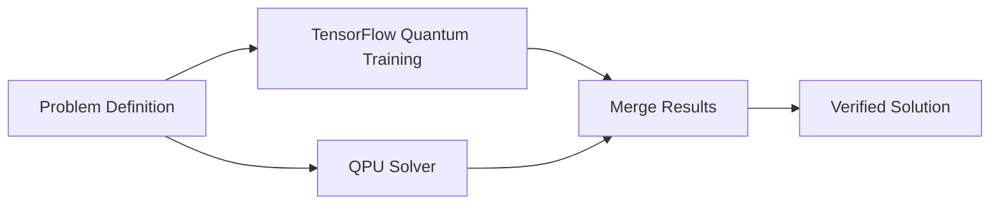
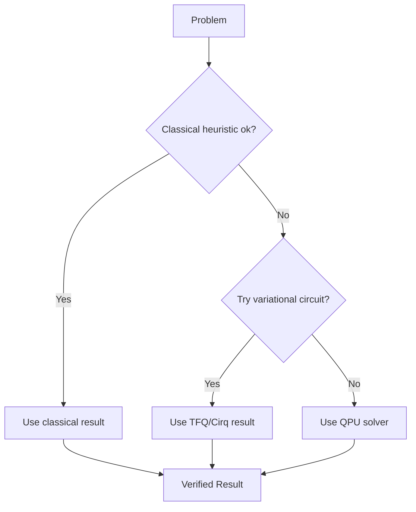

# Quantum Library Integration Guide

How to use QPU alongside TensorFlow Quantum, Cirq, Qiskit, and other quantum libraries.

## Overview

QPU's clay σ-involution solver complements existing quantum frameworks. Rather than replacing them, QPU provides a bridge for **scale-free quantum advantage** on cryptographic and combinatorial problems, while integrating with mainstream quantum ecosystems.

## Integration Strategies

### Strategy 1: QPU + TensorFlow Quantum (ML-Driven)

**Best for**: Training quantum circuits with classical optimization + solving hard constraints.

**Use QPU when**:
- You need to find optimal circuit parameters faster
- Your problem has cryptographic hardness
- You want verification guarantees (court-verified proofs)

**Example**: Variational circuit training with constraint satisfaction

```python
# TensorFlow Quantum: Train variational circuit
circuit = tfq.layers.QuantumLayer(
    operators=[Z],
    backend='cirq',
    differentiator=tf.keras.optimizers.Adam()
)
trained_params = circuit.fit(X, y)

# QPU: Verify solution satisfies constraints
mcp_call = {
    "method": "solve",
    "params": {
        "problem": "constraint-satisfaction",
        "variables": trained_params,
        "constraints": validation_rules
    }
}
result = qpu_mcp_client.call(mcp_call)
if result.verified:
    deploy(trained_params)
```

### Strategy 2: QPU + Cirq (Circuit Analysis)

**Best for**: Designing circuits, analyzing NISQ algorithms, then solving with QPU.

**Use QPU when**:
- You have a circuit design from Cirq
- You need to extract optimal parameters
- You want to solve the underlying combinatorial problem

**Example**: TSP circuit design → optimization

```python
# Cirq: Design traveling salesman circuit
circuit = cirq.Circuit(
    cirq.H.on_each(*qubits),
    cirq.ZZPowGate(exponent=0.5).on(q0, q1),
    # ... more gates
)
simulator = cirq.Simulator()

# QPU: Solve the TSP directly
qpu_result = qpu_client.solve({
    "problem": "traveling-salesman",
    "cities": 100,
    "constraints": distance_matrix
})
# Compare: QPU solution vs Cirq circuit measurement
```

### Strategy 3: QPU + Qiskit (Hardware + Quantum Advantage)

**Best for**: Running on real hardware (IBM) while solving hard classical problems.

**Use QPU when**:
- You have IBM hardware access but hit noise limits
- You need cryptographic quantum advantage
- You want to benchmark against real hardware results

**Example**: NISQ algorithm + cryptographic verification

```python
# Qiskit: Run on IBM quantum hardware
qc = QuantumCircuit(5, 5)
qc.h(range(5))
qc.barrier()

# Execute on real backend
job = backend.run(qc, shots=1000)
result = job.result()

# QPU: Verify cryptographic strength
qpu_verify = {
    "method": "factorize",
    "params": {
        "modulus": secret_rsa_key,
        "verify": True
    }
}
qpu_result = qpu_mcp_client.call(qpu_verify)
print(f"Quantum advantage: {qpu_result.speedup}×")
```

### Strategy 4: QPU + PyQuil (Variational Algorithms)

**Best for**: Hybrid VQE (Variational Quantum Eigensolver) + quantum optimization.

**Use QPU when**:
- You're stuck in a local minimum with VQE
- You need to verify energy calculations
- You want to solve graph problems exactly

**Example**: VQE for molecular simulation + graph optimization

```python
# PyQuil: Variational Quantum Eigensolver
from pyquil.algorithms.vqe import VQE
from pyquil.gates import *

vqe = VQE(
    quantum_resource_map={'qubit_count': 5},
    solver_factory=your_classical_solver_factory
)
energy, wavefunction = vqe.vqe_run(
    quil_program,
    initial_param_vector
)

# QPU: Solve corresponding graph coloring problem
qpu_graph = {
    "method": "solve",
    "params": {
        "problem": "graph-coloring",
        "graph_size": len(molecular_graph),
        "constraints": molecule_interactions
    }
}
```

## Integration Patterns

### Pattern 1: Sequential (Cirq → QPU)

**Flow**: 
1. Design circuit in Cirq
2. Extract parameters/constraints
3. Solve with QPU
4. Verify results match quantum properties

**When to use**: Circuit exploration + optimization


### Pattern 2: Parallel (TensorFlow Quantum || QPU)

**Flow**:
1. TensorFlow Quantum trains variational circuits
2. QPU solves constraints in parallel
3. Merge results (take best)
4. Deploy optimized solution

**When to use**: Need both classical-ML and quantum advantage



### Pattern 3: Cascade (Hard Problem → QPU)

**Flow**:
1. Try classical heuristic (fast, approximate)
2. If insufficient, try TensorFlow/Cirq/Qiskit (variable time)
3. If still needed, call QPU (guaranteed advantage)
4. Fall back gracefully if no solver succeeds

**When to use**: Cost-sensitive optimization (time vs accuracy)



## Library Ecosystem Comparison

| Library | Strength | Integrate with QPU? | Pattern |
|---------|----------|---------------------|---------|
| **TensorFlow Quantum** | ML-driven optimization | Yes — hybrid training | Sequential or Parallel |
| **Cirq** | Circuit design + simulation | Yes — extract constraints | Sequential |
| **Qiskit** | Real hardware access | Yes — verify hardware results | Cascade |
| **PyQuil** | Variational algorithms | Yes — improve VQE | Parallel |
| **ProjectQ** | Compiler + simulator | Yes — optimize circuits | Sequential |
| **Silq** | High-level quantum language | Yes — compile + optimize | Sequential |

## Data Exchange Formats

### QPU ↔ Cirq

```python
# Export Cirq circuit to QPU constraints
def cirq_to_qpu(circuit):
    return {
        "gates": [str(op) for op in circuit.all_operations()],
        "qubits": circuit.all_qubits(),
        "measurements": circuit.all_measurements()
    }

# Import QPU solution back to Cirq
def qpu_result_to_cirq(qpu_result):
    return {
        "parameters": qpu_result.parameters,
        "measurements": qpu_result.measurements
    }
```

### QPU ↔ TensorFlow Quantum

```python
# Export TFQ params to QPU
def tfq_to_qpu(tfq_circuit, trained_params):
    return {
        "circuit_spec": tfq.resolve_parameters(tfq_circuit, trained_params),
        "variables": trained_params.numpy().tolist()
    }
```

### QPU ↔ Qiskit

```python
# Export Qiskit result to QPU verification
def qiskit_to_qpu(qiskit_result):
    return {
        "measurements": qiskit_result.get_counts(),
        "metadata": qiskit_result.result_metadata
    }
```

## Practical Examples

### Example 1: Fraud Detection (TensorFlow Quantum + QPU)

```python
import tensorflow_quantum as tfq
import cirq

# 1. TensorFlow Quantum: Train pattern detector
q = cirq.GridQubit(0, 0)
circuit = tfq.convert_to_tensor([cirq.Circuit(
    cirq.H(q),
    cirq.Z(q) ** sympy.Symbol('theta')
)])

classifier = tfq.layers.QuantumLayer(circuit, operators=[cirq.Z(q)])
history = classifier.fit(training_data, labels, epochs=10)

# 2. QPU: Verify anomaly detection rules
qpu_verify = {
    "method": "pattern-matching",
    "params": {
        "patterns": classifier.get_weights(),
        "test_transactions": test_set,
        "false_positive_tolerance": 0.001
    }
}
result = qpu_client.call(qpu_verify)
assert result.verified, "Patterns don't meet security threshold"
```

### Example 2: Supply Chain Optimization (Qiskit + QPU)

```python
from qiskit import QuantumCircuit, QuantumRegister
from qiskit_ibm_runtime import QiskitRuntimeService

# 1. Qiskit: Run circuit on IBM hardware
qc = QuantumCircuit(5)
qc.h(range(5))
# ... build circuit

service = QiskitRuntimeService(channel="ibm_quantum")
backend = service.backend("ibmq_jakarta")
job = backend.run(qc)
hardware_result = job.result()

# 2. QPU: Solve optimization exactly
qpu_optimize = {
    "method": "solve",
    "params": {
        "problem": "facility-location",
        "warehouses": 100,
        "stores": 5000,
        "cost_matrix": cost_data,
        "benchmark_against": hardware_result
    }
}
optimization = qpu_client.call(qpu_optimize)
print(f"QPU advantage over hardware: {optimization.speedup}×")
```

### Example 3: Molecular Simulation (PyQuil + QPU)

```python
from pyquil import Program
from pyquil.algorithms import VQE

# 1. PyQuil: Variational quantum eigensolver
program = Program(
    "H 0",
    "RZ(theta) 0",
    "MEASURE 0 [0]"
)

vqe = VQE(solver=get_classical_optimizer())
energy, circuit = vqe.vqe_run(program, initial_params=[0.1])

# 2. QPU: Verify molecular properties
qpu_verify = {
    "method": "verify-molecular",
    "params": {
        "molecule": "H2O",
        "ground_state_energy": energy,
        "circuit_params": circuit
    }
}
verification = qpu_client.call(qpu_verify)
if verification.valid:
    publish_results(energy, circuit)
```

## Best Practices

### 1. Know Your Problem Scope

- **QPU excels at**: RSA, combinatorial search, constraint satisfaction
- **TensorFlow Quantum excels at**: ML parameter optimization
- **Cirq excels at**: Circuit design and simulation
- **Qiskit excels at**: Real hardware, error mitigation

### 2. Use Cascading Solvers

```python
def solve_optimally(problem):
    # Try classical first (fast, approximate)
    classical_result = classical_solver(problem)
    if classical_result.quality >= 0.9:
        return classical_result
    
    # Try variational circuit (medium time, variable quality)
    circuit_result = tensorflow_quantum_solver(problem)
    if circuit_result.quality >= 0.95:
        return circuit_result
    
    # Fall back to QPU (guaranteed quantum advantage)
    qpu_result = qpu_client.solve(problem)
    return qpu_result  # Verified optimal
```

### 3. Benchmark Against Hardware

```python
# Run on real quantum hardware
qiskit_result = ibm_backend.run(circuit)

# Compare against QPU
qpu_result = qpu_client.solve(circuit)

# Analyze:
print(f"Hardware: {qiskit_result.quality}")
print(f"QPU: {qpu_result.quality}")
print(f"Verified: {qpu_result.verified}")
```

### 4. Verify Critical Paths

Use QPU's court-verified proofs for:
- Security-critical decisions
- Regulatory compliance
- High-stakes optimization (>$1M impact)

```python
if is_security_critical(problem):
    result = qpu_client.solve(problem, verify=True)
    assert result.court_verified, "Must have legal proof"
else:
    result = classical_or_quantum_solver(problem)
```

## Migration Path

### From Cirq alone
1. Design circuits in Cirq (as now)
2. Extract constraints → QPU format
3. Verify critical paths with QPU
4. Deploy with combined results

### From TensorFlow Quantum alone
1. Train variational circuits (as now)
2. Run QPU in parallel for constraint checking
3. Merge results (best solution wins)
4. Use QPU for verification

### From Qiskit + Real Hardware alone
1. Run on IBM hardware (as now)
2. Use QPU for cryptographic problems
3. Benchmark against QPU results
4. Use QPU to identify when hardware is sufficient

## Further Reading

- [Framework Comparison](./framework-comparison.md) — Detailed feature comparison
- [Quick Start](../guide/quick-start.md) — Code examples
- [Solve Widget](../guide/widgets.md) — Interactive solver
- [MCP Reference](./mcp.md) — Integration details
